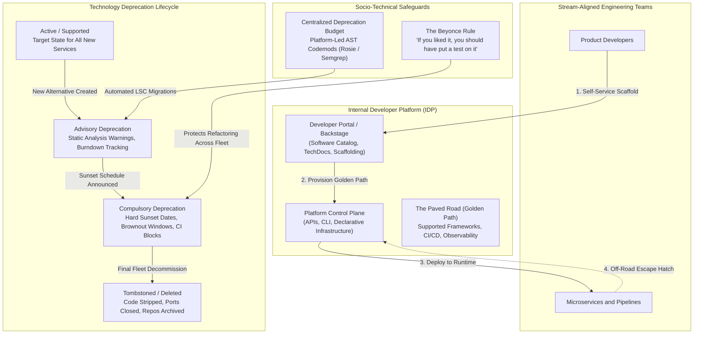

# Platform Engineering, Paved Roads, and Technology Deprecation

> [!summary] Claim:
> Internal Developer Platforms operationalize the Paved Road by treating infrastructure as an evolving product, reducing extraneous cognitive load through self-service golden paths without eliminating developer autonomy.
> Technology deprecation succeeds at enterprise scale only when transitioning deliberately from advisory warnings to compulsory sunsets, governed by centralized deprecation budgets and automated codemod campaigns.
> Under the Beyonce Rule, platform teams safely refactor and modernize shared code across thousands of consumers because only contractually tested invariants are protected against breaking changes.



## The Mechanism

Platform engineering addresses the socio-technical breakdown that occurs when software organizations grow beyond several hundred engineers.
In a small startup, direct coordination and informal conventions suffice to align architectural choices.
As an engineering fleet scales to thousands of developers across hundreds of autonomous teams, unconstrained autonomy leads to ecosystem fragmentation, uncoordinated migrations, compounding technical debt, and catastrophic developer friction.
Resolving this pathology requires three tightly coupled architectural mechanisms: Internal Developer Platforms treating infrastructure as a product, the Paved Road governance model, and structured technology deprecation anchored by the Beyonce Rule.

### 1. Internal Developer Platforms and Platform-as-a-Product

The Cloud Native Computing Foundation (CNCF) TAG App Delivery Platforms White Paper (v1.0) defines a platform for cloud-native computing as "an integrated collection of capabilities defined and presented according to the needs of the platform's users"; it speaks of "internal platforms" rather than using the term Internal Developer Platform (IDP), which this note uses for the self-service layer over infrastructure, build systems, deployment pipelines, and cloud services.
The first attribute the white paper lists for such a platform is "Platform as a product."
Rather than treating internal tooling as a reactive help desk or an ad-hoc collection of shell scripts, the platform team treats internal developers as customers.
The platform team conducts user research, measures adoption, manages a formal product roadmap, and optimizes developer satisfaction and flow efficiency as quantified by DORA and SPACE frameworks ([[Developer-Productivity-Metrics-DORA-SPACE-and-GSM]]).

```
+-----------------------------------------------------------------------+
|                    Developer Portal (Backstage)                       |
|   +-------------------+  +-------------------+  +-----------------+   |
|   | Software Catalog  |  | Scaffolder/Wizard |  | TechDocs Engine |   |
|   +-------------------+  +-------------------+  +-----------------+   |
+-----------------------------------------------------------------------+
                                   |
                                   v
+-----------------------------------------------------------------------+
|                    Platform Control Plane & APIs                      |
|   +-------------------+  +-------------------+  +-----------------+   |
|   | Service Templates |  | Telemetry Policy  |  | Security Guards |   |
|   +-------------------+  +-------------------+  +-----------------+   |
+-----------------------------------------------------------------------+
                                   |
                                   v
+-----------------------------------------------------------------------+
|                   Underlying Infrastructure & Delivery                |
|   +-------------------+  +-------------------+  +-----------------+   |
|   | Compute (K8s/IaaS)|  | Build/CI Pipeline |  | Cloud Datastores|   |
|   +-------------------+  +-------------------+  +-----------------+   |
+-----------------------------------------------------------------------+
```

Platform-as-a-Product is grounded in Cognitive Load Theory, formulated by educational psychologist John Sweller in 1988, extended to the intrinsic, extraneous, and germane taxonomy by Sweller, van Merrienboer, and Paas in 1998, and applied to software organizations by Matthew Skelton and Manuel Pais in Team Topologies (2019).
A human engineer's working memory is strictly finite.
Cognitive load is categorized into three distinct domains:

1. Intrinsic Cognitive Load: The mental effort required to understand the fundamental business logic and domain rules of the application (for example, pricing a derivative contract, calculating sales tax, or routing a payments transaction).
Intrinsic load represents the core value-producing activity of a stream-aligned team and cannot be eliminated.

2. Extraneous Cognitive Load: The mental effort wasted on non-essential operational friction, confusing interfaces, environment configuration, boilerplate generation, and pipeline plumbing (for example, debugging 400-line Kubernetes YAML manifests, resolving IAM permissions, or untangling incompatible build tool flags).
Extraneous load is pure organizational waste.

3. Germane Cognitive Load: The mental effort dedicated to learning, architecting robust systems, optimizing design patterns, and mastering high-leverage skills.

When a platform is absent or poorly designed, extraneous cognitive load consumes the vast majority of an engineer's working memory.
This leaves zero headroom for germane load, degrading code quality, slowing delivery cadence, and inducing developer burnout.
An IDP systematically strips away extraneous cognitive load by wrapping complex multi-cloud and internal infrastructure behind clean, self-service interfaces.
The platform team operates primarily in the X-as-a-Service interaction mode, supplemented by the Facilitating mode (usually through an Enabling team) to onboard and train stream-aligned teams; Team Topologies names three interaction modes (Collaboration, X-as-a-Service, Facilitating) and four team types (Stream-aligned, Enabling, Complicated Subsystem, Platform).

### 2. The Paved Road (Golden Path) Model

Used at Netflix, whose "Full Cycle Developers at Netflix" post (2018-05-17) describes a "paved road" set of tools and practices that are formally supported by centralized teams, with adoption encouraged rather than mandated, and popularized as Golden Paths by Spotify, which defines the Golden Path as "the 'opinionated and supported' path to 'build something'" (Niemen, 2020), the Paved Road is an opinionated, supported, and automated route for building, deploying, and operating software services.
A Paved Road pre-integrates every tool required for production readiness: language runtimes, build rules, testing frameworks, CI/CD workflows, secret management, distributed tracing, structured logging, RPC protocols, and telemetry dashboards.

The fundamental rule of the Paved Road is that it is the path of least resistance, not an inescapable mandate.
The socio-technical contract balances developer autonomy with organizational standards through the principle of Freedom and Responsibility:

- Staying on the Paved Road: When an application uses the platform-supported language, framework, and deployment pipeline, the platform team guarantees first-class support.
Security vulnerabilities in base images are automatically patched by platform automation.
Core libraries are continuously updated.
Observability, compliance, and disaster recovery configurations are satisfied by default.
Zero custom infrastructure engineering is required from the product developers.

- Stepping off the Paved Road (Off-Roading): When a product team encounters genuine technical constraints that the Paved Road cannot satisfy (for example, ultra-low latency kernel-bypass networking in C, an exotic machine learning model requiring specialized GPU drivers, or an experimental database engine), the team retains the freedom to build custom infrastructure.
However, stepping off the Paved Road means the product team assumes full operational responsibility for the entire lifecycle of their stack.
The team must write their own CI pipelines, maintain custom Dockerfiles, manage security patches, rotate credentials, build custom monitoring integrations, and handle 24/7 on-call escalations without claiming platform team incident SLAs.

By making the supported path extraordinarily efficient, reliable, and frictionless, most engineering teams voluntarily remain on the Paved Road; no primary source publishes a canonical adoption percentage, so treat any such figure as a local target to be measured.
This voluntary convergence achieves enterprise standardization without the demotivating friction and productivity paralysis of bureaucratic architecture review boards.

### 3. The Technology Deprecation Lifecycle

Every software technology, library, framework, and protocol inevitably reaches obsolescence.
Without a structured deprecation process, old systems never die; they linger indefinitely as "zombie infrastructure," consuming maintenance hours, creating security vulnerabilities, and fragmenting the codebase.
Software Engineering at Google (Chapter 15, written by Hyrum Wright) distinguishes advisory from compulsory deprecation and groups deprecation tooling into discovery, migration, and preventing backsliding; it does not define numbered stages.
This note organizes that material into a four-phase lifecycle:

```
[ Active / Supported ]
         |
         | (Replacement GA, Migration Path Validated)
         v
[ Advisory Deprecation ] ---- (Static Analysis Warnings, Documentation)
         |
         | (Hard Sunset Announced, Migration Automation Executed)
         v
[ Compulsory Deprecation ] -- (Brownouts, CI Failures, Endpoint Blackholing)
         |
         | (Zero Production Traffic, All Artifacts Deleted)
         v
[ Tombstoned / Deleted ]
```

#### Advisory Deprecation

An advisory deprecation communicates intent without enforcing migration deadlines.
The platform team marks a library, API, or service as obsolete, directs consumers to the modern replacement, and documents the migration path.
In code, this is signaled via compiler attributes (`[[deprecated]]`, `#[deprecated]`), runtime warnings, or static analysis rules.

Advisory deprecation serves exactly one valid operational purpose: discouraging new adoption.
When integrated into presubmit static analysis platforms such as Tricorder ([[Static-Analysis-at-Scale-Tricorder-and-Autofix]]), the linter blocks any new pull request that introduces a fresh dependency on an advisory-deprecated symbol.

However, advisory deprecations rarely drive existing consumers to migrate away from legacy systems.
Chapter 15 reports Google's experience that advisory deprecation "can lead to (slightly) fewer new uses of an obsolete system, but it rarely leads to teams actively migrating away from it," and that it "should not be counted on to do the majority of migration work."
Product engineers are held accountable for shipping customer-facing features.
When given the choice between building a quarterly product commitment and undertaking an un-deadline-backed refactoring of a working system, product engineers will rationally defer the migration indefinitely.
Leaving systems in an advisory deprecation state indefinitely creates a permanent "split-brain" architecture where the platform team is forced to maintain both v1 and v2 concurrently, doubling operational overhead.

#### Compulsory Deprecation

A compulsory deprecation is an active, policy-backed migration campaign bounded by a firm sunset date.
After the sunset date passes, the deprecated technology ceases to function: the legacy API endpoint is disconnected, the old compiler version is removed from the build cluster, or the deprecated library is physically deleted from the source repository.

Executing a compulsory deprecation without organizational revolt requires rigorous adherence to the deprecation covenant:
1. Production Readiness of Successor: The modern replacement must be generally available (GA), hardened in production, and demonstrably superior in performance, reliability, or security.
2. Complete Parity and Migration Documentation: Every supported capability of the old system must have an explicit equivalent in the new system, accompanied by verified, copy-pasteable migration recipes.
3. Automated Translation Tooling: The platform team must provide automated codemods (AST rewrites) or network compatibility shims that handle the mechanical bulk of the migration.
4. Telemetry and Burndown Visibility: The platform team must operate high-fidelity telemetry tracking every remaining caller, publishing a live, public burndown dashboard.
5. Progressive Brownout Schedule: Before permanent decommissioning, the platform team must execute planned brownout windows to expose dormant, un-instrumented dependencies in staging and production; Chapter 15 describes this as announcing "planned outages of increasing duration in the months and weeks prior to the turndown."
Chapter 15 also requires every deprecation warning to have "actionability and relevance," which is why the covenant pairs warnings with recipes and tooling.

### 4. Deprecation Budgets and Migration Economics

The primary failure mode of enterprise deprecation is the "Unfunded Mandate."
An infrastructure team designs a new logging library, deprecates the previous version, and unilaterally announces that 400 product teams must rewrite their logging calls within six months.
Three months later, the database team deprecates the ORM, the security team deprecates the authentication client, and the build team deprecates the build configuration syntax.
If left unchecked, product teams can spend a large and unmeasured share of their capacity on non-functional migration toil, bringing feature delivery to a halt and generating deep organizational cynicism; Chapter 15 notes that unstaffed compulsory deprecations feel to customer teams like "an unfunded mandate."

To eliminate migration thrash, mature engineering organizations establish a Centralized Deprecation Budget:

$$\text{Fleet Capacity Reserved for Migrations} \le \text{Threshold } \theta \quad (\text{typically } \theta = 0.05 \text{ to } 0.10)$$

An organization caps total non-functional migration toil across all product engineering at a fixed share of sprint capacity; the 5% to 10% range for $\theta$ is this note's own planning assumption for the worked examples, not a published standard.
More importantly, the organization enforces the fundamental economic rule of platform engineering:
The team that initiates the deprecation bears the primary cost of executing the migration.
Chapter 15 states the staffing form of this rule: compulsory deprecations should be "actively staffed by a specialized team through completion," with the expertise sitting in "usually the team responsible for removing the old system entirely."

```
Distributed Migration Model (O(N) Complexity):
Platform Team ----> Mandate ----> 500 Product Teams (Each writes bespoke migration code)
Total Cost: 500 teams x 40 hours = 20,000 engineering hours

Centralized Codemod Model (O(1) Complexity):
Platform Team ----> Writes AST Codemod (Rosie / Semgrep) ----> 500 Teams (Auto-PRs)
Total Cost: 2 platform engineers x 160 hours = 320 engineering hours (98.4% reduction)
```

By leveraging automated Large-Scale Changes (LSCs) and AST refactoring engines ([[Large-Scale-Changes-and-Codemods-Across-Repos]]), a central platform team of two engineers can inspect semantic call graphs ([[Code-Search-and-Semantic-Indexing-at-Scale]]), generate automated transformation patches across 10,000 call sites, and submit validated pull requests to 500 repositories.
The product teams need only review and approve the changes.
This shifts the authoring cost of technology modernization from linear $O(N)$ distributed churn (every consumer writes its own migration) to near-constant $O(1)$ centralized automation; the per-consumer review and rollout cost is still $O(N)$, but with a much smaller constant.

Furthermore, a platform project's Definition of Done must be contractually updated:
A project is not done when the new replacement version is launched.
A project is done only when the deprecated predecessor is completely deleted from the codebase, all backwards-compatibility shims are stripped, and all decommissioned infrastructure is powered down.

### 5. The Beyonce Rule and Invariant Protection

When a platform team executes automated migrations across thousands of consumer codebases, what happens when an automated change accidentally breaks a consumer's application?
Without a clear socio-technical contract, fear of breaking downstream systems paralyzes platform teams, freezing technical debt in place.

Google solved this scaling dilemma through the formulation of the Beyonce Rule, named after the lyrics of the pop song.
Chapter 11 states it as "If you liked it, then you shoulda put a test on it"; Chapter 1 phrases it as "If you liked it, you should have put a CI test on it."

As articulated in Software Engineering at Google (Chapters 1 and 11), the Beyonce Rule defines the contractual boundary of responsibility for system behavior under automated change:

1. The Contract: Infrastructure and platform teams have full organizational authority to refactor, upgrade, migrate, or deprecate any shared library, toolchain, or system across the entire company codebase at will, provided that all existing automated tests pass in CI.
2. The Liability: If an infrastructure change passes all hermetic continuous integration tests ([[Build-and-Test-Latency-Economics-and-Flaky-Tests]]), but unexpectedly breaks an application in staging or production because that application relied on an unasserted, implicit behavior, the platform team is not at fault (Chapter 1: a problem "not surfaced by tests in our Continuous Integration (CI) system ... is not the fault of the infrastructure change").
The product team is entirely responsible for fixing the defect and adding a regression test (Chapter 11: "you are on the hook for fixing it and adding the additional tests").
3. The Protection: If a product team relies on a specific behavior and encodes that expectation in an automated CI test, the platform team cannot merge any change that breaks that test.
The platform team is contractually obligated to either preserve the behavior, update the test in coordination with the consumer, or refactor the consumer's implementation as part of the migration.

The Beyonce Rule operates as the necessary operational counterweight to Hyrum's Law ([[Dependency-Management-Theory-and-Hyrums-Law]]).
Hyrum's Law observes that with a sufficient number of users, every observable attribute of a system (timing quirks, error message formatting, hash iteration order, undocumented side effects) will be depended upon by someone.
If a platform team were held liable for preserving every unasserted observable behavior, all modernization would become impossible.
The Beyonce Rule explicitly draws the boundary: only asserted behaviors constitute a protected API contract.

### 6. Technical Implementation Mechanics Across the Stack

Technology deprecation must be manifested mechanically across compilers, runtime interpreters, API gateways, and build systems.

#### Compiler and Language Mechanics

In compiled languages, deprecation is declared using compiler attributes that feed the diagnostic pipeline.
In ISO C++14 and later (`[dcl.attr.deprecated]`), the standardized syntax is `[[deprecated]]` or `[[deprecated("message")]]`.
Clang parses this attribute into an AST attribute node (`DeprecatedAttr`, visible in `clang++ -Xclang -ast-dump`); GCC records it on the declaration in its own internal tree representation.
During semantic analysis, any reference to a deprecated entity triggers a diagnostic warning under `-Wdeprecated-declarations`, which is on by default (Apple clang 21 prints `warning: 'f' is deprecated: x [-Wdeprecated-declarations]` with no flags).
In presubmit verification, platform teams enforce `-Werror=deprecated-declarations` on new code, turning advisory warnings into compulsory compiler errors.

```cpp
// ISO C++14 Standard Deprecation Attribute
[[deprecated("Use modern_platform::rpc_client::call() instead. Sunset: 2027-01-01.")]]
void legacy_raw_rpc_call(const char* endpoint, const void* payload);
```

In Python, deprecation historically relied on runtime warning emission using the standard `warnings` module:

```python
import warnings

def legacy_fetch_user(user_id: int) -> dict:
    warnings.warn(
        "legacy_fetch_user is deprecated and will be removed in v3.0. Use user_service.get_user() instead.",
        category=DeprecationWarning,
        stacklevel=2,
    )
    return {"id": user_id}
```

The `stacklevel=2` parameter is critical.
By default, `warnings.warn` reports the file and line number where `warnings.warn` was invoked inside the library function (`stacklevel=1`).
Setting `stacklevel=2` instructs the interpreter to walk up the execution call frame to inspect the calling frame, reporting the exact file and line number in the consumer's code where the deprecated function was called.
Since Python 2.7 and 3.2, `DeprecationWarning` is ignored by default to prevent end-user disruption; since Python 3.7 (PEP 565) the default filter list starts with `default::DeprecationWarning:__main__`, so warnings triggered directly by code in `__main__` are shown again while those raised from imported modules stay hidden.
The `unittest` runner and pytest already show `DeprecationWarning` and `PendingDeprecationWarning` by default; other harnesses, and production canaries, must enable deprecation reporting explicitly with `PYTHONWARNINGS="default"` or `-Wd`.
Setting `PYTHONWARNINGS` or `-W` makes pytest skip its own default filters.

Python 3.13 (PEP 702) added `@warnings.deprecated` (not `typing.deprecated`, an option the PEP rejected), which type checkers report statically and which, by default, also emits a runtime `DeprecationWarning` when the decorated object is used (`category` defaults to `DeprecationWarning`, `stacklevel` to 1; `category=None` disables the runtime warning):

```python
from warnings import deprecated  # Python 3.13+; older: from typing_extensions import deprecated (4.5.0+)

@deprecated("Use UserService.get_user() instead. Decommission date: 2027-06-30.")
def fetch_user(user_id: str) -> dict:
    ...
```

Static type checkers such as mypy and pyright inspect the AST, emitting diagnostics whenever a decorated symbol is referenced.
In mypy the `deprecated` error code is an optional check that must be turned on with `--enable-error-code deprecated` (`--report-deprecated-as-note` downgrades it); pyright reports it through `reportDeprecated`, whose default is `"none"` in the off, basic, and standard modes and `"error"` in strict mode (pyright configuration docs, as of 2026-11).

In Rust, the language provides the `#[deprecated]` attribute (`RFC 1270`):

```rust
#[deprecated(
    since = "2.4.0",
    note = "Replaced by `platform_engine::Client::execute`. Will be removed in 3.0.0."
)]
pub fn raw_execute(cmd: &str) -> Result<(), Error> {
    // implementation
}
```

The Rust compiler (`rustc`) processes this during lint analysis.
By default, `deprecated` emits a compiler warning (`#[warn(deprecated)]`).
In strict CI gates, teams promote this to a hard compilation error using `-D deprecated`, `#![deny(deprecated)]` in the crate root, or `deprecated = "deny"` under `[lints.rust]` in `Cargo.toml` (respected by Cargo as of Rust 1.74).
`rustc` does not interpret the `since` string; it is shown in the message.

#### Network and API Layer Mechanics

At the network boundary, deprecation must be communicated across microservices without breaking intermediate HTTP/gRPC parsers.
Two standardized HTTP headers govern this lifecycle:

1. RFC 8594 (`Sunset`, Informational, May 2019): Specifies the date and time when the target resource is expected to become unresponsive.
The ABNF is `Sunset = HTTP-date`, whose preferred form is the IMF-fixdate:
```http
Sunset: Wed, 30 Jun 2027 23:59:59 GMT
```
RFC 8594 mandates no status code after the sunset; it says interactions will likely yield 4xx or 3xx responses, and its example mentions `410 Gone` or a generic `404 Not Found`.
It also registers the `sunset` link relation for a retirement-policy document.

2. RFC 9745 (`Deprecation`, Standards Track, March 2025): A machine-readable declaration that the resource is or will be deprecated.
The value is a Structured Field Item that "MUST be a Date" (RFC 9651 Section 3.3.7), a Unix epoch timestamp prefixed with `@`; the boolean `?1` form of earlier drafts is not valid in the final RFC:
```http
Deprecation: @1798761600
```
(`@1798761600` is 2027-01-01T00:00:00Z.)
RFC 9745 Section 4 requires that the `Sunset` timestamp "MUST NOT be earlier than" the `Deprecation` timestamp, and Section 5 states that "the act of deprecation does not change any behavior of the resource."

These headers are accompanied by `Link` header fields (RFC 8288) directing consumers to successor resources and migration guides; the `successor-version` relation is registered by RFC 5829 and the `deprecation` relation by RFC 9745 Section 3:
```http
HTTP/1.1 200 OK
Content-Type: application/json
Deprecation: @1798761600
Sunset: Wed, 30 Jun 2027 23:59:59 GMT
Link: </api/v2/payments>; rel="successor-version"
Link: <https://platform.internal/docs/migrations/payments-v2>; rel="deprecation"; type="text/html"
```

In gRPC and Protocol Buffers, fields, methods, and messages are annotated with the standard `deprecated` option:
```protobuf
syntax = "proto3";

package billing.v1;

service PaymentService {
  rpc ProcessLegacyPayment (PaymentRequest) returns (PaymentResponse) {
    option deprecated = true;
  }
}
```

`MethodOptions` in `descriptor.proto` declares `optional bool deprecated = 33`, so the option is valid on an `rpc`.
Its effect is generator-specific: the proto3 language guide says of the field option that "in most languages this has no actual effect," that in Java it "becomes a `@Deprecated` annotation," and that for C++ clang-tidy warns on uses of deprecated fields.
Do not rely on `protoc` alone to give every consumer a compiler diagnostic; pair it with static analysis or runtime telemetry.

#### Chaos Deprecation (Scheduled Brownouts)

Dormant, batch, or unmonitored services frequently ignore documentation, emails, and compiler warnings.
To flush out hidden dependencies before permanent decommissioning, platform teams implement scheduled brownouts (chaos deprecation).

During a scheduled brownout, the API gateway or service mesh interceptor dynamically intercepts traffic to the deprecated endpoint during a pre-announced time window, intentionally injecting artificial failures (HTTP `429 Too Many Requests`, HTTP `503 Service Unavailable`, or gRPC `UNAVAILABLE`) or artificial latency delays (e.g. 5,000 ms).
Brownouts escalate in duration over a multi-week schedule:

- Week 1: 5-minute brownout during business hours.
- Week 2: 30-minute brownout.
- Week 3: 2-hour brownout.
- Week 4: 24-hour brownout.
- Week 5: Permanent 100% decommissioning (HTTP `410 Gone`).

Any system that breaks during a brownout is instantly identified in monitoring dashboards, forcing the owning team to prioritize migration before the hard sunset deadline.

---

## Commands and Numbers to Know

The following table provides reference operational thresholds, diagnostic flags, standard HTTP headers, and timing parameters for platform governance and deprecation programs (as of 2026-11, Both).

| Parameter or Command | Default / Standard Value | Target Context | Operational Meaning and Failure Bound |
| :--- | :--- | :--- | :--- |
| `RFC 8594 Sunset Header` | `Sunset: <IMF-fixdate>` | HTTP APIs (Both) | Machine-readable endpoint retirement timestamp; triggers gateway logging. |
| `RFC 9745 Deprecation Header` | `Deprecation: @<unix_ts>` | HTTP APIs (Both) | Standardized Structured Field declaring API obsolescence date. |
| `RFC 8288 Successor Link` | `Link: <uri>; rel="successor-version"` | HTTP APIs (Both) | Programmatic hyperlink pointing clients directly to successor endpoint (relation registered by RFC 5829). |
| `C++ Deprecation Attribute` | `[[deprecated("msg")]]` | C++14+ Compilers (Both) | Emits compiler warning at every call site during semantic AST analysis. |
| `Clang/GCC Fatal Warning` | `-Werror=deprecated-declarations` | C/C++ Toolchains (Both) | Promotes deprecation warnings to fatal compilation errors in presubmit. |
| `Python Runtime Warning Flag` | `PYTHONWARNINGS="default"` | Python 3 Runtime (Both) | Overrides default suppression of `DeprecationWarning` raised outside `__main__`; `unittest` and pytest already show it. |
| `Python Stacklevel Parameter` | `stacklevel=2` | Python Warnings (Both) | Adjusts warning call frame to identify consumer file/line instead of library. |
| `Rust Deprecation Attribute` | `#[deprecated(since, note)]` | Rust Compiler (Both) | Emits `deprecated` compiler lint during `cargo check` and `cargo build`. |
| `Rustc Deny Deprecation` | `-D deprecated` | Cargo / Rustc (Both) | Treats any use of deprecated Rust crate items as a build-breaking error. |
| `Protobuf Field Deprecation` | `option deprecated = true;` | Proto2/Proto3 (Both) | Java gets `@Deprecated`; C++ relies on clang-tidy; in most languages no effect. |
| `Brownout Error Injection Code` | `HTTP 503` or `gRPC 14 (UNAVAILABLE)` | Service Mesh / Gateway | Common status code returned during deliberate brownout windows; no standard mandates one. |
| `Deprecation Capacity Budget` | `5% to 10%` of sprint points | Fleet Planning (Both) | The note's own planning assumption for capping non-functional migration toil imposed on product teams; not a published standard. |
| `Minimum Deprecation Window` | `12 months or 2 releases` (GA CLI elements) | Kubernetes deprecation policy (Both) | Published example: GA user-facing CLI elements "must function after their announced deprecation for no less than 12 months or 2 releases (whichever is longer)"; Beta is 3 months or 1 release (as of 2026-11). Choose an internal window per tier; there is no universal standard. |
| `Rosie / LSC Shard Throttle` | Capped outstanding shards, low priority | Fleet Automation (Both) | SWE at Google Ch. 22: Rosie "caps the number of outstanding shards" and "runs at lower priority"; no published rate. |
| `Paved Road Adoption Target` | Set locally, measured | Platform Metrics (Both) | No published canonical figure; Netflix states adoption is encouraged, not mandated, so the off-road remainder is deliberate. |

---

## Multi-Language Comparison: C++ / Python / Rust

The mechanisms for declaring, detecting, and enforcing technology deprecation differ substantially across programming language paradigms:

| Mechanism / Dimension | ISO C++ (C++14 to C++23) | Python (Python 3.10 to 3.13+) | Rust (Edition 2021 / 2024) |
| :--- | :--- | :--- | :--- |
| **Declaration Syntax** | `[[deprecated("reason")]]`<br/>(ISO C++14 `[dcl.attr.deprecated]`) | `@warnings.deprecated("reason")` (PEP 702, 3.13)<br/>or `warnings.warn(..., stacklevel=2)` | `#[deprecated(since = "x.y", note = "msg")]`<br/>(Rust RFC 1270) |
| **Enforcement Layer** | Compile-time AST semantic analysis | Static: mypy (opt-in) / pyright (PEP 702)<br/>Runtime: `warnings` filter engine | Compile-time `rustc` lint, emitted by stability checking after name resolution |
| **Compiler / Tooling Warnings** | `-Wdeprecated-declarations`<br/>(Enabled by default in Clang/GCC) | Ignored by default outside `__main__`;<br/>shown by `unittest`, pytest, or `PYTHONWARNINGS="default"` | `#[warn(deprecated)]`<br/>(Enabled by default in `rustc`) |
| **Fatal CI Build Failure Flag** | `-Werror=deprecated-declarations` | `PYTHONWARNINGS="error::DeprecationWarning"`<br/>or `pytest -W error` | `-D deprecated`, `#![deny(deprecated)]` in crate root,<br/>or `[lints.rust] deprecated = "deny"` in `Cargo.toml` |
| **Call Site Resolution** | Native AST identifier reference | Requires `stacklevel=2` to walk call stack<br/>past the internal library wrapper | Native AST item resolution; exact span<br/>pointing to call site token |
| **Automated Migration Tooling** | `clang-tidy` modernize AST check,<br/>Clang LibTooling refactoring tool | `LibCST` codemods, Bowler AST refactor,<br/>Semgrep autofix rules | `cargo fix --edition` / `--edition-idioms`,<br/>`rustfix` machine-applicable suggestions |
| **Package / Visibility Controls** | Bazel package `visibility = [...]`,<br/>C++20 module exports | Python module `__all__`, private `_`<br/>naming, Bazel Python visibility | Crate visibility `pub(crate)`, `pub(in super)`,<br/>Cargo feature-gated APIs |
| **Breaking Change Policy** | ABI compatibility guarantee or<br/>Major toolchain migration RFC | PEP 387: warn for >= 2 minor releases<br/>and >= 2 years; 5 years preferred (2025-01-27) | Rust Epoch / Edition system; breaking<br/>syntax gated behind edition transitions |

---

## Worked Example

This note has no lab; the example is a reasoning exercise with hypothetical numbers, and every figure in it is an input or arithmetic, not a measurement.

### Scenario: Fleet-Wide RPC Framework Deprecation

An enterprise engineering organization has the following structural profile:
- Total Engineering Fleet: 3,500 software engineers.
- Microservice Repositories: 1,200 independently deployed services across 180 product teams.
- Codebase Scale: 45,000,000 physical lines of code across C++, Go, and Python.
- Legacy Technology: `LegacyRPC` (an in-house binary RPC protocol built in 2017 using bespoke serialization, lacking HTTP/2 multiplexing, distributed tracing context propagation, and mTLS).
- Modern Paved Road: `ModernRPC` (standard gRPC over HTTP/2, with automated OpenTelemetry injection, mTLS via SPIFFE/SPIRE, and Backstage software template integration).

The organization must decommission `LegacyRPC` to satisfy enterprise-wide zero-trust security mandates and eliminate $4,200,000 in annual legacy compute and network maintenance costs.

```
Step 1: Paved Road Provisioning (Backstage Scaffolders)
           |
Step 2: Advisory Deprecation (Static Analysis & Burndown Dashboard)
           |
Step 3: Centralized Codemod Campaign (AST Transformations under Beyonce Rule)
           |
Step 4: Compulsory Sunset & Progressive Brownout Execution
           |
Step 5: Physical Decommissioning (Tombstoning & Cluster Deletion)
```

#### Step 1: Migration Economic Feasibility Analysis

Before launching the initiative, the Principal Platform Architect models the economic difference between a distributed mandate and a centralized automated campaign:

1. Distributed Mandate Model (The Unfunded Mandate):
- Each of the 1,200 microservice teams is issued a ticket instructing them to migrate their service from `LegacyRPC` to `ModernRPC`.
- Estimated manual migration effort per service: 80 engineer-hours (understanding the new API, rewriting serialization bindings, manual testing, canary deployment).
- Total fleet engineering toil:
$$\text{Fleet Effort} = 1,200 \times 80 = 96,000 \text{ engineer-hours}$$
- Assuming an average loaded engineering cost of $120/hour:
$$\text{Direct Economic Cost} = 96,000 \times 120 = \$11,520,000$$
- Schedule drag: assume the distributed migration reaches only 65% completion after 18 months (an input, not a measured industry figure), leaving 420 services stranded indefinitely and preventing legacy server shutdown.

2. Centralized Codemod Campaign Model:
- A dedicated Platform Migration Pod of 4 senior platform engineers is funded for 4 months (16 weeks).
- The pod constructs an AST refactoring pipeline using Clang LibTooling (for C++) and LibCST (for Python) along with a dual-stack network bridge.
- Central platform engineering effort:
$$\text{Central Effort} = 4 \times 16 \times 40 = 2,560 \text{ engineer-hours}$$
- Automated AST codemods successfully rewrite 1,032 services (86.0% automation rate).
- The remaining 168 complex services (14.0%) require paired manual refactoring with product teams (averaging 30 hours of joint effort per service):
$$\text{Residual Effort} = 168 \times 30 = 5,040 \text{ engineer-hours}$$
- Total organization engineering effort:
$$\text{Total Centralized Effort} = 2,560 + 5,040 = 7,600 \text{ engineer-hours}$$
$$\text{Direct Economic Cost} = 7,600 \times 120 = \$912,000$$
- Net Economic Savings:
$$\text{Net Savings} = \$11,520,000 - \$912,000 = \$10,608,000 \quad (92.1\% \text{ reduction in fleet toil})$$

#### Step 2: Advisory Deprecation and Influx Prevention

The platform team initiates Phase 1: Advisory Deprecation.
The goal is to drive the inflow of new `LegacyRPC` dependencies to zero.

1. Backstage Software Templates:
The Backstage IDP updates all service scaffolding templates.
The button to generate a `LegacyRPC` service is removed.
`ModernRPC` becomes the default and only option for all new microservice generation.

2. Presubmit Linter Gates (Tricorder / Semgrep):
The platform team adds a static analysis rule to the company-wide CI presubmit pipeline:

```yaml
# Semgrep Rule: Banning New LegacyRPC Imports
rules:
  - id: ban-new-legacy-rpc
    patterns:
      - pattern: import legacy_rpc
    message: "LegacyRPC is deprecated under RFC-2026-44. Use modern_rpc instead."
    languages: [python]
    severity: ERROR
    paths:
      exclude:
        # Generated from legacy_rpc_allowlist.txt: one glob per grandfathered service.
        - "services/checkout-gateway/**"
        - "services/ledger-writer/**"
```

A baseline `legacy_rpc_allowlist.txt` records the exact 1,200 existing service paths, and a generator expands it into the rule's `paths.exclude` globs; Semgrep's `exclude` takes target-path globs, so listing the allowlist file itself would only skip scanning that text file.
Any pull request touching an existing allowlisted repository is permitted to merge; any pull request introducing `legacy_rpc` into a new repository fails presubmit immediately.
New adoption drops to zero within 24 hours.

3. Telemetry and Burndown Setup:
The legacy RPC server clusters are instrumented to emit OpenTelemetry counter metrics tagging every incoming request by calling client identity:
`rpc.legacy.inbound_calls{caller_service="checkout-gateway", endpoint="ProcessPayment"}`.
The platform team exposes a live Grafana burndown dashboard tracking the exact number of active clients and daily call volumes.

#### Step 3: Centralized Codemod Execution Under the Beyonce Rule

The Platform Migration Pod executes Phase 2: Centralized Large-Scale Changes ([[Large-Scale-Changes-and-Codemods-Across-Repos]]).

1. Dual-Stack Network Bridge:
The pod deploys an Envoy-based proxy sidecar into the Paved Road mesh that accepts incoming `ModernRPC` gRPC calls and translates them to `LegacyRPC` binary frames, and vice versa.
This decouples client migrations from server migrations: a client can upgrade to `ModernRPC` without waiting for the downstream server to migrate.

2. Automated AST Transformation:
The platform team writes a LibCST transformer for Python services that rewrites boilerplate client declarations:

```python
# Before (LegacyRPC client invocation)
import legacy_rpc
client = legacy_rpc.Client("payment-service:8080")
resp = client.call_method("Charge", payload={"amount": 100})

# After (ModernRPC client invocation generated by LibCST)
import modern_rpc
client = modern_rpc.Client("payment-service:8080")
resp = client.Charge(modern_rpc.ChargeRequest(amount=100))
```

3. Sharded PR Submission and the Beyonce Rule:
The migration pod batches the automated changes into shards of 25 repositories per day.
In each repository, the CI presubmit suite runs the full test battery:
- In 1,032 repositories, all hermetic unit and integration tests pass.
Under the Beyonce Rule, the platform team merges these changes automatically or requests fast-track approvals from code owners ([[Code-Review-and-Readability-Systems-at-Scale]]).
- In 42 repositories, downstream tests fail because the consumer application asserted a custom mock on `legacy_rpc.Client.call_method`.
Because an automated test existed and asserted this behavior, the platform team is bound by the Beyonce Rule to fix the mock integration before merging.
- In 126 repositories, complex dynamic serialization patterns require paired manual refactoring with product owners.

After 12 weeks of automated execution, active `LegacyRPC` services decrease from 1,200 to 45.

#### Step 4: Compulsory Sunset, Progressive Brownouts, and Decommissioning

With 96.25% of the fleet successfully migrated, the remaining 45 services represent unmaintained, dormant applications whose owners have ignored emails and ticket notifications.
The platform team activates Phase 3: Compulsory Deprecation.

1. Announcement of Sunset Schedule:
A hard sunset date is locked 30 days out.
All remaining service owners receive notifications linking directly to the burndown dashboard.

2. Progressive Brownouts (Chaos Deprecation):
The platform team configures the legacy RPC gateway to inject synthetic drops for legacy traffic:
- Week 1 (Day 10 before sunset): A 5-minute brownout at 10:00 UTC rejecting all `LegacyRPC` traffic with the protocol's unavailable error (the bespoke equivalent of gRPC status 14 `UNAVAILABLE`; gRPC codes do not apply to a non-gRPC wire format).
Two unmonitored cron jobs fail; their owning teams investigate the alert and execute their pending migrations.
- Week 2 (Day 5 before sunset): A 30-minute brownout at 14:00 UTC.
An orphaned internal analytics dashboard breaks.
The owning team deploys the pre-generated modern RPC pull request.
- Day 1 before sunset: A 2-hour brownout.
Zero critical alerts trigger; the burndown dashboard shows remaining active `LegacyRPC` traffic has dropped to zero RPS.

3. Final Decommissioning (Tombstoning):
On Day 0, the sunset date arrives:
- The legacy RPC network load balancers are permanently deleted.
- The `legacy_rpc` library code is deleted from the monorepo via a final clean-up pull request.
- The `legacy_rpc_allowlist.txt` file is purged from the static analysis engine.
- The legacy backend server instances are de-provisioned, reclaiming $4,200,000 in annual infrastructure cloud spend.
The migration is complete.

---

## Pitfalls

> [!warning] Pitfall: Advisory Abandonment and the Split-Brain Fleet
> Marking a library or API as advisory-deprecated without establishing a funded sunset date and automated migration tooling guarantees permanent architectural divergence.
> New developers avoid the legacy tool, but existing services never migrate, forcing platform engineers to maintain dual stacks, duplicate security patches, and maintain dual telemetry pipelines indefinitely.
> Advisory deprecation must always be treated as an intermediate, time-bounded phase (maximum 90 to 180 days) leading directly to compulsory execution.

> [!warning] Pitfall: The Unfunded Mandate and Platform Revolt
> Issuing a compulsory deprecation deadline while forcing product teams to manually write migration code shifts platform maintenance costs onto product roadmaps.
> When multiple infrastructure teams issue uncoordinated migration mandates simultaneously, product development freezes, engineering velocity metrics collapse, and product leadership initiates organizational escalation to bypass platform standards.
> Platform teams must bear the primary cost of migration by providing automated AST codemods, shims, or direct engineering staffing.

> [!warning] Pitfall: Paved Road Imperialism and Missing Escape Hatches
> Treating the Paved Road as a mandatory prison by outlawing all off-road development destroys engineering innovation and drives critical projects underground.
> Teams with legitimate, specialized domain constraints (such as high-frequency trading engines, embedded firmware, or novel ML architectures) cannot fit into generic web-tier templates.
> Platform engineering must explicitly preserve the Freedom and Responsibility escape hatch: teams may go off-road if they accept full operational, security, and maintenance ownership of their stack.

> [!warning] Pitfall: Invisible Runtime Warnings and Silent Log Sinks
> Relying on runtime logging (`logger.warn("This API is deprecated")`) to communicate deprecation fails completely in enterprise microservice environments.
> Production application logs generate gigabytes of unstructured data per second; developer teams rarely inspect standard error streams unless an active production outage occurs.
> Deprecation notices must be delivered at compile-time or type-check-time (`[[deprecated]]`, `@warnings.deprecated`), at presubmit review-time (static analysis gates), or via machine-readable HTTP/gRPC headers (`Sunset`, `Deprecation`) aggregated into centralized observability dashboards.

> [!warning] Pitfall: Violating the Beyonce Rule Through Untested Implicit Invariants
> Pausing a platform migration because an unasserted, undocumented implementation quirk broke a downstream consumer creates total migration paralysis.
> Under Hyrum's Law, every change will alter some observable behavior.
> If a product team demands that a platform team preserve an undocumented behavior that was never asserted in an automated CI test, the platform lead must hold the line: under the Beyonce Rule, unasserted behaviors are non-contractual, and the consumer owns the remediation.

> [!warning] Pitfall: Brownout Exceptions and Slipping Sunset Deadlines
> Granting indefinite brownout exemptions or repeatedly moving sunset dates when consumers fail to meet deadlines completely destroys the platform team's organizational credibility.
> If product teams learn that a sunset deadline is negotiable, they will routinely deprioritize future deprecation campaigns.
> Sunset dates must be treated as immutable production release gates, backed by executive sponsorship and clear escalation paths.

---

## At Scale

The operational dynamics and governance structures of platform engineering and technology deprecation evolve fundamentally as an organization scales across orders of magnitude:

```
[ 10-50 Engineers ]    --> Ad-hoc conventions, direct pairing, shared templates
[ 50-500 Engineers ]   --> Dedicated platform team, Backstage portal, advisory tracking
[ 500-5,000 Engineers] --> Platform-as-a-Product, centralized budgets, LSC codemods, strict Beyonce Rule
[ 5,000-50,000+ Eng ]  --> Federated platform domains, self-service infrastructure APIs, automated brownouts
```

### Scale Trade-Offs

#### Single Developer to 50 Engineers
- Governance Model: Informal consensus and shared code review conventions.
A dedicated platform team is an anti-pattern at this stage; it introduces unnecessary organizational boundaries and communication overhead.
- Paved Road: A collection of shared repository starter kits, Dockerfiles, and CI configuration templates stored in git.
- Deprecation Strategy: Immediate, direct refactoring.
Because the codebase is small and ownership is concentrated, an engineer can change an API and update all 15 calling locations in a single afternoon commit.
The Beyonce Rule is informal: engineers run the local test suite before pushing.

#### 50 to 500 Engineers
- Governance Model: Formation of the first formal Platform Engineering team.
The team operates in an Enabling and X-as-a-Service mode, establishing the initial Backstage software catalog and standard service templates.
- Paved Road: Standardized base images, golden CI/CD pipelines, and unified observability stacks.
Teams stepping off the Paved Road require informal review from senior architects.
- Deprecation Strategy: Advisory deprecation tracking begins.
The platform team uses static analysis (linters) to prevent new adoptions of obsolete libraries.
Migrations are scheduled during quarterly planning, but distributed execution begins to show signs of friction and schedule slippage.

#### 500 to 5,000 Engineers
- Governance Model: Formal Platform-as-a-Product organization with dedicated Platform Product Managers (PMs).
Platforms are evaluated against developer Net Promoter Scores (NPS), system availability, and DORA lead times.
- Paved Road: Highly opinionated Golden Paths integrated into self-service developer portals.
Service scaffolding is completely automated: clicking a button in Backstage provisions git repositories, cloud infrastructure, DNS, CI pipelines, and alerting rules in under five minutes.
Off-roading is governed by formal Freedom and Responsibility charters.
- Deprecation Strategy: Mandatory centralized deprecation budgets.
The platform team owns the execution of deprecations via automated Large-Scale Changes (LSCs), writing semantic AST transformations and managing batch PR submissions.
The Beyonce Rule is strictly enforced: any asserted test is protected; unasserted breakages are resolved by consumers.
Compulsory sunset schedules include automated brownouts.

#### 5,000 to 50,000+ Engineers
- Governance Model: Federated platform engineering organization spanning multiple platform divisions (Core Infrastructure, Developer Experience, Security Engineering, Data Platforms).
Platform APIs are treated with the same engineering rigor as external public cloud APIs.
- Paved Road: Declarative Internal Developer Platforms (such as Kratix or Crossplane) where platform capabilities are defined as Kubernetes Custom Resource Definitions (CRDs) or declarative graph schemas.
Golden paths span polyglot ecosystems (C++, Java, Go, Rust, Python, TypeScript).
- Deprecation Strategy: Continuous, algorithmic deprecation pipelines.
Automated bots continuously scan semantic dependency graphs ([[Code-Search-and-Semantic-Indexing-at-Scale]]), generate AST patches, validate changes against massive distributed test automation farms, and orchestrate progressive brownouts across global regions without manual human intervention.
Deprecation governance is integrated into executive risk reporting, tying legacy burndown directly to organizational engineering capital allocation.

### Decision Rules for Platform Investments

To maintain architectural clarity, distinguished engineers apply the following definitive decision rules:

1. When to Pave a Road: Pave a road only when a capability is required by at least three independent stream-aligned teams and represents standard, commoditized infrastructure (e.g. gRPC service skeletons, database access pools, Kafka ingestion pipelines).
Never pave an experimental, unproven technology path.
Let pioneering product teams explore the wilderness first; pave the path only after the route is proven.

2. When to Allow Off-Roading: Approve off-road architecture when a product team presents quantified, empirical requirements that the Paved Road fundamentally cannot satisfy (e.g. sub-microsecond p99 latency SLAs, strict hardware-level isolation, or novel programming language features).
Reject off-road requests driven by personal developer preference or minor aesthetic grievances with standard tooling.

3. When to Make Deprecation Compulsory: Transition a deprecation from advisory to compulsory the moment the modern replacement reaches production feature parity and the platform team possesses the automated tooling or dedicated staffing to execute the migration across at least 80% of calling sites.
Never announce a compulsory sunset without an automated migration path.

---

## Practice Drill

> [!tip] Practice Drill: Designing a Zero-Downtime Deprecation Program
> You are the Principal Engineer leading the Platform Architecture team at a global fintech institution.
> The company operates 2,200 microservices across Kubernetes clusters.
> A mission-critical, un-versioned internal authentication library (`AuthV1`) contains an architectural vulnerability that cannot be patched without breaking the core signature verification API.
> A modern, zero-trust successor (`AuthV2`) has been built and validated.
>
> Your objective is to design and execute a comprehensive deprecation and migration program that completely retires `AuthV1` across all 2,200 microservices within 6 months with zero production downtime and zero uncoordinated product team migration churn.
>
> Formulate an end-to-end execution specification addressing the following structural pillars:
> 1. Presubmit Influx Prevention: Formulate the exact static analysis rule and baseline tracking system required to prevent any new service from importing `AuthV1`.
> 2. Migration Automation Strategy: Detail the technical design of the AST codemod (using Clang LibTooling, LibCST, or Semgrep) and the network-level dual-stack compatibility shim required to allow incremental client/server rollout.
> 3. Contractual Boundary Enforcement: Apply the Beyonce Rule to resolve disputes when automated refactoring pull requests break unasserted consumer behavior in downstream integration environments.
> 4. Progressive Brownout Schedule: Construct a 4-week chaos deprecation schedule specifying exact HTTP/gRPC status codes, duration intervals, traffic percentages, and escalation triggers to flush out dormant callers.
> 5. Burndown Telemetry and SLAs: Define the exact OpenTelemetry metrics, Prometheus alerting queries, and Backstage catalog metadata required to track the burndown to absolute zero.

---

## Interview Questions

### L5: Practical Mechanism and Diagnostics

#### Question 1 (Predict the Output): Python Deprecation Stacklevel Mechanics
Consider an internal platform library providing a helper function that wraps a deprecated legacy configuration parser:

```python
# internal_tools/config_helper.py
import warnings

def _parse_raw_string(raw: str) -> dict:
    warnings.warn(
        "Direct raw string parsing is deprecated; use ConfigModel.from_yaml().",
        category=DeprecationWarning,
        stacklevel=1,
    )
    return {"data": raw.strip()}

def parse_config(raw: str) -> dict:
    return _parse_raw_string(raw)
```

A product developer invokes this library in their application:

```python
# service_app/main.py
from internal_tools.config_helper import parse_config

def start():
    config = parse_config("db_host: localhost")

if __name__ == "__main__":
    start()
```

Both directories are packages (each has an `__init__.py`).
If the program is executed from the project root with `python3 -W default -m service_app.main`, predict the exact file path and line number associated with the emitted warning.
(Running `python3 service_app/main.py` instead puts `service_app/` on `sys.path` and fails with `ModuleNotFoundError: No module named 'internal_tools'`.)
Explain why this behavior impairs fleet-wide deprecation tracking, and provide the exact code modification required to report the warning at the call site in `service_app/main.py`.

> [!success]- Answer
> 1. Predicted Output:
> The warning will be reported at `internal_tools/config_helper.py` on the line inside `_parse_raw_string` where `warnings.warn` is invoked (observed with CPython 3.15.2 on macOS, path prefix elided):
> ```text
> .../internal_tools/config_helper.py:5: DeprecationWarning: Direct raw string parsing is deprecated; use ConfigModel.from_yaml().
>   warnings.warn(
> ```
> Without `-W default` this warning is suppressed, because it is attributed to the imported module `internal_tools.config_helper`, not to `__main__`.
>
> 2. Operational Defect:
> With `stacklevel=1` (the default in Python), the Python interpreter inspects the immediate calling execution frame, which is the internal library function itself.
> When hundreds of different microservices across the enterprise call `parse_config()`, centralized log aggregators will attribute 100% of the deprecation warnings to `config_helper.py:5`.
> This makes it impossible for platform telemetry to identify which product services are actually invoking the deprecated code.
>
> 3. Remediation:
> Because the user calls `parse_config()`, which in turn calls the internal helper `_parse_raw_string()`, the call stack from `warnings.warn` has three frames:
> Frame 0: `_parse_raw_string` (where `warn` is called).
> Frame 1: `parse_config` (internal wrapper).
> Frame 2: `start` in `service_app/main.py` (the actual consumer call site).
>
> Therefore, `stacklevel` must be set to `3`:
> ```python
> warnings.warn(
>     "Direct raw string parsing is deprecated; use ConfigModel.from_yaml().",
>     category=DeprecationWarning,
>     stacklevel=3,
> )
> ```
> Setting `stacklevel=3` instructs Python to walk two frames up the call stack, correctly reporting the warning at the consumer call site (observed with CPython 3.15.2):
> ```text
> .../service_app/main.py:5: DeprecationWarning: Direct raw string parsing is deprecated; use ConfigModel.from_yaml().
>   config = parse_config("db_host: localhost")
> ```
> Because the attributed frame now belongs to `__main__`, the PEP 565 default filter shows this warning even without `-W default`; a consumer that is an imported module still needs `-W default` or a test runner.

#### Question 2: Cognitive Load Theory in Platform Engineering
Explain the three forms of cognitive load in Sweller's framework (Intrinsic, Extraneous, Germane; the taxonomy is from Sweller, van Merrienboer, and Paas, 1998).
In an organization lacking an Internal Developer Platform, how does extraneous cognitive load impact delivery metrics such as DORA Lead Time for Changes?
How does a well-designed Paved Road alter this balance?

> [!success]- Answer
> 1. Three Types of Cognitive Load:
> - Intrinsic Load: The unavoidable mental effort required to solve the domain-specific business problem (e.g. understanding risk models, payment workflows, or accounting ledger rules).
> - Extraneous Load: Mental effort consumed by environment friction, non-standard tools, complex configuration files, manual handoffs, and debugging infrastructure plumbing.
> - Germane Load: High-value mental effort devoted to deep learning, architectural refactoring, performance optimization, and creating reusable design patterns.
>
> 2. Impact on Delivery Metrics:
> When an organization lacks an IDP, developers must manually assemble build scripts, provision cloud resources, write raw infrastructure-as-code manifests, configure monitoring dashboards, and troubleshoot deployment networking.
> Because human working memory is bounded, extraneous cognitive load crowds out both intrinsic and germane processing.
> Developers experience context switching and decision fatigue.
> DORA Lead Time for Changes degrades from hours to weeks because developers spend days resolving infrastructure boilerplate rather than writing business logic.
> Change Failure Rate increases because manually crafted configurations introduce subtle drift and security misconfigurations.
>
> 3. Paved Road Transformation:
> A Paved Road provides pre-integrated, opinionated software templates and automated self-service control planes.
> It drives extraneous cognitive load toward zero by making standard logging, telemetry, security, CI/CD, and deployment completely transparent.
> This frees working memory for germane processing, allowing stream-aligned teams to deliver features rapidly, safely, and predictably.

---

### L6: Systems Architecture and Triage

#### Question 3 (Debug This): Cascading Outage During Deprecation Brownout
A platform engineering team is executing a compulsory deprecation of an unversioned HTTP payment gateway (`/v1/checkout`).
To expose remaining callers, the platform team initiates a 30-minute brownout window, configuring the API gateway to return `HTTP 503 Service Unavailable` with a `Retry-After: 300` header for all requests matching `/v1/checkout`.
Within four minutes of activating the brownout, the entire modern payment platform (`/v2/checkout`) experiences a catastrophic cascading failure: CPU utilization on modern backend clusters spikes to 100%, database connection pools are exhausted, and incoming requests time out across all payment tiers.

Diagnose the root cause of this failure.
Identify why the brownout triggered an outage in the modern system, and formulate the architectural and operational safeguards required to prevent this failure during subsequent deprecation exercises.

> [!success]- Answer
> 1. Root Cause Diagnosis:
> The failure is driven by an unmitigated retry storm and shared infrastructure coupling:
> - Client Retry Storm: Legacy client applications calling `/v1/checkout` were coded with aggressive, un-jittered retry loops (e.g. retrying immediately in a tight while-loop upon receiving an HTTP 503, ignoring the `Retry-After` header).
> This multiplied incoming request volume by an order of magnitude within seconds.
> - Shared Dependency Saturation: Although the API endpoints were separated (`/v1/checkout` vs `/v2/checkout`), both services connected to the same underlying relational database cluster and shared the same upstream ingress proxy tier.
> The flood of retried connections on `/v1/checkout` exhausted the global connection pool and consumed all worker threads on the shared ingress proxies and databases, starving the modern `/v2/checkout` service of compute and database connection slots.
>
> 2. Operational and Architectural Safeguards:
> - Resource and Gateway Isolation: The legacy deprecated gateway must be isolated onto dedicated, rate-limited ingress nodes with physically separated connection pools.
> Traffic destined for deprecated endpoints must never share thread pools, memory limits, or database connection pools with modern production traffic.
> - Rate Limiting and Token Bucket Shedding: The API gateway must enforce strict rate limits on deprecated endpoints during brownouts.
> When a client exceeds its quota, the gateway must drop the connection immediately with an HTTP 429 without traversing internal proxy layers or database connections.
> - Exponential Backoff and Jitter Verification: The platform team must verify client SDK implementations prior to brownouts, ensuring all clients employ exponential backoff with full jitter and honor `Retry-After` headers.
> - Circuit Breaking: Upstream proxies must implement circuit breakers that trip immediately when the error threshold exceeds 10%, cutting off traffic at the perimeter before it impacts shared backends.

#### Question 4: Advisory vs. Compulsory Deprecation Pipeline Design
Describe the architectural design of a continuous deprecation pipeline that transitions an API from initial deprecation to final decommissioning.
How do you mechanically enforce that no new services adopt the deprecated API while tracking a burndown of existing users?
Include the specific roles of static analysis, build visibility, and runtime observability.

> [!success]- Answer
> An effective deprecation pipeline consists of four automated stages:
>
> 1. Stage 1: Declarative Deprecation and Influx Block (Day 0)
> - Developer Portal: The software template catalog (Backstage) is updated to remove the deprecated component from all scaffolding wizards, preventing new projects from selecting it.
> - Build-Level Visibility: In build systems like Bazel, the target's `visibility` attribute is constrained from `["//visibility:public"]` to a fixed package allowlist containing only existing consumers: `visibility = ["//legacy_service_a:__pkg__", "//legacy_service_b:__pkg__"]`.
> Any new package attempting to depend on the target fails during the build analysis phase before compilation begins.
> - Presubmit Static Analysis: Rules in linters (Tricorder, Semgrep) flag any pull request introducing a new import of the deprecated symbol.
> A baseline file records existing usages; new references trigger fatal presubmit check failures.
>
> 2. Stage 2: Runtime Telemetry and Burndown Instrumentation (Days 1 to 60)
> - The deprecated service or library is instrumented to emit OpenTelemetry metrics tagging each caller: `deprecation.invocations{api="legacy_v1", caller_app="service_x"}`.
> - API responses inject standardized HTTP headers: `Deprecation: @<timestamp>` (RFC 9745) and `Sunset: <date>` (RFC 8594).
> - Telemetry streams into a real-time Grafana burndown dashboard, categorizing consumers by organizational business unit, traffic volume, and migration status.
>
> 3. Stage 3: Progressive Brownout Execution (Days 60 to 90)
> - The platform team schedules automated, escalating brownout windows (5 min, 30 min, 2 hours, 24 hours) where the gateway returns HTTP 503 / gRPC UNAVAILABLE to flush out dormant, unmonitored batch clients.
>
> 4. Stage 4: Permanent Cutoff and Tombstoning (Day 90+)
> - The endpoint is permanently disabled (HTTP 410 Gone).
> - Code and configurations are stripped from the repository.
> - DNS records, load balancers, and compute instances are de-provisioned, closing the lifecycle.

---

### L7: Enterprise Economics, Governance, and Invariant Theory

#### Question 5: The Beyonce Rule, Hyrum's Law, and Invariant Boundaries
In a monorepo containing 50,000,000 lines of code, an infrastructure team must upgrade a core string-formatting and logging library used by 12,000 engineers.
Under Hyrum's Law, every observable behavior of this library will be depended upon by downstream callers.
How does the Beyonce Rule operate as an invariant protection mechanism to prevent organizational gridlock?
Under what specific circumstances is the platform team contractually obligated to fix a consumer's codebase, and when is the consumer obligated to absorb the breakage?
What are the failure modes of the Beyonce Rule if test environments lack hermeticity?

> [!success]- Answer
> 1. Invariant Boundary Under the Beyonce Rule:
> Hyrum's Law states that with enough users, every implementation detail (e.g. error string wording, memory allocation order, microsecond execution timing) becomes a de facto contract.
> If an infrastructure team were required to preserve all unasserted observable behaviors, all refactoring and library upgrades would become mathematically impossible.
> The Beyonce Rule resolves this by defining an objective, contractual invariant boundary:
> "If you liked it, then you shoulda put a test on it" (SWE at Google, Chapter 11).
> Only behaviors asserted by hermetic, automated continuous integration tests constitute the protected contractual specification.
> All unasserted observable behaviors are explicitly classified as undefined implementation artifacts that may change without notice.
>
> 2. Contractual Liability Division:
> - Platform Team Obligation: If an automated test in a consumer's codebase was green prior to the infrastructure change, and turns red as a direct result of the change, the platform team cannot merge their refactor.
> The platform team is contractually obligated to either modify their library to preserve the asserted behavior, update the consumer's test in collaboration with the owner, or execute an automated codemod across the consumer's code to restore compliance.
> - Consumer Obligation: If the platform team's change passes all continuous integration tests across the fleet, merges to head, and subsequently breaks an application in production because the application relied on an unasserted side effect, the platform team is completely exonerated.
> The consumer team owns the defect, must remediate their application, and is required to add an automated test to protect the behavior against future upgrades.
>
> 3. Failure Modes from Non-Hermetic Testing:
> The entire social contract of the Beyonce Rule collapses if test suites are non-hermetic or flaky ([[Build-and-Test-Latency-Economics-and-Flaky-Tests]]):
> - False Regressions: If tests fail due to external network calls, environment clock drift, or resource contention, platform teams waste thousands of hours debugging ghost regressions.
> - Cynicism and Bypassing: When platform engineers cannot distinguish real contractual breaks from flaky tests, they are incentivized to disable tests, override CI gates, or abandon modernization initiatives entirely.
> Hermetic, deterministic testing is the foundational prerequisite for the Beyonce Rule.

#### Question 6: Deprecation Budgeting and Migration ROI Modeling
You are the VP of Platform Engineering at an enterprise with 5,000 developers.
Ten different infrastructure teams have published independent deprecation notices, demanding that product teams migrate logging, metrics, databases, RPC clients, and build configurations over the next two quarters.
Product engineering leadership alerts the CTO that product feature delivery will stall for six months.
Formulate a mathematical and organizational framework for a Centralized Deprecation Budget.
How do you calculate the Total Cost of Ownership (TCO) of a migration, determine the allocation of engineering capacity, and enforce that infrastructure teams build automated codemods rather than imposing unfunded mandates?

> [!success]- Answer
> 1. Organizational Deprecation Budgeting:
> The CTO and Platform VP establish a fleet-wide Deprecation Budget Cap ($\theta = 0.08$):
> Product teams may spend a maximum of 8% of total sprint points on non-functional platform migrations.
> With 5,000 developers, the fleet possesses approximately:
> $$\text{Total Fleet Capacity} = 5,000 \times 160 \times 6 = 4,800,000 \text{ hours per half}$$
> $$\text{Maximum Allowed Migration Toil} = 4,800,000 \times 0.08 = 384,000 \text{ engineer-hours}$$
>
> 2. Total Cost of Ownership (TCO) Formula:
> Every proposed deprecation must submit an RFC ([[Playbook-Write-a-Toolchain-Migration-RFC]]) calculating its fleet-wide TCO:
> $$\text{TCO}_{\text{migration}} = C_{\text{platform}} + \sum_{i=1}^{M} \left( H_i \times R_i \right) + C_{\text{risk}}$$
> Where:
> - $C_{\text{platform}}$: Cost of building the successor, automation tooling, and documentation.
> - $M$: Number of downstream consumer applications.
> - $H_i$: Manual engineering hours required by consumer team $i$.
> - $R_i$: Loaded hourly rate of consumer engineering team $i$.
> - $C_{\text{risk}}$: Expected financial loss from incident downtime during migration.
>
> 3. Enforcing Centralized Codemods via Capacity Gating:
> If an infrastructure team proposes an "unfunded mandate" requiring each of the $M = 1,500$ services to spend 40 hours migrating manually:
> $$\text{Consumer Toil} = 1,500 \times 40 = 60,000 \text{ hours}$$
> If ten teams do this, total consumer toil would reach $600,000$ hours, exceeding the $384,000$-hour cap and causing rejection by the Architecture Review Board.
>
> To gain approval, the infrastructure team must invert the economic model:
> The infrastructure team must build automated AST codemods (using Semgrep, Clang LibTooling, or OpenRewrite) and network shims that reduce consumer toil from 40 hours to 1 hour of review per service:
> $$\text{Automated Consumer Toil} = 1,500 \times 1 = 1,500 \text{ hours}$$
> By absorbing the migration cost centrally into the platform team ($C_{\text{platform}} = 500$ hours), consumer toil drops by 97.5% ($1 - 1,500 / 60,000$), and total fleet effort including the platform's 500 hours drops by 96.7% ($1 - 2,000 / 60,000$).
>
> 4. Contractual Definition of Done:
> The platform team's project funding is released in tranches.
> The final 30% of project bonuses and organizational recognition is strictly withheld until 100% of legacy call sites are purged and the deprecated technology is physically deleted from the fleet.

---

### L8+: Enterprise Strategy, Platform Topologies, and Fleet Transformations

#### Question 7: Platform as a Product vs. Platform Dictatorship
A newly appointed Principal Architect at a tier-1 investment bank attempts to standardize the firm's fragmented microservice ecosystem by mandating that all 4,000 developers must exclusively use a single Java Spring Boot framework and a unified Kubernetes cluster.
All other programming languages (including C++ used in low-latency market making and Python used in quantitative research) are declared deprecated and barred from deployment.
Within six months, quantitative trading teams fork internal repositories, deploy services onto unmonitored shadow cloud accounts, and key low-latency engineers resign.

Analyze this organizational failure through the lens of Team Topologies, the CNCF Platform-as-a-Product paradigm, and the Freedom and Responsibility model.
How should a distinguished platform leader restructure the organization's platform strategy to achieve standardization where beneficial while preserving specialized high-performance capabilities?

> [!success]- Answer
> 1. Pathology Analysis: Platform Dictatorship vs Platform as a Product:
> The Principal Architect committed the classic anti-pattern of Platform Dictatorship:
> - Treating internal platforms as a bureaucratic mandate rather than a customer-centric product.
> When a platform is forced upon teams with incompatible requirements, developers treat the platform team as an adversary rather than an enabler.
> - Violating Domain Boundaries and Conway's Law: Quantitative trading and high-frequency market making have fundamentally different intrinsic constraints (sub-microsecond determinism, zero GC pauses, direct kernel bypass) than general web banking tiers (CRUD APIs, horizontal scaling, asynchronous IO).
> Forcing high-frequency trading systems onto a managed JVM and shared Kubernetes cluster destroys their core business competitiveness.
> - Driving Shadow IT: Because engineers remain accountable for business performance, they rationally resort to "off-grid" shadow infrastructure to deliver their targets, creating massive unmonitored security, compliance, and operational risks.
>
> 2. Strategic Realignment Framework:
> A distinguished leader restructures the platform under three pillars:
>
> Pillar A - Multi-Tiered Golden Paths:
> The platform team must establish distinct, domain-appropriate Golden Paths:
> - Tier 1: General Microservices Paved Road (Java/Go, Kubernetes, gRPC, PostgreSQL).
> - Tier 2: Quantitative Research Paved Road (Python, Ray, Jupyter, Ephemeral Compute).
> - Tier 3: Low-Latency Execution Paved Road (C++20, Linux RT kernel, solarflare onload, isolated bare-metal).
> Each path receives dedicated self-service scaffolding, CI pipelines, and observability integrations tailored to its domain requirements.
>
> Pillar B - Freedom and Responsibility (The Escape Hatch Contract):
> The organization formally codifies the off-roading charter:
> Teams are granted the autonomy to build custom technology stacks outside the Golden Paths, under the condition that they sign an operational covenant:
> - The off-road team assumes 24/7 on-call operational support.
> - The off-road team must pass all automated enterprise security, vulnerability, and compliance audits without central assistance.
> - The off-road team receives zero incident response SLAs from the central platform team.
>
> Pillar C - Product-Led Platform Governance:
> The platform team hires technical Product Managers who measure platform success via developer adoption rates, voluntary retention, and developer Net Promoter Scores (NPS).
> Standardization is achieved not by executive decree, but by making the Golden Paths so performant, reliable, and effortless that developers willingly abandon custom tooling.

#### Question 8: Fleet-Wide Elimination of Zombie Platforms in Highly Regulated Enterprises
You are the Chief Enterprise Toolchain Architect at a multinational financial conglomerate operating across three continents.
The firm has accumulated 15 distinct internal RPC protocols, 8 CI/CD systems, and 4 separate compute platforms over 20 years of mergers and acquisitions.
Previous attempts to eliminate these legacy platforms failed because local regulatory jurisdictions and risk committees blocked changes.
Design a five-year fleet-wide technology modernization and deprecation strategy that permanently eliminates legacy zombie platforms across 25,000 engineers.
Define the governance architecture, automated refactoring pipelines, regulatory compliance models, and organizational incentive structures necessary to guarantee successful execution.

> [!success]- Answer
> Executing an enterprise transformation of this magnitude requires a multi-layered socio-technical strategy:
>
> 1. Governance Architecture: Federated Platform Guild and Sunsetting Board
> - Enterprise Architecture Council: Composed of the Chief Architect, Global Head of Infrastructure, Chief Risk Officer, and Lead Principal Engineers.
> - The council establishes an immutable Enterprise Technology Catalog with strict lifecycle tiers: Emerging, Adopted (Paved Road), Deprecated (Advisory), Sunsetting (Compulsory), and Prohibited.
> - Regulatory Alignment: In heavily regulated environments (FINRA, SEC, BaFin, PRA), technology changes require audit trails.
> The platform team pre-certifies the modern Paved Road with regulatory and risk committees once.
> By staying on the Paved Road, product teams inherit pre-approved compliance controls, transforming compliance from an agonizing multi-month audit into an instant self-service guarantee.
>
> 2. Automated Migration and Transformation Engine
> - Centralized Toolchain Modernization Group (TMG): A dedicated engineering division of 40 senior engineers tasked exclusively with writing automated refactoring pipelines.
> - The group builds an Enterprise Semantic Graph ([[Code-Search-and-Semantic-Indexing-at-Scale]]) indexing all 25,000 repositories.
> - Universal Codemods: Developing AST-based automated code transformers across C++, Java, and Python that rewrite legacy RPC bindings, database drivers, and CI configurations into Paved Road standards.
> - Compatibility Shims and Multiplexers: Deploying wire-level proxy bridges (e.g. Envoy WASM filters) that translate legacy RPC wire formats to modern gRPC, enabling clients and servers to migrate asynchronously without lock-step deployments.
>
> 3. Enforcing the Lifecycle: The Carrots and Sticks Model
> - The Economic Incentive (Carrot): Infrastructure costs are cross-charged directly to business units.
> The firm institutes a progressive "Legacy Infrastructure Surcharge":
> Operating on the modern Paved Road is heavily subsidized by central infrastructure funds.
> Running on deprecated platforms incurs an escalating monthly cost penalty (+25% in Q1, +50% in Q2, +100% in Q3), directly eroding the business unit's operating margin.
> - The Operational Mandate (Stick): Compulsory sunset dates are backed by immutable executive charters.
> Brownout windows are scheduled in production environments during low-volume periods.
> Any system failing to migrate by the sunset date is quarantined into an isolated, read-only network segment, preventing new transactions from processing.
>
> 4. Organizational Incentives and Engineering Culture
> - Redefining Engineering Excellence: Engineering promotion criteria across Staff, Principal, and Distinguished levels are explicitly tied to the successful retirement and deletion of legacy systems, rather than merely launching new prototypes.
> - The "Graveyard of Honor": The firm celebrates the physical deletion of legacy systems.
> Decommissioning ceremonies commemorate the deletion of the final line of code and the un-racking of legacy servers, establishing a culture where eliminating technical debt is recognized as a premier engineering achievement.

---

## Further Reading

- Titus Winters, Tom Manshreck, and Hyrum Wright, Software Engineering at Google: Lessons Learned from Programming Over Time, O'Reilly Media, 2020.
  The definitive foundational reference on the Beyonce Rule (Chapters 1 and 11), technical deprecation lifecycles (Chapter 15), and dependency management at scale (Chapter 21).
- CNCF TAG App Delivery, CNCF Platforms White Paper, v1.0, Cloud Native Computing Foundation, 2023 (the paper was accepted as v1 on 2023-03-24 in the cncf/tag-app-delivery repository).
  The authoritative industry standard defining Internal Developer Platforms, Platform-as-a-Product core attributes, and persona classifications.
- Matthew Skelton and Manuel Pais, Team Topologies: Organizing Business and Technology Teams for Fast Flow, IT Revolution Press, 2019.
  The primary organizational text applying Cognitive Load Theory to team design and defining the three interaction modes (Collaboration, X-as-a-Service, Facilitating) in platform engineering.
- E. Wilde, RFC 8594: The Sunset HTTP Header Field, Internet Engineering Task Force (IETF), 2019.
  The official IETF specification defining the standardized machine-readable HTTP header for advertising resource retirement timelines.
- S. Dalal and E. Wilde, RFC 9745: The Deprecation HTTP Response Header Field, Internet Engineering Task Force (IETF), 2025.
  The official IETF standard defining the Structured Field `Deprecation` response header for signaling API deprecation status and schedules.
- John Sweller, Cognitive Load During Problem Solving: Effects on Learning, Cognitive Science, Vol. 12, No. 2, pp. 257-285, 1988.
  The seminal paper that formulated Cognitive Load Theory around the limits of human working memory.
- John Sweller, Jeroen J. G. van Merrienboer, and Fred G. W. C. Paas, Cognitive Architecture and Instructional Design, Educational Psychology Review, Vol. 10, No. 3, pp. 251-296, 1998.
  The paper that sets out the intrinsic, extraneous, and germane load categories used in this note.
- Benjamin Peterson, PEP 387 - Backwards Compatibility Policy, Python Software Foundation, 2009.
  The formal backwards-compatibility standard governing deprecation intervals and warning requirements across Python ecosystems.
- Jelle Zijlstra, PEP 702 - Marking deprecations using the type system, Python Software Foundation, 2023.
  The Python specification standardizing `@warnings.deprecated` (Python 3.13) for static type checker, IDE, and runtime diagnostics.
- Gary Niemen, How We Use Golden Paths to Solve Fragmentation in Our Software Ecosystem, Spotify Engineering Culture Documentation, 2020.
  The foundational case study detailing Spotify's operationalization of Golden Paths and the inception of Backstage.

---

## Related

- Prerequisites: [[Developer-Productivity-Metrics-DORA-SPACE-and-GSM]]
- Next: [[Dependency-Management-Theory-and-Hyrums-Law]]
- See also: [[17-Cloud-AI-Engineering/Volume_05_Kubernetes_and_Platform_Engineering/Chapter_06_Internal_Developer_Platforms_and_Backstage|Chapter_06_Internal_Developer_Platforms_and_Backstage]], [[19-Shell-and-Unix-Engineering/23-Shell-at-Organizational-Scale/Golden-Paths-for-Automation|Golden Paths for Automation]]
