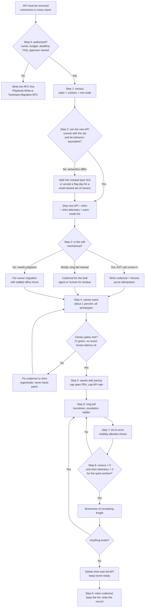

# Playbook: Execute a 1,000-Repository Breaking API Migration

> [!summary] Claim:
> A breaking change across 1,000 repositories cannot be one commit, so it is run as three releases of the same API: expand (ship the new API and a behavior-preserving shim), migrate (a codemod-generated pull request per repository), and contract (delete the old API only when both a static census and runtime telemetry read zero).
> Every step must be idempotent and measured by sites remaining, not pull requests merged, because the work is dominated by the long tail: owners who never answer, call sites a pattern did not match, and callers that depend on behavior the contract never promised.
> The campaign is a rate-limited, resumable pipeline with a ledger, a canary wave, a pacing budget derived from the code host's published limits, a backsliding guard that goes live before the first pull request, and a contract step that is rehearsed with brownouts before it is irreversible.
> A shim that is not equivalent, an unmatched alias, a missing import, or a deletion made on the strength of a green dashboard are the four failure classes this playbook is built around.

The theory of automated change, AST engines, and Rosie-style sharding is owned by [[Large-Scale-Changes-and-Codemods-Across-Repos]].
Deprecation policy, advisory versus compulsory deprecation, and paved-road economics are owned by [[Platform-Engineering-Paved-Roads-and-Deprecation]].
Hyrum's Law and the One-Version Rule are owned by [[Dependency-Management-Theory-and-Hyrums-Law]].
This playbook owns the execution runbook that composes them for a breaking change at 1,000-repository scale.

## Trigger and Symptoms

Activate this playbook when all of the following hold.

- An API, library entry point, wire format, or tool flag must stop existing, and the replacement is not a pure rename that a compiler or interpreter can alias for free.
- The consumers live in hundreds to thousands of repositories with different owners, so no single commit can span them.
  Software Engineering at Google defines a large-scale change (LSC) as any set of logically related changes that cannot practically be submitted as a single atomic unit, and lists a federated repository topology as one reason atomic change is not even technically possible.
- A deadline exists that is set by something outside your control: a security fix, a compiler or runtime end of life, a vendor shutdown, a license change, or an infrastructure decommission.

Symptoms that you are already in this situation and have not named it yet:

- A deprecation warning has been in the library for two or more releases and the count of warning sites is flat or rising.
  The book is blunt about it: warnings "can lead to (slightly) fewer new uses of an obsolete system, but it rarely leads to teams actively migrating away from it."
- New code keeps adding calls to the old API because engineers copy existing code as examples.
- Platform staff answer "can I upgrade the library" with "not until team X migrates", and X has no capacity.
- A "migration guide" exists, and the owners of 700 of the 1,000 repositories have not opened it.

Do not activate this playbook for:

- An additive change that does not break callers (just release it).
- A change that a compiler-checked alias can absorb (see the shim table below for where that is sufficient).
- A change under roughly 500 edits in total, where the book's rule of thumb is that hand edits beat learning the tooling (the book adds that for experienced "code janitors" the number is often much smaller).
- The RFC that justifies the migration and prices it, which is owned by [[Playbook-Write-a-Toolchain-Migration-RFC]] and is a prerequisite to step 0 here.

## Decision Tree



## Prerequisites

### People and authority

- A named campaign owner who is paid to finish it.
  The deprecation chapter's finding is that without explicit owners "a deprecation process is unlikely to make meaningful progress, no matter how many warnings and alerts a system might generate."
- A named global approver, or a pattern-based approval bot, for mechanical shards.
  The book's committee "direct[s] all of the code reviews for an LSC to go to a single 'global approver'", because for mechanical changes it is cheaper for one expert to build review automation than for every owner to learn the change.
- An escalation sponsor with the authority to break non-compliant callers after the warning period.
  The book states the requirement directly: the team running a compulsory deprecation must be empowered "to break noncompliant users after they have been sufficiently warned."
- A one-page authorization document: the reason, the estimated shard count, an FAQ, and the proposed pull request description.
  This is the book's Authorization phase, and it forces you to write down the PR description before you send 1,000 of them.

### Tools and access

- A code host with a bot identity (a GitHub App or a machine account) that can push branches and open pull requests in every target repository.
  Use a dedicated identity so that the campaign's branches, labels, and audit trail are separable from humans.
- A way to enumerate repositories and owners: an internal catalog, the org repository list, and each repository's CODEOWNERS file.
- A static census tool that sees all repositories at once or can be driven repository by repository: a trigram or semantic index per [[Code-Search-and-Semantic-Indexing-at-Scale]], or a local clone cache plus an AST matcher.
- An AST-level rewrite engine for the language: for example OpenRewrite for Java and Kotlin, LibCST for Python, ast-grep for many languages, `go fix` for Go, or a clang-based tool for C++.
  The book names ClangMR, JavacFlume, and Refaster as Google's compiler-index-based engines.
- A formatter run as a separate pass.
  The book is explicit that all LSC generation tools "run the automated formatter appropriate to the language being changed as a separate pass so that the change-specific tooling does not need to concern itself with formatting specifics."
- Telemetry in the old API's implementation that records caller identity (service name, version, call site hash), so runtime-only and generated callers are visible.

### Local commands (verified present on the authoring host, `gh` 2.106.0, `git` 2.55.0, `ast-grep` 0.51.3, macOS)

```bash
gh --version
gh pr create --help | grep -E -- '--(repo|head|base|title|body-file|draft|label|reviewer|dry-run)'
gh pr list --help | grep -E -- '--(head|base|label|json|search)'
gh pr merge --help | grep -E -- '--(auto|squash|admin|match-head-commit)'
ast-grep --version
```

## Commands and Numbers to Know

| Item | Value | Platform |
| :--- | :--- | :--- |
| GitHub secondary limit, content creation | no more than 80 content-generating requests per minute and 500 per hour; some endpoints lower (as of 2026-11) | Both (GitHub.com REST) |
| GitHub secondary limit, concurrency | no more than 100 concurrent requests, shared by REST and GraphQL (as of 2026-11) | Both |
| GitHub secondary limit, points | 900 points per minute per REST endpoint, 2,000 per minute for GraphQL (as of 2026-11) | Both |
| GitHub secondary limit, CPU time | 90 seconds of CPU time per 60 seconds of real time, at most 60 of it GraphQL (as of 2026-11) | Both |
| GitHub primary limit, user token | 5,000 requests per hour; 15,000 for an app owned by a GitHub Enterprise Cloud organization (as of 2026-11) | Both |
| GitHub primary limit, `GITHUB_TOKEN` | 1,000 requests per hour per repository; 15,000 on Enterprise Cloud (as of 2026-11) | Both |
| GitHub App installation, non-Enterprise | scales by 50 per repository beyond 20 repositories and 50 per user beyond 20 users, capped at 12,500 per hour (as of 2026-11) | Both |
| GitHub pacing guidance | make requests serially, and wait at least one second between POST, PATCH, PUT, DELETE requests (as of 2026-11) | Both |
| GitHub retry rule | honor `retry-after`; else wait at least a minute; then back off exponentially and give up after a bound (as of 2026-11) | Both |
| CODEOWNERS | looked up in `.github/`, then root, then `docs/`, first file found wins; last matching pattern wins; file must be under 3 MB or it is not loaded; draft PRs do not auto-request owners (as of 2026-11) | Both |
| Sourcegraph `changesetTemplate.published` | `false`, `true`, `draft`, or omitted (UI decides); a published changeset cannot go back to draft or unpublished (as of 2026-11) | Both |
| Renovate | `prConcurrentLimit` caps open PRs per repository (default 10, 0 is unlimited); `prHourlyLimit` caps PR creation only (default 2); `commitHourlyLimit` also caps rebases (default 0, unlimited) (as of 2026-11) | Both |
| `@InlineMe` (Error Prone) | needs `javac -parameters`; supports non-overridable instance methods, static methods, constructors (as of 2026-11) | Both |
| `go fix` with `//go:fix inline` | new `go fix` and source-level inliner arrived in Go 1.26, February 2026; `go fix -diff ./...` previews (as of 2026-11) | Both |
| `warnings.deprecated` | PEP 702, Python 3.13; `category` defaults to `DeprecationWarning`, `stacklevel` selects the reported frame (as of 2026-11) | Both |
| `Deprecation` header | RFC 9745, Standards Track, March 2025; value is an RFC 9651 Date item such as `@1688169599` (as of 2026-11) | Both |
| `Sunset` header | RFC 8594, May 2019, Informational; value is an HTTP-date; clients treat it as a hint (as of 2026-11) | Both |
| Google LSC rule of thumb | above about 500 edits, learn the generation tools instead of editing by hand | n/a |
| Google LSC throughput, scoped_ptr | over 500,000 references; peak over 700 independent changes and over 15,000 files per day; "today, we sometimes manage 10 times that throughput" | n/a |
| Go repair multiplier | 20x in the 2009 `bytes.Buffer` example; 10x to 100x in Docker, Juju, Kubernetes; over 1000x inside Google | n/a |
| Google LLM-assisted migrations | 39 migrations, 595 code changes, 93,574 edits, 74.45 percent of changes and 69.46 percent of edits LLM-generated; developers estimated a 50 percent time reduction | n/a |
| Meta SCARF dead code removal | over 100 million lines deleted in over 370,000 change requests across five years | n/a |

The rate numbers are service-side limits on GitHub.com that "are subject to change without notice", so re-read the rate-limit page at the start of every campaign rather than trusting a stamped copy.

## The Mechanism: Why Three Releases and Not One Commit

Russ Cox's Go refactoring article names the two strategies.
An atomic code repair changes the API and every caller in one commit.
A gradual code repair runs three stages: introduce the new API so old and new are interchangeable, convert uses across as many commits as needed, then remove the old API.

The atomic option fails on four independent axes, and the book gives each its own failure mode.

- Technical: most version control operations scale linearly with change size, and "the largest atomic change possible counterintuitively decreases" as the codebase and the number of engineers grow.
- Merge conflicts: the probability of a conflict grows with the number of files touched and the number of concurrent authors.
- Testing: a change touching 25 files has an obvious culprit when a test fails; "finding [one] in a 10,000-file change is like the proverbial needle in a haystack."
- Racing: the Go article's version is the sharpest.
  You prepare one big commit, it merges cleanly, and "another developer added a use of the old API while you were working."
  The book continues: "There were no merge conflicts, so you missed that use, and despite all your effort the one big commit broke the codebase."
  A cross-repository change has no atomic commit at all, so the question is moot.

The consequence for execution is structural.
Between "new API exists" and "old API deleted" there is a long period in which both exist and the system must be correct at every instant.
That period is the campaign.
Everything in this playbook is a way to make that period short, observable, and safe.

### Interchangeability is the gate

Cox's requirement is that "it must be possible to convert individual uses from the old to the new API without changing the overall behavior of the program, and uses of the old and new APIs must be able to coexist in a single program."
His counterexample is hypothetical: had there been a function taking an `*io.ByteBuffer` and a caller passing one, the two sides could not have been updated independently, because the old and new types were distinct and passing one where the other is expected does not compile.
The real 2009 move survived only because a stub `type ByteBuffer struct { bytes.Buffer }` was left in `io` for generated code, and Cox notes the old and new API "were not completely interchangeable."
The same shape breaks gradual repair in every language: a widely used API whose parameter or return type is itself the thing being migrated.
The book's `scoped_ptr` case study solved it by making the old type an alias of `std::unique_ptr` first, then substituting textually, then removing the alias.
The book also records the alternative it rejected: a call-graph analysis that would change an API and its callers transitively in one commit, "concerned that the resulting changes would themselves be too large to commit atomically."

If your new API is not interchangeable with the old, the first job is a compatibility layer that makes it so, and that layer is itself a release in the expand phase.
If no layer can exist (a wire protocol whose semantics changed), the honest alternative is a small, named flag-day cohort plus a versioned endpoint for everyone else, which is how the Kubernetes deprecation policy treats REST APIs: objects must round-trip between versions, and a GA version is not removed within a major release.

### Shim taxonomy

The shim is the old API reimplemented as a thin adapter over the new one, plus the machinery that lets tools finish the job.

| Layer | Mechanism | What it gives the campaign | Limit |
| :--- | :--- | :--- | :--- |
| Java, Kotlin | `@Deprecated` plus Error Prone `@InlineMe(replacement = "...", imports = {...})` | Tools inline the old method body at every call site, so the codemod is the library author's annotation | Needs `-parameters`; only non-overridable instance methods, static methods, and constructors; replacement must qualify the access (`this.` or the class name) |
| Go | `//go:fix inline` on a deprecated function, then `go fix -diff ./...` and `go fix ./...` | Each user can self-serve the migration; gopls shows a per-call diagnostic as soon as the directive is added | Go 1.26 and later; the inliner handles function calls, not arbitrary semantic changes |
| Python | `@warnings.deprecated("...")` (3.13), or `warnings.warn(..., DeprecationWarning, stacklevel=2)` before it | Static type checkers report uses; runtime warns with the caller's frame | Warning is advice, not migration; default filters ignore `DeprecationWarning` unless triggered by code in `__main__`; the `unittest` runner and pytest display it by default (CPython warnings docs, pytest capture-warnings docs, filters checked on Python 3.15.2, as of 2026-11) |
| Typed languages with aliasing | Type alias or forwarding function from old name to new | Lets old and new coexist for types in public signatures, the `scoped_ptr` pattern | Alias must be exact; a subtly different type is a break |
| HTTP APIs | `Deprecation: @<unix-seconds>` (RFC 9745), `Sunset: <HTTP-date>` (RFC 8594), `Link: <...>; rel="deprecation"` | Machine-readable signal to clients and API gateways | Does not change behavior; RFC 9745 says deprecation "does not change any behavior of the resource", and Sunset is a hint |
| Wire formats, schemas | Versioned endpoint or field; dual-write and dual-read; round-trip tests | Old and new data coexist | Kubernetes Rule 4a (as of 2026-11): beta versions are deprecated no more than 9 months or 3 minor releases after introduction (whichever is longer), and stop being served 9 months or 3 minor releases after deprecation (whichever is longer) |

The shim must preserve behavior, and Hyrum's Law is why that is harder than it looks.
Wright's statement: "With a sufficient number of users of an API, it does not matter what you promise in the contract: all observable behaviors of your system will be depended on by somebody."
In deprecation the effect is acute, because "removing a system can be thought of as the ultimate change: we aren't just changing behavior, we are removing that behavior completely."
Equivalence is therefore tested, not asserted: differential tests that run old and new implementations on a sampled corpus of real inputs and compare outputs, errors, ordering, and timing class.

## Step-by-Step Execution

Each step ends with a check that fails loudly.
Steps are numbered, and every step after step 2 assumes a ledger (see step 1).
The commands target a campaign named `legacy-fetch`, a Python API `legacy.fetch(url, timeout)` being replaced by `http.get(url, timeout_s=timeout)`, with GitHub as the code host.
Substitute your own names.

### Step 0: Authorize and price it

Write the authorization document before any code.
It has six fields: reason and deadline, the old and new API, estimated sites and repositories (from step 1), the approver and review model, the escalation ladder with its dates, and the FAQ.
The FAQ is not decoration.
The book notes local owners "don't hold a veto over the broader LSC", but "a good FAQ and a solid historic track record of improvements have generated widespread endorsement."
The review model is a decision: a global approver with pattern-based auto-approval for mechanical shards, or per-owner review for shards where the owner's context is needed.
The book's rule is to send a shard to local owners only "for which their review is required for context, not just approval permissions."

Verification: the document names one human for each of campaign owner, approver, and escalation sponsor, and states the delete date.
If any of the three is blank, stop; the campaign has no mechanism to end.

### Step 1: Census, ledger, and the broad query

The census answers "who uses this, how, and how many times" and produces the ledger, the single table every later step reads and writes.

Static census.
Run the codemod's own matcher and a deliberately broader residue query.
The matcher measures what the codemod can fix.
The broad query measures what exists.
The gap between them is your long tail, and you want to see it on day 0, not week 6.

```bash
# census.sh: per-repo counts of (matched by the rule, present by a broad query)
# usage: census.sh repos.txt   (one repo path per line, already cloned)
set -euo pipefail
while read -r repo; do
  matched=$(ast-grep scan -r rule.yml --json=compact "$repo" | python3 -I -c 'import sys,json; print(len(json.load(sys.stdin)))')
  broad=$(grep -rEn 'legacy\.fetch|from legacy import|^import legacy' "$repo" 2>/dev/null | wc -l | tr -d ' ')
  printf '%s\t%s\t%s\n' "$repo" "$matched" "$broad"
done < "$1"
```

Dimensions the census must cover, each of which has defeated a real campaign:

- Direct calls (what a pattern matches).
- Aliased imports (`from legacy import fetch as f`) and attribute aliases (`g = legacy.fetch`), which a call-shaped pattern does not match.
- Dynamic references: strings that name the symbol (`getattr`, reflection, registries, dispatch tables), configuration files, templates.
  Meta's dead-code system encodes this explicitly: static analysis alone "may not reveal links between components created through dynamic references or runtime language features", so it augments its graph with runtime logs and domain-specific rules, and still falls back to a textual search so that errors are false negatives, not false positives.
- Generated code and vendored copies, which the codemod will not own and which regenerate the old call on the next build.
  The book's `scoped_ptr` study names "uses in generated code that weren't detectable by our automated tooling" as part of its long tail.
- Non-code consumers: shell scripts, CI configs, Dockerfiles, runbooks, notebooks, and docs that show the old call.
  For the shell-script cohort see [[19-Shell-and-Unix-Engineering/23-Shell-at-Organizational-Scale/Migrating-Shell-to-Real-Languages|Migrating Shell to Real Languages]], which is the better template when the "API" is a script contract.
- Runtime callers: services calling the old network endpoint from code you cannot grep (other languages, third parties).
  Runtime sampling and request logs fill this gap; the book calls out "logging and runtime sampling in production" for dynamic dependencies.
- Branches and forks: sites that exist on release branches and long-lived feature branches, which a default-branch scan misses.

Ledger.
A table with one row per (repository, branch), keyed so that a re-run updates rather than duplicates.
Columns: `repo`, `branch`, `owner` (from CODEOWNERS or the catalog), `language`, `sites_matched`, `sites_broad`, `tier`, `state`, `pr_url`, `last_event_at`, `blocker`.
States: `planned`, `generated`, `pr_open`, `approved`, `merged`, `no_change`, `blocked_ci`, `blocked_owner`, `exempt`, `manual`.
Store it in SQLite or a TSV under version control; anything that survives a crashed driver and can be queried with SQL is fine.

Ownership resolution.
Parse CODEOWNERS the way the host does: the file is looked up in `.github/`, then the repository root, then `docs/`, the first one found is used, and "the last matching pattern takes the most precedence."
A CODEOWNERS file over 3 MB "will not be loaded", and then no owner is requested at all, so a repository with a huge generated CODEOWNERS silently has no owner.
Repositories with no resolvable owner go to the `manual` pile at once, with a platform-team owner assigned.

Tiering.
Sort repositories into tiers by risk and by what they cost you if they break: tier 0 canary-eligible and leaf (no dependents), tier 1 ordinary services, tier 2 libraries with dependents (their break propagates), tier 3 critical-path and haunted-graveyard systems.
The book's "no haunted graveyards" point is that old, untested, critical code is exactly what prevents a migration from finishing; test coverage there is the prerequisite, not the afterthought.

Verification: the ledger row count equals the repository count from the catalog, and `sum(sites_broad) >= sum(sites_matched)` for every row.
A repository where `sites_matched > sites_broad` means your broad query is narrower than your rule; fix the query, because the burndown denominator will be wrong.

### Step 2: Expand, ship the new API and the shim

Release, in this order, and not merged into one version:

1. The new API.
2. The old API reimplemented as a shim over the new one, with the deprecation marker (`@InlineMe`, `//go:fix inline`, `@warnings.deprecated`, `Deprecation` header).
3. Shim telemetry: a counter tagged with caller identity, emitted at a bounded rate so that logging the call does not become the outage.
4. A differential test that runs old and new on a corpus and fails on any behavioral difference you have not explicitly approved.
5. The lint rule that flags new uses of the old API, in warn mode on changed lines only.

Item 5 ships first in importance, though last in this list.
Without a backsliding guard "deprecation can become a game of whack-a-mole in which users constantly add new uses of a system with which they are familiar (or find examples of elsewhere in the codebase)."
The book's mechanism is the Tricorder analyzer that flags new uses of a `@deprecated` symbol at review time, with a push-button fix in limited cases.
It is warn-only and limited to newly changed lines at first, because "naive tooling often produces a quantity of warning messages that can overwhelm the unsuspecting engineer."
The guard design is owned by [[Static-Analysis-at-Scale-Tricorder-and-Autofix]].

Verification: install the new library version in one test repository and run its suite with warnings as errors for the deprecated symbol:

```bash
python3 -m pytest -q -W error::DeprecationWarning   # pytest's own -W flag; fails on any DeprecationWarning the tests reach
```

This proves only the paths the tests exercise, and it also fails on unrelated deprecations from other libraries; narrow it with a message filter (`-W "error:legacy.fetch:DeprecationWarning"`) once the suite is otherwise clean.
(pytest was not installed on the verifying host, so this command was checked against the pytest capture-warnings documentation, not executed.)

If the shim is not equivalent, this is where differential tests fail.
Fix the shim, never the corpus.

### Step 3: Write the codemod, with fixtures, and prove it idempotent

Use a rewrite engine that understands syntax, not text.
A regex is acceptable only for text with no structure; for code the failure modes (comments, strings, multi-line calls, shadowed names) are the usual ones.
Pick by what the engine knows:

- Syntax-only engines (ast-grep, tree-sitter based tools, LibCST, jscodeshift) match shapes and are fast, but do not resolve types or scope.
- Type-aware engines (OpenRewrite LSTs, `go fix` analyzers, clang tools, Error Prone, Refaster) resolve what a name refers to, so they can tell `legacy.fetch` from another `fetch`.
- The book is explicit that "statically typed languages are much easier to perform large automated changes in than dynamically typed languages", because compiler-based tools reject invalid transformations before testing.
  In a dynamic language, expect a larger residue and more manual work, and budget for it.

A real rule, and what it does.
The following rule file and three throwaway repositories were created and run once on the authoring host (macOS, ast-grep 0.51.3) to capture the output below.
The repositories are not a lab: they exist only to show the shape of a codemod's three characteristic failures.

```yaml
id: legacy-fetch-to-http-get
language: python
rule:
  pattern: legacy.fetch($URL, $T)
fix: http.get($URL, timeout_s=$T)
```

`repo-a` and `repo-b` call `legacy.fetch(url, 30)`, `legacy.fetch("http://" + host + "/ping", 5)`, and `legacy.fetch(u, TIMEOUT)`.
`repo-c` imports `from legacy import fetch as f`, assigns `g = legacy.fetch`, and calls `f(u, 7), g(u, 9)`.

Dry run, then apply (output recorded 2026-11-26, macOS darwin-arm64, ast-grep 0.51.3; reproduced by the verifier the same day; ast-grep draws the gutter with U+2502, shown here as `|`, and the two `repo-b` hunks are elided):

```text
$ ast-grep scan -r rule.yml repo-a repo-b repo-c
repo-a/app.py
help[legacy-fetch-to-http-get]:
@@ -0,4 +0,4 @@
1 1| import legacy
2 2|
3 3| def get(url):
4  |-    return legacy.fetch(url, 30)
  4|+    return http.get(url, timeout_s=30)
...
$ ast-grep scan -r rule.yml -U repo-a repo-b repo-c
Applied 3 changes
```

Three facts fall out of that run, each a campaign-sized hazard at 1,000 repositories.

1. The rewrite changed the call and not the import.
   After applying it, `repo-a/app.py` still began with `import legacy` and used `http.get(...)` with no `import http`.
   `python3 -m py_compile` reported `ok` for all three files, and an `ast` check reported `used-but-not-imported: ['http']`.
   A syntax check does not find an unresolved name, so a codemod that ships without import management and a real test run produces pull requests that fail only at runtime.
   Engines that model imports exist for this reason: LibCST ships an `AddImportsVisitor` in `libcst.codemod.visitors`, and `@InlineMe` carries an `imports = {...}` element.
2. The residue was not zero.
   After the rewrite, a broad query (`legacy.fetch|import fetch|fetch as|^import legacy|from legacy`) still found 1 line in `repo-a`, 1 in `repo-b`, and 3 in `repo-c`.
   `repo-c` was never touched: the alias import and the attribute alias do not match a `legacy.fetch(...)` call shape.
   A burndown computed from "pull requests merged" would have shown `repo-c` as done.
3. The rule is idempotent.
   Re-running `ast-grep scan -r rule.yml -U repo-a repo-b repo-c` exited 0 and printed nothing, and `--json=compact` reported `matches: 0`.
   That property is required: the driver will run the codemod repeatedly as repositories change and as backsliders add old calls, and a second run must produce an empty diff or the pull requests churn.

Codemod acceptance checklist:

- Fixtures: for every pattern class a before and after pair, including comments, string occurrences, multi-line calls, shadowed names, and already-migrated code.
- Idempotence: running the codemod over its own output yields no diff.
- Imports: both adds and removes, and no unused import left behind.
- Formatting: the project's formatter runs afterward as a separate pass, so the diff contains only the semantic edit.
- Semantic equivalence beyond the fixture: run the codemod over a sample of real repositories and run their tests; this is step 4.

Verification:

```bash
ast-grep scan -r rule.yml --json=compact . | python3 -I -c 'import sys,json; print("matches:",len(json.load(sys.stdin)))'   # expect: matches: 0 after apply
```

### Step 4: Canary wave

Pick roughly 1 percent of repositories, at least 10, chosen to cover the archetypes in the ledger: every language and build system, one tier-2 library with dependents, one repository with a flaky suite, one with no tests, one with a giant CODEOWNERS file, one with a monorepo layout, one where the old API appears only in generated code.
Publish canary pull requests as drafts first: `gh pr create --draft`.
Note that GitHub does not automatically request code owners on draft pull requests, so a draft is a review-free zone until you mark it ready; Sourcegraph's `published: draft` has the same use and is supported on GitHub, GitLab, Azure DevOps, and Gerrit but not Bitbucket.

The canary measures the things that vary per repository and that no dry run can tell you: whether CI passes, whether required checks block a bot, whether the pull request description is acceptable, how long owners take to review, and what the repository's own presubmit complains about.
Define go and no-go thresholds before you look at results.
These are starting defaults to tune, not measured constants: at least 90 percent of canary pull requests pass CI with no human edit, zero reverts, and median time to first review inside your normal review SLA.
A failed canary means the codemod or shim is wrong; fix it and regenerate every canary pull request, never hand-patch one.
The book's "cattle versus pets" framing is the operating principle: treat individual changes as nameless and disposable, "rolled back or otherwise rejected at any given time with little cost unless the entire herd is affected."

Verification: the ledger shows every canary repository in a terminal-for-this-wave state (`merged`, `no_change`, `exempt`, or `blocked_*` with a named cause), and the causes are triaged into "codemod bug", "repo-specific", or "infrastructure".

### Step 5: Waves, pacing, and idempotent dispatch

Run waves of increasing size, for example 10, 50, 200, then the remainder, with a bound on open pull requests and a bound on host API calls.
Rosie does the same: it "caps the number of outstanding shards for any given LSC, runs at lower priority, and communicates with the rest of the infrastructure about how much load it is acceptable to generate on our shared testing infrastructure."

Derive the pacing from the host's published limits and show your arithmetic.
Two ceilings apply: the host's content-creation limit and your CI capacity.

- Host: 500 content-generating requests per hour is one request every 7.2 seconds.
  Suppose each pull request costs three mutating requests (create, add labels, post a description comment), then 1,000 pull requests need 3,000 requests, which is at least 6 hours at 500 per hour, and at least 21.6 seconds per pull request.
  A pacing sleep of 25 seconds keeps headroom.
  `gh pr create --label` needs the label to exist in the target repository, so the dispatcher runs `gh label create --force` first (`--force` updates an existing label instead of failing, per `gh label create --help` on `gh` 2.106.0); that is a fourth mutating call, which moves the floor to 28.8 seconds if it counts as content-generating.
  The 80 per minute burst limit is not binding at that rate.
  This is arithmetic on documented limits under a deliberately conservative planning assumption: count all three requests as content-generating.
  GitHub's rate-limit and best-practices pages (read 2026-11-26) state the 80 per minute and 500 per hour figures and say only that some endpoints have lower content creation limits, so the per-request accounting is the planner's to bound.
  Treat the 21.6 second figure as a floor, start at the 25 second sleep, and let observed 403 and 429 answers with `retry-after` tell you whether to slow down.
- CI: 1,000 pull requests times your median presubmit minutes is the cost of one generation, and every regeneration repeats it.
  With an assumed 12-minute median presubmit, one generation is 12,000 runner minutes (200 runner hours), before retries.
  Cap open campaign pull requests so the campaign cannot starve other work; the failure mode is the one in [[Drill-Engineering-Systems-Diagnose-CI-Merge-Queue-Collapse]].
- Do not parallelize the API mutations.
  GitHub's guidance is to make requests serially, with at least a second between mutating requests, and to honor `retry-after`.

Idempotent identity.
Use one branch name per (campaign, repository), for example `campaign/legacy-fetch`, so a re-run finds the existing pull request and updates it.
Sourcegraph's batch spec states the same constraint: use a distinct `changesetTemplate.branch` for every target branch and workspace in a repository.
Regenerate and force-push rather than merging main into a bot branch: the change is a function of the codemod and the base commit, so recomputing is simpler and cheaper than resolving a conflict.

```bash
#!/usr/bin/env bash
# dispatch.sh WAVE.tsv   (repo<TAB>base_branch per line)
# Shape of a resumable, paced dispatcher. NOT executed in this job: shown for structure.
set -euo pipefail
CAMPAIGN=legacy-fetch
BRANCH="campaign/${CAMPAIGN}"
PACE_SECONDS="${PACE_SECONDS:-25}"     # 3 mutating calls per PR at <= 500/hour => >= 21.6 s
MAX_OPEN="${MAX_OPEN:-50}"             # cap on open campaign PRs across the whole wave
WORK="${WORK:-$HOME/campaign-work}"

ORG="${ORG:?set ORG to the GitHub organization}"
# --limit matters: gh search prs returns at most 30 results by default, so without it the count
# saturates at 30 and a MAX_OPEN above 30 never binds. Fail closed: a failed query must not read as 0.
open_count() { gh search prs --owner "$ORG" --label "$CAMPAIGN" --state open --limit 1000 --json number -q 'length' || echo "$MAX_OPEN"; }

while IFS=$'\t' read -r repo base; do
  while [ "$(open_count)" -ge "$MAX_OPEN" ]; do sleep 300; done
  dir="$WORK/${repo//\//__}"
  [ -d "$dir/.git" ] || gh repo clone "$repo" "$dir" -- --depth 1 --branch "$base" --quiet
  git -C "$dir" fetch --quiet --depth 1 origin "$base"
  git -C "$dir" checkout --quiet -B "$BRANCH" "origin/$base"
  ast-grep scan -r rule.yml -U "$dir" >/dev/null
  # formatter as a separate pass, then the import fixer, both defined per language
  if git -C "$dir" diff --quiet; then echo -e "$repo\tno_change"; continue; fi
  git -C "$dir" add -A
  git -C "$dir" commit --quiet -m "Migrate legacy.fetch to http.get ($CAMPAIGN)"
  # the bot owns this branch name, so a plain force push is the intended regenerate-forward
  git -C "$dir" push --quiet --force origin "$BRANCH"
  existing=$(gh pr list -R "$repo" --head "$BRANCH" --state open --json url -q '.[0].url')
  if [ -z "$existing" ]; then
    # the label must exist in the target repository; --force makes this idempotent (updates color and description if present)
    # this is one more mutating call: if you count it as content-generating, use PACE_SECONDS=30 (4 x 7.2 s = 28.8 s)
    gh label create "$CAMPAIGN" -R "$repo" --force >/dev/null
    url=$(gh pr create -R "$repo" --head "$BRANCH" --base "$base" \
          --title "Migrate legacy.fetch to http.get" \
          --body-file pr-body.md --label "$CAMPAIGN")
  else
    url="$existing"
  fi
  echo -e "$repo\tpr_open\t$url"
  sleep "$PACE_SECONDS"
done < "$1"
```

Properties to preserve if you rewrite it: it can be killed and restarted at any point without duplicating pull requests (the branch name and `gh pr list --head` check); it caps open pull requests; it records `no_change` rather than opening empty pull requests; and it writes to the ledger on every event.
If the host answers 403 or 429, stop and honor `retry-after`, else wait at least a minute and back off exponentially with a bounded number of retries, as the host documents.
Renovate users get similar controls from configuration, with one difference: Renovate's limits are enforced per repository, so they bound load inside each repository but not the campaign's total across 1,000 of them: `prConcurrentLimit` for open pull requests, `prHourlyLimit` for creation, and `commitHourlyLimit` when rebases also trigger CI, because `prHourlyLimit` "only limits PR creation."

The pull request body is the campaign's user interface.
Put in it: one sentence of why, the deadline, exactly what changed (before and after in two lines), how to verify, what to do if it is wrong (`/campaign skip` or a label), who to ask, and a link to the FAQ.
The book's warning applies: reviewers give LSCs "only cursory review" because they trust the authors, so a body that makes the risk legible is worth more than a long one.

Verification, per wave:

```bash
gh search prs --owner org --label legacy-fetch --state open --limit 1000 --json number -q 'length'   # open count, bounded by MAX_OPEN (default --limit is 30)
gh api rate_limit --jq '.resources.core | {limit,remaining,reset}'                           # primary bucket headroom
```

The ledger must reconcile: every repository in the wave file has exactly one row in a post-dispatch state.

### Step 6: Review, merge, and the long tail

Review.
For mechanical shards use the global-approver pattern: one reviewer or bot with a pattern-based checker that auto-approves shards whose diff matches the expected shape and escalates the anomalies.
The book describes global reviewers using "a separate set of pattern-based tooling to review each of the changes and automatically approve ones that meet their expectations", so that they examine "only a small subset that are anomalous because of merge conflicts or tooling malfunctions."
Review systems and their latency models are owned by [[Code-Review-and-Readability-Systems-at-Scale]].
Enable auto-merge after approval: `gh pr merge --auto --squash` waits for requirements; on a branch with a merge queue, `gh pr merge` adds the pull request to the queue if required checks have passed and otherwise enables auto-merge, and the queue's own merge method applies, so the strategy flag is not required there.
Never use `--admin` to bypass a queue for campaign pull requests (the `gh` manual: "To bypass a merge queue and merge directly, pass the `--admin` flag"): you will merge exactly the failures the queue exists to stop.
Use `--match-head-commit SHA` when merging from a script so a stale approval cannot merge a regenerated commit.

CI failures.
The book's testing finding is that "independent low-probability events are almost certainties at large enough scale": "Flaky and brittle tests... which often don't harm the teams that write and maintain them, are particularly difficult for LSC authors."
Google reached the point where "recently flaky tests are now ignored when submitting via our automated tooling", because for a semantic-preserving machine-generated change they trust the change more than a test with a flaky history.
That is a choice that requires the infrastructure to know which tests are flaky; see [[Build-and-Test-Latency-Economics-and-Flaky-Tests]] and [[Playbook-Quarantine-and-Eliminate-Flaky-Tests]].
Without it, triage each blocked pull request into one of three causes: the codemod is wrong (fix and regenerate all), the repository has a preexisting failure (the book's rule: ignore preexisting presubmit failures; owners are "responsible for having no preexisting failures in their codebase as part of the social contract"), or a flaky test (rerun once, then record).
The book's own wording for the second case is that Google "aggressively ignore[s] presubmit check failures that preexist the change in question."

Burndown.
The metric is census count over time, not pull requests merged.
Rerun the census daily against default branches, and chart three series: sites remaining, sites introduced by new commits since the campaign began (backsliding), and repositories in each ledger state.
Net remaining equals removed minus introduced; a campaign whose gross removal is high and whose net is flat has a leak, and the guard in step 7 is the fix.
Compute velocity as sites removed per week over a trailing window and forecast a delete date from the net, with a range, not a point.
Rerunning the census is also how you find repositories that merged the pull request but still have residue (alias imports, generated code), which is the `repo-c` case above.

Escalation ladder.
A state machine with dates, written into the authorization document so it is not invented under pressure.
The day counts below are starting defaults to tune, not measured values:

1. Day 0: bot pull request with owner notification.
2. Day 7: automated reminder in the pull request and the owning team's channel.
3. Day 14: the campaign owner contacts the owner's engineering manager with the count and the deadline.
4. Day 21: the platform team lands the change itself under the global-approver authority, if policy permits, or marks the repository `exempt` with an expiry.
5. Day 30 and onward: scheduled brownouts of the old API (step 8), which turn "we will break you" into a dated, observable event.

Ownerless and abandoned repositories get the same ladder with a shorter timeline and a default of archive-or-delete.
The book is direct on why: abandoned projects "are unlikely to fade away on their own", and "These teams should have removal as their primary goal, not just a side project of some other work."
Every `exempt` row needs an owner and an expiry date, or it is a permanent hole.

Verification:

```bash
gh pr list -R org/repo --head campaign/legacy-fetch --state all --json state,mergedAt -q '.[0]'   # per-repo state
# aggregate: ledger state counts must sum to the repository count
sqlite3 ledger.db 'select state, count(*) from repos group by state order by 2 desc;'
```

### Step 7: Turn the guard from warn to enforce

When the large majority of sites are migrated, change the lint rule from warn to error for all new and changed code, and close the build visibility allowlist.
The book's two mechanisms are micro and macro: Tricorder flags new uses of a deprecated symbol at review time, and "visibility whitelists in our build system" prevent new dependencies on a deprecated target, with automated tooling that "periodically examines these whitelists and prunes them as dependent systems are migrated away."
Backsliding does not wait for the end of the campaign, because, as the LSC chapter puts it when explaining why organic migrations fail, "engineers tend to use existing code as examples when writing new code" and every remaining old call is a template for a new one.
So this step can start at the end of the canary, and the warn-to-error flip is gated by sites remaining, not by the calendar.

Verification: introduce a deliberate new use on a scratch branch and confirm the rule rejects it at review or build time with a message that names the replacement.
A guard that has never been seen failing is not evidence of a guard.

### Step 8: Contract, brownouts, then delete

Preconditions to delete, all of them:

- Static census is zero on default branches, and zero on supported release branches (or the release branches are end-of-life).
- Exemptions are zero or have all expired.
- Shim telemetry shows zero calls from any non-test caller for a quiet window longer than your longest cron and batch cycle.
  A quarterly job that has not run yet is invisible to a one-week window, so choose the window by the slowest periodic caller you know of.
- Brownouts have been run and nothing broke, or what broke was repaired.

Brownouts discover what static analysis could not.
The book's practice: "the team will announce planned outages of increasing duration in the months and weeks prior to the turndown", like disaster recovery exercises, so dependent teams discover and plan.
For code dependencies the book describes renaming implementation-only symbols to see who depends on them, and treating "our global test suite as an oracle to determine whether all references to an old symbol have been removed."
Implement a brownout as a feature flag in the shim that makes the old API fail (or sleep, or log at error level) for a bounded window: 10 minutes, then 1 hour, then a business day, each announced with a date, each followed by a review of what broke and who was not on your list.
For HTTP APIs, announce the same schedule with `Deprecation` and `Sunset` headers on every response; they carry the dates in a form a gateway can alert on.
For a library, the brownout is a pre-release version of the library without the old symbol, tried in CI by a sample of owners.

Delete in the order that keeps rollback cheap:

1. Make the shim emit a loud, rate-limited error log (not an exception) for one release.
2. Make the shim fail in non-production environments.
3. Remove the old symbol in a library release; keep the previous release available so a straggler can pin to it while they migrate.
4. After a further quiet window, remove the shim implementation, tests, docs, telemetry, and the lint rule's "deprecated" entry.
   The old implementation behind the shim is now dead code; Meta's SCARF is the model for removing it by dependency graph with auto-generated change requests, and its reported scale is over 100 million lines deleted in over 370,000 change requests across five years.

Contract is the only irreversible step, and the book's footnote on a change that "removed more than one billion lines of code from the repository over the course of three days" is its measure of how much confidence that takes: tested, rehearsed, and with a revert path.

Verification:

```bash
# static: zero in all supported branches (repeat the census against each branch in the ledger)
./census.sh repos.txt | awk -F'\t' '{m+=$2; b+=$3} END {print "matched", m, "broad", b}'   # expect: matched 0 broad 0
# runtime: shim counter for non-test callers over the quiet window must be 0 (query your metrics system)
```

### Step 9: Close out

Retire the codemod but keep its fixtures; the next migration reuses the harness.
Keep the lint rule permanently, with its message pointing at the replacement; deleting it invites the old name to return.
Write a record: dates, site counts, repositories per tier, canary defects, brownout findings, exemptions, cost in runner hours and engineer hours, and what the long tail was made of.
The cost number is the input to the next migration's authorization document.
The book's header-rename case, which the mature tooling finished with "just a couple weeks' worth of background-task effort", is the argument for making the harness durable.

## Worked Example: A Three-Repository Codemod Run

This note has no lab, so there is no recorded golden output.
Three real outputs from the single run described in step 3 are the only measured facts in this playbook, taken on 2026-11-26 on macOS (darwin-arm64), ast-grep 0.51.3, throwaway directories since deleted.

| Observation | Command or check | Result |
| :--- | :--- | :--- |
| Matches applied | `ast-grep scan -r rule.yml -U repo-a repo-b repo-c` | `Applied 3 changes` |
| Idempotence | the same command again; `--json=compact` | exit 0, empty output, `matches: 0` |
| Residue by broad query after rewrite | grep with the broad pattern, count per repo | `repo-a 1`, `repo-b 1`, `repo-c 3` |
| Syntax check of rewritten files | `python3 -m py_compile` | `ok` for all three |
| Name resolution | `ast` walk for names used but never imported | `used-but-not-imported: ['http']` in `repo-a/app.py` |

Reading the table is the exercise.
Applied-changes is 3 because three call sites matched in `repo-a` and `repo-b`, and `repo-c` contributed none: its sites are a different shape.
Residue never reaches zero without a second rule or a human, and the syntax check passes while the program is broken.
Every one of these is why the ledger's two counters (`sites_matched` and `sites_broad`) exist.

## Rollback Procedure

Roll back at the smallest scope that fixes the harm, and prefer regenerate-forward over revert where the old API still exists, which it does until step 8.

1. Stop the dispatcher.
   Kill the driver and set the ledger's `paused` flag; the idempotent design means nothing is lost.
2. Identify the scope from the ledger: one repository, one wave, or the whole campaign.
3. Per-repository: revert the merged commit in that repository with a normal revert pull request.
   The old API still exists (contract has not run), so the revert compiles.
4. Per-wave: close open pull requests with a label and a comment (`gh pr close -R org/repo <n> --comment "..."`), and revert merged ones from a list generated from the ledger.
5. Whole campaign: disable the guard (set the lint rule back to warn), and decide whether the shim or the codemod was wrong.
   Fix it, regenerate.
6. After contract: restore the old API from the previous library release and re-expand; this is why step 8 removes the symbol in a release that leaves the previous one pinnable, and why the delete is staged.
7. Write down which assumption failed; add a fixture or a differential test for it before resuming.

Verification: the ledger shows the affected scope back in `planned` or `exempt`, the census count rises by the expected number, and the shim telemetry shows the old API serving traffic.

## Failure Modes of the Procedure

| Failure | How it shows | Recovery |
| :--- | :--- | :--- |
| Shim not behavior-equivalent | canary CI fails in many unrelated repositories on the same assertion; production error budgets burn after merges | pause; add the failing input to the differential corpus; fix the shim, not the callers |
| Codemod leaves imports unresolved | pull requests green on syntax and lint, fail on import or at runtime | add import management; run the repository's tests, not only a parser, as a codemod gate; regenerate |
| Alias or dynamic sites unmatched | "100 percent merged" yet old symbol still found by broad census; failures at brownout | add rules for aliases; keep the broad query in the burndown denominator; rely on runtime telemetry for dynamic callers |
| Rate limited by the host | 403 or 429 with a secondary-limit message; driver stalls | honor `retry-after`, else wait at least a minute, then exponential backoff; reduce concurrency to serial; lower `PACE_SECONDS` only after measuring |
| CI saturation | queue latency rises for unrelated teams while campaign pull requests run | lower `MAX_OPEN`; run campaign checks at lower priority; schedule waves off-peak |
| Review fatigue | pull requests approved in seconds without reading, or never reviewed | global approver with pattern checks; legible body; route only context-needed shards to owners |
| Ownerless repositories | no reviewer requested; CODEOWNERS over 3 MB so no owners loaded; pull request ages | route to platform owner with shortened ladder; archive if unused |
| Release branches ignored | main is clean, a hotfix branch rebuild breaks at brownout | census all supported branches; cherry-pick the codemod, not the diff |
| Backsliding | net remaining flat while gross removals rise | lint to error; close visibility allowlist; require the guard before wave 1 |
| Generated and vendored code | old call reappears on next build | patch the generator or template; exclude vendored paths and track them separately |
| Stale approval merges a regenerated commit | wrong content merged under an old approval | merge with `--match-head-commit`; require re-approval on new commits |
| Deleting on a green dashboard | removal merged, then a quarterly job fails | quiet window longer than the slowest periodic caller; brownouts first; staged removal |
| Campaign with no owner | state frozen; deprecation warnings accumulate | stop and assign an owner and a sponsor; compulsory deprecation requires both |
| Unfunded mandate | owners refuse; escalations stall | central team does the work; the book calls an unstaffed compulsory deprecation "mean spirited" and an "unfunded mandate" |

## Pitfalls

> [!warning] Counting pull requests instead of sites
> A merged pull request is a claim, not a measurement.
> The broad census is the measurement, and it must run on schedule against all supported branches.
> The three-repository run above has a pull request merged, a clean syntax check, and a repository that was never touched.

> [!warning] Warnings are not migration
> The book's finding is that deprecation warnings reduce new uses at best.
> A warning without a funded migration, a guard, and a date is an advisory deprecation, and "hope is not a strategy."

> [!warning] Sharding by convenience instead of by ownership boundary
> A shard must be the smallest unit that can be tested, reviewed, and committed atomically, and it should map to one owner.
> A shard that spans two owners waits for the slower one.
> In a polyrepo estate the shard is the repository; in a monorepo it is an ownership subtree.

> [!warning] Hand-fixing a campaign pull request
> Editing one generated pull request by hand diverges it from the codemod, and the next regeneration overwrites or conflicts.
> Fix the codemod and regenerate; if the repository needs a bespoke edit, mark it `manual` and take it out of the generator.

> [!warning] Assuming the shim is invisible
> A shim adds a stack frame, a log line, possibly an allocation, and a different exception type.
> On a latency-critical path those are observable behaviors: Hyrum's Law applies to performance, and the callers that care are the ones you cannot ask.
> Measure p50 and p99 before and after in the canary for any hot-path API.

> [!warning] Turning on the guard last
> Every unmigrated site is an example for new code.
> Without the guard the campaign is bailing a boat with the drain open.

> [!warning] Sending 1,000 pull requests as a burst
> You will hit the host's secondary limit, saturate CI, and flood owners at the same time.
> Pace the campaign and cap the open set; the speed you lose in the first week you recover in the last, because fewer retries and fewer reverts.

> [!warning] Silent coupling to a release train
> If consumers pin library versions, no migration pull request helps until the version bump lands.
> Check whether the new API is in a version consumers can reach, and decide whether the campaign also bumps the pin.
> The version-pinning trade-offs are owned by [[Dependency-Management-Theory-and-Hyrums-Law]].

## Operational Boundaries for the Platform Team

These are limits on what the campaign team may do on its own authority, written so they can be checked.

- The team may open pull requests, label them, comment, and regenerate its own branches.
  It may not merge over a failing required check, bypass a merge queue, or edit branch protection to land a change.
- The team may merge mechanical shards under the global-approver authority only where the approval policy in the authorization document grants it, and only for pull requests whose diff matches the expected shape.
- The team may not delete the old API, the shim, or telemetry until the step 8 preconditions hold and are recorded in the ledger with a date and a name.
- The team owns the campaign's load on shared systems: open pull requests are capped, API calls are paced to the host's limits, and CI use is announced to the owners of the CI platform.
- The team owns the bot identity, its tokens, and their least-privilege scope; a campaign token should not be able to push to protected branches directly or administer repositories.
- Exemptions are granted by the sponsor, carry an expiry, and are reviewed at each wave; the team does not grant them silently.
- A change that needs judgment about behavior goes to the owner with context, however mechanical the diff looks.
- Stop conditions are pre-agreed: a revert rate above the canary threshold, any production incident attributed to a campaign merge, or a host rate-limit lockout each pause the dispatcher until the owner and sponsor resume it.

## At Scale

### From 10 repositories to 1,000

Below about 10 repositories, a script and a spreadsheet are enough, and the right review is the repository owner's.
At 100, the ledger, pacing, and the broad census become necessary, because the long tail (5 to 15 percent of repositories) is now dozens of repositories each with an owner who needs a nudge.
At 1,000, the shape changes: the campaign is a distributed system with a retry model, a rate budget, a back-pressure signal (CI queue depth), and a state machine, and the human problem is mostly escalation, not code.
The book's `scoped_ptr` figures are a ceiling on what tooling can do (over 700 independent changes and 15,000 files per day at the peak, and "sometimes" 10 times that throughput today), and the sharper lesson is its qualifier: the very long tail was nuanced behavior dependencies, races with other engineers, and generated code the tools could not see.

### Polyrepo versus monorepo

In a monorepo the shim, the codemod, the lint rule, and the delete can land with the same infrastructure and a single test oracle.
In a polyrepo estate each repository has its own CI, branch protection, release cadence, and owners, so heterogeneity is the cost.
The book's heterogeneity point applies directly: "If your organization has many different VCSs, Continuous Integration (CI) systems, project-specific tooling, or formatting guidelines, it is difficult to make sweeping changes across your entire codebase."
The campaign should minimize it by standardizing the pull request contract (labels, body fields, bot identity) rather than adapting the codemod to each repository's idiosyncrasies, and by writing the exceptions down as `exempt` or `manual` with a reason.

### Decision rules

- If the change needs more than about 500 edits in total, build the codemod (type-aware if an engine exists); below that, editing by hand is usually cheaper.
- If the new API is not interchangeable with the old, build a compatibility layer first; do not start the migration phase.
- If the language is dynamically typed, plan on a larger residue and more runtime telemetry, and set the quiet window by the slowest periodic caller.
- If the campaign needs more than one wave type (mechanical plus judgment), run them as separate ledgers with separate gates, so the mechanical wave is not blocked by the judgment one.
- If a repository's tests are absent or flaky and the repository is on the critical path, fund its tests before its migration; a haunted graveyard blocks the delete.
- If the host rate limit and CI capacity disagree, pace to the lower one.
- If a metric rewards pull requests merged, replace it with sites remaining; the metric will be gamed by splitting pull requests otherwise (see [[Developer-Productivity-Metrics-DORA-SPACE-and-GSM]]).
- If the migration is long enough that Hyrum-style dependents will appear, do not announce a delete date until a brownout has passed.

### LLM and agent assistance

Mechanical shards are for deterministic codemods.
Agents are for the residue the pattern could not match.
Google's experience report on 39 migrations reports 595 code changes with 93,574 edits, of which 74.45 percent of changes and 69.46 percent of edits were LLM-generated, developer-estimated time saved was 50 percent, and the workflow is location discovery plus an LLM, followed by the same validation as any other change.
The rule that follows is to put LLM output behind the same canary, gates, and ledger as a codemod: nondeterminism is a reason for more validation, not less.
Agent isolation, worktrees, and ship gates are owned by [[AI-Coding-Agents-Sandboxes-Worktrees-and-Ship-Gates]], and fleet supervision and quota routing by [[Multi-Agent-Supervision-and-Quota-Aware-Routing]].

## Practice Drill

> [!tip] Practice Drill: Break the three-repository campaign on purpose
> Create three directories like the ones in step 3 (two with direct `legacy.fetch(url, n)` calls, one using `from legacy import fetch as f` and `g = legacy.fetch`), write the rule file, and run `ast-grep scan -r rule.yml -U` over them.
> Then predict each result before checking.
> 1. Add a rule for the alias form and an import-adding step, rerun, and confirm the broad query reaches 0 while the rule still reports `matches: 0` on a second run.
> 2. Add a fixture file where `legacy.fetch` appears inside a string and a comment; confirm the rule does not touch them, and explain why a regex would have.
> 3. Write a function in `repo-b` that shadows `legacy` with a local variable; predict whether a syntax-only engine rewrites it, and what a type-aware engine would do instead.
> 4. Write the ledger as a SQLite table, load the three rows, and compute a burndown query that counts sites from the broad pattern, not pull requests.
> 5. Extend `dispatch.sh` with a `--dry-run` mode that prints the `gh` commands it would run, and compute the minimum wall-clock time for 1,000 repositories at 3 mutating requests each under a 500 per hour limit (answer: 6 hours).
> Target time: 45 minutes.
> Then run the pacing arithmetic again with your own organization's presubmit minutes and write down the CI hours one generation costs.

## Interview Questions

> [!question] L5
> Why is a breaking API change across many repositories done as three releases rather than one commit?
>
> > [!success]- Answer
> > Expand, migrate, contract.
> > Atomic changes fail on size (version control cost scales with change size), merge conflicts, testing (one failing test in a 10,000-file change is a haystack), and racing: someone adds a use of the old API while you prepare the commit and a clean merge hides it.
> > Across repositories an atomic commit does not exist at all.
> > The gradual form requires that old and new APIs be interchangeable and coexist, so the system is correct at every intermediate state, and only then is the old API removed.

> [!question] L5
> A deprecation warning has been in the library for a year and the number of old call sites has not fallen.
> What should you do?
>
> > [!success]- Answer
> > Treat the warning as advisory: it can reduce new uses but rarely drives migration.
> > Convert it to a compulsory deprecation with an owner, a date, a codemod, and an escalation ladder, and add a lint guard that flags new uses at review time.
> > A warning must be actionable and relevant; one that fires in transitive builds becomes alert fatigue.

> [!question] L5
> What does an idempotent codemod mean, and why does the campaign depend on it?
>
> > [!success]- Answer
> > Running it over its own output produces no diff.
> > The driver reruns the codemod on every repository repeatedly as bases move and backsliders add old calls, and each run must converge on the same branch contents.
> > Without it, pull requests churn and regeneration becomes a source of noise.
> > Check it in the acceptance suite: apply, apply again, expect zero matches.

> [!question] L6
> Predict the output.
> After the rule `pattern: legacy.fetch($URL, $T)`, `fix: http.get($URL, timeout_s=$T)` is applied to a repository whose file starts with `import legacy`, what does `python3 -m py_compile` report for a rewritten file, and what happens when the code runs?
>
> > [!success]- Answer
> > `py_compile` reports no error: the rewritten code is syntactically valid.
> > At runtime the first call raises `NameError: name 'http' is not defined`, because the codemod rewrote the call and not the import.
> > In the recorded run an AST name check reported `used-but-not-imported: ['http']`.
> > The fix is an engine step that adds the needed import and removes the unused one, and a codemod gate that runs the repository's tests or at least a name-resolution check, not only a parser.

> [!question] L6
> Debug this.
> The dashboard says 940 of 1,000 pull requests are merged and the old API shows zero call sites, yet during a scheduled brownout three production services fail.
> What are the most likely causes and how do you find the rest?
>
> > [!success]- Answer
> > The dashboard counted pull requests and a call-shaped pattern, not residue.
> > Likely causes: alias imports and attribute aliases the pattern did not match; dynamic references (strings, registries, config); generated or vendored code; non-code callers (scripts, cron jobs); release branches; and the 60 unmerged repositories.
> > Find them with the broad census across all branches, the shim's caller-tagged telemetry, a rename of an implementation-only symbol to see who breaks, and the failing services' stack traces.
> > Repair the census so it matches reality, then reset the denominator and extend the quiet window to cover the slowest periodic caller.

> [!question] L6
> Your dispatcher starts returning 403 with a secondary-rate-limit message at about 400 pull requests.
> How do you size the campaign so this does not happen again?
>
> > [!success]- Answer
> > Read the host's current limits.
> > On GitHub.com as of 2026-11 the secondary limit is no more than 80 content-generating requests per minute and 500 per hour, requests should be serial with at least a second between mutations, and `retry-after` must be honored.
> > Count mutating requests per pull request (create, labels, comments), multiply by 1,000, divide by 500 per hour: at three requests that is 6 hours, so pace at least 21.6 seconds per pull request and run overnight.
> > Make the dispatcher resumable and idempotent (branch name per campaign and repository, `gh pr list --head` check), stop on 403 or 429, and back off exponentially.

> [!question] L6
> Review fatigue: owners approve in seconds.
> Is that acceptable?
>
> > [!success]- Answer
> > Sometimes.
> > For semantic-preserving mechanical shards the book's practice is a global approver with pattern-based approval of shards that match the expected shape and manual review of the anomalies, because local owners give only cursory review anyway.
> > It is not acceptable when the change has behavioral risk, or when the shim is not proven equivalent: those shards need owner context.
> > Make the risk legible in the pull request body and keep the differential tests as the real safety net.

> [!question] L7
> You are asked to delete the old API in two weeks because the census says zero.
> What do you require first?
>
> > [!success]- Answer
> > A quiet window of shim telemetry longer than the slowest periodic caller (a quarterly job is invisible to a two-week window), zero static residue on all supported branches, exemptions expired, and brownouts of increasing length with findings reviewed.
> > Then a staged removal: loud log for a release, failure in non-production, symbol removed in a release with the previous one still pinnable, and only after a further quiet window remove the shim implementation.
> > The reasoning is Hyrum's Law: removal is the ultimate behavior change, and unknown dependents surface only when it breaks.

> [!question] L7
> A VP wants a "percent migrated" number weekly.
> Design the metric.
>
> > [!success]- Answer
> > Define it as sites remaining from a scheduled broad census, with a separate series for sites introduced since the start, and report net.
> > Add repositories by ledger state, aging of open pull requests, and exemptions with expiry.
> > Avoid pull requests merged and avoid a percentage whose denominator moves; state the denominator source.
> > Forecast the delete date from trailing velocity with an interval, and flag the dependency on the long tail.
> > Ensure no incentive to split pull requests or to mark repositories exempt to improve the number; see [[Drill-Engineering-Systems-Audit-a-Gamed-Productivity-Dashboard]].

> [!question] L8+
> Design the organizational operating model so that breaking migrations are a routine capability rather than a heroic project.
>
> > [!success]- Answer
> > Fund a standing team that owns campaigns end to end, with the authority and the escalation sponsor the book requires for compulsory deprecation.
> > Make interchangeable shims and deprecation markers part of API design review, so every new API is born with an exit plan.
> > Standardize the pull request contract, the bot identity, and the ledger across repositories to reduce heterogeneity.
> > Treat the guard (lint, visibility allowlists) as a platform service that every deprecation gets for free.
> > Keep the codemod and differential-test harness as shared infrastructure, publish campaign records so cost estimates improve, and set a concurrency budget for campaigns because organizations have a limit on simultaneous deprecation work.
> > Decide per campaign between organic, advisory, and compulsory deprecation by the benefit's size: marginal benefits do not drive voluntary migration.

> [!question] L8+
> Where do LLM agents fit in the campaign and where must they not?
>
> > [!success]- Answer
> > Agents fit the residue the deterministic rule could not match, and location discovery for ambiguous sites; the reported case at Google was 39 migrations with 74.45 percent of changes LLM-generated and developer-estimated 50 percent time saved.
> > They do not belong as the sole author of the mechanical bulk, in the contract step, or as their own verifier.
> > Their output goes through the same ledger, canary, differential tests, and review as a codemod, and their quota and isolation are managed as in [[Multi-Agent-Supervision-and-Quota-Aware-Routing]].
> > Nondeterminism raises the validation bar, because regeneration will not reproduce the same diff.

## Further Reading

- Software Engineering at Google, chapter 22 Large-Scale Changes, https://abseil.io/resources/swe-book/html/ch22.html.
  The authorization, change creation, sharding, review, and cleanup phases, plus the `scoped_ptr` case study and the TAP train.
- Software Engineering at Google, chapter 15 Deprecation, https://abseil.io/resources/swe-book/html/ch15.html.
  Advisory versus compulsory deprecation, warning actionability, discovery, migration, and backsliding prevention tooling.
- Hyrum Wright, Hyrum's Law, https://www.hyrumslaw.com/.
  The statement and the implicit-interface argument behind shim equivalence and brownouts.
- Russ Cox, Codebase Refactoring (with help from Go), https://go.dev/talks/2016/refactor.article.
  The atomic versus gradual code repair argument and the interchangeability requirement.
- The Go Blog, `//go:fix inline` and the source-level inliner, https://go.dev/blog/inliner.
  Library-author-driven, self-service API migration in Go 1.26.
- Error Prone InlineMe, https://errorprone.info/docs/inlineme.
  The Java equivalent: the deprecation annotation that carries its own codemod.
- PEP 702, https://peps.python.org/pep-0702/.
  Type-system and runtime deprecation marking in Python 3.13.
- RFC 9745 and RFC 8594, https://www.rfc-editor.org/rfc/rfc9745.txt and https://www.rfc-editor.org/rfc/rfc8594.txt.
  Machine-readable deprecation and sunset signals for HTTP APIs.
- Kubernetes Deprecation Policy, https://kubernetes.io/docs/reference/using-api/deprecation-policy/.
  A published, tiered wire-API deprecation contract with round-trip rules.
- GitHub REST rate limits and best practices, https://docs.github.com/en/rest/using-the-rest-api/rate-limits-for-the-rest-api.
  The numbers that bound dispatch speed and the retry rules.
- Sourcegraph Batch Changes, https://docs.sourcegraph.com/batch_changes/references/batch_spec_yaml_reference.
  A managed implementation of the dispatch and publish-state model.
- OpenRewrite, https://docs.openrewrite.org/running-recipes/getting-started.
  Type-aware recipes with import management for Java and related languages.
- Meta, Automating dead code cleanup, https://engineering.fb.com/2023/10/24/data-infrastructure/automating-dead-code-cleanup/.
  Graph-based deletion with a textual fallback, for the contract step.
- Ziftci et al., Migrating Code At Scale With LLMs At Google, https://arxiv.org/abs/2504.09691.
  Measured LLM-assisted migration results and workflow.

## Related

- Prerequisites: [[Large-Scale-Changes-and-Codemods-Across-Repos]], [[Platform-Engineering-Paved-Roads-and-Deprecation]]
- Next: [[Playbook-Write-a-Toolchain-Migration-RFC]]
- See also: [[19-Shell-and-Unix-Engineering/23-Shell-at-Organizational-Scale/Migrating-Shell-to-Real-Languages|Migrating Shell to Real Languages]]
- Also in this pillar: [[Dependency-Management-Theory-and-Hyrums-Law]], [[Code-Search-and-Semantic-Indexing-at-Scale]], [[Static-Analysis-at-Scale-Tricorder-and-Autofix]], [[Code-Review-and-Readability-Systems-at-Scale]], [[Build-and-Test-Latency-Economics-and-Flaky-Tests]], [[Playbook-Quarantine-and-Eliminate-Flaky-Tests]], [[Drill-Engineering-Systems-Diagnose-CI-Merge-Queue-Collapse]], [[Drill-Engineering-Systems-Audit-a-Gamed-Productivity-Dashboard]], [[Developer-Productivity-Metrics-DORA-SPACE-and-GSM]], [[AI-Coding-Agents-Sandboxes-Worktrees-and-Ship-Gates]], [[Multi-Agent-Supervision-and-Quota-Aware-Routing]]
