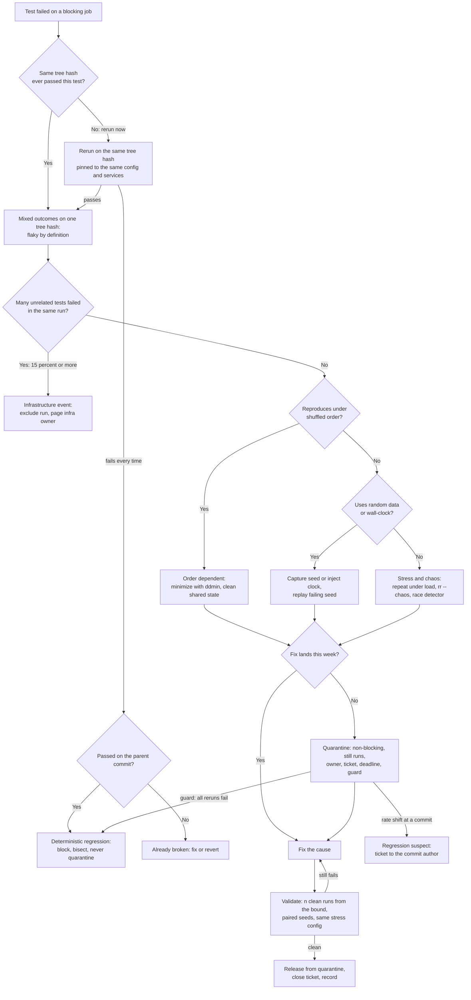

# Playbook: Quarantine and Eliminate Flaky Tests

> [!summary] Claim:
> A flaky test is one that shows both a pass and a fail on the same code, so the only trustworthy detector is a pair of conflicting outcomes on one tree hash, filtered for infrastructure events that fail many tests at once.
> Quarantine is a containment tool, not a fix: it removes a test from the blocking path while still running it, files an owned ticket with a deadline, and must keep a guard that re-blocks the moment the test starts failing deterministically.
> Elimination means reproducing the cause (shuffle for order dependence, seed capture for random data, stress for races), fixing the cause, and proving the fix with a run count taken from a confidence bound rather than "it passed ten times".
> Retry-everything and quarantine-and-forget both hide real regressions; the lab below measures how many.

The flake math, test size categories, and predictive selection are owned by [[Build-and-Test-Latency-Economics-and-Flaky-Tests]].
The productivity metrics that flake rates feed are owned by [[Developer-Productivity-Metrics-DORA-SPACE-and-GSM]].
Batch and queue dynamics when flakes meet a merge queue are owned by [[Drill-Engineering-Systems-Diagnose-CI-Merge-Queue-Collapse]].
This playbook owns the operational procedure: measure, classify, quarantine, reproduce, fix, validate, release.

## Trigger and Symptoms

Activate this playbook when test outcomes stop predicting code quality.

- A pull request goes red on a test it did not touch, and the retry button turns it green.
  Same code, two outcomes, is the definition used by Google ("a test that exhibits both a passing and a failing result with the same code") and by GitHub's CI.
- The test passes alone and fails in the suite, or passes in the suite and fails when a runner reorders, shards, or parallelizes tests.
- A merge queue or build cop spends its time on re-runs.
  At Google in 2016, about 1.5% of all test runs reported a flaky result, almost 16% of tests had some level of flakiness, and about 84% of observed pass-to-fail transitions in post-submit involved a flaky test.
- Failures scatter as isolated points across a test-by-run grid (flakiness) rather than forming a solid column across many tests in one run (infrastructure).
  Spotify's Odeneye view draws exactly this distinction.
- Engineers have started to ignore red.
  Micco's post names the failure mode: developers dismiss a failing result as flaky and later learn it was a legitimate failure.

Reference magnitudes from public sources (each stamped with the source's own date):

| Source | Measurement |
| :--- | :--- |
| Google, 2016 | about 1.5% of test runs flaky; almost 16% of tests have some flakiness; about 84% of pass-to-fail transitions involve a flaky test |
| Google TAP, quoted in Luo et al. 2014 | 1.6M test failures per day on average over 15 months, 73K of them (4.56%) caused by flaky tests |
| GitHub monolith, 2020 | 1 in 11 commits (about 9%) had at least one red build from a flaky test; 6 weeks after the new system, under 0.5% (1 in 200) |
| Spotify, 2019 | flakiness fell from 6% to 4% in two months after teams could see a table of flaky tests, with no other change |
| Luo et al. 2014 (201 fix commits, 51 Apache projects) | 78% of flaky tests were flaky the first time they were written |
| iDFlakies, 2019 (422 flaky tests, 82 Java projects) | one suite run had up to 50.0% probability of at least one flaky failure |

The trigger thresholds for starting this playbook are a team decision, not a published constant.
A defensible starting rule: start when more than 2% of default-branch commits (or merge-queue batches) have a red result that clears on a rerun of the same tree hash, or when any single test accounts for more than 10 such failures in 30 days.
Both numbers are this note's suggestion; calibrate them against your own history with Step 2.

## Decision Tree



## Prerequisites

Data you must already have, or build first in Step 1:

- One row per test attempt with: test id, tree hash (not only commit SHA), run id, attempt number, outcome, duration, host or shard, random seed, and the order index inside its process.
- A way to run any test N times on one tree hash, in one process or fresh processes, with a chosen order and seed.
- A write path from CI to a quarantine list that is reviewed (a file in the repository owned by CODEOWNERS, or a service with an audit log) and a ticket system that accepts an owner and a due date.
- A rule for who owns a test: a CODEOWNERS entry, or the authors of the most recent commits that touched the test or the code under it.
  GitHub's system assigns issues to the people who most recently modified the test files or associated code before the test became flaky.

Runner capabilities used below (each flag was read in the primary documentation, as of 2026-11, Both Linux and macOS):

| Need | Bazel | pytest | Go | GoogleTest | cargo-nextest |
| :--- | :--- | :--- | :--- | :--- | :--- |
| Repeat N times | `--runs_per_test=N` | n/d | `-count=N` | `--gtest_repeat=N` | `--stress-count N` |
| Shuffle order, replay by seed | n/d | `pytest-randomly`: `--randomly-seed=N` or `last` | `-shuffle=on` or `-shuffle=N` | `--gtest_shuffle`, `--gtest_random_seed=SEED` | n/d |
| Retry on failure | `--flaky_test_attempts=N` | `pytest-rerunfailures`: `--reruns N` | n/d | n/d | `--retries N` |
| Report flaky vs failed | status `FLAKY` | `--fail-on-flaky` exits 7 | n/d | n/d | `flaky` in summary, `--flaky-result fail` |

`n/d` means not documented in the pages read for this note; the absence of a flag there is not proof that the tool lacks one.

## Commands and Numbers to Know

All entries `(as of 2026-11)`, platform Both unless stated.

| Item | Exact form | What it does and the catch |
| :--- | :--- | :--- |
| Bazel repeat | `bazel test --runs_per_test=300 //pkg:t` | Runs each test 300 times; if any attempt fails, the whole test is considered failed (Bazel command-line reference). `--runs_per_test=regex@N` limits it to matching labels. |
| Bazel flake status | `--runs_per_test_detects_flakes` (default false) | If true, a shard with at least one passing and at least one failing run gets status `FLAKY` instead of `FAILED`. Use for detection, not for validation. |
| Bazel retry | `--flaky_test_attempts=3` or `regex@3` | Retries a failing test up to N attempts; a test that needed more than one attempt is marked `FLAKY`. Value `default` means 1 attempt, or 3 for rules with `flaky = True`. |
| Bazel flaky attribute | `flaky = True` on a test rule | Runs up to three times and fails only if all three fail. Bazel's own text discourages it: tests should pass reliably when their assertions hold. |
| Bazel result cache | `--[no]cache_test_results`, default `auto` | In `auto`, Bazel reruns a test if its inputs changed, it is marked `external`, multiple runs were requested with `--runs_per_test`, or it previously failed. A plain rerun of an unchanged, passing target is served from the cache, so stress it with `--runs_per_test` or `--nocache_test_results`. |
| pytest last failed | `pytest --lf`, `--ff`, `--sw`, `--cache-clear` | Cache provider options; CI should use `--cache-clear` because isolation beats speed there (pytest docs). |
| pytest order and seed | `pytest-randomly`: on by default, prints `Using --randomly-seed=N` | Shuffles modules, then classes, then functions, and reseeds `random.seed()` per test from the base seed and test id. Replay with `--randomly-seed=N` or `last`; disable with `-p no:randomly`. |
| pytest rerun | `--reruns 5 --reruns-delay 1 --only-rerun AssertionError` | `pytest-rerunfailures`. `--fail-on-flaky` fails the run with exit code 7 when a flaky test passes on rerun. The mark form is `@pytest.mark.flaky(reruns=3)`. |
| pytest-xdist | `-n auto`; `--dist load` (default), `loadscope`, `loadfile`, `loadgroup`, `worksteal` | `load` sends pending tests to any free worker with no guaranteed order, so the order a test sees can change when the worker count changes. |
| Go repeat and cache | `go test -count=N`; `-count=1` | `-count n` runs each test n times (default 1). `-count=1` is the idiomatic way to disable result caching. |
| Go order | `go test -shuffle=on` or `-shuffle=N` | Off by default. `on` seeds from the system clock; `N` uses N as the seed. Either way the seed is reported so the order can be replayed. |
| Go race detector | `go test -race` | Supported on darwin/amd64, darwin/arm64, linux/amd64, linux/arm64 (48-bit VMA only), and a few others. |
| Go skip | `go test -skip regexp` | Excludes matching tests; the mechanism for a Go quarantine list. |
| GoogleTest | `--gtest_repeat=1000`, `--gtest_break_on_failure`, `--gtest_shuffle`, `--gtest_random_seed=SEED` | Repeat count `-1` means forever. Seed range is [0, 99999] and 0 means "derive from time". With `--gtest_repeat`, each iteration picks a new seed and reshuffles. |
| nextest retry | `cargo nextest run --retries 2` | Retried and passed means `flaky`; the exit code stays 0 unless `--flaky-result fail` (nextest 0.9.131 or later) or `flaky-result = "fail"` in `.config/nextest.toml`. |
| nextest stress | `--stress-count N`, `--stress-count infinite`, `--stress-duration 90m` | Added in nextest 0.9.103. Loops the selected tests to reproduce failures you suspect but cannot yet see. |
| nextest backoff | `retries = { backoff = "exponential", count = 3, delay = "5s", max-delay = "30s", jitter = true }` | Configuration only; the jitter algorithm picks uniformly between 0.5 x delay and delay and is documented as not stable. |
| rr chaos | `rr record --chaos ./test_binary` (Linux) | "Randomize scheduling decisions to try to reproduce bugs" (usage text in `RecordCommand.cc`). Replay the recorded failure afterwards with `rr replay`. |
| Gradle retry | `maxRetries`, `maxFailures`, `failOnPassedAfterRetry = true` | `test-retry-gradle-plugin`. Its README warns that retrying alone is not a viable mitigation. |
| Playwright | `retries: 3` in config | Outcome categories: passed, flaky (failed then passed on retry), failed. A failing test discards its worker process and browser. |
| Kubernetes stress | `go test ./pkg/x -race -c` then `stress ./x.test -test.run TestName -test.timeout=1m` | The `golang.org/x/tools/cmd/stress` tool reruns a compiled test binary until it fails. |
| Runs to see a p-flake | n = ceil(ln(1 - C) / ln(1 - p)) | 9 runs at p = 0.30 and C = 95%; 2995 runs at p = 0.001 (lab Part 1 below). |

## Step-by-Step Execution

### Step 1: Record the evidence that flake detection needs

Without a result store keyed by tree hash, there is no definition of flaky to apply.

1. Make CI emit one record per attempt.
   Keep the tree hash (`git rev-parse HEAD^{tree}`), not only the commit SHA, because a rebase or a merge-queue merge creates a new SHA for identical content.
   GitHub's detector matches builds by "the root git tree hash" for exactly this reason.
2. Record the seed and the order index for every test process.
   A failure that cannot be replayed cannot be debugged.
3. Record a `run_failed_fraction` per run (failed tests divided by tests executed).
   Step 2 needs it to separate infrastructure events from flakes.
4. Pin retries to one environment.
   Meta's infrastructure makes "all retries of a particular test observe a very similar state of the world", pinning attempts to the same version of configuration and external services, so that a pass-after-fail is attributable to the test and not to the world changing.

Verify: the query below returns rows, and every row has the same tree hash on both sides of the disagreement.

```sql
-- passed is 1 for pass, 0 for fail; infra_run marks runs excluded in Step 2
SELECT test_id, COUNT(*) AS mixed_tree_hashes
FROM (
  SELECT test_id, tree_hash
  FROM results
  WHERE NOT infra_run
  GROUP BY test_id, tree_hash
  HAVING MIN(passed) = 0 AND MAX(passed) = 1
) AS m
GROUP BY test_id
ORDER BY mixed_tree_hashes DESC;
```

Expected: a short ranked list with a long tail.
GitHub found that about a quarter of its tests had failed flaky across three or more branches in two years, but that only 0.4% of flaky tests failed 100 times or more, so the head of the list is where the cost is.

### Step 2: Measure, filter infrastructure events, and classify

Run the classifier over the history.
The lab's `flakelib.py` implements it with the standard library only; the rules are:

- Drop any run in which at least 15% of the suite failed (lab parameter).
  That is a host, network, or registry event, and counting it manufactures flakes: in the lab it would flag 47 of 114 healthy tests.
- A test is **FLAKY** if at least two tree hashes show mixed outcomes.
- A test is **DETERMINISTIC** if there is a window of at least four consecutive commits in which every run failed.
  This is a real break, not a flake, even if the test also has a flaky past.
- A test is a **SHIFT** if some split of the history makes the later failure rate significantly higher: one-sided Fisher exact test at the best split, multiplied by the number of splits tried (Bonferroni), below 0.001 and a rate rise of at least 0.15.
  This is the partial regression that a pass-after-retry never reveals.
- Report every rate with a Wilson score interval, because 1 failure in 78 runs is a rate somewhere in [0.002, 0.069], not 0.013.

The lab output for this step, from a deterministic synthetic history of 40 commits, 2 full runs per commit, and 120 tests (darwin-arm64):

```text
== Part 2: audit 40 commits x 2 runs x 120 tests ==
infra event: commit c17 run 0 failed 48 of 120 tests (40%), excluded from evidence
test                   label            fails    rate wilson95        mixed  detail
flaky_cache_ttl        DETERMINISTIC   29/78    0.372 [0.273,0.483]     9  all runs failed c30..c39
regress_ledger         DETERMINISTIC   10/78    0.128 [0.071,0.220]     0  all runs failed c24..c28
shift_orders_dedup     SHIFT           13/78    0.167 [0.100,0.265]     7  rate 0.00 -> 0.54 at c28, p_adj=3.4e-07
flaky_checkout         FLAKY           26/78    0.333 [0.239,0.444]    16  
flaky_rate_window      WATCH            1/78    0.013 [0.002,0.069]     1  
flaky_report_render    WATCH            1/78    0.013 [0.002,0.069]     1  
label counts: DETERMINISTIC=2, SHIFT=1, FLAKY=1, WATCH=2, CLEAN=114
power: P(at least 1 failure in 78 runs) at p=0.02 is 0.79, at p=0.005 is 0.32
control: without the infra filter, 47 of 114 stable tests are flagged
```

Read it as follows.

- `flaky_checkout` (true rate 0.30) is plainly flaky: 26 failures in 78 runs, 16 tree hashes with mixed outcomes.
- `flaky_rate_window` (true rate 0.02) and `flaky_report_render` (true rate 0.005) have one failure each.
  They are `WATCH`, not `FLAKY`, because one mixed hash is not evidence; the printed power line says a 0.005 flake has only a 0.32 chance of failing even once in 78 runs.
  Rare flakes need more runs, and cannot be found by looking harder at 78.
- `regress_ledger` and `flaky_cache_ttl` are `DETERMINISTIC`.
  The second had been flaky at rate 0.10 and then really broke at commit 30; the classifier reports the break and not "a very flaky test".
- `shift_orders_dedup` is a `SHIFT` at commit 28 (rate 0.00 to 0.54, adjusted p 3.4e-07).
  A retry policy would have called it flaky; a rate-shift detector calls it a regression that commit 28 introduced.

Verify: the checks printed at the end of this part pass, and each can fail.

```text
check filtered: no stable test is flagged                  PASS
check unfiltered control flags stable tests (filter matters) PASS
check flaky_checkout labelled FLAKY                        PASS
check regress_ledger labelled DETERMINISTIC c24..c28       PASS
check flaky_cache_ttl labelled DETERMINISTIC from c30      PASS
check shift_orders_dedup labelled SHIFT within c27..c30    PASS
```

The control line is the point of the first check: remove the infrastructure filter and 47 of 114 stable tests are flagged.

### Step 3: Triage one test: same-process, shifted-time, other-host reruns

For the highest-impact test, classify the cause before choosing a tool.
GitHub reruns a failed test three ways, each aimed at a cause, and reports that this raised automatic identification of flaky failures from 25% (same-tree-hash comparison plus a plain retry) to 90%:

| Rerun | What it holds fixed | A pass here suggests |
| :--- | :--- | :--- |
| Same process | VM, database, host | randomness in the code or a race |
| Same process, time shifted into the future | everything but the clock | a wrong assumption about time ("28 days in February") |
| Different host | nothing | order dependence or other shared state |

A plain immediate rerun cannot catch a time-based flake: GitHub's example is a test that fails because of a leap year, which rerunning two minutes later cannot fix.

Verify: for the test under triage, write down which of the three reruns passed.
If none did, it is deterministic on this tree hash; go back to the decision tree and treat it as a regression.

### Step 4: Isolate an order dependence by shuffling and delta debugging

Order dependence is the cause that parallelism, sharding, and test selection quietly expose.
In Luo et al.'s study, Test Order Dependency was one of the top three categories of flaky-test fix commits, and 74% of those fixes cleaned the shared state between test runs.
In iDFlakies' dataset of 422 flaky tests, 50.5% were order-dependent, and running tests in random orders detected the most flaky tests overall.

Procedure:

1. Run the suite in the default order and confirm it passes.
2. Shuffle with a printed seed (`pytest` with `pytest-randomly` installed, `go test -shuffle=on`, `--gtest_shuffle`) until one order fails.
   Record the seed; it is the reproducer.
3. In the failing order, take the victim and every test that ran before it.
   Delta debugging (Zeller's `ddmin`) removes chunks of that prefix, keeping any smaller list that still fails, until a minimal polluter list remains.
4. Fix by cleaning the state in the polluter (a cleanup registered with the test) or by not sharing it; never by renaming tests so they sort in a lucky order.

The lab does this with real `unittest` code in real subprocesses (darwin-arm64):

```text
== Part 5: order dependence on real unittest runs ==
default order (alphabetical), 12 tests: 0 failures
shuffled orders, seeds 1..20: 12 fail (expect about 10: P(polluter before victim) = 1/2)
first failing seed 4: failed=['test_a03_registry_starts_empty'], victim at position 7 of 12
ddmin: 6 tests before the victim reduced to 1 in 3 subprocess runs
minimal reproducer: test_a09_registers_plugin, test_a03_registry_starts_empty
fix touches 3 diff lines in the module; same failing order on fixed suite: 0 failures
fixed suite over shuffled seeds 1..20: 0 failures
check default order passes (the flake hides in CI)         PASS
check shuffling exposes the order dependence               PASS
check victim alone passes (it is a victim, not broken)     PASS
check ddmin isolates exactly the polluter                  PASS
check the same failing order passes after the fix          PASS
check fixed suite passes every shuffle                     PASS
```

What this shows, line by line:

- The default order passes, which is why the flake lives in CI for months and appears when someone adds a worker or a shuffle plugin.
- 12 of 20 shuffled orders failed against an analytic expectation of about 10: one polluter and one victim give P(polluter first) = 1/2.
- `ddmin` cut 6 candidate tests to the single polluter in 3 subprocess runs, with the precondition that the victim alone passes (a check, because a victim that fails alone is simply broken).
- The fix is one added line (`self.addCleanup(_REGISTRY.clear)`) plus one changed line in the unrelated random-data test; the same failing order then passes, as do all 20 shuffles.

Every check there can fail: with the default-order check inverted, the shuffle check unreachable, or `ddmin` returning the victim's neighbors, the output differs.

Verify: replay the recorded seed against the real suite (`pytest --randomly-seed=SEED`, `go test -shuffle=SEED`, or `--gtest_random_seed=SEED`).
Before the fix it fails with the victim named; after the fix it exits 0, and so does a fresh shuffle.
In the lab, those are the lines `same failing order on fixed suite: 0 failures` and `fixed suite over shuffled seeds 1..20: 0 failures`.

### Step 5: Reproduce a random-data flake from its seed

Randomness in test data is deterministic once the seed is known.
The only requirement is that the seed is printed in the failure message and can be injected.
`pytest-randomly` does this for the whole run and resets `random.seed()` per test from the base seed and the test id, so one printed number replays every random draw.

The lab's `IdTests` draws 4 ids from 16 values and asserts they are unique, a birthday collision with probability 1 - (16 x 15 x 14 x 13) / 16^4 = 0.3335 (darwin-arm64):

```text
== Part 6: a random-data flake replayed by its seed ==
4 draws from 16 values collide with probability 1 - 16*15*14*13/16^4 = 0.3335
seeds 0..199: 69 failures (expected 66.7)
replay seed 0 five times: 5 of 5 fail
replay seed 1 five times: 0 of 5 fail
runs needed to see this flake once at 95%: 8
fixed suite, the same 200 seeds: 0 failures
0 failures in 200 runs: rate < 0.0149 at 95% (exact), so it certifies p0=0.05 but not 0.01 (needs 299)
check observed failure count within 25% of binomial mean   PASS
check a failing seed fails on every replay                 PASS
check a passing seed passes on every replay                PASS
check fixed suite passes the same 200 seeds                PASS
check 200 clean runs cannot certify 1% (bound above 0.01)  PASS
```

- 69 of 200 seeds fail against an expectation of 66.7.
  The check allows a 25% band, so a harness that quietly forced a pass would be caught.
- Seed 0 fails on all 5 replays and seed 1 passes on all 5.
  A flake with a captured seed is a deterministic failing test; nothing is left to chance.
- A p = 0.3335 flake needs 8 runs to show itself at 95% confidence, so this one would have been found by any short stress run; the dangerous ones are the p = 0.001 flakes that need 2995.

Verify: the failing seed, replayed alone in a fresh process, fails every time with the seed in its message (`replay seed 0 five times: 5 of 5 fail`).
If a replay disagrees with the original failure, something other than the seed varies (time, order, environment); go back to Step 3.

### Step 6: Stress and chaos for races and timing

When neither shuffling nor a seed reproduces it, the cause is scheduling, load, or timing.
In Luo et al.'s data, almost all Concurrency flaky tests involved two threads or could be simplified to two, and 97% of their failures were concurrent accesses to memory objects only.
So a data-race detector plus repetition under contention finds most of them.

- Go: `go test -race -count=200 -run '^TestName$' ./pkg`.
  Kubernetes' guide suggests compiling the test binary with `go test ./pkg -race -c` and running that binary under `stress` with `-test.run` and `-test.timeout`.
- C++ (GoogleTest): `./foo_test --gtest_filter=Suite.Name --gtest_repeat=1000 --gtest_break_on_failure` under a debugger; the first failure stops with the stack intact.
  Global set-up and tear-down repeat on each iteration, which is correct if the flake is in them.
- Rust: `cargo nextest run test_name --stress-count 500`.
- Linux native code: `rr record --chaos ./test_binary` until it fails, then `rr replay` gives a deterministic, steppable recording of the failure.
- Bazel: `bazel test --runs_per_test=500 --nocache_test_results //pkg:t` reruns the target 500 times and fails it if any attempt fails.

Verify: the repetition ends in a failure with a preserved artifact (a seed, a stack, a recording), or in a clean bound.
A clean run of n attempts bounds the rate below 1 - 0.05^(1/n) at 95% (Step 8).

### Step 7: Quarantine with a guard, an owner, and a deadline

Quarantine is for a test you cannot fix this week.
It trades signal for throughput, and Google's engineers say so in the post that describes their quarantine tool: it "could easily mask a real race condition or some other bug in the code being tested."
Luo et al. measured what is at risk: 24% of flaky-test fixes modified the code under test, and 94% of those fixed a real bug in it.
The procedure therefore has five parts.

1. **Entry criterion.**
   Lab policy: at least two tree hashes with mixed outcomes, infrastructure events excluded.
   Tune the number from your own history; a lower bar quarantines too eagerly, a higher one lets the test block merges while evidence accumulates.
2. **What quarantine means.**
   The test still runs on every change, in a non-blocking job, and its result is recorded.
   A quarantine that stops running the test destroys the data Step 8 and the guard need.
3. **Guard.**
   When a quarantined test fails, rerun it 5 times on the same tree hash.
   If all 5 fail, treat it as a deterministic failure, block, and open a P0.
   A p-flake false-blocks with probability p^5: 0.30^5 = 0.0024, 0.10^5 = 1e-05.
4. **Shift detector.**
   The guard cannot see a failure rate that moves from 0.1 to 0.5: all 5 reruns fail with probability 0.5^5 = 0.03, so it stays silent 97% of the time.
   Step 2's change-point test runs on the quarantined test's history and files a regression-suspect ticket against the author of the commit at the change point.
5. **Owner and deadline.**
   File the ticket at the moment of quarantine, owned by CODEOWNERS (or the suspect commit's author for a shift), due 14 days later in the lab policy.
   Kubernetes' rule for presubmits is to create an issue in the current release milestone, assigned to the owning SIG, labeled `priority/critical-urgent`, `lifecycle/frozen`, and `kind/flake`, with the expectation that the SIG fixes and reintroduces the test or deletes it as covered elsewhere.

Mechanically, the quarantine list is a reviewed file or tag; keep it per tool:

| Tool | Quarantine mechanism |
| :--- | :--- |
| Bazel | add tag `quarantine`; blocking job runs `--test_tag_filters=-quarantine`, advisory job runs `--test_tag_filters=quarantine` |
| pytest | register a `quarantine` marker; blocking job `-m "not quarantine"`, advisory job `-m quarantine` |
| Go | blocking job `go test -skip 'TestA\|TestB'`; advisory job `-run 'TestA\|TestB'` |
| GoogleTest | `--gtest_filter=-Suite.Name` for blocking, `--gtest_filter=Suite.Name` for advisory |
| Kubernetes style | `[Flaky]` in the test name, which most CI jobs exclude |

The lab replays the 40-commit history through four policies.
"Swallowed" means a failure that did not block; the defect columns count only commits where the test was truly broken, scored against the generator's ground truth (darwin-arm64):

```text
== Part 3: replay the history through four policies ==
swallowed = non-blocking failures; the defect columns count only commits where the test is really broken
policy                    red  defect: ledger ttl dedup           all  extra
no quarantine           28/40  0 0 0                                0      0
retry x3, all tests     15/40  0 0 3                               20     68
quarantine, ignore       8/40  0 10 6                              32      0
quarantine + guard      18/40  0 0 6                               22     89
guard fired (quarantined test failed all 5 reruns on the same SHA): 10 times, first flaky_cache_ttl at c30
```

Read the table in terms of what each policy buys and what it hides.

- No quarantine: 28 of 40 commits are red, with nothing swallowed.
- Retry x3 on every test: 15 red, 20 swallowed failures, 68 extra executions, and 3 failures of the partial regression (`shift_orders_dedup`) swallowed.
  This is the cost Google describes for the `flaky` attribute, at lab scale: with 3 attempts, a defect that fails at rate 0.5 turns green 87.5% of the time (1 - 0.5^3).
- Quarantine and ignore: only 8 red, but 10 of the commits at which `flaky_cache_ttl` was truly broken merged green.
  The break landed on a test that had been quarantined for 22 commits.
- Quarantine with guard: 18 red, which is 10 more than the naive policy and matches the 10 commits where the quarantined test was truly broken (the guard first fired at c30).
  The price is 89 extra executions.
  The ledger regression, never quarantined, blocked in every policy.
- The guard does not fix the partial regression: 6 swallowed, same as naive.
  That is the shift detector's job, and Part 2 found it.

The checks for this part (darwin-arm64):

```text
check guarded: fewer red commits than no quarantine        PASS
check guarded: regress_ledger never swallowed              PASS
check naive hides the break landing on a quarantined test  PASS
check guarded blocks the same break at its first commit    PASS
check guard is blind to a partial regression (dedup swallowed) PASS
check retry x3 swallows partial regression too, at extra runs PASS
```

Tickets generated at the end of the replay, with the deadline clock stopped at the last commit date (darwin-arm64):

```text
== Part 4: tickets (as of 2026-12-11) ==
TICKET flaky_checkout       flake                      P2  owner=team-payments  quarantined=c07(2026-11-09) due=2026-11-23 OVERDUE
TICKET flaky_cache_ttl      regression-on-quarantined  P0  owner=team-platform  quarantined=c08(2026-11-10) due=2026-11-24 OVERDUE
TICKET shift_orders_dedup   regression-suspect         P1  owner=dev-d          quarantined=c31(2026-12-03) due=2026-12-17 open
check every quarantined test got a ticket with a real owner PASS
```

Two of the three tickets are overdue: the 14-day deadline passed with no fix.
An overdue ticket must escalate (to the owner's manager, or to a staffing decision) rather than silently extend; quarantine without enforcement becomes a graveyard.

Verify: the blocking job's test list excludes exactly the quarantined entries and the advisory job runs exactly those (for Bazel, `bazel query 'attr("tags", "[\[ ]quarantine[,\]]", tests(//...))'` should list the quarantined targets; the bracket pattern is the Bazel query reference's form for one exact value in a list-type attribute, because a bare `quarantine` pattern is a substring match that would also select a tag such as `not_quarantine`), and every entry has a ticket with an owner and a due date, which is the `every quarantined test got a ticket with a real owner` check above.

### Step 8: Fix by cause and prove the fix with a bound

Fix the cause the evidence points to.
Luo et al. found the fixes by category (percentages are of the category):

| Category | Count in 201 inspected commits | What worked |
| :--- | :--- | :--- |
| Async Wait | 74 | 54% fixed with `waitFor`-style waiting, which "often completely removes the flakiness rather than just reducing its chance"; the cause in 34% was a method call with a time delay used to enforce an order |
| Concurrency | 32 | 31% added locks, 25% made the code deterministic, 9% changed conditions |
| Test Order Dependency | 19 | 74% cleaned shared state between test runs; the cause in 47% was a dependence on external resources |
| Resource Leak | 11 | varied |
| Network | 10 | varied |
| Time | 5 | varied |

The counts are the paper's "Total" column in its Table 2; the table also lists IO (4), Randomness (4), Floating Point Operations (3), and Unordered Collections (1), and 40 further commits were "hard to classify".

The patterns, in order of frequency:

```python
# Async wait: replace "sleep and hope" with a condition and a generous ceiling.
def test_worker_done():
    worker.start()
    time.sleep(0.1)              # flaky: assumes the scheduler is fast
    assert worker.done

def test_worker_done_fixed():
    worker.start()
    assert worker.done_event.wait(timeout=10)   # a ceiling, not a delay
```

Spotify's advice is the same: wait on a predicate that polls the application until it is in a known good state, not a fixed wait.
Kubernetes' guide gives the matching rule for deadlines: do not assume success after a fixed delay, but do not wait forever; its example poll uses `wait.ForeverTestTimeout` rather than 10 seconds.

```python
# Time: inject a clock; never read the wall clock inside the unit under test.
class FakeClock:
    def __init__(self, now): self.now = now
    def time(self): return self.now
    def advance(self, seconds): self.now += seconds

def test_ttl_expires():
    clock = FakeClock(1000.0)
    cache = Cache(ttl=60, clock=clock.time)
    cache.put("k", 1)
    clock.advance(61)
    assert cache.get("k") is None
```

```python
# Randomness: print the seed in the failure message and let an env var inject it.
seed = int(os.environ.get("TEST_SEED") or time.time_ns())
rng = random.Random(seed)
ids = rng.sample(range(16), 4)   # sampling without replacement: collisions are impossible
assert len(set(ids)) == 4, "seed %s" % seed
```

The lab's `suite_fixed` keeps the same property (4 distinct ids from 16, keyed by `TEST_SEED`) but takes the first 4 values of `range(16)` sorted by a SHA-256 key derived from the seed instead of calling `rng.sample`, so its output does not depend on the Python version's `random` implementation.
For order dependence use a cleanup registered with the test (as in the lab) instead of a hand-written `tearDown` that the failing test never reaches.

**Validate the fix with a number that comes from a bound.**
"It passed ten times" certifies almost nothing: ten clean runs bound the rate only below 0.26 at 95%.
If n runs are clean, the one-sided 95% bound on the failure rate is 1 - 0.05^(1/n), which the rule of three approximates as 3/n (Hanley and Lippman-Hand 1983).
To certify a rate below p0 you need n >= ln(0.05) / ln(1 - p0) clean runs.
The lab prints the table (darwin-arm64):

```text
== Part 1: how many runs does a verdict need ==
runs n so that a flake of rate p fails at least once: n = ceil(ln(1-C) / ln(1-p))
  p           C=95%    C=99%
  0.3             9       13
  0.1            29       44
  0.01          299      459
  0.001        2995     4603
zero failures in n runs certify rate < p0 at 95% only when n >= ln(0.05) / ln(1-p0)
  p0        n exact 3/p0 (rule of 3)
  0.05           59           60
  0.01          299          300
  0.001        2995         3000
P(presubmit red from flakes alone) = 1 - (1-p)^N for N independent tests
  N        p            P(red)
  1000     0.001        0.6323
  1000     0.0001       0.0952
  5000     0.0001       0.3935
check rule of 3 matches exact bound within 0.5% at p0=0.001 PASS
```

The paired-seed run in Step 5 is stronger than an unpaired one: the same 200 seeds that failed 69 times before the fix fail 0 times after it, so the improvement is not a lucky draw.
But 0 failures in 200 runs still gives a bound of 0.0149, which certifies p0 = 0.05 and not p0 = 0.01 (that needs 299 runs).
Say which p0 you are claiming.

Verify: the run log of the validation shows N clean attempts with the same seeds or stress configuration that reproduced the failure, and the claimed p0 satisfies N >= ln(0.05) / ln(1 - p0).

Bazel form: `bazel test --runs_per_test=300 --nocache_test_results //pkg:t`, which fails if any of the 300 attempts fails.
Spotify built this into the pull request: an engineer can invoke a tool (Flakybot) on a PR and get a report showing whether the test is still flaky, before merge.

### Step 9: Release from quarantine

Release is a change to the quarantine list, reviewed like code.

1. The PR that removes the quarantine entry must include the validation evidence from Step 8: the run count, the paired seeds or stress config, and the resulting bound.
2. Merge it.
   The test is blocking again, with its history preserved.
3. Keep a watch period.
   A released test that shows mixed outcomes again within 30 days returns to quarantine with the original ticket reopened and a note on what the fix missed (the 30 days is a lab suggestion, not a published number).
4. Close the ticket and record time-in-quarantine, root-cause category, and the fixing commit for Step 10.

Verify: the test's blocking status in CI matches the list, and `git log` on the quarantine file shows the entry removed in a reviewed commit.

### Step 10: Close the loop with metrics that resist gaming

Track a few numbers that connect test infrastructure to developer velocity (the metrics themselves are defined in [[Developer-Productivity-Metrics-DORA-SPACE-and-GSM]]):

- Share of default-branch commits or merge-queue batches with a flake-attributable red (GitHub's headline metric: 9% down to under 0.5%).
- Reruns per merged change and the CI minutes they cost.
- Quarantine population, median time in quarantine, and tickets overdue.
- Guard fires (a real regression found on a quarantined test) and shift-detector tickets.
- Per-test flake rate with intervals, not a single org-wide percentage.

The risk is Goodhart's law: if the metric is "number of flaky tests", teams delete tests or quarantine them silently.
Pair the flake metrics with coverage of the blocking path and with the quarantine age distribution.
A team that drives its flaky count to zero by growing the quarantine list has not improved; [[Drill-Engineering-Systems-Audit-a-Gamed-Productivity-Dashboard]] practices catching exactly that.

Verify: the weekly series for the flake-attributable red share is computed with the Step 1 query and the Step 2 infrastructure filter, and the 90th percentile of quarantine age is below the ticket deadline.
If the red share falls while the quarantine population rises, the improvement is containment, not elimination; report both.

## Worked Example: The quarantine_harness Lab

Lab path: `code/09-Engineering-Systems-at-Scale/quarantine_harness/`.
Requirements: none beyond `bash` and `python3` (standard library only); no network, no containers.
Recorded platform: `darwin-arm64`, Python 3.15.2.
Run it with:

```sh
cd code/09-Engineering-Systems-at-Scale/quarantine_harness
bash run.sh
```

Files:

| File | Role |
| :--- | :--- |
| `harness.py` | six parts and 25 named checks; exits 1 if any check fails |
| `flakelib.py` | Wilson interval, runs-to-detect, zero-failure bound, Fisher exact test, change-point scan, classifier |
| `history.py` | deterministic synthetic CI history from SHA-256 hashes of (test, commit, run); the failure model per test is in `fail_prob` |
| `runner.py` | runs named `unittest` methods in a given order inside one process, optionally looping over `TEST_SEED` values |
| `suite_bad/test_demo.py` | the real flaky tests: shared registry (order dependence) and random ids |
| `suite_fixed/test_demo.py` | the same module after the fix |

What is real and what is simulated, plainly:

- Parts 1 to 4 run on a synthetic history.
  The numbers are what the policies do to that history; they are not claims about any real fleet.
  The generator, the 15% infrastructure threshold, the two-mixed-hashes entry rule, and the 5-rerun guard are the lab's choices.
- Parts 5 and 6 run real `unittest` code in real subprocesses.
  The only substitution is that the entropy source in `IdTests` is a SHA-256 stream keyed by `TEST_SEED` instead of the OS random source, so the output is the same on every machine; the technique (inject the seed, print it, replay it) is the real one.

The full set of checks, and what would break each one:

| Check | If the mechanism were absent |
| :--- | :--- |
| filtered: no stable test is flagged; unfiltered control flags stable tests | no infrastructure filter: 47 false flakes (the control prints it) |
| labels for `regress_ledger`, `flaky_cache_ttl`, `shift_orders_dedup` | the classifier would call the shift flaky and the break "very flaky" |
| naive hides the break; guarded blocks it at c30 | no guard: 10 commits with a broken quarantined test merge green |
| guard is blind to the partial regression; retry x3 swallows it | proves the limits instead of claiming coverage |
| default order passes; shuffling exposes it; `ddmin` isolates the polluter | no shuffle: the order dependence is never seen |
| same failing order passes on the fixed suite | no real fix: the failure persists |
| failing seed fails on every replay; passing seed passes on every replay | an uncaptured seed: replays disagree |
| 200 clean runs cannot certify 1% | would overclaim a bound |

Final line of the recorded output (darwin-arm64):

```text
== Checks ==
25 of 25 checks passed
```

## Rollback Procedure

Every step above is a change you can undo; undo in the opposite order and keep the evidence.

1. **Quarantine entry was wrong** (the test was never flaky, or the guard missed a real regression).
   Revert the commit that added the entry: `git revert <sha-of-quarantine-commit>`, and merge it through the normal pipeline.
   The test is blocking again on the next run.
   Re-run the guard and the shift detector over the test's history, and attach the result to the ticket.
2. **Quarantine flood** (the list grows faster than fixes land).
   Freeze new entries except for tests that block more than a set number of merges per week, and escalate the overdue tickets.
   If the list has lost meaning, revert it to the last commit that was reviewed and replay the entry criterion with a higher bar.
3. **A deflake fix changed behavior** (24% of flaky-test fixes in Luo et al. changed the code under test).
   Revert the fix commit and return the test to quarantine with the original ticket reopened.
   Do not leave the fix in place with the test quarantined; that combination hides the interaction.
4. **Retry policy hid regressions** (for example `--flaky_test_attempts=3` applied to every test).
   Set it back to 1 for tests outside the quarantine list and keep retries only inside the advisory job.
   Confirm with `bazel test --flaky_test_attempts=1 ...` that failures surface as `FAILED`, not `FLAKY`.
5. **Infrastructure filter dropped good evidence.**
   Lower the failed-fraction threshold only with a recorded incident; re-run Step 2 over the excluded runs to confirm they were infrastructure events and not a suite-wide regression.
   A real suite-wide regression also fails many tests in one run, so the filter should compare run N with run N+1 on the same tree hash: an event that clears on the rerun is infrastructure, one that does not is a break.

## Failure Modes of the Procedure

| Failure mode | Symptom | Recovery |
| :--- | :--- | :--- |
| Infrastructure event counted as flakes | a wave of tests suddenly "flaky" after one bad run | exclude runs where 15% or more of the suite failed; look for the solid column in the test-by-run grid (Spotify) |
| Quarantine masks a real bug | quarantined test fails in more of the runs than before | guard (all reruns fail) plus change-point scan; Part 3 shows 10 hidden commits without a guard |
| Guard blind to partial regression | quarantined test rate moves from 0.1 to 0.5 | the shift detector; the guard misses it 97% of the time at 0.5 |
| Retry hides the cost | 15-minute test marked flaky: break discovered after 3 runs | Google's own example is 45 minutes; keep retries out of the blocking path where possible |
| Time-based flake invisible to a rerun | passes on retry every time except on a certain date | shifted-time rerun (GitHub) and an injected clock |
| Order dependence reappears | green for months, red after adding a worker | `pytest-randomly` or `-shuffle=on` in one CI job permanently; xdist `load` mode gives no guaranteed order |
| Unreplayable failure | nobody can reproduce it | print the seed; for races, `rr record --chaos` |
| Too few runs to see a rare flake | 0.005 flake never flagged | the power line in Part 2: 0.32 chance in 78 runs; aggregate over more history or run a dedicated soak |
| Ownership ping-pong | ticket reassigned repeatedly | owner from CODEOWNERS or recent commits; escalate overdue |
| Quarantine as graveyard | entries older than the deadline | overdue tickets escalate; delete tests whose function is covered elsewhere (Kubernetes' stated option) |
| Whole-suite correlated flake | same dependency fails many tests intermittently | the failed-fraction filter hides it; track per-run failed fraction as its own series |

## Pitfalls

> [!warning] Pitfalls:
> - Rerunning until green and calling it fixed: the test is still flaky; retry is a mitigation that Bazel, Gradle's plugin, and Google all say not to rely on alone.
> - Marking a test `flaky` in Bazel (up to 3 attempts) or `--flaky_test_attempts` globally: it makes every test pass a 3-try gate, which also hides a partial regression (lab: 3 failures of `shift_orders_dedup` swallowed).
> - Counting flakes by commit SHA instead of tree hash, so a rebased pull request never shows "same code, different results".
> - Treating one red-then-green as proof: it could be a real fix landing between runs.
>   The evidence is both outcomes on one tree hash.
> - Reading a rate without an interval: 1 of 78 runs is [0.002, 0.069] at 95%; ranking tests by point estimate sorts noise.
> - Quarantining in a way that stops the test running.
> - Validating a fix with ten runs: ten clean runs only bound the rate below 0.26 at 95%.
> - Deleting `sleep` and adding a bigger `sleep`: Luo et al. found 34% of Async Wait tests used a time delay to enforce an order, and the real fix is to wait on the condition.
> - Applying a Python-only habit (`pytest-randomly` seeds) to a Go or C++ suite without the matching flag: Go needs `-shuffle`, GoogleTest needs `--gtest_shuffle`.

## At Scale

From one team with a dozen flaky tests to an organization with 1,000 to 50,000 engineers, the procedure is the same but the controls move from people to systems.

- **Central evidence store.**
  Every repository emits per-attempt records with tree hashes, seeds, and shards to one store.
  GitHub's detector needed this to match builds by tree hash across branches.
- **Automatic classification and prioritization.**
  GitHub's impact score counts failures plus the branches, developers, and deploys affected, and opens an issue automatically when it passes a threshold.
  Impact is skewed: 0.4% of flaky tests failed 100 times or more, so prioritize by impact and ignore the long tail until the head is gone.
- **Ownership at creation.**
  The person who wrote the test is the first responder; GitHub's stated goal was that "the only person bothered by a flaky test is the person who wrote it".
- **A budget, not a count.**
  Cap quarantined tests per team or per service, with an SLA and an escalation path.
  A team over budget stops merging feature work that adds tests until it pays down.
- **Retries policy.**
  Two public positions, both defensible, and opposite.
  Kubernetes runs a "zero-flake" policy: test jobs must not automatically retry on test failures (announced in effect from 2019, with no `ginkgo.flakeAttempts=2` for e2e from 2019-12-13, confirmed as policy in 2023).
  Google lets a test marked flaky fail only after three failures in a row, and pays for it in discovery latency.
  Decision rule: retries inside the blocking path only for tests that are explicitly registered and ticketed; retries as a detection signal everywhere.
- **Statistical posture.**
  Meta found "there aren't any" tests with no unreliable behavior among end-to-end tests, and measures a Probabilistic Flakiness Score (a Bayesian model implemented in Stan) instead of a flaky/not-flaky label.
  Their key observation is an asymmetry: a pass indicates the absence of a regression, while a failure is only a hint to rerun.
  The practical move at scale is to carry a rate and an interval per test and to alert on movement in the rate.
- **Merge-queue interplay.**
  A batch of k changes fails from flakes alone with probability 1 - (1 - q)^k, so batching amplifies flake rate: 10 changes at 2% each give 18.3%.
  Fix queue throughput by lowering q, which this playbook does; the queue dynamics are in [[Drill-Engineering-Systems-Diagnose-CI-Merge-Queue-Collapse]].
- **Guard rails in the paved road.**
  The default CI template should include a nightly shuffle job, a quarantine advisory job, and the guard, so teams get them without choosing to.
  See [[Platform-Engineering-Paved-Roads-and-Deprecation]].
- **Prevent at review.**
  Static checks for `sleep` in tests, unseeded randomness, and wall-clock reads in unit-tested code are cheap lints; see [[Static-Analysis-at-Scale-Tricorder-and-Autofix]].

Decision rules, with the downside of each:

- Quarantine when a fix will not land within one sprint and the test blocks merges more than it protects; downside: you lose the signal.
- Block immediately, never quarantine, when the failure is deterministic on a tree hash that passed on its parent; downside: you may block on a real but low-priority break.
- Delete when the behavior is covered elsewhere and the owner agrees; downside: you lose a test that might catch a real bug later.
- Add shuffle to CI permanently once the suite is clean; downside: occasional red from a new polluter, which is the point.

## Practice Drill

> [!tip] Practice Drill: Break each mechanism in the lab
> Copy `code/09-Engineering-Systems-at-Scale/quarantine_harness/` to a scratch directory (the lab itself stays unchanged), run `bash run.sh`, and confirm the output equals `expected/darwin-arm64.txt`.
> Then change one thing at a time, predict the output first, and explain the difference.
> 1. In `flakelib.infra_runs`, raise `threshold` from 0.15 to 0.45.
>    The commit 17 event (40% of tests failed) is no longer excluded, so the Part 2 control line and the filtered checks change: predict which check flips and why.
> 2. In `harness.py`'s guard, change `range(2, 7)` (5 reruns) to `range(2, 4)` (2 reruns).
>    The false-block probability for a 0.30 flake rises from 0.30^5 = 0.0024 to 0.30^2 = 0.09; predict how the `guarded` row's red count and extra executions move.
> 3. In `suite_bad/test_demo.py`, change the draw range from 16 to 32.
>    The analytic failure probability becomes 1 - (32 x 31 x 30 x 29) / 32^4 = 0.1769, so about 35 of 200 seeds should fail; predict, then run Part 6 and compare with the binomial band.
> 4. Remove the `addCleanup` line from `suite_fixed` and re-run Part 5.
>    Predict which checks fail and what `ddmin` reports.
> 5. In `history.py`'s `fail_prob`, change the `FLAKY_REPORT_RENDER` rate from 0.005 to 0.05 and predict whether it becomes `FLAKY`; then explain the power line.
> 6. Stretch: add a second polluter to `suite_bad` and observe that `ddmin` finds one of them; explain why the minimal reproducer can be either and what that implies for a fix that removes only one.
> Target time: under 30 minutes, then apply Steps 1 to 5 to a real flaky test in your own repository.

## Interview Questions

> [!question] L5
> A test fails on your pull request, passes when you click rerun, and you did not touch it.
> How do you decide whether it is flaky or you broke something?
>
> > [!success]- Answer
> > Flaky means the same code produced both outcomes, so the evidence is the tree hash.
> > Check whether the test has failed and passed on the same tree hash anywhere (including other branches and the default branch history).
> > A pass after a rerun on your own PR is weak evidence: you may have changed the PR between runs, or the world (a dependency, a clock) may have changed.
> > Then look at the run: if many unrelated tests failed in the same run, it was infrastructure.
> > If the test is isolated and has a history of mixed outcomes, it is flaky; file or find its ticket.
> > If it has never failed before and fails deterministically across reruns, treat it as a regression you caused.

> [!question] L5
> What is the difference between Bazel's `--runs_per_test` and `--flaky_test_attempts`?
>
> > [!success]- Answer
> > `--runs_per_test=N` runs each test N times and fails it if any attempt fails, which is a stress or validation tool.
> > `--flaky_test_attempts=N` retries a failing test up to N attempts, and a test that needed more than one attempt is marked `FLAKY`, which is a mitigation.
> > Add `--runs_per_test_detects_flakes` to `--runs_per_test` and a shard with at least one pass and one fail gets status `FLAKY` instead of failing, which turns the stress run into a detector.
> > A rule with `flaky = True` gets three attempts by default, which Bazel's documentation discourages.

> [!question] L5
> Predict the output.
> What happens when this test runs in the order shown, and what happens in the default alphabetical order?
>
> ```python
> import unittest
> _log = []
>
> class T(unittest.TestCase):
>     def test_a(self):
>         self.assertEqual(_log, [])
>     def test_b(self):
>         _log.append("b")
>
> suite = unittest.TestSuite([T("test_b"), T("test_a")])
> unittest.TextTestRunner(verbosity=0).run(suite)
> ```
>
> > [!success]- Answer
> > `TestSuite` runs the tests in the order given, so `test_b` runs first and appends to the module-global list.
> > `test_a` then asserts the list is empty and fails with a "Lists differ" error showing `['b']`, and the run reports `FAILED (failures=1)`.
> > In the default alphabetical order (`python3 -m unittest`), `test_a` runs first, sees an empty list, and passes, then `test_b` passes; the run is `OK`.
> > This is the lab's pattern in 10 lines: the default order hides the dependency, and any runner that reorders exposes it.
> > The fix is a cleanup registered with the polluter (`self.addCleanup(_log.clear)` in `test_b`) so the state does not outlive the test.

> [!question] L6
> Debug this.
> The test below fails about one run in thirty in CI and never locally.
> Find the cause and fix it.
>
> ```python
> def test_cache_refresh():
>     cache = Cache(ttl=0.05)
>     cache.put("k", 1)
>     threading.Thread(target=cache.refresh_loop, daemon=True).start()
>     time.sleep(0.1)
>     assert cache.get("k") == 2
> ```
>
> > [!success]- Answer
> > The test enforces an order between its own thread and the refresh thread with `time.sleep(0.1)`.
> > On a loaded CI host the refresh thread can start late or run slowly, so 0.1 s is not always enough; locally the machine is idle and it always is.
> > This is the Async Wait category, the largest in Luo et al.'s study, and 34% of that category used exactly a time delay to enforce ordering.
> > Fix it by waiting on a condition: have the refresh loop set an `Event` (or expose a `refreshed` hook) and `assert cache.refreshed.wait(timeout=10)`, then check the value.
> > Better, inject a clock and a manual `tick()` so the test runs the refresh synchronously and has no thread at all.
> > Validate with a run count from the bound: at p0 = 0.001, n = 2995 clean runs, or the paired stress config that failed before.

> [!question] L6
> You are asked to design the quarantine entry and exit criteria.
> What numbers do you use and why?
>
> > [!success]- Answer
> > Entry: evidence of both outcomes on at least two tree hashes, infrastructure runs excluded, so one red-then-green is not enough; tune the count from your history because a rare 0.005 flake has only a 0.32 chance of showing a single failure in 78 runs.
> > Guard: on every failure of a quarantined test, rerun it 5 times on the same tree hash and block if all fail; the false-block probability for a p-flake is p^5 (0.0024 at 0.30).
> > Shift detector: Fisher exact test at the best change point, multiplied by the number of splits, with a minimum rate rise, so a partial regression is attributed to a commit.
> > Exit: n clean runs with n = ln(0.05) / ln(1 - p0), for example 2995 for p0 = 0.001, using the same seeds or stress configuration that failed before; the paired seeds make the improvement evidence stronger than a fresh draw.
> > Deadline: a ticket with an owner and a due date at entry, with escalation on breach; in the lab it is 14 days.
> > The downside is cost: 2995 runs of a slow test is expensive, so choose p0 by the test's blocking cost, and say which p0 you certified.

> [!question] L6
> Why can quarantine hide a real bug, and how do you stop it?
>
> > [!success]- Answer
> > A flaky test and a real race in the code under test fail the same way: intermittently.
> > Micco's post says quarantine "could easily mask a real race condition"; Luo et al. found 24% of flaky-test fixes changed the code under test and 94% of those fixed a real bug in it.
> > Three failure paths: the test is quarantined and then really breaks (the lab hid 10 commits with the naive policy), a rate shift leaves the guard blind (the guard misses 97% of failures at rate 0.5), and the test stops running so no data accrues.
> > Stop it by keeping the test running, guarding with same-tree-hash reruns, running a change-point test on quarantined tests, and routing a shift to the author of the commit at the change point.
> > Review the root-cause category when the test is fixed; if the fix touched production code, treat it as a bug fix.

> [!question] L7
> Your merge queue batches 10 changes and each change has a 2% chance of a flake-driven red.
> What fraction of batches fail, and what does this say about where to invest?
>
> > [!success]- Answer
> > The batch fails if any change fails: 1 - 0.98^10 = 0.183, about 18.3%.
> > Batching multiplies a small per-change flake rate by the batch size, and each failed batch costs a bisection or a rerun for all ten.
> > Reducing the per-change rate q is therefore worth more than tuning the queue: q from 2% to 0.5% gives 1 - 0.995^10 = 0.049.
> > The invest-where answer is the head of the impact distribution (GitHub: 0.4% of flaky tests caused 100+ failures each), with the interaction between batch size and queue depth analyzed in [[Drill-Engineering-Systems-Diagnose-CI-Merge-Queue-Collapse]].
> > Downside: lowering q needs developer time on test fixes; a shorter-term lever is smaller batches, which trade throughput for stability.

> [!question] L7
> A 5-million-test monorepo has 40,000 tests with flaky history and no program.
> Design the first two quarters.
>
> > [!success]- Answer
> > Quarter 1: evidence and visibility, because Spotify's 6% to 4% in two months came from visibility alone.
> > Build the per-attempt result store with tree hashes, seeds, and shard; compute per-test rates with intervals and the infrastructure filter; publish a table per team ordered by impact (failures, branches, developers affected).
> > Add automatic issue creation above an impact threshold, assigned by CODEOWNERS or recent authors, with a due date.
> > Quarter 2: containment and prevention.
> > Roll out quarantine with a guard and a shift detector, a per-team quarantine budget, and escalation on overdue tickets; add one nightly shuffle job and the lints for sleep, unseeded randomness, and wall-clock reads in unit tests.
> > Measure the flake-attributable red share of default-branch commits and merge-queue batches, quarantine age, and reruns per merge; watch for Goodhart effects by tracking coverage of the blocking path.
> > Do not start with 40,000 tickets: focus on the head (0.4% of flaky tests in GitHub's data caused 100+ failures) until it is exhausted.

> [!question] L8+
> Argue for or against a zero-retry policy in the blocking path.
>
> > [!success]- Answer
> > For: retries make the blocking signal hide partial regressions (the lab swallowed 3 failures of a rate-0.5 defect and paid 68 extra executions), lengthen discovery (Google's 15-minute test flagged flaky takes three runs to reveal a break), and remove the pressure to fix.
> > Kubernetes adopted a zero-flake policy with no automatic retry in test jobs, announced in effect from 2019 and confirmed in 2023, together with a quarantine process and ownership by SIG.
> > Against: at very large scale a per-test flake rate of 1e-4 across 5,000 tests fails 39% of runs (1 - (1 - 0.0001)^5000 = 0.3935), and an engineering organization cannot reach zero.
> > Meta's position is that all end-to-end tests are flaky to some degree and the question is how flaky; retries are used, pinned to the same state of the world, and results are interpreted through the asymmetry that a failure is only a hint to rerun.
> > A defensible resolution: no blanket retries, an explicit ticketed registry for tests that may retry, retries as a detection signal everywhere (never as a verdict), and a rate-shift detector so a retry-hidden regression is still found.
> > The downside to state: zero-retry needs a strong ownership system, or red becomes noise again.

> [!question] L8+
> Explain Meta's Probabilistic Flakiness Score and why "is this test flaky?" is the wrong question.
>
> > [!success]- Answer
> > Meta's claim is that every real-world test is flaky to some extent, so the useful measure is how flaky.
> > PFS measures how likely a test is to fail given that it could have passed on the same code version and in the same state of the world, had it been retried an arbitrary number of times.
> > The model has two parameters per test: a probability of a bad state (code version or world state causes the failure) and a probability of failure in a good state (the PFS), and it is inverted with Bayesian inference using the Stan probabilistic programming language.
> > It relies on an asymmetry in how engineers read results: a pass indicates the absence of a regression, while a failure is merely a hint to rerun.
> > For operations this changes decisions from a binary quarantine to a rate with an interval, with alerts on movement of the rate, exactly the posture this playbook's shift detector and Wilson intervals take.
> > Limits: the model cannot tell, for one failure, whether the version, the world, or flakiness caused it; it ranks tests, it does not exonerate one failure.

## Further Reading

- John Micco, Flaky Tests at Google and How We Mitigate Them, https://testing.googleblog.com/2016/05/flaky-tests-at-google-and-how-we.html.
  The definition of flaky, the 1.5% and 16% and 84% numbers, and the original warning that quarantine can mask a real race.
- Luo, Hariri, Eloussi, Marinov, An Empirical Analysis of Flaky Tests, FSE 2014, https://mir.cs.illinois.edu/marinov/publications/LuoETAL14FlakyTestsAnalysis.pdf.
  Root-cause categories and fix strategies from 201 commits in 51 projects; the source of the fix-by-cause table.
- Lam, Oei, Shi, Marinov, Xie, iDFlakies, ICST 2019, https://mir.cs.illinois.edu/marinov/publications/LamETAL19iDFlakies.pdf.
  Order-dependent vs non-order-dependent classification by reordering and rerunning, and the suite-level failure probability.
- GitHub, Reducing flaky builds by 18x, https://github.blog/engineering/infrastructure/reducing-flaky-builds-by-18x/.
  A complete detect, contain, delegate pipeline with the three-rerun scheme and impact scoring.
- Meta, Probabilistic flakiness, https://engineering.fb.com/2020/12/10/developer-tools/probabilistic-flakiness/.
  The case for a flakiness rate over a flaky label, and how retries are pinned to one world state.
- Spotify, Test Flakiness - Methods for identifying and dealing with flaky tests, https://engineering.atspotify.com/2019/11/test-flakiness-methods-for-identifying-and-dealing-with-flaky-tests.
  Visibility as a mitigation, predicate-based waits, and the PR-time check for deflaking.
- Kubernetes, Flaky Tests, https://github.com/kubernetes/community/blob/master/contributors/devel/sig-testing/flaky-tests.md.
  A published zero-flake policy with a concrete quarantine and hunt process.
- Bazel Command-Line Reference, https://bazel.build/reference/command-line-reference.
  Exact semantics of `--runs_per_test`, `--runs_per_test_detects_flakes`, and `--flaky_test_attempts`.
- Go command documentation, https://pkg.go.dev/cmd/go.
  `-count`, `-shuffle`, `-race`, `-skip`, and the test cache.
- GoogleTest Advanced Topics, https://google.github.io/googletest/advanced.html.
  Repeat, shuffle, seed range, and break-on-failure.
- cargo-nextest, Retries and flaky tests, https://nexte.st/docs/features/retries/ and https://nexte.st/docs/features/stress-tests/.
  Retries with backoff, `--flaky-result`, and stress loops.
- pytest-rerunfailures, https://github.com/pytest-dev/pytest-rerunfailures, and pytest-randomly, https://github.com/pytest-dev/pytest-randomly.
  The Python retry and shuffle plugins, with their seed and exit-code behavior.
- rr, https://rr-project.org/.
  Record and replay with chaos mode for scheduling-dependent failures.
- Wilson, Probable Inference, the Law of Succession, and Statistical Inference, JASA 1927, https://doi.org/10.1080/01621459.1927.10502953.
  The interval used for every rate in the lab.
- Hanley and Lippman-Hand, If nothing goes wrong, is everything all right?, JAMA 1983, https://doi.org/10.1001/jama.1983.03330370053031.
  The rule of three that bounds a rate after zero failures.

## Related

- Prerequisites: [[Build-and-Test-Latency-Economics-and-Flaky-Tests]]
- Next: [[Playbook-Execute-a-1000-Repo-Breaking-API-Migration]]
- See also: [[Developer-Productivity-Metrics-DORA-SPACE-and-GSM]], [[Drill-Engineering-Systems-Diagnose-CI-Merge-Queue-Collapse]], [[Drill-Engineering-Systems-Audit-a-Gamed-Productivity-Dashboard]], [[Platform-Engineering-Paved-Roads-and-Deprecation]], [[Static-Analysis-at-Scale-Tricorder-and-Autofix]]
- Lab: `code/09-Engineering-Systems-at-Scale/quarantine_harness/`
