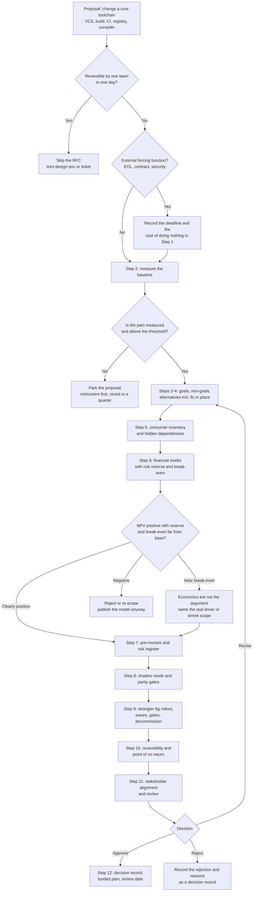

# Playbook: Write a Toolchain Migration RFC

> [!summary] Claim:
> A toolchain migration RFC is a decision instrument, not a design description: it exists so that an organization can approve, reshape, or reject an expensive and partly irreversible change using numbers, named risks, and pre-agreed exit criteria.
> The costs that decide the outcome (product-team migration labor, dual-running, the long tail) fall mostly outside the migration team's budget, so a model that omits them approves migrations that lose money.
> Every phase of the rollout needs a measurable gate written before the work starts, a shadow-mode comparison that can fail, and a stated point of no return, because "we will see how it goes" is how migrations stall at 60 percent with two systems running forever.
> The document ends with a decision record and a scheduled forecast-versus-actual review, so the next RFC is calibrated by this one.

This playbook owns the RFC itself: its structure, financial model, risk register, validation plan, rollout design, and stakeholder process.
The metrics it consumes are owned by [[Developer-Productivity-Metrics-DORA-SPACE-and-GSM]].
The deprecation policy it plugs into is owned by [[Platform-Engineering-Paved-Roads-and-Deprecation]].
Executing the resulting campaign across repositories, including codemods and burndown tracking, belongs to [[Large-Scale-Changes-and-Codemods-Across-Repos]] and [[Playbook-Execute-a-1000-Repo-Breaking-API-Migration]].
Build and test latency economics belong to [[Build-and-Test-Latency-Economics-and-Flaky-Tests]], and the build-versus-buy framing belongs to [[19-Shell-and-Unix-Engineering/23-Shell-at-Organizational-Scale/Build-versus-Buy-for-Tooling|Build versus Buy for Tooling]].

## Trigger and Symptoms

Activate this playbook when someone proposes to replace, consolidate, or fundamentally reconfigure a tool that most engineers touch every day: the version control system or code host, the build system, the CI system, the package manager or registry, the language toolchain or compiler distribution, or the release pipeline.

Typical triggers:

- A vendor contract renewal, end-of-life notice, or licence change forces a decision on a date.
  A forcing function is a legitimate reason to migrate, but it must be written down as the reason, because it changes the economics: the alternative to migrating is not "stay as is", it is "stay as is without support".
- A measured pain crosses a threshold: CI wait at the 90th percentile, merge-queue throughput, clone time, or the maintenance load of two overlapping systems.
  The Kubernetes project's KEP-2420 is a clean example: it proposed removing the Bazel build from the main repository because maintaining two build systems was a toil and confusion cost with a "duplicate-but-slightly-different" qualification gap (KEP-2420, Summary and Goals, as of 2026-11).
- A tool swap has been announced in chat or a slide with no baseline, no cost, and no rollback, and several teams are already planning around it.
- A previous migration is stuck: two systems have run in parallel for more than two planning cycles and nobody owns the end.

Use the design-doc test from Malte Ubl to decide whether an RFC is the right instrument: answer yes to three or more of five questions (unsure about the right design; would senior input help; is the design ambiguous or contentious enough that consensus has value; do cross-cutting concerns such as privacy, security, or logging get forgotten; is there a need for a high-level document on a legacy system) and write the document (Ubl, Design Docs at Google, 2020).
For a toolchain migration the answer is almost always yes, because the change is contentious by construction: it taxes many teams to benefit a platform team or the organization.

Do not write this RFC when:

- One team owns both the tool and all its users, and the change is reversible in a day.
  Write a mini design doc of one to three pages, which Ubl describes as legitimate, or just do it.
- The decision is already made and the document would only describe implementation.
  Ubl's warning applies: design docs that are really implementation manuals, with no trade-offs or alternatives, are "a clear indicator that a doc might not be necessary", and it would probably have been better to write the program right away.
  If the decision is made, write the rollout plan and say so, rather than staging a consultation whose outcome is fixed.
- The change is an in-place upgrade within a supported compatibility window.
  That is a release-engineering task; see [[Progressive-Delivery-Rollbacks-and-Feature-Flags]].

## Decision Tree



## Prerequisites

Collect these before drafting; an RFC written without them is an opinion.

- **Telemetry access.**
  CI run durations and outcomes, VCS operation timings, build logs or build-event data, and ticket or chat volume for toolchain complaints.
  If none exists, Step 2 becomes "instrument for four weeks" and the RFC waits.
- **A finance partner and a loaded cost rate.**
  Ask finance for a fully loaded cost per engineer-hour (salary, benefits, overhead, equipment) and for the rules on what counts as a saving: freed headcount, avoided hiring, reduced cloud spend, and recovered time are accounted differently, and only some of them appear on a budget line.
- **An ownership map.**
  A list of every repository or service with an owning team, for example from `CODEOWNERS` files or a service catalog.
  Without it you cannot size the product-team labor or assign wave cohorts.
- **A named executive sponsor and a named migration owner.**
  [[Platform-Engineering-Paved-Roads-and-Deprecation]] explains why a deprecation without an explicit owner makes no progress; the same holds for the migration.
- **Local tools.**
  `python3` for the baseline and model scripts, and for GitHub-hosted CI, the GitHub CLI `gh` (2.106.0 was current on the test host, as of 2026-11, macOS).
  `gh run list --json` exposes `attempt, conclusion, createdAt, databaseId, displayTitle, event, headBranch, headSha, name, number, startedAt, status, updatedAt, url, workflowDatabaseId, workflowName`, and `gh search code --json` exposes `path, repository, sha, textMatches, url` (both read from `--help` on gh 2.106.0).

**Verification:** run the baseline reducer on a synthetic sample to prove the tooling works before pointing it at real data.
The script reads the JSON that `gh run list --json startedAt,updatedAt,conclusion` prints and reports nearest-rank percentiles of run duration plus the failure rate.

```python
"""Read `gh run list --json startedAt,updatedAt,conclusion` JSON on stdin, print wait percentiles."""
import json
import sys
from datetime import datetime


def secs(run):
    t0 = datetime.fromisoformat(run["startedAt"].replace("Z", "+00:00"))
    t1 = datetime.fromisoformat(run["updatedAt"].replace("Z", "+00:00"))
    return (t1 - t0).total_seconds()


def pct(sorted_vals, q):
    # nearest-rank percentile
    rank = max(1, -(-int(q * len(sorted_vals)) // 100))
    return sorted_vals[min(rank, len(sorted_vals)) - 1]


runs = [r for r in json.load(sys.stdin) if r["conclusion"] in ("success", "failure")]
vals = sorted(secs(r) for r in runs)
print(f"n={len(vals)} p50={pct(vals, 50):.0f}s p90={pct(vals, 90):.0f}s p99={pct(vals, 99):.0f}s")
print(f"failure_rate={sum(r['conclusion'] == 'failure' for r in runs) / len(runs):.2f}")
```

On a synthetic input of 20 runs whose durations are 300, 330, ... 870 seconds, with every fifth run (indices 0, 5, 10, 15) marked a failure, it printed (synthetic data, Python 3.15.2, darwin-arm64, 2026-11):

```text
n=20 p50=570s p90=810s p99=870s
failure_rate=0.20
```

Real use is `gh run list --workflow ci.yml --limit 500 --json startedAt,updatedAt,conclusion | python3 -I baseline.py`.
Wall-clock `updatedAt - startedAt` is a proxy, not a measured duration.
In `gh` the two fields map to the REST fields `updated_at` and `run_started_at` (`pkg/cmd/run/shared/shared.go`, which also falls back to `created_at` when `run_started_at` is zero), and the REST schema describes `run_started_at` as "The start time of the latest run. Resets on re-run." (GitHub REST API description, `run_attempt` is 1 for the first attempt and higher after a re-run).
So a re-run resets the start time and the figure covers only the latest attempt, not the total time a developer waited; the docs do not define the value more precisely than that, so treat it as an approximation.
State which definition you used, because the RFC's headline number is only comparable if the post-migration measurement uses the same one.

## Commands and Numbers to Know

| Item | Platform | Value `(as of 2026-11)` | Why it matters |
| :--- | :--- | :--- | :--- |
| Design doc length for a larger project | Both | "around 10-20ish pages" sweet spot; a 1-3 page "mini design doc" is legitimate (Ubl, 2020) | Past about 20 pages, split the problem; a migration RFC that needs 40 pages is several RFCs. |
| Design doc "write one" test | Both | Yes to 3 or more of 5 questions (Ubl, 2020) | A cheap gate on whether the overhead is justified. |
| Rust RFC final comment period | Both | 10 calendar days, so it is open for at least 5 business days; all subteam members must sign off before entering it | A concrete, defensible minimum comment window for a decision that taxes many people. |
| Rust RFC dispositions | Both | merge, close, or postpone | An RFC needs an explicit negative outcome, not only approval. |
| KEP status gate | Both | Moving a KEP to `implementable` needs approval from each KEP approver | Approval authority is named per document, not implied. |
| KEP GA test stability | Both | "Minimum Two Week Window for GA e2e tests to prove flake free" (KEP template) | A graduation criterion expressed as a duration of clean signal, not a date. |
| KEP beta-to-GA spacing | Both | "Generally we also wait at least two releases between beta and GA/stable" | Back-to-back stages give users no chance to report problems. |
| KEP-2420 targets | Both | Alpha 1.21, Beta 1.21, Stable 1.23 (tracking issue, opened 2021-02-04) | A build-system removal scheduled over about two release cycles. |
| SWE at Google change-tooling threshold | Both | "if a change requires more than 500 edits, it's usually more efficient" to use change-generation tools (Ch. 22) | Where manual migration labor stops being a plausible plan. |
| PEP 512 decision and cutover | Both | Decision 2016-01-01; CPython development moved to GitHub 2017-02-10 | About 13 months from decision to cutover for a volunteer project, with the tools built in between. |
| Windows Git rollout (Microsoft) | Both | About 3.5M files, about 300GB, about 4,000 engineers, 1,760 daily lab builds across 440 branches; waves of about 2,000 (March 22), about 1,000 (April 22), 300-400 (May 12), 3,500 of about 4,000 by 2017-05-24 | A real wave schedule and scale; the first wave was half the engineers. |
| Rule of three | Both | With 0 disagreements in n independent trials, the 95 percent upper bound on the disagreement rate is about 3/n | Sizes a shadow-mode comparison: 1,000 clean comparisons bound the rate below 0.3 percent. |
| Monthly discount rate | Both | (1 + 0.10)^(1/12) - 1 = 0.797 percent per month at 10 percent annual | Converts the annual hurdle rate your finance partner gives you into the model's monthly steps. |
| Model output: base NPV, 36 months | Both | +438k USD, payback month 33, trough -3,367k at month 18 (illustrative inputs, Worked Example) | Shows the shape: a long trough, then a slow climb. |
| Model output: with risk reserve | Both | -227k USD, payback month 35 | The reserve alone flips the sign of the headline. |
| Model output: break-even recovery factor | Both | 0.525 against a base of 0.5 | The decision sits within about 5 percent of break-even on the least measurable input. |

## Step-by-Step Execution

Each step names an artifact the RFC must contain and ends with a check that can fail.
Do not continue past a failed check; go to Failure Modes.

### Step 1: Name the decision, its owner, its deadline, and its reversibility

Write one paragraph that states the decision as a choice with a date, for example: "Decide by 2027-01-31 whether to move the 1,200-engineer monorepo CI from the current system to a new one, and if yes, approve a funded 21-month plan."

Include:

- **Decider and deadline.**
  A named person or body, and a date after which the default (usually "stay") becomes the decision.
- **Forcing function, if any.**
  An end-of-life date or contract expiry, and what happens at that date if you do nothing.
- **Reversibility class.**
  Which parts are cheap to undo (a pilot, a shadow job) and which are not (decommissioning the old system, rewriting history, deleting the old artifacts).
  Step 10 turns this into an explicit point of no return.
- **Scope boundary.**
  Which repositories, which languages, which environments, and which user populations.

**Check:** a reader who knows nothing else can answer "who decides, by when, and what happens by default" from this paragraph alone.
If two reviewers give different answers, the paragraph is not done.

### Step 2: Measure the baseline

Quantify the problem with distributions, not means.
For build and CI pain the baseline is the distribution of time engineers wait, per event, and the number of events per engineer per day.
The reducer in Prerequisites produces the first; commit counts, push counts, and CI trigger counts from the VCS and CI system produce the second.

Collect, for at least four weeks so a release cycle and a holiday week are both visible:

- p50, p90, and p99 of the waiting step (CI duration, clone, build, test selection), and the failure and retry rates; the economics of these numbers are owned by [[Build-and-Test-Latency-Economics-and-Flaky-Tests]].
- Cost: compute, licences, and the FTEs that operate the current system.
- Experience: a short survey run once now and once after each wave, with the same wording (the Windows team surveyed "How satisfied are you?" two weeks into the first wave and tracked check-in activity across both systems; Brian Harry, 2017).
- Incident history: outages and data-loss events attributable to the current tool in the last year.

Define the metrics through the goal-signal-metric method in [[Developer-Productivity-Metrics-DORA-SPACE-and-GSM]], and add guardrail metrics that the migration must not worsen; the gaming failure modes of a single headline metric are drilled in [[Drill-Engineering-Systems-Audit-a-Gamed-Productivity-Dashboard]].

**Check:** the baseline is reproducible by someone else from the stated queries and time window, and the RFC states each metric's definition precisely enough that the post-migration measurement can use the same one.
A baseline that cannot be re-measured cannot support a success claim later.

### Step 3: Write goals, non-goals, and success metrics with thresholds

Goals are outcomes with numbers; non-goals are things that could reasonably be goals but are explicitly not.
Ubl is precise on the second: non-goals "aren't negated goals like 'The system shouldn't crash'", they are real options you chose not to pursue.
KEP-2420's non-goals show the technique: it excludes removing Bazel from sub-projects and excludes improving the existing make build, "largely orthogonal" to the decision.

Use PEP 512's two-tier structure: a **minimum goal** (the new system must be at least as productive as today) and **extended goals** (improvements that justify the cost).
The minimum goal is the acceptance gate; the extended goals are the business case.
PEP 512 states it exactly: meeting the minimum goals should let development "be as productive as it currently is", and meeting the extended goals "should improve the development process from its status quo".

For each success metric record:

| Field | Example |
| :--- | :--- |
| Metric | p90 CI wall time for the main pipeline |
| Baseline | measured value, window, and query from Step 2 |
| Threshold to proceed from pilot to wave 1 | new system within a stated factor of old on the shadow comparison |
| Target at 100 percent adoption | stated improvement, with the measurement point |
| Guardrail | failure rate, retry rate, p99, and developer-survey score must not regress by more than a stated margin |
| Owner of the number | a person, not a team |

**Check:** every goal has a baseline and a threshold; every non-goal is something a reasonable stakeholder might have expected; no metric is both the target and its own guardrail.

### Step 4: Enumerate alternatives, including doing nothing and fixing in place

The alternatives section is, in Ubl's words, "one of the most important" because it shows why the chosen design beats the ones a reader is already thinking of.
For a migration it must always contain:

1. **Do nothing.**
   With the status quo's cost over the same horizon, including the forcing function if there is one.
2. **Fix in place.**
   Software Engineering at Google reports that "evolving a system in place is usually cheaper than replacing it with a new one, when turndown costs are included" (Ch. 15, TL;DRs) and that the costs of migrating to entirely new systems "are frequently underestimated" (Ch. 15).
   If the RFC does not engage with an in-place improvement, reviewers will supply it.
3. **Buy versus build the replacement.**
   Delegate the framework to [[19-Shell-and-Unix-Engineering/23-Shell-at-Organizational-Scale/Build-versus-Buy-for-Tooling|Build versus Buy for Tooling]] and import its result, not its argument.
4. **The proposal and at least one credible rival.**
   KEP-2420 weighs "Continue maintaining both" and "Improve bazel integration and drop the make based build", and rejects the second with specifics: CGO `pkg-config` directives do not work in `rules_go`, cross-compiling with CGO never shipped in Kubernetes, and a larger pool of contributors had demonstrated experience updating the make build.
   Those are checkable engineering facts, not preferences.

Evaluate in two passes:

- **Hard gates first.**
  Capabilities the organization cannot lose (for example, hermetic builds on the platforms you ship, an audit trail, support for your largest repository).
  An option that fails a gate is eliminated before any weighting, so a high weighted score cannot launder a missing must-have.
- **Weighted scoring second**, with weights agreed before scoring, and a column for evidence per cell (a benchmark, a pilot result, a reference customer).

Reference architectures for specific choices live in sibling pillars, for example [[Decision-Record-Monorepo-vs-Polyrepo]], [[Build-Performance-Economics-and-Decision-Record]], and [[Beyond-Git-Jujutsu-Sapling-and-Patch-Theory]].

**Check:** each rejected alternative has a stated reason that a proponent of that alternative would recognize as fair.
Show the section to its strongest advocate before circulating.

### Step 5: Inventory consumers and hidden dependencies

The migration's real scope is everything that depends on the old tool, including things nobody remembers: bot accounts, IDE plugins, cron jobs, release scripts, dashboards that parse log formats, vendor integrations, and one-off scripts in a wiki.
This is Hyrum's Law applied to a toolchain: every observable behavior of the old tool has a dependent (see [[Dependency-Management-Theory-and-Hyrums-Law]]).

Static discovery:

```bash
# Repositories in an organization that contain a given CI config file (names are illustrative)
gh search code --owner YOUR-ORG --filename Jenkinsfile --limit 1000 --json repository,path
```

`gh search code` is bounded by `--limit` (default 30) and by GitHub's search index, so treat the result as a lower bound and reconcile it against the ownership map.
Inside a monorepo, use the code search described in [[Code-Search-and-Semantic-Indexing-at-Scale]] to find references by structure, not by text.

Dynamic discovery:

- **Brownouts.**
  Software Engineering at Google (which does not use the word "brownout") describes announcing "planned outages of increasing duration in the months and weeks prior to the turndown", which "often discover unknown dependencies between running systems" (Ch. 15).
  Schedule them in the plan, with owners and a rollback of each outage.
- **Renaming implementation-only symbols or endpoints** to see who breaks, the technique the same chapter reports using.
- **Access logs.**
  Who authenticated to the old system in the last 90 days, by service account and by human, joined to the ownership map.

Classify every consumer into one of four rows and size the work in the model:

| Class | Example | Migration path |
| :--- | :--- | :--- |
| Mechanical | Repository with a standard config | Codemod or generated config ([[Large-Scale-Changes-and-Codemods-Across-Repos]]) |
| Assisted | Repository with a custom step | Platform team writes the config; owner reviews |
| Bespoke | Release pipeline with unique gates | Joint project with a named engineer on each side |
| Orphan | Used, but no live owner | Platform team decides: adopt, archive, or turn off after notice |

**Check:** the inventory has an owner for every row, the orphan list is explicit, and the count of rows in each class is the input to the Step 6 labor estimate rather than a guess.

### Step 6: Build the financial model

Model month by month, not as a single payback sentence, because the shape matters: migrations have a long investment trough, benefits that ramp with adoption, and some savings that only appear after the old system is turned off.

Structure:

- **Benefits.**
  - *Recovered engineering time* = engineers x events per day x seconds saved per event x recovery factor x working days x cost per hour, scaled by the fraction of engineers already migrated.
    The **recovery factor** is the share of saved wait time that becomes useful work.
    It is the least measurable input: a person waiting 90 seconds rarely converts 90 saved seconds into 90 seconds of focused output.
    It is a modeling parameter you must state and defend, not a published constant; calibrate it from a pilot (changes merged per engineer-week before and after), and show the break-even value.
  - *Infrastructure savings*, counted only once the old system is switched off.
    Test the incumbent's claimed benefits as hard as the proposal's.
    KEP-2420's drawbacks section records that Bazel's remote caching "theoretically reduces our resource consumption", but that in practice the gain was reduced because repeated unit-test runs, enabled to surface flakes, defeat result caching for both `go` and Bazel, and that "current measurements show equivalent runtime for the two builds".
  - *Maintenance FTE freed*, also only after decommission, net of the FTEs that run the new system.
- **Costs.**
  - *Migration team* FTE-months until decommission.
  - *Dual running*: the infrastructure cost of both systems at scale, from the first wave to decommission.
  - *Product-team labor*: repositories x hours per repository x loaded rate.
    This is paid by teams outside the platform budget and is usually the item an RFC forgets; Software Engineering at Google calls a compulsory deprecation without staffing an "unfunded mandate" that "creates friction between infrastructure maintainers and their customers" (Ch. 15).
  - *Training* and a one-time *productivity dip* per migrated engineer (the learning-curve trough).
  - *A risk reserve*: the expected loss of the risk register in Step 7, so the model and the register cannot disagree.
- **Timeline.**
  Pilot, rollout to 100 percent, then a tail of dual running until decommission.
  Costs and benefits are keyed to those phases.
- **Valuation.**
  Net present value at the finance partner's hurdle rate, payback month, and the **trough** (the most negative cumulative position), which is the number an executive must be willing to fund.
  Add a one-at-a-time sensitivity table and the break-even value of the recovery factor.
  The horizon is a choice: a 36-month horizon with no terminal value, as in the model in this step, deliberately ignores benefits after month 36.
  State it, and show the result at a second horizon if the answer depends on it.

The model in this step is the one the Worked Example runs.
Every input is an assumption to be replaced with your own measurement; the code uses only the Python standard library.

```python
"""Toolchain migration ROI model: monthly cash flows, NPV, payback, sensitivity.

Every input is an assumption to be replaced with your own measurements.
Standard library only; output is deterministic.
"""
from dataclasses import dataclass, replace


@dataclass(frozen=True)
class Inputs:
    engineers: int = 1200            # engineers who use the toolchain
    cost_per_hour: float = 120.0     # fully loaded USD per engineer-hour
    days_per_month: float = 21.0
    waits_per_day: float = 6.0       # build or CI waits per engineer per day
    seconds_saved: float = 90.0      # per wait, new system vs old
    recovery: float = 0.5            # share of saved wait that becomes useful work
    infra_savings: float = 25_000.0  # USD per month, only once the old system is off
    old_fte: float = 3.0             # FTE that run the old system, freed at decommission
    new_fte: float = 1.5             # FTE that run the new system afterwards
    team_fte: float = 6.0            # migration team until decommission
    fte_month: float = 20_000.0      # USD per FTE-month
    pilot: int = 6                   # months before the first wave
    rollout: int = 12                # months from first wave to 100% adoption
    tail: int = 3                    # months of dual running after 100% adoption
    dual_run: float = 30_000.0       # USD per month while both systems run at scale
    repos: int = 400
    hours_per_repo: float = 16.0     # migration labor per repo, spent by the product team
    training_hours: float = 4.0      # per engineer
    dip_hours: float = 6.0           # one-time productivity dip per engineer
    annual_rate: float = 0.10
    horizon: int = 36


def decommission(i: Inputs) -> int:
    return i.pilot + i.rollout + i.tail


def adoption(i: Inputs, month: int) -> float:
    return min(max((month - i.pilot) / i.rollout, 0.0), 1.0)


def risk_register(i: Inputs):
    """(name, probability, impact in USD). Impacts derive from the same inputs."""
    slip = 6 * (i.dual_run + i.team_fte * i.fte_month)
    wave = 0.25 * i.engineers * i.dip_hours * 4 * i.cost_per_hour
    return [
        ("Long tail refuses to migrate, dual running +6 months", 0.40, slip),
        ("Parity gap forces one wave to roll back", 0.30, wave),
        ("Key-person loss stalls the migration team 3 months", 0.25, 3 * i.team_fte * i.fte_month),
        ("Remote cache outage in a cutover week", 0.15, 150_000.0),
    ]


def expected_loss(i: Inputs) -> float:
    return sum(p * impact for _, p, impact in risk_register(i))


def cashflows(i: Inputs, with_risk: bool):
    rate = (1 + i.annual_rate) ** (1 / 12) - 1
    decom = decommission(i)
    reserve_month = i.pilot + i.rollout // 2
    rows, cum, npv = [], 0.0, 0.0
    for m in range(1, i.horizon + 1):
        a_prev, a = adoption(i, m - 1), adoption(i, m)
        d = a - a_prev
        wait = (i.engineers * (a_prev + a) / 2 * i.waits_per_day * i.seconds_saved / 3600
                * i.recovery * i.days_per_month * i.cost_per_hour)
        post = m > decom
        benefit = wait + ((i.infra_savings + i.old_fte * i.fte_month) if post else 0.0)
        cost = (i.new_fte if post else i.team_fte) * i.fte_month
        cost += i.dual_run if i.pilot < m <= decom else 0.0
        cost += d * i.repos * i.hours_per_repo * i.cost_per_hour
        cost += d * i.engineers * (i.training_hours + i.dip_hours) * i.cost_per_hour
        if with_risk and m == reserve_month:
            cost += expected_loss(i)
        net = benefit - cost
        cum += net
        npv += net / (1 + rate) ** m
        rows.append((m, a, net, cum))
    return rows, npv


def summarize(i: Inputs, with_risk: bool):
    rows, npv = cashflows(i, with_risk)
    payback = next((m for m, _, _, c in rows if c >= 0 and m > i.pilot), None)
    trough_m, trough = min(((m, c) for m, _, _, c in rows), key=lambda t: t[1])
    return rows, npv, payback, trough_m, trough


def k(x: float) -> str:
    return f"{x / 1000:,.0f}k"


def breakeven_recovery(i: Inputs) -> float:
    lo, hi = 0.0, 1.0
    for _ in range(60):
        mid = (lo + hi) / 2
        if cashflows(replace(i, recovery=mid), True)[1] < 0:
            lo = mid
        else:
            hi = mid
    return hi


def main() -> None:
    base = Inputs()
    rows, npv, payback, tm, tr = summarize(base, False)
    print("== Base case (USD, 36-month horizon, 10% annual discount rate)")
    steady = base.engineers * base.waits_per_day * base.seconds_saved / 3600
    steady = steady * base.recovery * base.days_per_month * base.cost_per_hour
    print(f"steady-state wait benefit per month at 100% adoption: {k(steady)}")
    print(f"decommission month: {decommission(base)}")
    print("month adoption net/month cumulative")
    for m, a, net, cum in rows:
        if m in (6, 12, 18, 21, 24, 30, 36):
            print(f"{m:>5} {a * 100:>7.0f}% {k(net):>9} {k(cum):>10}")
    print(f"NPV: {k(npv)}  payback month: {payback}  trough: {k(tr)} at month {tm}")

    print("\n== Risk register (expected loss = probability x impact)")
    for name, p, impact in risk_register(base):
        print(f"{p:.2f} x {k(impact):>6} = {k(p * impact):>5}  {name}")
    _, npv_r, pay_r, _, tr_r = summarize(base, True)
    print(f"total expected loss: {k(expected_loss(base))}")
    print(f"NPV with reserve: {k(npv_r)}  payback month: {pay_r}  trough: {k(tr_r)}")

    print("\n== One-at-a-time sensitivity (with reserve)")
    print("case                         NPV  payback")
    cases = [
        ("recovery 0.35", replace(base, recovery=0.35)),
        ("recovery 0.65", replace(base, recovery=0.65)),
        ("seconds_saved 63", replace(base, seconds_saved=63.0)),
        ("seconds_saved 117", replace(base, seconds_saved=117.0)),
        ("team_fte 8", replace(base, team_fte=8.0)),
        ("rollout 18 months", replace(base, rollout=18)),
        ("rollout 18, tail 6", replace(base, rollout=18, tail=6)),
        ("seconds_saved 30", replace(base, seconds_saved=30.0)),
    ]
    for name, inp in cases:
        _, n, p, _, _ = summarize(inp, True)
        print(f"{name:<22} {k(n):>10}  {p}")
    print(f"\nbreak-even recovery factor (NPV = 0 with reserve): {breakeven_recovery(base):.3f}")


if __name__ == "__main__":
    main()
```

**Check:** the model reproduces the base case by hand for at least one month (see the Worked Example), every input is labeled measured or assumed, and a second person can change an input and predict the direction of the output before running it.
If the model's total cost does not include a line that someone outside the platform team pays, it is incomplete.

### Step 7: Run a pre-mortem and write the risk register

Gary Klein's premortem asks team members to assume the project "has just failed" and to generate plausible reasons for the failure (Klein, HBR, September 2007; the article's public abstract says team members "assume that the project they are planning has just failed" and "generate plausible reasons for its demise", and the rest of the article is paywalled, so only the abstract is relied on here).
It works because it licenses people to voice doubts they would otherwise suppress in a design review.
Run it with the platform team, three or four product-team leads, a security reviewer, and someone who operates the old system, for 45 minutes, and have everyone write causes silently before discussing.

Turn the output into a register with these columns, and give every row an owner:

| Column | Meaning |
| :--- | :--- |
| Risk | A specific failure, written as an event, not a worry |
| Probability | Your estimate, as a number, with a range if you are unsure |
| Impact | In the model's currency, derived from the same inputs as the model |
| Detection | How and how fast you would find out (a metric, an alert, a complaint) |
| Tripwire | The observable value that triggers the response |
| Mitigation | What is done in advance to reduce probability or impact |
| Contingency | What is done if it happens anyway |

Plot the rows on a probability-by-impact grid (a risk matrix) to decide which get a funded mitigation before the first wave, which get a monitored tripwire only, and which are accepted.
Rows that are high on both axes are candidates for redesigning the plan, not for a mitigation note.
The probabilities in the Worked Example are the author's illustrative numbers, not measured base rates; the discipline is that every row has one, that the sum feeds the model, and that the post-implementation review (Step 12) compares them to what happened.

Categories that recur in toolchain migrations, each with a documented precedent:

- **Behavioral parity gaps.**
  The new system does something subtly differently: ordering, caching, flaky-test behavior, environment inheritance, line endings.
  Mitigation is the shadow comparison in Step 8.
- **Scale cliffs.**
  The new system works for the pilot and fails at production size.
  In the Windows Git rollout, the first week showed that the pull request and merge-conflict UI "simply didn't scale" to changes with "10,000's of changes with 1,000's of conflicts", and the team had to virtualize lists and fetch incrementally; it was resolved "within a couple of days" (Brian Harry, 2017).
  Their mitigation was preparation: backup plans existed for the first wave, and were not needed.
  Test with the largest repository and the worst merge, not the median.
- **The long tail of integrations.**
  PEP 512's migration plan is largely integration work rather than the move itself: GitHub usernames in the issue tracker, a CLA status check, a service mapping old revision identifiers to URLs, a `sys._mercurial` replacement, a bot for the contribution workflow.
  Budget for the integrations as a first-class workstream.
- **Identifier and history continuity.**
  PEP 512 describes, as the most likely design, a revision lookup service that accepts both old Mercurial changeset IDs and new Git hashes, disambiguating by length (12 or 40 hex digits are compared to the known Mercurial set; a non-match, or any other length between 7 and 40, is treated as a Git hash).
  Every link, ticket, and commit message in your history that embeds an old identifier is a dependency.
- **Performance regressions on the critical path.**
  Measure with the methodology in [[Performance-Regression-Detection-in-CI]] and [[Benchmark-Methodology-Noise-and-Environment-Control]], not a single run.
- **Security and provenance.**
  A new CI or build system changes who can sign and publish.
  Check the build and source tracks in [[SLSA-Framework-Build-and-Source-Tracks]] before cutover, not after.
- **People risk.**
  A migration team of three with one key person has a bus factor of one, and the model should say what that costs (Worked Example, risk row 3).
- **Coupling to team structure.**
  Fowler's strangler-fig article also stresses organizational change: legacy systems become rigid because of the "design thinking and organizational processes" that produced them, so a migration that does not change those will rebuild the same system.

**Check:** every risk has a tripwire that a dashboard or a person can observe, and the expected-loss sum is wired into the model; deleting the risk reserve visibly changes the headline.

### Step 8: Design the validation: shadow mode and parity gates

A toolchain migration should not be validated by feature checklists alone; it should be validated by running both systems on the same real inputs and comparing outputs.
This is the control and candidate pattern of GitHub's Scientist: run the original (the control) and the new code (the candidate) on live requests, return the control's result, and record "the behavior mismatches and performance differences between the legacy system and the new one" (Jesse Toth, 2016).
Scientist also records exceptions from both branches and can sample (override `enabled?` with a percentage), because running both can be expensive.

For toolchains the control is the old build or CI path and the candidate is the new one, run on every change.

Mechanism in GitHub Actions: put the candidate in its own job with `jobs.<job_id>.continue-on-error: true`, which "prevents a workflow run from failing when a job fails" (GitHub Docs, as of 2026-11).
Required status checks gate merging in a protected branch: a required check "must have a successful, skipped, or neutral status", so a candidate job that is not required cannot block merges (GitHub Docs, About protected branches, as of 2026-11).
That makes shadow mode safe, and it also makes it silent, which is the main hazard; see the debug-this interview question.

KEP-2420 describes the promotion path in its test plan: "Non-blocking 'make build' equivalents to kubernetes/kubernetes 'bazel' CI jobs will be introduced... When the new jobs provide equivalent signal, they will be moved to blocking, and the old jobs will be retired."
Adopt that three-state lifecycle: **shadow** (non-blocking, results compared), **blocking** (the candidate gates merges, the control still runs), **sole** (the control is retired).

What to compare, with a pass condition for each:

| Dimension | Comparison | Gate to enter blocking |
| :--- | :--- | :--- |
| Verdict agreement | Per commit: old pass/fail versus new pass/fail | Disagreement rate below a stated bound, every disagreement classified (new bug, old bug, flake) |
| Artifact equivalence | Hash of the outputs where reproducible; otherwise a normalized diff | Zero unexplained differences in released artifacts; see [[Hermetic-and-Reproducible-Builds]] |
| Latency | Distribution of duration, p50 and p99 | Within the Step 3 threshold, measured with the same definition as the baseline |
| Resource cost | Compute-hours, cache hit rate, storage | Within the model's assumption; otherwise re-run the model |
| Coverage of the tail | Share of repositories and config shapes exercised | Every Step 5 class represented |

Size the comparison with the rule of three: if you observe zero disagreements in n independent comparisons, the 95 percent upper confidence bound on the true disagreement rate is about 3/n, which follows from setting (1 - p)^n = 0.05 and noting -ln(0.05) = 2.996.
So 300 clean comparisons bound the rate below 1 percent, and 1,000 bound it below 0.3 percent.
This holds only for independent samples; consecutive commits to one repository are correlated, so count distinct repositories and distinct change shapes, not raw commits.

Flaky tests contaminate every comparison, because a flake in either system looks like a disagreement.
Quarantine them first; the procedure is in [[Playbook-Quarantine-and-Eliminate-Flaky-Tests]].

**Check:** the shadow comparison can fail: seed a known difference (an intentionally wrong flag in the candidate) and confirm the comparison reports it.
A comparison that has never been seen to fail proves nothing.

### Step 9: Design the rollout as a strangler fig

State the strategy explicitly so reviewers know what is being approved.
Martin Fowler's strangler fig begins "with small additions... built on top of, yet separate to the legacy code base" and gradually moves behavior to the new system, accepting "transitional architecture to allow the new and legacy system to coexist" because "the reduced risk and earlier value from the gradual approach outweigh its costs" (Fowler, 2024).
The same source warns that the "simple replacement" plan "go[es] down in flames most of the time" because replacing a serious system takes long, users cannot wait for new features, and existing behavior is hard to enumerate.

At the interface level the pattern is expand, migrate, contract: add the new path beside the old, move consumers, then remove the old path (Danilo Sato, Parallel Change, 2014).
The first phase is only safe when the old path is untouched, and the last only when no consumer remains; the middle phase is where the rollout plan lives.

Sequence by risk and by dependency, not by team convenience.
PEP 512 did this: code-only repositories first (devinabox), then web-related repositories (peps, devguide), and the CPython repository last because it "requires more tooling before being moved", with requirements per section that "should unblock" the migration of the related repositories.
Microsoft's Windows rollout went in waves of roughly 2,000, 1,000, and 300-400 engineers a few weeks apart, and kept some teams on the old system while they worked to deadlines, expecting to finish "in the next few months" (Brian Harry, 2017).

Define per phase:

| Phase | Population | Entry gate | Exit gate (go/no-go) | Rollback |
| :--- | :--- | :--- | :--- | :--- |
| Shadow | Candidate runs, nobody depends on it | Pilot team agrees; Step 8 comparison running | Parity gates met for the declared sample | Turn off the job |
| Pilot | One friendly team with real work | Shadow gates met | Pilot success metrics and survey over threshold for a set number of weeks | Pilot team returns to old path |
| Wave N | Cohort sized by blast radius | Previous wave exit gate; support capacity confirmed | Same metrics as pilot, plus support ticket rate under a bound | Per-cohort revert (Step 10) |
| Default | New system is default, old opt-in | Waves complete or a set share adopted | Remaining consumers listed by name with owners and dates | Flip the default back |
| Compulsory | Old system deadline announced, enforcement active | Staffed help for the long tail | Zero unexplained dependents; brownouts passed | Extend the deadline only by decision record |
| Decommission | Old system off | Compulsory gate met | Old data archived and verified; cost lines removed | Restore from archive within a stated time |

Two policy points matter more than the diagram:

- **Advisory is not a plan.**
  Software Engineering at Google separates advisory deprecation (no deadline) from compulsory deprecation (a removal date), and says a warning-only deprecation "can lead to (slightly) fewer new uses of an obsolete system, but it rarely leads to teams actively migrating away from it"; for compulsory deprecation to work, "its schedule needs to have an enforcement mechanism" and the team needs the power "to break noncompliant users after they have been sufficiently warned" (Ch. 15).
  The RFC must say who has that power and when it takes effect, and the sponsor must sign it.
- **Prevent backsliding.**
  Without it, "deprecation can become a game of whack-a-mole" as teams copy existing usage.
  Google uses static analysis to warn on new uses of a deprecated symbol at review time and build-system visibility lists (the book's word is "whitelists") to block new dependencies, pruned as consumers leave (Ch. 15).
  Equivalent mechanisms for a toolchain: a lint that rejects the old CI config file in new repositories, a repository template that only offers the new system, and an allowlist for the old one that only shrinks.
  See [[Static-Analysis-at-Scale-Tricorder-and-Autofix]] for the review-time mechanism.

Also write the migration's incremental milestones.
Ch. 15 warns against making removal of the old system the only measurable milestone; it recommends concrete incremental milestones that are measurable and deliver value to users, such as deleting a key subcomponent.

For the mechanical part of the work across many repositories (sharded changes, canaries, burndown), do not restate it here; link to [[Playbook-Execute-a-1000-Repo-Breaking-API-Migration]] and [[Large-Scale-Changes-and-Codemods-Across-Repos]] and give the RFC's numbers (repository count, labor per class) as the inputs to that plan.

**Check:** every phase has an entry gate, an exit gate with a number, and a rollback; the plan names who enforces the compulsory phase; and the plan contains at least one milestone that is not "old system deleted".

### Step 10: Design reversibility and state the point of no return

For each phase, answer: if the exit gate fails, what is the way back, how long does it take, and what is lost?

Techniques with precedent:

- **Make the old system read-only before deleting it.**
  PEP 512 specifies a Mercurial `hgrc` hook, `pretxnchangegroup.reject`, that prints a message and exits 1, "will make the repository read-only", so the old repository stays available as a reference while rejecting new commits.
- **Back up state that does not replicate.**
  PEP 512 notes that Git clones implicitly back up repository history, but code-review history "does not have the same implicit backup mechanism", so a daily backup of review data "should be done", which also keeps a later move off GitHub feasible.
  Ask which data in your old system has no second copy (build logs, test history, approvals, audit trails) and archive it before decommission.
- **Keep the old system runnable until the point of no return.**
  The Windows team had "backup plans in case of mishap" for the first cutover (Brian Harry, 2017).
  Write the plan down: who runs the rollback, how long it takes, and what the data-loss window is.
- **Per-cohort rollback.**
  A wave that fails its exit gate reverts only that wave; this requires that cohort boundaries are real (separate configs, separate repositories) and that nothing couples a migrated team to an unmigrated one.

Then state the **point of no return** as a specific event with a date: "after the compulsory deadline and archive verification, reverting requires a new RFC".
Reviewers can then see exactly which decision they are approving: the pilot and early waves are cheap bets; decommission is not.

Write the rollback itself in the RFC as a procedure, with a time budget and an owner; the format is the Rollback Procedure section of this note.

**Check:** a person who was not involved can execute the rollback for the current phase from the written procedure, and the document states the first phase from which rollback is impossible or prohibitively expensive.

### Step 11: Align stakeholders and run the review

Treat the review as a process with roles, not an email.

- **Map stakeholders by what they must be able to say yes to.**
  Executive sponsor (funding and enforcement), finance partner (the model's accounting), security (provenance, access, audit), product-team leads (labor and schedule), operators of the old system (their jobs and their knowledge), developer-experience or support (capacity), and the strongest advocate of each rejected alternative.
- **Pre-wire before circulating.**
  Walk each stakeholder through the parts that affect them in a 30-minute conversation, so the formal review contains no first-time surprises.
  Ubl notes that reviews "can add a lot of value, but they are also a dangerous trap of overhead"; the value is incorporating the organization's cross-cutting experience early, so pre-wire the people whose concerns are most likely to reshape the plan.
- **Use a fixed comment window and named disposition.**
  The Rust RFC process shows one defensible design: a motion for a final comment period with a disposition (merge, close, or postpone), sign-off by all subteam members before the period starts, a 10 calendar day window advertised widely, and cancellation of the period if substantial new arguments appear.
  It also states that proceeding "does not require consensus amongst all participants", only that the argument for the disposition has been clearly articulated and that there is no strong consensus against it outside the deciding group.
  Write your equivalent: who decides, what minimum window applies, and what counts as a blocking objection.
- **Record dissent.**
  Include a section listing objections that were heard and not adopted, with the reason, so the decision record is honest.
- **Use the Production Readiness Review idea.**
  The KEP template's questions are a reusable checklist for any migration: how can the change be enabled and disabled; can it be rolled back; what specific metrics should inform a rollback; was an upgrade-downgrade-upgrade path tested; how can an operator tell the feature is in use; what are the SLOs and SLIs; and what depends on it.
- **Keep the audience small enough to decide.**
  A review with 40 reviewers and no decider produces comments, not a decision.

**Check:** each stakeholder class has a named representative who has seen the relevant section before the formal window, the decider is named, and the window and sign-off rules are written in the document.

### Step 12: Assemble, decide, and close the loop

Assemble the document in the order of the template in this step.
Keep it to the length Ubl suggests for a large project, around 10-20 pages, and move bulk (inventories, raw survey data, benchmark tables) to linked appendices.

````markdown
# RFC-NNNN: Migrate <system A> to <system B>

Status: draft | in review | final comment | approved | rejected | postponed | superseded by RFC-MMMM
Owner: <name>   Sponsor: <name>   Decider: <name or body>   Decision due: <date>
Reviewers: <named per stakeholder class>   Comment window: <dates and rules>

## 1. Decision requested
One paragraph: the choice, the date, the default if no decision is made, and the reversibility class.

## 2. Summary
Five sentences: problem with its number, proposal, cost and trough, expected benefit with break-even, point of no return.

## 3. Background and baseline
Measured distributions with queries, window, and definitions. Incident history. Cost of the status quo.

## 4. Goals, non-goals, success metrics
Minimum goal (no worse than today) and extended goals. Thresholds, guardrails, metric owners.

## 5. Alternatives considered
Do nothing. Fix in place. Buy. Proposal. Rival. Hard gates, then scored table with evidence.

## 6. Proposal
Target architecture. What changes for the engineer on their first day. Interoperation with the old system during the transition.

## 7. Consumer inventory
Counts by class (mechanical, assisted, bespoke, orphan). Owners. Discovery method and its blind spots.

## 8. Financial model
Inputs marked measured or assumed. Monthly table. NPV, payback, trough. Sensitivity. Break-even. Horizon and what it excludes. Who pays each line.

## 9. Risks and mitigations
Register with probability, impact, detection, tripwire, mitigation, contingency, owner. Pre-mortem date and attendees.

## 10. Validation plan
Shadow mode design, parity dimensions, sample sizes, gates to blocking, how the comparison was proven able to fail.

## 11. Rollout plan
Phases with entry gate, exit gate, rollback. Enforcement authority. Backsliding prevention. Milestones that are not deletion.

## 12. Reversibility
Rollback procedures with time budgets. Data archived. Point of no return.

## 13. Staffing and budget
Team, duration, stage-gated funding, support capacity per wave, product-team labor and who funds it.

## 14. Open questions
What will be resolved before approval, what during implementation, what is out of scope.

## 15. Dissent and responses
Objections heard, not adopted, with reasons.

## 16. Review schedule
Forecast-versus-actual review dates. Metrics to be compared. Owner.

## Appendices
Inventory, raw benchmark data, survey instrument, model source and inputs, glossary.
````

After approval:

- **Write the decision record.**
  Michael Nygard's architecture decision record format is short (title, context, decision, status, consequences) and keeps superseded decisions "around" marked as superseded.
  One decision record for approval (or rejection), and a new one for each later change of course (a schedule change, a scope cut, an invocation of the enforcement clause).
- **Stage-gate the funding.**
  Fund the pilot and shadow phase; release the next tranche on the exit gate.
  A single multi-year allocation removes the pressure to hit the gates honestly.
- **Schedule the forecast-versus-actual review.**
  At 6 and 12 months after decommission, re-measure every success metric with the Step 2 definitions, re-run the model with actuals, and compare each risk's probability to what occurred.
  Publish the result; it is how the organization learns whether its estimates are calibrated.
- **Keep the RFC living during implementation.**
  Ubl recommends updating the design doc as shortcomings surface during implementation; for a migration, update the Implementation History and the decision records rather than silently diverging.

**Check:** the document passes a cold read: someone outside the project can state the decision, the cost, the trough, the break-even, the first gate, and the point of no return after ten minutes.
The decision record exists, funding is tied to gates, and the review dates are on a calendar.

## Worked Example: The Model Decides Whether to Write the Rest

This note has no lab.
The model in Step 6 is the worked example; it ran once on 2026-11-26 with Python 3.15.2 on darwin-arm64 (`python3 -I roi_model.py`), and its output is shown unedited.
The scenario is generic: 1,200 engineers moving their build and CI to a new system, with a 6-month pilot, a 12-month rollout, and a 3-month tail.
All inputs are illustrative assumptions chosen to be plausible, not measurements of any real organization.

```text
== Base case (USD, 36-month horizon, 10% annual discount rate)
steady-state wait benefit per month at 100% adoption: 227k
decommission month: 21
month adoption net/month cumulative
    6       0%     -120k      -720k
   12      50%     -230k    -2,384k
   18     100%     -117k    -3,367k
   21     100%       77k    -3,137k
   24     100%      282k    -2,291k
   30     100%      282k      -601k
   36     100%      282k     1,090k
NPV: 438k  payback month: 33  trough: -3,367k at month 18

== Risk register (expected loss = probability x impact)
0.40 x   900k =  360k  Long tail refuses to migrate, dual running +6 months
0.30 x   864k =  259k  Parity gap forces one wave to roll back
0.25 x   360k =   90k  Key-person loss stalls the migration team 3 months
0.15 x   150k =   22k  Remote cache outage in a cutover week
total expected loss: 732k
NPV with reserve: -227k  payback month: 35  trough: -4,099k

== One-at-a-time sensitivity (with reserve)
case                         NPV  payback
recovery 0.35             -1,576k  None
recovery 0.65              1,122k  31
seconds_saved 63          -1,576k  None
seconds_saved 117          1,122k  31
team_fte 8                -1,112k  None
rollout 18 months         -1,775k  None
rollout 18, tail 6        -2,263k  None
seconds_saved 30          -3,225k  None

break-even recovery factor (NPV = 0 with reserve): 0.525
```

Read the output the way a reviewer should.

1. **Check one number by hand.**
   The steady-state wait benefit is 1,200 engineers x 6 waits x 90 s = 648,000 s = 180 hours per day, x 0.5 recovery = 90 hours, x 21 days = 1,890 hours per month, x 120 USD = 226,800, printed as 227k.
   Post-decommission net per month is 227k + 25k infrastructure + 60k freed old FTEs (3 x 20k) - 30k new FTEs (1.5 x 20k) = 282k, which matches months 24 to 36.
   If a model cannot be reproduced on paper for one month, do not trust its other numbers.
2. **The trough is the funding ask.**
   The cumulative position bottoms at -3,367k in month 18 (the end of the rollout) in the base case, and -4,099k with the reserve.
   Payback is month 33 and month 35 respectively, and the horizon is 36, so with the reserve a slip of two months or more pushes payback past the model's horizon.
3. **The reserve flips the sign.**
   The unreserved NPV is +438k; the 732k expected loss, booked at month 12 and discounted, makes it -227k.
   The largest single contributor is the long tail, row 1: 0.40 x 900k = 360k, where the 900k impact is six extra months of both dual running (30k) and the migration team (6 x 20k = 120k).
4. **Only the product matters for two inputs.**
   `recovery 0.35` and `seconds_saved 63` produce the same NPV (-1,576k) because the benefit depends on the product recovery x seconds_saved, and 0.35 x 90 = 0.5 x 63 = 31.5.
   The sensitivity table should not present them as independent uncertainties; collapse them into one effective benefit parameter, "useful seconds recovered per wait", and measure that.
5. **The decision is near break-even on the soft parameter.**
   The break-even recovery factor is 0.525 against a base of 0.5.
   A reasonable person can shift an unmeasured fraction by 5 percent without noticing, so the economics do not decide this case.
   The RFC should say so and name the real argument (an end-of-life date, a security requirement, a platform consolidation), or shrink cost: cutting `hours_per_repo` with codemods, shortening the rollout, or removing the dual-running tail.
6. **Hand-derived cost split.**
   The inputs imply 768k of repository labor (400 x 16 x 120), 576k of training (1,200 x 4 x 120), 864k of productivity dip (1,200 x 6 x 120), 2,520k of migration team (6 x 20k x 21 months), and 450k of dual running (15 months x 30k), plus 450k of new-system operation over months 22 to 36 (1.5 x 20k x 15).
   The sum is 5,628k, and 2,208k of it (about 39 percent) is paid by product teams and individuals, not the migration team.
   Benefits to month 36 are 24 full-month-equivalents of 227k (5,443k, since the rollout's average adoption is half over 12 months and full for 18 months more) plus 15 months x 85k post-decommission (1,275k), 6,718k in all, and 6,718k - 5,628k = 1,090k, which equals the printed cumulative at month 36.
7. **What the model leaves out, deliberately.**
   Option value, attrition effects, security risk reduction, and the cost of a forced end-of-life are not in it.
   If they are the real reasons, put them in the RFC as stated, separately valued reasons; do not smuggle them into the recovery factor.

To adapt: replace every input with your measurement, replace the risk rows with your register, and re-run.
Do not publish a model whose output you have not seen change when you change an input.

## Rollback Procedure

This section covers withdrawing the RFC and unwinding the migration; both are procedures, because both occur.

**Withdrawing or superseding the RFC**

1. Set the document status to `rejected`, `postponed`, or `superseded by RFC-MMMM` and keep the file; Nygard's format keeps reversed decisions "around" marked as superseded.
   **Check:** the status line changed and the old text is still readable.
2. Write a new decision record stating what changed in the context.
   **Check:** it links to the old record and the old record links forward.
3. Stop spend tied to the old plan: release team members, close infrastructure reservations, and cancel contracts whose notice period allows it.
   **Check:** the budget tracker shows no tranche released after the date.

**Unwinding a migration in progress**

1. Stop the next wave.
   Do not start a cohort whose predecessor failed its exit gate.
   **Check:** the wave calendar shows the hold, with a named owner.
2. Revert the failing cohort using the Step 10 procedure.
   For a read-only old system (PEP 512's `pretxnchangegroup.reject` hook is the Mercurial example), remove the hook or equivalent to restore writes, and reconcile changes made on the new system in the interim.
   **Check:** a test change round-trips through the old system and the old pipeline passes.
3. Re-baseline.
   Re-run the Step 2 queries for the reverted cohort and compare to the pre-migration baseline.
   **Check:** the cohort's metrics are within the baseline's normal range; if not, the revert itself introduced a regression.
4. Decide among three exits for a stalled migration: **finish** (fund the remaining work), **freeze and fork** (keep both systems permanently, accepting dual-running cost with an owner and a budget), or **reverse** (retire the new system).
   Re-run the model on forward-looking flows only: exclude money already spent, include the cost of dual running, and compare the three exits' NPVs.
   **Check:** the choice is recorded as a decision record with the forward-looking numbers, not as a continuation by inertia.
5. Archive, do not delete, until the review.
   **Check:** new-system data (logs, configs, build history) is in cold storage with a retention date.

## Failure Modes

| Failure | How it shows up | Recovery |
| :--- | :--- | :--- |
| Benefit counted on total wait, not recovered time | RFC claims hours saved equal to seconds saved x events, with recovery factor 1 | Introduce the recovery factor, measure it in the pilot (merged changes per engineer-week), and report the break-even value. |
| Product-team labor omitted | Migration team's budget looks small; teams complain of an unfunded mandate | Add repositories x hours x rate; decide who funds it; staff a platform team to do the mechanical share. |
| Savings counted before decommission | Infrastructure and FTE savings start in the model while both systems run | Move those lines to after the decommission month; add the dual-running cost. |
| Shadow mode that never fails | The shadow workflow is green for weeks; nobody has compared outputs | Compare verdicts and artifacts, seed a known difference, and surface comparison results in the review, not job colors. |
| Pilot is unrepresentative | Pilot team is friendly and small; wave 1 hits bespoke pipelines | Choose pilot repositories across the Step 5 classes, including the largest and the weirdest. |
| Wave sized by convenience | Wave 1 is the easiest 60 percent; the remainder has no plan | Size by blast radius and unknown-dependency risk; schedule the hardest consumers early with named owners. |
| No enforcement authority | The old system lingers with a handful of consumers | Write the compulsory deadline, the authority to break noncompliant users after warning, and the sponsor's signature into the RFC. |
| Backsliding | New repositories keep using the old tool | Lint for old configs, change the templates, and shrink the allowlist only. |
| Identity and history breakage | Old links, ticket references, or commit IDs no longer resolve | Add a lookup service or redirects as in PEP 512's commit-ID mapping, and test it with real historical links before cutover. |
| Scale cliff at production size | Pilot is fine; the largest repository or merge fails (cf. the Windows merge UI) | Test with the largest repository and the worst merge in shadow mode, with a scripted scenario. |
| Review without a decider | Comments accumulate; no decision | Name the decider, the window, the disposition options, and the default in Step 1 and Step 11. |
| Model near break-even presented as a win | Positive base-case NPV with a single point estimate | Show the reserve, the sensitivity, and the break-even; state that economics are not the argument if so. |
| Stalled at partial adoption | Two systems for several planning cycles | Apply the stalled-migration exits (finish, freeze and fork, reverse) with a forward-looking model and a decision record. |
| Cutover surprise from an undiscovered dependent | A consumer breaks at decommission | Run brownouts of increasing duration before turn-off and keep the old system restorable for a stated time. |

## Pitfalls

> [!warning] The RFC is a ratification in disguise
> If the platform team has already bought the tool, hired for it, or told the executive sponsor it is happening, the document will be written backward from the conclusion and every section will drift toward it.
> Ubl's marker for a bad design doc is one that is really an implementation manual with no trade-offs.
> A decided migration should say so in Step 1 and be a rollout plan; a consultation with a fixed outcome spends credibility the platform team needs later.

> [!warning] Precision theater
> A model that prints "NPV: 438k" invites the reader to treat a figure built on assumed probabilities and an unmeasured recovery factor as an estimate with three significant digits.
> Show ranges, show the break-even, and lead with the trough and the break-even, not the NPV.
> Where the answer is near break-even, say that the economics do not settle the question.

> [!warning] A success metric that can be satisfied by moving the problem
> If "CI time" is the target, the cheapest way to hit it is to run fewer tests or skip steps.
> Pair every target with guardrails (failure and retry rates, escaped defects, developer-survey scores) and re-measure with the baseline's exact definition; see [[Drill-Engineering-Systems-Audit-a-Gamed-Productivity-Dashboard]].

> [!warning] Deprecation warnings nobody can act on
> Ch. 15 says a warning must be both actionable and relevant.
> A banner in the old tool saying "will be retired" with no replacement command, no owner, and no date is an advisory deprecation, and advisory deprecations "will never organically finish".

> [!warning] Parity defined as a feature checklist
> Teams ship a new system that has every documented feature and still diverges on undocumented behavior: environment variables inherited, ordering of outputs, caching of failures, timeouts, and what happens on retry.
> Parity must be measured on real workloads against the old system's behavior, which is what the control and candidate comparison does.

> [!warning] Counting only what the platform team pays
> The costs that kill the business case sit in other teams' calendars.
> If they are not in the model, the sponsor will approve a plan whose real cost is borne silently by product teams, who will then deprioritize the migration, and the long tail will stretch the dual-running period.

> [!warning] Designing the migration but not the end
> Removal of the old system is the least visible milestone and the first dropped when priorities shift.
> Fund the decommission explicitly, assign an owner whose goal is removal, and treat the old system's turn-off as a milestone with a date.

## At Scale

From a single team to an organization of 1,000 to 50,000 engineers, the same document changes in four ways.

**Tiering.**
Use three document sizes: a one to three page mini RFC for a team-scoped, reversible change; a standard 10 to 20 page RFC for a cross-team change; and an organization-level RFC with an executive sponsor, finance review, and a security review for a change to a core system (VCS, build, CI, registry).
Set the thresholds in policy, for example by number of affected teams or by funded engineer-months, so authors do not choose their own tier.

**Staffing.**
Software Engineering at Google argues that compulsory deprecations scale best when the migration expertise is localized in one specialist team with the incentive and tools to do the work, and that the infrastructure teams that own a system do much of the large-scale-change work because they have the domain knowledge consuming teams lack, and owning the change aligns incentives; its rule of thumb is that a change needing more than 500 edits is usually cheaper to do with change-generation tools than by hand (Ch. 15, Ch. 22).
At fleet size this is the economic lever on the product-team labor line: moving a class of consumers from "assisted" to "mechanical" changes `hours_per_repo` from hours to minutes, and often turns a negative NPV positive.

**Funding and governance.**
Multi-year migrations need stage-gated funding, a standing steering group, and a stated enforcement authority.
Compulsory phases need a sponsor who will actually break a noncompliant consumer; if the sponsor will not, plan for the old system to run indefinitely and price it that way.

**Open source versus corporate.**
PEP 512 and KEP-2420 have no payroll to model.
Their cost is maintainer and contributor attention, their benefit is lower contribution friction and less maintenance toil, and their enforcement is by maintainers controlling the main repository.
PEP 512's rationale is stated as contributor and core-developer time and the burden of maintaining custom infrastructure (an unmaintained, custom fork of Rietveld was in use), with the choice of GitHub over GitLab made on familiarity, the absence of a differentiating feature beyond GitLab being open source, and the BDFL's preference.
Use the financial model for a company and translate it to maintainer-hours for a community; the rest of the playbook transfers.

Decision rules:

- If the base-case NPV is positive but negative with the risk reserve, do not approve at full scope; re-scope to a pilot with a funded decision at the pilot's exit gate.
- If the break-even on the least measurable input is within 10 percent of the base, require a pilot that measures that input before the full funding is released.
- If a forcing function exists, model "do nothing" as "unsupported", and compare migration options against that, not against the supported status quo.
- If more than about 40 percent of cost is borne outside the migration team, require the sponsor to state how those teams are funded or credited.
- If no one will hold enforcement authority, plan and fund permanent dual running instead of promising a decommission date.

## Practice Drill

> [!tip] Practice Drill: Rewrite a real RFC against the playbook
> Part 1: Read KEP-2420 (Reducing Kubernetes Build Maintenance) and PEP 512.
> For each, fill in the 16-section template from Step 12 using only what the document states, and list what is missing (no baseline numbers? no sensitivity? no per-phase rollback?).
> Part 2: Copy the model from Step 6 into a scratch directory, and before running anything predict, in the direction only (higher, lower, unchanged), what each of these changes does to NPV with reserve, to payback month, and to the trough:
> 1. Set `hours_per_repo` to 2 (a codemod handles most of the work).
> 2. Set `tail` to 0 (no dual running after full adoption).
> 3. Set `pilot` to 12.
> 4. Set `dip_hours` to 0 and `training_hours` to 0.
> 5. Set `engineers` to 600 with everything else unchanged (the benefit halves, the migration labor per repository does not).
> Then run the script and compare.
> Explain any surprise in terms of the cash flow's structure (what is keyed to adoption, what is keyed to the calendar).
> Part 3: Using your own organization's last toolchain change, estimate its actual cost in the model's categories and compare it to what was budgeted; list which line was missing from the original plan.
> Target time: 90 minutes for parts 1 and 2.
> Next drill: [[Drill-Engineering-Systems-Diagnose-CI-Merge-Queue-Collapse]].

## Interview Questions

> [!question] L5
> Your team wants to replace the CI system.
> What goes in the first page of the RFC?
>
> > [!success]- Answer
> > The decision requested: who decides, by when, and what happens by default if no one decides.
> > Then the problem with a measured baseline (p50, p90, p99 of the waiting step, failure and retry rate, cost of operating the current system), the proposal in a sentence, the cost including the trough, the expected benefit with its break-even, and the reversibility class with the point of no return.
> > A reader should be able to approve, reject, or ask for a pilot from that page alone.
> > Ubl's sweet spot for the whole document is around 10 to 20 pages, so the first page is a summary, not an introduction.

> [!question] L5
> Why must the alternatives section include "do nothing" and "fix in place"?
>
> > [!success]- Answer
> > Because they are the alternatives every reviewer is already holding.
> > "Do nothing" has a cost you can measure, and if there is a forcing function it is not the supported status quo.
> > "Fix in place" matters because Software Engineering at Google finds that evolving a system in place is usually cheaper than replacing it when turndown costs are included, and that the costs of new systems are frequently underestimated.
> > Ubl calls the alternatives section one of the most important because it shows why the chosen design beats designs the reader already thinks of.
> > Omit them and the review will supply them, usually with less data than you could have given.

> [!question] L5
> Predict the output.
> `baseline.py` from Prerequisites reads JSON for 20 runs: durations 300, 330, 360, ..., 870 seconds in order, with runs at indices 0, 5, 10, and 15 marked `failure` and the rest `success`.
> What does it print?
>
> > [!success]- Answer
> > `n=20 p50=570s p90=810s p99=870s` and `failure_rate=0.20`.
> > Nearest-rank percentile: for q = 50 the rank is ceil(0.5 x 20) = 10, and the tenth sorted value is 300 + 9 x 30 = 570; for q = 90 the rank is 18 and the value is 300 + 17 x 30 = 810; for q = 99 the rank is ceil(19.8) = 20 and the value is 870.
> > Four failures in 20 gives 0.20.
> > The script filters to `success` and `failure` conclusions, so cancelled or skipped runs would be excluded, which is itself a definition you must state in the RFC.

> [!question] L6
> An RFC says: "The new CI saves 4 minutes on each of 10 builds per day for 1,000 engineers, so we save 14,000 engineer-hours a month and the 6-person team pays back in 3 months."
> Find what is wrong, and say what you would change.
>
> > [!success]- Answer
> > Debug this: the arithmetic of the first clause is right (4 x 10 x 1,000 x 21 / 60 = 14,000 hours) but the claims built on it are not.
> > First, it assumes every saved minute becomes useful work; the recovery factor is likely well below 1, so the benefit needs a stated recovery factor and a measured value from a pilot.
> > Second, the benefit starts at full adoption on day one; adoption ramps, so benefits should be keyed to the fraction of engineers migrated.
> > Third, the cost is only the 6-person team; it omits product-team repository labor, training, the productivity dip, dual-running infrastructure, and the support load per wave.
> > Fourth, payback of "3 months" ignores the pilot and rollout months in which there is cost and no benefit; payback is measured from the start of spending, and the trough is the number to report.
> > Fifth, there is no discounting, no risk reserve, no sensitivity, and no break-even.
> > Fix: a month-by-month model like Step 6, with the recovery factor's break-even and the trough stated up front.

> [!question] L6
> Your shadow-mode candidate job has been green for three weeks, so the team says the new CI has parity.
> What is wrong with that conclusion?
>
> > [!success]- Answer
> > Debug this: a candidate job marked `continue-on-error: true` is designed not to fail the workflow run; GitHub documents that it "prevents a workflow run from failing when a job fails".
> > So the workflow run passes whether or not the candidate works, and because the candidate is not a required check it never blocks a merge; the absence of a blocked merge tells you nothing about parity.
> > Parity is a claim about outputs: per-commit verdict agreement with the old system, artifact equivalence, and latency distributions, over a sample that covers every consumer class.
> > Compare the verdicts and artifacts directly, classify every disagreement, size the sample with the rule of three (zero disagreements in n independent comparisons bounds the rate near 3/n), and prove the comparison can fail by seeding a known difference.
> > Also check that flaky tests were quarantined first, since a flake in either system looks like a disagreement.

> [!question] L6
> Compute the number of clean, independent comparisons you need to claim the verdict-disagreement rate is below 0.5 percent with 95 percent confidence, and say when the number is invalid.
>
> > [!success]- Answer
> > With zero observed disagreements, set (1 - p)^n = 0.05, so n = ln(0.05) / ln(1 - p), which is about 3 / p for small p.
> > For p = 0.005, n is about 600 (3 / 0.005 = 600; the exact value is about 598).
> > The bound is invalid if the samples are not independent: consecutive commits to one repository share code, configuration, and failure modes, so count distinct repositories and distinct change shapes, not raw commits.
> > It is also invalid if the disagreements are not zero; with k observed disagreements use an exact binomial upper bound instead, and if the sample omits a consumer class you have bounded the rate only for the classes you sampled.

> [!question] L7
> The model shows a positive NPV before the risk reserve and a negative NPV after it.
> Do you approve?
>
> > [!success]- Answer
> > Not at full scope.
> > A sign flip from the reserve means the case depends on nothing going wrong, and the largest risk is usually the long tail of dual running.
> > Look at the sensitivity: if the break-even value of the least measurable input (the recovery factor) is within about 10 percent of the base, the economics are not the argument.
> > Options: approve a stage-gated pilot whose exit gate measures that input and the long-tail size; re-scope to cut cost (codemods to lower labor per repository, a shorter tail with an enforcement date); or identify a non-economic driver (an end-of-life date or a security requirement), value it separately in the RFC, and compare against the cost of doing nothing.
> > Do not hide the reserve to get a positive headline.

> [!question] L7
> How do you handle a compulsory deadline when the last remaining user of the old system is a critical piece of infrastructure?
>
> > [!success]- Answer
> > Software Engineering at Google names this hurdle explicitly: if the critical consumer can veto, "it is hard to believe the deprecation is really compulsory".
> > Write the escalation into the RFC before the deadline: who decides, on what evidence, and what extension is allowed (a dated decision record, not an open slip).
> > Staff the migration for that consumer with a named engineer from the platform team, run brownouts of increasing duration so the owners see the effect before the deadline, and make the cost of extending visible in the model (dual-running dollars per month).
> > If the sponsor will not enforce, say so and convert the plan to permanent dual running with an owner and a budget, which is an honest outcome.

> [!question] L7
> A migration is at 60 percent adoption, the platform team is exhausted, and the remaining teams are resisting.
> What do you do?
>
> > [!success]- Answer
> > Re-run the model on forward-looking flows only, excluding sunk cost, and compare three exits: finish (fund the remaining work), freeze and fork (permanent dual running with an owner and a budget), and reverse.
> > Diagnose the resistance by class: mechanical consumers lacking tooling, assisted consumers lacking help, or bespoke ones with a real parity gap.
> > Software Engineering at Google's advice is to staff the compulsory phase with a specialist team, enforce after warning, and prevent backsliding so the tail stops growing.
> > Record the choice in a decision record with its numbers.
> > Do not default to "keep going" by inertia; the stalled state is the worst-priced of the three because it pays both systems' costs and collects only part of the benefit.

> [!question] L8+
> Design the approval process for a company-wide replacement of the version control system, affecting 20,000 engineers over three years.
>
> > [!success]- Answer
> > Tier it as an organization-level RFC with an executive sponsor, a finance partner for the model, a security review, and a decider body with named authority.
> > Require the pilot and shadow phase to be funded first, and release further tranches on exit gates with numbers, so the board is approving a sequence of bets and not a three-year commitment.
> > Learn from precedent in scale and shape: Microsoft's Windows Git migration rolled out in waves (about 2,000, 1,000, then a few hundred engineers) after building tooling for a repository of about 3.5M files and 300GB, discovered scale cliffs in the first week, and measured by survey and by combined activity across both systems.
> > PEP 512 shows the dependency ordering and identity-continuity work: code-only repositories before web-related before the main repository, a revision-lookup service that accepts old and new identifiers, a read-only old repository, and a backup of review data.
> > Write the enforcement authority, the point of no return, and the forecast-versus-actual review at 6 and 12 months after decommission into the approval, and require a decision record for every later change.
> > State plainly what the model excludes, and ask the decider to approve those reasons separately.

> [!question] L8+
> How would you structure an organization so that toolchain RFCs improve in quality over time?
>
> > [!success]- Answer
> > Make calibration a process: every approved RFC schedules a forecast-versus-actual review, re-measures the success metrics with the original definitions, re-runs the model on actuals, and compares each risk's stated probability to what occurred.
> > Publish a ledger of forecasts across RFCs, so the organization can see whether its recovery factors, its labor-per-repository estimates, and its tail-length estimates are biased and by how much.
> > Keep decision records short, linked, and superseded rather than edited (Nygard's format).
> > Provide the platform team with a reusable template, a model repository, and a reviewer pool, and rotate reviewers so cross-cutting experience (security, observability, finance) enters early.
> > Treat rejected and postponed RFCs as valuable outputs, with a recorded reason, so the next proposer starts with the prior art.

## Further Reading

- Titus Winters, Tom Manshreck, Hyrum Wright, Software Engineering at Google, Ch. 15 Deprecation, https://abseil.io/resources/swe-book/html/ch15.html.
  Advisory versus compulsory deprecation, enforcement, ownership, brownouts, milestones, and backsliding prevention, from the organization that has done the most of this.
- Software Engineering at Google, Ch. 22 Large-Scale Changes, https://abseil.io/resources/swe-book/html/ch22.html.
  Why infrastructure teams own mechanical migrations, and the 500-edit rule of thumb for using generation tools.
- Malte Ubl, Design Docs at Google, https://www.industrialempathy.com/posts/design-docs-at-google/.
  Goals and non-goals, alternatives considered, document length, and when not to write one.
- Rust RFCs README and template, https://github.com/rust-lang/rfcs/blob/master/README.md.
  A published RFC process with a motion for final comment, a 10 calendar day window, and explicit dispositions.
- Kubernetes KEP template, https://github.com/kubernetes/enhancements/blob/master/keps/NNNN-kep-template/README.md.
  The Production Readiness Review questions are a reusable rollback and monitoring checklist.
- KEP-2420 Reducing Kubernetes Build Maintenance, https://github.com/kubernetes/enhancements/blob/master/keps/sig-testing/2420-reducing-kubernetes-build-maintenance/README.md.
  A real build-system removal RFC with goals, non-goals, alternatives, drawbacks, and a shadow-to-blocking test plan.
- PEP 512, Migrating from hg.python.org to GitHub, https://peps.python.org/pep-0512/.
  A real VCS and code-host migration with rationale, ordered requirements, identifier continuity, read-only old repository, and backups.
- Brian Harry, The largest Git repo on the planet, https://devblogs.microsoft.com/bharry/the-largest-git-repo-on-the-planet/.
  Wave rollout numbers, survey and activity measurement, and a scale cliff found in the first week.
- Martin Fowler, Strangler Fig, https://martinfowler.com/bliki/StranglerFigApplication.html.
  The incremental replacement strategy and why transitional architecture is worth its cost.
- Danilo Sato, Parallel Change, https://martinfowler.com/bliki/ParallelChange.html.
  Expand, migrate, contract, the interface-level version of the rollout.
- Jesse Toth, Scientist: Measuring Refactorings, https://github.blog/engineering/infrastructure/scientist/.
  Control and candidate experiments in production, the model for shadow-mode validation.
- Michael Nygard, Documenting Architecture Decisions, https://www.cognitect.com/blog/2011/11/15/documenting-architecture-decisions.
  The decision record format: title, context, decision, status, consequences.
- Gary Klein, Performing a Project Premortem, https://hbr.org/2007/09/performing-a-project-premortem.
  The premortem technique for surfacing risks before they happen.
- GitHub Docs, Workflow syntax (continue-on-error) and About protected branches, https://docs.github.com/en/actions/reference/workflows-and-actions/workflow-syntax.
  The exact semantics that make a non-blocking shadow job possible, and the required-status-check rules that gate merges.

## Related

- Prerequisites: [[Developer-Productivity-Metrics-DORA-SPACE-and-GSM]], [[Platform-Engineering-Paved-Roads-and-Deprecation]]
- Next: [[Drill-Engineering-Systems-Diagnose-CI-Merge-Queue-Collapse]]
- See also: [[19-Shell-and-Unix-Engineering/23-Shell-at-Organizational-Scale/Build-versus-Buy-for-Tooling|Build versus Buy for Tooling]]
- Also see: [[Large-Scale-Changes-and-Codemods-Across-Repos]], [[Playbook-Execute-a-1000-Repo-Breaking-API-Migration]], [[Dependency-Management-Theory-and-Hyrums-Law]], [[Build-and-Test-Latency-Economics-and-Flaky-Tests]], [[Playbook-Quarantine-and-Eliminate-Flaky-Tests]], [[Drill-Engineering-Systems-Audit-a-Gamed-Productivity-Dashboard]], [[Hermetic-and-Reproducible-Builds]], [[Decision-Record-Monorepo-vs-Polyrepo]]
