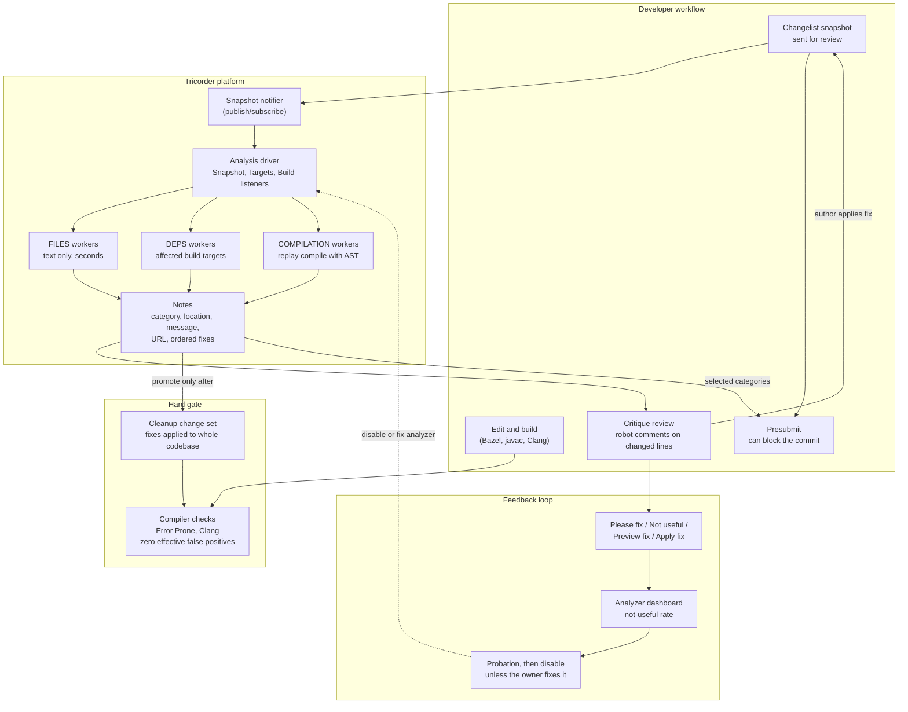

# Static Analysis at Scale: Tricorder and Automated Fixes

> [!summary] Claim:
> Google built Tricorder around code review, where authors can act on findings in the change they already have open.
> Stateless analyzers run at three stages (FILES, DEPS, COMPILATION) and return structured Notes with optional edits.
> Google targeted under 10 percent effective false positives in review and used action clicks to spot analyzers that needed attention.
> A check can become a compiler error after it meets a stricter correctness bar and its existing findings are cleaned up.

This note owns the platform architecture and the automated-fix machinery.
Review latency, change size, and readability certification belong to [[Code-Review-and-Readability-Systems-at-Scale]].
Fleet-wide mechanical rewrites and their sharding belong to [[Large-Scale-Changes-and-Codemods-Across-Repos]].
The paper-level summaries are [[Paper-Tricorder-Program-Analysis-Ecosystem]] and [[Paper-Lessons-From-Static-Analysis-at-Google]].
Compiler diagnostics and editor linters are covered here only as the two integration points on either side of review, and the boundary is spelled out in the subsection "Three Channels, Three Budgets".



## The Mechanism

### Why dashboards failed: the history that shaped the design

Google's static analysis effort started with FindBugs, and the Communications of the ACM article describes three failed integrations before Tricorder.
1. In 2006 FindBugs ran nightly over the whole codebase into a database of findings behind a dashboard.
   It found hundreds of bugs in the Java codebase, but the dashboard saw little use: it sat outside the normal workflow, and telling new findings from old ones was distracting.
2. A small team then triaged each night's new findings by hand and filed bugs.
   In the May 2009 company-wide Fixit week, engineers reviewed 3,954 of 9,473 warnings (42 percent).
   Only 16 percent of those reviewed warnings (640) were fixed, even though 44 percent of the reviewed issues (1,746) produced a bug report.
   The lesson the authors draw is that many findings were real but not important enough to fix, and manual triage does not scale.
3. FindBugs was then run automatically on each change sent for review, posting comments on the review thread.
   It sometimes mislabeled old findings as new, effective false positives eroded trust, and per-user customization gave each developer a different view.
   The integration was dropped in 2011 when the code review tool was replaced.

The Tricorder paper adds the timing lesson: some tools showed results too late, after the code was submitted, and others too early, while the developer was still experimenting in the editor.
Editor-based tools hit latency limits as the codebase grew.
The command-line FindBugs tool was used by only 35 developers in 2014, and 20 of them used it once.
The paper's conclusion is blunt: when developers have to navigate to a dashboard or run a standalone command, usage drops off.
Tricorder has been in production since July 2013 and was maintained at the time of the paper by a team of two to three people.

The design goals that came out of this are in the paper: be used without prompting from advocates or management, integrate into the existing workflow, scale to an industrial codebase, and let non-experts write analyses.

### The effective false positive

A tool author counts a false positive as an incorrect report.
A developer counts it as any report they did not want to see.
Tricorder uses the developer's definition: an effective false positive is a report after which the developer took no positive action.
Three consequences follow directly from the sources.
- A wrong report whose fix still improves readability is not an effective false positive.
  The book's example is flagging `contains` on a hash table that was meant to be `containsKey`: even when the developer meant the value check, calling `containsValue` is clearer.
- A correct report the developer did not understand is an effective false positive.
  Wording is therefore part of the analyzer.
  For one analyzer, 75 percent of the bugs filed from Tricorder were misreadings of the message and were fixed by editing the text or linking to documentation.
  For an Error Prone check on a Guava printf-like method that accepts only `%s`, weekly Not-useful bugs stopped after the message said so directly.
- An analysis can have false positives in theory and none in practice, for example when a style guide forbids the unusual construction that would trigger them.

The 10 percent budget compounds per review.
If a change shows k findings and each independently has probability 0.1 of being an effective false positive, the chance that the author sees at least one is 1 - 0.9^k: 41 percent for k = 5 and 65 percent for k = 10 (derived arithmetic, assumes independence, which real findings do not have).
The example illustrates why the number of comments per change matters even at a fixed per-check rate.
The Tricorder paper reports a platform-wide Not-useful rate around 5 percent in 2014 and under 4 percent with probationary analyzers removed, and the 2020 book reports an effective false-positive rate just below 5 percent.

The paper also says why the bar is 10 percent: the figure matches the threshold used by other analysis platforms such as Coverity.
The CACM article is candid that the first author chose it "somewhat arbitrarily" and that it "seems to be a sweet spot".
Treat it as an empirical operating point, not a theorem.
Tricorder's stated choice is to favor precision and to accept false negatives: a missed issue is allowed, and a report the developer does not act on counts against the analyzer.

Rice's theorem (Rice 1953 is its standard citation) supplies a separate theoretical limit.
In its modern form it says that every non-trivial semantic property of programs is undecidable (Wikipedia, "Rice's theorem", fetched 2026-11-26; the 1953 paper itself was not readable from this environment, so its original wording and corollary numbering are not quoted here).
For example, a general analyzer that always decides whether an arbitrary program can ever output the integer `42` would decide such a property.
A syntactic rule like the FILES-stage line-length check is not a semantic property and has a direct decision procedure, and the theorem provides no numerical threshold for the usefulness of review comments.

### Architecture: stages, workers, and the Note

Tricorder is a set of microservices built on the assumption that parts of the system will go down.
Analysis workers are replicated and stateless.
Results come back to the code review tool as robot comments (robocomments).
All analyzers implement one protocol-buffer API, and worker services exist for Java, C++, Python, and Go, plus compiler-specific workers that plug into jscompiler, javac, and Clang, and a Linter worker that multiplexes linters written in any language.

An analyzer supports three operations (paper, section IV-B):
1. `GetCategory` returns the set of categories the analyzer produces, each with a unique human-readable name shown on its robocomments.
2. `GetStage`: when it runs.
3. `Analyze`: takes information about the change and returns a list of Notes.

A Note carries the category (and optional subcategory), the location (file and line/column range), the message, a URL for more detail, and an ordered list of fixes.
The paper treats the structured form as a feature: the same Notes can be shown in other contexts, such as code browsing.

The three stages exist because each one has strictly more information and costs more.

| Stage | What the analyzer can see | Example (paper) | Trigger and cost |
| :--- | :--- | :--- | :--- |
| FILES | Contents of the files in the change | Line over 80 characters | Fires on each new snapshot, no build needed |
| DEPS | Also the build targets affected by the change | AffectedTargets, BuildDeprecation | Needs the dependencies service |
| COMPILATION | The full AST with resolved types and implicit expressions | ErrorProne, ClangTidy, Unused | Build service signals each finished compilation unit |

The driver has a listener per stage: the Snapshot Listener calls FILES analyzers, the Targets Listener calls DEPS analyzers, and the Build Listener calls COMPILATION analyzers.
The snapshot notification includes metadata and source context, including the repository and revision used to read the source and attach the returned Notes to the right version of the change.
The dependency service supplies transitively affected targets for DEPS, and the driver asks the build service to build directly affected targets.
Builds are instrumented to capture each compiler invocation's inputs (jars, arguments, headers), and compiler workers replay the compilation with extra analysis passes.
The paper lists three practical benefits of the split: earlier stages answer faster because they do not wait for a build, costlier stages can be rate limited, and a failure in a dependency such as the build service does not affect earlier stages.
The book adds that analysis servers read the changed sources through a FUSE-based filesystem and can use cached build inputs and outputs.
Smaller codebases can skip the DEPS stage and build the whole project (paper footnote).

A production implementation can use the snapshot identity, analyzer version, and stage input identity as a deduplication key for retried work.
For COMPILATION, include the compilation unit and build configuration so a result from one target or feature set cannot erase a distinct result from another.
At publication, verify that the snapshot still matches the review revision and distinguish a completed analyzer with zero findings from an analyzer that timed out or lacked build inputs.
Those are design consequences of asynchronous stages and immutable source inputs.
Record queue time, execution time, and result age separately so a late review comment can be traced to saturation, a slow analyzer, or a downstream publication delay.

The scale numbers, with their dates, are in Commands and Numbers to Know.
Two structural facts matter more than the numbers.
First, analyses must be shardable and incremental, run on the files affected by a change, and show results only for edited files or lines; the paper's phrase is to think of an analysis tool as something to map-reduce across large sets of programs.
Second, almost all analyzers are intraprocedural.
The book states that compositional interprocedural analysis is technically feasible but needs extra infrastructure, and the CACM article lists why it was not a priority (large up-front investment, false-positive reduction work, and plenty of simple analyzers still to write).
The paper adds that none of the checks in its table use control or data flow, pointer analysis, whole-program analysis, or abstract interpretation, yet they find real problems.

Contributions scale the same way.
Error Prone and ClangTidy are themselves plug-in systems, so a domain expert adds one check, not a pipeline.
Refaster lets an engineer write an analyzer as a before and after code pair.
By January 2018 Tricorder had 146 analyzers, 125 of them from outside the Tricorder team, and Error Prone alone had 733 checks from 162 authors.
The platform keeps a contract with analyzer owners: it may disable an analyzer when nobody fixes bugs filed against it, when it uses too many resources (the owner must then run a standalone service Tricorder calls), or when it annoys developers by the not-useful rate defined in the next subsection.

### The feedback loop: four buttons and one rate

Each robocomment can offer four actions (paper, section IV-E):

| Action | Who | Effect |
| :--- | :--- | :--- |
| NOT USEFUL | Reviewer or author (CACM: reviewers or proposers) | Paper: a prepopulated bug link appears. CACM 2018: the click files the bug against the owner |
| PLEASE FIX | Reviewer only | Creates a review comment asking the author to fix it |
| PREVIEW FIX | Either | Shows a diff of the suggested fix when the Note has one |
| APPLY FIX | Author only, after previewing | Applies the fix to the code in the changelist |

The not-useful rate of an analyzer is `NOT_USEFUL / (NOT_USEFUL + PLEASE_FIX + APPLY_FIX)`.
A rate of 10 percent or more puts the analyzer on probation, and the owner must show progress.
Above 25 percent the team may turn it off immediately, though in practice they work with the owner first.
The paper's best analyzers sit at 0 to 3 percent, and between 10 and 60 percent of Not-useful clicks (depending on the analyzer) turn into a filed bug.
The CACM article states the policy in simpler words: above 10 percent the team disables the analyzer until the author improves it, and it has rarely had to do so permanently.
The two sources define the ratio slightly differently (the article says Please fix versus Not useful), so use the paper's formula when you build your own.
The denominator counts qualifying actions, and the paper says it could not count how many results developers actually viewed.
A production dashboard can expose counts and sampling windows by analyzer version and project alongside the ratio.
One Not-useful click out of four actions and 25 out of 100 produce the same rate with very different evidence about typical use.
Treat zero qualifying actions as missing signal, and estimate technical precision with sampled findings checked independently of click traffic.

The paper lists why clicks are an imperfect measure, and each item is a bias you must model.
- Developers fix issues before the reviewer sees them, so Please fix is undercounted.
- Developers fix in their own editor rather than with Apply fix, so Apply fix is undercounted.
- Developers who do not plan to fix a finding may ignore it instead of clicking Not useful.
- Developers sometimes click Not useful by accident.

Despite this, clicks proved a good signal of annoyance, and Please fix correlates strongly with Preview fix: a reviewer asks, and the author previews to learn what the problem was.
That is the second purpose of a fix: it is documentation of the finding.
The measured effect on the codebase is also in the paper: after the ClangTidy `misc-redundant-smartptr-get` check began to appear in Tricorder, the count of violations in the codebase dropped, because developers stopped writing the pattern and cleaned up existing instances.
Checks with complicated non-local fixes only leveled off.

### Where else the same Notes show up

Review is the main channel but not the only one (book and CACM):
- Presubmit.
  A presubmit check blocks committing, from trivial ones (the change description must not say "DO NOT SUBMIT") to "no Tricorder issues in category X".
  Team-specific presubmits can make large-scale changes harder, so some are skipped for changes marked `CLEANUP=`.
- Command line, for engineers who act as code janitors and apply all fixes from one analysis in bulk.
- Continuous integration and code browsing.
  Browsing is for analyses that do not belong in review: results that need vetting by a security team, a view of how much work a deprecation migration needs, or analyses that need production data.
  The paper adds that nightly results shown in code search suit analyses with higher false-positive rates that have a cleanup team.
- IDE.
  IDE analyses need under one second and ideally under 100 ms, must behave the same in every IDE, and Google does not mandate an IDE.
  The paper and book both say IDE integration is welcome for suitable analyses, but it cannot be the only integration.

Customization is project-level only.
The team deleted all priority and severity ratings and the per-user settings that early Critique offered.
Removing them immediately produced complaints about annoying results.
Instead of restoring the settings, the team asked users why, and found analyzer bugs such as the C++ linter that also ran on Objective-C files, which developers had previously just hidden.
By January 2018 about 70 optional analyses existed and 2,500 projects had enabled at least one of them.
Some analyses graduate: a Java readability analyzer started optional, was improved from feedback, and became on by default.
The reasons to keep configuration per project are consistent views (nobody introduces what a teammate is removing) and analyzers whose result is binary per project, such as the protocol buffer compatibility analyzer that matters only to teams that store serialized data.

### From review to compiler: the ratchet

A compiler error is a warning nobody can ignore, so the bar is higher.
Google's criteria for a compiler check (CACM and book): easy to understand, actionable with a mechanically applicable suggested fix where possible, no effective false positives, and only correctness issues rather than style.
The paper adds a performance criterion: compiler analyses must add under 5 percent overhead.
Error Prone's public criteria for ERROR severity add that the bug should occur with a small but noticeable frequency: a pattern that never occurs is not worth detecting, and one that occurs constantly probably is not hurting anyone.
Its public criteria for WARNING severity restate the review-time bar: very few false positives, "at least 90 percent" of the time a real issue.

The enablement procedure is the part to remember, because it is a large-scale change (see [[Large-Scale-Changes-and-Codemods-Across-Repos]]):
1. Write the check with a suggested fix.
2. Run the compiler over the entire codebase in parallel as a MapReduce job.
   For Java this is JavacFlume built on FlumeJava; for C++ it is ClangMR.
   The job emits fixes as diffs.
3. Split the combined change into per-project changes (the internal tool Rosie), test each, and send each to its owners, who approve and Rosie commits.
4. When every existing instance is gone, enable the check as a compiler error, so no new instance can be committed without breaking the build.
   Presubmit and continuous integration catch the breakage after that.

When developers who received such cleanup patches were surveyed, 57 percent were happy to have received the fix, 41 percent were neutral, and 2 percent were negative ("It just created busywork for me").
A second survey compared compile-time errors with the same problem found in checked-in code: 74 percent of compile-time issues were judged real problems versus 21 percent in checked-in code, and 6 percent versus 0 percent were judged critical.
The authors attribute this to a survivor effect: by the time code is checked in, the worst bugs were caught by tests and review.
Moving the check to compile time is the way to avoid that cost.
Their motivating example hashes a `long` field as `31 * result + (int) (f ^ (f >>> 32))`.
When `f` is an `int`, the shift is a no-op and the field XORs with itself; the cleanup fixed 31 occurrences while enabling the Error Prone check.

Two policies fall out of this.
Google aims never to issue compiler warnings: a check is either an error or hidden from compiler output, shown in review instead, because developers ignore warnings.
And because the same flags apply across the codebase, the decision is global.
Checks that can neither be proven mechanical nor cleaned up (restructuring needed, no automated fix) stay at review time, where they prevent new instances while the author decides.

### The fix as a data structure

The shared idea across every ecosystem is that a diagnostic carries zero or more fixes, and a fix is a set of text edits keyed by location, not a patch against a particular IDE.
The paper stresses that Tricorder fixes are part of the analysis and language-agnostic, and that applying them relies on a system that exposes the contents of a changelist for edits.
The table shows how the main systems encode the same idea (as of 2026-11, Both).

| System | Fix shape | Applicability or safety signal | Application behavior |
| :--- | :--- | :--- | :--- |
| Clang `FixItHint` | `CreateInsertion(Loc, Code)`, `CreateRemoval(Range)`, `CreateReplacement(Range, Code)` | Hint on a warning must not change meaning; otherwise attach it to a note, which is never applied automatically | `-Xclang -fixit` applies hints from errors and warnings |
| clang-tidy | Diagnostic with fix-its; `--export-fixes` writes YAML | `--fix`; `--fix-errors` also under compile errors; `--fix-notes` for a single fix on a note | Exported YAML is applied by `clang-apply-replacements` |
| Go `analysis.SuggestedFix` | `TextEdits` of `Pos`, `End`, `NewText`; description message | Each fix of a diagnostic is an alternative, at most one applied | Edits in a fix must not overlap; fixes of different diagnostics are independent changes to the same baseline, like commits with one parent |
| SARIF 2.1.0 `fix` | `artifactChanges` with `replacements` of `deletedRegion` and `insertedContent` | Not in the format; tools add their own property | Appendix G: use minimal disjoint replacements so more fixes compose |
| Gerrit comment | `CommentInfo.fix_suggestions`: `FixSuggestionInfo` of `FixReplacementInfo` (path, range, replacement). Robot comments are deprecated (as of 2026-11) | Description only | Replacements in one file must be non-overlapping; `fix:apply` edits the current patch set |
| rustc `Applicability` | Suggestions on diagnostics | `MachineApplicable`, `MaybeIncorrect`, `HasPlaceholders`, `Unspecified` | `MachineApplicable` ones "should be automatically applied" |
| Ruff | Fix per rule | "safe" versus "unsafe"; `--fix` applies safe only, `--unsafe-fixes` adds the rest | Per-rule override via `extend-safe-fixes` and `extend-unsafe-fixes` |
| ESLint | `fix(fixer)` or suggestions | `meta.fixable` is mandatory; suggestions need `meta.hasSuggestions` | Fixes may be dropped on conflict; multiple fix objects from one rule must not overlap |
| LSP `CodeAction` | `edit` carries a `WorkspaceEdit`, optionally alongside a command | `isPreferred` (since 3.15) marks the preferred action for automated client selection | A versioned `TextDocumentEdit` lets the client check the document version before applying the edit |
| Error Prone | `SuggestedFix` shown as "Did you mean ...?" | Choose checks with `-XepPatchChecks:` | Output is a unified diff `error-prone.patch` or `IN_PLACE` |

Four details from those sources are worth knowing cold.
- Clang requires a high likelihood that the fix matches the user's intent, parser recovery consistent with the edit, and preservation of code meaning for hints on warnings.
  A hint that cannot meet those rules goes on a note.
- Ruff documents an unsafe fix that rewrites `list(...)[0]` to `next(iter(...))`.
  On an empty collection the exception changes from `IndexError` to `StopIteration`, which can break error handling upstream.
- The Go documentation spells out the merge model: combining fixes "requires resolving any conflicts", and a tool may discard fixes, consult the user, or abort.
- SARIF's Appendix G explains why edit granularity decides composability: if the fix for "unquoted attribute value" replaces the whole value, the independent "renumber the part" fix over the same characters is blocked, but two insertions of a quote on either side leave the second fix applicable.

ESLint illustrates the multi-pass idea: after fixes are applied it re-runs all enabled rules on the fixed code, repeating "up to 10 times, or until no more fixable problems are found", while suggestions are applied as stand-alone changes without multipass.
`--fix-type` selects among `directive`, `problem`, `suggestion`, and `layout`.
Cargo does the analogous thing for Rust: `cargo fix` takes rustc's suggestions from diagnostics and applies them, runs `cargo check` underneath, and only fixes code that is actually compiled, so feature-gated and `cfg`-gated code needs `--features` or `--target`.
For `cargo fix`, `--allow-dirty` permits a dirty worktree including staged changes, `--allow-staged` permits staged changes alone, and `--allow-no-vcs` permits a tree where Cargo detected no VCS (as of 2026-11, Both).

### Applying a fix to a moving snapshot

Capture the artifact identity, revision or content digest, coordinate encoding, and half-open edit ranges when generating a fix.
Before writing, verify that the old text still matches the expected revision or reanalyze the new revision and regenerate the edit.
Gerrit's `fix:apply` targets the current patch set and can try to forward-apply a patch from the supplied `originalPatchsetForFix` (as of 2026-11, Both).
Treat a conflict as a new analysis or review decision so a stale offset cannot silently change a different expression.

LSP versioned document edits and SARIF's `columnKind` describe different parts of this contract.
A document version identifies the edit's baseline, while a coordinate unit says how to interpret its ranges.
For example, a single supplementary Unicode code point occupies two UTF-16 code units, which changes the column of every following character in that line (SARIF 2.1.0, section 3.14.27).
Keep artifacts and encoding explicit across tool boundaries, and preserve an edit batch atomically if one replacement fails.

Check three distinct conditions before automatic application.
Check that each edit has valid ranges and that alternatives for one diagnostic are mutually exclusive.
Check that the combined post-image still parses or compiles, even when each candidate passes by itself.
Re-run the originating rule to ensure the finding disappeared and use targeted tests or type checks for behavior-changing fixes.
The lab demonstrates range conflicts, AST preservation for style edits, and syntactically invalid combinations of otherwise disjoint edits.

### Learned fixes

Getafix (Meta, 2019) summarizes past human fixes for a bug category into a hierarchy of patterns and ranks candidates by the context of the change.
An AST differencer extracts old and new subtrees, and clustering generalizes concrete edits into templates with holes that can bind to different code.
The predictor ranks applicable templates using their surrounding context and runs the original analyzer on the top candidate before offering it.
The paper reports that the top suggestion matched the human-written fix between 12 percent and 91 percent of the time on 1,268 examples spanning six categories of Java findings, and the top five suggestions contained the human fix for 526 examples.
The authors also report about 42 percent acceptance for fixes suggested in Facebook's deployment, a separate measurement from exact match against historical changes.
Clearing the warning confirms that the analyzer accepts the edit, while the author still judges whether the repair preserves the intended behavior.

### New findings versus existing findings

The book makes the economic case for hiding legacy issues: fixing a warning in code that runs fine in production can introduce a bug (its example is fixing a dead-code warning by adding a call to the dead code, which then runs untested), so Google focuses on newly introduced warnings or warnings on modified lines, where the viewer also has the context.
There are three ways to define "new", and they fail differently.

| Method | Mechanism | Failure mode |
| :--- | :--- | :--- |
| Changed-line filter (Tricorder default) | Keep findings whose line is in the diff | Misses findings that surface on an unchanged line, such as an import orphaned when the change removed its last use |
| Diff-filtered diagnostics (`clang-tidy-diff.py`) | Feed `git diff -U0`, analyze affected files in full, then filter diagnostics to added or modified lines (as of 2026-11, Both) | An edit can exceed the function size limit while the diagnostic points to an unchanged declaration |
| Fingerprint baseline (SARIF `baselineState`) | Compare against a baseline run by content fingerprint | Needs a stable fingerprint and a baseline per branch |

The paper's footnote is the same observation: some analyses, such as unused-variable warnings, are shown on all lines by default because deleting a block can leave an unused variable on an untouched line.
SARIF's `baselineState` takes the values `new`, `unchanged`, `updated`, and `absent`, and the spec says that if it is present on any result it must be present on every result, because it implies a comprehensive comparison with the baseline run.
SARIF `partialFingerprints` provides versioned components of a result's identity, such as a producer's normalized content hash.
The lab adds an occurrence index so identical lines within a file remain distinguishable and includes the path in its comparison so identical findings in different artifacts remain separate.
When a change inserts another identical occurrence or renames a file, this toy identity can drift.
A production matcher can use a stable artifact or rename mapping and nearby syntactic context, and can decline to match ambiguous occurrences.
Generate both sides with compatible rule versions and build coverage before interpreting a missing finding as `absent`.

### Compiler, review, and editor budgets

The seed's boundary with compiler diagnostics and IDE linters comes down to different budgets.

| Channel | Latency budget | False-positive budget | Blocks? | Fix expectation | Config scope |
| :--- | :--- | :--- | :--- | :--- | :--- |
| Compiler check | Under 5 percent compile overhead (Tricorder paper) | Essentially zero effective | Yes, breaks the build | Mechanical, applied during cleanup | Global, same flags for the codebase |
| Review-time analyzer | Minutes (paper expects under 5 to 10 minutes; mean review longer than 1 hour) | Under 10 percent effective | No by default, peer pressure and optional presubmit | Offered, applied with one click | Project-level |
| IDE linter | Under 1 second, ideally under 100 ms (book) | Not stated in the sources; the editor user decides | No | Quick fix, per editor | Per user, per editor |

An IDE linter cannot replace the review channel in a monorepo with many editors, and a compiler cannot carry the review channel's noisy-but-useful checks.
Meta's 2019 CACM article describes deeper interprocedural analyses integrated with review and reports over 100,000 Infer-reported issues fixed before production.
Its Zoncolan deployment sends broader periodic scans to security engineers, sends selected new alarms to the on-call engineer, and comments directly on a change for categories with the strongest signal.
The authors use per-procedure analysis summaries and dependency scheduling for incremental work, iterating mutually recursive methods until their analysis stabilizes.
This gives the system a way to increase semantic depth while exposing each result to an audience with the time and context to act.

## Commands and Numbers to Know

All rows were read from the cited sources in 2026-11; the "date" column says when the number was measured, because the numbers are historical.

| Fact | Value | Date and source | Platform |
| :--- | :--- | :--- | :--- |
| Effective false-positive ceiling for a review-time check | Under 10 percent | Paper 2015, CACM 2018, book 2020; Error Prone docs for WARNING | Both |
| Compiler-check false-positive and overhead bar | No effective false positives; under 5 percent compile overhead | Paper 2015, book 2020 | Both |
| Probation and disable thresholds | Not-useful rate at least 10 percent, above 25 percent may disable | Paper section IV-E, 2015 | Both |
| Not-useful rate of the best analyzers | 0 to 3 percent | Paper, 2014 data | Both |
| Platform-wide not-useful rate | About 5 percent (under 4 percent without probation); book 2020: effective FP just below 5 percent | Paper 2014 data, book 2020 | Both |
| Findings and clicks per day, average over 90 days | Fig. 9 averages: 93K findings, 716 Please fix, 48 Not useful, 31K snapshots, 81K analyzer runs, 4K builds; the same section's prose says close to 5K builds per day | Paper Fig. 9 and section V, 2014 data | Both |
| Same, later | CACM January 2018: approximately 50,000 changes per day, three analysis runs per second during peak hours, more than 5,000 Please fix per day, approximately 3,000 fixes applied per day, and 250 Not useful per day; the 2020 book: more than 50,000 changes per day, often several analyses per second, Please fix thousands of times per day, about 3,000 fixes, and 250 Not useful | CACM January 2018; book 2020 | Both |
| Analyzers | More than 30 analyses in the 2015 paper; 146 analyzers, 125 external, and 7 plug-in systems in CACM January 2018; more than 100 analyzers in the 2020 book, 7 of them plug-in systems | Paper, CACM, book | Both |
| Optional analyses | About 70 available, 2,500 projects with at least one enabled | CACM, January 2018 | Both |
| Language reach | More than 30 languages | CACM 2018, book 2020 | Both |
| `clang-tidy --fix` / `--fix-errors` / `--fix-notes` / `--export-fixes=<yaml>` / `--format-style` | Apply fixes / apply even under compile errors / apply a single note fix / write YAML for `clang-apply-replacements` / format around fixes (default `none`) | Extra Clang Tools trunk docs, fetched 2026-11-26 | Both |
| `clang-tidy --line-filter` | JSON array of `{"name": ..., "lines": [[a,b]]}`, inclusive ranges | Same trunk docs, fetched 2026-11-26 | Both |
| `git diff -U0 --no-color HEAD^ \| clang-tidy-diff.py -p1 -fix` | Run only on changed lines | Same trunk docs, fetched 2026-11-26 | Both |
| Error Prone severity flags | `-Xep:<Check>[:OFF\|WARN\|ERROR]`, last flag wins; `-XepDisableAllChecks`, `-XepExcludedPaths:<regex>` | errorprone.info flags page, as of 2026-11 | Both |
| Error Prone patching | `-XepPatchChecks:A,B` with `-XepPatchLocation:<dir>` (writes `error-prone.patch`, apply with `patch -p0 -u -i`) or `IN_PLACE`; docs call it experimental | errorprone.info patching page, as of 2026-11 | Both |
| Refaster in Error Prone | `-XepPatchChecks:refaster:<file>.refaster` | errorprone.info Refaster page (tip valid for 2.3.1, subject to change), as of 2026-11 | Both |
| Ruff fix gating | `ruff check --fix` applies safe fixes only; `--unsafe-fixes` adds unsafe ones | docs.astral.sh, as of 2026-11 | Both |
| ESLint fix loop | Fixes then reruns rules, up to 10 passes | eslint.org custom rules, as of 2026-11 | Both |
| SARIF fix path | `result.fixes[].artifactChanges[].replacements[].deletedRegion/insertedContent`; zero-length `deletedRegion` is an insertion point | SARIF 2.1.0 errata 01, sections 3.27.30, 3.55 to 3.57 | Both |

## Multi-Language Comparison

| Concern | C++ | Java | Python | Rust |
| :--- | :--- | :--- | :--- | :--- |
| Compiler-hosted checks | Clang warnings and clang-tidy on the AST | Error Prone on the javac AST | `ast` module (parse only); `python -W error` covers runtime warnings only | rustc lints (early passes on the AST, late passes on the HIR) |
| Fix representation | `FixItHint` insertion, removal, replacement | `SuggestedFix`, Refaster templates | Per-tool, for example Ruff `Fix` with applicability | `Applicability` on each suggestion |
| Bulk apply | `clang-tidy --fix`, `--export-fixes` then `clang-apply-replacements`, `run-clang-tidy` | `-XepPatchChecks` with a patch file or `IN_PLACE` | `ruff check --fix` | `cargo fix` |
| Safety tiering | Fix-it on a note is never auto-applied | Choose checks per patch run | Safe versus unsafe fixes | `MachineApplicable` versus `MaybeIncorrect` |
| Suppression | `// NOLINT`, `NOLINTNEXTLINE`, `NOLINTBEGIN` to `NOLINTEND` (with check names) | `@SuppressWarnings("Check")`, `-Xep:Check:OFF` | `# noqa` and `# ruff: ignore` (Ruff docs, as of 2026-11) | `#[allow]`, `#[expect]`, `#[warn]`, `#[deny]`, `#[forbid]` (Rust reference) |
| Compile-correctness boundary | Needs `compile_commands.json`; compile errors block analysis (`clang-diagnostic-error`) | Needs a full compile; analyses run in the compile | Parse only; type information is tool-specific | `cargo fix` covers only code that `cargo check` compiles |

## Worked Lab Example

The lab at `code/09-Engineering-Systems-at-Scale/tricorder_analyzer/` models the stages, review filters, ordered fixes, baseline comparison, and feedback policy with six standard-library Python analyzers.
Run `bash run.sh` from the lab directory with Python 3.10 or later.
The lab uses ASCII source so byte offsets and character offsets coincide, and its COMPILATION stage uses the Python AST and symbol tables in place of a real compiler replay.
For the DEPS example, the helper scans a small corpus for direct imports of a changed module.

Each `Note` carries a category, location, message, help URL, line text for fingerprinting, and an ordered tuple of `Fix` alternatives.
Each `Fix` carries a description, applicability, a style-preservation flag, and a tuple of half-open `Edit` ranges relative to the same pre-image.
`plan` chooses the first permitted fix for each finding.
`apply_fixes` rejects malformed ranges, then orders candidates by earliest edit offset and input order.
It validates Python candidates alone and in combination with previously accepted edits, applies replacements right to left, and rejects a conflicting candidate whole.
A style-only fix must preserve the AST in isolation, and a style-only batch must also preserve the combined AST.
`autofix` reanalyzes the new text after each productive pass and stops when no edits apply or the pass limit is reached.

### Verified output

Captured on darwin-arm64 (macOS, CPython 3.15.2, as of 2026-11).
The wording of the syntax error in section 5 comes from CPython and can differ on other versions.

```text

== 1. Stages: a parse failure costs the COMPILATION stage only ==
notes from FILES stage: TrailingWhitespace=1
notice: broken.py: skipped DeadException
notice: broken.py: skipped NoneComparison
notice: broken.py: skipped MutableDefaultArgument
notice: broken.py: skipped UnusedImport

== 2. Where results appear: dashboard, review view, baseline ==
old file notes:      MutableDefaultArgument=1, UnusedImport=1
dashboard (all new): DeadException=1, MutableDefaultArgument=1, NoneComparison=1, TrailingWhitespace=1, UnusedImport=3
changed lines:       [3, 10, 16, 17, 18, 19, 20, 21]
review view:         DeadException=1, NoneComparison=1, TrailingWhitespace=1, UnusedImport=1
fingerprint baseline: new=5 unchanged=2 absent=0
  new: line 2 UnusedImport
  new: line 3 UnusedImport
  new: line 19 NoneComparison
  new: line 19 TrailingWhitespace
  new: line 20 DeadException
line-keyed baseline would call 6 of 7 results new
affected by billing.py (DEPS stage): ['reports.py']

== 3. Applicability gates what an automatic pass may do ==
machine-only pass leaves '== None': True
with maybe-incorrect it becomes 'is None': True
obj == None -> True ; obj is None -> False

== 4. Fix composition: minimal disjoint edits (SARIF Appendix G) ==
coarse   applied=1 rejected=1 -> <lineItem partNumber="A3101" />
         rejected: conflicts with an accepted fix
minimal  applied=2 rejected=0 -> <lineItem partNumber="AA3101" />

== 5. Validation: a fix must not break the file it fixes ==
sole-statement guard=False applied=0 rejected=1 parses=True
   rejected: breaks syntax: expected an indented block after 'if' statement on line 2
sole-statement guard=True  applied=1 rejected=0 parses=True
trailing whitespace: notes=2 applied=1 rejected=1
   rejected: changes the AST but is declared style-only
disjoint edits, invalid combination: applied=1 rejected=1

== 6. Passes: conflicts defer, then the pass reaches a fixed point ==
pass 1: notes=2 applied=1 rejected=1
pass 2: notes=0 applied=0 rejected=0
billing pass 1: notes=7 applied=5 rejected=0
billing pass 2: notes=2 applied=0 rejected=0
second run: passes=1 changed=False
left for a human: MutableDefaultArgument=1, NoneComparison=1

== 7. Can this check become a compiler error? (cleanup rehearsal) ==
DeadException          instances=2 remaining=0 -> ENABLE AS ERROR
MutableDefaultArgument instances=1 remaining=1 -> review-time only: 1 of 1 instances survive mechanical cleanup
UnusedImport           instances=1 remaining=0 -> review-time only: not correctness-only
NoneComparison         instances=1 remaining=1 -> review-time only: not correctness-only; 1 of 1 instances survive mechanical cleanup

== 8. Sharding: stateless workers give the serial answer ==
files=12 notes=60 identical=True

== 9. Feedback policy on synthetic click counts ==
no-signal       NOT_USEFUL=0   PLEASE_FIX=0   APPLY_FIX=0   rate=n/a -> no-signal
healthy         NOT_USEFUL=3   PLEASE_FIX=600 APPLY_FIX=300 rate=0.003 -> healthy
boundary-10pct  NOT_USEFUL=10  PLEASE_FIX=60  APPLY_FIX=30  rate=0.100 -> probation
boundary-25pct  NOT_USEFUL=25  PLEASE_FIX=50  APPLY_FIX=25  rate=0.250 -> probation
noisy           NOT_USEFUL=26  PLEASE_FIX=50  APPLY_FIX=24  rate=0.260 -> disable-candidate

== 10. The same fix as SARIF 2.1.0 ==
{
  "fixes": [
    {
      "artifactChanges": [
        {
          "artifactLocation": {
            "uri": "billing.py"
          },
          "replacements": [
            {
              "deletedRegion": {
                "charLength": 0,
                "charOffset": 257
              },
              "insertedContent": {
                "text": "raise "
              }
            }
          ]
        }
      ],
      "description": {
        "text": "Did you mean 'raise ValueError(...)'?"
      },
      "properties": {
        "applicability": "machine-applicable"
      }
    }
  ],
  "level": "warning",
  "locations": [
    {
      "physicalLocation": {
        "artifactLocation": {
          "uri": "billing.py"
        },
        "region": {
          "startColumn": 9,
          "startLine": 20
        }
      }
    }
  ],
  "message": {
    "text": "exception created but not raised"
  },
  "partialFingerprints": {
    "toyTricorderLine/v1": "053c5123bfce"
  },
  "ruleId": "DeadException"
}
```

### What the run demonstrates

1. **Stage isolation.**
   A syntax error leaves the text-only whitespace diagnostic available while the four COMPILATION analyzers are skipped.
2. **Review filtering and dependency scope.**
   The hand-authored zero-context hunk headers for the fixture supply the new-side line numbers, with a separate assertion that a pure deletion creates no new-side lines.
   The changed-line view shows four of seven findings and misses the new unused `json` import on line 2, where the change removed its only use elsewhere.
   The content baseline catches the orphaned import, preserves two unchanged findings after a line shift, and distinguishes identical fingerprints in different files.
   A line-number key instead calls six findings new.
   The DEPS helper identifies `reports.py` because it imports the changed `billing.py` module.
3. **Applicability.**
   The machine-only pass leaves `== None` intact, and the maybe-incorrect tier allows the edit to `is None`.
   The overloaded `__eq__` in the fixture makes the two expressions return different values.
4. **Edit composition.**
   A coarse replacement that adds quotes overlaps with the renumbering.
   Two insertions at the value's boundaries leave room for both fixes in the same pass.
   The XML fragment uses plain-text edit composition so the example isolates range semantics.
5. **Validation.**
   Replacing the last statement of a suite with `pass` keeps it parseable, and the AST check preserves whitespace inside a docstring.
   Two disjoint edits that parse separately would produce `return yield sent` together, so the applier rejects the second one.
6. **Convergence.**
   Deleting an import also removes its trailing whitespace, so the conflicting whitespace fix has nothing left to do on the next pass.
   The second run over the fixed billing module is idempotent.
7. **Cleanup rehearsal.**
   The curated corpus includes a built-in exception, a module-local exception subclass, and checks that cannot be promoted under the toy policy.
   `DeadException` uses Python's symbol table to reject names with possible shadowing, and recognizes a restricted set of directly declared subclasses without trying to resolve arbitrary Python imports or runtime rebinding.
   The `raise` insertion intentionally changes behavior in the fixture, and real promotion would need evidence about author intent, error paths, and runtime behavior.
8. **Sharding.**
   Two processes return the same 60 notes in the same sorted order as the serial traversal of 12 files.
9. **Feedback.**
   Synthetic click counts exercise the paper's denominator and both probation boundaries.
   The toy adds a `no-signal` state for a zero-action window.
10. **SARIF export.**
    The result carries a versioned partial fingerprint, and the run declares its column unit.
    The `charOffset` of the zero-length `deletedRegion` is asserted to point at the `ValueError` call that the fix prefixes with `raise `.

## Pitfalls

> [!warning] Pitfalls:
> - **Dashboard first.**
>   Building the platform around a findings database and a web page reproduces Google's 2006 FindBugs attempt, where distinguishing new from existing findings was itself the distraction.
>   Ship the review-time comment before the dashboard, and keep the dashboard for analyzer owners.
> - **Counting findings, not fixes.**
>   The CACM authors say success is "defects corrected, not the number presented".
>   A high finding count with almost no applied fixes is a negative return.
> - **Calling unusual input a false positive and stopping.**
>   If users misread the message, they behave as if it were a false positive.
>   Read the Not-useful bugs for wording problems first.
> - **Trusting click rates blindly.**
>   Please fix is undercounted when authors fix before review, and Apply fix is undercounted when they fix in an editor.
>   A low Not-useful rate with low Please-fix counts means little.
> - **Marking a semantics-changing fix as machine-applicable.**
>   `x == None` to `x is None` is not equivalent for overloaded `__eq__` (lab section 3); Ruff's `IndexError` to `StopIteration` example is the same class of bug.
>   If the fix can change runtime behavior, tier it below the auto-apply line.
> - **Naive deletion fixes.**
>   Deleting the only statement of a block, deleting an import that is a side-effecting registration, or deleting the last use of something a type checker needs all pass a text diff and fail later.
>   Validate with a parse, and for style-only fixes require an unchanged AST.
> - **Coarse edits that block other fixes.**
>   A fix that replaces a whole expression prevents every other fix inside it from applying in the same pass.
>   Emit minimal disjoint edits (SARIF Appendix G).
> - **Edits relative to a stale file.**
>   Offsets are meaningful only against the exact text that was analyzed.
>   Reject or re-run when the file changed after analysis; Gerrit's `fix:apply` applies to the current patch set and takes an `originalPatchsetForFix` to say which patch set a fix was suggested against.
> - **Encoding and newline mismatches.**
>   SARIF requires inserted text to be transcoded from UTF-8 to the target encoding and notes that this means a fix is not safe unless the artifact's encoding is known; its `newlineSequences` property exists so a fix-applying tool counts lines the way the producer did.
> - **User-level severity and suppression settings.**
>   They hide analyzer bugs and create inconsistent team views.
>   Keep configuration per project.
> - **Diff-only analysis as a complete gate.**
>   `clang-tidy-diff.py` can miss a problem that a change causes in code outside the diff, and clang-tidy's own docs advise a full run before merging significant changes.
> - **Enabling a compiler check before cleanup.**
>   The check breaks every project that has an old instance, and the rollback is a revert of the compiler flag.
>   Run the rehearsal first.
> - **Raising the false-positive tolerance for everything because security tolerates it.**
>   The book notes reviewers may tolerate much higher false-positive rates for some security analyses.
>   That is a per-analysis, per-channel decision (code browsing with a security team), not a platform default.
> - **Copying the 10 percent number as a law.**
>   It is an operating point with a stated origin; measure your own users.

## At Scale

From one engineer to 1,000 to 50,000, the technique does not change but its failure modes do.
Each bullet is a decision rule and says whether it is sourced or my judgment.

- Team of one to ten.
  Use the compiler's own warnings and one formatter and linter in a pre-commit hook; build no platform.
  The value of a platform comes from sharing a workflow across many authors and a feedback loop, which a small team can run by talking.
- A few hundred engineers with code review in a single tool.
  Put results in the review before anything else, as a bot comment or as Gerrit `CommentInfo.fix_suggestions` (robot comments are deprecated, as of 2026-11), on changed lines only, from a short allowlist of checks you sampled by hand.
  The paper's admission test is cheap: run the analyzer on existing code and manually check a statistically sound sample of its results against the 90 percent bar (or run it as a job over all code).
- Past a few thousand engineers.
  The costs are not CPU.
  They are analyzer ownership (the paper's contract: owners fix bugs or the analyzer is disabled), wording quality, a dashboard of not-useful rate per analyzer, and an explicit promotion path from optional to default.
  Tricorder was maintained by two to three people in 2014 while members of more than 10 other teams contributed 13 of the 16 analyzers in the paper's table; budget for contribution tooling (plug-in checks, Refaster-style templates) before you budget for analysis research.
- Promotion rule for a compiler error (sourced): easy to understand, mechanical fix, no effective false positives, correctness only, cheap to run, and a completed cleanup.
  Everything else stays at review time.
- Baseline rule (my judgment, supported by the sources): default to changed lines for review, and add a fingerprint baseline when a change can orphan old code; keep an all-lines view for owners doing deliberate cleanup.
- Fix tiering rule (my judgment, same shape as Rust and Ruff): auto-apply only machine-applicable fixes, show preview for the rest, and never combine tiers in one automatic pass.
- Deep analysis rule: adopt interprocedural analysis (Meta's Infer and Zoncolan style) only for a narrow class where the bug is severe (crashes, security) and the analysis can be incremental per change, and run it as a review-time bot; the Google experience is that simple checks have more payoff per engineer-year.
- Security rule: the book allows higher false-positive rates for security analyses; route them to a security team's code-browsing layer or a separate reviewer, not to every author's review.
- The cleanup change set is a [[Large-Scale-Changes-and-Codemods-Across-Repos]] campaign: per-owner shards, a canary, and a burndown dashboard.
  Deprecation work uses static analysis to prevent backsliding during migration, as the book says; see [[Platform-Engineering-Paved-Roads-and-Deprecation]].
- Reviewer time is the shared budget: automated findings save reviewers from repeating common comments but also consume the author's attention, so tie the platform to the measured review metrics in [[Code-Review-and-Readability-Systems-at-Scale]] and [[Developer-Productivity-Metrics-DORA-SPACE-and-GSM]], and measure fixes applied, not findings shown.
- Search and indexing feed analyses that need whole-corpus views (callers of a deprecated API); see [[Code-Search-and-Semantic-Indexing-at-Scale]].
- Agents change the economics of fixing but not of trust.
  A coding agent that applies suggested fixes still needs the applicability tiers and a validation gate; see [[AI-Coding-Agents-Sandboxes-Worktrees-and-Ship-Gates]].
- Dynamic analysis belongs next to the same loop.
  The paper notes ThreadSanitizer and AddressSanitizer have typically no false positives and under 10x slowdown, run in tests rather than in review; see [[Paper-AddressSanitizer]].
- Test and build latency set your presubmit budget for analysis; see [[Build-and-Test-Latency-Economics-and-Flaky-Tests]].

## Practice Drill

> [!tip] Practice Drill:
> Add a Python analogue of the Refaster `StringIsEmpty` template to the lab and decide its tier with evidence.
> 1. Write an analyzer `LenZero` in `analyzers.py` that flags `len(x) == 0` and proposes `not x` as a minimal edit on the whole comparison.
> 2. Run it through section 3's pattern: show that for a numpy array of one element and of several elements the two expressions agree or disagree, then decide whether the fix is `MACHINE` or `MAYBE` and defend it in two sentences.
> 3. Add it to the corpus in section 7 and read whether the cleanup rehearsal allows promotion.
> 4. Add a fixture where your fix and `TrailingWhitespace` overlap on one line and confirm the applier defers one and converges in two passes.
> 5. Write down, for a hypothetical analyzer with 120 Please-fix, 40 Apply-fix, and 25 Not-useful clicks in a week, its not-useful rate and its disposition under the paper's thresholds (answer: 25 / 185 = 0.135, probation).

## Interview Questions

> [!question] L5: Why did Google's nightly FindBugs dashboard fail while the same tool's findings in code review succeeded?
> > [!success]- Answer
> > The dashboard sat outside the developer workflow, so few engineers visited it, and telling new findings from old ones was distracting.
> > Findings in the checked-in code were also too late: the code already worked, so many findings (in the 2009 Fixit, 3,954 warnings were reviewed and only 640 of those, 16 percent, were fixed) were not worth the risk.
> > In review the author is already in a change mindset, is blocked on a reviewer anyway so there is time for analysis to run, sees results on the lines they just wrote, and a reviewer can see if they ignore them.
> > Tricorder keeps a dashboard only for analyzer owners.

> [!question] L5: What is an "effective false positive", and why does Google care about it more than the textbook false-positive rate?
> > [!success]- Answer
> > It is a report after which the developer took no positive action.
> > It includes correct findings the developer did not understand, and excludes technically wrong findings whose suggested change still improves the code.
> > Developers decide whether a tool is worth reading, so their definition predicts adoption.
> > In practice that makes message wording, links, and fixes part of the analyzer: 75 percent of bugs filed against one analyzer were wording problems.

> [!question] L5: Predict the output.
> Two fixes on `<lineItem partNumber=A3101 />`: fix 1 replaces `A3101` with `"A3101"` (one edit), fix 2 replaces `A3101` with `AA3101`.
> What does the lab's applier return, and what changes if fix 1 is two one-character insertions of `"`?
> > [!success]- Answer
> > With the single replacement, fix 1 is accepted first, fix 2 overlaps its range and is rejected whole, and the result is `<lineItem partNumber="A3101" />` with applied=1, rejected=1.
> > With two insertions, an insertion at the start or end boundary of the range does not overlap it (`a.start < b.end and b.start < a.end` is false at the boundary), so both apply and the result is `<lineItem partNumber="AA3101" />`.
> > This is the SARIF Appendix G guidance to use minimal disjoint replacements.

> [!question] L6: Debug this.
> An autofix bot that deletes unused imports opens changes that fail with `expected an indented block` on about 1 in 40 files.
> > [!success]- Answer
> > The deleted import is the only statement in a block such as `if DEBUG:` or `try:`, so removing it leaves an empty body.
> > Reproduce it with `DEBUG = True\nif DEBUG:\n    import pdb\n`.
> > The fix must either replace the statement with `pass` or be rejected by a validator that parses the post-image, which the lab does (`sole-statement guard=False` is rejected with a syntax error, `guard=True` applies).
> > Also check the less visible variant that parses but changes behavior: an import with a side effect or a re-export through `__all__`.
> > A syntax check is necessary, not sufficient.

> [!question] L6: Your analyzer has a 4 percent not-useful rate but engineers say they ignore it.
> What do you check?
> > [!success]- Answer
> > Clicks are a biased signal.
> > Developers who plan to ignore a finding often do not click anything, and many fix before the reviewer sees it or in their own editor, so Please fix and Apply fix are undercounted.
> > Check findings shown versus fixed over time, survey a sample, and read the filed bugs; sample the results manually against the 90 percent bar.
> > Also check that findings appear on changed lines where the author has context, and that the message says what, why, and how.

> [!question] L6: Why does Google show most results on changed lines only, and what does that miss?
> What would you use instead of line numbers to decide what is "new"?
> > [!success]- Answer
> > Fixing warnings in code that works can introduce bugs and has unclear benefit, and the author has context only for the lines they changed.
> > It misses findings that surface elsewhere because of the change, such as an unused import after the last use was deleted (lab section 2), or a size-limit violation reported on a function declaration that the diff did not touch (clang-tidy docs).
> > Use a fingerprint of the finding's content plus an occurrence index, compare with a baseline run, and mark results new, unchanged, updated, or absent as SARIF's `baselineState` does.
> > A line-number key calls 6 of 7 results new in the lab after one inserted line.

> [!question] L6: When should a check be an Error Prone or Clang compiler error instead of a review comment?
> > [!success]- Answer
> > When it is easy to understand, has a suggested fix that can be applied mechanically, produces no effective false positives, reports only correctness issues, and is cheap enough (the paper says under 5 percent compile overhead).
> > Before enabling it you run the compiler over the whole codebase, apply the fixes through per-owner changes, and only then turn it on.
> > Checks that are noisy, need restructuring to fix, or concern style stay in review, where they prevent new instances while the author decides.

> [!question] L7+: Design the promotion pipeline from an experimental analyzer to a compiler error for a 20,000-engineer monorepo.
> What are the stages and exit criteria?
> > [!success]- Answer
> > Stage 0: write the check with a suggested fix, test on a MapReduce-style run over all code, and sample results manually to estimate effective false positives against the 10 percent bar; offer it to volunteer users first (the paper's whitelisted users).
> > Stage 1: on in review for optional projects, with Please fix, Not useful, Preview, and Apply telemetry and a dashboard; exit when the not-useful rate is stable well under 10 percent and the wording bugs are drained.
> > Stage 2: default on in review, on changed lines with a baseline for orphaned findings; exit when the fix is machine-applicable and the manual sample shows effectively zero false positives.
> > Stage 3: cleanup rehearsal, then a per-owner change set (Rosie-style shards) with canaries; success is zero remaining instances, a survey like Google's (57 percent happy, 2 percent negative), and a revert plan.
> > Stage 4: enable as an error with presubmit and CI catching breakage, and never ship it as a warning.
> > Downside: the pipeline takes months and a single maybe-incorrect fix forces the check to stay at review time.

> [!question] L7+: Your org wants to add an LLM that proposes fixes for static analysis findings.
> How do the Tricorder lessons constrain the design?
> > [!success]- Answer
> > Keep the tiers.
> > Deterministic machine-applicable fixes stay auto-applicable; model-generated fixes join the Getafix-style tier of ranked suggestions that the author previews, since learned fixes matched the human fix only between 12 and 91 percent of the time in that paper's per-category evaluation.
> > Validate every model fix the same way: syntax, AST-preservation for style-only changes, tests, and re-run the analyzer to require that the finding is gone and no new one appeared.
> > Keep the feedback loop: Preview, Apply, and Not-useful clicks per (analyzer, fixer) pair, with probation thresholds.
> > Never let a model fix bypass the compiler-error cleanup rule, and route agent use through the gates in [[AI-Coding-Agents-Sandboxes-Worktrees-and-Ship-Gates]].

> [!question] L7+: A VP asks you to mandate that every team fix every finding in the dashboard within 30 days.
> What do you say?
> > [!success]- Answer
> > Push back with Google's evidence: a dashboard did not drive fixes, a mandated count measures findings rather than defects corrected, and the CACM authors state there was typically no management mandate, and that the team must demonstrate impact with data.
> > Fixing old findings in working code has real risk and low benefit unless the issue is serious, which the book says is the only time to chase legacy issues (security, significant bugs).
> > Offer instead: review-time enforcement for new code, a cleanup campaign for the specific checks that meet the compiler-error criteria, and a metric of fixes applied and reverts, not findings shown.
> > Tie it to [[Developer-Productivity-Metrics-DORA-SPACE-and-GSM]] so the metric cannot be gamed by suppressing findings.

## Further Reading

- Sadowski et al., Tricorder (ICSE 2015): the architecture, the click metrics, probation thresholds, and the original numbers; read section IV and Figure 9.
- Sadowski et al., Lessons from Building Static Analysis Tools at Google (CACM 2018): the FindBugs history, the compiler-error survey numbers, and the cleanup procedure.
- Software Engineering at Google, chapter 20: the cleanest statement of effective false positives, the compiler-warning policy, and the presubmit and IDE integration points.
- Error Prone documentation (criteria, patching, flags, Refaster): how a production compiler plug-in exposes severity, fixes, and templates.
- Clang Internals Manual on fix-it hints and the clang-tidy documentation: the strictest published rules for automatic fixes in a compiler.
- SARIF 2.1.0 sections 3.27.24 (`baselineState`), 3.55 to 3.57 (fixes), and Appendix G (guidance on fixes): the interchange format for results, baselines, and fix edits.
- Go `analysis` package `diagnostic.go`: the shortest precise statement of fix independence and the merge analogy.
- Rust `Applicability` and the Ruff fix-safety page: two worked-out tiering schemes for fix safety.
- ESLint custom rules documentation: the multipass fix loop and how suggestions differ from fixes.
- Gerrit REST API (`CommentInfo.fix_suggestions`; robot comments are deprecated, as of 2026-11): an open-source way to attach fixes to review comments.
- Distefano et al., Scaling Static Analyses at Facebook: the main contrast case, interprocedural analyses run as review bots (only the abstract was read for this note).
- Bader et al., Getafix: learned fix patterns and their measured hit rates.
- Shipshape (archived 2021-10-12): the open-source relative of Tricorder whose API the paper says was heavily influenced by it.

## Related

- Prerequisites: [[Platform-Engineering-Paved-Roads-and-Deprecation]]
- Next: [[Code-Review-and-Readability-Systems-at-Scale]]
- See also: [[Large-Scale-Changes-and-Codemods-Across-Repos]], [[Code-Search-and-Semantic-Indexing-at-Scale]], [[Dependency-Management-Theory-and-Hyrums-Law]], [[Build-and-Test-Latency-Economics-and-Flaky-Tests]], [[Developer-Productivity-Metrics-DORA-SPACE-and-GSM]], [[AI-Coding-Agents-Sandboxes-Worktrees-and-Ship-Gates]], [[Paper-Tricorder-Program-Analysis-Ecosystem]], [[Paper-Lessons-From-Static-Analysis-at-Google]], [[Paper-AddressSanitizer]]
- Lab: `code/09-Engineering-Systems-at-Scale/tricorder_analyzer/`
