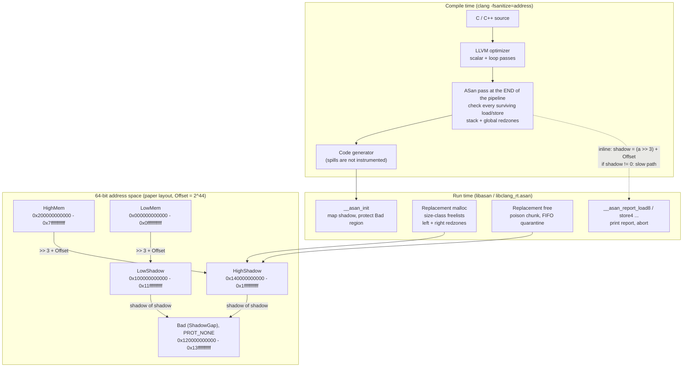

# Paper: AddressSanitizer: A Fast Address Sanity Checker (Serebryany et al. 2012)

> [!summary] Claim:
> AddressSanitizer (ASan) showed that a memory error detector can keep the comprehensiveness of shadow memory without the cost of binary translation or multi-level shadow tables: one shadow byte describes eight application bytes, the shadow address is `(Addr >> 3) + Offset`, and every load and store gets one extra memory read and a compare inserted by the compiler.
> The run-time library supplies the rest: a replacement `malloc` that surrounds every chunk with poisoned redzones, a `free` that poisons the chunk and parks it in a FIFO quarantine, and compiler-created redzones around stack and global objects.
> On SPEC CPU2006 the paper reports a 73% average slowdown and a 3.37x average memory increase, against 20x for Valgrind Memcheck and 10x for Dr. Memory, and 300+ previously unknown Chromium bugs in its first 10 months.
> The 2012 design is still the skeleton of every shipping ASan in Clang, GCC, MSVC, the Linux kernel (Generic KASAN), and Rust, but the constants moved: Linux x86_64 now uses offset `0x7fff8000` instead of `2^44`, heap redzones are adaptive from 16 to 2048 bytes, stacks are recorded in a depot, and use-after-return, use-after-scope, leaks, and container overflows were added later.



## Bibliographic Metadata

| Field | Value |
| :--- | :--- |
| Title | AddressSanitizer: A Fast Address Sanity Checker |
| Authors | Konstantin Serebryany, Derek Bruening, Alexander Potapenko, Dmitry Vyukov (all Google; the USENIX page spells the last author "Dmitriy") |
| Venue | 2012 USENIX Annual Technical Conference (USENIX ATC 12), Boston, MA, June 2012 |
| Pages | 309-318 (from the USENIX BibTeX record, entry 180957) |
| ISBN | 978-931971-93-5 (USENIX BibTeX record) |
| Primary URL | https://www.usenix.org/system/files/conference/atc12/atc12-final39.pdf |
| Landing page | https://www.usenix.org/conference/atc12/technical-sessions/presentation/serebryany |
| Length | 10 pages, letter size, including an appendix of x86_64 instrumentation that runs from the end of page 9 into page 10, followed by the references |
| Implementation evaluated | LLVM-based, released May 2011, merged in LLVM 3.1 (LLVM 3.1 release notes list "AddressSanitizer, a fast memory error detector"; the notes page carries a last-modified stamp of 2012-05-15) |
| Compiler flag in the paper | `-faddress-sanitizer` (Appendix A); today `-fsanitize=address` |
| Evaluation machine | HP Z600, 2 quad-core Intel Xeon E5620, 24 GB RAM, 64-bit Linux, baseline `clang -O2` |

The paper has four stated contributions (section 1.1): show that shadow memory can be cheap, present a compact shadow encoding ("as much as a 128-to-1 mapping"), describe an allocator built for that encoding, and evaluate a publicly available tool.
It is short, and most of its value is in a handful of design decisions that are each one paragraph long.
Two of its numbers are quoted far more often than they are understood: the 73% slowdown (measured with stack unwinding off and quarantine set to zero) and the 3.37x memory increase (whose table column does not equal the ratio of its own printed totals, see Evaluation and Limitations).

## The Core Problem

### Memory errors in C and C++ are frequent, exploitable, and detected late

Out-of-bounds accesses and use-after-free are undefined behavior in C and C++.
The access usually "works": it reads or writes some other live object, allocator metadata, or freed memory that has not been unmapped.
The failure surfaces later and elsewhere, as a corrupted heap, a wrong answer, or a crash in an unrelated function, which is the worst possible signal for debugging.
For a browser such as Chromium these bugs are also the raw material of remote code execution, which is why the paper's evaluation is a browser.

### The 2012 tool landscape: comprehensive and slow, or fast and partial

Section 2 sorts existing tools into three families, and each fails differently.

| Family | Examples named in the paper | What it misses or costs |
| :--- | :--- | :--- |
| Dynamic binary instrumentation with shadow memory | Valgrind Memcheck, Dr. Memory, Purify, BoundsChecker, Intel Parallel Inspector, Discover | Heap out-of-bounds and use-after-free with (typically) no false positives, but no stack or global overflows (other than beyond the stack top); 20x (Memcheck) and 10x (Dr. Memory) slowdowns on CPU2006 |
| Compile-time instrumentation | Mudflap, CCured, LBC, Insure++ | Mudflap does not put redzones between objects in one frame, has false positives in complex C++, and slows CPU2006 by 2x to 41x; CCured and LBC are C-only and need static analysis; Insure++ implementation details are not public |
| Debug allocators | Electric Fence, DUMA, GuardMalloc, Page Heap (guard pages); DieHarder, Dmalloc (magic values) | Guard pages cost at least one system call per `malloc` and a page per object, and miss sub-page overflows such as byte 6 of a 5-byte region; magic values detect corruption only on `free`, long after the write; none handle stack or globals |

Canaries (StackGuard, ProPolice) are mentioned as the same magic-value idea applied to the return address, and they detect only contiguous smashing that reaches the canary.

### Why shadow memory was believed to be expensive

The paper names the "conventional wisdom" it attacks in its conclusion: shadow memory either needs a multi-level translation (an extra dependent load per access) or a direct mapping that consumes a prohibitive contiguous slice of the address space.
TaintTrace used a 1:1 direct shadow and so could give the application only half the address space.
LIFT used a 1/8 direct shadow.
Valgrind and Dr. Memory split shadow into chunks found by table lookup, and on 64-bit Valgrind adds another table layer for addresses above the low 32 GB.
Umbra avoids the table with a non-uniform, dynamically tuned scale and offset.
ASan's bet is that if the encoding is compact enough, the simplest possible mapping (one shift, one add, fixed per platform) is affordable, and the simplicity is what makes the check fast.

## Key Innovation

The core insight is a statement about allocator alignment.
`malloc` returns memory aligned to at least 8 bytes, so any aligned 8-byte word of heap memory is in one of only 9 states: the first `k` bytes are addressable and the remaining `8 - k` are not, for `0 <= k <= 8`.
Nine states fit in one byte, so one shadow byte can describe eight application bytes exactly, and the shadow costs one eighth of the address space instead of all of it.

That single observation enables the rest of the design:
- The mapping is a direct scale and offset, `Shadow = (Addr >> 3) + Offset`, with no table and no dependent load beyond the shadow byte itself.
- The common case (shadow byte is 0, all 8 bytes addressable) is one load, one compare with zero, and one never-taken branch.
- The rare case (shadow byte `k` between 1 and 7) needs a second compare on the low 3 address bits, and runs only when the access touches a partially addressable word.
- Every kind of unaddressable memory is a negative shadow value, so the fast path does not care whether it is a heap redzone, a stack redzone, a global redzone, or freed memory; the report decodes it afterwards.
- Because the check is a compile-time transformation, it runs after the optimizer and sees only accesses that survived optimization, and it can add redzones to stack frames and globals, which binary translators cannot do because the object boundaries are gone by then.

The paper generalizes the encoding to `(Addr >> Scale) + Offset` for `Scale` from 1 to 7.
With `Scale = N` the shadow takes `1/2^N` of the address space, each shadow byte describes `2^N` bytes and must encode `2^N + 1` states, and the minimum redzone and `malloc` alignment become `2^N` bytes.
At `Scale = 7` a shadow byte covers 128 bytes and must encode 129 states, which a signed byte holds (0, 1 to 127 for partial granules, negatives for poisoned), and that is the "128-to-1 mapping" of the contributions list.

## Mechanism Details

### 1. Shadow mapping and the Bad region (section 3.1)

The paper's offsets are fixed per platform, chosen so that `[Offset, Offset + Max/8)` is not occupied at process start.
On 32-bit Linux and macOS it uses `Offset = 0x20000000` (`2^29`).
On 64-bit with 47 significant address bits it uses `Offset = 0x0000100000000000` (`2^44`).
With `-fPIE`/`-pie` on Linux the offset can be zero, which simplifies the instruction sequence further.

Applying the mapping twice is the clever part of Figure 1.
The shadow of the shadow region lands in a region the paper calls Bad, which the runtime marks inaccessible with page protection, so an instrumented access that somehow targets the shadow faults instead of silently corrupting metadata.
Computing the paper's 64-bit layout from its own formula (47-bit user space, `Offset = 2^44`):

| Region | Range | How it arises |
| :--- | :--- | :--- |
| HighMem | `0x200000000000 - 0x7fffffffffff` | application memory above the shadow |
| HighShadow | `0x140000000000 - 0x1fffffffffff` | `(HighMem >> 3) + 2^44` |
| Bad (ShadowGap) | `0x120000000000 - 0x13ffffffffff` | `(Shadow >> 3) + 2^44`, protected |
| LowShadow | `0x100000000000 - 0x11ffffffffff` | `(LowMem >> 3) + 2^44` |
| LowMem | `0x000000000000 - 0x0fffffffffff` | application memory below the shadow |

The whole shadow is `[2^44, 2^45)`, 16 TB of virtual space, which is what the Clang documentation still warns about today: "On 64-bit platforms AddressSanitizer maps (but not reserves) 16+ Terabytes of virtual address space" (as of 2026-11, Both).

The paper notes three platform facts: on Linux the shadow region is always free at startup, on macOS it had to disable ASLR to get the region, and preliminary experiments suggested the same layout works on Windows.

#### What the mapping looks like now (as of 2026-11, llvmorg-23.1.6)

The scale is still 3 everywhere (`#define ASAN_SHADOW_SCALE 3` in `asan_mapping.h`), but the 64-bit Linux x86_64 offset changed.
`getShadowMapping` in `AddressSanitizer.cpp` computes it as `kSmallX86_64ShadowOffsetBase & (kSmallX86_64ShadowOffsetAlignMask << Scale)`, that is `0x7FFFFFFF & (~0xFFF << 3) = 0x7fff8000`, and the header comment gives the resulting Linux x86_64 layout:

| Region | Range (Linux x86_64, offset `0x7fff8000`) |
| :--- | :--- |
| HighMem | `0x10007fff8000 - 0x7fffffffffff` |
| HighShadow | `0x02008fff7000 - 0x10007fff7fff` |
| ShadowGap | `0x00008fff7000 - 0x02008fff6fff` |
| LowShadow | `0x00007fff8000 - 0x00008fff6fff` |
| LowMem | `0x000000000000 - 0x00007fff7fff` |

The reason is instruction encoding.
`0x7fff8000` fits in a sign-extended 32-bit displacement, so the shadow load becomes one instruction, `cmpb $0x0,0x7fff8000(%rax)` in the wiki's `load8` listing, instead of the paper's `mov $0x100000000000,%rcx` (a 10-byte `movabs`) followed by `or`.
LowMem is now under 2 GB, enough for a non-PIE executable's text and data at the traditional `0x400000` base, and PIE executables and shared libraries live in HighMem.

Other 64-bit offsets in the same function (as of 2026-11): AArch64 Linux `1 << 36`, PowerPC64 `1 << 44`, SystemZ `1 << 52`, FreeBSD and NetBSD x86_64 `1 << 46`, x86_64 macOS the paper's `1 << 44` (the `kDefaultShadowOffset64` fallthrough), and a dynamic offset found at startup on arm64 macOS, iOS, Android 32-bit, Fuchsia, RISC-V 64, and Windows 64-bit.
Disassembly of the paper's `foo` compiled with `clang -O2 -fsanitize=address -S` on arm64 macOS (Apple clang, run during verification, as of 2026-11) shows the dynamic offset loaded at run time: an `adrp` and `ldr` through the GOT to `___asan_shadow_memory_dynamic_address`, then a second `ldr` to read its value, followed by `and` with `0xf0ffffffffffffff` to strip the pointer tag bits, `lsr #3`, and `ldrb w8, [x9, x8]` for the shadow byte.
Generic KASAN in the Linux kernel uses the same formula with `kLinuxKasan_ShadowOffset64 = 0xdffffc0000000000` on x86_64.

The paper's appendix uses `or` instead of `add` to apply the offset.
That is legal because `Addr >> 3` is below `2^44` for any 47-bit address, so its bits never overlap the single set bit of `2^44`.
The current pass keeps the trick as `Mapping.OrShadowOffset`: it uses `or` only when the offset is a power of two and the target is not AArch64, PowerPC64, SystemZ, PS, RISC-V 64, or LoongArch64 (as of 2026-11).
`0x7fff8000` is not a power of two, so Linux x86_64 today uses `add` folded into the addressing mode.

### 2. Shadow encoding (section 3.1)

| Shadow byte | Meaning in the paper | Meaning today (`asan_internal.h`, as of 2026-11) |
| :--- | :--- | :--- |
| `0` | all 8 bytes addressable | same |
| `k`, 1 to 7 | first `k` bytes addressable | same |
| negative | whole word unaddressable; different negative values distinguish heap redzone, stack redzone, global redzone, freed memory | `0xfa` heap left redzone, `0xfd` freed heap, `0xf1`/`0xf2`/`0xf3` stack left/mid/right, `0xf5` stack after return, `0xf8` stack after scope, `0xf9` global redzone, `0xf6` init order, `0xf7` user poisoned, `0xfc` container overflow, `0xac` array cookie, `0xca`/`0xcb` alloca left/right, `0xfe` internal heap |

All the current magic values have the top bit set, so they are negative as signed bytes, and the fast path is unchanged by their addition.
The paper's own stack example uses `0xff` for every redzone byte; the per-kind values are what let a modern report say "stack-buffer-overflow" versus "stack-use-after-scope".

### 3. The inline check (section 3.2 and Appendix A)

For an 8-byte access the paper inserts:

```c
ShadowAddr = (Addr >> 3) + Offset;
if (*ShadowAddr != 0)
  ReportAndCrash(Addr);
```

For 1-, 2-, and 4-byte accesses a non-zero shadow byte is not yet an error, because the access might lie entirely inside the first `k` addressable bytes:

```c
ShadowAddr = (Addr >> 3) + Offset;
k = *ShadowAddr;
if (k != 0 && ((Addr & 7) + AccessSize > k))
  ReportAndCrash(Addr);
```

The `k` compare is signed, so any negative `k` makes `(Addr & 7) + AccessSize > k` true and reports.
The wiki writes the same test as `last_accessed_byte = (address & 7) + kAccessSize - 1; return last_accessed_byte >= shadow_value;`, which is the identical inequality.

Appendix A shows the x86_64 code that `clang -O2 -faddress-sanitizer` emitted for `*a = 0x1234`:

```text
8-byte store (T = long)                 4-byte store (T = int)
push  %rax                              push  %rax
mov   %rdi,%rax                         mov   %rdi,%rax
shr   $0x3,%rax                         shr   $0x3,%rax
mov   $0x100000000000,%rcx              mov   $0x100000000000,%rcx
or    %rax,%rcx                         or    %rax,%rcx
cmpb  $0x0,(%rcx)    # shadow == 0?     mov   (%rcx),%al     # get shadow
jne   <error>                           test  %al,%al
movq  $0x1234,(%rdi) # original store   je    <original store>
pop   %rax                              mov   %edi,%ecx      # slow path
retq                                    and   $0x7,%ecx      # slow path
callq __asan_report_store8              add   $0x3,%ecx      # slow path
                                        cmp   %al,%cl
                                        jge   <error>
                                        movl  $0x1234,(%rdi) # original store
                                        pop   %rax
                                        retq
                                        callq __asan_report_store4
```

Three design choices are visible in those listings.
The error path is a call placed out of line after `retq`, so the hot path has a single forward branch that is never taken in a correct program.
The constant `3` in `add $0x3,%ecx` is `AccessSize - 1` for a 4-byte access, so the compare is "last byte offset >= k".
The check happens before the original store, which is what the paper means by detecting bugs "at the point of occurrence": the report fires before memory is corrupted, so the allocator metadata in the left redzone cannot be overwritten by an underflow in instrumented code.

The paper considered encoding the report as a hardware exception instead of a call to keep the inserted code compact.
The wiki records that ASan at one point defaulted to three instructions (copy the failing address to `%rax`, execute `ud2`, then a one-byte instruction encoding access type and size, 5 to 6 bytes in total) and that a call is the default now (as of 2026-11).

#### Where the pass runs

The paper placed the pass "at the very end of the LLVM optimization pipeline", for two reasons: accesses that the optimizer deleted (for example locals promoted to registers) cost nothing, and accesses generated later by the code generator (register spills) are not instrumented because they cannot be buggy.
Clang still does this by default: `BackendUtil.cpp` registers the sanitizer passes with `registerOptimizerLastEPCallback` unless the LLVM option `-sanitizer-early-opt-ep` (`ClSanitizeOnOptimizerEarlyEP`) is set (as of 2026-11, llvmorg-23.1.6).

#### The only optimization in 2012

Section 5.1 says ASan had exactly one compile-time optimization: in `(*a)++` the load and the store hit the same address, so only the first is instrumented.
The rest of section 5.1 is a wish list (instrument only the first or last of repeated accesses, only `a[0]` and `a[n-1]` of a loop, merge adjacent field accesses, skip statically safe accesses and scalar globals).
The paper notes that range checking at both ends was already used for the `memset`/`memcpy` family.

### 4. The run-time library and allocator (section 3.3)

At startup the runtime maps the entire shadow so nothing else can take it, and protects the Bad region.
`malloc` and `free` are replaced.
The allocator keeps an array of freelists by size class; when a class is empty it maps a large group of regions with `mmap`, laid out so that `n` regions need `n + 1` redzones and the right redzone of one chunk is the left redzone of the next:

```text
rz1 mem1 rz2 mem2 rz3 mem3 rz4
```

The left redzone holds the allocator's internal data (allocation size, thread ID, and so on), which is why the paper's minimum heap redzone was 32 bytes, and it also stores the `malloc` call stack.
The free call stack is stored in the first bytes of the freed region itself, which is safe because the region is poisoned and nobody may legally read it.
A larger redzone stores more frames of the `malloc` stack, so in 2012 the redzone size and the maximum unwind depth were coupled.

`free` poisons the whole region and pushes it onto a FIFO quarantine that "holds a fixed amount of memory at any time", so a freed chunk is not handed out again until enough later frees have pushed it out.

Section 3.7 adds the threading story: shadow is written only when the corresponding application memory is not legitimately accessible (inside `malloc`/`free`, frame creation and destruction, module initialization), so every other shadow access is a read and the scheme is thread-safe without locks on the check path.
`malloc` and `free` use thread-local caches.
Thread IDs are recorded for every allocation and deallocation and reported together with thread creation stacks.
A race between an access and a `free` may be reported as a use-after-free, but is not guaranteed to be.

#### What the allocator looks like now (as of 2026-11, llvmorg-23.1.6)

| Aspect | Paper (2012) | `asan_allocator.cpp` and flags today |
| :--- | :--- | :--- |
| Chunk metadata | in the left redzone, minimum heap redzone 32 bytes | 16-byte `ChunkHeader` (`COMPILER_CHECK(kChunkHeaderSize == 16)`), which is part of the left redzone; `redzone` flag default 16 and must be a power of two |
| Redzone size | one value, default 128 bytes | adaptive by request size: `ComputeRZLog` picks 16 bytes for requests up to 48, then 32, 64, 128, ... up to 2048 for requests above 65,536 - 1024 bytes, clamped by `redzone` and `max_redzone` (default 2048) |
| Allocation stack | raw frames in the left redzone | a 32-bit `StackDepotPut` id plus thread id packed into `alloc_context_id` |
| Free stack | start of the freed region | `free_context_id` in the part of `ChunkBase` that overlaps user memory |
| Unwind depth | default 30 | `malloc_context_size` default 30 (`kDefaultMallocContextSize = 30` in `asan_stack.h`), hard cap `kStackTraceMax = 255` |
| Quarantine | one FIFO, default 256 MB | `quarantine_size_mb` default 256 (16 on iOS and Android, `ASAN_LOW_MEMORY`), plus `thread_local_quarantine_size_kb` default 1024 on 64-bit (256 on 32-bit, 64 in low-memory mode) |
| Chunk states | not described | `CHUNK_INVALID`, `CHUNK_ALLOCATED`, `CHUNK_QUARANTINE`, swapped with atomic compare-exchange, which is how double free is detected |

Moving stacks into a depot decoupled the two knobs the paper had to trade against each other: a small redzone no longer limits how many frames a report can show, and identical stacks are stored once.

### 5. Stack and globals (section 3.4)

For globals the compiler creates the redzones by padding each global, and passes the addresses to the runtime at startup; the runtime poisons them and remembers them for reports (today through `__asan_register_globals`).

For stack objects the redzones are created and poisoned at run time on function entry and unpoisoned on exit.
The paper uses 32-byte redzones plus up to 31 bytes of alignment padding, and shows this transformation of `void foo() { char a[10]; ... }`:

```c
void foo() {
  char rz1[32];
  char arr[10];
  char rz2[32-10+32];
  unsigned *shadow =
    (unsigned*)(((long)rz1>>8)+Offset);   /* as printed; must be >>3 */
  // poison the redzones around arr.
  shadow[0] = 0xffffffff; // rz1
  shadow[1] = 0xffff0200; // arr and rz2
  shadow[2] = 0xffffffff; // rz2
  <function body>
  // un-poison all.
  shadow[0] = shadow[1] = shadow[2] = 0; }
```

The listing has a typo in the printed paper: the shift is `>>8`, but every other formula in the paper uses `>> 3`, and the wiki's version of a similar example (`char a[8]`) computes the pointer with `MemToShadow`, which it defines as `(Mem >> 3) + 0x7fff8000`.
Working the example through shows why the numbers are what they are:
- The frame is 32 + 10 + 54 = 96 bytes, which needs 96 / 8 = 12 shadow bytes, written as three 32-bit stores.
- `shadow[0]` covers `rz1` (32 bytes, 4 shadow bytes), all `0xff`.
- `shadow[1] = 0xffff0200` stored little-endian is the byte sequence `00 02 ff ff`: 8 addressable bytes, then 2 addressable bytes (`arr[8]` and `arr[9]`), then 16 bytes of redzone.
- `shadow[2]` covers the last 32 bytes of `rz2`.
- Poisoning a whole frame costs a handful of word stores, which is why stack protection is cheap enough to be on by default.

Today the frame layout comes from `ComputeASanStackFrameLayout` (as of 2026-11): every variable is aligned to at least 16 bytes (`kMinAlignment`), the frame starts with a header of `max(LongSize / 2, Granularity)` bytes (32 on 64-bit) whose first three words hold a frame magic (`kCurrentStackFrameMagic = 0x41B58AB3`), a pointer to a frame description string, and the function's address, and each variable gets a size-dependent redzone from `VarAndRedzoneSize` (16 bytes total for objects up to 4 bytes, 32 for up to 16, `size + 32` up to 128, `size + 64` up to 512, `size + 128` up to 4096, else `size + 256`).

### 6. False negatives (section 3.5)

The paper is explicit about three blind spots, all still present in 2026.

Unaligned partially out-of-bounds accesses:

```cpp
int *a = new int[2];          // 8-aligned, bytes [0, 7]
int *u = (int*)((char*)a + 6);
*u = 1;                       // writes [6, 9]
```

The check looks only at the shadow byte for `Addr >> 3`, which describes bytes 0 to 7 and is `0`, so the access passes even though bytes 8 and 9 are in the redzone.
The authors rejected the fixes they found (an alignment test on every access, a 1:1 shadow, or `Scale = 7` to shrink the window) because each slows the common path.
The wiki still lists this as unfixed in the default mode (as of 2026-11).

Far overflows that jump the redzone:

```cpp
char *a = new char[100];
char *b = new char[1000];
a[500] = 0;   // may land inside b
```

Every access inside the redzone is caught "with 100% probability"; anything beyond it may land in another live chunk.
The paper recommends redzones up to 128 bytes when memory allows.

Use-after-free after the quarantine has drained:

```cpp
char *a = new char[1 << 20];  // 1 MB
delete [] a;                   // "free"
char *b = new char[1 << 28];  // 256 MB
delete [] b;                   // drains the quarantine queue
char *c = new char[1 << 20];  // 1 MB
a[0] = 0;                      // "use"; may land in c
```

The paper notes that Valgrind and Dr. Memory share the last two limitations, since they are properties of any redzone-plus-quarantine design.

### 7. False positives and how they were fixed (section 3.6)

The paper's headline claim is "In short, AddressSanitizer has no false positives", followed by three classes of undesirable reports seen during development, all fixed.

Load widening.
For `struct X { char a, b, c; }`, the optimizer turned `x.a + x.c` into one 4-byte load of a 3-byte object; since the ASan pass runs after the optimizer, it instrumented a load that crosses the object end.
The fix partially disabled load widening when ASan is on, while still allowing `x.a + x.b` to become a 2-byte load because that stays in bounds.
This is the general hazard of instrumenting late: the check sees what the optimizer produced, and the optimizer is allowed to touch bytes the source never did.

`clone` with `CLONE_VM | CLONE_FILES`.
A child shares the parent's memory, poisons stack redzones in a frame, and calls a function that never returns (`_exit`, `exec`), leaving poison behind in the parent's address space.
The fix unpoisons the whole stack before calls to functions marked noreturn, and the same reasoning forced the runtime to intercept `longjmp` and C++ exceptions, which also leave frames without running their epilogues.

Intentional wild reads.
Low-level code that walks the stack across frames reads redzones on purpose.
The paper added the attribute `no_address_safety_analysis`, and Chromium needed it once.
Today Clang lists `no_address_safety_analysis` and `no_sanitize_address` as deprecated synonyms of `__attribute__((no_sanitize("address")))` (as of 2026-11).

"No false positives" holds for fully instrumented code using the ASan allocator.
It does not survive custom allocators that hand out sub-chunks of one `malloc` (no redzones between them, so false negatives), mismatched container annotations between instrumented and uninstrumented translation units (a modern source of false positives that the 2012 tool did not have, because container-overflow checks did not exist yet), or uninstrumented code that writes memory ASan believes is poisoned.

### 8. Tuning (section 4.3)

| Control (paper) | 2012 default | Effect stated in the paper | Current knob (as of 2026-11) |
| :--- | :--- | :--- | :--- |
| Stack unwind depth | 30 | speed only, especially for `malloc`-heavy code; short stacks make reports hard to use | `malloc_context_size=30`, `fast_unwind_on_malloc` |
| Quarantine size | 256 MB | use-after-free detection only; "does not affect performance" | `quarantine_size_mb=256`, `thread_local_quarantine_size_kb` |
| Heap redzone | 128 bytes | heap overflow detection; large values cost speed and memory for small chunks; also limits unwind depth | `redzone=16`, `max_redzone=2048` (adaptive) |

Chromium was tested with the defaults, and increasing any of them found no more bugs.
For other software the authors sometimes used 32- or 64-byte redzones, disabled unwinding, or shrank the quarantine to meet memory limits.
All three were set from an environment variable at process start, which today is `ASAN_OPTIONS`.

### 9. Hardware support (section 5.3)

The paper proposes a `checkN Addr` instruction equivalent to the inline check, with `Offset` and `Scale` in special registers, defaulting to a no-op unless a CPU flag enables it.
The claimed benefits are less icache pressure, fused arithmetic, better branch prediction, smaller binaries, and the ability to turn checking on for part of a long-lived process.
No CPU shipped `checkN`.
What shipped instead is pointer tagging: HWASan uses AArch64 top-byte-ignore to keep a tag in the pointer and a TG-to-1 shadow of memory tags (TG "e.g. 16 or 64"), and Arm MTE moves the memory tag into hardware, which Hardware Tag-Based KASAN uses "as an in-field memory bug detector or as a security mitigation" on arm64 (as of 2026-11).
The HWASan design document names ASan's redzones, quarantine, and "to a lesser extent" shadow as the sources of its memory overhead, and cites this paper for details; [[Cpp-HWASan-and-Hardware-Memory-Tagging]] owns that mechanism.

### 10. Handling libraries (section 5.2)

Compile-time instrumentation does not see system libraries, except the C library functions that ASan intercepts (such as `memset`).
The paper suggests special instrumented builds of open-source libraries and, for closed-source ones, a hybrid with DynamoRIO, and argues that a pure binary-translation ASan would be slower and that it "is not clear how to implement redzones for stack objects using run-time instrumentation".
That argument is the dividing line between this paper and [[Paper-Valgrind-Dynamic-Binary-Instrumentation]]: a DBI tool sees every instruction but not object boundaries, and a compiler pass sees object boundaries but only the code it compiled.

## Evaluation and Limitations

### What the paper measured

The benchmark set is the 19 C and C++ benchmarks of SPEC CPU2006 that appear in Figure 2 and Table 1 (all 12 CINT2006 programs plus `433.milc`, `444.namd`, `447.dealII`, `450.soplex`, `453.povray`, `470.lbm`, `482.sphinx3`).
The configuration matters: 32-byte redzones, stack unwinding in `malloc`/`free` disabled, and quarantine size zero.
That is not the configuration anyone runs by default, so the 73% is a lower bound on the cost of the checks plus allocator, not a measurement of the default tool.

| Result | Value (paper) |
| :--- | :--- |
| Average slowdown, reads and writes instrumented | 73% |
| Worst benchmarks | `400.perlbench` 2.60x, `483.xalancbmk` 2.67x (both text processing, `malloc`-heavy, many 1- and 2-byte accesses) |
| Average slowdown, writes only | 26% |
| `Offset = 0` (needs `-fPIE`/`-pie`) | average slowdown 69% |
| `Scale` 4 to 7 versus 3 | from 2% faster to 15% slower; footprint similar for 4 and 5, larger for 6 and 7 because of larger redzones |
| Memory (VmPeak at exit) | 3.37x average, from 1.40x (`429.mcf`) to 24.55x (`453.povray`) |
| Stack (VmStk) | only 6 benchmarks changed noticeably, 3 by more than 10%; worst `400.perlbench` 568 KB to 1740 KB (3.06x) |
| Binary size | 1.5x to 3.2x, average 2.5x |
| Bugs found in CPU2006 | 3: one stack and one global overflow in `h264ref`, one use-after-realloc in `perlbench` |

Reading Figure 2 bar by bar: the slowest-to-fastest spread is roughly 1.07x (`462.libquantum`) to 2.67x (`483.xalancbmk`), and in the writes-only series `462.libquantum` and `470.lbm` have no visible bar above 1.00.
The arithmetic mean of the 19 bar heights read off the chart is about 1.73, which matches the "average" bar and suggests the 73% is an arithmetic mean of per-benchmark ratios; the paper does not say which mean it used, and bar reads are only good to about 0.02.

### Threats to validity

The memory table does not reconcile with itself.
The printed columns sum to 8,171 MB original and 24,467 MB instrumented, a ratio of 2.99x, not the 3.37x printed in the total row.
Every row's "Increase" is the row's Instrumented / Original multiplied by the same factor, about 1.125 (for example `400.perlbench` 2168 / 670 = 3.24, printed 3.64; `453.povray` 371 / 17 = 21.8, printed 24.55), and 2.99 x 1.125 = 3.37.
A factor of 9/8 is what you get if the increase column adds a 1/8 shadow estimate on top of the VmPeak figure, but the paper never says so, so treat that as an inference and quote "about 3x to 3.4x" rather than a precise number.

Other threats a careful reader should name:
- The 20x and 10x numbers for Valgrind and Dr. Memory are cited from the Dr. Memory paper, not re-measured on the same machine, and those tools also find uninitialized reads and leaks, so the comparison is not like for like (the authors say this themselves).
- The DUMA comparison used 18 benchmarks (it crashed on 12 "out of 18"), while Figure 2 has 19.
- SPEC CPU2006 is CPU-bound single-threaded code; the slowdown on a `malloc`-heavy multithreaded server or a branchy parser can be very different, which the perlbench and xalancbmk outliers already hint at.
- A single machine, a single compiler version, and no variance or confidence intervals are reported; [[Paper-Producing-Wrong-Data-Measurement-Bias]] explains why that matters for differences of a few percent such as the 69% versus 73% `Offset = 0` result.
- Disabling unwinding and quarantine removes exactly the costs a user pays by default; the paper says quarantine "does not affect performance", but it does affect memory and cache footprint.

### Deployment results (section 4.2)

Chromium had been tested continuously with ASan since the May 2011 release.
In the first 10 months it found more than 300 previously unknown bugs in Chromium and its third-party libraries: 210 heap-use-after-free, 73 heap-buffer-overflow, 8 global-buffer-overflow, 7 stack-buffer-overflow, and 1 `memcpy` parameter overlap, plus 13 cases where ASan triggered another kind of error without a useful message.
The two sources of reports were the existing unit tests and fuzzing, and the paper's argument for speed is explicitly about both: fewer machines to keep up with commits, and random tests that run in seconds (no start-up translation penalty) and can be minimized quickly.
Outside Chromium, heap-use-after-free was again the most common class but stack and global overflows were relatively more frequent, and users reported bugs in Firefox, Perl, Vim, and LLVM itself.

### Limitations, as stated and as they stand in 2026

| Limitation | Paper | Status (as of 2026-11) |
| :--- | :--- | :--- |
| Unaligned partial overflow | ignored, every fix slows the common path | still missed by default (wiki) |
| Overflow beyond the redzone | possible miss | still possible; adaptive redzones grow with object size |
| Use-after-free after quarantine drains | possible miss | still possible; tune `quarantine_size_mb` |
| Stack use-after-return | not addressed | added later: fake stack, `-fsanitize-address-use-after-return=runtime` default, `detect_stack_use_after_return` on by default on Linux (not Android) |
| Stack use-after-scope | not addressed | added later; on by default in the Clang driver (`AsanUseAfterScope = true`) and the `0xf8` shadow value |
| Leaks | not addressed (Valgrind's advantage in section 4.1) | LeakSanitizer integrated; `detect_leaks` defaults to off on Apple platforms |
| Uninitialized reads | out of scope | a separate tool, [[Paper-MemorySanitizer]] |
| Uninstrumented libraries | instrumented builds or DynamoRIO hybrid proposed | interceptors for libc; rebuild everything else (for example CPython `--with-address-sanitizer`, ideally with `--without-pymalloc`) |
| Static linking | not discussed | "Static linking of executables is not supported" (Clang docs) |
| Production use | not discussed | Clang docs: the runtime "is not meant to be linked against production executables" and "may compromise the security of the resulting executable" |

## Industry Impact

The paper's prediction that the check is "simple enough to be implemented in a wide range of compilers, binary instrumentation systems, and even in hardware" came true in every category except a `checkN` instruction.

| Year | Event | Source |
| :--- | :--- | :--- |
| May 2011 | ASan released, Chromium testing starts | paper, section 4.2 |
| May 2012 | LLVM 3.1 ships AddressSanitizer | LLVM 3.1 release notes; paper "Availability" |
| June 2012 | paper presented at USENIX ATC 12, Boston | USENIX record |
| 2013-03-22 | GCC 4.8.0 adds `-fsanitize=address` on IA-32, x86-64, x32, PowerPC, PowerPC64 GNU/Linux and x86-64 Darwin | GCC 4.8 changes; release date from gcc.gnu.org/releases.html |
| 2014-04-22 | GCC 4.9.0 adds ARM ASan and removes the Mudflap runtime ("The mudflap options remain, but do nothing") | GCC 4.9 changes; release date from gcc.gnu.org/releases.html |
| 2021-03-02 | MSVC supports AddressSanitizer starting in Visual Studio 2019 version 16.9 (`/fsanitize=address`), x86 and x64 | Microsoft ASan docs for the version; Visual Studio 2019 16.9 release notes for the 16.9.0 release date |
| ongoing | Generic KASAN in the Linux kernel uses the same 1/8 direct shadow, `kasan_mem_to_shadow(addr) = (addr >> 3) + KASAN_SHADOW_OFFSET` | kernel KASAN docs |
| ongoing | Rust exposes ASan as the unstable `-Zsanitizer=address` (nightly only) on targets including `x86_64-unknown-linux-gnu`, `aarch64-unknown-linux-gnu`, and both Apple Darwin targets | Rust Unstable Book |

The design also changed what "a memory error detector" means operationally.
Before ASan the reference tool was Memcheck, run occasionally on a test by hand because of its slowdown.
After ASan, memory checking became a build configuration: an ASan build of the whole test suite on every commit, and ASan as the default oracle for coverage-guided fuzzers, because a fuzzer needs a crash at the first bad access, not a corrupted heap that maybe crashes later.
Mudflap's removal from GCC one release after ASan arrived is the cleanest evidence that the approach displaced its closest predecessor.

The sanitizer family grew from the same runtime (`sanitizer_common`) and the same shadow idea with different encodings: [[Paper-ThreadSanitizer]] for races, [[Paper-MemorySanitizer]] for uninitialized reads with bit-exact shadow, LeakSanitizer as a mark phase over ASan's allocator, and HWASan and MTE replacing redzones with tags.
KASAN brought the paper's mapping into the kernel, where the inline-versus-outline trade-off reappears: the kernel docs state that inline instrumentation "significantly enlarges the kernel" but gives "an x1.1-x2 performance boost over the outline-instrumented kernel" (as of 2026-11, Linux).

The cost picture also moved.
The current Clang documentation says "Typical slowdown introduced by AddressSanitizer is 2x" and "We have seen up to 3x increase" in stack memory (as of 2026-11, Both).
Those numbers reflect the default configuration with unwinding, quarantine, use-after-return, and use-after-scope on, which is the configuration the paper deliberately did not measure.

## Concept Grounding

- [[Cpp-AddressSanitizer-and-LeakSanitizer-Internals]] owns the shipping mechanism in full: the current shadow layouts, chunk header bits, report anatomy, fake stack, and LeakSanitizer, with a runnable lab; this note owns the 2012 design and why it was chosen.
- [[Cpp-HWASan-and-Hardware-Memory-Tagging]] owns the tag-based successor that section 5.3 anticipated.
- [[Paper-Valgrind-Dynamic-Binary-Instrumentation]] is the baseline this paper argues against: D&R binary translation, two-level shadow, and the 20x Memcheck figure.
- [[Paper-MemorySanitizer]] reuses the direct-mapping idea with a 1:1 bit-exact shadow for the bug class ASan deliberately leaves out.
- [[Paper-ThreadSanitizer]] is the race-detection sibling from the same group and runtime family.
- [[Virtual-Memory-Mmap-and-Process-Address-Space]] explains the `mmap` reservation, `PROT_NONE` gap, and overcommit behavior that make a 16 TB shadow mapping cheap.
- [[Compiler-Pipeline-and-Debuggability]] explains why a pass at the end of the optimizer sees fewer accesses than the source has.
- [[Cpp-Clang-Tidy-Static-Analyzer-and-Fuzzing-libFuzzer-AFLPlusPlus]] covers fuzzing, where ASan is the default bug oracle.
- [[Drill-Debugging-Use-After-Free-Core-Dump]] and [[Cpp-Playbook-Heap-Corruption]] are the hands-on consequences of detecting at the point of occurrence versus after the fact.
- [[Rust-Miri-Sanitizers-Loom-and-Cargo-Fuzz]] grounds the Rust side: ASan for `unsafe` and FFI code, Miri for undefined behavior that ASan cannot see.

## Commands and Numbers to Know

| Item | Value | Platform |
| :--- | :--- | :--- |
| Shadow formula | `(Addr >> 3) + Offset`, scale 3 everywhere (as of 2026-11) | Both |
| Paper 64-bit offset | `0x100000000000` (`2^44`), still used on x86_64 macOS and PowerPC64 (as of 2026-11) | macOS |
| Linux x86_64 offset | `0x7fff8000` (as of 2026-11) | Linux |
| Linux AArch64 offset | `0x1000000000` (`1 << 36`) (as of 2026-11) | Linux |
| arm64 macOS offset | dynamic, `__asan_shadow_memory_dynamic_address` (as of 2026-11) | macOS |
| 32-bit offset | `0x20000000` (`2^29`), paper and today's default 32-bit Linux (as of 2026-11) | Linux |
| Virtual shadow mapped | 16+ TB on 64-bit, mapped but not reserved (as of 2026-11) | Both |
| Heap redzone | `redzone=16` minimum, `max_redzone=2048`, adaptive by size (as of 2026-11) | Both |
| Chunk header | 16 bytes (as of 2026-11) | Both |
| Quarantine | `quarantine_size_mb=256` (16 on iOS and Android), thread-local 1024 KB on 64-bit (as of 2026-11) | Both |
| Allocation stack depth | `malloc_context_size=30`, max 255 (as of 2026-11) | Both |
| Stack frame header | 32 bytes on 64-bit (as of 2026-11) | Both |
| Callback threshold | functions with more than 7000 accesses use calls instead of inline checks (`-asan-instrumentation-with-call-threshold`, hidden LLVM option) (as of 2026-11) | Both |
| Use-after-return | `-fsanitize-address-use-after-return=runtime` default; `detect_stack_use_after_return` default on Linux except Android (as of 2026-11) | Both |
| Use-after-scope | on by default in the Clang driver; `-fno-sanitize-address-use-after-scope` turns it off (as of 2026-11) | Both |
| Leak detection | `detect_leaks` default off on Apple, on elsewhere where supported (as of 2026-11) | Both |
| Paper slowdown | 73% average (69% with `Offset = 0`), 26% writes-only, CPU2006 | Linux |
| Docs slowdown | "Typical slowdown ... is 2x" (as of 2026-11) | Both |

```sh
# Build and run with the flags the Clang docs recommend.
clang++ -O1 -g -fsanitize=address -fno-omit-frame-pointer app.cc -o app
ASAN_OPTIONS=quarantine_size_mb=1024:malloc_context_size=30 ./app

# Reproduce the paper's measurement configuration (32-byte heap redzones,
# no malloc/free stacks, no quarantine) to compare against its 73%.
ASAN_OPTIONS=redzone=32:max_redzone=32:malloc_context_size=0:quarantine_size_mb=0:thread_local_quarantine_size_kb=0 ./app

# Paper section 4: writes-only instrumentation (hidden LLVM option).
clang++ -O2 -fsanitize=address -mllvm -asan-instrument-reads=false app.cc -o app_w

# Look at the inline check the paper's Appendix A shows.
clang -O2 -fsanitize=address -c store.c -o store.o && objdump -d store.o
```

The option names in the block come from `asan_flags.inc`, `sanitizer_flags.inc`, and `AddressSanitizer.cpp` at llvmorg-23.1.6; `thread_local_quarantine_size_kb=0` is accepted only together with `quarantine_size_mb=0`, which `asan_flags.cpp` enforces.
None of these commands were run for this note; the runnable lab lives in [[Cpp-AddressSanitizer-and-LeakSanitizer-Internals]].

## Pitfalls

> [!warning] Pitfalls:
> - **Quoting 73% as the cost of ASan:** the paper measured with unwinding off, quarantine zero, and 32-byte redzones, before use-after-return, use-after-scope, and leak checking existed, the current docs say 2x is typical, and CI capacity should be budgeted from your own measurement.
> - **Quoting 3.37x as a precise memory number.** The table's own totals give 2.99x, and each row is inflated by the same 9/8 factor without explanation.
> - **Believing "no false positives" unconditionally:** it holds for fully instrumented code on the ASan allocator, while custom pool allocators hide bugs, uninstrumented code can write poisoned memory, and container annotations that disagree across translation units produce reports.
> - **Assuming every overflow is caught.** Unaligned partial overflows and jumps past the redzone are missed by design; a clean ASan run is evidence, not proof.
> - **Assuming every use-after-free is caught.** A large allocation between `free` and use can drain the quarantine, exactly as the paper's section 3.5 example shows; raise `quarantine_size_mb` for tests that churn memory.
> - **Copying the paper's offset into hand-written code.** `2^44` is the paper's value and still x86_64 macOS's, but Linux x86_64 is `0x7fff8000` and arm64 macOS is dynamic; use the public interface (`__asan_address_is_poisoned`, `ASAN_POISON_MEMORY_REGION`) rather than computing shadow addresses.
> - **Copying the paper's stack example literally.** The printed `>>8` is a typo for `>> 3`.
> - **Running ASan under `ulimit -v`.** A 16 TB shadow mapping exceeds any realistic virtual memory limit; the Clang docs warn that "tools like ulimit may not work as usually expected".
> - **Linking only the shared libraries.** The runtime must be linked into the executable (link with `clang`, not `ld`); `-Wl,-z,defs` breaks sanitized shared libraries; static executables are unsupported.
> - **Shipping it:** ASan is a test-time tool whose runtime is not hardened, the docs warn it may compromise the executable's security, and for production the tools are tagging (MTE, Hardware Tag-Based KASAN) or hardened allocators.
> - **Mixing ASan with another shadow tool.** ASan, MSan, and TSan each claim the shadow layout and the allocator; build them as separate configurations.

## At Scale

The paper's argument for speed is an argument about scale, and it is the right frame for a fleet.
A 20x tool can be run on a handful of tests by a person; a 2x tool can be run on every test of every commit by a build farm, and on every fuzzer execution.

- **One developer.** Build with `-fsanitize=address -fno-omit-frame-pointer -O1 -g` for local debugging of any crash in C, C++, or `unsafe` Rust before reaching for a debugger, because the report names the bad access, the allocation stack, and the free stack.
- **A team (10 to 100 engineers).** Keep an ASan configuration of the full unit and integration suite in CI as a required check, with the default flags plus a larger quarantine for allocation-heavy suites, and treat a new ASan report as a release blocker.
- **An organization (1,000 to 50,000 engineers).** Make ASan one of a small fixed matrix (ASan plus UBSan, TSan, MSan) built from the same sources, budget machine capacity from measured slowdown of your own suite, run continuous fuzzing with ASan as the oracle, and route reports by allocation and free stack so that ownership is automatic.
- **Decision rule: ASan versus Valgrind.** Use ASan when you can rebuild the code; use Memcheck when you cannot (closed binaries, a vendor library you must test as shipped) or when you need uninitialized-read detection without an MSan build.
- **Decision rule: ASan versus HWASan or MTE.** Use ASan on x86_64 and wherever you need deterministic detection of small overflows; use HWASan on AArch64 when ASan's memory overhead is the constraint; use MTE-based checking when you need something that can run in production.
- **Decision rule: inline versus outline.** Inline checks are the paper's design and the fast default; outline (`-fsanitize-address-outline-instrumentation`) trades speed for binary size when the instrumented binary or its debug info hits a size limit.

## Practice Drill

> [!tip] Practice Drill:
> 1. Compile the paper's Appendix A function `void foo(long *a) { *a = 0x1234; }` and its `int` variant with `clang -O2 -fsanitize=address -c` on Linux x86_64 and on arm64 macOS, disassemble both, and annotate each instruction against the paper's listing; explain why the Linux sequence has no `movabs` and why the macOS sequence loads the offset from memory.
> 2. Write the three section 3.5 false-negative programs and confirm which ones ASan reports with default flags; then make the quarantine example report by raising `quarantine_size_mb`, and explain why the unaligned one cannot be made to report with any runtime flag.
> 3. Run one allocation-heavy benchmark of your own under the paper's configuration (`redzone=32:max_redzone=32:malloc_context_size=0:quarantine_size_mb=0:thread_local_quarantine_size_kb=0`) and under defaults, five runs each, and report the median and spread; compare the gap to the paper's 73% versus the docs' 2x.
> 4. Recompute the paper's Table 1 from its Original and Instrumented columns and write one paragraph on what the 9/8 factor could mean and how you would check it.

## Interview Questions

### L5

**Q1. Why can one shadow byte describe eight bytes of heap memory exactly?**

> [!success]- Answer
> Because `malloc` returns memory aligned to at least 8 bytes, the only place where an aligned 8-byte word can be partly valid is the tail of an allocation, and there the valid bytes are always a prefix.
> So each aligned word is in one of 9 states (first `k` bytes valid, `k` from 0 to 8), which fits in a byte: 0 for all valid, `k` from 1 to 7 for a valid prefix, and negative values for fully invalid words, with different negative values recording why (heap redzone, freed, stack redzone, global redzone).
> The cost is one eighth of the address space in shadow and a minimum 8-byte granularity for redzones.

**Q2. What are the instructions on the fast path of an ASan check for an 8-byte load, and why is it fast?**

> [!success]- Answer
> Shift the address right by 3, add (or OR) the offset, load the shadow byte, compare with zero, and branch to an out-of-line report call if non-zero.
> On Linux x86_64 today the offset `0x7fff8000` fits in a 32-bit displacement, so the add and the load collapse into `cmpb $0x0,0x7fff8000(%rax)`.
> It is fast because there is exactly one extra memory read, no table lookup, no function call on the common path, and a branch that is never taken in a correct program, so it predicts perfectly.
> The paper's 2^44 offset needed a separate `movabs` and `or`, which is part of why the Linux offset changed.

**Q3. Predict the output: with default ASan flags, which of these three programs produce an ASan report?**

```cpp
// (a)
int *a = new int[2]; *(int*)((char*)a + 6) = 1;
// (b)
char *a = new char[100]; a[100] = 0;
// (c)
char *a = new char[100]; delete[] a; a[0] = 0;
```

> [!success]- Answer
> (a) produces no report.
> The 4-byte store at offset 6 covers bytes 6 to 9; the check reads only the shadow byte for the word containing the address, which covers bytes 0 to 7 and is 0, so the access passes, which is the unaligned false negative of section 3.5.
> (b) reports heap-buffer-overflow: byte 100 is in the right redzone (the shadow byte for bytes 96 to 103 is 4, and `(100 & 7) + 1 = 5 > 4`).
> (c) reports heap-use-after-free: the chunk is poisoned with `0xfd` and sits in the quarantine, since nothing has been allocated in between to push it out.

**Q4. Why does ASan detect stack and global overflows when Valgrind Memcheck does not?**

> [!success]- Answer
> Detecting an overflow requires poisoned bytes between objects.
> On the heap a replacement allocator can insert them, which is why both tools catch heap overflows.
> For stack and globals the layout is fixed by the compiler, and by the time a binary translator sees the code the object boundaries are gone, so Memcheck can only tell valid stack from below the stack pointer.
> ASan is a compiler pass, so it can pad each stack variable and each global with redzones and poison them at frame entry or at startup, which the paper argues is unclear how to do with run-time instrumentation at all.

### L6

**Q5. The paper reports a 73% slowdown and the current Clang docs say 2x; reconcile them.**

> [!success]- Answer
> The paper measured SPEC CPU2006 with 32-byte heap redzones, stack unwinding in `malloc`/`free` disabled, and quarantine zero, on a 2012 Xeon with 2012 LLVM.
> The default tool unwinds 30 frames on every allocation and free, keeps a 256 MB quarantine (more cache and TLB pressure), uses adaptive redzones, and has since gained use-after-return (fake stack frames, on by default on Linux), use-after-scope (extra poisoning around scoped locals), and leak checking.
> The workloads also differ: allocation-heavy text processing (perlbench, xalancbmk) already ran at 2.6x in the paper.
> So the two numbers measure different configurations and both are plausible; the right engineering answer is to measure the ASan build of your own suite.

**Q6. Why did the authors put the ASan pass at the end of the optimization pipeline, and what false positive did that cause?**

> [!success]- Answer
> Running last means only memory accesses that survived scalar and loop optimization are instrumented (promoted locals cost nothing), and accesses created later by code generation, such as spills, are not instrumented because they cannot be buggy.
> The cost is that the check sees the optimizer's code, not the source's.
> Load widening turned `x.a + x.c` on a 3-byte struct into a 4-byte load that crosses the object end, and ASan reported it.
> The fix partially disabled load widening under ASan, allowing only widenings that stay within the object, such as `x.a + x.b` into a 2-byte load.
> The general lesson: a late instrumentation pass must constrain any optimization that is allowed to touch bytes the program never named.

**Q7. Debug this: a test suite passes under ASan, but production crashes with heap corruption traced to a use-after-free in a cache eviction path.**

The failing path frees an entry, then a background job allocates and frees several hundred MB of buffers, then a stale pointer to the entry is read.
Why did ASan not catch it, and what do you change?

> [!success]- Answer
> The freed entry sat in the quarantine, a FIFO bounded by `quarantine_size_mb` (default 256 MB) plus per-thread caches.
> The background job's frees pushed more than that through the queue, so the entry's memory was recycled and unpoisoned for a new allocation before the stale read, and the read hit valid memory, exactly the section 3.5 scenario.
> Fixes in order: write a test that reproduces the interleaving with a smaller background allocation, raise `quarantine_size_mb` for that suite (for example 1024 or more if the machines have the RAM), and consider HWASan on AArch64, where a stale pointer's tag mismatches with high probability even after reuse.
> The root cause is the ownership bug, which should be fixed with clear lifetime rules (owning pointers, generation counters, or epoch-based reclamation for the cache).

**Q8. Explain the Bad region in Figure 1 and what would go wrong without it.**

> [!success]- Answer
> Apply the mapping to an address inside the shadow itself and you get an address in a third region; with the paper's 64-bit layout, shadow `[2^44, 2^45)` maps to `[0x120000000000, 0x140000000000)`, which sits between LowShadow and HighShadow.
> The runtime maps that region with no access, so any instrumented access whose address points into shadow faults on the shadow load instead of reading shadow-of-shadow garbage.
> Without it, a wild pointer into the shadow would be checked against arbitrary bytes, could pass, and could then overwrite metadata, silently disabling detection for the memory that shadow describes.
> Today the same region is the ShadowGap, protected when `protect_shadow_gap` is true (default).

### L7+

**Q9. How does this paper shape the memory-safety testing strategy for a 5,000-engineer C++ codebase that also ships Rust and Python extensions?**

> [!success]- Answer
> The paper's central claim is that a detector cheap enough to run on every test and every fuzz iteration finds more bugs than a more complete detector run rarely: 300 Chromium bugs in 10 months came from unit tests and fuzzing, and speed is what made both feasible.
> So the strategy is a fixed sanitizer matrix built from the same sources (ASan plus UBSan as the default required configuration, TSan and MSan as separate ones), continuous fuzzing with ASan as the oracle, and automatic routing by allocation and free stacks.
> Measure the slowdown of your own suite to size the build farm rather than relying on 73% or 2x.
> Cover the languages explicitly: Rust `unsafe` and FFI code through `-Zsanitizer=address` (nightly) builds, CPython extensions through an interpreter configured `--with-address-sanitizer --without-pymalloc` so that small objects get redzones.
> Name the gaps: unaligned partial overflows, far overflows, quarantine drains, and uninstrumented third-party binaries, the last covered by Valgrind runs on the specific binaries that cannot be rebuilt.
> For production, add tagging (MTE where hardware allows) rather than shipping ASan, which the docs warn against.

**Q10. The paper proposed a `checkN` instruction; why did the industry ship pointer tagging instead, and what did it give up?**

> [!success]- Answer
> `checkN` would have made ASan's existing check cheaper but kept its expensive parts: redzones around every object and a large quarantine, which are the main memory costs, and an architectural commitment to one shadow encoding and scale.
> Tagging changes the detection model: each allocation gets a small random tag stored in the pointer's top byte and in a coarse tag shadow (or in hardware with MTE), and every access compares the two.
> That removes redzones and makes use-after-free detection independent of a quarantine, since reuse gives the memory a new tag, at the cost of probabilistic detection (with random `TS`-bit tags, a stale or wild pointer matches by chance with probability about `1/2^TS`, so roughly 1/16 for 4-bit tags and 1/256 for 8-bit tags) and coarser granules (the HWASan design document gives the tagging granularity as "e.g. 16 or 64" bytes) handled with short granules.
> It also needs specific hardware: top-byte-ignore on AArch64 for HWASan and MTE for hardware checking, with Intel LAM still not widely available per the HWASan docs.
> ASan remains the choice where deterministic detection of a 1-byte overflow matters and on x86_64.

**Q11. Critique the paper's evaluation as a reviewer: what would you ask the authors to add?**

> [!success]- Answer
> First, reconcile Table 1: the column totals give 2.99x, not the 3.37x printed, and every row is scaled by about 1.125 without explanation.
> Second, report the default configuration's slowdown alongside the tuned one, since users run the defaults (unwinding on, 256 MB quarantine, 128-byte redzones).
> Third, measure Valgrind and Dr. Memory on the same machine and benchmarks instead of citing 20x and 10x, and normalize for the bug classes each detects.
> Fourth, report variance and use more than one machine, since the `Offset = 0` gain (73% to 69%) and the `Scale` comparisons (2% faster to 15% slower) are small enough for layout effects to matter.
> Fifth, add a multithreaded, allocation-heavy workload that resembles Chromium, the deployment the paper actually justifies, and state which mean "average" denotes.
> Sixth, quantify false negatives with a seeded-bug benchmark rather than asserting "no false positives" from experience.

### L8+

**Q12. ASan made memory checking a build configuration instead of a debugging tool; what organizational consequences follow, and where does the model break?**

> [!success]- Answer
> Once a detector is cheap, the scarce resource becomes report triage and ownership, not compute: an organization needs deduplication by stack, automatic assignment, a policy that a new report blocks release, and a fuzzing program that turns the detector into a bug-finding engine.
> It also creates a dependency on rebuilding everything with one compiler and one runtime, which shapes vendoring (third-party code must build from source), ABI choices (sanitizer builds of libraries), and toolchain upgrades (sanitizer runtime and compiler must match).
> The model breaks at the edges the paper identified: closed binaries, the OS, and kernel code, which needed KASAN, a separate implementation of the same idea, and production, where the overhead and the runtime's security posture rule it out.
> The long-term answer is layering: memory-safe languages for new code, ASan-class testing for existing C and C++, and hardware tagging for production detection.

## Further Reading

- Serebryany et al., AddressSanitizer: A Fast Address Sanity Checker, USENIX ATC 2012, https://www.usenix.org/system/files/conference/atc12/atc12-final39.pdf - the primary source; ten pages, read sections 3 and 4 with Appendix A open.
- google/sanitizers wiki, AddressSanitizerAlgorithm, https://github.com/google/sanitizers/wiki/AddressSanitizerAlgorithm - the authors' own living description, with the current Linux x86_64 mapping and listings.
- LLVM `compiler-rt/lib/asan/asan_mapping.h` at llvmorg-23.1.6 - every platform's shadow layout in one comment block.
- LLVM `llvm/lib/Transforms/Instrumentation/AddressSanitizer.cpp` at llvmorg-23.1.6 - `getShadowMapping`, the OR-versus-ADD rule, and all hidden `-asan-*` options.
- Clang AddressSanitizer documentation, https://clang.llvm.org/docs/AddressSanitizer.html - current usage, defaults, limitations, and the security warning.
- Clang HWASan design document, https://clang.llvm.org/docs/HardwareAssistedAddressSanitizerDesign.html - the tagging successor, written as a response to ASan's overheads.
- Linux kernel KASAN documentation, https://docs.kernel.org/dev-tools/kasan.html - the paper's mapping applied to the kernel, plus inline versus outline numbers.
- Nethercote and Seward, Valgrind (PLDI 2007), and Bruening and Zhao, Dr. Memory (CGO 2011) - the binary-translation baselines the paper's speed claims are measured against.

## Related

- Prerequisites: none
- Next: [[Paper-MemorySanitizer]]
- See also: [[Cpp-AddressSanitizer-and-LeakSanitizer-Internals]], [[Paper-Valgrind-Dynamic-Binary-Instrumentation]], [[Cpp-HWASan-and-Hardware-Memory-Tagging]], [[Paper-ThreadSanitizer]], [[Virtual-Memory-Mmap-and-Process-Address-Space]]
