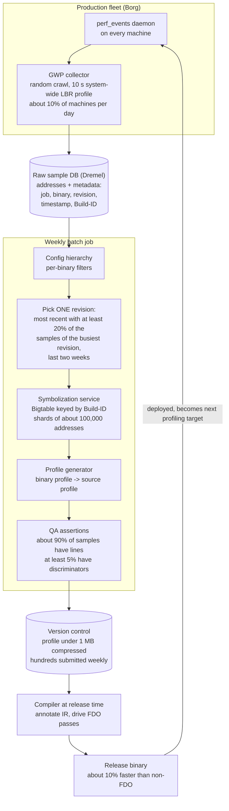

# Paper: AutoFDO: Automatic Feedback-Directed Optimization for Warehouse-Scale Applications (Chen et al. 2016)

> [!summary] Scope
> Owns the CGO 2016 compiler optimization paper by Dehao Chen, David Xinliang Li, and Tipp Moseley on sample-based Feedback-Directed Optimization.
> Explains how production PMU Last Branch Record hardware samples are mapped back to compiler intermediate representations and DWARF source locations to guide inlining and branch probability without instrumented binaries.
> Grounds warehouse-scale compiler optimizations bridging GWP and BOLT.

## Bibliographic Metadata

| Field | Value |
| :--- | :--- |
| Title | AutoFDO: Automatic Feedback-Directed Optimization for Warehouse-Scale Applications |
| Authors | Dehao Chen, David Xinliang Li, Tipp Moseley (all Google Inc. at publication) |
| Venue | CGO '16, 2016 International Symposium on Code Generation and Optimization, Barcelona, March 12-18, 2016 |
| Pages | 12-23, ACM, ISBN 978-1-4503-3778-6 |
| DOI | https://doi.org/10.1145/2854038.2854044 |
| Author PDF | https://research.google.com/pubs/archive/45290.pdf |
| Direct predecessors | Chen et al., "Taming hardware event samples for FDO compilation", CGO 2010, pp. 42-52, https://doi.org/10.1145/1772954.1772963 (the paper's reference 9), and "Taming hardware event samples for precise and versatile feedback directed optimizations", IEEE Transactions on Computers 62(2):376-389, 2013, https://doi.org/10.1109/TC.2011.233 (reference 10) |
| Builds on | The Google-Wide Profiler (see [[Paper-Google-Wide-Profiling]]) for fleet collection |

Read the paper as two papers stapled together.
Sections 3 and 4 are compiler and profile-format work, most of which survives unchanged in LLVM and GCC today.
Sections 3.2 to 3.5 and 6 are Google infrastructure (Borg, Dremel, Bigtable, a symbolization service) that you will not reproduce, but whose design constraints you should copy.

> [!info] What this note is not
> The sampling side (perf_events daemons, fleet crawling, the raw sample database, symbolization economics) is owned by [[Paper-Google-Wide-Profiling]].
> Post-link layout is owned by [[Paper-BOLT-Binary-Optimizer]].
> Cross-module inlining with summaries is owned by [[Paper-ThinLTO-Scalable-Incremental-LTO]].
> Reading and drawing the resulting stack profiles is owned by [[Paper-The-Flame-Graph-Gregg]].
> This note owns the step in the middle: turning a hardware branch sample into the compiler's profile, and getting the compiler to use a profile that is stale, noisy, and taken from an already-optimized binary.

## The Core Problem

Feedback-directed optimization (FDO, also called PGO) tells the compiler which branches are biased, which callsites are hot, and which functions are cold.
The paper states typical gains of 10-15% and sometimes over 30%, and motivates the work with Google's 2014 capital expenditure of $11 billion, the majority of it for production equipment and datacenters.
At that scale a few percent of CPU is a data center, so the question is not whether to use FDO but why only "a few dozen" of Google's largest CPU consumers did.

Traditional FDO is a three-step build pattern: compile with instrumentation, run a benchmark that generates a representative profile, recompile with the profile.
The paper's argument that this does not survive contact with warehouse-scale software has four parts:

1. **No representative benchmark.**
   Binaries are compiled from millions of lines of C++, the performance-critical parts change quickly, and the binaries depend on many remote services.
   Maintaining a benchmark that exercises the same distribution as production is "prohibitively difficult", even for something as simple as SPEC.
2. **Data cannot be replayed.**
   The data the services process is often sensitive, so storing and accessing logs for load tests is complicated by security restrictions.
3. **Instrumentation changes behavior.**
   Counter overhead makes servers behave differently under load because default timeouts are exceeded, so the instrumented binary is not even a faithful model of the production binary.
4. **The release process is the real cost.**
   The paper gives "the release process was too difficult to maintain" as the reason only a few dozen binaries used FDO.
   Reading it with the three points above, the benchmark-and-profile run inside every release is the part of that process this design removes.

Taking the profile from production fixes the first three and replaces the fourth with a different problem set.
The paper lists the new problems as its contributions:

- Sampled profiles must reach 85% of the speedup of instrumented profiles (the paper's headline, measured on Google internal applications).
- Iterative compilation must be stable: the next release is profiled from a binary that the previous profile already optimized.
- Stale profiles must be tolerated: the profile was collected on the previous release, not on the source being compiled.
- The whole thing must scale to hundreds of binaries with no per-team toil.

There is also a purely technical gap beneath all of this.
A hardware sample is a program counter in an optimized binary.
The compiler wants frequencies on its intermediate representation, before inlining, before most of the transformations that produced the binary.
The paper's mapping chain is: binary address, then source location (via DWARF), then compiler IR.
Every inaccuracy in the system lives somewhere in that chain.

## Key Innovation

The paper's novelty is not "use perf for PGO"; sample-based profile feedback had been published before (the paper's related work cites DCPI, Morph, and Chen's own earlier work).
The innovations are the choices that make sample-based FDO work for large C++ with deep inlining and a continuous release train:

1. **LBR as the binary-level profile.**
   Sampling the last few taken branches gives a near-accurate instruction-frequency profile and a branch-frequency profile, where plain instruction-pointer sampling does not: the paper says "PMU design constraints" make an accurate instruction-frequency profile hard to get (citing its reference 9) and cites the experiments of reference 10 for LBR's near-accuracy.
2. **The extended source location as the profile key.**
   A key is a stack of `{function name, line offset from function start, discriminator}` triples, with the stack recording the inlined callsites.
   Because the key contains neither file name nor absolute line, changing one function does not perturb any other function's key, and compiler version changes do not perturb keys at all.
3. **A profile preparation step that recreates the profiled binary's inline tree.**
   The compiler first inlines the callsites that the profile says were inlined and hot, top-down, so that each inline instance has its own subtree of counts.
   This is how a context-insensitive-looking DWARF profile becomes context-sensitive for inlined callees.
4. **Stale by design.**
   The system does not detect source drift and does not rectify the profile.
   It relies on function-relative line offsets and the observation that hot code in a mature binary changes slowly.
5. **Indirect call promotion integrated into preparation.**
   A profile taken from an AutoFDO-built binary no longer contains the indirect call that was promoted away, so the next build would fail to promote it and the speedup would oscillate by release.
   The fix makes the preparation step force-promote and inline calls that the profile shows to be hot promoted instances.
6. **Production automation.**
   A weekly batch job, profiles checked into version control (under 1 MB each compressed), a symbolization service keyed by Build-ID, quality-assurance assertions on every profile, and per-binary configuration files.

## Mechanism Details

### The pipeline



The loop at the bottom is the feature that makes the system hard: the thing being profiled is the output of the previous iteration.

### Step 1: the binary-level profile (two maps)

The paper defines two maps taken from the PMU.

- **Instruction address to frequency.**
  Plain PMU sampling of the program counter does not give an accurate frequency profile because of PMU design constraints.
  Sampling the last few taken branches does (Intel LBR, IBM POWER BHRB are the two the paper names).
- **Branch `{source, destination}` pair to frequency.**
  In the paper only Algorithm 2 consumes this map, to build the histogram of targets at indirect call sites.

Mechanically, an LBR sample is a snapshot of a ring of the most recent taken branches, each a `(from, to)` pair, taken when the sampling event overflows.
Because only taken branches are recorded, two adjacent entries bound a straight-line stretch of code that executed with no taken branch: from the target of the older branch to the source of the newer one.
Every instruction in that range executed once for that snapshot.
This is how a sample of at most a few dozen branches yields counts for hundreds of instructions, and why LBR profiles are far denser than instruction-pointer samples.
The modern LLVM converter does exactly this.
For a plain (non-context-sensitive) LBR profile, `PerfScriptReader::computeCounterFromLBR` in `llvm/tools/llvm-profgen/PerfReader.cpp` (llvmorg-23.1.6) records a branch count for every entry and a range count from the target of each entry to the source of the next newer one; because the walk starts with no newer source, the leaf range after the newest branch is never counted.
`ProfileGenerator::populateBodySamplesForAllFunctions` in `ProfileGenerator.cpp` then walks each range instruction by instruction, adding to the function's total samples per byte of instruction rather than per instruction (a FIXME in the source says per-instruction totals caused a regression).
The context-sensitive path makes the same choice explicitly (`VirtualUnwinder::unwind`: "Do not attempt linear unwind for the leaf range as it's incomplete").

LBR depth varies, which bounds how many ranges one sample yields.
(as of 2026-11, Linux, from `arch/x86/events/intel/lbr.c` on kernel master): Core 4 entries, Nehalem/Westmere, Sandy Bridge, and Haswell 16, Skylake 32, Atom and Silvermont-era parts 8.
Architectural LBR (newer Intel parts) reports its depth through CPUID leaf 28 as `fls(lbr_depth_mask) * 8`, and the kernel sets that depth through `MSR_ARCH_LBR_DEPTH`.
The CSSPGO paper says LBR snapshots hold "16 or 32 pairs" in the production setup it describes.
The paper under study ran its SPEC evaluation on Intel Westmere (16 entries).

### Step 2: the source-level profile

Three definitions make the rest of the paper work.

- A **source location** is a triple `{function name, source line offset to function start, discriminator}`.
- An **extended source location** is a stack of source locations: the top is the location of the sampled instruction, the lower entries are the callsites of the inlined frames it sits in.
- A **discriminator** is a number that distinguishes instructions mapped to the same source line but belonging to different basic blocks.
  Example from the paper: in `A = (foo() ? bar() : baz());` the three calls get discriminators D1, D2, D3, because one line produces three blocks with different frequencies.

The **source-level profile** is a forest of trees of `ProfileNode`.
Each tree is one standalone function of the profiled binary.
Inner nodes are inline instances and carry `TotalCount` (samples attributed to the instance) and `Function` (the origin of the inline instance).
Leaf nodes are statements and carry `Count` (the maximum sample count of instructions mapped to that extended source location) and `Targets` (for indirect call sites, a histogram from callee name to frequency).

The conversion (the paper's Algorithm 1) iterates over addresses, looks up each address's extended source location through DWARF, takes the max of the existing count and the new one, and walks the inline stack adding the count to the `TotalCount` of each enclosing inline instance.
Algorithm 2 builds the `Targets` map from branch samples whose source is an indirect call.

The following is the paper's Algorithm 1 run on the paper's own Figure 2 data, written for this note (it is not code from the paper).

```python
from collections import defaultdict

# address -> extended source location, innermost frame first: (function, line offset, discriminator)
ESL = {
    0x670: [("foo", 1, 0)],
    0x675: [("foo", 2, 0)],
    0x690: [("bar", 1, 0)],
    0x69D: [("foo", 1, 0), ("bar", 2, 0)],
    0x6A2: [("foo", 2, 0), ("bar", 2, 0)],
}
SAMPLES = {0x670: 50, 0x675: 10, 0x690: 200, 0x69D: 200, 0x6A2: 100}


def convert(samples, esl, combine):
    leaf = {}                      # extended source location -> Count
    inner = defaultdict(int)       # inline instance (path, outermost frame last) -> TotalCount
    for pc, n in samples.items():
        stack = tuple(esl[pc])
        leaf[stack] = combine(leaf.get(stack, 0), n)
    for stack, n in leaf.items():
        for depth in range(1, len(stack)):   # every inline instance enclosing this leaf
            inner[stack[depth:]] += n
    return leaf, inner
```

Run once with `python3 -I` (Python 3.15.2, macOS 27.3 arm64, 2026-11-26), the output for `combine = max` is:

```text
root bar: TotalCount = 500
  leaf bar:1.0            Count = 200
  leaf foo:1.0 <- bar:2.0 Count = 200
  leaf foo:2.0 <- bar:2.0 Count = 100
  inline instance bar:2.0    TotalCount = 300
root foo: TotalCount = 60
  leaf foo:1.0            Count = 50
  leaf foo:2.0            Count = 10
two clones, 40 + 40 samples, combine=MAX: Count = 40
two clones, 40 + 40 samples, combine=SUM: Count = 80
```

These numbers match the paper's Figure 4 exactly: tree `bar` with TotalCount 500, leaf 200, the inlined `foo` instance with 300 (the figure labels this inner node `Count:300`) holding leaves 200 and 100, and the standalone `foo` tree with TotalCount 60 holding 50 and 10.
The point of the example is that `foo` appears twice in the profile: once as an outlined function (60 samples) and once as an inline instance inside `bar` (300 samples).
Those are different distributions of the same source code, and the compiler can only use that difference if it recreates the inline.
The last two lines of output show why the combine operator matters, which the MAX versus SUM subsection explains.

> [!note] Fixture provenance
> The address-to-location table and sample counts are transcribed from the paper's Figure 2.
> The script was run once, only to capture the printed output, and no other platform was run.

### MAX versus SUM, and what the discriminator really encodes

An extended source location can map to many instructions.
Ideally they are all in one basic block and have identical frequency.
Debug info in a fully optimized binary does not guarantee that, so the paper takes the **maximum** instruction frequency as the location's frequency (in the GCC implementation).
The reasoning in section 4.1.4 is that redundancy-elimination style optimizations tend to move instructions from hot blocks to colder ones, so the surviving copy in the hot block is still sampled at full rate and MAX recovers the right number.
Their loop-invariant code motion example hoists `T = a[M]` out of a loop: the hoisted load has a low count, but the basic block still gets the right count from the `call foo(T)` that stayed.

MAX is wrong when code is **duplicated** (cloned), because then each copy executes a fraction of the original count and the right answer is the SUM.
The paper says so directly and gives the fix as future work: the discriminator must be extended to distinguish instructions generated by code duplication, which also grows the debug info.
The two-clones line in the printed output is that failure: two copies at 40 samples each, MAX reports 40 when the source line executed 80 times.

The LLVM implementation took that route.
(as of 2026-11, LLVM llvmorg-23.1.6) `DILocation::getDiscriminator` returns a 32-bit value holding up to three components, from the low bits: a **base discriminator** (assigned by the `AddDiscriminators` pass, identifying blocks on the same line), a **duplication factor** (assigned by optimizations that scale down the original IR's frequency, such as unrolling), and a **copy identifier** (assigned by optimizations that clone the IR).
The encoding is prefix based: if the lowest bit is 1 the current component is empty and the next starts at the next bit; otherwise the component occupies bits 2-6 (5 bits) or, with bit 7 set, bits 2-6 plus 8-14 (12 bits), so a component costs 0, 1, 7, or 14 bits.
`llvm-profgen` then keeps the MAX rule but compensates: `ProfileGeneratorBase::updateBodySamplesforFunctionProfile` multiplies the count by the duplication factor before taking the maximum, with the comment "this is only needed when we're taking MAX of the counts at the location instead of SUM".
The consumer side uses the same shape as the paper's Algorithm 4: `SampleProfileLoaderBaseImpl::getBlockWeight` returns the max of the instruction weights in the block, and `getInstWeightImpl` looks samples up by `(line offset, base discriminator)`, or by the full discriminator when flow-sensitive discriminators (`EnableFSDiscriminator`) are on.

`AddDiscriminators` assigns a new discriminator when the last instruction of a block and the first of its successor share file and line.
Its own header comment gives the intuition: without it, `if (i < 10) x = i;` would give the `entry -> if.then` edge the same weight as the comparison and make a seldom-taken edge look hot.

### Step 3: collection, storage, and the batch job

These are summarized because [[Paper-Google-Wide-Profiling]] owns the collection side; the numbers in this subsection are the paper's.

- Each Borg machine runs a perf_events daemon exposing a restricted set of perf functionality; the GWP collector crawls machines in random order and requests a **10-second system-wide LBR profile**.
- The AutoFDO collector covers about **10% of machines per day**, which is about **0.001% of observable cycles**, with **under 1% overhead** during profiling.
  Coverage sounds low but the fleet is top-heavy: about 750 binaries account for 95% of CPU usage, out of tens of thousands, so the top binaries get far more samples than needed.
- Each sample is a row in a Dremel table with addresses and metadata: Borg user and job, binary name, revision, timestamp, and **Build-ID** (a unique identifier, usually a hash of the binary contents).
  Symbolization is deliberately deferred because one symbolized sample can expand to thousands of bytes and there are billions of samples per day.
- A **weekly batch job** (with a dry run twice a week to surface problems early) scans a configuration hierarchy that mirrors where each binary lives, selects a revision, queries the sample counts for it, symbolizes, converts, and submits over the previous profile.
- **Revision selection** exists to avoid merging profiles across revisions: choose the most recent revision with at least **20%** as many samples as the busiest revision, over the last **two weeks**.
  Many live revisions are test deployments and release candidates, so usually one or two are viable.
- Profiles are checked into version control so builds at one revision are **repeatable and hermetic**, and so automated tests can use them; each is typically under 1 MB compressed, and a few hundred are submitted weekly.
- A **symbolization service** exists because unstripped binaries can be multiple gigabytes, so fetching one and running `addr2line` takes minutes and gigabytes of RAM per binary.
  At ingestion a release binary is partitioned into shards of about **100,000 addresses** in a Bigtable keyed by Build-ID, each with the function, file, line, and discriminator for each address.
  Single-address lookups take tens of milliseconds, and symbolizing all samples for one binary takes tens of seconds.
- **Quality assurance** assertions guard the profile: typically about 90% of samples have line numbers, and at least 5% have discriminators.
  Config files can relax a rule after a human confirms a failure is a false positive.
- **Multiple profiles per binary** are allowed, filtered by metadata (usually the Borg job), because a merged profile can hurt the smaller user of a shared binary.

### Step 4: profile annotation in the compiler

The compiler takes the source-level profile and the IR and produces annotated IR, a CFG with block and edge frequencies, in three steps.

**4a. Preparation (selective inlining).**
The profile is hierarchical: each inline instance of a function is a separate subtree, which together form a context-sensitive profile.
The preparation pass transforms the IR to resemble that tree by iteratively inlining the callsites that map to a hot inline instance.
Two properties are required:

- A **top-down** traversal of the call graph (the paper's Algorithm 3 iterates the call graph in reverse post order).
  The paper's Figure 5 example: `bar -> baz` is hot only when `bar` is called from `foo`, so top-down order inlines `baz` into `bar` only inside `foo`, not in the outlined copy of `bar`.
- A hotness threshold on the instance's `TotalCount`.
  A callsite that was inlined in the profiled binary but is not hot enough is not inlined here, to avoid code growth.

Cold inline instances that are not recreated have their samples discarded during annotation.
The paper notes that combining them into the standalone instance's profile is possible and, in practice, makes little difference.

**4b. Basic block frequency (Algorithm 4).**
For each block, take the max of the counts of the profile entries that match its statements' extended source locations; mark the block as annotated if any matched.

**4c. Edge frequency (Algorithm 5).**
Block counts do not determine edge counts in general (the paper's Figure 6), and some blocks have no count because their source was optimized away.
The heuristic groups blocks into **equivalence classes**: sets of blocks in the same loop nest that dominate or post-dominate each other and so must execute equally often.
Each class's frequency is the maximum of its members.
Then it iterates: if all incoming (or outgoing) edges of a block are annotated, the class count is raised to their total if that is larger; if exactly one edge is unannotated and the class is annotated, that edge gets `class count - total of the others`.
It only ever raises block frequencies on inconsistency, which guarantees termination, and for the cases the authors saw it converged in **3 iterations**.
The alternative in the earlier work (reference 10) used a minimum-cost circulation; the authors claim theoretical equivalence and say the flow heuristic is conceptually simpler and much more efficient.

The LLVM implementation has the same structure.
(as of 2026-11, LLVM llvmorg-23.1.6) `SampleProfileLoaderBaseImpl` documents block weight as the max of instruction weights, builds `EquivalenceClass` from dominators, post-dominators, and loop info, and propagates until a fixed point or until `-sample-profile-max-propagate-iterations` (default 100).
LLVM also offers the profile inference algorithm (`-fsample-profile-use-profi`, `sample-profile-use-profi`) as an optional smarter repair of missing blocks and edges, which the Clang manual describes as improving the quality of sampling-based profiles.

### Step 5: why profile data is a hazard when the binary was already optimized

The paper's section 4.1.4 classifies how optimizations in the **profiled** binary damage debug info, and therefore the profile:

| Class | Effect | Examples named in the paper | Handling |
| :--- | :--- | :--- | :--- |
| Recoverable | Information is lost but the annotation algorithm repairs it | LICM, partial redundancy elimination, jump threading, code hoisting and sinking, loop unswitching, tail duplication | MAX on counts and equivalence-class propagation |
| Unrecoverable but benign | Large local change, but later decisions do not depend on the lost detail | Full loop unrolling (decided from static trip count and size), unreachable code elimination | Ignore |
| Unrecoverable and destructive | Information is lost and the optimizer can be misled | Indirect call promotion, function cloning, if-conversion, partial unrolling (a previously unrolled loop shows a smaller trip count) | Needs per-case handling |

The destructive class is what makes iterative compilation (profile from release N optimizes release N+1) fragile, and the paper only solves one member of it, the one that caused the most trouble: indirect call promotion.

**Indirect call promotion (ICP) in the loop.**
AutoFDO speculatively promotes a hot indirect call to a guarded direct call and inlines it.
In the next profile the indirect call is colder, and the inlined direct instance is hot.
During annotation the compiler cannot use that instance's data because the promotion has not happened yet (the preparation step has no direct call to inline), and later the ICP pass finds no target histogram, so the call is not promoted.
Performance drops for that iteration; in the iteration after, the unpromoted indirect call reappears in the profile and the cycle repeats.
The paper's Figure 8 shows most applications oscillating every other iteration.
The fix (Algorithm 6): the preparation step force-promotes and inlines indirect calls that the profile shows as hot promoted instances.
A node mapped from an indirect call site is enhanced to carry both inner-node properties (total count, function: the promoted target) and leaf-node properties (count, targets: the default unpromoted path); a linked list of inner nodes can track multiple promoted targets.
With this, Figure 9 shows the iterative speedup becoming smooth, and later iterations tend to be better than the first because more context has accumulated, in some cases exceeding instrumented FDO.
The paper also notes loop unrolling distorting trip counts as another source of fluctuation, and says fixing ICP resolved most of the fluctuation in Google's C++ applications.

### Step 6: staleness

AutoFDO builds a release from a profile taken from an earlier release.
The design decision is the one-liner in section 4.2.2: use `{function name, line offset, discriminator}` instead of `{file name, line number, discriminator}`.
That tolerates file renames and moves and confines a source change to the function it touches: if `foo()` changes but `bar()` in the same file does not, `bar()`'s profile still applies.
The paper deliberately does **not** detect source changes and does **not** rectify the profile.
The justification is empirical: datacenter profiles are flat, so it is unlikely all hot functions change at once, and drift is gradual.
It provides a manual recovery path (push a suboptimal build to production, collect fresh samples, rebuild) and says it has not been activated for any project.

LLVM's text format documents the same key: the line number "is always relative to the line where symbol of the function is defined", never negative, and macro expansions before the function start are emitted as offset 0.

### The consumed format (LLVM, as of 2026-11, Both)

The Clang manual gives the text format of a sample profile, which is the easiest way to see the paper's data model in a real file:

```text
function1:total_samples:total_head_samples
 offset1[.discriminator]: number_of_samples [fn1:num fn2:num ... ]
 offsetA[.discriminator]: fnA:num_of_total_samples
  offsetA1[.discriminator]: number_of_samples [fn7:num fn8:num ... ]
```

Indentation is the nesting of the inline stack.
Lines of the form `offset[.disc]: samples [callee:count ...]` are sampled lines, and a trailing list of `callee:count` pairs is exactly the paper's `Targets` map.
Lines of the form `offsetA[.disc]: fnA:total` are inlined callsites, the paper's inner nodes.
The header's second number is the head sample count, the number of samples in the function prologue, an indicator of how often the function is called.
The Clang manual's worked example is:

```text
main:35504:0
1: _Z3foov:35504
  2: _Z32bari:31977
  1.1: 31977
2: 0
```

Reading it: 35,504 samples in `main`, all at line 1 (the call to `foo`); of those 31,977 were in the inlined `bar`; line 2 of `main` got none.
The format comes in text, binary, and GCC (gcov-based) encodings per the manual; `SampleProf.h` at llvmorg-23.1.6 also defines `SPF_Ext_Binary` with named sections (`SecProfSummary`, `SecNameTable`, `SecProfileSymbolList`, `SecFuncMetadata`, `SecCSNameTable`, `SecFuncOffsetTable`, and the function-profile section `SecLBRProfile`) and has MD5-hashed function names as a size option; `SPF_Compact_Binary` is marked deprecated there.
The `llvm-profgen` command guide lists `--format=[text|binary|extbinary|compbinary|gcc]`, but the tool's own option table in `ProfileGenerator.cpp` (llvmorg-23.1.6 and `main` as of 2026-11) accepts only `binary`, `extbinary`, `text`, and `gcc`, and its default is `extbinary` even though the help string labels `binary` as the default.

### Step 7: what the compiler decides with it

The paper's own list of consumers is the standard FDO set: inlining, branch probability and layout, and in the AutoFDO-specific part, indirect call promotion.
GCC's manual shows the breadth of what `-fauto-profile` turns on (as of 2026-11, Linux, GCC manual as served 2026-11-26): `-fbranch-probabilities`, `-fprofile-values`, `-funroll-loops`, `-fpeel-loops`, `-ftracer`, `-fvpt`, `-finline-functions`, `-fipa-cp`, `-fipa-cp-clone`, `-fipa-bit-cp`, `-fpredictive-commoning`, `-fsplit-loops`, `-funswitch-loops`, `-fgcse-after-reload`, `-ftree-loop-vectorize`, `-ftree-slp-vectorize`, `-fvect-cost-model=dynamic`, `-ftree-loop-distribute-patterns`, plus `-fprofile-correction` (smoothing profile inconsistencies).
Compared with the manual's `-fprofile-use` list, it omits `-fprofile-reorder-functions` and adds `-fprofile-correction`, so sample profiles feed nearly the same transformations as instrumented ones.

GCC's own source describes the phases (as of 2026-11, gcc trunk `gcc/auto-profile.cc`, copyright header "Contributed by Dehao Chen"):
read the profile at startup; in an `afdo_offline` pass remove function instances from other translation units; during early optimization run an AFDO inliner that inlines a callsite regardless of code growth when it was inlined in the profiled binary and its callee body was hot ("controlled by -fauto-profile-inlining and is independent of -fearly-inlining"); offline the functions that were inlined in the train run but not here; then annotate the CFG with block counts and branch probabilities, "use earlier static profile to fill in the gaps if AFDO profile is ambiguous".
That is the paper's preparation-then-annotation split, placed early in GCC's pipeline so that early optimizations run before the IPA passes read the profile.

LLVM's sample loader does the same in one pass.
(as of 2026-11, llvmorg-23.1.6, defaults read from `SampleProfile.cpp`; all are hidden options, so they are internal tuning knobs and not stable interface): `sample-profile-top-down-load` and `use-profiled-call-graph` default true (process functions in a top-down order of the profiled call graph); `sample-profile-merge-inlinee` defaults true (merge the past inlinee's profile into the outline version when the loader decides not to inline it); `profile-sample-accurate` defaults false (unsampled functions are treated as unknown rather than as having zero samples); `sample-profile-icp-max-prom` defaults to 3 promotions per callsite; `sample-profile-icp-relative-hotness` (25 percent) applies only to the priority-based inliner described next.
The hotness test for a recreated inline is `sampleprofutil::callsiteIsHot`: the callsite sample total is compared with the hot cutoff computed by `ProfileSummaryInfo`, and a callsite with no `FunctionSamples` (not inlined in the profiled binary) is never hot.
The priority-based inliner with `sample-profile-inline-growth-limit` 12, `-limit-min` 100, `-limit-max` 10000, `-hot-inline-threshold` 3000, and `-cold-inline-threshold` 45 is gated by `sample-profile-prioritized-inline`, whose help text says "Currently only CSSPGO is supported"; it is not the path the paper describes.

## Evaluation and Limitations

### Reported results

All numbers are from the paper; "speedup" is against an `-O2` binary unless noted.

| Result | Value | Source in paper |
| :--- | :--- | :--- |
| Geometric mean speedup on the authors' benchmarks | 10.5% (abstract on the publication page; the PDF text layer loses the percent sign) | Abstract |
| AutoFDO speedup as share of instrumented FDO | 85% | Abstract, Table 1 |
| Table 1, 10 internal applications, FDO mean | 12.40% (the geometric mean of the ten rows; recomputed for this note, the arithmetic mean would be 12.49%) | Table 1 |
| Table 1, same, AutoFDO mean | 10.52% (ratio 84.84%) | Table 1 |
| Table 1 best and worst ratio | artificial intelligence1 100.00%; encoder 38.37% (FDO 8.63%, AutoFDO 3.31%) | Table 1 |
| Table 1 first row, server | 17.61% FDO vs 15.89% AutoFDO (90.23%) | Table 1 |
| Table 2, SPEC CPU2006 int, FDO mean | 4.40% | Table 2 |
| Table 2, same, AutoFDO mean | 4.87% (ratio 112.33%) | Table 2 |
| Table 2 platform and compiler | Intel Westmere, GCC r231122 from the google/gcc-4_9 branch | Section 5.1 |
| Adoption | FDO users at Google increased 8X, cycles in FDO-optimized binaries doubled, over half of CPU cycles now in some flavor of FDO | Abstract |
| Deployment | hundreds of binaries | Abstract |
| Stale profile, rapidly changing app | 3-week-old profile costs 2% to 3%; 6-month-old profile still gives 50% of the fresh-profile speedup | Section 5.3 |
| Production compiler-attributed bugs to date | one (a third-party library exposing an optimizer bug, not well tested because most Google C++ does not use exceptions) | Section 6.1 |

Three things to read carefully in these numbers.

1. The 85% figure comes from internal benchmarks where "profiles are collected from the benchmark itself" for both FDO and AutoFDO, because instrumented profiles cannot be collected from production.
   So the comparison isolates profile precision, not profile representativeness.
2. Table 2's mean ratio exceeds 100% because several SPEC entries are negative or near zero under instrumented FDO (for example 462.libquantum is -10.41% FDO and -0.61% AutoFDO, and 456.hmmer is -0.73% versus 1.90%), which drags the FDO mean down.
   Recomputed from the rows for this note: 112.33% equals the ratio of the two arithmetic means (4.8725 / 4.3375), not the mean of the ratio column (82.05%), and the printed FDO mean of 4.40% does not match its own rows (arithmetic 4.34%, geometric 4.12%).
   The per-row ratio column shows 100.00% for 429.mcf, 456.hmmer, and 462.libquantum and 0.00% for 464.h264ref, so it looks capped when a speedup is non-positive or near zero, yet 473.astar shows 114.20%; the paper does not state its rule.
   The paper attributes negative speedups to lack of tuning and mis-optimization and says it has not seen them in its production applications.
3. The paper's explanation for the gap and for the `encoder` outlier is debug info: tight, complicated loop nests need very accurate trip counts, and aggressive loop optimization pollutes the debug info.
   Media encode and decode code benefits least.

### Stability beyond mean speedup

- In section 6.2, latency-sensitive users switched from instrumented FDO to AutoFDO despite slightly worse benchmark numbers because production monitoring showed realized performance was equivalent.
  The paper's hypothesis is that imprecise profiles from real workloads are as good as precise profiles from training inputs.
- The same section reports the dark side: a user found that a rare error condition had poorly optimized code (the profile said it was cold), which caused cascading overload of the service; they disabled feedback-directed optimization entirely because stable performance outweighed average performance.
  The authors say the same could happen with instrumented FDO if the error path is not covered proportionally, and that they were investigating per-file FDO disabling.
- FDO changes inlining so much that it exposes latent application bugs (missing or duplicate symbols, uninitialized uses, stack overflow); the risk is similar to a compiler upgrade, so FDO-compiled tests (hundreds) run to qualify a release.

### Limitations and unaddressed constraints

- **Debug info is the weak link.**
  Everything depends on DWARF line tables in an optimized binary being a faithful map.
  The paper says the main source of inaccuracy is not the LBR data (which it calls very accurate) but this mapping.
- **MAX versus SUM** is unresolved in the paper (needs an extended discriminator), which also hurts partially unrolled and cloned code.
- **Little benefit for already-tuned code.**
  Routines such as compression, encryption, and math libraries gain little because they are already tuned and not branch- and call-heavy (section 6.4).
- **No staleness detection.**
  There is no error, warning, or metric for "your profile no longer matches the source".
  The recovery path is manual.
- **One profile per binary by default.**
  Multi-tenant binaries need the per-job profile feature.
- **Release packaging.**
  Binaries in one archive (for example multi-stage MapReduce jobs) must be built in one invocation with one profile; the paper says there is no convenient solution, so each FDO binary is built and archived separately.
- **No value profiling, no cross-module optimization yet.**
  The paper lists value profiling (for example the distribution of `memcpy` size and alignment arguments) as unavailable from sampling, and says LIPO (lightweight cross-module optimization, typically 5-10% on top of FDO for the top cycle consumers) was in the final steps of being integrated as "AutoLIPO", with ThinLTO as the scalable follow-on.
- **Single-vendor hardware assumption.**
  The paper names Intel LBR and IBM BHRB; the Industry Impact section covers what happened on AMD and Arm.

> [!warning] Pitfalls
> - **Profiling a stripped or differently built binary.**
>   The profile generator needs the exact binary that was sampled (matched by Build-ID) plus its debug info.
>   `llvm-profgen --debug-binary` exists to load DWARF from a different file than the executable.
> - **Debug options differ between profile and use builds.**
>   Clang requires the "same debug info options" in the profiling build and the use build (`-fdebug-info-for-profiling`, `-funique-internal-linkage-names`, or the pseudo-probe equivalent).
>   If the use build omits them, function and discriminator keys do not line up.
> - **`-funique-internal-linkage-names` and absolute paths.**
>   The Clang manual warns the uniqued names derive from the source paths on the command line, so if a build system uses absolute paths that change between profiling and use, names change and profile data goes unused; consider omitting the option in that case.
> - **Missing `-b`.**
>   `llvm-profgen --perfdata` requires perf data collected with branch stacks.
>   The Clang manual says if perf was run without `-b`, `create_llvm_prof` must be called with `--use_lbr=false`, and that this gives worse call information.
> - **Profiling a binary with its profile already applied, without iteration safeguards.**
>   Modern LLVM handles inline recreation and ICP in the loader, but the paper's failure (oscillating speedup per release) is the thing to look for when numbers alternate.
> - **Treating fleet coverage as accuracy.**
>   Profiling about 0.001% of cycles is enough for the top binaries and useless for the long tail.
> - **Pseudo-probe and DWARF profiles are not interchangeable.**
>   A profile built from a pseudo-probe binary needs a pseudo-probe use build, and the `rejectHighStalenessProfile` check in `SampleProfile.cpp` asserts the profile is probe-based.

## Industry Impact

### Compilers and kernels

- **GCC.**
  `-fauto-profile[=path]` reads an AutoFDO profile (default file `fbdata.afdo` in the current directory), and the manual documents the pipeline: `perf record -e br_inst_retired:near_taken -b -o perf.data -- your_program`, then `create_gcov --binary=your_program.unstripped --profile=perf.data --gcov=profile.afdo` from the google/autofdo project (as of 2026-11, Linux, GCC manual).
  `-fauto-profile-inlining` is on by default.
  The pass in `gcc/auto-profile.cc` was contributed by Dehao Chen, one of the paper's authors, with a copyright range starting in 2014.
- **LLVM and Clang.**
  The sample-profile loader reads text, binary (extbinary and friends), and gcov-style formats and is invoked as `-fprofile-sample-use=<file>`; Clang's manual also accepts `-fauto-profile` as a name for it.
  `llvm-profgen` (in the LLVM tree) converts perf output to a profile, and `llvm-profdata merge` merges profiles.
  The google/autofdo project still provides `create_llvm_prof` for the same job, and its README notes that the Propeller code moved to its own repository (google/llvm-propeller) as of 2025Q1.
- **Linux kernel.**
  Clang-built kernels can use AutoFDO via `CONFIG_AUTOFDO_CLANG=y` and `make LLVM=1 CLANG_AUTOFDO_PROFILE=<profile>`.
  The kbuild commit "kbuild: Add AutoFDO support for Clang build" (Rong Xu, 2024-11-02) is an ancestor of `v6.13-rc1` and not of `v6.12`, determined with the GitHub compare API; the commit message claims up to 10% latency improvement from experiments.
  (as of 2026-11, Linux, kernel docs on master): it requires Clang from LLVM 17 or later and supports x86/x86_64 through LBR and arm64 through SPE or ETM; the recommended collection is `perf record -e BR_INST_RETIRED.NEAR_TAKEN:k -a -N -b -c <count> -o <perf_file> -- <loadtest>` with a prime period such as 500009 (the doc recommends the prime; that it avoids aliasing with periodic loops is the usual reason and is not stated in the doc), the AMD path needs Zen3 with BRS or Zen4 with `amd_lbr_v2`, and conversion uses `llvm-profgen --kernel --binary=<vmlinux> --perfdata=<perf_file> -o <profile_file>` (LLVM 19 or later, not necessarily matching the Clang version) or `create_llvm_prof` v0.30.1 or later.
  The kernel doc also states the profile can be portable across microarchitectures if performance-critical code is architecture-independent (an Intel-derived profile can help an AMD kernel build), and that building with AutoFDO enabled but without a profile only changes the DWARF information.
- **Hardware.**
  The kernel's LBR code and the `perf record -b/-j` filters (any, any_call, any_ret, ind_call, cond, and so on) are the substrate.
  Arm has SPE and ETM paths in the kernel doc, and `llvm-profgen` documents LBR or BRBE input for branch stacks and an `--etm` command for ARM CoreSight traces (requires OpenCSD 1.5.4 or higher).

### What followed in the research and production lineage

- **CSSPGO (Meta, CGO 2024).**
  He, Yu, Wang, and Oh keep the sampling model and attack its two weaknesses: profile correlation by debug info, and context loss after inlining.
  *Pseudo-instrumentation* inserts pseudo probes, IR-level markers that are not counter increments and so cost near-zero at run time (0.04% reported), as the correlation anchor instead of DWARF; *context-sensitive profiling* uses synchronized LBR and stack sampling to attribute branches to full call contexts.
  Reported numbers (their Table I, measured on HHVM only, the one workload they could build with instrumentation PGO): block overlap with instrumentation PGO of 92.3% for CSSPGO versus 88.2% for AutoFDO (100% for instrumentation PGO itself), and profiling overhead of 0.04% for pseudo-instrumentation versus 73.06% for instrumentation PGO.
  They report 1%-5% over AutoFDO on production workloads and use across more than 75% of Meta's data center CPU cycles.
  In LLVM the probe path is `-fpseudo-probe-for-profiling`, and a CFG checksum (`SampleProfileProber::computeCFGHash` in `SampleProfileProbe.cpp`: the low 32 bits are a CRC32 of the block indexes, the high 32 bits the edge count preceded by the indirect call count) lets the loader detect a changed function, which is a staleness detector that the DWARF-keyed AutoFDO profile does not have.
- **Post-link optimizers.**
  The CSSPGO paper treats BOLT and Propeller as the next stage on top of sampling PGO, at the cost of an extra profile-and-rebuild iteration.
  Propeller's abstract (ASPLOS 2023) says post-link optimizers have disassembly-driven, monolithic designs that scale badly and conflict with distributed builds, and proposes basic block sections and relinking instead.
  See [[Paper-BOLT-Binary-Optimizer]] for BOLT, which consumes LBR profiles of the same kind.
- **ThinLTO.**
  The AutoFDO paper names ThinLTO as in-progress work to scale cross-module optimization, which is the subject of [[Paper-ThinLTO-Scalable-Incremental-LTO]].

> [!note] The shape of the lineage
> Treat AutoFDO as the root of a tree.
> The same hardware samples (LBR) feed three consumers of different cost and depth: compile-time FDO (this paper), compile-time FDO with probes and contexts (CSSPGO), and link-time or post-link layout ([[Paper-BOLT-Binary-Optimizer]], Propeller).
> The paper's lasting claim is that a sampled profile from production, imprecise as it is, is operationally better than a precise profile from a benchmark nobody maintains.

## Concept Grounding

- [[Paper-Google-Wide-Profiling]]: the fleet profiler this system is built on; the collection, metadata, and symbolization problems summarized here are developed there.
- [[Paper-BOLT-Binary-Optimizer]]: the post-link optimizer that starts from the same LBR samples and fixes layout after inlining has already happened.
- [[Paper-ThinLTO-Scalable-Incremental-LTO]]: the cross-module step that the paper names as the scalable follow-on to LIPO; profile-guided importing uses the sample counts described here.
- [[Paper-The-Flame-Graph-Gregg]]: how the same perf samples are visualized rather than compiled; a flame graph is the quickest way to see whether a profile is flat (AutoFDO-friendly) or concentrated.
- [[Paper-Producing-Wrong-Data-Measurement-Bias]]: why a 2% to 3% effect from a stale profile must be measured with randomized layout and environment, not a single build pair.
- [[Paper-Coz-Causal-Profiling]]: contrasts a profile that says where cycles are with one that says what would speed the program up; FDO consumes the former.

## Commands and Numbers to Know

Every row is stamped with its platform.
Rows marked "not run here" were taken from documentation and not executed in this environment (macOS, no PMU).

| Item | Value | Platform | Stamp |
| :--- | :--- | :--- | :--- |
| Record LBR with Clang docs event | `perf record -b -e BR_INST_RETIRED.NEAR_TAKEN:uppp ./code` (fallback event: `branches:u`) | Linux | (as of 2026-11) not run here |
| Record for GCC | `perf record -e br_inst_retired:near_taken -b -o perf.data -- your_program` | Linux | (as of 2026-11) not run here |
| Convert to LLVM profile | `create_llvm_prof --binary=./code --out=code.prof` or `llvm-profgen --binary=./code --output=code.prof --perfdata=perf.data` | Linux | (as of 2026-11) not run here |
| Convert to GCC profile | `create_gcov --binary=your_program.unstripped --profile=perf.data --gcov=profile.afdo` | Linux | (as of 2026-11) not run here |
| Build with LLVM profile | `clang++ -O2 -fdebug-info-for-profiling -funique-internal-linkage-names -fprofile-sample-use=code.prof code.cc -o code` | Both | (as of 2026-11) not run here |
| Build with GCC profile | `gcc -O2 -fauto-profile=profile.afdo ...` (default path `fbdata.afdo`) | Linux | (as of 2026-11) not run here |
| Pseudo-probe variant | replace the debug options with `-fpseudo-probe-for-profiling` in both profiling and use builds | Both | (as of 2026-11) not run here |
| Profile inference | `-fsample-profile-use-profi` | Both | (as of 2026-11) not run here |
| `llvm-profgen` input rule | `--perfdata` needs branch stacks (`perf record -b`); only one of `--perfscript`, `--perfdata`, `--unsymbolized-profile`, `--llvm-sample-profile`, `--etm` per run | Both | (as of 2026-11, LLVM trunk docs) |
| `llvm-profgen --format` | docs list `text`, `binary`, `extbinary`, `compbinary`, `gcc`; the source accepts `text`, `binary`, `extbinary`, `gcc` (default `extbinary`) | Both | (as of 2026-11, LLVM trunk docs and llvmorg-23.1.6 source) |
| LBR depth (Intel, kernel `lbr.c`) | Core 4; Nehalem, Sandy Bridge, Haswell 16; Skylake 32; Atom 8; Architectural LBR `fls(depth_mask) * 8` | Linux | (as of 2026-11, kernel master) |
| Kernel Kconfig and build | `CONFIG_AUTOFDO_CLANG=y`, `make LLVM=1 CLANG_AUTOFDO_PROFILE=<file>`; first in v6.13-rc1 | Linux | (as of 2026-11) |
| Kernel sample period | `-c 500009` (prime, per kernel doc) | Linux | (as of 2026-11) |
| LLVM loader: max propagate iterations | default 100 (`sample-profile-max-propagate-iterations`) | Both | (as of 2026-11, llvmorg-23.1.6) |
| LLVM loader: ICP max promotions per callsite | 3 (`sample-profile-icp-max-prom`) | Both | (as of 2026-11, llvmorg-23.1.6) |
| LLVM loader: stale profile salvage | `salvage-stale-profile` default false (hidden) | Both | (as of 2026-11, llvmorg-23.1.6) |
| Paper: fleet coverage | about 10% of machines/day, 0.001% of cycles, under 1% overhead | Linux (Google fleet) | 2016 paper |
| Paper: revision rule | most recent revision with at least 20% of the busiest revision's samples, last 2 weeks | n/a | 2016 paper |
| Paper: QA gates | about 90% of samples have lines, at least 5% have discriminators | n/a | 2016 paper |
| Paper: propagation | converges in 3 iterations in most cases seen | n/a | 2016 paper |

> [!note] What was verified here
> The only code run for this note is the Algorithm 1 sketch from the Step 2 subsection, run once, on macOS arm64 with Python 3.15.2.
> No `perf`, `llvm-profgen`, compiler, or kernel build was run, because macOS has no `perf` and no LBR access, and the brief paused lab checks.
> Every command in this table is taken from the cited documentation at the stated version.

## At Scale

The lesson of the paper is a set of operational decisions that change character between one developer and a fleet.

| Decision | One developer or small team | Thousands of engineers, hundreds of binaries |
| :--- | :--- | :--- |
| Where does the profile come from | A load test, or a short `perf record -b` on a staging box | Sampled continuously from production, filtered by binary and revision |
| Where does the profile live | A file next to the build | In version control, reviewed like source, so a build at a revision is hermetic and repeatable |
| Who regenerates it | A person | A scheduled job with a dry run, a configuration schema, and assertion-based QA |
| Staleness policy | Re-profile before each release | Accept drift, key on function-relative offsets, refresh weekly, keep a manual recovery path |
| Failure of the profile pipeline | Build fails and you notice | Must degrade to the previous profile, never block a release |
| Testing | Run your tests | Run the FDO-built binary through the same suite, hundreds of tests, to qualify a release |
| Latency-sensitive services | Whatever the mean says | Treat a cold-marked error path as a risk; consider per-file FDO disable, or accept lower mean for stable tails |

Decision rules, with the downside of each:

1. **Use sampled FDO (AutoFDO or CSSPGO) when you cannot maintain a representative training run.**
   Downside: 10-15% of the instrumented gain is left behind on average, and tight loop nests lose more.
2. **Use instrumented PGO when a faithful, maintained benchmark exists and the instrumented binary can be run under it.**
   Downside: CSSPGO reports 73.06% profiling overhead for instrumentation PGO, and the instrumented binary generally cannot run in production.
3. **Move to a probe-based sampled profile (CSSPGO) when staleness or profile quality is your measured bottleneck.**
   Downside: it needs the compiler's pseudo-probe support in both builds, a stack-and-LBR synchronized collection setup, and frame pointers for reliable stack samples (the CSSPGO paper calls out frame pointer omission and tail calls as breaking stack samples).
4. **Add post-link layout (BOLT or Propeller) after compile-time FDO is stable, not instead of it.**
   Downside: an extra profile-and-rebuild iteration in the release pipeline.
5. **Do not enable FDO for a binary dominated by hand-tuned kernels (compression, crypto, math).**
   The paper says the benefit is small.
6. **Never let one profile serve two very different workloads silently.**
   Use per-job profiles, or accept that the merged profile favors the larger user.

The cost model is simple.
Profile collection is under 1% overhead on a sampled 10% of machines, and the benefit is binaries about 10% faster on average (the paper's figure); the cost that matters is engineering toil, which the paper attacks by making the user's entire interface "add some flags to the release build".

## Practice Drill

> [!tip] Practice Drill
> On a Linux machine with a PMU that exposes LBR (bare metal or a VM with LBR virtualization; most cloud VMs do not), build a branchy C++ program twice and measure it.
> 1. Build `-O2 -gline-tables-only -fdebug-info-for-profiling -funique-internal-linkage-names`, record with `perf record -b -e BR_INST_RETIRED.NEAR_TAKEN:uppp`, convert with `llvm-profgen`, and rebuild with `-fprofile-sample-use`.
> 2. Run `llvm-profdata show --sample` (check its manual for the exact flags on your version) on the profile and find a function with an inlined callsite; compare its inline instance count with the outlined function's count.
> 3. Edit one hot function's body (insert two lines above the hot loop), rebuild with the old profile, and check the compiler's diagnostics for unused or mismatched profile data; then edit a different function in the same file and confirm the first function's profile still applies.
> 4. Take a profile from the AutoFDO-built binary, rebuild, and compare speed across three iterations with 20 or more runs each.
> Report the median and spread, not a single run (see [[Paper-Producing-Wrong-Data-Measurement-Bias]]).
> If you have no LBR access, run step 1 with a `-fprofile-sample-use` text profile you write by hand from the Clang manual's format, to see the loader respond to counts.

## Interview Questions

### L5

> [!question] 1. Why can a hardware sample not drive the compiler directly, and what two translations are required?
>
> > [!success]- Answer
> > A sample is a program counter in an optimized binary, but the compiler needs frequencies on its IR before most transformations ran.
> > The first translation is address to source: DWARF line tables map each address to an extended source location (function, line offset from function start, discriminator, plus the inline stack).
> > The second is source to IR: during annotation the compiler matches each IR statement's extended source location to profile entries, takes the max over a block, and propagates through the CFG.
> > The paper chose source locations as the bridge because they survive compiler changes and function-local edits.

> [!question] 2. What does LBR sampling record, and why does it give an instruction-frequency profile that plain PC sampling does not?
>
> > [!success]- Answer
> > LBR is a ring of the most recent taken branches as `(from, to)` pairs, snapshotted on a counter overflow.
> > Adjacent entries bound a stretch of straight-line execution, so one sample yields counts for every instruction in up to 15 or 31 ranges (16 or 32 entries) rather than the single instruction where the interrupt landed.
> > It also sidesteps the PMU design constraints that, per the paper and its reference 9, keep plain PC samples from being accurate instruction frequencies (attribution skew, usually called skid, is the common example; the paper does not use that word).
> > Downside: only taken branches are recorded, the newest range is incomplete, and depth varies by CPU.

> [!question] 3. Why is the profile key `{function, line offset, discriminator}` and not `{file, line}`?
>
> > [!success]- Answer
> > File and absolute line change whenever unrelated code above moves or a file is renamed, invalidating the whole file's profile.
> > A function-relative offset confines a source change to the function that was edited and survives renames and file moves.
> > The discriminator separates blocks that share a line.
> > The cost: if a function is edited, entries after the edit point in that function can silently attach to the wrong statements, and the system does not detect it.

### L6

> [!question] 4. Predict the output: using the paper's Figure 2 data, what are the `TotalCount` of root `bar`, the `TotalCount` of the inline instance of `foo` in `bar`, and the `Count` of two clones with 40 samples each under MAX and SUM?
>
> > [!success]- Answer
> > Root `bar` is 500, the inlined `foo` instance is 300 (200 for the `if_stmt` and 100 for the `foo_stmt`), and standalone `foo` is 60 (50 and 10).
> > Two clones of one location with 40 samples each give 40 under MAX and 80 under SUM.
> > This is the output of the Algorithm 1 sketch in this note (run once on macOS arm64, Python 3.15.2) and matches the paper's Figure 4.
> > The right operator depends on why the copies exist: MAX for code motion from hot to cold, SUM for duplication; LLVM keeps MAX and multiplies by the duplication factor encoded in the discriminator.

> [!question] 5. Debug this: a team's service shows speedup alternating release to release, about 9%, 3%, 9%, 3% (hypothetical numbers), with AutoFDO enabled and each release profiled from the previous one.
> Source is stable.
> What is happening and how was it fixed in the paper?
>
> > [!success]- Answer
> > This is the paper's Figure 8 pattern, caused by indirect call promotion feeding back through the profile.
> > In release N the hot indirect call is promoted and inlined; the profile of N therefore shows a cold indirect call and a hot inlined direct instance.
> > For release N+1 the compiler cannot use the inlined instance (no direct call exists yet to inline during preparation) and the ICP pass finds no target histogram, so it does not promote; N+1 is slower.
> > The profile of N+1 shows the hot indirect call again, so N+2 recovers.
> > The fix (Algorithm 6) integrates promotion into preparation: if a promoted, inlined instance is hot in the profile, force-promote and inline it.
> > Check also for loop unrolling distorting trip counts, which the paper says is a second fluctuation source.

> [!question] 6. Debug this: you collected `perf record -e cycles ./code`, ran `llvm-profgen --binary=./code --output=code.prof --perfdata=perf.data`, and got an error or an empty profile; separately a second build prints that most of the profile went unused.
> List the causes to check.
>
> > [!success]- Answer
> > First, `llvm-profgen` needs branch stacks: the Clang manual says `perf.data` must be collected with `-b`; with `create_llvm_prof` and no `-b` you need `--use_lbr=false`, at lower quality.
> > Second, the profile must have been generated from the binary that was sampled, matched by Build-ID, with its DWARF (use `--debug-binary` if the executable is stripped).
> > Third, the profiling and use builds must share debug-info options (`-fdebug-info-for-profiling`, `-funique-internal-linkage-names` or the pseudo-probe flag), and if absolute paths change between steps the uniqued names change and the data is unused.
> > Fourth, check `-sample-profile-check-record-coverage` and `-sample-profile-check-sample-coverage` (default 0, no warning) to quantify the match.
> > Fifth, a pseudo-probe profile needs a pseudo-probe build.

> [!question] 7. Why does the paper take `MAX` of sample counts at a source location, and when is that wrong?
>
> > [!success]- Answer
> > Several instructions map to one extended location and ideally share a block and a count, but optimizations break that.
> > Code motion that moves an instruction from a hot block into a colder one (LICM, PRE, hoisting, sinking, jump threading) leaves the hot copy sampled at full rate, so the max recovers the true count.
> > When code is duplicated (tail duplication, unrolling, cloning), each copy runs a fraction of the original executions, so the right combination is a sum, but the profile cannot tell clones from redundant copies without a discriminator for duplication.
> > LLVM's answer is a duplication factor and a copy identifier in the discriminator.

### L7+

> [!question] 8. Design: your org has 400 services, no representative load tests, and a quarterly release train.
> Propose a sampled-PGO rollout
> What do you collect, where does the profile live, and what guards do you add before a profile can affect a release?
>
> > [!success]- Answer
> > Collect continuously from production with a low-rate LBR sample on a fraction of hosts, keyed by Build-ID and service, as the paper does; consume only the top binaries by CPU first (the paper's fleet is top-heavy: 750 binaries cover 95% of CPU).
> > Store the generated profile in version control so builds are repeatable and hermetic.
> > Pin one revision per profile (most recent with at least 20% of the busiest revision's samples) rather than merging across revisions.
> > Add QA gates before commit (line-number coverage near 90%, discriminator coverage at least 5%, as in the paper), a dry-run job between releases, and a build-time staleness check where the toolchain allows it (probe-based profiles can detect function CFG hash mismatch, DWARF-keyed profiles cannot).
> > Qualify each release by running the existing test suite on the FDO build, and keep a per-binary and per-file escape hatch because of the paper's overload incident, where a cold-marked error path caused a cascade.
> > Downsides: sampled profiles lose accuracy on tight loops, so benchmark before expecting instrumented-level gains, and it needs frame-pointer discipline if you later add context-sensitive stack samples.

> [!question] 9. A latency-sensitive service sees a p99.9 regression after enabling sampled FDO while the mean improves 8%. Walk through the likely mechanisms and your decision.
>
> > [!success]- Answer
> > Profile-guided code layout and inlining optimize the hot path at the expense of paths the profile marks cold; a rare error or failover path that is hot only during incidents can be compiled for size and miss caches, exactly the overload story in the paper's section 6.2.
> > Check which functions changed placement and whether the regressing path appears as cold in the profile (see [[Paper-The-Flame-Graph-Gregg]] for visualizing sample coverage).
> > Options: disable FDO for those files, add a synthetic profile for the incident path, or use a partial-training mode where unexecuted code is treated as if it had no profile (GCC documents `-fprofile-partial-training` for instrumented profiles, with a size cost; there is no claim here that it applies to `-fauto-profile`).
> > The decision rule from the paper: stable performance outweighs average performance for a latency-sensitive service; if you cannot bound the tail, ship without FDO for that binary.

> [!question] 10. Compare AutoFDO, CSSPGO, and BOLT/Propeller on what they consume, what they fix, and what they cost the release pipeline.
>
> > [!success]- Answer
> > All three can start from LBR samples.
> > AutoFDO maps samples through DWARF to source locations and feeds compile-time inlining and branch probabilities; its weaknesses are debug-info accuracy and lost context after inlining.
> > CSSPGO replaces DWARF anchors with pseudo probes (reported block overlap on HHVM 92.3% versus 88.2%, 0.04% profiling overhead) and adds calling contexts from synchronized stack and LBR samples (1%-5% over AutoFDO at Meta).
> > BOLT and Propeller work after link on layout using a profile of the final binary, so they see what the compiler produced, but they add an extra profile-and-optimize iteration (the CSSPGO paper's framing); Propeller avoids BOLT's disassembly-driven monolith by relinking with basic block sections, and BOLT is covered in [[Paper-BOLT-Binary-Optimizer]].
> > A reasonable ordering is sampled compile-time FDO first, then probes and contexts if profile quality is the bottleneck, then post-link layout if front-end stalls dominate.

> [!question] 11. The paper deliberately does not detect source staleness.
> Argue for and against that decision, and say what you would add today.
>
> > [!success]- Answer
> > For: profiles of datacenter binaries are flat, changes between releases are gradual, function-relative keys already confine damage, and the measured cost was 2% to 3% at 3 weeks and half the speedup at 6 months for a rapidly changing app; detection adds complexity and could block releases.
> > Against: silent mismatch can attach counts to wrong statements within an edited function, and nobody learns that the profile lost value; the paper's own recovery path was never triggered, so it is untested.
> > Today: LLVM's pseudo-probe path records a per-function CFG checksum and, in `SampleProfile.cpp`, `rejectHighStalenessProfile` refuses a probe-based profile when at least 80% of at least 50 hot functions mismatch (defaults `precent-mismatch-for-staleness-error` 80, `min-functions-for-staleness-error` 50, hot cutoff 800000), and `-report-profile-staleness` computes statistics.
> > For DWARF profiles, track the profile's coverage ratio per build (`-sample-profile-check-sample-coverage`) as an alarm instead of a gate.

> [!question] 12. What would convince you that a claimed AutoFDO speedup is real?
>
> > [!success]- Answer
> > Hold the source, compiler, and flags fixed and vary only the profile; run A/B builds many times with randomized link order and environment size to avoid layout noise (see [[Paper-Producing-Wrong-Data-Measurement-Bias]]); report the spread.
> > Verify the profile applied (coverage remarks, `-sample-profile-check-*`), not just that the build succeeded.
> > Compare against both a non-FDO build and an instrumented build when one is feasible, because the paper's 85% is relative to instrumented profiles from the same benchmark.
> > Check tail latency, not only mean throughput, and test iterating (profile from the optimized binary) because the paper shows first-iteration and later-iteration numbers differ.

## Further Reading

- Chen, Li, Moseley, CGO 2016, https://research.google.com/pubs/archive/45290.pdf: the primary source; sections 3 and 4 are the compiler-side mechanism, section 6 the operational lessons.
- Chen et al., "Taming hardware event samples for precise and versatile feedback directed optimizations", IEEE Transactions on Computers 62(2):376-389, 2013, https://doi.org/10.1109/TC.2011.233 (the paper's reference 10): the theory behind LBR accuracy and the min-cost-circulation edge algorithm AutoFDO simplifies.
  Bibliographic data confirmed through Crossref; the summary of its content follows the AutoFDO paper's description, since the full text was not read for this note.
- Clang User's Manual, section on sampling profilers, https://clang.llvm.org/docs/UsersManual.html: the exact build flags and the text profile format.
- `llvm-profgen` command guide, https://llvm.org/docs/CommandGuide/llvm-profgen.html: the LLVM-native replacement for the conversion step.
- GCC Optimize Options, https://gcc.gnu.org/onlinedocs/gcc/Optimize-Options.html: `-fauto-profile` and what it enables.
- Linux `Documentation/dev-tools/autofdo.rst`, https://github.com/torvalds/linux/blob/master/Documentation/dev-tools/autofdo.rst: a complete, current, per-architecture collection and build workflow.
- He, Yu, Wang, Oh, CSSPGO, CGO 2024, pp. 322-333, https://doi.org/10.1109/CGO57630.2024.10444807: how pseudo-instrumentation and context-sensitive sampling address the paper's debug-info and context limits.
- Shen et al., Propeller, ASPLOS 2023, https://research.google/pubs/propeller-a-profile-guided-relinking-optimizer-for-warehouse-scale-applications/: post-link layout via basic block sections.
- google/autofdo, https://github.com/google/autofdo: the `create_llvm_prof` and `create_gcov` tools.

## Related

- Prerequisites: [[Paper-Google-Wide-Profiling]]
- Next: [[Paper-The-Flame-Graph-Gregg]]
- See also: [[Paper-BOLT-Binary-Optimizer]], [[Paper-ThinLTO-Scalable-Incremental-LTO]], [[Paper-Producing-Wrong-Data-Measurement-Bias]], [[Paper-Coz-Causal-Profiling]]
