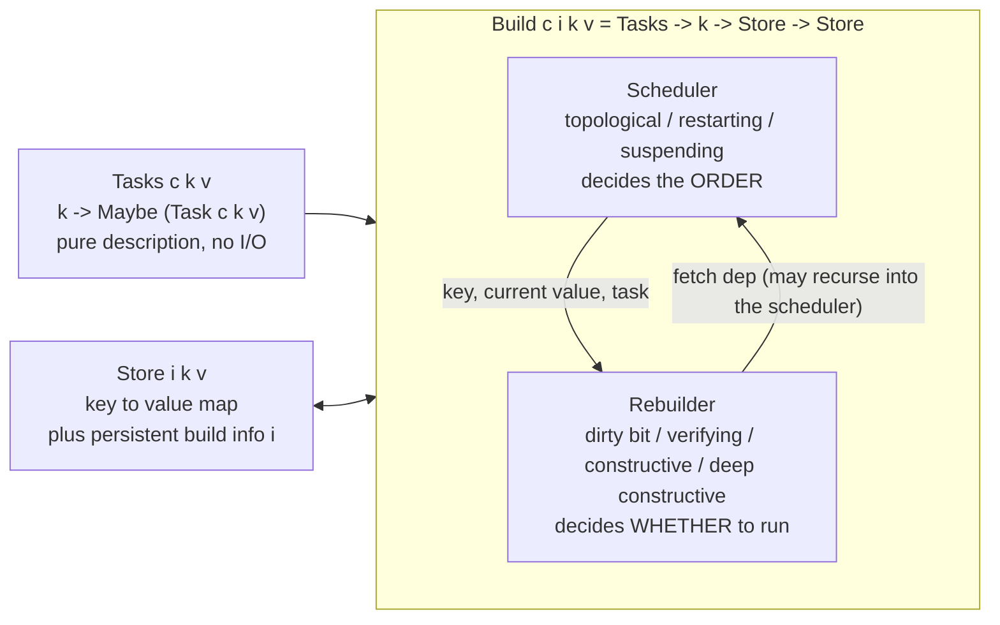

# Paper: Build Systems a la Carte (Mokhov, Mitchell, and Peyton Jones 2018/2020)

> [!summary] Scope
> Owns the ICFP 2018 and JFP 2020 paper by Andrey Mokhov, Neil Mitchell, and Simon Peyton Jones that formalizes the build system design space.
> It splits every build system into a scheduler (in what order keys are built) and a rebuilder (whether a key must be rebuilt), and recovers Make, Excel, Shake, Bazel, Ninja, CloudBuild, Buck, and Nix as cells of one 3-by-4 table.
> It reaches the Explain and Rebuild rungs and hands version solving to [[Paper-PubGrub-and-Minimal-Version-Selection]].

> [!summary] Claim:
> A build system is a function `Tasks -> target -> Store -> Store` over a key/value store that also holds the system's own persistent memory.
> Two independent choices produce every system in the paper: the scheduler (topological, restarting, or suspending) fixes the order, and the rebuilder (dirty bit, verifying trace, constructive trace, or deep constructive trace) decides whether to run a task.
> The schedulers differ in which dependencies they can handle, the rebuilders differ in what they can skip (early cutoff, cache restore, shallow builds) and what they require (deterministic tasks), and any scheduler composes with any rebuilder to give a correct build system.
> Twelve combinations exist, eight were occupied by real systems in 2018, and the most interesting empty cell (suspending plus constructive traces) became Cloud Shake.



## 1. Bibliographic Metadata

| Field | ICFP 2018 version | JFP 2020 version |
| :--- | :--- | :--- |
| Title | Build Systems a la Carte | Build Systems a la Carte: Theory and Practice |
| Authors | Andrey Mokhov (Newcastle University), Neil Mitchell (Digital Asset), Simon Peyton Jones (Microsoft Research) | Mokhov (Newcastle University, and Jane Street), Mitchell (Facebook), Peyton Jones (Microsoft Research) |
| Venue | Proc. ACM Program. Lang. 2 (ICFP), Article 79, September 2018, 29 pages | Journal of Functional Programming 30, e11, 2020, 55 pages |
| Identifier | https://doi.org/10.1145/3236774 | https://doi.org/10.1017/S0956796820000088 |
| License | Copyright held by the authors, CC BY 4.0 (per the paper's rights notice) | Open access, CC BY 4.0 (per the article's first page) |
| Companion code | Haskell package `build` on Hackage, version 1.0 uploaded 2018-07-06 | Same package; version 1.1 uploaded 2024-05-18, tested with GHC 9.2.8 to 9.8.2 (as of 2026-11, Both) |

The ICFP paper is the short statement of the framework.
The JFP article is the long form and adds material that the ICFP paper lacks; the additions that matter are listed here so that a reader knows which version a claim comes from:

- Section 3.8: worked task examples (Fibonacci, Ackermann, Collatz, and a cached Ackermann using `MonadState`).
- Section 5.2.2: verifying step traces, the trace format Shake actually uses.
- Section 7: experience reports (Haskell as a design language, Shake, Cloud Shake, a Standard Chartered report, and GHC's Hadrian build).
- Section 8.6 to 8.8: GADT encodings of key-dependent value types and multiple-output tasks (ICFP 6.7 discusses both only in prose and does not model them), and a concrete `selfTracking` combinator.
- Section 8.9: file watching versus polling.
- Non-determinism is modelled with `MonadRandom` (JFP 8.3) where the ICFP paper used `Alternative` and `MonadPlus` (ICFP 6.3).
- Dune is described as having been redesigned onto selective functors (JFP 9.1); ICFP says it uses arrows.

Section numbers below are JFP section numbers unless marked ICFP.

## 2. The Core Problem

In 2018 the literature had papers about single build systems (Shake, Nix, CloudBuild) but, in the authors' words, "little research to date comparing different build systems" (JFP 9).
Each system bakes two decisions into one monolith, so a feature such as early cutoff, dynamic dependencies, or remote caching looked like an isolated invention rather than a point on a map.
The authors name the axes the community argued about without shared vocabulary:

- Static versus dynamic dependencies.
- Local versus cloud builds.
- Deterministic versus non-deterministic tasks.
- Whether the system supports early cutoff.
- Whether it is self-tracking (it rebuilds when a task description changes, not only when inputs change).
- What persistent information it keeps between builds.

Two precise definitions were also missing.
The first is minimality (JFP 2.1): a build system is minimal if it executes tasks at most once per build and only if they transitively depend on inputs that changed since the previous build.
The second is correctness (JFP 3.6), which the paper notes is "seldom stated formally" and which is covered in the Mechanism section.

The practical stake is that build systems are "used by every developer around the world, but are rarely the object of study", in the paper's own words, while large firms were by then building their own (Bazel, Buck, CloudBuild) and exploring the design space without a shared theory.

## 3. Key Innovation

Three abstractions, all expressed as executable Haskell:

1. **A task description with no effects.**
   `newtype Task c k v = Task { run :: forall f. c f => (k -> f v) -> f v }` and `type Tasks c k v = k -> Maybe (Task c k v)`.
   A task is polymorphic in the context `f`; the constraint `c` (Functor, Applicative, Monad, ...) is a type-level statement of how dynamic its dependencies may be.
   `Nothing` marks an input key.
2. **A build system as a function over a store.**
   `type Build c i k v = Tasks c k v -> k -> Store i k v -> Store i k v`, where `i` is the persistent build information that is the system's memory.
3. **The scheduler/rebuilder split.**
   `type Scheduler c i ir k v = Rebuilder c ir k v -> Build c i k v` and `type Rebuilder c ir k v = k -> v -> Task c k v -> Task (MonadState ir) k v`.
   A rebuilder wraps a task that unconditionally rebuilds into a task that rebuilds only when necessary and does the bookkeeping in `ir`.
   A scheduler consumes a rebuilder and decides which keys to ask about and in what order.

The consequence is the 3-by-4 table of the paper (Table 2), which is the main result.
Because the split is a type-level interface, "we can compose any scheduler with any rebuilder and obtain a correct build system" (JFP 6.1), and the empty cells are not speculation but runnable combinations.

## 4. Mechanism Details

### 4.1 Vocabulary: store, keys, values, persistent information

The goal of any build system is to bring up to date a store that maps keys to values (JFP 3.1).

| Concept | Software build | Excel |
| :--- | :--- | :--- |
| Store | The file system | The worksheets |
| Key | File name | Cell name such as `A1` |
| Value | File contents | Number, string, formula result |
| Input | Source files edited by the user | Cells containing constants |
| Persistent build information `i` | mtimes, trace database, cache | Dirty bits and the calc chain |
| Task description | Makefile rules | Formulae |

The store carries two things: the key/value map, and the build system's own memory `i` that persists from one invocation to the next.
Stating this explicitly is what lets the paper classify systems by what they remember.

### 4.2 Tasks, and what the constraint `c` buys

A task receives a `fetch` callback and may call it to obtain any dependency.
The paper's running example is a spreadsheet:

```haskell
sprsh1 :: Tasks Applicative String Integer
sprsh1 "B1" = Just $ Task $ \fetch -> ((+) <$> fetch "A1" <*> fetch "A2")
sprsh1 "B2" = Just $ Task $ \fetch -> ((*2) <$> fetch "B1")
sprsh1 _    = Nothing
```

The constraint classifies task descriptions (JFP 3.4):

| Constraint `c` | What a task can do | Dependencies | Example from the paper |
| :--- | :--- | :--- | :--- |
| `Functor` | Transform one fetched value | Exactly one, a linear chain | Collatz sequence; Docker image layers |
| `Applicative` | Combine independent fetches with `<*>` | Static, extractable without running | Make rules, `fibonacci` |
| `Monad` | Branch on a fetched value | Dynamic, known only by running | `INDIRECT` in Excel, Shake `need` after reading a file |
| `MonadRandom` (JFP) or `MonadPlus` (ICFP) | Draw non-deterministic results | Value-level or dependency-level non-determinism | `RANDBETWEEN(1,2)` |
| `MonadState s` | Read and write a shared cache | Cloud cache lookups inside a task | `cloudAckermann` (JFP 3.8) |

Three consequences are worth knowing cold.

**Static dependencies come from running the task in the wrong functor.**
Instantiate `f` as `Const [k]`, whose `<*>` concatenates the recorded keys, and run the task:

```haskell
dependencies :: Task Applicative k v -> [k]
dependencies task = getConst $ run task (\k -> Const [k])
```

No computation happens, there is no store, and `dependencies (fromJust $ sprsh1 "B1")` returns `["A1","A2"]`.
The same trick returns `[4,3]` for `fibonacci 5` in JFP 3.8.
It cannot be applied to a monadic task, because `Const` has no `Monad` instance.

**Dynamic dependencies must be discovered by running.**
The paper's `track` runs a monadic task in a `WriterT [(k, v)]` transformer whose `fetch` records every key/value pair it serves.
For the spreadsheet `B1 = IF(C1=1, B2, A2)`, tracking with `C1 = 1` gives `(10, [("C1",1),("B2",10)])` and with `C1 = 2` gives `(20, [("C1",2),("A2",20)])`, so the dependency set depends on a value (ICFP 3.7).

**Expressiveness is classified, not just asserted.**
The Ackermann function cannot be an applicative task, since computing `A(m, n)` needs the result of `A(m, n-1)` to decide which key to fetch next, so it is `Tasks Monad`.
The Collatz sequence is the classic functorial task, and it also illustrates early cutoff: recomputing `c8` from `c0 = 40` instead of `c0 = 6` agrees from `c2 = 10` onward, so a build system with cutoff stops after two steps (JFP 3.8).
`A(4,2) = 2^65536 - 3` has 19,729 decimal digits, which is the paper's motivation for caching it rather than recomputing it.

The naive build system is `busy`: it runs `fetch` recursively in a `State (Store () k v)` monad and recomputes every key on every demand.
It is correct for acyclic tasks and not minimal, since a key that is fetched more than once (by several dependents, or twice by one formula) is recomputed on every fetch; the paper's example is changing `B2 = B1 * 2` to `B2 = B1 + B1`.

### 4.3 Correctness and minimality, stated precisely

**Correctness (JFP 3.6).**
Let `result = build tasks key store`, let `I` be the input keys reachable from `key`, and let `O` be the reachable non-input keys.
The build is correct if both of these hold:

- Inputs were not corrupted: for all `k` in `I`, `getValue k result == getValue k store`.
- The result is consistent with the tasks: for all `k` in `O`, `getValue k result == compute task result`, where `compute` runs the task against the final store with no building.

In words: after the build, recomputing any key from the final store gives exactly the value in the store.
All systems in the paper are correct only for acyclic task descriptions, and `busy` loops forever on a cyclic one.

Two relaxations are defined:

- **Non-determinism (JFP 8.3):** the stored value must be an element of the set of possible results of recomputing the task.
- **Shallow builds (JFP 8.4):** the shallow store must agree with some correct store on the input keys and the target key only, so intermediates may be absent.

**Minimality (JFP 2.1)** is the property that makes incremental builds worth having: at most once per build, and only if a transitive input changed.
It is also what Excel and Bazel give up when they restart tasks, and what Make quietly assumes about timestamps: a footnote notes that `touch` fools Make, so Make is minimal only if nobody does that (ICFP 2.1).

### 4.4 Schedulers: the order

A scheduler is correct only if it builds keys in an order that respects dependencies, and that is the only way to achieve "at most once" (JFP 4).

**Topological.**
It extracts the static dependency graph with `dependencies`, topologically sorts it, and runs the rebuilder on each key in order.
Because `dependencies` exists only for `Applicative` tasks, every topological system is limited to static dependencies: Make, Ninja, CloudBuild, Buck.
The benefit of fixing the order up front is that all dependencies of a key are guaranteed to be up to date when the rebuilder sees it, so `fetch` is a plain store read (JFP 6.2), and missing keys or cycles are reported before any work starts (JFP 4.1).

**Restarting.**
Build tasks in some initial order, and when a task calls `fetch` on a key that is not yet up to date, abort the task, build the dependency, and restart the task later (JFP 4.2).
This handles dynamic dependencies without suspending a computation, at the price of minimality: a task can start, do real work, abort, and rerun.
The two real systems differ in how they avoid aborts:

- **Excel** persists the discovered order as the calc chain.
  When computing cell C needs an uncomputed cell D, Excel aborts C, moves D before C in the chain, and resumes at D.
  The chain is "just an optimisation": a build succeeds from any initial chain barring true circularity, and when a change does not alter dependencies the previous chain gives zero aborts.
- **Bazel** does not persist an order; it stores the most recent task dependency information, computes a linear order from it, and may still abort a task when a newly discovered dependency is out of date (JFP 4.2).
  Its model uses a build queue seeded with all dirty keys; a key whose dynamic dependency is dirty is marked blocked, and when that dependency finishes, blocked keys re-enter the queue (JFP 6.5).
  Bazel's own Skyframe documentation describes the mechanism from the other side: a `SkyFunction` asks for another node through `env.getValue`, and if the node is not available the call returns `null` and the function is expected to return `null`; the dependency is then evaluated and the original function is invoked again (as of 2026-11, Both).

**Suspending.**
Build a dependency when it is requested and suspend the requesting task until it completes, keeping a set of keys already built (JFP 4.3).
With the done-set this yields a minimal build system that supports dynamic dependencies, which is why Shake and Nix use it.
It needs suspendable tasks.
Shake originally used cheap green threads with blocking and moved to continuation-passing style; that move is described as the biggest implementation change in roughly 5,000 commits (JFP 7.2).

**Parallelism lives entirely in the scheduler (JFP 8.2).**

| Scheduler | How it parallelizes | Subtlety |
| :--- | :--- | :--- |
| Topological | Start a task as soon as all its dependencies complete | Needs the full graph first |
| Restarting | `n` workers read from the build queue | Keys also move to the back because of races with unfinished tasks, not only because they are out of date; if the build order is persisted across runs (as in Excel), racy dependencies get separated and parallelism improves over time |
| Suspending | Let a task request a list of keys at once, as Shake does, or run the applicative dependencies of a monadic task in parallel (Marlow et al., "There is no fork") | A dynamic dependency is by definition requested only after an earlier value is known; the paper also notes that a thread pool or limit is needed to prevent excess parallelism and resource starvation |

### 4.5 Rebuilders: whether to run

A rebuilder receives a key, its current value, and an unconditional task, and returns a task that consults the persistent information `ir`.
There are four fundamental answers (JFP 5).

**Dirty bit.**
One piece of persistent state per key says clean or dirty.
- Make repurposes file modification times as the bit: a file is dirty when it is older than its dependencies.
  Modifying a file clears its own bit and sets its direct dependents' bits, but not recursively, because the scheduler walks the graph.
  Make requires timestamps to move forward only, which backup software can violate (ICFP 4.2.1).
- Excel keeps a real dirty bit per cell and marks dirty every cell that transitively depends on a changed cell, using a static over-approximation: a cell is dirty if its formula statically mentions a dirty cell, calls a function such as `INDIRECT` whose dependencies are not statically visible, or the formula itself changed.
  The over-approximation applies even to `IF`, where both branches are followed though only one is used.
- A dirty bit can be minimal but cannot do early cutoff.
  For Make, it is impossible to mark a file clean and at the same time not mark its dependents dirty; Make can approximate cutoff by not touching the result file, but then the file is rebuilt on every subsequent build.

**Verifying traces (VT).**
Record, per key, the hash of the result and the keys and hashes of the dependencies used.
The two operations are:

```haskell
recordVT :: k -> Hash v -> [(k, Hash v)] -> VT k v -> VT k v
verifyVT :: (Monad m, Eq k, Eq v) => k -> Hash v -> (k -> m (Hash v)) -> VT k v -> m Bool
```

`verifyVT` takes a `fetchHash` callback that returns the post-build hash of any dependency.
For a monadic task the dependencies are not known from the task alone, only from the recorded trace, and two traces for one key both request the same first dependency because a monadic task is deterministic; they may diverge afterwards based on that first value.
A consequence the paper points out: under a suspending scheduler the actual build steps often occur as a side effect of checking whether a key needs rebuilding, because `fetchHash` brings each dependency up to date.
VT supports dynamic dependencies, minimality, and early cutoff.

**Verifying step traces (JFP 5.2.2).**
Shake does not store dependency hashes.
It stores, per key, the result hash, a `built` time, a `changed` time, and the dependency keys, with a verification that takes these steps:

1. Find the latest trace for the key; if none exists, the key was never built, so return False.
2. If the current value's hash differs from the recorded result hash, the value was changed externally, so return False.
3. For each dependency, make sure it is up to date (suspending if needed); if its `changed` time is greater than the key's `built` time, return False.
4. Return True.

`changed` equals `built` if the last build changed the value and is older otherwise, which is what preserves early cutoff; a variant with a single time field loses cutoff and "corresponds quite closely to Make".
The size argument is concrete: a typical cryptographic hash takes 32 bytes, while a Shake key is an `Int` of 4 bytes, and for applicative tasks the dependency list can be dropped so a step trace is O(1) rather than O(n) in the number of dependencies.
Shake also allows custom value equality, so two bit-different values can compare equal, which makes `Hash v` an invalid encoding for Shake.
Step traces are weaker than hash traces in one observable case (the paper's Figure 7): edit `util.c`, build only `util.o`, revert `util.c`, then build `main.exe`.
With hashes, `main.exe`'s recorded dependency hashes still match, so it is not rebuilt; with step traces `util.o`'s `changed` time advanced, so `main.exe` is rebuilt (its own `changed` time stays unchanged because its value is the same).
The authors say they know of no other situation, apart from building subsets of targets, where step traces are less powerful.

**Constructive traces (CT).**
A constructive trace also stores the result value, which lets the system restore a result without running the task:

```haskell
recordCT    :: k -> v -> [(k, Hash v)] -> CT k v -> CT k v
constructCT :: (Monad m, Eq k, Eq v) => k -> (k -> m (Hash v)) -> CT k v -> m [v]
```

`constructCT` returns a list of values because non-deterministic tasks can have several valid results.
There are three cases: the list is empty, so rebuild; the current value is in the list, so skip; otherwise copy any listed value into the store with no work.
Storing values makes it sensible to keep many traces per key and to share them, which is the cloud build.
In practice many systems keep hashes in the trace store and the values in a separate content-addressable cache.
Bazel's documented remote cache has exactly this shape: an action cache that maps action hashes to action-result metadata, and a content-addressable store of output files, with stdout and stderr stored for every action; remote caching needs Bazel 0.10.0 or later (as of 2026-11, Both).
An applicative system using CT, such as CloudBuild, can index by key plus dependency hashes and fetch the result with a single server call, since the client computes the dependency hashes itself.

**Deep constructive traces (DCT).**
A constructive trace verifies a key by looking at its immediate dependencies, so verification cost grows with the number of transitive dependencies, since each must first be brought up to date.
A DCT records only the hashes of terminal inputs and skips every intermediate.
The paper's example: to decide whether `main.exe` is up to date, a CT looks at `util.o` and `main.o`, a DCT looks at `util.c`, `util.h`, and `main.c`.
This gives the cheap shallow build (no need to even consider `util.o` or `main.o`), and it has two costs (JFP 5.4):

- Tasks must be deterministic, or correctness can be violated (see the Frankenbuild below).
- No early cutoff, since intermediate results are never examined.

The generalization: skip any number `n` of dependency levels.
`n = infinity` is the input-only DCT used in practice, `n = 1` is the ordinary constructive trace, and intermediate values regain some cutoff at the cost of losing the simple shallow build while still requiring determinism.

**One trace or many.**
Storing a single trace per key, a `Map k (Trace ...)`, bounds the trace store by the number of distinct keys regardless of how many builds ran.
The cost: if a key's dependencies change, its value does not, and then the dependencies change back, no valid trace exists and the key is rebuilt, whereas a complete history would skip it (JFP 5.2.1).
The toy build system below measures exactly this difference.

### 4.6 The table (JFP Table 2)

| Rebuilder \ Scheduler | Topological (static only) | Restarting | Suspending |
| :--- | :--- | :--- | :--- |
| Dirty bit | Make | Excel | empty |
| Verifying traces | Ninja | empty | Shake |
| Constructive traces | CloudBuild | Bazel | empty (Cloud Shake) |
| Deep constructive traces | Buck | empty | Nix |

There are 12 combinations and 8 were inhabited by existing systems (JFP 6); the authors state that all four remaining cells result in workable build systems.
The most interesting empty cell, suspending plus constructive traces, would be minimal, support early cutoff, and support monadic dependencies in a cloud setting; the paper's recipe for it is `cloudShake = suspending ctRebuilder`, one line.

The ICFP paper's Table 1 compares the four systems it introduces on the properties that fall out of the cells:

| System | Persistent build information | Scheduler | Dependencies | Minimal | Cutoff | Cloud |
| :--- | :--- | :--- | :--- | :--- | :--- | :--- |
| Make | File modification times | Topological | Static | Yes | No | No |
| Excel | Dirty cells, calc chain | Restarting | Dynamic | No | No | No |
| Shake | Previous dependency graph (with hashes) | Suspending | Dynamic | Yes | Yes | No |
| Bazel | Cloud cache, command history | Restarting | Dynamic (user-defined rules could not yet use it in 2018) | No | Yes | Yes |

A caution on the Ninja cell: the paper says Ninja "combines the topological scheduler of Make with the verifying traces of Shake" in the paper's associated implementation, which is a modelling statement.
The Ninja manual describes the real tool as deciding what to run "as determined by file modification times", keeping a log of the command used for each built file in `.ninja_log` so that a changed command line triggers a rebuild, and offering a per-rule `restat` that re-stats outputs after a command and treats outputs whose mtime did not change as though they never needed building, which removes their dependents from the pending list; the manual contains no mention of content hashes (as of 2026-11, Both).
So real Ninja is a dirty-bit system with command tracking and an opt-in approximation of early cutoff, and the Ninja cell is a statement about what combination the framework can express, not a description of Ninja's database.
The lesson is to read the table as a classification of models and to check the tool before relying on a cell.

### 4.7 Impurity: the real world is not a function

Section 8.3 lists three ways tasks fail to be functions:

- **Untracked dependencies.** A C compile lists `source.c` but may not record the version of `gcc`.
- **Non-determinism.** GHC compiled with parallelism can change the order in which unique variables come out of a name supply, producing different but semantically identical results.
- **Volatility.** Excel's `RANDBETWEEN` changes on every recalculation, and Make and Shake have volatile phony rules.
  Volatile tasks cannot be cached; they are modelled as depending on a special key `RealWorld` whose value changes every build.

The paper's remark about sandboxes is worth memorizing: systems such as Bazel use sandboxing to guard against missing dependencies, but "none are likely to capture all dependencies right down to the CPU model and microcode version".
Marking a task with untracked dependencies as volatile fixes the dependency at the cost of minimality, which is what Excel does for `INDIRECT`.
Most of the paper's implementations cope with non-determinism, except Buck, which relies on determinism to cut cloud lookups: if all tasks are deterministic then one lookup from the hash of terminal inputs yields the target, and all intermediate values can be requested as a single batch.

### 4.8 The Frankenbuild: deep constructive traces plus non-determinism

The paper's Figure 12 (ICFP Figure 11), after Esfahani et al. on CloudBuild (ICSE-C 2016), is the sharpest failure mode in the framework:

1. Build `report.txt`, a human-readable report derived from `main.prof`, which a profiler produced from `main.exe`.
   Record deep constructive traces; `report.txt` is keyed by the hash of `main.exe`, the terminal input.
2. Remove the built files locally and evict `main.prof` from the cloud store.
3. Build `main.prof`: the profiler is non-deterministic, so it produces a different `main.prof`.
   Then build `report.txt`: its DCT matches on `main.exe` alone, so it is downloaded from the cloud, and it describes the old profile.

The final store violates all three correctness definitions (main, non-deterministic, shallow): `report.txt` is inconsistent with its immediate dependency `main.prof`.
The toy build system below reproduces this in section 3 of its output, and shows the same sequence under verifying and constructive traces ending consistent.
The fix space is: use constructive traces (which key on the immediate dependency hashes), make the tasks deterministic (see [[Paper-Reproducible-Builds-Lamb-Zacchiroli]]), or mark the nondeterministic task so its dependents are never cached against terminal inputs alone.

### 4.9 Engineering aspects

**Cloud implementation (JFP 8.4).**
The model omits four engineering corners:

- Communication: traces and contents in the cloud make communication a bottleneck, so the system must send the minimum.
  The paper cites Reflow, which orchestrates terabytes of data.
- Offloading: once the cloud stores products and traces it can also host workers that execute tasks remotely.
- Eviction: the modelled store grows forever, but real stores evict.
  Evicting a value can also evict traces mentioning its hash, but for shallow builds it is better to keep the traces so that builds can pass hashes through without the underlying values.
- Shallow builds: build end products without materializing intermediates, and in the extreme (the paper cites the Git Virtual File System) materialize a file only when the user accesses it.

**Self-tracking (JFP 8.8).**
A system is self-tracking if it recomputes a task when the task itself changes.
Excel and Ninja are, per the paper; Ninja's `.ninja_log` command tracking matches this.
Self-tracking is only precise when the build language is a non-embedded DSL, where a task is a data structure that can be compared for equality.
A system that uses a full programming language, as Shake does, would need equality on arbitrary functions, so the safe approach is pessimistic: assume any change to the build system changes any task, as with a makefile depending on itself.
The paper's `selfTracking` combinator makes script keys explicit: `Script k` for the script text and `Value k` for values, so that `Value k` depends on `Script k`.
Hadrian gets partial self-tracking by modelling command lines as values (JFP 7.5).

**Cycles and iteration (JFP 8.5).**
All results assume acyclic tasks.
Excel handles `A1 = A1 + 1` only with Iterative Calculations enabled, running the formula at most `N` times per calculation, where `N` defaults to 100.
LaTeX needs a fixed point and is better encoded as a bounded series of iterative steps than as a cycle, because LaTeX can be bistable or diverging.

**Key-dependent value types and multiple outputs (JFP 8.6 and 8.7).**
Replacing `fetch :: k -> f v` by `fetch :: k v -> f v` with a GADT key, for example `File :: FilePath -> Key String` and `Program :: String -> Key Version`, lets a build depend on a compiler's version as a typed key, and the example rule picks `compileNew` or `compileOld` on `gcc >= 8.0`.
A command that produces several files, such as `ghc A.hs` producing `A.hi` and `A.o`, is encoded as one key `Files ["A.hi","A.o"]` whose value is the list of contents.
The awkward part is that both outputs must ask for exactly the same `Files` key; if one swaps the list order the compiler probably runs twice, so the paper adds a `Partition k = k -> [k]` function that maps any key to its elementary subset in a consistent order.

**File watching versus polling (JFP 8.9).**
For the largest projects the cost of checking every input's mtime or hash is prohibitive, so Bazel and Buck use file-watching APIs.
This introduces new problems: a running task may become obsolete and should be cancelled and restarted; a topological scheduler cannot easily handle it, since a new sort may be needed when dependencies change; spurious dependency cycles can form during a series of edits and an IDE-integrated build should tolerate them; and concurrent modification of outputs (for example a checked-in output replaced by a download mid-build) can corrupt results undetectably unless tasks have exclusive access to their outputs, for example via sandboxing.

### 4.10 Systems the framework does not capture

Fabricate (Hoyt et al., 2009) is a script of commands run in order; each command is traced at the OS level, and commands with unchanged inputs are skipped on the next run.
It is the one system the authors know of that the framework cannot model, because a script supplies a list of statements in a user-chosen order without declaring what each one reads or writes, instead of a mapping from keys to tasks (JFP 9.1).
The authors sketch an approximate encoding (commands as keys, a linear dependency between successive commands, OS-level tracing lifted into a monadic task), which is imperfect because a command such as `gcc` writes files whose locations are not known in advance; capturing that needs separate `read` and `write` callbacks instead of one `fetch`.
A footnote notes that Shake ships `Development.Shake.Forward` for this style.
The follow-up on forward build systems is by Sarah Spall, Neil Mitchell, and Sam Tobin-Hochstadt: Rattle (Build Scripts with Perfect Dependencies, OOPSLA 2020) and a mechanized correctness proof in Agda (Forward Build Systems, Formally, CPP 2022), both listed on Mitchell's publications page.
Also related, per JFP 9: Pluto (cyclic rules with a user-supplied resolution strategy), Redo (almost exactly Shake at this level of detail, predating it, developed independently), Tup (Make with a file-system-watching dirty bit and automatic deletion of stale results), Dune, and Nix (coarse-grained, packages not files).

## 5. Evaluation and Limitations

### 5.1 What the paper evaluates, and what it does not

The paper is a modelling paper.
It has no benchmark of the models, and none of the build systems it models are measured against each other.
Its evidence is (a) that real systems fit into one framework with small executable definitions, (b) the Table 2 inhabitants plus one new cell, and (c) the experience in JFP section 7, which has the only operational numbers:

| Reported number | Source and meaning |
| :--- | :--- |
| About 5,000 commits to Shake since the original paper | JFP 7.2; the design did not change, the implementation matured (resources, faster serialization, docs, tests) |
| "around 5 s, saving us up to 2 h" for a from-scratch build with a warm shared cache | JFP 7.4; reported by Standard Chartered after moving a Shake build to `--share`, quoted by the authors, not measured by them |
| About 1 hour to build GHC 8.8 from scratch on Windows with either Hadrian or the old Make build | JFP 7.5; includes the compiler, 29 bundled libraries (each in vanilla and profiled ways), and 6 bundled executables |
| 3 minutes for a from-scratch Hadrian build when the commit does not change the GHC binaries | JFP 7.5; done by creating symbolic links to cached results |
| Less than 10% speedup on unlimited CPUs; at least 15% of build time in a handful of tasks | JFP 7.5; from Shake profiling: two anomalously slow Haskell compilations and slow single-threaded `configure` calls |

Two qualifiers belong with those numbers.
If a commit modifies the Stage 1 GHC executable, the intermediate compiler built during bootstrapping, further cache hits become unlikely, which limits the CI cache benefit to Stage 1.
A small number of GHC build rules cannot be cached because they register libraries by mutating a shared package database, and Cloud Shake lets a user label such rules to exclude them.

### 5.2 Cloud Shake as the empirical check

Cloud Shake was built by bolting constructive traces onto Shake rather than rewriting the database: keep verifying traces, and if the verifying trace does not match, consult the constructive trace (JFP 7.3).
The authors found no significant downside and suggest the bolt-on may be a sensible route even from scratch, since the optimized VT path handles most cases and the remote lookup is the rare fallback.
Differences from the abstract `recordCT` and `constructCT` show what the abstraction omits:

- Two `Ver` arguments (script version and rule version) are part of every lookup, so a changed build script never reuses stale products.
- Dependencies are a list of lists, since Shake can request a group of dependencies at once so they build in parallel.
- A rule declares the files it produces, including the ones declared with `produces`.
- Lookup can return `Nothing` for a dependency that is not buildable, and returns at most one result.
- At the time of the paper all caches were on shared file systems rather than hosted over HTTP; mounting HTTP as a file system needs administrator rights on some operating systems such as Windows.

The paper's list of what it takes to make a build cloud-ready is a better checklist than most vendor documentation:

| Problem | Example | Fix |
| :--- | :--- | :--- |
| Irrelevant differences prevent sharing | `gcc` installed at `/usr/bin/gcc` for one user and `/usr/local/bin/gcc` for another, with paths recorded in the key; or a compiler that embeds the current time in its output | Relative paths; depend only on version numbers of system binaries; control the environment (for example with Nix); compiler flags for determinism |
| Insufficient produced files | A rule declares `Foo.hi` only, a later rule also reads `Foo.o`; a local build works because `Foo.o` is on disk, but a cache restore of `Foo.hi` does not bring `Foo.o` and the link fails | Declare every output; the paper says most issues in moving GHC to cloud builds were this |
| Missing dependencies | Harmless in a local build that runs once per user, serious in a cloud build where a task may run once ever | Lint modes coupled to FSATrace, which detects the files a command reads and writes |

### 5.3 Limitations and open edges

- **Acyclic only.** Cyclic dependencies are out of scope (JFP 8.5), and `busy` diverges on them.
- **Pure tasks.** The model's task is a function.
  Hermeticity, sandboxing, and undeclared inputs (compiler version, environment, microcode) are not part of the type, which is why they appear as engineering aspects, and a build can be formally correct in the model and wrong in practice if the task description omits a dependency.
- **Correctness is relative to the description.** Definition 3.1 says the store is consistent with the declared tasks, not that the declared tasks match what the commands really read.
- **Forward builds** (Fabricate, Rattle) do not fit without extending `Task` with separate read and write callbacks.
- **Partial stores and errors** are handled by instantiating `v` as `Maybe v` or `Either e v`, but because `v` is polymorphic the build system cannot apply special behaviour such as early abort (JFP 8.1).
- **Parallel and persistent details** are intentionally left out: the paper says the parallel schedulers are "not overly onerous, but neither is [their implementation] beautiful or informative".
- **Language precision.** The models were translated to Rust (Gandhi, 2018) and Kotlin (Estevez and Shetty, 2019), and in both cases precision was lost to language limitations: `Task` needs a data constructor with a polymorphic field, a higher-kinded `f`, an even more abstract kind for `c`, and type classes (JFP 7.1).
- **Dune did not fit the first version.** Trying to express Dune led to a new abstraction, the selective applicative functor (Mokhov et al., ICFP 2019), and Dune was later redesigned onto a flavour of it.

## 6. Industry Impact

### 6.1 Real systems that implement a cell, checked against their documentation

All version statements are as of 2026-11 and apply to Both platforms unless stated.

| System | What its documentation says | Cell and notes |
| :--- | :--- | :--- |
| Bazel | Skyframe returns `null` for an unavailable node and re-invokes the function later; bottom-up invalidation; "change pruning" resurrects invalidated nodes whose recomputed value is unchanged (the example is a comment-only change); remote cache = action cache plus content-addressable store | Restarting plus constructive traces, with early cutoff.  Matches the paper's model of Bazel, including the aborts that break strict minimality |
| Buck2 | "Buck2 uses a dynamic (aka monadic) graph as its underlying computation engine"; dynamic dependencies let a rule build a file and look at its contents before declaring further actions, used for import-driven languages (Haskell, OCaml) and for distributed ThinLTO where the optimization plan comes from summaries; "dep files" let an action declare which inputs were not actually used | Moves beyond the 2018 Buck cell, which was topological plus DCT.  The ThinLTO use links to [[Paper-ThinLTO-Scalable-Incremental-LTO]] |
| Shake and Hadrian | Shake 0.17 (2018-10-15) added `shakeShare`, `--share` and history functions for shared builds, shortly after the September 2018 ICFP paper; `shakeChange` selects `ChangeModtime`, `ChangeDigest`, `ChangeModtimeAndDigest`, `ChangeModtimeAndDigestInput`, or `ChangeModtimeOrDigest` (digest rules and `shakeChange` arrived in Shake 0.13, released 2014-05-27, changelog entry `#83`); latest release in the changelog is 0.19.9 (2026-01-19); GHC's Hadrian "is based on the Shake library" | Suspending plus verifying traces, with Cloud Shake bolted on for caches.  Note the mtime-or-digest options: real Shake lets you trade hashing cost against mtime trust, which the paper's hash-only VT does not model |
| Ninja | mtimes, command log in `.ninja_log`, `restat`; no hashing mentioned | See the caution in section 4.6 |
| rustc incremental compilation | After each run it saves query results and the query DAG; a query is colored red if its result changed since the previous compilation and green if the same; if all inputs to a query are green the query is not re-executed; otherwise re-execute and compare hash, marking green if equal (early cutoff); try-mark-green visits `reads(Q)` in the original order | A verifying-trace rebuilder with early cutoff and monadic dependencies, including the same order-sensitivity as `verifyVT`. The dev-guide page does not cite the paper, and this note makes no claim that rustc descends from it |
| `build` on Hackage | "A library for experimenting with build systems and incremental computation frameworks, based on the ideas presented in the ICFP 2018 paper"; modules include `Build.Scheduler`, `Build.Rebuilder`, `Build.Trace`, `Build.SelfTracking`, `Build.Task.Applicative`, `Build.Task.Monad`; MIT license | The reference executable model |

### 6.2 Concept and vocabulary impact

- "Early cutoff", "dynamic dependencies", "shallow build", and "self-tracking" are now a standard checklist when evaluating a build tool, because the paper gave each a definition and a place in a table.
- The design-language lesson (JFP 7.1): the authors state that writing executable Haskell prototypes forced misconceptions out early, made them explicit about side effects, and drove the discovery of the scheduler/rebuilder abstraction late in the project.
- The Functor/Applicative/Monad classification of dependency expressiveness is reused outside build systems: selective functors came out of attempting to model Dune and "turned out to be useful outside the build systems domain" (JFP 7.1).

### 6.3 Decision rules the framework implies

Choose by the properties your workload needs, not by a tool name.

| Your situation | Choose | Reason |
| :--- | :--- | :--- |
| Static graph, local builds, simplest correct thing | Topological plus dirty bit or verifying trace | No restarts, no suspension; verifying adds early cutoff when generated files rarely change |
| Dependencies discovered while building (generated source lists, import-driven languages) | Suspending (or restarting) plus a trace rebuilder | Topological cannot express it; restarting risks wasted work on first build, suspending needs suspendable tasks |
| Shared remote cache across developers and CI | Constructive traces | Many traces per key and restorable values |
| Very large graph where verifying each intermediate is expensive, and tasks are deterministic | Deep constructive traces | One lookup from input hashes and shallow builds |
| Tasks you cannot make deterministic | Never deep constructive traces | Frankenbuild |
| Repository so large that polling mtimes is too slow | File watching, which implies a scheduler that can cancel and restart, not a topological one | JFP 8.9 |

The cost side of every row: richer rebuilders need richer persistent state (hash database, cache server, eviction policy), and cloud builds punish untracked operations that are harmless locally.

## 7. Concept Grounding

- [[Paper-PubGrub-and-Minimal-Version-Selection]]: the next paper in the pillar; where this paper decides what to rebuild given resolved inputs, that one decides which versions the inputs are.
- [[Paper-Reproducible-Builds-Lamb-Zacchiroli]]: determinism is the precondition for deep constructive traces and for useful cache sharing, and it is the cure for the Frankenbuild.
- [[Paper-ThinLTO-Scalable-Incremental-LTO]]: thin links are the paper-level example of a dynamic dependency, where the optimization plan comes from summaries; Buck2's dynamic dependencies are documented for exactly this use.
- [[Paper-Google-Monorepo-Piper-and-CitC]]: the scale that motivates cloud build systems, remote execution, and file watching.
- [[Paper-in-toto-Supply-Chain-Guarantees]]: a build step's recorded materials and products are the supply-chain counterpart of a trace's recorded dependency hashes.
- [[Paper-Zeller-Delta-Debugging]]: re-running a build under a changed input and testing for a failing outcome is the same loop; a build system with early cutoff makes each delta-debugging probe cheaper.
- [[Git-Packfiles-and-Delta-Compression]]: content addressing (object names are hashes of contents) is the storage idea under constructive traces and caches.

## 8. Rebuild: a Mini Build System with 3 Schedulers and 4 Rebuilders

This section is the Rebuild rung: roughly 340 lines of Python that implement the paper's split.
Python has no `forall f. c f` constraint, so an applicative task declares its dependency list (`deps=[...]`) and a monadic task passes `None`; the "run the task in `Const`" trick is replaced by that declaration.
Each rebuilder is a class with `rebuild(key, current_value, task, fetch, log)`; each scheduler is a function that decides when to call it.
The suspending scheduler combined with the constructive rebuilder is Cloud Shake.

```python
#!/usr/bin/env python3
"""Build Systems a la Carte as a toy: 3 schedulers x 4 rebuilders.

Follows the Scheduler / Rebuilder split of Mokhov, Mitchell and Peyton Jones.
Python has no Applicative/Monad constraint on Task, so an applicative task
declares its dependency list (deps=[...]) and a monadic task declares None.
"""
import hashlib
from itertools import count


def digest(value):
    return hashlib.sha256(repr(value).encode("ascii")).hexdigest()[:8]


class Task:
    """deps is a list for an applicative task (static dependencies), None for a monadic one."""

    def __init__(self, fn, deps=None):
        self.fn, self.deps = fn, deps

    def run(self, fetch):
        if self.deps is None:
            return self.fn(fetch)
        return self.fn(*[fetch(d) for d in self.deps])


class Log:
    def __init__(self):
        self.ran, self.aborts = [], 0


class Restart(Exception):
    """Raised by a restarting scheduler's fetch when a dependency is not built yet."""

    def __init__(self, key):
        super().__init__(key)
        self.key = key


class Unsupported(Exception):
    pass


def execute(key, task, fetch, log):
    """Run the task body and record every (dependency, value) it fetched, in order."""
    seen = []

    def tracking_fetch(k):
        v = fetch(k)
        seen.append((k, v))
        return v

    log.ran.append(key)
    return task.run(tracking_fetch), seen


# ---------------------------------------------------------------- rebuilders
# rebuild(key, current_value_or_None, task, fetch, log) -> value.
# fetch(d) brings d up to date and returns its value.
# Rule: a rebuilder must fetch a dependency before it reads metadata about it.

class DirtyBit:
    """Make: one modification time per key; dirty if any dependency is newer."""

    name = "dirty-bit"

    def __init__(self):
        self.now, self.mtime = 0, {}

    def touch(self, key):
        self.now += 1
        self.mtime[key] = self.now

    def rebuild(self, key, cur, task, fetch, log):
        if task.deps is None:
            raise Unsupported("dirty bit here needs static dependencies")
        for d in task.deps:
            fetch(d)
        t = self.mtime.get(key)
        if t is not None and all(self.mtime[d] <= t for d in task.deps):
            return cur
        v, _ = execute(key, task, fetch, log)
        self.touch(key)  # always bumps the time, even if v == cur: no early cutoff
        return v


class VerifyingTrace:
    """Shake and Ninja style: per key, the hash of the result and of each dependency used."""

    name = "verifying"

    def __init__(self):
        self.traces = {}  # key -> (result hash, [(dep, dep hash)])

    def rebuild(self, key, cur, task, fetch, log):
        tr = self.traces.get(key)
        if tr is not None and tr[0] == digest(cur):
            if all(digest(fetch(d)) == hd for d, hd in tr[1]):  # stops at the first mismatch
                return cur
        v, deps = execute(key, task, fetch, log)
        self.traces[key] = (digest(v), [(d, digest(dv)) for d, dv in deps])
        return v


class ConstructiveTrace:
    """CloudBuild and Bazel style: many traces per key, each also stores the value."""

    name = "constructive"

    def __init__(self):
        self.traces = []  # (key, [(dep, dep hash)], value)

    def evict(self, key):
        self.traces = [t for t in self.traces if t[0] != key]

    def rebuild(self, key, cur, task, fetch, log):
        cands = [val for k, deps, val in self.traces
                 if k == key and all(digest(fetch(d)) == hd for d, hd in deps)]
        if cur in cands:
            return cur
        if cands:
            return cands[0]  # restored from the trace store, no task body runs
        v, deps = execute(key, task, fetch, log)
        self.traces.append((key, [(d, digest(dv)) for d, dv in deps], v))
        return v


class DeepConstructiveTrace:
    """Buck and Nix style: traces name only the terminal inputs, never intermediates."""

    name = "deep-constr"

    def __init__(self, tasks):
        self.traces = []  # (key, {input: hash}, value)
        self.inputs_of = {}
        self.is_input = lambda k: tasks.get(k) is None

    def evict(self, key):
        self.traces = [t for t in self.traces if t[0] != key]

    def rebuild(self, key, cur, task, fetch, log):
        hits = [(val, ins) for k, ins, val in self.traces
                if k == key and all(digest(fetch(i)) == h for i, h in ins.items())]
        for val, ins in hits:
            if val == cur:
                self.inputs_of[key] = set(ins)
                return cur
        if hits:
            self.inputs_of[key] = set(hits[0][1])
            return hits[0][0]
        v, deps = execute(key, task, fetch, log)
        ins = {}
        for d, _ in deps:
            for i in ([d] if self.is_input(d) else self.inputs_of[d]):
                ins[i] = digest(fetch(i))
        self.inputs_of[key] = set(ins)
        self.traces.append((key, ins, v))
        return v


# ---------------------------------------------------------------- schedulers
def topological(rebuilder, tasks, target, store, log, chain):
    order, seen = [], set()

    def visit(k):
        t = tasks.get(k)
        if t is None or k in seen:
            return
        if t.deps is None:
            raise Unsupported("topological scheduler needs static dependencies: " + k)
        seen.add(k)
        for d in t.deps:
            visit(d)
        order.append(k)

    visit(target)
    for k in order:
        store[k] = rebuilder.rebuild(k, store.get(k), tasks[k], lambda d: store[d], log)


def suspending(rebuilder, tasks, target, store, log, chain):
    done = set()

    def fetch(k):
        t = tasks.get(k)
        if t is None or k in done:
            return store[k]
        store[k] = rebuilder.rebuild(k, store.get(k), t, fetch, log)
        done.add(k)
        return store[k]

    fetch(target)


def restarting(rebuilder, tasks, target, store, log, chain):
    queue = list(chain) + ([target] if target not in chain else [])
    done, new_chain = set(), []
    while queue:
        k = queue.pop(0)
        t = tasks.get(k)
        if t is None:
            continue

        def fetch(d):
            if tasks.get(d) is None or d in done:
                return store[d]
            raise Restart(d)

        try:
            store[k] = rebuilder.rebuild(k, store.get(k), t, fetch, log)
        except Restart as r:
            log.aborts += 1
            queue = [r.key] + [x for x in queue if x != r.key] + [k]
            continue
        done.add(k)
        new_chain.append(k)
    chain[:] = new_chain  # the "calc chain" persists to the next build


def build(scheduler, rebuilder, tasks, target, store, chain):
    log = Log()
    scheduler(rebuilder, tasks, target, store, log, chain)
    return log


def reference(tasks, key, store):
    t = tasks.get(key)
    if t is None:
        return store[key]
    return t.run(lambda k: reference(tasks, k, store))


SCHEDULERS = [("topological", topological), ("restarting", restarting), ("suspending", suspending)]
REBUILDERS = [
    ("dirty-bit", lambda tasks: DirtyBit()),
    ("verifying", lambda tasks: VerifyingTrace()),
    ("constructive", lambda tasks: ConstructiveTrace()),
    ("deep-constr", lambda tasks: DeepConstructiveTrace(tasks)),
]

# ---------------------------------------------------------------- scenario 1
INPUTS = {"util.c": "int f(){return 1;}", "util.h": "int f();", "main.c": "int main(){return f();}"}
STEPS = [
    ("cold", None),
    ("noop", None),
    ("comment", ("main.c", "// note\n" + INPUTS["main.c"])),
    ("header", ("util.h", "int f(int);")),
    ("edit", ("util.c", "int f(){return 2;}")),
    ("revert", ("util.c", INPUTS["util.c"])),
]


def c_tasks():
    def cc(src, hdr):  # "compile": comment lines do not reach the object
        body = [ln for ln in src.splitlines() if not ln.startswith("//")]
        return "obj(" + ";".join(body) + "|" + hdr + ")"

    return {
        "util.o": Task(cc, ["util.c", "util.h"]),
        "main.o": Task(cc, ["main.c", "util.h"]),
        "main.exe": Task(lambda a, b: "exe(" + a + "," + b + ")", ["util.o", "main.o"]),
    }


def matrix():
    print("task bodies started per build (aborted attempts count); ok = final store matches a direct evaluation")
    print("%-12s %-13s %s  %s %s" % ("scheduler", "rebuilder", " ".join("%-7s" % s for s, _ in STEPS), "aborts", "ok"))
    for sname, sched in SCHEDULERS:
        for rname, mk in REBUILDERS:
            tasks = c_tasks()
            rb, store, chain = mk(tasks), dict(INPUTS), []
            if hasattr(rb, "touch"):
                for k in INPUTS:
                    rb.touch(k)
            counts, aborts, ok = [], 0, True
            for _, change in STEPS:
                if change:
                    store[change[0]] = change[1]
                    if hasattr(rb, "touch"):
                        rb.touch(change[0])
                log = build(sched, rb, tasks, "main.exe", store, chain)
                counts.append(len(log.ran))
                aborts += log.aborts
                ok = ok and store["main.exe"] == reference(tasks, "main.exe", store)
            print("%-12s %-13s %s  %-6d %s" % (sname, rname, " ".join("%-7d" % c for c in counts), aborts, "yes" if ok else "NO"))


# ---------------------------------------------------------------- scenario 2
def dynamic():
    def tar(fetch):  # monadic: which files to fetch depends on a value
        names = fetch("release.txt").split()
        return "tar(" + ",".join(fetch(n) for n in names) + ")"

    tasks = {"release.txt": Task(lambda b, d: b + " " + d, ["bins.txt", "docs.txt"]), "release.tar": Task(tar)}
    inputs = {"bins.txt": "a.bin", "docs.txt": "LICENSE", "a.bin": "BIN", "LICENSE": "MIT", "README": "HELLO"}
    for sname, sched in SCHEDULERS:
        rb, store, chain = VerifyingTrace(), dict(inputs), []
        print("-- %s + verifying" % sname)
        for label, change in [("cold", None), ("noop", None), ("add README", ("docs.txt", "LICENSE README"))]:
            if change:
                store[change[0]] = change[1]
            try:
                log = build(sched, rb, tasks, "release.tar", store, chain)
            except Unsupported as e:
                print("   %-10s refused: %s" % (label, e))
                break
            print("   %-10s ran=%s aborts=%d tar=%s" % (label, log.ran, log.aborts, store["release.tar"]))


# ---------------------------------------------------------------- scenario 3
def franken():
    for name, mk in [("verifying", lambda t: VerifyingTrace()),
                     ("constructive", lambda t: ConstructiveTrace()),
                     ("deep-constr", lambda t: DeepConstructiveTrace(t))]:
        n = count(1)
        tasks = {  # the profiler is non-deterministic: a fresh result on every run
            "main.prof": Task(lambda exe: "prof#%d" % next(n), ["main.exe"]),
            "report.txt": Task(lambda prof: "report(" + prof + ")", ["main.prof"]),
        }
        store, rb = {"main.exe": "EXE"}, mk(tasks)
        build(suspending, rb, tasks, "report.txt", store, [])
        for k in ("main.prof", "report.txt"):  # clean the checkout
            del store[k]
        if hasattr(rb, "evict"):  # the cache drops the profile
            rb.evict("main.prof")
        build(suspending, rb, tasks, "main.prof", store, [])
        log = build(suspending, rb, tasks, "report.txt", store, [])
        consistent = store["report.txt"] == "report(" + store["main.prof"] + ")"
        print("%-13s prof=%-7s report=%-15s ran=%s consistent=%s"
              % (name, store["main.prof"], store["report.txt"], log.ran, "yes" if consistent else "NO (Frankenbuild)"))


if __name__ == "__main__":
    print("== 1. static graph: 3 schedulers x 4 rebuilders ==")
    matrix()
    print("== 2. dynamic dependencies ==")
    dynamic()
    print("== 3. non-determinism and deep constructive traces ==")
    franken()
```

The script was run once for this note (no lab is attached to this note, so there is no recorded `expected/` file and no harness verification).
Output below is from that run: Python 3.15.2 on Darwin arm64 (darwin-arm64), 2026-11-26.
Counts are task bodies started in the toy, not build times.

```text
== 1. static graph: 3 schedulers x 4 rebuilders ==
task bodies started per build (aborted attempts count); ok = final store matches a direct evaluation
scheduler    rebuilder     cold    noop    comment header  edit    revert   aborts ok
topological  dirty-bit     3       0       2       3       2       2        0      yes
topological  verifying     3       0       1       3       2       2        0      yes
topological  constructive  3       0       1       3       2       0        0      yes
topological  deep-constr   3       0       2       3       2       0        0      yes
restarting   dirty-bit     3       0       2       3       2       2        2      yes
restarting   verifying     5       0       1       3       2       2        2      yes
restarting   constructive  5       0       1       3       2       0        2      yes
restarting   deep-constr   5       0       2       3       2       0        2      yes
suspending   dirty-bit     3       0       2       3       2       2        0      yes
suspending   verifying     3       0       1       3       2       2        0      yes
suspending   constructive  3       0       1       3       2       0        0      yes
suspending   deep-constr   3       0       2       3       2       0        0      yes
== 2. dynamic dependencies ==
-- topological + verifying
   cold       refused: topological scheduler needs static dependencies: release.tar
-- restarting + verifying
   cold       ran=['release.tar', 'release.txt', 'release.tar'] aborts=1 tar=tar(BIN,MIT)
   noop       ran=[] aborts=0 tar=tar(BIN,MIT)
   add README ran=['release.txt', 'release.tar'] aborts=0 tar=tar(BIN,MIT,HELLO)
-- suspending + verifying
   cold       ran=['release.tar', 'release.txt'] aborts=0 tar=tar(BIN,MIT)
   noop       ran=[] aborts=0 tar=tar(BIN,MIT)
   add README ran=['release.txt', 'release.tar'] aborts=0 tar=tar(BIN,MIT,HELLO)
== 3. non-determinism and deep constructive traces ==
verifying     prof=prof#2  report=report(prof#2)  ran=['report.txt'] consistent=yes
constructive  prof=prof#2  report=report(prof#2)  ran=['report.txt'] consistent=yes
deep-constr   prof=prof#2  report=report(prof#1)  ran=[] consistent=NO (Frankenbuild)
```

How to read it:

- **Section 1, the 12-cell matrix.** Every cell finishes with `ok = yes`, which here means the final target value equals a direct recursive evaluation of the tasks.
  That check is weaker than Definition 3.1, which tests every reachable key, but it shows the modularity claim: all three schedulers combine with all four rebuilders to give a build system that computes the right answer.
- **`noop` is 0 everywhere.** Nothing changed, so every rebuilder skips every key.
- **`comment`: 2, 1, 1, 2.** Adding a comment line to `main.c` makes `main.o` run (its input changed) but leaves the object bytes unchanged.
  Verifying and constructive traces see the same `main.o` hash and skip `main.exe`: early cutoff.
  The dirty bit rebuilds `main.exe` because `main.o`'s mtime advanced, and deep constructive traces rebuild it because they look only at terminal inputs, one of which changed.
- **`header`: 3 for all.** A real change reaches every key through every mechanism.
- **`edit`: 2 for all.** Editing `util.c` runs `util.o` and `main.exe`; `main.o` is skipped by every rebuilder because neither `main.c` nor `util.h` changed, and for `deep-constr` that is decided from those two terminal inputs alone.
- **`revert`: 0 for constructive and deep, 2 for dirty bit and verifying.** Editing `util.c` and reverting it, with a build in between, leaves one trace per key in the verifying system, which no longer matches, so both `util.o` and `main.exe` rerun.
  The constructive systems keep the older traces and values, so they restore `util.o` and `main.exe` without running anything.
  This is the "one trace per key versus a history" trade-off from section 4.5, measured.
  It is not the Figure 7 scenario, in which `main.exe` is not built between the edit and the revert.
- **`cold` under restarting: 3 for the dirty bit, 5 for the three trace rebuilders, with 2 aborts in each case.**
  The first build has an empty calc chain, so the queue starts as just `main.exe`.
  `main.exe` is tried, finds `util.o` unbuilt, and aborts, and again for `main.o`, so it is attempted three times in total.
  The dirty-bit rebuilder fetches dependencies before it starts the task, so it aborts before running the body; the trace rebuilders run the body until the first `fetch` raises, so the aborted attempts count as started task bodies.
  After the first build the persisted chain is `[util.o, main.o, main.exe]` and every later build has no aborts, which is Excel's calc chain behaviour.
- **Section 2, dynamic dependencies.** The topological scheduler refuses `release.tar` because its dependency list depends on the contents of `release.txt`.
  Restarting runs `release.tar` first, aborts when it needs `release.txt`, builds `release.txt`, and reruns `release.tar` (`ran` has 3 entries, 1 abort), and the second build has no aborts.
  Suspending starts `release.tar`, suspends it while building `release.txt`, and resumes it, so there are 2 starts and no aborts.
  After adding `README` to the list, both rebuild `release.txt` and `release.tar` and the new dependency is picked up without any static declaration.
- **Section 3, the Frankenbuild.** Under verifying and constructive traces the final `report.txt` agrees with the final `main.prof`.
  Under deep constructive traces `main.prof` is `prof#2` and `report.txt` is `report(prof#1)`, with no task executed: the report was restored from the stale cache entry, because its only recorded input, `main.exe`, never changed.

## 9. Pitfalls

> [!warning] Pitfalls:
> - **Reading the table as a description of the real tool.**
>   The Ninja cell is a modelling choice; the Ninja manual describes mtimes plus a command log plus `restat`, not content hashes.
>   Check the tool's own documentation before using a cell to predict behaviour.
> - **Using deep constructive traces with non-deterministic tasks.**
>   A profiler, a timestamp in an artifact, an unordered archive, or a parallel compiler's name supply can break the determinism the cache key assumes, and the result is a stale mixture that no check in the build system detects.
> - **Declaring only some of a rule's outputs.**
>   A local build works because the extra file is on disk; a cache restore brings back only what was declared and a later step fails.
> - **Recording environment-specific values in keys.**
>   Absolute tool paths, usernames, and embedded timestamps make cache keys differ across machines and silently remove sharing.
> - **Trusting the model's correctness for undeclared inputs.**
>   Correctness is relative to the task description; a compiler version, environment variable, or file read that is not a key is invisible to every rebuilder unless a sandbox or tracer catches it.
> - **Assuming a restarting scheduler is minimal.**
>   It can run part of a task body, abort, and run it again; tasks with side effects must tolerate that.
> - **Forgetting that timestamps are only a proxy.**
>   `touch` triggers rebuilds, and clocks or backup tools that move timestamps backward make Make-style systems skip real changes.
> - **Over-indexing on one trace per key.**
>   It bounds state and costs you reuse when a change is reverted; a cache of many traces is what makes revert and branch switching cheap.

## 10. Practice Drill

> [!tip] Practice Drill:
> Extend the mini build system and keep the 12-cell table passing.
> 1. Add Shake's verifying step traces (`built` and `changed` times, dependency keys without hashes) as a fifth rebuilder, and reproduce JFP Figure 7: edit `util.c`, build only `util.o`, revert, then build `main.exe`, and confirm that step traces rebuild `main.exe` where hash traces skip it.
> 2. Add the paper's `busy` scheduler with no rebuilder, add a diamond to the task graph, and show that it runs the shared key twice, violating minimality.
> 3. Make `ConstructiveTrace.rebuild` fail a check when a nondeterministic task is placed under `DeepConstructiveTrace`, by recomputing a restored value's immediate dependencies and comparing; then decide whether that cost defeats the point of deep traces.
> 4. Write a test that every cell of the matrix, not just the final target, satisfies Definition 3.1 by recomputing each deterministic key from the final store.
> 5. Add a `volatile` flag to `Task`, model it as a dependency on a `RealWorld` key that changes every build, and observe which rebuilders can still cache around it.

## 11. Interview Questions

### L5

> [!question] L5: What two decisions does the paper separate, and why is it useful that they are orthogonal?
>
> > [!success]- Answer
> > The scheduler decides the order in which keys are built (topological, restarting, suspending), and the rebuilder decides whether a key must be rebuilt (dirty bit, verifying trace, constructive trace, deep constructive trace).
> > Orthogonality means any pair composes into a correct build system, giving 12 cells, 8 of which were occupied in 2018.
> > It makes features comparable and exposes unoccupied designs, such as suspending plus constructive traces, which became Cloud Shake.

> [!question] L5: Predict the output. With `A1 = 10`, `A2 = 20`, `C1 = 2` and the monadic task `B1 = IF(C1=1, B2, A2)` run through the paper's `track` with a `fetch` that reads the store, what value and dependency list come back?
>
> > [!success]- Answer
> > The task fetches `C1` (value 2), takes the else branch, fetches `A2` (value 20), and returns `20`, with the tracked dependencies `[("C1",2),("A2",20)]`, in the order fetched.
> > With `C1 = 1` it would fetch `B2` instead, and the list would start `("C1",1)` followed by `B2` and whatever value `B2` holds in the store.
> > The point is that the dependency list depends on a value, so it cannot be extracted statically, which is why monadic tasks need a scheduler that discovers dependencies while building.

> [!question] L5: Why can Make not do early cutoff, and how does Ninja's `restat` approximate it?
>
> > [!success]- Answer
> > Make's only state is file mtimes, a dirty bit repurposed from the file system.
> > Rebuilding a file always updates its mtime, which makes its dependents dirty, and it is impossible to mark a file clean without also not marking its dependents dirty.
> > Ninja's `restat` re-stats a command's outputs after it runs and treats outputs whose mtime did not change as though they never needed building, which drops their dependents from the pending list.
> > That requires the command to leave an unchanged output file untouched.

### L6

> [!question] L6: Predict the output. In the mini build system, a cold build of `main.exe` (inputs `util.c`, `util.h`, `main.c`; objects `util.o`, `main.o`) under the restarting scheduler: how many task bodies start with the dirty-bit rebuilder, how many with the verifying rebuilder, and how many aborts in each case?
>
> > [!success]- Answer
> > The dirty-bit rebuilder starts 3 task bodies and the verifying rebuilder starts 5, with 2 aborts in each case.
> > The chain is empty, so the queue is `[main.exe]`.
> > `main.exe` needs `util.o` (abort 1), then `main.o` (abort 2), and runs on the third attempt.
> > The dirty-bit rebuilder fetches dependencies before starting the body, so its aborts cost no body start; the verifying rebuilder starts the body and the first unbuilt `fetch` raises, so two aborted attempts add two starts to the three real ones.
> > On later builds the persisted chain removes the aborts.

> [!question] L6: Debug this. A team moves a Shake-style build to a shared cache.
> A local build links fine.
> On CI, `Foo.hi` is restored from the cache, but the link step fails with `Foo.o: No such file`.
> The rule is declared as producing `Foo.hi`, and another rule reads `Foo.o` after depending on `Foo.hi`.
> What is wrong, and how do you find the rest?
>
> > [!success]- Answer
> > The rule produces two files (`ghc Foo.hs` yields `Foo.hi` and `Foo.o`) but declares one, so the cache stores and restores only `Foo.hi`.
> > The local build worked only because `Foo.o` happened to exist on disk.
> > Fix the declaration to list every produced file, and make the link rule depend on `Foo.o` properly.
> > To find the others, run the build with a file-access tracer: the paper describes Shake's lint modes coupled to FSATrace, which reports the files a command reads and writes so that undeclared dependencies and outputs show up.
> > The paper reports that most problems in moving GHC to cloud builds were of this kind.

> [!question] L6: Why is `Task` polymorphic in the context `f`, and what does running a task in `Const [k]` give you? Why does this not work for a monadic task?
>
> > [!success]- Answer
> > Each build system instantiates `f` differently (state over the store, `Const` for dependency extraction, `Identity` for `compute`, a writer for tracking), so the task description must not fix `f`; the constraint `c` says what the task needs from it.
> > In `Const [k]`, `fetch` records a key and `<*>` concatenates the key lists, so the task's static dependencies are produced with no computation and no store.
> > A monadic task may branch on a fetched value, which `Const` cannot supply, and `Const` has no `Monad` instance, so the dependencies must be discovered by actually running the task (`track`).

> [!question] L6: Walk through the Frankenbuild and say which rebuilders are immune.
>
> > [!success]- Answer
> > A deep constructive trace keys a result by the hashes of terminal inputs only.
> > Build `report.txt` from `main.prof` from `main.exe`, store the traces, clean locally, evict `main.prof`, and rebuild `main.prof`: the non-deterministic profiler yields a new profile.
> > `report.txt` still matches its recorded trace by `main.exe` alone, so the old report is downloaded, and it no longer matches the new profile.
> > Constructive traces key on the immediate dependency hashes, so the new `main.prof` hash misses and `report.txt` is rebuilt; verifying traces also rebuild.
> > Deep traces are safe only if tasks are deterministic, which is why they pair with reproducible-build discipline.

### L7+

> [!question] L7+: You own the migration of a large Make-based monorepo to a build system with a shared remote cache.
> Which scheduler and rebuilder do you want, and what must be true of the build before you switch the cache on?
>
> > [!success]- Answer
> > Constructive traces, with a content-addressable store behind them, for cache sharing; a scheduler that supports dynamic dependencies (suspending or restarting) if the repo generates dependency lists or uses import-driven languages.
> > Deep traces only if you can establish deterministic tasks and need the cheaper shallow lookup.
> > Before enabling the cache: every rule declares all its outputs and inputs (verify with a tracer or sandbox); tool versions are keys, not absolute paths; outputs are free of timestamps and ordering nondeterminism so keys match across machines; rules that mutate shared state are excluded from caching.
> > The paper's experience report says moving to cloud builds is neither onerous nor trivial and that untracked operations that are usually harmless locally become serious.
> > Measure the hit rate on CI first, since a change that invalidates an early bootstrap stage (the GHC Stage 1 case) can cap the benefit.

> [!question] L7+: Critique the framework.
> What can it not express, and what has been built since?
>
> > [!success]- Answer
> > It assumes acyclic, pure tasks, with a fixed task description; it cannot faithfully express forward build systems such as Fabricate that infer reads and writes from traced commands (the authors suggest separate read and write callbacks); it has no model of hermeticity or sandboxing, so correctness is relative to declared dependencies; and it abstracts error handling and parallel details.
> > Since then: Dune's redesign onto selective functors (the first model attempt exposed the gap), Rattle and a mechanized proof of forward build correctness, and the systems in the industry table such as Buck2, whose documentation describes a dynamic (monadic) graph engine.
> > A strong answer separates what the model got right (the two-axis decomposition, the correctness definition) from what a production system adds (sandboxes, remote execution, file watching).

> [!question] L7+: Hash-based verifying traces versus Shake's step traces: which is cheaper, which is more precise, and when do they diverge?
>
> > [!success]- Answer
> > Step traces store the result hash, `built`, `changed`, and dependency keys without dependency hashes, so a trace is small (a 32-byte hash versus a 4-byte key in Shake) and for applicative tasks O(1) rather than O(n).
> > They also allow custom value equality, where hash equality would not be the right test.
> > Hash traces are slightly more precise: after editing and reverting an input, hashes recognize the reverted state, while step traces see that the intermediate's `changed` time advanced and rebuild the dependent.
> > The paper says it knows of no other situation, except building subsets of targets, where step traces are less powerful.
> > A variant with a single time field loses early cutoff and behaves like Make.

> [!question] L7+: A teammate proposes keeping every historical trace for every key for maximum reuse.
> What are the trade-offs, and what does the framework say about a bound?
>
> > [!success]- Answer
> > With one trace per key, the store is bounded by the number of distinct keys regardless of how many builds ran, but a dependency change that is later reverted forces a rebuild (the toy build system's `revert` column shows verifying at 2 versus constructive at 0).
> > Keeping all traces gives reuse across reverts, branch switches, and multiple developers, but the store grows without bound unless there is an eviction policy.
> > The paper notes that evicting a value can also evict traces mentioning its hash, but that for shallow builds keeping traces lets hashes pass through without the underlying values.
> > The decision depends on how often you revert or switch, the cost of a cache miss relative to storage, and whether the store is shared.

## 12. Further Reading

- Mokhov, Mitchell, Peyton Jones, ICFP 2018, https://doi.org/10.1145/3236774: the short statement of the framework; read this first.
- Mokhov, Mitchell, Peyton Jones, JFP 2020, https://doi.org/10.1017/S0956796820000088: the long form, with step traces, the experience report, and the engineering aspects.
- The `build` Haskell package, https://hackage.haskell.org/package/build: the executable models; the module names mirror the paper's abstractions.
- Bazel Skyframe documentation, https://bazel.build/reference/skyframe: restarting by returning `null`, bottom-up invalidation, and change pruning in production.
- Bazel remote caching documentation, https://bazel.build/remote/caching: the action cache plus content-addressable store shape of constructive traces.
- Buck2 "Why Buck2", https://buck2.build/docs/about/why/: a documented dynamic (monadic) graph engine and dynamic dependencies.
- rustc dev guide, incremental compilation, https://rustc-dev-guide.rust-lang.org/queries/incremental-compilation.html: the red-green algorithm, a verifying-trace rebuilder in a compiler.
- Ninja manual, https://ninja-build.org/manual.html: what a topological, command-logging build tool actually records.
- Shake changelog, https://raw.githubusercontent.com/ndmitchell/shake/master/CHANGES.txt: when `shakeShare` and digest support landed.
- Works cited by the paper and not fetched for this note: Mitchell, "Shake before building" (ICFP 2012); Mokhov et al., "Non-recursive Make Considered Harmful" (Haskell 2016); Esfahani et al., "CloudBuild: Microsoft's distributed and caching build service" (ICSE-C 2016); Mokhov et al., "Selective applicative functors" (ICFP 2019).
- Spall, Mitchell, and Tobin-Hochstadt on forward build systems, https://ndmitchell.com/: Build Scripts with Perfect Dependencies (OOPSLA 2020) and Forward Build Systems, Formally (CPP 2022).

## Related

- Prerequisites: none
- Next: [[Paper-PubGrub-and-Minimal-Version-Selection]]
- See also: [[Paper-Reproducible-Builds-Lamb-Zacchiroli]], [[Paper-ThinLTO-Scalable-Incremental-LTO]], [[Paper-Google-Monorepo-Piper-and-CitC]], [[Paper-in-toto-Supply-Chain-Guarantees]], [[Paper-Zeller-Delta-Debugging]], [[Git-Packfiles-and-Delta-Compression]]
