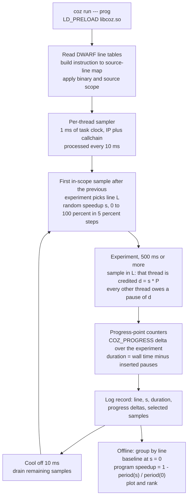

# Paper: Coz: Finding Code that Counts with Causal Profiling (Curtsinger and Berger 2015)

> [!summary] Claim:
> A conventional profiler ranks code by time spent, which says nothing about how much the program would speed up if that code were faster, because a concurrent program has a critical path that moves when you shorten part of it.
> Coz turns that into an experiment: it cannot make line L faster, so it makes everything else slower by the same relative amount, pausing every other thread for `d` each time a sample lands in L, which is a virtual speedup of `d / P` for sampling period `P`.
> It then reads the change in the rate of visits to a developer-placed progress point, measured over the experiment's duration minus the pauses it inserted, and plots program speedup against line speedup for hundreds of lines.
> The paper reports 17.6% mean overhead, predictions within 0.5 percentage points on the two cases where the real line speedup could be measured, and speedups of 2.56% to 68.4% (Table 3) from changes that were mostly under 10 lines.

This note owns the paper: the problem, the virtual-speedup derivation, the experiment protocol, the suspended-thread rules, the phase correction, the evaluation and its limits, and how the shipped tool (Coz v0.2.5) differs from the paper.
It hands the day-to-day workflow of choosing between on-CPU, off-CPU, and causal views to [[Off-CPU-Analysis-Thread-States-and-Causal-Profiling]], and hands sampling skid and bias to [[Sampling-vs-Instrumentation-Skid-and-Safepoint-Bias]].



## 1. Bibliographic Metadata

| Field | Value |
| :--- | :--- |
| Title | Coz: Finding Code that Counts with Causal Profiling |
| Authors | Charlie Curtsinger (Grinnell College; the work was initiated while a PhD student at UMass Amherst), Emery D. Berger (UMass Amherst) |
| Venue | SOSP '15, 25th ACM Symposium on Operating Systems Principles, Monterey, CA, October 4-7, 2015, pp. 184-197 |
| DOI | https://doi.org/10.1145/2815400.2815409 |
| Author copy | https://arxiv.org/abs/1608.03676 (arXiv:1608.03676v1, stamped 12 Aug 2016) |
| Later version | Communications of the ACM 61(6), pp. 91-99, 2018, https://doi.org/10.1145/3205911 (Crossref metadata only; this note did not read that text) |
| Award | The authors' project README states the paper received a Best Paper Award at SOSP 2015; this note relies on that statement only, because the SOSP 2015 proceedings and abstracts pages list the paper in the Concurrency and Performance session without an award label and the SIGOPS awards page lists no winners |
| Code | https://github.com/plasma-umass/coz, BSD 2-clause per the README, latest release v0.2.5 on 2026-02-16 |
| Funding | NSF grants CCF-1012195 and CCF-1439008; Curtsinger held a Google PhD Research Fellowship (paper acknowledgments) |

How the paper is organized, so you can find a claim: Section 2 is the experiment protocol, Section 3 the implementation (3.1 core mechanisms, 3.2 experiments, 3.3 progress points, 3.4 virtual speedups with 3.4.1 suspended threads, 3.4.2 sample attribution, 3.4.3 minimizing delays, then a subsection on phases), Section 4 the evaluation (4.1 setup, 4.2 case studies, 4.3 accuracy, 4.4 efficiency), Section 5 related work.
The number of the phases subsection did not survive text extraction of the arXiv PDF, so this note cites it by title.

## 2. The Core Problem

Profilers answer "where did the time go", and developers read the answer as "where should I optimize".
The paper's opening example is a program with two threads, `a()` spinning a volatile counter 2,000,000,000 times (about 6.7 s) and `b()` 1,900,000,000 times (about 6.4 s), joined by `main`.
`gprof` reports 55.2% of time in `a` and 45.19% in `b` (Figure 2a of the paper).
Removing `a` entirely can save at most the gap between the two threads, `1 - 6.4 / 6.7`, about 4.5%, because `b` then becomes the critical path, and removing `b` saves nothing.

Three properties of the conventional toolbox make this gap structural, not fixable by better sampling:

- **Time share is not benefit.**
  A flat or call-graph profile ranks by cumulative time.
  The paper's other example is a loading animation drawn during a download: it consumes real time and removing it speeds nothing up.
- **Concurrency moves the critical path.**
  Critical-path profilers (IPS, IPS-2, and later systems cited in Section 5.2) name the path but, in the paper's words, give no information about how much gain is possible before the path changes.
  Slack and logical zeroing (Hollingsworth and Miller) approximate that, but need a full program activity graph, which is costly to collect and perturbs the program.
- **Bottleneck tools see only explicit communication.**
  Lock-contention profilers see time blocked on locks.
  The paper argues causal profiling also measures problems from cache coherence, scheduling dependencies, and I/O, because it measures the effect on progress, not the cause of waiting.

The metric is also wrong for servers.
Execution time is the quantity a batch profiler reports, but a server or interactive application cares about throughput and latency, which a whole-run time share cannot express.

The motivating claim of the introduction is empirical: even tuned code leaves large wins, and developers cannot predict them from a time profile.
The evaluation backs this with benchmarks (PARSEC, Memcached, SQLite), and in three of them (dedup, ferret, SQLite) `gprof` and `perf` did not point at the lines that mattered (paper, Section 4.2).

## 3. Key Innovation

Causal profiling is an experimental method with two ideas.

**Virtual speedup.**
You cannot automatically make an arbitrary line faster by an arbitrary amount.
You can make everything else slower.
If line `f` runs `n_f` times and each time all other threads are paused for `d`, then total runtime grows by `n_f * d`, and subtracting that growth leaves the runtime you would have measured had `f` been `d` faster.
The relative effect on every other thread is the same as if `f` had shrunk, and the profiler measures that effect directly instead of modeling it.

**Progress points.**
A line marked as the end of a unit of work.
The causal profiler measures the rate of visits to it, so "faster" means "more units of work per unit of effective time".
Two progress points (begin and end of a transaction) give latency through Little's law without tracking individual requests.

What is new compared with earlier delay-based work: Mytkowicz et al. used delays to validate profilers on single-threaded Java programs, Snelick et al. used synthetic perturbations but needed an exponential number of full runs for combinations, and Active Dependence Discovery needed developers to insert perturbations manually (all in Section 5.3).
Coz runs the experiments inside one execution, over many lines, on unmodified binaries, using sampling in place of instrumentation.

## 4. Mechanism Details

### 4.1 The experiment protocol (Section 2 and 3.2)

A run is a sequence of experiments, each with two independent variables (a line `L`, a speedup `s`) and recorded dependent variables (progress-point visit counts and an effective duration).

1. **Startup.**
   `coz run --- <program>` preloads a runtime library, reads DWARF line information for the executable and loaded libraries (default scope: the main executable's source files), and builds an instruction-to-line map.
   A profiler thread is created and the program resumes.
2. **Select a line and a speedup.**
   The first thread to sample a line inside the scope sets it as the line for the next experiment, and the profiler thread draws a speedup from 0% to 100% in multiples of 5%.
   The paper requires both choices to be random because any systematic exploration biases the result.
   Its example: sweeping from small to large speedups per line would miss a line that matters only after warmup and would overstate a line that matters only during initialization.
   Note what "random line" means in the mechanism: the line is the first sample after the last experiment, so lines are chosen in proportion to time spent, and a line that is never sampled is never tested.
3. **Zero speedup is oversampled.**
   Program speedup for speedup `s` is `1 - p_s / p_0`, where `p_0` is the period between progress-point visits with no virtual speedup and `p_s` the period with speedup `s`.
   Every line needs its own `p_0`, so the paper picks `s = 0` with 50% probability and spreads the other 50% over the remaining amounts.
4. **Run.**
   The profiler thread snapshots every progress counter and starts the experiment.
   Each thread processes its samples, and a sample in `L` forces the other threads to pause (Section 4.2 of this note).
5. **End.**
   After a predetermined time, the profiler thread logs the end time, the total inserted delay, the number of samples in `L`, and the progress counters.
   If fewer than five progress-point visits occurred, which is the default minimum, the experiment length doubles for the rest of the run.
   The effective duration is the real runtime minus the total delay inserted.
6. **Cool off.**
   Coz waits ten sampling periods (10 ms) so samples from the finished experiment are processed before the next one begins.
   A longer cooloff reduces overhead (fewer delays) at the cost of fewer experiments per unit of profiling time.

### 4.2 Virtual speedup by sampling (Section 3.4)

Pausing on every execution of a line would be far too expensive and would distort the program, so Coz samples.
Let `P` be the sampling period, `t` the mean time one execution of `L` takes, and `n` the number of executions.

```text
samples in L:           s   ~=  n * t / P                        (paper Eq. 1)
effective mean time:    te   =  ((n - s) * t + s * (t - d)) / n  (paper Eq. 2)
                             =  t * (1 - d / P)                  (paper Eq. 3)
virtual speedup:        1 - te / t  =  d / P                     (paper Eq. 4)
```

The result is independent of `n` and `t`: a delay of a quarter of the sampling period per sample is a 25% virtual speedup of whatever line was sampled, however often it runs.
Only the sampled executions pay a delay, but sampling is unbiased in expectation, so the mean behaves as if every execution were shortened.

**Pausing without signals.**
Coz does not send signals to pause threads, because that is too expensive.
There is one global counter of delays every thread owes and one local counter per thread of delays already served.
A thread whose local count is behind the global count pauses and increments its local count.
To make everyone else pause, a thread increments both the global counter and its own local counter, so it never pauses for its own samples.
Each thread checks after processing its own samples.

**Minimizing delays (Section 3.4.3).**
If every thread executes `L` and each sample made all `T - 1` other threads pause, threads would pause `T - 1` times too often.
The invariant that must hold is: for each thread, the number of pauses plus the number of samples in `L` is the same.
So a sample in `L` increments only that thread's local count, and a thread whose local count exceeds the global count after processing raises the global count; threads behind the global count pause.

**Timing accuracy.**
`nanosleep` guarantees at least the requested time, not exactly it.
Coz tracks the excess pause time and subtracts it from future pauses.

**Thread creation.**
Coz interposes on `pthread_create`, starts sampling in the new thread, and copies the parent's local delay count to the child, because earlier pauses of the parent also delayed the child's creation.

**Sample attribution (Section 3.4.2).**
A sample whose instruction pointer is not in an in-scope line is attributed by walking the sampled call chain to the first in-scope frame.
A call to `printf` that reaches `vfprintf` and `strlen` is charged to the line that called `printf`.
This is why the paper compiled with `-fno-omit-frame-pointer`: the kernel's callchain unwinding on Linux depends on frame pointers.

### 4.3 Suspended threads (Section 3.4.1)

Coz samples and delays only a thread that is running, so required delays accumulate while a thread is suspended.
Two cases need opposite treatment:

- **Blocked on I/O.**
  The thread was not delaying anyone, so add the accumulated delays after it unblocks.
- **Blocked on a mutex or similar primitive.**
  Another thread had to unlock it.
  If that thread already executed all its required delays before unlocking, the waiter has effectively been delayed already and should add nothing.

The rule: a suspended thread woken by another thread is credited for the delays that thread inserted, otherwise it adds all accumulated delays.
Implementation: before any call that could block or wake another thread, force the thread to execute all delays owed.
The paper's Table 1 lists the potentially unblocking calls (`pthread_mutex_unlock`, `pthread_cond_signal`, `pthread_cond_broadcast`, `pthread_barrier_wait`, `pthread_kill`, `pthread_exit`) and Table 2 the potentially blocking calls (`pthread_mutex_lock`, `pthread_cond_wait`, `pthread_barrier_wait`, `pthread_join`, `sigwait`, `sigwaitinfo`, `sigtimedwait`, `sigsuspend`).
Ad hoc synchronization that does not suspend a thread (spinning on a flag) needs no special handling, because a spinning thread keeps running and keeps paying delays.

### 4.4 Progress points (Section 3.3)

| Kind | Mechanism | Notes |
| :--- | :--- | :--- |
| Source-level | `COZ_PROGRESS` macro inserted in the source | The only kind that needs program modification; the only kind the shipped tool supports |
| Breakpoint | `perf_event` breakpoint on the first instruction of a line given on the command line | Described in the paper; command-line points are disabled in v0.2.5 |
| Sampled | Counts samples falling in a command-line line | Percent change computable without exact counts; disabled in v0.2.5 |

**Latency via Little's law.**
With two progress points, the arrival rate `lambda` is the rate of visits to the start point, and the number in flight `L` is the difference between start and end counts.
Average latency is `W = L / lambda`.
The law needs a stable system (arrival rate not above service rate), which the paper argues holds for any usable system because an unstable one has unbounded latency.
It holds without assumptions about the arrival or service distributions, which is why Coz needs no per-request tracking.

### 4.5 Phase correction (Section 3.4, "Adjusting for phases")

Because a line is selected only when it is currently executing, an experiment on a line that runs only in one phase measures the effect during that phase and overstates the whole-program effect.
The paper splits execution into phase A (the line runs) and phase B (it does not), `T = tA + tB`.
Coz records samples in every line across the entire run.
With `s` samples in the line overall and `s_obs` of them inside experiments totalling `t_obs`:

```text
E[s_obs] = s * t_obs / tA          so   tA ~= s * t_obs / s_obs        (paper Eq. 6)
dP       = dp_A * tA / T  ~=  dp_A * (t_obs / s_obs) * (s / T)        (paper Eq. 8)
```

Coz multiplies every measured speedup `dp_A` by the correction factor `(t_obs / s_obs) * (s / T)` in its final report.

Worked arithmetic (a one-thread illustration, not a measurement): a run of `T = 100 s` where a line executes only in a 20 s phase gives `s = 20,000` samples at 1 ms.
Experiments covering `t_obs = 5 s` collect `s_obs = 5,000` samples, so `tA ~= 20,000 * 5 / 5,000 = 20 s`.
If the in-phase speedup `dp_A` is 30%, the reported speedup is `30% * (5 / 5,000) * (20,000 / 100) = 30% * 0.2 = 6%`.

### 4.6 Producing the causal profile (Section 2)

- Combine experiments with the same `(line, speedup)` by adding progress visits and effective durations.
- Discard lines with no `s = 0` measurement.
  Measuring the baseline per line guarantees that line-dependent overhead (for example, cross-thread communication when a frequently-executed line triggers many delays) does not skew the result.
- Discard lines with fewer than five distinct speedup amounts by default.
- Program speedup for each grouped experiment is the percent change in the rate of progress-point visits against the baseline.
- Rank by the slope of the linear regression through the points.
  A steep positive slope means optimizing the line helps.
  A flat line means it does not.
  A **negative slope** means optimizing the line would hurt, and the paper reads this as contention: the line interferes with the critical path, and speeding it up increases the interference.
  The paper calls this "surprisingly common" and finds it in fluidanimate, streamcluster, and Memcached.

### 4.7 Worked example: the paper's Figure 1, by arithmetic

This reproduces the logic of Figure 2b using the paper's rounded timings (6.7 s and 6.4 s), as a hand calculation with `P = 1 ms`.
No profiler was run to produce these numbers, and the exact values in Figure 2b are in the paper.

The model: virtually speeding up a line in thread `X` by fraction `s` credits `X` and makes the other thread pause for `s * t_X` in total (one `s * P` per sample, `t_X / P` samples).
Measured wall time is the longer of the two threads, and Coz subtracts the total inserted delay.

| Line | Virtual speedup `s` | Total delay inserted | Wall time | Effective time | Program speedup |
| :--- | :--- | :--- | :--- | :--- | :--- |
| in `a` (6.7 s) | 2% | 0.134 s | `max(6.7, 6.4 + 0.134) = 6.7 s` | `6.7 - 0.134 = 6.566 s` | 2.0% |
| in `a` | 4.48% | 0.300 s | `max(6.7, 6.4 + 0.3) = 6.7 s` | `6.4 s` | 4.48% |
| in `a` | 10% | 0.670 s | `max(6.7, 6.4 + 0.67) = 7.07 s` | `7.07 - 0.67 = 6.4 s` | 4.48% |
| in `a` | 100% | 6.700 s | `6.4 + 6.7 = 13.1 s` | `13.1 - 6.7 = 6.4 s` | 4.48% |
| in `b` (6.4 s) | any `s` | `6.4 * s` | `6.7 + 6.4 * s` (a is paused) | `6.7 s` | 0% |

The curve for `a` rises with slope 1 until `s = 1 - 6.4/6.7 = 4.48%`, then flattens, exactly the knee a critical-path argument predicts.
The curve for `b` is flat at zero.
The paper states that Coz predicts both outcomes within 0.5%.

### 4.8 What the shipped tool does differently (Coz v0.2.5, as of 2026-11)

The paper is a 2015 prototype on Linux 3.14.
These differences come from reading the v0.2.5 sources (`libcoz/profiler.h`, `libcoz/profiler.cpp`, `libcoz/libcoz.cpp`, the `coz` script, `viewer/ts/profile.ts`); none were run for this note, which was written on a macOS host where the Linux runtime does not execute.

| Topic | Paper (SOSP 2015) | v0.2.5 source | Platform |
| :--- | :--- | :--- | :--- |
| Sampling | `perf_event` sampling of IP and user call stack every 1 ms, batches of 10 | `perf_event_attr` with `PERF_TYPE_SOFTWARE`, `PERF_COUNT_SW_TASK_CLOCK`, `PERF_SAMPLE_IP \| PERF_SAMPLE_CALLCHAIN`, `sample_period = 1000000` ns, `exclude_kernel`, `exclude_idle`; a per-thread POSIX timer on `CLOCK_THREAD_CPUTIME_ID` delivering `SIGPROF` every 10 ms drains the batch | Linux |
| Zero-speedup share | 50% of experiments | a uniform draw over 0 to 27 (`ZeroSpeedupWeight + SpeedupDivisions` = 7 + 20, inclusive); values 0 to 7 mean zero speedup, so 8 of 28, about 28.6% (the source comment says about 25%) | Both |
| Speedup grid | multiples of 5% | `SpeedupDivisions = 20`, delay `(r - 7) * SamplePeriod / 20`, so 50 us steps up to 1 ms | Both |
| Experiment length | predetermined, doubled when under 5 visits | starts at 500 ms (`SamplePeriod * SampleBatchSize * 50`), doubles when the minimum visit delta is under 5 (capped at 16 times 500 ms, 8 s), halves when the delta exceeds 10 and the length is at least 1 s; experiments with under 5 visits are not written to the log | Both |
| Delay accounting | counts of pauses | `local_delay` and `_global_delay` in nanoseconds; a thread behind the global value pauses for the difference with its sampler stopped and adds the time it actually waited, so oversleep is absorbed | Linux |
| Sample attribution | first in-scope frame of the call chain | the sample's own line, else the first in-scope frame; a sample counts as a hit on the selected line if any frame of its call chain resolves to the selected line, so the selected line is charged for its in-scope callees too | Both |
| Blocking calls | Tables 1 and 2 | adds `pthread_rwlock_*lock`, `pthread_tryjoin_np`, `pthread_timedjoin_np`, `pthread_cond_timedwait` (delays are skipped after it only if the wait did not time out), `pthread_sigqueue`, and `kill` aimed at the own process; `exit`, `_exit`, and `_Exit` are wrapped to shut the profiler down | Linux |
| Reserved signals | not discussed | for `SIGPROF`, `SIGSEGV`, and `SIGABRT`, `sigaction` returns 0 without installing the handler, `signal` returns `NULL` without installing it, and `sigprocmask` and `pthread_sigmask` strip the three signals from `SIG_BLOCK` and `SIG_SETMASK` sets (`libcoz.cpp`, `is_coz_signal`, `remove_coz_signals`) | Linux |
| Custom locks | not discussed | `COZ_PRE_BLOCK`, `COZ_POST_BLOCK(skip)`, and `COZ_CATCH_UP` macros in `coz.h` for futex-based or library-internal synchronization Coz does not intercept | Both |
| Phase correction | applied to the final report | the runtime logs `samples` and `runtime` records, but the viewer's `profile.ts` handles them in a "do nothing" branch and `calculate_speedups` in the `coz` script does not use them | Both |
| Baseline, filtering, ranking | discard lines without an `s = 0` point or with under 5 speedup amounts; rank by regression slope | the viewer still requires the zero-speedup point but sorts by "impact" (normalized area), maximum, or minimum speedup, with a user-set minimum point count; `coz plot --text` (`calculate_speedups(data, min_points=1, min_delta=5)`) falls back to the lowest speedup with at least 5 visits as the baseline when `s = 0` is missing and sorts by maximum speedup | Both |
| Command-line progress points | breakpoint and sampled | disabled: `--progress` is marked NOT SUPPORTED, the runtime aborts with "Sampling-based progress points are temporarily unsupported", and the README says the feature "did not work particularly well" | Both |
| Output | tab-separated records, a `.coz` profile | JSON Lines, written to `profile.jsonl` by default; `--legacy-format` switches the record format to tab-separated but does not rename the file | Both |
| Platforms | Linux x86-64 | Linux with `perf_event_open`; a macOS port using Apple's private kperf framework arrived in 0.2.4 (2026-02-15), needs elevated privileges or SIP changes, and uses signal-based delay application driven by the profiler thread | Linux, macOS |

Two consequences deserve emphasis:

- **The selected line is inclusive.**
  Because a sample on any frame of the call chain that resolves to the selected line triggers the delay, a virtual speedup of a line that calls a heavy function speeds up the callee's time as well.
  Read a hot line in a causal profile as "this statement and everything it calls", not "this instruction".
- **The paper's phase correction is not applied by the shipped consumer.**
  If a program has strong phases, treat a steep curve for a line that runs in a short phase as an upper bound on the whole-run benefit, and use `--fixed-line` and `--fixed-speedup` runs over the whole execution to check.

## 5. Evaluation and Limitations

### 5.1 Setup (Section 4.1)

- Hardware: a 64-core, four-socket AMD Opteron machine with 60 GB of memory, Linux 3.14.
- Build: GCC 4.9.1 at `-O3`, with debug information (`-g`) and `-fno-omit-frame-pointer`.
- Coz: default 1 ms sampling period, processing after every 10 samples, 10 ms cooloff.
- Only throughput was profiled, not latency: the paper states that space limitations prevented evaluating latency profiling.

### 5.2 Effectiveness: Table 3 and the case studies (Section 4.2)

Each speedup was measured over ten runs before and after the change, with standard error by Efron's bootstrap and significance at the 99.9% level (alpha = 0.001) by a one-tailed Mann-Whitney U test, which assumes nothing about the distribution of run times.

| Application | Speedup | Diff size (lines removed, added) | What Coz pointed at |
| :--- | :--- | :--- | :--- |
| blackscholes | 2.56% +- 0.41% | -61, +4 | Many lines in `CNDF` and `BlkSchlsEqEuroNoDiv`, each with a small effect; merging 61 piecewise calculations into 4 expressions |
| dedup | 8.95% +- 0.27% | -3, +3 | The top of the loop that walks a hash bucket chain at `hashtable.c:217` |
| ferret | 21.27% +- 0.17% | -4, +4 | Lines in the indexing, ranking, and segmentation stages, none in feature extraction; thread reallocation |
| fluidanimate | 37.5% +- 0.56% | -1, +0 | Two lines in a custom barrier, with a downward-sloping profile |
| streamcluster | 68.4% +- 1.12% | -1, +0 | The same custom barrier |
| swaptions | 15.8% +- 1.10% | -10, +16 | Nested loops over a large multidimensional array |
| Memcached | 9.39% +- 0.95% | -6, +2 | The lock at the start of `item_remove`, downward-sloping |
| SQLite | 25.60% +- 1.00% | -7, +7 | Prologues of `sqlite3MemSize`, `pthreadMutexLeave`, `pcache1Fetch` |

The three outcome classes the paper identifies:

1. **Coz found what `gprof` and `perf` did not (dedup, ferret, SQLite).**
   In dedup, the hash function mapped keys to only 2.3% of the buckets (over 97% never used).
   Removing a bit-shifting step raised utilization to 54.4%, and XOR-ing 32-bit chunks of the key raised it to 82.0%.
   `gprof` ranked `hashtable_search` highest at 14.38% of time, but calls from the hash computation stage were 0.48%, so its call graph hid the importance.
   In SQLite, `perf` showed the three functions Coz flagged accounting for 0.15% of runtime in total, while Coz predicted that speeding them up up to about 25% would help and beyond that would hurt.
   Replacing indirect calls through function-pointer structs with direct calls gave 25.6%.
   `gprof` segfaulted on SQLite immediately (paper, Section 4.2.3).
2. **Coz found contention (fluidanimate, streamcluster, Memcached).**
   The custom barrier spun on `pthread_mutex_trylock`.
   Replacing it with the stock `pthread_barrier` implementation was a one-line change worth 37.5% and 68.4%.
   In Memcached, a static array of locks guarded items by key hash, so unrelated items contended; because reference counts are updated atomically, the lock in `item_remove` could be dropped.
3. **Coz and a conventional profiler agreed (blackscholes, swaptions).**
   The blackscholes hotspot had been reported earlier by ParaShares, the only previously reported one among the paper's optimizations.

Case-study effort reported: for dedup, one graduate student initially unfamiliar with the code spent two hours on profiling and tuning in total; the paper says ferret was also done by one graduate student new to the code, but gives the two-hour figure only for dedup (Section 4.2.1).
Coz identified roughly 20 lines of interest per application, up to about 50 for Memcached and x264.
For the PARSEC programs not optimized (bodytrack, canneal, facesim, freqmine, raytrace, vips, x264), Coz still found opportunities, but some needed more invasive changes than the authors attempted (Table 4).
Patches were submitted to the developers of every application optimized.

### 5.3 Accuracy (Section 4.3)

The prediction can be checked against reality only when you can measure how much the real optimization sped up the specific line Coz named.
The paper does this for two of the eight case studies:

| Case | Real effect on the named line | Coz predicted | Observed |
| :--- | :--- | :--- | :--- |
| ferret | indexing threads from 16 to 22 raised throughput at line 320 by 27% | 21.4% program speedup | 21.2% (Table 3 reports 21.27%) |
| dedup | average bucket chain from 76.7 to 2.09 entries, loop iterations 77.7 to 3.09, a 96% speedup of the line | about 9% | 8.95% |

For the other six, the paper cannot quantify the effect on the specific line, so the check is directional (the fix Coz led to worked).

### 5.4 Efficiency (Section 4.4)

Measured on the PARSEC benchmarks with native inputs, except streamcluster with test inputs (execution time was excessive otherwise), by running four configurations: baseline, Coz exiting after startup, Coz sampling with no delays, Coz fully enabled.

| Component | Share of mean overhead |
| :--- | :--- |
| Startup (processing debug information) | 2.6% |
| Sampling and attributing samples | 4.8% |
| Delays for virtual speedups | 10.2% |
| Total mean | 17.6% (minimum 0.1%, maximum 65%) |

The introduction rounds the mean to 17%; the evaluation says 17.6%.
For all but three benchmarks overhead was under 30%.
Mean running time was 103 s, enough to amortize debug-information processing, though x264 and vips with large executables are expensive at startup.
The comparison point: `gprof` reached 6x overhead (ferret) versus 6% for Coz on the same program.
The authors name possible reductions: lazy debug-information processing, sampling globally (needs root) instead of per thread, and longer gaps between experiments, which trades overhead for longer profiling runs.

### 5.5 Limits and unaddressed constraints

- **Validated on two of eight.**
  Prediction accuracy was checked on dedup and ferret only.
  For contention cases (the largest wins) the fix was a different change from "make the line faster", so the quantitative prediction was never tested.
- **Latency was not evaluated.**
  The Little's-law path is described but the paper's experiments cover throughput only.
- **Virtual speedup assumes a line's speedup has no side effects.**
  A real optimization can change cache footprint, memory traffic, or branch behavior of other code, and a virtual one cannot.
  Pausing a thread can also change time-dependent behavior (timeouts, rate limiters, timed waits).
  The paper does not quantify either effect.
- **Only running threads are sampled.**
  The sampler counts task-clock time, so time a thread spends blocked in a syscall is not sampled; this is a consequence of the mechanism, and it means Coz cannot virtually shorten a wait.
- **Line selection is time-weighted.**
  A line with a small share of samples gets few experiments.
  Arithmetic extrapolation, not a measurement: with v0.2.5's 500 ms minimum and 10 ms cooloff the ceiling is about 1.96 experiments per second, about 117 per minute, and a line holding 1% of samples is chosen in about 1% of them, roughly one experiment a minute, of which about 29% are zero-speedup.
  Collecting five distinct non-zero speedups plus a baseline for such a line takes a long run, which matches the README's warning that sample programs may need several runs.
- **Progress point choice is the user's burden.**
  A badly placed point measures the wrong thing (see the debug-this question below).
- **Scope.**
  The paper's tool targets native Linux binaries with DWARF; the README says Coz does not support interpreted or JIT-compiled languages such as Python, Ruby, or JavaScript, and "will likely not" support interpreted ones.

> [!warning] Pitfalls:
> - A curve that is flat for a hot line is the expected, useful answer, not a failed profile: the line is off the critical path or the progress point is not downstream of it.
> - A downward curve means contention, not a slow line: the fix is to reduce interference (remove a spin, shard a lock), not to micro-optimize the line.
> - Reading a v0.2.5 profile with `--source-scope` too narrow hides the lines that matter; scope should be exactly the code you are willing to change.
> - Do not compare curves across progress points of different meaning; each progress point has its own baseline period.
> - Programs that install handlers for `SIGPROF`, `SIGSEGV`, or `SIGABRT` (profilers, crash reporters, runtimes) silently lose them under Coz, because `sigaction` returns 0 and `signal` returns `NULL` without installing the handler (v0.2.5 `libcoz.cpp`).
> - Custom futex or spin-then-park locks that Coz does not intercept break the suspended-thread rule; wrap them in `COZ_PRE_BLOCK` and `COZ_POST_BLOCK`, and call `COZ_CATCH_UP` before releasing.
> - Frame pointers off means callchains unwind badly, which mis-attributes samples from out-of-scope code to the wrong in-scope line.

## 6. Industry Impact

What can be said with evidence:

- The tool is maintained and released: v0.2.3 (2026-01-02), 0.2.4 (2026-02-15, macOS port and browser-viewer AI suggestions), v0.2.5 (2026-02-16), packaged as `.deb`, `.rpm`, and tarballs per the README.
- Ports and wrappers exist for other ecosystems, per the README: JCoz for Java, Cozgo for Go, Swift Coz for Swift, and a Rust crate (the README shows a crates.io badge).
  The note did not audit their maturity or fidelity to the paper's protocol.
- The method is cited in the vault's own methodology notes as the third leg of a diagnosis sequence after on-CPU and off-CPU views; see [[Off-CPU-Analysis-Thread-States-and-Causal-Profiling]].

What this note cannot support: claims about fleet-scale production deployment.
No public report of Coz running in continuous production profiling is cited here, and the authors' own ;login: article calls it "a prototype causal profiler for Linux"; the fleet-scale canon in this pillar ([[Paper-Google-Wide-Profiling]], [[Paper-AutoFDO-Warehouse-Scale-Optimization]]) is sampling-for-ranking and sampling-for-compiler-feedback, not causal.

The conceptual lineage matters more than adoption numbers:

| Question | Tool family | Output |
| :--- | :--- | :--- |
| Where does time go? | Sampling profilers, flame graphs ([[Paper-The-Flame-Graph-Gregg]]) | Share of samples per stack |
| Where does it go across a fleet, continuously? | [[Paper-Google-Wide-Profiling]] | Aggregated sampled profiles |
| What should the compiler do given those samples? | [[Paper-AutoFDO-Warehouse-Scale-Optimization]] | Optimized binary, no developer in the loop |
| What would my change buy end to end? | Coz | Predicted progress-rate change per line and speedup |
| Is my measurement even trustworthy? | [[Paper-Producing-Wrong-Data-Measurement-Bias]] | Setup and layout bias in comparisons |

Coz is also an instance of the discipline in the measurement-bias paper: it replaces an unverified inference (this line is hot, so optimizing it helps) with a controlled experiment, and it reports uncertainty as standard error.
Note that the Coz paper cites Mytkowicz et al.'s 2010 PLDI paper on the accuracy of Java profilers (a different paper from the 2009 ASPLOS one this pillar owns) for the point that sampling must be unbiased, and cites Stabilizer (Curtsinger and Berger, ASPLOS 2013) for the motivation that compiler optimization alone does not meet developers' demands.

## 7. Concept Grounding

| Concept note | What it takes from this paper |
| :--- | :--- |
| [[Off-CPU-Analysis-Thread-States-and-Causal-Profiling]] | The working procedure: when to reach for causal profiling after on-CPU and off-CPU views, with v0.2.5 numbers |
| [[Sampling-vs-Instrumentation-Skid-and-Safepoint-Bias]] | Why the virtual-speedup identity needs unbiased samples, and how skid mis-assigns a sample to a neighboring line |
| [[Statistics-for-Benchmarks-Coordinated-Omission-and-HDR-Histograms]] | The paper's evaluation statistics: bootstrap standard error, one-tailed Mann-Whitney U over ten runs |
| [[Linux-perf-in-Depth-and-perf-c2c]] | The `perf_event_open` software task-clock sampler with callchains that Coz is built on |
| [[DWARF-Debug-Information-and-Symbol-Bundles]] | The instruction-to-line map and the gdb-style search for separate debug information |
| [[Dynamic-Linking-PLT-GOT-and-Loaders]] | `LD_PRELOAD` interposition of the `pthread_*` and signal functions |
| [[Signals-Process-Groups-Sessions-and-Job-Control]] | The `SIGPROF` handler and the signal-mask wrappers Coz installs |
| [[Drill-Profiling-False-Sharing-Cache-Contention]] | A contention bug of the downward-sloping kind |
| [[Continuous-Profiling-GWP-Parca-Pyroscope-and-OTel-Profiles]] | The always-on sampled alternative; contrast with Coz's experiment-based profile |

## Practice Drill

> [!tip] Practice Drill:
> On a Linux x86-64 host with Coz installed (not run for this note), compile a two-thread program shaped like the paper's Figure 1 with `-g -O2 -fno-omit-frame-pointer`, a `COZ_PROGRESS` after each thread's loop iteration batch, and run it:
>
> ```sh
> sudo sh -c 'echo 1 >/proc/sys/kernel/perf_event_paranoid'   # per the Coz README
> coz run --- ./two_threads
> coz plot --text
> ```
>
> Predict first, from the arithmetic in the worked example, where each curve flattens.
> Then change one loop's iteration count so the threads are balanced and confirm both curves rise.
> Finally move the progress point to the start of the loop body and observe what changes.
> A macOS host runs the experiment only through the 0.2.4+ kperf port, which needs elevated privileges.

## Interview Questions

### L5

> [!question] 1. Why can a profiler that is perfectly accurate still send you after the wrong code?
> [!success]- Answer
> An accurate time profile reports where time was spent, not what would change if that code were faster.
> In a concurrent program the critical path moves: in the paper's two-thread example `gprof` shows 55.2% in `a` and 45.19% in `b`, but removing `a` entirely speeds the program up only about 4.5% because `b` becomes the critical path, and removing `b` gains nothing.
> Causal profiling measures the benefit directly by experiment.

> [!question] 2. What is a progress point, and why does Coz need one?
> [!success]- Answer
> A source line (placed with `COZ_PROGRESS`) marking the end of a unit of work, such as a completed request.
> Coz measures the rate of visits to it, so "faster" is defined as more units of work per unit of effective time.
> Without a progress point there is no metric to improve; with two (`COZ_BEGIN` and `COZ_END`) Coz measures latency through Little's law.

> [!question] 3. Predict the output (progress point after a join).
> Each iteration of an outer loop spawns thread A (10 ms of work) and thread B (8 ms), joins both, and then executes `COZ_PROGRESS`.
> Coz virtually speeds up a line that is 100% of thread A's time.
> What program speedup does the curve reach, and what happens for a line that is 100% of B's time?
> [!success]- Answer
> The time per iteration is `max(10, 8) = 10 ms`.
> Speeding up A by `s` gives `max(10 * (1 - s), 8)` ms, so the speedup is `s` until `s = 20%` (when A reaches 8 ms) and then stays at 20%, because `1 - 8/10 = 20%`.
> The B curve is flat at 0%, because shortening B never changes the maximum.
> In Coz's accounting, a sample in A's line credits A and pauses B, and effective time is wall time minus inserted delay, which gives the same numbers as the calculation in the worked example.

### L6

> [!question] 4. Derive why pausing other threads for `d` per sample in a line is a speedup of `d / P` for that line.
> [!success]- Answer
> With `n` executions of mean time `t`, sampling period `P`, the line collects `s = n * t / P` samples.
> Only sampled executions are treated as `d` faster, so the effective mean is `((n - s) * t + s * (t - d)) / n`.
> Substituting `s`, this equals `t * (1 - d / P)`, so the relative speedup is `d / P`, independent of `n` and `t`.
> A delay of a quarter of the sampling period is a 25% speedup.
> The pauses added `s * d` to total runtime across threads, and Coz subtracts that from the measured duration.

> [!question] 5. Why does every line need its own zero-speedup baseline, and why is zero speedup oversampled?
> [!success]- Answer
> Program speedup is `1 - p_s / p_0`, so you cannot compute any speedup without `p_0` for the same line.
> A shared baseline would hide line-dependent overhead: a line executed very often adds sampling and cross-thread communication cost that other lines do not.
> The paper draws `s = 0` with 50% probability for this reason; v0.2.5's code gives 8 of 28 draws, about 28.6%.

> [!question] 6. Debug this (flat worker lines).
> A request server marks `COZ_PROGRESS` where the acceptor thread enqueues each request onto an unbounded queue.
> The profile shows every worker-side line flat and only the acceptor's lines rising.
> Why?
>
> ```c
> void* acceptor(void* arg) {
>   for (;;) {
>     req_t* r = accept_request();
>     queue_push(&q, r);       /* unbounded */
>     COZ_PROGRESS;            /* progress point here */
>   }
> }
> void* worker(void* arg) {
>   for (;;) {
>     req_t* r = queue_pop(&q);
>     handle(r);
>     send_reply(r);
>   }
> }
> ```
> [!success]- Answer
> The progress point measures arrivals into an unbounded queue, and the acceptor's rate does not depend on how fast workers drain it, so speeding up worker code cannot change the measured rate.
> The curve is flat for worker lines by construction.
> Place the point after `send_reply` (throughput of completed requests), or use `COZ_BEGIN("req")` at enqueue and `COZ_END("req")` after `send_reply` to measure latency, which depends on worker speed through Little's law.
> The general rule: the progress point must be downstream of the work you want to speed up.

> [!question] 7. A line's causal profile slopes downward. What does that tell you and what do you do about it?
> [!success]- Answer
> Optimizing the line would slow the program.
> The paper reads it as contention: the line interferes with the critical path (for example, spinning on `pthread_mutex_trylock` before entering a custom barrier), and making it faster increases the interference.
> You do not optimize the line; you reduce the interference, as in the paper's fluidanimate and streamcluster fixes (replace the custom barrier with `pthread_barrier`, 37.5% and 68.4%) or Memcached (drop an unneeded lock, 9.39%).

### L7+

> [!question] 8. Explain the suspended-thread rule, and what goes wrong if Coz skips the catch-up before `pthread_mutex_unlock`.
> [!success]- Answer
> Delays owed accumulate on a thread while it is blocked, because Coz only delays running threads.
> If the blocked thread was woken by another thread, that waker has already executed its own owed delays, so the waiter is credited for them and must not pay again.
> That requires the waker to have executed all delays before it unlocks.
> If a thread unlocked while still owing delays, the waiter would be credited for delays the waker never served before waking it, so the work flowing through that lock would carry fewer pauses than the global delay Coz subtracts (v0.2.5 computes `duration = elapsed - experiment_delay` from the global counter), the effective duration would be understated, and the predicted program speedup for the selected line would be biased upward.
> Zero-speedup experiments insert no delays, so the baseline itself is unaffected; the error grows with the speedup amount and distorts the curve's slope.
> Hence Coz forces catch-up before unblocking calls (unlock, signal, broadcast, barrier, kill, exit) and skips owed delays after the blocking calls return.
> For timed waits that time out, the thread was not woken by anyone, so v0.2.5 does not skip the delays.

> [!question] 9. The paper validates predictions on two of its eight case studies.
> How much should you trust a single curve, and how would you design a stronger validation?
> [!success]- Answer
> The two validated cases (ferret and dedup) are the ones where the real optimization changes the named line by a quantity you can measure independently (thread count and bucket chain length).
> The contention cases cannot be validated that way because the fix is not "make that line faster".
> A single curve is a good ranking signal and a calibrated estimate under the model's assumptions (no side effects of speeding a line, delays do not change time-dependent behavior), but not a guarantee.
> A stronger validation: choose optimizations whose effect on the line is controllable (synthetic busy-loop shortening, thread-count changes, fixed spin counts), run the real change over many runs with bootstrap error as the paper does, and compare predicted against observed across the whole curve, not one point.
> Include programs with timed waits and phase behavior to measure the bias the assumptions introduce.

> [!question] 10. Phases.
> A service has a warmup phase and a steady phase.
> A causal profile ranks a line in the warmup code at the top with a steep curve.
> What do you check, and why?
> [!success]- Answer
> Lines are selected only while executing, so an experiment on a warmup-only line measures benefit during that phase and overstates the whole-run effect.
> The paper corrects with the factor `(t_obs / s_obs) * (s / T)`, which estimates the phase's share of the run from sample counts, but v0.2.5's viewer and `coz plot --text` do not apply it (the runtime still logs the `samples` and `runtime` records), so you must do it yourself or avoid the issue.
> Practical steps: read the logged sample counts and runtime to estimate the phase share, put the progress point in the steady phase, or use `--fixed-line` with a fixed speedup across the whole execution.

> [!question] 11. Where does the virtual speedup model break, and how would you extend causal profiling to a program dominated by I/O waits or a distributed request path?
> [!success]- Answer
> It breaks where the assumptions fail: speeding up a line is assumed to have no effect beyond that line's duration (real optimizations change cache and memory behavior), pausing others is assumed not to alter time-dependent logic, and only running threads are sampled, so a blocked wait cannot be virtually shortened.
> For I/O-bound programs a delay-injection or off-CPU-attributed approach is needed (see [[Off-CPU-Analysis-Thread-States-and-Causal-Profiling]]).
> For distributed paths, a faithful extension would virtually speed up a span by delaying all concurrent work in the other services and measure end-to-end throughput or latency at a service boundary; the trace infrastructure in [[Paper-Dapper-Distributed-Systems-Tracing]] supplies the span identity, but the pause propagation, clock skew, and baseline-per-span costs are open design problems, not solved by this paper.

> [!question] 12. When would you refuse to use Coz and choose a different tool?
> [!success]- Answer
> Single-threaded or CPU-bound code with no concurrency, where a time share does predict benefit and a flame graph ([[Paper-The-Flame-Graph-Gregg]]) is cheaper.
> Interpreted or JIT-compiled languages, which the README says Coz does not support.
> Statically linked or otherwise preload-incompatible binaries, where the runtime cannot be injected (see [[Dynamic-Linking-PLT-GOT-and-Loaders]]).
> Programs that need their own `SIGPROF`, `SIGSEGV`, or `SIGABRT` handlers, which Coz's wrappers suppress.
> Hosts that forbid `perf_event_open` for the user (see the numbers table).
> For fleet-wide ranking and compiler feedback use [[Paper-Google-Wide-Profiling]] and [[Paper-AutoFDO-Warehouse-Scale-Optimization]].

## Commands and Numbers to Know

| Item | Value | Platform | Source |
| :--- | :--- | :--- | :--- |
| Run | `coz run --- ./prog args` (flags `--source-scope`/`-s`, `--binary-scope`/`-b`, `--output`/`-o`, `--end-to-end`, `--fixed-line`, `--fixed-speedup` 0-100, `--verbose`, `--legacy-format`) | Linux, macOS (as of 2026-11) | v0.2.5 `coz` script |
| View | `coz plot` (browser), `coz plot --text`, `coz plot -i profile.jsonl`, `--json` | Both (as of 2026-11) | README and CLI |
| Default output file | `profile.jsonl` in the current directory (JSON Lines); `--legacy-format` changes the record format, not the name; the bare runtime falls back to `profile.coz` when `COZ_OUTPUT` is unset | Both (as of 2026-11) | v0.2.5 `coz` script and `libcoz.cpp` |
| Source macros | `COZ_PROGRESS`, `COZ_PROGRESS_NAMED("n")`, `COZ_BEGIN("n")`, `COZ_END("n")`; link with `-ldl` per the README | Both (as of 2026-11) | `include/coz.h`, README |
| Build requirement | `-g` (DWARF 5 supported per README), frame pointers kept (`-fno-omit-frame-pointer`, paper) | Linux | README, paper 4.1 |
| `perf_event_paranoid` | README tells you to set it to 1, and that is required: Coz v0.2.5 opens per-thread `PERF_TYPE_SOFTWARE` / `PERF_COUNT_SW_TASK_CLOCK` events with `exclude_kernel = 1` but also `PERF_SAMPLE_CALLCHAIN` and never sets `exclude_callchain_kernel`; kernel `perf_event_open` in `kernel/events/core.c` calls `perf_allow_kernel()` for any callchain sample that does not exclude kernel frames, and `perf_allow_kernel()` returns `-EACCES` when the sysctl is above 1 and the caller lacks `CAP_PERFMON`; so at the default of 2 an unprivileged `coz run` is expected to fail to open its sampler (read from source, not run) | Linux (as of 2026-11, kernel master) | README, `kernel.rst`, v0.2.5 `profiler.cpp`, kernel `kernel/events/core.c` |
| Sampling | 1 ms, batch 10, 10 ms processing interval | Linux, v0.2.5 (as of 2026-11) | `profiler.h` |
| Speedup grid | 0 to 100% in 5% steps, 50 us delay per step | Both, v0.2.5 (as of 2026-11) | `profiler.h` |
| Zero-speedup share | 8 of 28 draws (paper: 50%) | Both, v0.2.5 (as of 2026-11) | `profiler.cpp` |
| Experiment length | at least 500 ms, up to 8 s, at least 5 visits to emit | Both, v0.2.5 (as of 2026-11) | `profiler.h`, `profiler.cpp` |
| Paper overhead | mean 17.6%, min 0.1%, max 65% | Linux 3.14, 64-core Opteron, 2015 | paper 4.4 |
| Paper accuracy | ferret 21.4% predicted, 21.2% observed; dedup 9% predicted, 8.95% observed | Linux 3.14, 2015 | paper 4.3 |
| Unsupported | interpreted and JIT languages; command-line progress points | Both (as of 2026-11) | README |

## Further Reading

- Curtsinger and Berger, "Coz: Finding Code that Counts with Causal Profiling", SOSP '15, https://doi.org/10.1145/2815400.2815409: the primary text; Section 3.4 and the phases subsection are the parts to reread.
- The arXiv author copy, https://arxiv.org/abs/1608.03676: free, and the version used for citations here.
- Coz source at v0.2.5, https://github.com/plasma-umass/coz/tree/v0.2.5: `libcoz/profiler.cpp` for the experiment loop and delay accounting, `libcoz/libcoz.cpp` for the interposed `pthread_*` and signal functions, `include/coz.h` for the macros.
- `perf_event_open(2)`, https://man7.org/linux/man-pages/man2/perf_event_open.2.html: the sampling interface and `PERF_COUNT_SW_TASK_CLOCK`.
- Kernel `kernel.rst` sysctl documentation, https://github.com/torvalds/linux/blob/master/Documentation/admin-guide/sysctl/kernel.rst: `perf_event_paranoid` levels and `perf_event_max_stack` (default 127).
- Kernel `kernel/events/core.c`, https://github.com/torvalds/linux/blob/master/kernel/events/core.c: `perf_allow_kernel()` and `perf_allow_cpu()` and the callchain check in `perf_event_open`.
- Little, "Little's Law as Viewed on Its 50th Anniversary", Operations Research 59(3), 2011: the result behind the latency mode (reference 30 in the paper).
- Hollingsworth and Miller, "Slack: a new performance metric for parallel programs", 1994: the metric closest to a causal profile that needs a full activity graph (reference 22 in the paper).

## Related

- Prerequisites: none
- Next: [[Paper-AutoFDO-Warehouse-Scale-Optimization]]
- See also: [[Off-CPU-Analysis-Thread-States-and-Causal-Profiling]], [[Sampling-vs-Instrumentation-Skid-and-Safepoint-Bias]], [[Paper-Producing-Wrong-Data-Measurement-Bias]], [[Paper-Google-Wide-Profiling]], [[Paper-The-Flame-Graph-Gregg]], [[Paper-Dapper-Distributed-Systems-Tracing]], [[Linux-perf-in-Depth-and-perf-c2c]], [[Drill-Profiling-False-Sharing-Cache-Contention]]
