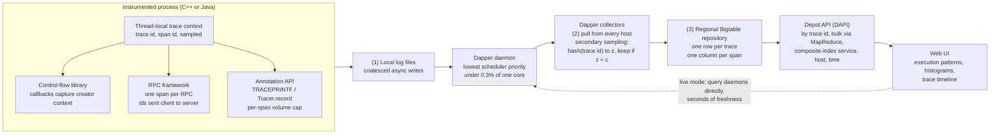

# Paper: Dapper, a Large-Scale Distributed Systems Tracing Infrastructure (Sigelman et al. 2010)

> [!summary] Claim:
> Dapper traced nearly every production process at Google by instrumenting only three shared libraries: thread-local trace context, a callback library that carries that context across asynchronous hops, and the one RPC framework that forwards trace and span ids from client to server.
> Its data model is a tree of spans, each span a log of timestamped client and server events plus optional annotations, all tied together by a probabilistically unique 64-bit trace id.
> Spans are written to local log files and collected out of band by a per-host daemon into one Bigtable row per trace, so tracing never rides in RPC responses and never blocks the request.
> Overhead is controlled by sampling at two points: a runtime decision near 1 in 1024 traces, and a second collection-time filter that hashes the trace id so whole traces, never fragments, are kept or dropped.
> Almost every modern tracer (Zipkin, Jaeger, OpenTelemetry, W3C Trace Context) inherits this span model, id propagation, and trace-id-consistent sampling; most of the paper's listed limitations are still the open problems.



## Bibliographic Metadata

- Authors: Benjamin H. Sigelman, Luiz Andre Barroso, Mike Burrows, Pat Stephenson, Manoj Plakal, Donald Beaver, Saul Jaspan, Chandan Shanbhag.
- Title: Dapper, a Large-Scale Distributed Systems Tracing Infrastructure.
- Venue: Google Technical Report dapper-2010-1, April 2010, 14 pages.
- Primary URL: `https://research.google.com/archive/papers/dapper-2010-1.pdf`.
- Genre: an experience report on a system that had been "our production tracing system for over two years" when written (Section 3), not a proposal; the authors say their main contribution is reporting retrospectively on an operational system (Section 9).
- Companion paper from the same year: [[Paper-Google-Wide-Profiling]] (Ren et al., IEEE Micro 2010), which answers "where inside one process" while Dapper answers "where across processes".

## The Core Problem

The paper's motivating example is universal web search.
A front end fans one query out to hundreds of index servers plus ads, spelling, images, video, and news backends, so "thousands of machines and many different services might be needed to process one universal search query" (Section 1).
An engineer who sees only end-to-end latency faces three gaps the paper names explicitly:

1. They may not know which services are in the request path at all, because services are added and changed week to week.
2. They are not experts in the internals of every service, because each is owned by a different team.
3. Services and machines are shared, so a slowdown may be caused by another tenant rather than by the request itself.

From this the paper derives two requirements, ubiquitous deployment and continuous monitoring, and three design goals:

- **Low overhead:** in highly optimized services even small overheads "might compel the deployment teams to turn the tracing system off."
- **Application-level transparency:** a tracer that depends on application developers to cooperate "becomes extremely fragile" and breaks ubiquity.
- **Scalability:** it must handle Google's services and clusters "for at least the next few years."

A fourth, softer goal is freshness: trace data should be queryable "ideally within a minute" of generation.

The design space already had two camps, and the paper positions Dapper between them (Section 2):

| Approach | How requests are associated | Cost | Examples cited |
| :--- | :--- | :--- | :--- |
| Black-box | Statistical inference over message logs, no ids | No code changes, but needs more data and is imprecise | Project5, WAP5, Sherlock |
| Annotation-based | Every record tagged with a global id that links it to the initiating request | Precise, but every program must be instrumented | Magpie, X-Trace, Pinpoint, Pip, Webmon |
| Dapper | Annotation-based, but the ids are added by a handful of shared libraries | Precise and transparent, but only in a homogeneous stack | - |

The key enabling fact is Google's homogeneity in 2010: "all applications use the same threading model, control flow and RPC system", so instrumenting a few libraries yields annotation-based precision without per-application work.

## Key Innovation

The paper itself credits two choices as "key to its success" in the abstract: sampling, and "restricting the instrumentation to a rather small number of common libraries."
Read as engineering contributions, the novel pieces are:

1. **Transparency by library chokepoint.**
   Context lives in thread-local storage, rides along with every callback the common control-flow library creates, and crosses process boundaries inside the one RPC framework.
   The whole core is under 1000 lines of C++ and under 800 lines of Java, plus 500 lines for key-value annotations (Section 3.1).
2. **Sampling as a first-class design element, proven in production.**
   Earlier research systems traced everything; Dapper reports that "a sample of just one out of thousands of requests provides sufficient information for many common uses" (Section 1.1) and backs it with a controlled measurement on the web search cluster (Table 2).
3. **Out-of-band collection.**
   Trace data never travels in RPC responses, which keeps the request's network behaviour unperturbed and supports non-nested call patterns (Section 2.5.1).
4. **Trace-id-consistent secondary sampling.**
   The collector keeps or drops spans by hashing the trace id, so every host independently makes the same decision for the same trace and stored traces are always complete (Section 4.6).
5. **Tracing as a platform, not a tool.**
   Opening the repository through the Depot API (DAPI) produced uses the designers did not plan: service dependency inference, network attribution, shared-storage accounting, security-policy checks (Sections 5 to 7).

What is deliberately not new is the global-id idea itself: the paper states that, like Pinpoint, X-Trace, and early Magpie, "Dapper uses a global identifier to tie together related events" (Section 8).
The novelty is making it work at fleet scale with negligible overhead and no per-application effort.

## Mechanism Details

### 1. The data model: trees, spans, annotations

A Dapper trace is a tree.
Nodes are **spans**, "basic units of work", and edges are causal parent-child relationships (Section 2.1).
Each span records:

- A human-readable span name, such as `Frontend.Request` or `Helper.Call`.
- A span id and a parent id; a span with no parent id is a **root span**.
- A trace id shared by every span in the tree.
- A log of timestamped events: span start and end, RPC timing, and zero or more application annotations.

"All of these ids are probabilistically unique 64-bit integers" (Section 2.1).
There is no central id allocator; uniqueness comes from random choice, which is why root span creation costs more than child creation (the 28 ns difference in Section 4.1 is attributed to "allocating a globally unique trace id").

Figure 2 of the paper is the canonical example, five spans in one trace:

```text
span 1  Frontend.Request      parent: none   (root)
  span 2  Backend.Call        parent: 1
  span 3  Backend.DoSomething parent: 1
    span 4  Helper.Call       parent: 3
    span 5  Helper.Call       parent: 3
```

Figure 3 expands span 5 (`trace id = 100`, `span id = 5`, `span parent id = 3`) into its event log.
The client side contributes `<Start>`, `Client Send`, `Client Recv`, and `<End>`; the server side contributes `Server Recv`, an application annotation `"foo"`, and `Server Send`.
So a single RPC span holds events from two machines: "every RPC span contains annotations from both the client and server processes, making two-host spans the most common ones" (Section 2.1).
Later systems kept the four events and changed the packaging: Facebook's Canopy started with a block model "analogous to Dapper's spans" using client send (CS), server receive (SR), server send (SS), and client receive (CR) events, and OpenTelemetry splits the one shared span into a `CLIENT` span and a child `SERVER` span (see Industry Impact).

Two consequences of the tree model matter later:

- One RPC per span means each tier of infrastructure adds one level of depth, so trace depth is a direct picture of the call stack across services.
- A tree has exactly one parent per node, so it cannot express a join, a batch that serves many requests, or a span caused by two earlier spans; the paper's Section 7 coalescing limitation is one symptom, and Sambasivan et al. 2014 name the missing joins directly.

### 2. Clock skew: bounds, not synchronization

Client and server timestamps in one span come from different clocks.
Dapper does not try to synchronize them.
Its analysis tools use causality instead: "an RPC client always sends a request before a server receives it, and vice versa for the server response", which gives "a lower and upper bound for the span timestamps on the server side of RPCs" (Section 2.1).

Concretely, with client times `cs`, `cr` and server times `sr`, `ss` on different clocks, the server's offset `d` relative to the client must satisfy `cs <= sr + d` and `ss + d <= cr`.
That gives `cs - sr <= d <= cr - ss`, an interval whose width is the client-observed latency minus the server's processing time, which is the network round trip plus any queueing outside the server's measured window.
The UI uses the same subtraction to colour each RPC as time "within a server process (green) and time spent on the network (blue)" (Section 5.2).
The general skew-correction algorithms and their failure modes are owned by [[Debugging-Distributed-Systems-with-Traces-and-Correlation]].

### 3. Instrumentation points: three libraries

Section 2.2 lists exactly three instrumentation points:

1. **Thread-local trace context.**
   "When a thread handles a traced control path, Dapper attaches a trace context to thread-local storage."
   A trace context is "a small and easily copyable container of span attributes such as trace and span ids."
2. **Callbacks and executors.**
   Most Google developers used "a common control flow library to construct callbacks and schedule them in a thread pool or other executor."
   Dapper makes every such callback store its creator's trace context and reinstall it on the thread that runs the callback, so "the Dapper ids used for trace reconstruction are able to follow asynchronous control paths transparently."
3. **The RPC framework.**
   "Nearly all of Google's inter-process communication is built around a single RPC framework with bindings in both C++ and Java."
   Instrumenting it defines a span around every RPC and transmits the span and trace ids from client to server "for traced RPCs."

Trace data is language independent, and production traces routinely mix C++ and Java processes.

The second point is the one most reimplementations get wrong, because it is where context is lost silently.
A minimal C++ sketch of the pattern (not Dapper's code, which was never published; compiled once with `c++ -std=c++17 -c` to check it is well formed, not run):

```cpp
#include <cstdint>
#include <utility>

struct TraceContext {
  std::uint64_t trace_id = 0;  // 0 means "not in a trace"
  std::uint64_t span_id = 0;
  bool sampled = false;
};

inline thread_local TraceContext tls_ctx;

// Installs a context for the lifetime of a scope and restores the previous one,
// so a pooled thread never leaks one request's ids into the next request.
class ScopedContext {
 public:
  explicit ScopedContext(const TraceContext& c) : saved_(tls_ctx) { tls_ctx = c; }
  ~ScopedContext() { tls_ctx = saved_; }
  ScopedContext(const ScopedContext&) = delete;
  ScopedContext& operator=(const ScopedContext&) = delete;

 private:
  TraceContext saved_;
};

// What the shared control-flow library does whenever it builds a callback:
// capture the creator's context by value now, reinstall it when the callback runs.
template <typename F>
auto WrapWithContext(F&& f) {
  return [ctx = tls_ctx, fn = std::forward<F>(f)]() mutable {
    ScopedContext scope(ctx);
    return fn();
  };
}

void AppendAnnotation(std::uint64_t span_id, const char* msg);  // logging backend

// The fast path the paper measures: an unsampled annotation is one
// thread-local read and a branch.
inline void TracePrintf(const char* msg) {
  const TraceContext& c = tls_ctx;
  if (!c.sampled) return;
  AppendAnnotation(c.span_id, msg);
}
```

The capture happens at callback creation, not at execution, because execution may occur on any pool thread long after the creating thread has moved on to another request.
The restore in the destructor is the other half: without it, a pool thread that ran a traced callback would attribute the next untraced work to the old trace, which is the "failing to discard contexts" failure that Mace and Fonseca 2018 describe.

### 4. Annotations

Applications may enrich spans through a deliberately small API (Figure 4 of the paper):

```cpp
// C++ (as printed in the paper, Figure 4)
const string& request = ...;
if (HitCache())
  TRACEPRINTF("cache hit for %s", request.c_str());
else
  TRACEPRINTF("cache miss for %s", request.c_str());
```

```java
// Java (as printed in the paper, Figure 4)
Tracer t = Tracer.getCurrentTracer();
String request = ...;
if (hitCache())
  t.record("cache hit for " + request);
else
  t.record("cache miss for " + request);
```

Three rules bound what annotations can do (Section 2.3):

- Each span has "a configurable upper-bound on their total annotation volume," protecting users from "accidental overzealous logging."
- "Application-level annotations are not able to displace the structural span or RPC information regardless of application behavior," so a noisy application can lose its own annotations but never the trace structure.
- Besides text, a map of key-value annotations supports counters, binary messages, and "transporting arbitrary user-defined data along with a traced request within a process," which defines application-specific equivalence classes over traces.

Usage was heavy: 70% of all spans and 90% of all traces carried at least one application annotation, and 41 Java and 68 C++ applications had added custom annotations (Section 3.3).
The canonical example is that every Bigtable request is annotated with the table name, which later made automatic service-dependency inference possible (Section 6.3).

### 5. Sampling at runtime

Every process applies a sampling decision, and the overhead a process pays is "proportional to the number of traces that process samples per unit time" (Section 4.4).
The first production version used "a uniform sampling probability for all processes at Google, averaging one sampled trace for every 1024 candidates."

The paper is explicit about why this works and where it fails:

- For high-throughput services, "if a notable execution pattern surfaces once in such systems, it will surface thousands of times" (Section 4.5), and sampling probabilities "as low as 0.01%" were in use.
- Low-traffic services "may miss important events at such low sampling rates" (Section 4.4), and fixing that by hand "requires the kind of manual intervention that we sought to avoid."

The fix was **adaptive sampling**, being deployed when the paper was written: the knob is "a desired rate of sampled traces per unit time" rather than a probability, so low-traffic workloads raise their probability and high-traffic workloads lower it (Section 4.4).
The essential detail is the next sentence: "The actual sampling probability used is recorded along with the trace itself," so analysis tools can weight each trace by the inverse of its probability.
Without that record, a dataset that mixes 1-in-10 and 1-in-10,000 traces cannot be turned back into correct request counts.

The paper does not specify the wire mechanism by which a downstream process learns the root's decision; it says only that ids are transmitted "for traced RPCs."
Sambasivan et al. 2014 classify Dapper as head-based coherent sampling: the decision is made once at the root and followed by the whole request.

### 6. Out-of-band collection

The pipeline has three stages (Section 2.5, Figure 5):

1. Span data is written to local log files on each host.
2. Dapper daemons and collection infrastructure pull it from all production hosts.
3. It is written to a cell in one of several regional Bigtable repositories, laid out as one row per trace and one column per span.

The row-per-trace layout uses Bigtable's sparse columns, because a trace may have any number of spans.
Writes to local disk are "the most expensive operation in Dapper's runtime library," but each write "coalesces multiple log file write operations and executes asynchronously with respect to the traced application" (Section 4.1).

The paper gives two separate reasons for collecting out of band rather than in band, where trace data would flow back in RPC response headers (Section 2.5.1):

1. **Payload distortion.**
   Large traces have thousands of spans, but RPC responses near the root are often "less than ten kilobytes," so in-band trace data "would dwarf the application data and bias the results of subsequent analyses."
2. **Non-nested execution.**
   In-band schemes assume perfectly nested RPCs, but "many middleware systems ... return a result to their caller before all of their own backends have returned a final result."

The cost of out-of-band collection is latency: the median time from application to repository is under 15 seconds, but the 98th percentile is bimodal, under two minutes about 75% of the time and "many hours" the other 25% (Section 2.5).
For live debugging the UI can bypass the pipeline and query daemons directly, with data "available within seconds of real time" but without system-level aggregate views (Section 5.2).

### 7. Secondary sampling in the collector

Runtime sampling bounds application overhead; it does not bound repository size.
Production clusters generated "more than 1 terabyte of sampled trace data per day," users wanted two weeks of retention, and high sampling brought collectors "uncomfortably close to the write throughput limit for the Dapper Bigtable repository" (Section 4.6).

The second stage is a deterministic filter keyed on the trace id:

> For each span seen in the collection system, we hash the associated trace id as a scalar z, where 0 <= z <= 1.
> If z is less than our collection sampling coefficient, we keep the span and write it to the Bigtable.

Because every collector computes the same `z` for the same trace id without coordination, all spans of a trace, "though they may be spread across thousands of distinct host machines," are kept or dropped together.
Operationally, the team set the runtime rate to produce "slightly more data than we can write" and throttled with the collection coefficient, because a single config change at the collector is fast while changing the runtime rate "in all deployed binaries" is not.

A sketch of the decision (the paper does not name its hash; `blake2b` is an arbitrary choice here; run once with Python 3 on macOS, where 200,000 random 64-bit ids at a coefficient of 0.25 kept 24.95% of traces):

```python
import hashlib

def z_of(trace_id: int) -> float:
    """Map a 64-bit trace id to [0, 1) deterministically."""
    digest = hashlib.blake2b(trace_id.to_bytes(8, "big"), digest_size=8).digest()
    return int.from_bytes(digest, "big") / 2**64

def keep_span(trace_id: int, coefficient: float) -> bool:
    # Same trace id gives the same answer on every collector: whole traces survive.
    return z_of(trace_id) < coefficient
```

Two properties follow and are worth knowing cold:

- If the collector instead flipped an independent coin per span, a trace with `k` spans would survive intact with probability `c^k`, so a 1,000-span trace at `c = 0.5` would essentially never be stored complete.
- If two stages both threshold the same hash of the same trace id, the effective rate is the minimum of the two coefficients, not their product, because one keep set is a subset of the other; if the stages are independent, the rates multiply.
  OpenTelemetry's consistent probability sampling is built on exactly this nesting property (see Industry Impact).

### 8. The Depot API and the index

The DAPI exposes three access paths (Section 5.1):

- **By trace id:** load any trace on demand.
- **Bulk:** a MapReduce in which the user overrides a virtual function that takes one trace and is invoked once per collected trace in a time window.
- **Indexed:** a single index mapping common trace features to trace ids.

The index was "the most challenging aspect of the DAPI design," because its compressed storage was "only 26% less than for the actual trace data itself."
In other words an index costs about three quarters as much as the data it indexes, so every index has to earn its storage.
The team first built separate host and service-name indices, found too little use for the host index alone, and replaced both with one composite index ordered by service name, host machine, and timestamp, "in that order", because users who cared about a machine also cared about a service.

Usage at the time: 3 persistent DAPI-based applications, 8 on-demand command-line tools, and about 15 to 20 one-off analyses that the Dapper team knew of (Section 5.1.1).
The web UI had roughly 200 users on a typical weekday and 750 to 1000 distinct users per week (Section 5.2).

### 9. Privacy

Dapper stored RPC method names but "does not log any payload data at this time"; applications opt in to recording data through annotations (Section 2.6).
The paper also reports an unplanned security use: tracing "public security protocol parameters" to verify that applications meet authentication and encryption policy, and to check that systems holding sensitive data do not talk to unauthorized components, which the authors say gives "greater assurance than source code audits."

## Evaluation and Limitations

### Measured overheads

All numbers in this section are the paper's, measured on Google's 2010 fleet; none were reproduced here.

| Quantity | Value | Paper section |
| :--- | :--- | :--- |
| Root span create and destroy | 204 ns average | 4.1 |
| Non-root span create and destroy | 176 ns average | 4.1 |
| Annotation on an unsampled span | about 9 ns (a thread-local lookup) | 4.1 |
| String-literal annotation on a sampled span | 40 ns average | 4.1 |
| Measurement machine | "a 2.2GHz x86 server" | 4.1 |
| Daemon CPU, worst case in load test | never more than 0.3% of one core | 4.2, Table 1 |
| Average stored span size | 426 bytes | 4.2 |
| Trace collection share of production network traffic | under 0.01% | 4.2 |
| Sampled trace data generated | more than 1 TB per day | 4.6 |
| Desired retention | at least two weeks | 4.6 |
| Index size relative to trace data | only 26% smaller | 5.1 |
| Median collection latency | under 15 s | 2.5 |
| Core instrumentation size | under 1000 lines C++, under 800 lines Java, plus 500 for key-value annotations | 3.1 |
| Applications needing manual propagation | 40 C++ and 33 Java, of thousands | 3.2 |

At 2.2 GHz, 204 ns is about 450 cycles and 9 ns about 20 cycles (derived arithmetic, not measured), which is the scale at which "negligible when unsampled" is credible.

Table 1 of the paper (daemon CPU under an "unrealistically heavy" load test; the data-rate column's unit is not stated in the paper):

| Processes per host | Data rate per process | Daemon CPU (one core) |
| :--- | :--- | :--- |
| 25 | 10K/sec | 0.125% |
| 10 | 200K/sec | 0.267% |
| 50 | 2K/sec | 0.130% |

The daemon also runs at "the lowest possible priority in the kernel scheduler," so under contention it yields rather than competing with the workload.

### The sampling experiment (Table 2)

The central evidence is a non-adaptive sampling sweep on a web search cluster:

| Sampling frequency | Avg. latency change | Avg. throughput change |
| :--- | :--- | :--- |
| 1/1 | 16.3% | -1.48% |
| 1/2 | 9.40% | -0.73% |
| 1/4 | 6.38% | -0.30% |
| 1/8 | 4.12% | -0.23% |
| 1/16 | 2.12% | -0.08% |
| 1/1024 | -0.20% | -0.06% |

The stated experimental errors are 2.5% for latency and 0.15% for throughput.
Reading the table correctly:

- Tracing everything costs a real 16.3% in average latency, about 6.5 times the error bar, but only 1.48% in throughput.
  The paper attributes the full-tracing cost to log write activity, which "can have a perceptible impact on high-throughput application performance, especially if all requests are being traced" even though writes are coalesced and asynchronous (Section 4.1); it does not explain why latency moves about ten times more than throughput.
- The paper's conclusion is that penalties for frequencies "less than 1/16 are all within the experimental error"; the 1/16 row itself (2.12%) is already inside the 2.5% latency error.
- The 1/1024 latency figure is negative (-0.20%) and well inside the error, so it means "no detectable effect", not "tracing makes search faster".
- Lower sampling also lets trace data stay longer on host disks before garbage collection, giving the collection pipeline more slack.

What the experiment does not tell you: it reports averages only, with no tail percentiles, and it is one workload on one cluster.
For a latency-sensitive service the question that matters is the p99 cost, which the paper does not measure; see [[Statistics-for-Benchmarks-Coordinated-Omission-and-HDR-Histograms]] for why averages hide exactly the effects tracing is meant to find.

### Limitations the paper states (Section 7 and elsewhere)

1. **Coalescing effects.**
   When a subsystem batches work from many requests (the paper's example is coalesced disk writes), one traced request "can be blamed for a deceptively large unit of work," and "only one of them will appear responsible for the span due to our reliance on a single unique trace id for each trace."
2. **Batch workloads.**
   Dapper targeted online serving; for MapReduce-style jobs a trace id must be associated with "some other meaningful unit of work, such as a key (or range of keys) in the input data, or a MapReduce shard."
3. **Finding a root cause.**
   Dapper locates which part of a system is slow but not always why; a request "may be slow not because of its own behavior, but because other requests were queued ahead of it."
   The paper suggests annotations that report queue sizes, and the paired sampling of ProfileMe (sampling two time-overlapping requests).
4. **Kernel-level information.**
   Tying kernel events to a user-level trace context "is difficult to accomplish in a general and unobtrusive manner"; the proposed compromise was user-level snapshots of a few kernel activity parameters attached to the active span.
5. **Firefighting freshness.**
   Shared storage owners need aggregates during a spike, and "until bulk analysis of collected Dapper data can complete within 10 minutes of an event onset," Dapper is less useful for that firefighting (Section 6.6).
6. **Annotation search.**
   The Ads Review team could not search annotations interactively and had to run a MapReduce or inspect traces by hand, and joining Dapper data with general debug logs was not trivial (Section 6.1).
7. **Control-flow escapes.**
   Non-standard control-flow primitives, uninstrumented libraries (raw TCP sockets, SOAP RPCs), and false causality attributed to unrelated events all break the trace; a manual propagation library was the workaround (Section 3.2).

### Limitations identified by later work

- **Trees cannot express joins.**
  Sambasivan et al. 2014 note that "Dapper cannot preserve joins because it uses a tree as its model for expressing causal relationships, not a DAG," which matters for diagnosing steady-state problems.
- **Head sampling cannot target anomalies.**
  The same report says Dapper "has proven less useful than initially thought because it cannot be used to detect certain types of anomalies"; a decision made at the root, before anything has gone wrong, is blind to which requests will become interesting.
- **The span model does not fit every execution pattern.**
  Mace and Fonseca 2018 write that "Dapper's request-response span model is ill-suited for instrumenting streams, queues, async," and that open-source derivatives "preserve causal relationships at different granularities."
- **Causality slice.**
  Sambasivan et al. classify Dapper as trigger-preserving: latent work (such as a cache eviction) is charged to the request that triggered it, not to the request that originally submitted the data.
  That is the right choice for latency diagnosis and the wrong one for resource attribution.

### Threats to validity

- The transparency result rests on a homogeneous environment, which the authors acknowledge ("our deployment environment is blessed with a certain degree of homogeneity"); they claim "sufficient conditions" for transparency, not that it is achievable everywhere.
- Usage statistics (UI users, DAPI tools, annotation counts) are self-reported from logs and the team's own knowledge; one-off tools "can build, run, and abandon" without the team knowing.
- The overhead experiment has no published methodology beyond the error bars, so it cannot be replicated; see [[Paper-Producing-Wrong-Data-Measurement-Bias]] for how environment and layout choices bias performance measurements.
- Secondary citations drift: Sambasivan et al. 2014 summarize Table 2 as capturing "just 0.01% of all trace points" with a 0.20% response-time slowdown, but the -0.20% row is the 1/1024 rate (about 0.098%) and its sign is negative; always read the primary table.

## Industry Impact

### The lineage

| System | Origin | What it took from Dapper | What it changed |
| :--- | :--- | :--- | :--- |
| Zipkin | Twitter | Span model, 64-bit ids, client and server annotations, sampling flag | Open source; B3 headers; pluggable storage (Cassandra, Elasticsearch, in-memory) |
| Jaeger | Uber, created 2015 | "Inspired by Dapper and OpenZipkin" (CNCF) | Began on Zipkin's UI and storage format; v2 rebuilt on the OpenTelemetry Collector (November 2024) |
| Canopy | Facebook, SOSP 2017 | Initial block model "analogous to Dapper's spans", with client send, server receive, server send, client receive events | Decoupled instrumentation from the trace model; RPCs as sets of one-way edges for streaming and pub-sub |
| Pivot Tracing | Brown, SOSP 2015 | "Baggage is a generalization of end-to-end metadata propagation techniques" from X-Trace and Dapper | Carries query tuples, not just ids, enabling the happened-before join |
| Tracing Plane | Brown, EuroSys 2018 | Context propagation as the substrate | Baggage contexts as a "narrow waist" with defined merge rules for branches that join |
| W3C Trace Context | W3C Recommendation, 23 November 2021 | Trace id, parent span id, sampled bit, propagated on every hop | 128-bit trace ids, a standard header, vendor `tracestate` |
| OpenTelemetry | Merger of OpenTracing and OpenCensus, announced May 2019 | Spans, span kinds, context propagation, trace-id-based samplers | Vendor-neutral API, SDK, collector, and OTLP wire format |

Details per system, each checked against its primary source:

- **Zipkin and B3.**
  The B3 specification says "The first tracer to use B3 was Finagle," Twitter's RPC library, and defines `X-B3-TraceId`, `X-B3-SpanId`, `X-B3-ParentSpanId`, `X-B3-Sampled`, and `X-B3-Flags`, plus a single-header form `b3={TraceId}-{SpanId}-{SamplingState}-{ParentSpanId}`.
  "Trace identifiers are 64 or 128-bit, but all span identifiers within a trace are 64-bit": the 64-bit width is Dapper's, and the 128-bit option came later.
  Twitter open-sourced Zipkin under the Apache 2.0 license on 7 June 2012; the announcement says it began during a Hack Week as "a basic version of the Google Dapper paper for Thrift" (Twitter Engineering Blog, read through the Internet Archive).
- **Jaeger.**
  Uber's 2017 post says its RPC protocol TChannel was designed with "Dapper-style distributed tracing built into the protocol," and that early Jaeger "still relied on Zipkin UI and Zipkin storage format."
  CNCF accepted Jaeger as an incubating project in September 2017 and announced its graduation on 31 October 2019.
  The open-source date conflicts between sources: the Uber post's editor update of April 2017 says it "is now officially open source," while the Jaeger docs say 2016.
- **OpenTelemetry.**
  The CNCF blog of 21 May 2019 announced that "OpenTracing and OpenCensus are merging to form OpenTelemetry"; its authors were Ben Sigelman, Dapper's first author and a co-creator of OpenTracing, and Morgan McLean, OpenCensus's product manager at Google.

### What OpenTelemetry and W3C inherited, mechanism by mechanism (as of 2026-11, specifications)

1. **Ids on the wire.**
   W3C `traceparent` is `version-traceid-parentid-traceflags`: a 16-byte trace id as 32 lowercase hex characters, an 8-byte parent id as 16 hex characters, and one flags byte whose least significant bit `0x01` means the caller "may have recorded trace data"; all-zero ids are invalid.
   The parent id width is still Dapper's 64 bits; only the trace id doubled.
   One plausible reason, derived here and not stated by W3C: with random 64-bit ids the birthday bound gives about a 2.7% chance of at least one collision among 10^9 traces and about 39% among 2^32, while 128 bits makes that negligible.
2. **The consistent-sampling hash, standardized.**
   Trace Context Level 2 (a Candidate Recommendation Draft dated 28 March 2024, not yet a Recommendation) adds a `random-trace-id` flag `0x02` asserting that "at least the right-most 7 bytes of the `trace-id` MUST be selected randomly."
   OpenTelemetry's probability sampling (status: Development) then uses those 56 bits directly as the randomness `R` and keeps a span if `R >= T`, with rejection threshold `T = (1 - p) * 2^56`; the threshold travels in `tracestate` as `ot=th:...` (the spec's 1% example is `ot=th:fd70a4`), and explicit randomness as `ot=rv:...`.
   This is Dapper's Section 4.6 `z < c` rule with the hash replaced by guaranteed-random bits and the threshold recorded with the trace, which is Dapper's Section 4.4 "record the probability" rule.
   The older `TraceIdRatioBased` sampler is now "deprecated in favor of the composable `ProbabilitySampler`," and the spec admits its "exact algorithm was never specified," so different SDKs did not agree on which traces a given ratio keeps.
3. **Head sampling follows the root.**
   The default OpenTelemetry sampler is `ParentBased(root=AlwaysOn)`: a root always samples and children obey their parent's flag, which is Dapper's head-based coherent model with a different default rate.
4. **Span kinds split the two-host span.**
   OpenTelemetry has `CLIENT`, `SERVER`, `PRODUCER`, `CONSUMER`, and `INTERNAL` span kinds, so one RPC becomes a client span and a server child span instead of Dapper's one span with events from both hosts.
   `PRODUCER` and `CONSUMER` exist for the asynchronous patterns that Mace and Fonseca say the Dapper model fits poorly.
5. **Links answer coalescing.**
   A span link references another `SpanContext` "from the same or a different trace," and the SDK specification describes links as "typically useful for batch operations"; a batch span can link to every request it serves, which is the fix for Dapper's Section 7 coalescing limitation that a strict tree could not express.
6. **Per-span caps.**
   The SDK's `EventCountLimit` defaults to 128, the descendant of Dapper's per-span annotation-volume bound.
7. **Tail sampling, the road Dapper did not take.**
   The OpenTelemetry Collector's tail sampling processor buffers spans and decides after the fact, with defaults `decision_wait` of 30 s and `num_traces` of 50000, and policies including `latency`, `status_code`, `probabilistic`, and `rate_limiting`.
   Its README states the cost Dapper avoided: "All spans for a given trace MUST be received by the same collector instance for effective sampling decisions," which forces trace-id-aware load balancing in front of the samplers.

### The broader legacy

- Distributed tracing became one of the standard telemetry signals alongside metrics and logs; [[USE-RED-and-Systems-Performance-Methodologies]] covers how request rate, errors, and duration per service are read, and traces explain which hop moved them.
- The "trace id in every error report" integration (Section 6.1.1, exception reports carried trace and span ids and linked back to traces) is now standard practice in crash and error reporting; [[Core-Dumps-Minidumps-and-Crash-Reporting]] and [[Debugging-Distributed-Systems-with-Traces-and-Correlation]] own the mechanics.
- Joining continuous CPU profiles to trace spans is the modern answer to Dapper's "logging kernel-level information" limitation; [[Continuous-Profiling-GWP-Parca-Pyroscope-and-OTel-Profiles]] owns it, and [[eBPF-bpftrace-ftrace-uprobes-and-USDT]] owns the kernel side.
- The "open the datastore with a simple API" lesson (Section 7) is the same platform argument made for program analysis in [[Paper-Tricorder-Program-Analysis-Ecosystem]], which this note does not summarize.

## Concept Grounding

Notes in this curriculum that rely on the paper's findings:

| Note | What it takes from Dapper |
| :--- | :--- |
| [[Debugging-Distributed-Systems-with-Traces-and-Correlation\|Debugging Distributed Systems with Traces]] | Owns W3C propagation, in-process context, span lifecycle, head and tail sampling, and skew correction in depth |
| [[Continuous-Profiling-GWP-Parca-Pyroscope-and-OTel-Profiles\|Continuous Profiling]] | Fleet-wide always-on sampling, and joining profile samples to span ids |
| [[Paper-Google-Wide-Profiling\|Paper: Google-Wide Profiling]] | The same-year sibling: sampling across machines and time instead of across requests |
| [[Sampling-vs-Instrumentation-Skid-and-Safepoint-Bias\|Sampling vs Instrumentation]] | Dapper is instrumentation that is made affordable by sampling requests, not by sampling time |
| [[Statistics-for-Benchmarks-Coordinated-Omission-and-HDR-Histograms\|Statistics for Benchmarks]] | Why Table 2's averages cannot show tail cost, and how to measure tracing overhead properly |
| [[Off-CPU-Analysis-Thread-States-and-Causal-Profiling\|Off-CPU Analysis]] | The "queued behind other requests" root-cause gap that span timing alone cannot close |
| [[Paper-Coz-Causal-Profiling\|Paper: Coz]] | Critical-path reasoning: speeding up a span off the critical path changes nothing end to end |
| [[Platform-Engineering-Paved-Roads-and-Deprecation\|Platform Engineering]] | Transparency via one paved-road RPC and threading library is the precondition Dapper depended on |

## Commands and Numbers to Know

| Item | Value | Source and status |
| :--- | :--- | :--- |
| Dapper id width | 64-bit trace, span, and parent ids | Paper 2.1 (2010) |
| Default runtime sampling | about 1 in 1024 traces | Paper 4.4 (2010) |
| Lowest rates in use | as low as 0.01% | Paper 4.5 (2010) |
| Full-tracing cost on web search | +16.3% latency, -1.48% throughput | Paper Table 2 (2010) |
| Span cost | 204 ns root, 176 ns child | Paper 4.1, 2.2 GHz x86 (2010) |
| Unsampled annotation | about 9 ns | Paper 4.1 (2010) |
| Average stored span | 426 bytes | Paper 4.2 (2010) |
| W3C trace id / parent id | 16 bytes / 8 bytes, lowercase hex | W3C Recommendation 2021-11-23 (as of 2026-11, spec) |
| W3C sampled flag | `0x01` in trace-flags | W3C Recommendation (as of 2026-11, spec) |
| W3C random flag | `0x02`, rightmost 7 bytes random | Trace Context Level 2, Candidate Recommendation Draft (as of 2026-11, spec) |
| `tracestate` members | at most 32 | W3C Recommendation 3.3.1.1 (as of 2026-11, spec) |
| OTel default sampler | `ParentBased(root=AlwaysOn)` | OTel SDK spec, Stable (as of 2026-11, spec) |
| OTel threshold | `T = (1 - p) * 2^56`, keep if `R >= T` | OTel TraceState probability sampling, Development (as of 2026-11, spec) |
| OTel `EventCountLimit` default | 128 | OTel SDK spec (as of 2026-11, spec) |
| Tail sampling `decision_wait` / `num_traces` | 30 s / 50000 | opentelemetry-collector-contrib README, main (as of 2026-11, Both) |
| B3 headers | `X-B3-TraceId`, `X-B3-SpanId`, `X-B3-ParentSpanId`, `X-B3-Sampled`, `X-B3-Flags`, or single `b3` | openzipkin/b3-propagation (as of 2026-11, spec) |

## Pitfalls

> [!warning] Pitfalls:
> - **Losing context at a thread hop.** Any executor, queue, or coroutine runtime that does not capture context at submit time silently starts new root traces; Dapper needed manual propagation in 40 C++ and 33 Java applications even with one shared control-flow library.
> - **Leaking context on pooled threads.** Installing a context without restoring the previous one attributes the next request's work to the old trace, which looks like causality that never happened.
> - **Per-span random sampling downstream.** A collector or pipeline stage that samples spans independently produces fragments; a trace survives whole only if every stage decides on the trace id.
> - **Assuming two sampling stages multiply.** Independent stages multiply; stages that threshold the same trace-id bits nest, and the effective rate is the smaller coefficient.
> - **Dropping the sampling probability.** With adaptive or per-service rates, counts computed from traces are wrong unless each trace carries the probability used, as Dapper's adaptive scheme recorded it.
> - **Reading trace duration as server cost.** RPC span time includes network time and queueing; subtract server time to get the network share, and look at the queue before blaming the code.
> - **Trusting cross-host timestamps.** Client and server clocks differ; use the send-before-receive bounds or a skew correction, never raw subtraction across hosts.
> - **Uniform head sampling for rare failures.** At 1 in 1024 a once-per-hour failure on a low-traffic service is almost never captured; use per-service rates, adaptive rates, or tail sampling for error and latency outliers.
> - **Putting payloads in spans.** Dapper refused to log payloads for privacy; attributes that copy request bodies, tokens, or user identifiers turn the trace store into a sensitive-data store.
> - **Treating trace overhead as zero because the average says so.** Table 2 reports averages; measure p99 with tracing on and off before claiming negligible overhead.

## At Scale

The economics in the paper are the template for any tracing rollout:

- **Overhead budget.** Runtime cost scales with sampled traces per second per process, so pick a rate from the budget, not from the desire to see everything; Dapper's adaptive scheme parameterizes exactly that rate.
- **Storage budget.** Stored bytes are roughly sampled traces times spans per trace times bytes per span; with Dapper's 426-byte average, 1 TB is about 2.3 billion spans (derived arithmetic), and two weeks of retention multiplies the daily volume by 14.
- **Index budget.** An index that costs three quarters of the data, as Dapper's did, means one carefully chosen composite index beats several convenient ones.
- **Control plane.** Keep a fast, centrally changeable knob (Dapper's collector coefficient, a collector-side sampler today) in addition to the slow per-binary rate, so you can shed load without a fleet redeploy.

Decision rules:

1. If your services share one RPC framework and one async runtime per language, instrument those libraries and make tracing on by default; that is the condition under which Dapper's transparency held.
2. If they do not, standardize propagation (W3C `traceparent`) at every boundary first; instrumentation of individual libraries is worthless while any hop drops the header.
3. Use head sampling with trace-id-consistent decisions as the baseline, record the probability, and add tail sampling only where you need guaranteed capture of errors or latency outliers and can afford trace-id-affine routing and buffering for the decision window.
4. For batch and streaming systems, give spans links to the requests or records they serve instead of forcing them into a single parent.
5. Ship the trace id into logs, error reports, and profiles from day one; Dapper's integrations worked because they exported "interfaces built around simple unique ids."
6. Expose the raw trace store through an API; most of Dapper's value came from tools its team did not write.

## Practice Drill

> [!tip] Practice Drill:
> Build a three-process toy with a front end, a middle tier that uses a thread pool, and a backend, passing W3C `traceparent` between them.
> 1. Write spans as JSON lines to a per-process local file, never in responses, and write a collector that groups lines by trace id into one record per trace.
> 2. Remove the context capture from the thread pool and observe the middle tier's backend calls appear as new root traces; restore it and confirm one tree per request.
> 3. Add a collector-side filter that keeps spans when a hash of the trace id is below a coefficient, then replace it with a per-span coin flip and count how many stored traces are complete at `c = 0.5`.
> 4. Skew one process's clock by 50 ms and recover bounds on its offset from the send-before-receive constraints.
> 5. Measure p50 and p99 request latency with sampling at 1/1, 1/16, and 1/1024, with enough repetitions to state an error bar, and compare the shape with Table 2.
> [[Debugging-Distributed-Systems-with-Traces-and-Correlation]] has a worked propagation lab that can serve as the starting point.

## Interview Questions

> [!question] L5: What is a Dapper span, and why are two-host spans the most common kind?
>
> > [!success]- Answer
> > A span is a node in the trace tree representing one unit of work, carrying a name, a span id, a parent id, the trace id, and a log of timestamped events plus annotations.
> > Dapper creates one span per RPC, and both the client and the server write events into that same span: client send and receive from the caller, server receive and send from the callee.
> > Because almost all work at Google crossed the one RPC framework, most spans contain events from exactly two hosts.
> > OpenTelemetry instead models the same RPC as a `CLIENT` span with a `SERVER` child, which makes each span single-host and the parent relationship explicit.

> [!question] L5: Why did Dapper collect traces out of band instead of returning them in RPC responses?
>
> > [!success]- Answer
> > The paper gives two reasons.
> > First, traces with thousands of spans would be appended to responses that are often under 10 KB, so trace data would dwarf application data and change the network behaviour being measured.
> > Second, in-band return assumes perfectly nested RPCs, but many middleware systems reply to their caller before their own backends finish, and that work would never be reported.
> > The price is collection latency: median under 15 seconds, but a 98th percentile that is sometimes many hours, which is why the UI could also read daemons directly.

> [!question] L5: Dapper samples about 1 in 1024 requests; why is that enough for web search but not for a service handling a few requests per second?
>
> > [!success]- Answer
> > At 30,000 requests per second, 1 in 1024 still yields about 29 sampled traces per second, so a pattern that occurs once in a thousand requests appears about twice a minute and over a hundred times an hour, plenty for analysis.
> > At 3 requests per second, 1 in 1024 yields about one trace every six minutes, and a rare event may never be sampled.
> > Dapper's answer was adaptive sampling parameterized by a target number of sampled traces per unit time, so low-traffic services automatically trace a larger fraction.
> > The probability used is stored with each trace so that aggregate counts can be reweighted.

> [!question] L6: A server span reports `sr = 1000.0` and `ss = 1003.0` on the server clock and the client recorded `cs = 500.0` and `cr = 510.0` on its own clock; what can you say about the clock offset and the network time?
>
> > [!success]- Answer
> > Causality requires `cs <= sr + d` and `ss + d <= cr`, where `d` converts server time to client time.
> > That gives `500 - 1000 <= d <= 510 - 1003`, so `-500 <= d <= -493`: the server clock is between 493 and 500 units ahead of the client.
> > Client-observed latency is 10 and server processing is 3, so 7 units were spent on the network and in queues outside the server's measured window, split between request and response in an unknown ratio.
> > That unknown split is exactly why Dapper reports bounds, not a corrected timestamp, and colours network time separately in the UI.

> [!question] L6 (debug this): After a team moves its request handling to a new async framework, their Dapper-style traces show the root span and the RPCs made on the request thread, but every backend call made from a continuation appears as a separate root trace with a fresh trace id; what happened and how do you fix it?
>
> > [!success]- Answer
> > Context lives in thread-local storage, and the old control-flow library captured it when a callback was created and reinstalled it when the callback ran.
> > The new framework schedules continuations on its own executor without that capture, so the continuation runs on a pool thread with an empty context, and the RPC layer starts a new root span with a new trace id.
> > The fix is to wrap the framework's executor or continuation factory so it captures context at submit time and restores it, with a scoped guard that also restores the previous context afterwards to avoid leaking ids across pooled tasks.
> > Dapper hit the same class of issue: 40 C++ and 33 Java applications needed some manual trace propagation, which the paper says typically stems from non-standard control-flow primitives.

> [!question] L6 (predict the output): If runtime sampling keeps traces with an independent 1/1024 coin at the root and the collector keeps spans whose `hash(trace_id)` is under 0.25, what fraction of traces is stored, and what changes if the runtime decision is instead `hash(trace_id) < 1/1024` with the same hash?
>
> > [!success]- Answer
> > With an independent runtime decision, the two filters are independent, so the stored fraction is 1/1024 times 1/4, which is 1/4096, and every stored trace is complete because the collector decides per trace id.
> > If both stages threshold the same hash, every trace with `z < 1/1024` also has `z < 0.25`, so the collector drops nothing new and the stored fraction stays 1/1024.
> > In general, nested thresholds on the same randomness give the minimum of the rates, not the product.
> > OpenTelemetry's threshold sampling relies on this property deliberately: every stage compares the same 56 random bits of the trace id against its own threshold, so stages compose predictably.

> [!question] L7: Given that Dapper's index cost almost as much as the data, how would you choose what to index for a trace store, and why did Dapper end up with service, host, and timestamp in that order?
>
> > [!success]- Answer
> > Start from access patterns and price each index against its storage, since an index that is only 26% smaller than the data adds about 74% to storage, so one such index nearly doubles the bill and two of them come to about 2.5 times the raw data.
> > Dapper found that host lookups were rare on their own and that users looking at a machine were also looking at a specific service, so a separate host index did not pay for itself.
> > A composite key of service, then host, then time supports the common queries as prefix scans: all traces of a service in a window, or of a service on one host in a window.
> > Anything else goes to bulk access with MapReduce, and modern systems make the same trade with columnar stores for attributes and a small set of indexed fields.

> [!question] L7: Explain Dapper's coalescing limitation, why a tree model cannot fix it, and how current systems address it.
>
> > [!success]- Answer
> > When a subsystem batches work from several requests, such as coalesced disk writes, the batch span gets one parent, so one request is blamed for the whole batch and the others show nothing.
> > A tree gives each node exactly one parent, so it cannot represent a span caused by many requests or a join of concurrent branches; Sambasivan et al. note Dapper cannot preserve joins for this reason.
> > OpenTelemetry adds span links, which reference other span contexts in the same or other traces and are described as useful for batch operations, so a batch span can link every request it serves.
> > Canopy went further and represented communication as one-way edges between blocks so streams, pub-sub, and multi-response RPCs fit the model.

> [!question] L7: Head-based sampling decides before anything goes wrong; contrast it with tail-based sampling in cost and in what each can guarantee.
>
> > [!success]- Answer
> > Head-based sampling makes one random decision at the root and propagates it, so unsampled requests pay almost nothing and no buffering is needed; Dapper's 9 ns unsampled annotation cost is the payoff.
> > It cannot guarantee capture of errors or slow requests, because the decision is independent of outcome.
> > Tail-based sampling records every span, buffers them until the trace is complete, then decides with full knowledge, so it can keep all errors and outliers.
> > It pays full instrumentation cost on every request, memory for the decision window (OpenTelemetry's processor waits 30 s by default), and requires all spans of a trace to reach the same sampler instance, so the collector tier needs trace-id-aware load balancing.

> [!question] L8+: You lead a 3,000-service organization with five languages and three RPC stacks; what does Dapper teach you about rolling out tracing, and where does its advice not transfer?
>
> > [!success]- Answer
> > Dapper's transparency came from homogeneity, one threading model, one control-flow library, one RPC framework, so its core lesson is to find or create chokepoints rather than ask every team to instrument.
> > With heterogeneity, the chokepoint becomes the propagation standard: make W3C `traceparent` mandatory at every boundary, then instrument each RPC stack, HTTP client, queue client, and async runtime once in a shared paved-road library per language, using OpenTelemetry so backends can change.
> > Keep tracing on by default with head sampling that is trace-id consistent and records its probability, add a central collector-side control for storage, and reserve tail sampling for error and latency capture where its routing and buffering cost is justified.
> > Do not transfer the payload policy loosely: Dapper's refusal to log payloads should become an enforced attribute allowlist, and links should be required for batch and streaming systems because the tree model will mislead there.
> > Finally, measure adoption the way Dapper did, by auditing where tracing is disabled and by counting broken traces, and open the trace store through an API so other teams build the analysis tools.

> [!question] L8+: A vendor cites Dapper to claim "tracing overhead is under 0.2%"; how do you evaluate that claim against the paper?
>
> > [!success]- Answer
> > The -0.20% figure is the average latency change at 1/1024 sampling on one web search cluster, with a stated 2.5% error, so it means no detectable effect at that rate, not a bound of 0.2%.
> > The same table shows 16.3% average latency cost when tracing every request, so overhead depends almost entirely on the sampling rate and on what the instrumentation logs.
> > The paper reports only averages, gives no tail percentiles, and describes no replication methodology, and secondary sources have already misquoted the rate as 0.01%.
> > Ask for p50, p99, and throughput with tracing off and on at your intended sampling rate and attribute limits, on your workload, with repeated runs and error bars.

## Further Reading

- Sigelman et al., *Dapper* (Google Technical Report dapper-2010-1, 2010): the primary source; Sections 2.5, 4, and 7 repay rereading.
- Sambasivan, Fonseca, Shafer, Ganger, *So, you want to trace your distributed system?* (CMU-PDL-14-102, 2014): the design axes (causality slices, head versus tail versus unitary sampling, models, visualization) that place Dapper among its peers.
- Fonseca et al., *X-Trace* (NSDI 2007): the closest predecessor; task ids and the `pushDown` and `pushNext` propagation primitives across layers.
- Mace, Roelke, Fonseca, *Pivot Tracing* (SOSP 2015): generalizes Dapper's metadata into baggage and adds the happened-before join.
- Mace and Fonseca, *Universal Context Propagation for Distributed System Instrumentation* (EuroSys 2018): why propagation is the hardest part and how baggage contexts with merge rules address it.
- Kaldor et al., *Canopy* (SOSP 2017): Facebook's successor design at 1.3 billion traces per day, and why it decoupled instrumentation from the trace model.
- W3C, *Trace Context* (Recommendation, 2021) and *Trace Context Level 2* (Candidate Recommendation Draft, 2024): the standardized descendants of Dapper's ids and sampled bit.
- OpenTelemetry specification, Tracing SDK and TraceState Probability Sampling: the current, precisely specified form of Dapper's consistent sampling.
- OpenZipkin, *B3 Propagation*: the first widely deployed open header format for Dapper-style ids.

## Related

- Prerequisites: none
- Next: [[Paper-AddressSanitizer]]
- See also: [[04-System-Design/00-Concepts/SLOs-and-Observability|SLOs and Observability]], [[15-Technical-Whitepapers/09-Seminal-Computer-Science-Papers/02-Distributed-Systems-and-Consensus|02 Distributed Systems and Consensus]], [[Debugging-Distributed-Systems-with-Traces-and-Correlation]], [[Continuous-Profiling-GWP-Parca-Pyroscope-and-OTel-Profiles]], [[Paper-Google-Wide-Profiling]]
