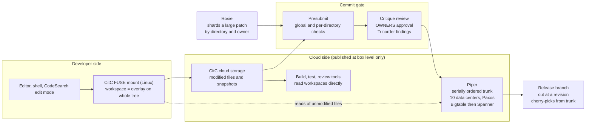

# Paper: Why Google Stores Billions of Lines of Code in a Single Repository (Potvin and Levenberg 2016)

> [!summary] Claim:
> Google keeps almost all of its source in one trunk-based repository, served by an in-house version-control system (Piper) that runs on Google's own replicated storage instead of one machine, and by a FUSE filesystem (CitC) that overlays each developer's few modified files on the whole tree.
> The monorepo is a bundle of mutually dependent choices, not a storage layout: one serially ordered trunk, per-directory OWNERS review, presubmit and automatic rollback, default-private API visibility, and Rosie for sharded cross-repo changes.
> The paper is a descriptive case study with self-reported numbers (about 1 billion files, 35 million commits, 86 TB in January 2015).
> Its durable lesson is that the benefits (atomic change, one version of every dependency, global refactoring) only exist if the tooling keeps every operation cheap at that scale.



## 1. Bibliographic Metadata

- Citation: Rachel Potvin and Josh Levenberg, "Why Google Stores Billions of Lines of Code in a Single Repository", Communications of the ACM, Vol. 59, No. 7 (July 2016), pp. 78-87.
- DOI: https://doi.org/10.1145/2854146.
- Authors' roles at publication: Potvin was an engineering manager and Levenberg a software engineer, both at Google, Mountain View.
- Type: a descriptive case study, not a controlled study.
  It has 15 references, 8 figures, and one statistics table.
- Access: the ACM Digital Library and `cacm.acm.org` returned HTTP 403 to automated fetches on 2026-11-26.
  The full text used for this note is the Internet Archive capture of the CACM web edition listed in `sources:`.
  The January 2015 statistics table is an image on that page and was not retrievable, so every number below comes from the article prose unless another source is named.
- Time frame: statistics are from January 2015 (table) and 2014 (weekly churn), and trend figures run January 2010 to July 2015.
  Treat every Google number as a 2015 datum, not as current (as of 2026-11, no newer official statistics table was found beyond the 2020 figures in Software Engineering at Google).

## 2. The Core Problem

### 2.1 What had to scale

Early Google engineers chose a single shared codebase on a centralized source-control system.
The article dates the decision to 1999, when the codebase moved from CVS to Perforce, and says engineers then held that one repository was strictly better than splitting it, without foreseeing the eventual scale.
By January 2015 the repository held approximately:

| Quantity | Value (as of 2015-01, published) | Note |
| :--- | :--- | :--- |
| Files, all kinds | about 1 billion | includes copies in release branches, files deleted at head, configs, docs, data |
| Unique source files | about 9 million | |
| Lines of code | about 2 billion | |
| History | about 35 million commits | over Google's 18 years |
| Content size | 86 TB | uncompressed, excludes release branches (footnote a) |
| Developers | more than 25,000 | 95% of Google developers use it |
| Human commits per workday | 16,000 | |
| Automated commits per workday | 24,000 | |
| Read traffic | about 500,000 queries per second on a workday, about 800,000 at peak | mostly from distributed build and test systems |
| Weekly churn, 2014 | about 15 million lines in about 250,000 files | reviewed human commits only (footnote b) |
| Comparison given | Linux kernel: about 15 million lines in 40,000 files | the article cites Wikipedia for this |

Derived arithmetic (mine, from the table; not measured, and sensitive to the footnotes):

- Commits per workday are 16,000 + 24,000 = 40,000, and 60% of them are automated.
- The ratio of reads to commits is about 10^6 to 1: 500,000 queries per second sustained is on the order of 4 x 10^10 reads per 24 hours against 4 x 10^4 commits.
  The exact figure depends on how "each workday" is averaged, but the order of magnitude says the system is a read-serving system that occasionally takes a write.
- 15 million changed lines over 250,000 files is about 60 changed lines per touched file per week, so the weekly churn alone is the size of the kernel's source tree.
- 2 billion lines over 9 million unique source files is about 220 lines per source file.

### 2.2 Why nothing off the shelf worked

The article says that "despite several years of experimentation" Google could not find a commercial or open-source system that scaled to this single repository.
The preceding architecture was one primary Perforce server on a single machine plus custom caching infrastructure, in service for more than 10 years before Piper.
Continued scaling of the repository is named as the main motivation for Piper.

The 2011 white paper "Still All on One Server: Perforce at Scale" (Dan Bloch, Google) shows what that single server looked like near its limit (as of 2011-05, published):

| Property | Value |
| :--- | :--- |
| Users | over 12,000 |
| Metadata | more than 1 TB, in about 40 database files in P4ROOT (`db.have`, `db.integed`, `db.rev`, and so on) |
| Command rate | 11 to 12 million commands on an average day (about 130 to 140 per second averaged over 24 hours, derived) |
| Hardware | 16 cores, 256 GB memory, Linux; metadata on RAM-based solid state disk, depot files on network-attached storage, logs and journal on local RAID |
| History | in operation more than 11 years, just past changelist 20,000,000 (slightly under 10 million are actual changelists) |
| Largest client / largest changelist | 6 million files / low hundreds of thousands of files |
| Automation share | more than half of load from programs and scripts |
| Lock stalls | server blocked routinely up to 10 minutes in 2005, down to gaps of 30 seconds to 1 minute in 2010 |

The mechanism behind the stalls matters because it is the thing Piper had to remove.
Every Perforce command runs in a `p4d` process that takes read or write locks on the metadata database files.
While a lock is held, some or all other commands wait (all of them for a write lock), so in the extreme case a 16-CPU machine with spare capacity can run only one process until the locks drop.
Bloch calls this "the single biggest factor affecting performance" at large sites.
Large submits and integrates hold locks for a long time, so reducing changelist size improves concurrency.
Their mitigations were operational and increasingly expensive:

- Two read-only replicas for continuous builds, built in-house before Perforce supported replication (2010.2).
- Sparse clients: a file-system integration built on the P4 API served files on demand and cached them locally, so a client specification named only the directories a user edited.
  This is the same shape as CitC (a small edit set over a lazily served tree).
  Neither source says it is CitC's direct ancestor, so treat the resemblance as a resemblance.
- Sparse branches: in the absence of sparse branches, revisions from branches were 95% of the depot.
- Obliterating all branches older than two years removed 11% of the file paths, saved about $100,000, and let Google defer a hardware purchase by a quarter.
- Watchdog scripts: `locks.pl` notified administrators of every lock-holding command once the `p4d` process count passed 325 (excluding idle processes), and killed lock-holding read-only commands that had run for more than a minute; `killer.pl` tailed the server log and killed known-bad commands such as `p4 files //depot/...`.
- Checkpoints moved from stop-the-world (about four hours, abandoned four or five years before 2011) to offline checkpoints and then to LVM snapshots.

The conclusion the article implies, and the white paper makes visible, is that a single-writer metadata database is a ceiling, and that code review traffic, build farms, and scripts (not humans typing commands) generate the load.
The way out was a different storage substrate, not a faster server.

### 2.3 The decision problem the paper actually answers

The paper does not argue that one big repository is easy.
It argues that, for an organization with an open culture, the benefits justify building the tooling that makes scale cheap, and it lists the costs honestly.
It also says the model "is not for everyone", and that it "would not work well for organizations where large parts of the codebase are private or hidden between groups".

## 3. Key Innovation

The article's contribution is a package, and each part constrains the others:

1. A version-control system built as a service on replicated cloud storage (Piper) instead of a repository file format on a server.
2. A virtual workspace (CitC) so that the cost of a client is proportional to what you change, not to the size of the repository.
3. Trunk-based development as the workflow the first two are shaped around: one head, a single serial order of changes, release branches only as snapshots with cherry-picks, feature flags instead of development branches.
4. Automation as a first-class committer: presubmit, automatic rollback, Rosie, and the compiler team's repository-wide cleanups, which made automated commits the growth driver after 2012.
5. Policy that keeps the single tree navigable: OWNERS per directory, default-private API visibility (since 2011), one version of each open-source library.

The paper's own framing is that "a monolithic codebase in no way implies monolithic software design".
The tree is shared; the architecture inside it is not.

## 4. Mechanism Details

### 4.1 Piper: the repository as a distributed service

What the paper states (as of 2016-07, published):

- Piper stores a single large repository on standard Google infrastructure, "originally Bigtable, now Spanner".
- It is distributed over 10 Google data centers and uses Paxos "to guarantee consistency across replicas".
- Caching and asynchronous operations hide much of the network latency, and the authors note that the cloud-based toolchain requires developers to be online.
- Changes land "in a single, serial ordering", and immediately after a commit the new code is visible to every developer.
- File-level ACLs exist, but over 99% of files are visible to all full-time Google engineers (footnote d).
  Reads and writes are logged.
  A file with accidentally committed sensitive data can be purged, and the read log lets administrators check who accessed it before the purge.
- A workspace is comparable to a Subversion working copy, a Git clone, or a Perforce client.
  Updates from the repository are pulled into a workspace and merged with ongoing work "as desired".
  A workspace snapshot can be shared for review, and files reach the repository only after code review.
- Limited interoperability with Git exists, and workspaces can be stored on local machines instead of in CitC.

What the paper does not say, so that no reader treats an inference as a fact (each item below is an absence in the sources named, not a claim about Google):

- The storage schema (how a revision, a path, and file content map to Bigtable or Spanner rows), the commit protocol, and the number of shards are not described.
- The Piper launch date is only bracketed: the paper says the commit rate was dominated by humans until 2012, "at which point Google switched to a custom-source-control implementation".
  The month and the cutover method are absent from the paper and from SWE ch. 16, 17, 21, 22, 23, so this note states neither.
- Why Spanner suited the job is inference.
  Spanner's published abstract (OSDI 2012; the paper's reference 3 is the 2013 ACM TOCS version) says it supports "externally-consistent distributed transactions" at global scale, which is the property a single serial commit order across data centers needs.
  Whether Piper's commit path uses a Spanner read-write transaction per change is not stated.

Software Engineering at Google (SWE book, 2020) adds that Piper "was built to run as a distributed microservice in our production environment", stores more than 80 TB of content and metadata, and handles 60,000 to 70,000 commits per workday between humans and semiautomated processes (as of 2020, published).
It also gives a latency anchor: about 15 seconds total to create a new client at trunk, add a file, and commit an unreviewed change.
Those are the book's numbers for a different year and a slightly different definition ("content and metadata"), so do not subtract them from the 2015 figures to infer growth rates.
The same book says OWNERS files live in the tree and are enforced by the VCS at commit time, and that Code Search indexes the linear Piper history, so deleted code and arbitrary snapshots are searchable.

### 4.2 Why a single serial order, and what it buys

A single serial order of changes is the property every other claim in the paper leans on:

- A revision number names the state of the entire company's code.
  A source file is uniquely identified by one string, a file path that optionally includes a revision number.
- An atomic change can touch thousands of files: a class rename is one commit and breaks no build or test.
- A bisection, a rollback, and a regression-test blame all operate on one timeline.
- The build system can record dependencies by path, because a path names exactly one thing at a given revision.

The cost lands on the write path: each commit must be ordered globally, validated against changed files, and visible everywhere immediately.
Piper makes the commit cheap by moving the expensive checks (build, test, review, static analysis) before the commit, into presubmit and review, so that the serialization point itself does little work.
That division is inference from the described workflow, but it is the only arrangement consistent with 40,000 commits a day plus a read load dominated by build and test.

### 4.3 CitC: workspace as an overlay

CitC (Clients in the Cloud) has "a cloud-based storage backend and a Linux-only FUSE file system".
The statements the paper makes:

- Developers see workspaces as directories "including their changes overlaid on top of the full Piper repository".
- Only modified files are stored in the workspace, and an average workspace has fewer than 10 files.
- Normal Unix tools work, and no clone or sync happens locally.
- All writes are stored as snapshots, which can be named, restored, or tagged for review.
- A workspace is reachable from any machine that can connect to the storage system, and other developers (and tools) can view it.
- More than 80% of Piper users use CitC (as of 2016-07), and adoption was still growing.

The consequences are the interesting part:

- Client creation is O(1) in repository size, because nothing is copied.
  That is why creating a client, adding a file, and committing takes seconds in the SWE book's anecdote.
- Uncommitted state is cloud state.
  The build system, the test infrastructure, Critique, and CodeSearch can read a developer's work in progress without the developer pushing anything.
  Auto-commit (commit after review approval and passing tests, without the author present) and CodeSearch's click-to-edit typo fixes both depend on that.
- The "snapshot on every write" behavior is a continuous backup, so a lost laptop loses no work.
- A workspace is a pure function of (base revision, set of modified files).
  That makes a workspace cheap to move, share, and garbage-collect.

How the base revision is chosen and updated is not stated in the paper.
The text "updates from the Piper repository can be pulled into a workspace and merged with ongoing work, as desired" implies a base that moves only when the developer asks, and that is the assumption the overlay model in this note uses.
The SWE book (ch. 17, as of 2020, published) confirms the pinned base: it describes workspaces (unsubmitted changes) as "synced to a specific snapshot of the codebase", and Code Search indexes them against that snapshot.
The pre-Piper Perforce file-system integration already did the same, providing "files at a different changelist level for each user" (Bloch 2011).
How often CitC moves the base and how a sync merges conflicts is still unpublished.

#### 4.3.1 The FUSE layer, from the kernel documentation

The paper cites FUSE only through a Wikipedia article, so the mechanics here come from the Linux kernel FUSE documentation (fetched 2026-11, page rendered as 7.4.0-rc4; this note describes that version only and makes no claim about when each file or option appeared):

- FUSE has three parts: the kernel module `fuse.ko`, the library `libfuse`, and the mount utility `fusermount`.
- The kernel talks to the filesystem daemon through a file descriptor from `/dev/fuse`, and the connection lives until the daemon dies or the filesystem is unmounted.
- Each VFS operation on the mount (lookup, read, write, readdir) becomes a request the daemon must answer.
  A daemon that is slow, hung, or dead stalls every process touching the mount.
- A control filesystem (`mount -t fusectl none /sys/fs/fuse/connections`) exposes one directory per connection with these files, which only the mount owner may read or write:

| File | Meaning (kernel doc) |
| :--- | :--- |
| `waiting` | requests queued for, or being processed by, the daemon; non-zero with no filesystem activity means "hung or deadlocked" |
| `abort` | writing anything aborts the connection: waiting requests and new requests fail with an error |
| `max_background` | most background requests outstanding at once; at the limit, further requests block and I/O can stall |
| `congestion_threshold` | above this many background requests the kernel skips asynchronous readahead and delays non-synchronous writeback |

- Interrupted syscalls: a fatal signal dequeues a request that has not reached userspace; otherwise an INTERRUPT request is queued, takes priority over other requests, and the daemon may ignore it or reply `EINTR`.
- To abort an unresponsive mount you can kill the daemon, kill the daemon and its users, use `umount -f` (only if not lazily unmounted), or write to `abort`, which the doc calls the most powerful method and says "always works".
- Non-privileged mounts go through `fusermount`, installed setuid root, which always adds `nosuid` and `nodev`.
  `allow_other`, which lets users other than the mounter see the mount, is by default restricted to root unless a userspace configuration option (`user_allow_other`) lifts it.

Why this matters for a CitC-like design (inference from the interface, not from the paper):

- A build worker running as a different user needs `allow_other`, so the mount policy is part of the platform, not a user setting.
- A read of an unmodified file is a kernel-to-daemon round trip plus a network fetch on a cold cache.
  Latency hiding therefore lives in the daemon's cache and in kernel readahead, and `congestion_threshold` is the knob that silently turns readahead off under load.
- The "Linux-only" limit follows from FUSE being a Linux kernel feature.
  The paper does not say how Windows and Mac users (supported by the central repository since October 2012) reach CitC workspaces.
  The paper and the SWE chapters checked are silent on the Mac and Windows route, so this note does not state one.

#### 4.3.2 A runnable model of the overlay and the commit check

The following overlay model is mine and runs in plain Python.
It is not Piper or CitC and it uses no FUSE.
It demonstrates three properties the paper asserts: a workspace stores only what changed, every write is recoverable, and a commit is one atomic revision that is refused if the base went stale.

```python
"""Toy model of a CitC-style overlay workspace on a serially ordered trunk."""
from __future__ import annotations


class Trunk:
    """Serially ordered history: revision N is the state after N commits."""

    def __init__(self, files: dict[str, str]) -> None:
        self.head = 0
        self._versions: dict[str, list[tuple[int, str | None]]] = {
            p: [(0, c)] for p, c in files.items()
        }

    def read(self, path: str, rev: int) -> str | None:
        for r, content in reversed(self._versions.get(path, [])):
            if r <= rev:
                return content
        return None

    def changed_since(self, path: str, rev: int) -> bool:
        versions = self._versions.get(path, [])
        return bool(versions) and versions[-1][0] > rev

    def commit(self, changes: dict[str, str | None]) -> int:
        self.head += 1
        for path, content in changes.items():
            self._versions.setdefault(path, []).append((self.head, content))
        return self.head

    def file_count(self, rev: int) -> int:
        return sum(1 for p in self._versions if self.read(p, rev) is not None)


class Workspace:
    def __init__(self, trunk: Trunk) -> None:
        self.trunk = trunk
        self.base = trunk.head
        self.delta: dict[str, str | None] = {}
        self.snapshots: list[dict[str, str | None]] = []

    def read(self, path: str) -> str | None:
        if path in self.delta:
            return self.delta[path]
        return self.trunk.read(path, self.base)

    def write(self, path: str, content: str | None) -> None:
        self.delta[path] = content
        self.snapshots.append(dict(self.delta))  # every write is recoverable

    def commit(self) -> int:
        stale = sorted(p for p in self.delta if self.trunk.changed_since(p, self.base))
        if stale:
            raise RuntimeError("stale base, changed on trunk: " + ", ".join(stale))
        rev = self.trunk.commit(self.delta)
        self.base, self.delta = rev, {}
        return rev


def main() -> None:
    trunk = Trunk({f"app/f{i:04d}.cc": f"v0 of {i}" for i in range(1000)})
    ws = Workspace(trunk)
    print("visible files:", trunk.file_count(ws.base), "stored in workspace:", len(ws.delta))

    # Rename-style atomic change touching 3 files.
    ws.write("app/f0001.cc", "v1 of 1")
    ws.write("app/f0002.cc", "v1 of 2")
    ws.write("app/f0003.cc", None)
    print("after 3 edits: stored:", len(ws.delta), "snapshots:", len(ws.snapshots))
    print("read unmodified f0500:", ws.read("app/f0500.cc"))
    print("read deleted f0003:", ws.read("app/f0003.cc"))

    # A second workspace commits first and touches one of the same files.
    other = Workspace(trunk)
    other.write("app/f0002.cc", "other v1 of 2")
    print("other commit -> rev", other.commit())

    try:
        ws.commit()
    except RuntimeError as err:
        print("commit refused:", err)

    # Resolve by rebasing: re-read trunk head, redo the edit, commit once.
    ws.base = trunk.head
    ws.write("app/f0002.cc", "v2 of 2 (on top of other)")
    print("retry commit -> rev", ws.commit(), "head:", trunk.head)
    print("3 files changed in one revision; revisions per workspace commit: 1")


if __name__ == "__main__":
    main()
```

Output of `python3 -I overlay_model.py`, run once on darwin-arm64 with the system `python3` (3.15.2) on 2026-11-26 and reproduced byte for byte by an independent re-run the same day (a one-off run for this note, not a gated lab):

```text
visible files: 1000 stored in workspace: 0
after 3 edits: stored: 3 snapshots: 3
read unmodified f0500: v0 of 500
read deleted f0003: None
other commit -> rev 1
commit refused: stale base, changed on trunk: app/f0002.cc
retry commit -> rev 2 head: 2
3 files changed in one revision; revisions per workspace commit: 1
```

What the output shows:

- 1000 files are visible while 0 are stored, and 3 edits store 3 files, which is the "fewer than 10 files" property.
- Reads of untouched paths fall through to the trunk at the base revision.
- The stale check is per path: `ws.commit()` is refused only because `other` changed `app/f0002.cc`.
  A real system must decide whether to check per path, per directory, or per file content, and the paper does not say which Piper does.
- The final line is a fixed string and proves nothing; the evidence for atomicity is that `head` advanced from 1 to 2 for a three-file change.

### 4.4 Trunk-based development

The paper's rules (as of 2016-07, published):

- The vast majority of users work at head of a single trunk, and changes are made in one serial order.
- Branches are "unusual and not well supported", used mainly for releases.
  A release branch is cut from a specific revision; fixes and enhancements are developed on trunk and cherry-picked in.
  A release is "typically a snapshot of head, with an optional small number of cherry-picks".
- Long-lived branches with parallel development on branch and trunk are "exceedingly rare".
- New features ship dark behind conditional flags, so old and new code paths coexist and a flag flip, not a rebuild, switches users off a bad implementation.
  Flags are mostly project-specific, not in common libraries, and are retired so the old path can be deleted.
- A small set of very low-level core libraries uses a mechanism similar to a development branch, with additional testing before client code sees a new version.

The SWE book later quantifies the branch rule (as of 2020, published): across roughly 1,000 teams in the monorepo, only a couple keep a long-lived dev branch, usually for compatibility of data at rest or of an API over time.
It also states a "build horizon": every production job must be rebuilt and redeployed at most every six months, which caps version skew.

Why the paper's design needs this and not the other way round:

- Every development branch is a hidden copy of the code, and a global refactor has to find and update all of them.
  In a DVCS the set of such branches may not even be enumerable.
- A long-lived branch re-introduces "a choice of version", the thing the single repository removes.
- Atomic changes and Rosie only make sense if the thing being changed is one tree at one revision.

Edge cases that bite:

- Dark launches turn a merge problem into a configuration problem.
  Flags that are never removed become permanent branching in the code, and flag interactions grow combinatorially.
  The paper says flags "are retired", but gives no number for flag lifetime.
- Cherry-picking to release branches means the release is not what ran on trunk; the SWE book's advice is to keep cherry-picks to a minimum and not plan to remerge.
- Trunk-based development moves risk from merge time to deploy time.
  A commenter on the article raises exactly this (database migrations and API skew across service versions); the one reply in the comments is that teams publish binaries under a de facto SLA and migrate in three steps: announce, new code and move over, then delete the old.
  That reply is a reader comment on the CACM page, not a statement by the authors.

### 4.5 The workflow around the commit: presubmit, rollback, review, ownership

- An automated test infrastructure rebuilds all affected dependents "on almost every change committed".
  If a change creates widespread build breakage, a system automatically undoes it.
- Presubmit runs before commit: global analyses for all changes, plus custom analyses code owners attach to directories they specify.
- Every change is reviewed.
  Most developers can propose changes to any file, except a small set of highly confidential code.
- The tree has an owner set per directory.
  A change often gets a detailed review from one developer (quality) and a commit approval from an owner (appropriateness for that area).
- Critique shows the evolution of the change and supports line comments, ending in "Looks Good To Me".
  Tricorder results (static analysis, one-click fixes) and presubmit data (coverage, test results) appear in the review.
- SWE ch. 23 puts TAP (the continuous build and test platform) at more than 50,000 unique changes and more than four billion test cases per day (as of 2020, published), and calls TAP "the gateway for almost all changes".

Two deeper points:

- Ownership is a text file in the tree, so a team transfer is a commit rather than a repository permission migration (SWE ch. 16).
- Review is the substitute for repository boundaries as an access and quality control.
  The risk of editing unfamiliar code is "mitigated through the code-review process and the concept of code ownership".
  See [[Paper-Modern-Code-Review-at-Google]] for the review study itself and [[Paper-Tricorder-Program-Analysis-Ecosystem]] for the analysis side.

### 4.6 Rosie: large-scale changes as a pipeline

The paper's account (as of 2016-07, published):

- Large cleanups are done in two phases: first a large backward-compatible change, then a smaller change that removes the old pattern once nothing references it.
- Rosie handles the first phase.
  The developer produces a large patch (find-and-replace, or a refactoring tool), and Rosie splits it "along project directory lines", tests the pieces independently, sends them to the owners for review, and commits each once it passes tests and review.
- Rosie's monthly commit count is Figure 7.
  Because Rosie spends reviewer time, Google adopted a formal large-scale-change review process in 2013, which reduced the number of commits through Rosie from 2013 to 2014.
  The committee weighs benefit against reviewer time and repository churn.
- Companion tools: Refaster (a tool that expresses a Java refactoring as compilable before and after examples) and ClangMR (Clang combined with MapReduce to transform large C++ codebases).
  The paper says these are often used in conjunction with Rosie.

The SWE book (ch. 22, as of 2020, published) fills in the mechanism:

- Rosie shards a master change by project boundary and ownership so each shard can be submitted atomically, and each shard goes through its own test-mail-submit pipeline.
- Rosie caps the number of outstanding shards per large-scale change, runs at lower priority, and coordinates with the shared testing infrastructure about load.
- Each shard is tested over the transitive closure of tests it can affect.
  Most shards touch fewer than 1,000 tests out of millions; for bigger sets Rosie runs the union of all affected tests once and then, per shard, only the intersection of its tests with the first-run failures.
- Recently flaky tests are ignored when submitting through the automated tooling, because machine-generated, semantics-preserving changes are trusted more than a flaky test.
- Reviewer selection uses an owners-detection service that weights owners; non-responsive owners trigger additional reviewers.
  The chapter also reports that local owners reviewed Rosie shards cursorily, so shards that do not need local context now go to a "global approver" who knows the change.
- Authors write a document with rationale, expected shard count, and an FAQ, and get domain review from the API owners first.

This note keeps Rosie at paper depth.
The full treatment of sharding, automated canaries, and codemod engines belongs to [[Large-Scale-Changes-and-Codemods-Across-Repos]] and the playbook [[Playbook-Execute-a-1000-Repo-Breaking-API-Migration]].

### 4.7 The structural claims: what a single tree buys and what it costs

The paper's list of advantages, with the mechanism each depends on:

| Advantage (paper wording) | Mechanism it depends on |
| :--- | :--- |
| Unified versioning, one source of truth | one repository, one path namespace, one revision order |
| Extensive code sharing and reuse | depend on any directory directly; no publish step |
| Simplified dependency management | build system includes code across directories; a change to a dependency triggers a rebuild of dependents |
| Atomic changes | one commit across any number of files; no build breaks mid-rename |
| Large-scale refactoring | global view plus Rosie, Refaster, ClangMR; old APIs removed once all callers are provably migrated |
| Collaboration across teams, flexible ownership | moving a project is an atomic change that preserves history |
| Visibility and implicit team namespacing | tree layout; a file is named by a path |

The diamond-dependency argument is the most-cited one, and its exact scope is easy to misquote:

- Setup: A depends on B and C, both depend on D, but B needs D.1 and C needs D.2, so A usually cannot be built.
- In a monorepo the person changing D updates all callers in the same change, so the technical debt "is paid down immediately".
- The article scopes this to the source or API level, and notes it also exists between binaries; "at Google, the binary problem is avoided through use of static linking".
  The SWE book later phrases the underlying policy as the One-Version Rule: developers must not have a choice about which version of a dependency to use.
  It also notes the rule is "not hard and fast" and that a monorepo does not enforce it automatically (a forked, un-renamed library inside one tree still breaks it).
  See [[Dependency-Management-Theory-and-Hyrums-Law]] and [[Diamond-Dependency-and-Incompatible-ABI-Mitigation]].

Concrete payoffs the authors give:

- The compiler team can do repository-wide cleanups before turning a pattern into a compiler error, which supports more than 20 C++ compiler releases per year (as of 2016-07, published).
- Using performance and regression data from nightly builds of the entire codebase, default compiler settings were tuned so that Java developers saw garbage-collection CPU consumption fall by more than 50% and GC pause time fall by 10% to 40%, from 2014 to 2015.
  The archived web text renders the pause range as "10%40%", a lost dash, and it is read here as a range.
- Core-library maintainers can test and benchmark high-impact changes against everything before committing them, including an experiment on the feasibility of converting data centers to non-x86 architectures.
- Modernizations such as moving to C++11 or rolling out performance optimizations touch up to half a million variable declarations or call sites across hundreds of thousands of files, done by specialists for the whole company.

The three cost categories the paper names:

1. Tooling for development and execution.
   A custom Eclipse plug-in, a code-indexing system behind cross-references and IDE features, and the scalable build and test infrastructure, whose run cost forces trade-offs about how often to run each tool.
2. Codebase complexity.
   `grep` stops being sufficient, so code search becomes a major investment.
   Extensive sharing makes it too easy to add dependencies and weakens the incentive for stable APIs.
   Unneeded dependencies increase exposure to downstream build breakage and binary size.
   Clipper (a tool using a custom Java compiler to build a cross-reference index and a reachability graph) finds classes that are never used, to guide dependency refactoring.
   In 2011 Google made new APIs private by default so developers must explicitly mark APIs for other teams, and the paper's stated lesson is to put such a mechanism in place "as soon as possible".
   Visibility is a build-system feature; Bazel's current rule is that a target without a visibility attribute gets the package's `default_visibility`, and a package without one is private (Bazel docs fetched 2026-11).
   Open-source code lives in a reserved area with only one version of each project at a time, and teams who use it are expected to spend time on upgrades.
   Code-reading culture has a cost: teams rely on implementation details, which makes deprecation hard (the paper's phrasing of what the field calls Hyrum's Law).
3. Effort invested in code health.
   Tools to detect and remove dead code, split large refactorings and assign reviewers, and mark APIs deprecated, run by people, and the review cost of the cleanup stream is paid by the owning teams.

### 4.8 The alternatives section: why not Git, and what Google tried

- A Git-based layout would need Google's repository split into "thousands of separate repositories", because Git cloning copies all content to the developer machine; the example given is that Google's Git-hosted Android codebase has more than 800 repositories.
- Android and Chrome use Git for external-partner and open-source reasons, and a team at Google supports it.
- Google ran an experimental effort with Mercurial to add scalability features to the client, so developers could use a DVCS-style workflow against the central repository, in collaboration with the Mercurial community and contributors from other companies (as of 2016-07, published).
  How that effort ended is not covered by the paper or by the SWE chapters listed in `sources:`, so this note states no outcome.
- The conclusion is that moving to more and smaller repositories "would not make sense" for the main repository.

For the Git-side answers that appeared later (partial clone, sparse index, VFS-style lazy hydration), go to [[Git-At-Scale-VFS-Scalar-and-Monorepos]], [[Git-Transfer-Protocol-and-Partial-Clone]], and [[Beyond-Git-Jujutsu-Sapling-and-Patch-Theory]].

## 5. Evaluation and Limitations

### 5.1 What kind of evidence this is

- It is a description of a deployed system by two of its engineers.
  There is no comparison group, no ablation, no cost accounting, and no latency distribution for Piper or CitC.
- The numbers are internal and unauditable from outside: a January 2015 table, a 2014 churn figure, trend charts from 2010 to 2015, and the GC improvement figures.
- The "advantages" list is argued by mechanism, and the "costs" list is candid but qualitative; no number is given for what the tooling cost to build or run.
- The selection effect is strong: the authors describe the survivor of "repeatedly" deciding to stay with the monorepo, and the paper itself says the model suits organizations "with an open and collaborative culture".

### 5.2 Independent and follow-up evidence

Jaspan et al. (ICSE-SEIP 2018, two years later) is the study the CACM paper lacks, and it is worth knowing its design and its limits:

- Method: a survey of engineers plus developer-tool logs analysis, within one company.
  Of 1,902 sampled engineers, 869 completed it (46% response rate).
  Of the 869, 205 (24%) had used a monolithic codebase at a different company and 379 (44%) a corporate multirepo.
- Finding 1: engineers strongly prefer the monorepo, citing visibility of the codebase and simple dependency management first, then finding examples of API use and automatically receiving API updates.
- Finding 2: tool logs confirm that engineers use cross-team visibility.
  The median engineer has 28% of file views and 5% of commits outside their own product area; at the 90th percentile 69% of views and 60% of commits are outside.
  Excluding very common libraries (26 hand-picked directory prefixes plus directories above 10,000 cross-area views, 63,500 of 1,817,000 directories, or 3.5%), build files, and service interface files changes the distributions only slightly, so the viewing is not just popular-library API lookups.
- Finding 3: multirepo has real advantages: stable versioned dependencies, freedom to choose a toolchain, and stronger access control.
  This is the same tension the CACM paper hides under "costs".
- Limits stated by the authors: selection bias in who responds, priming effects in the survey questions, and the confound that engineers' opinions mix the repository model with the quality of the surrounding tools.
  Engineers' preference was partly about tools, not about the repository shape.

The SWE book (2020) explicitly says a monorepo is not the One True Way, that the essential property is One Version, and that a virtual monorepo (many physical repositories with an agreed ordering and dependency graph) can approximate the benefits.
It also names the weak point: if parts of the organization have different legal, secrecy, privacy, or security requirements, a single repository carries "ongoing carrying costs" in customization.

### 5.3 Unaddressed constraints and weak points

- Compartmentalization: fewer than 1% of files are hidden from any full-time engineer (footnote d says over 99% are visible to all), and the paper concedes the model fails where large codebase parts must stay hidden between groups.
- Online dependence: the toolchain needs connectivity, and CitC is Linux-only; offline work is a second-class path.
- Cost: the paper does not say what the machines, the staff, or the test compute for the model cost, only that trade-offs about how often to run tools are needed.
- Dependency across time is outside the model: One Version helps at head, but data at rest and API skew between services still need compatibility promises (the SWE book's build-horizon point).
- Reviewer load is a shared resource and an unpriced one; Rosie's 2013 review process and the SWE book's remark on cursory shard reviews show the control loop failing and being patched.
- Weekly churn in 2014 of 15 million lines (reviewed, human) in 250,000 files excludes automated commits, so the true churn is higher, and the paper gives no number for it.

### 5.4 Numbers to Know

| Item | Value | Source and date |
| :--- | :--- | :--- |
| Repository size | 1 billion files, 35 million commits, 86 TB, 2 billion lines in 9 million source files | CACM 2016, as of 2015-01 |
| Commits per workday | 16,000 human plus 24,000 automated | CACM 2016, as of 2015 |
| Read queries per second | about 500,000 average, about 800,000 peak | CACM 2016, as of 2015 |
| Piper replication | 10 data centers, Paxos | CACM 2016 |
| CitC workspace | fewer than 10 files on average; over 80% of users | CACM 2016, as of 2016-07 |
| Pre-Piper Perforce | 12,000 users, 1 TB metadata, 11 to 12 million commands per day, 16 cores, 256 GB | Bloch 2011, as of 2011-05 |
| Later scale | more than 80 TB, 60,000 to 70,000 commits per workday, about 1,000 teams | SWE book, as of 2020 |
| Survey | 869 of 1,902 engineers (46%) | Jaspan et al. 2018 |

All of these are published figures, not measurements made for this note, and the platform is Google-internal infrastructure (not Linux or macOS in any sense a reader can reproduce).
The only measured thing in this note is the toy overlay model's output.

## 6. Industry Impact

- It established "monorepo" as an engineering position that could be argued with numbers.
  The SWE book calls it a "highly cited, much discussed" paper and lists Microsoft, Facebook, Netflix, and Uber as other organizations that have publicly mentioned relying on a monorepo.
- It gave other vendors a target: the CitC idea (a virtual filesystem that hydrates files on demand and stores only local edits) maps onto the later VFS approaches covered in [[Git-At-Scale-VFS-Scalar-and-Monorepos]].
  The claim here is about the shape of the idea; this note did not verify any direct lineage between CitC and a particular product.
- Bazel is the open-sourced subset of Google's internal build system, per the paper's footnote c; the paper's claims about dependency management are exercised through that build system.
  See [[Bazel-Skyframe-Bzlmod-and-Execution-Model]] and [[Remote-Execution-API-and-Remote-Caching]].
- It put the tooling bill on the table: code search, scalable review, presubmit, static analysis at review time, and large-scale-change infrastructure are now standard topics (see [[Code-Search-and-Semantic-Indexing-at-Scale]], [[Static-Analysis-at-Scale-Tricorder-and-Autofix]], [[Code-Review-and-Readability-Systems-at-Scale]]).
- It made the One-Version Rule and the Live-at-Head debate part of dependency-management practice (see [[Dependency-Management-Theory-and-Hyrums-Law]]).
- Git itself moved toward the monorepo case after 2016; the SWE book lists shallow clones, sparse branches, and better optimization as evidence that "we need to keep the repository small" is losing force.
  The mechanisms are owned by [[Git-Packfiles-and-Delta-Compression]] and [[Git-Transfer-Protocol-and-Partial-Clone]].

## 7. Concept Grounding

| Concept note | What relies on this paper |
| :--- | :--- |
| [[Decision-Record-Monorepo-vs-Polyrepo]] | the cost and benefit list, and the open-culture precondition |
| [[Git-At-Scale-VFS-Scalar-and-Monorepos]] | the virtual-filesystem workspace idea, and the Git-versus-single-tree argument |
| [[Large-Scale-Changes-and-Codemods-Across-Repos]] | Rosie, the two-phase cleanup, the review-cost control |
| [[Dependency-Management-Theory-and-Hyrums-Law]] | the diamond dependency, One Version, reading code instead of docs |
| [[Bazel-Skyframe-Bzlmod-and-Execution-Model]] | the build system that makes cross-directory dependencies cheap, and visibility |
| [[Code-Search-and-Semantic-Indexing-at-Scale]] | why `grep` stops working and code search becomes infrastructure |
| [[Code-Review-and-Readability-Systems-at-Scale]] | review as the control that replaces repository boundaries |
| [[Build-and-Test-Latency-Economics-and-Flaky-Tests]] | the cost of rebuilding all dependents, and flaky-test policy in LSCs |

## Worked Example: tracing one change through the system

A developer renames `Widget::Open` to `Widget::Connect` across 3,200 files in 410 directories.
The paper supports this shape; the per-step numbers are illustrative placeholders, not measured.

1. Phase one adds `Connect` and keeps `Open` as a forwarding shim.
   The author generates the patch with a refactoring tool (ClangMR for C++ or Refaster for Java), in a CitC workspace that stores only the 3,200 edited files, so the workspace costs what the edit costs.
2. The large-scale-change review (2013 onward) asks: is the benefit worth the reviewer time and repository churn?
3. Rosie splits the patch along directory lines, one shard per owned subtree, and runs each shard through presubmit (transitive test closure).
4. Each shard goes to its owners, or a global approver, and commits on pass, in one serial order.
   Trunk never contains a state where a caller uses a method that does not exist.
5. After the last caller is migrated, phase two deletes `Open`, and a cheap global check proves nothing references it.
6. If a shard breaks something that got through, the automatic rollback system can undo it, and the rest of the shards are unaffected.

The same change in a multirepo setting needs a coordinated release of the library, a version bump in each dependent repository, and a period where both versions are in use; that is the diamond-dependency window the paper says a monorepo closes.

> [!warning] Pitfalls:
> - Do not read "monorepo" as "monolith".
>   The paper says a monolithic codebase "in no way implies monolithic software design"; services, ownership, and API boundaries are unchanged.
> - Do not copy the repository shape without the tooling.
>   The advantages in the paper's list are consequences of Piper, CitC, presubmit, rollback, Rosie, and code search.
>   A plain Git repository with the same files has none of the 2015 cost properties (see [[Git-At-Scale-VFS-Scalar-and-Monorepos]]).
> - Do not treat sparse checkout or partial clone as CitC.
>   They reduce what is materialized, but uncommitted work is not in shared cloud storage that build and review tools can read.
> - Do not skip default-private visibility.
>   The authors' stated lesson is to add it "as soon as possible"; every public-by-default target is a dependency you will later have to untangle.
>   Bazel today defaults a package without `default_visibility` to private (as of 2026-11), so the safe default exists; the trap is turning it off.
> - Do not run LSCs without a review budget.
>   Rosie growth forced a formal review process in 2013, and the SWE book reports owners rubber-stamping shards.
> - Do not quote the 2015 numbers as current.
>   The SWE book (2020) already gives different figures (60,000 to 70,000 commits per workday, more than 80 TB), and the definitions differ.
> - Do not generalize the survey.
>   Jaspan et al. is one company with a 46% response rate and a strong tooling confound.
> - Do not assume One Version holds automatically in a monorepo.
>   A forked library that keeps its name is a violation inside a single tree.

## At Scale

How the decision changes with organization size, using the paper's evidence (decision rules are mine, built from the cited sources):

| Organization | Default | Reason | Trigger to revisit |
| :--- | :--- | :--- | :--- |
| 1 to 50 engineers | one repository, plain Git | the tooling bill of the paper does not apply, and clones are fast | clone or CI time becomes a daily complaint |
| 50 to 500 | monorepo on plain Git plus sparse and partial clone, remote build cache | atomic change and one version pay off long before Piper-scale | repository operations (status, fetch, gc) exceed seconds, or CI per change exceeds minutes |
| 500 to 5,000 | monorepo with Bazel-class build and test selection, OWNERS review, an LSC tool | the cost categories in the paper (tooling, complexity, code health) now need named teams | cross-team API changes take longer than a quarter, or reviewers are overloaded by cleanup streams |
| 5,000 and up | Piper-class VCS, virtual workspaces, global presubmit and rollback, code search, Rosie-class sharding | each of those became necessary at Google in turn | none of this note's evidence goes past 25,000 developers |

Decision rules:

- Choose a monorepo when one team can credibly say "we will update every caller" and the organization will fund the tooling that makes it true.
- Choose a virtual or federated monorepo (SWE ch. 16) when parts of the organization have different secrecy, legal, or access requirements, and enforce One Version across the repositories anyway.
- Put API visibility in place before the second team depends on the first (the paper's lesson on visibility).
- Meter review load for automated changes, and set a threshold at which a mass change needs a formal review (the 2013 lesson).
- Do not measure the repository by size; measure p50 and p99 of the operations developers perform (create client, sync, commit, search).
  The SWE book's 15-second create-add-commit is a useful bar for the whole loop.

> [!tip] Practice Drill:
> 1. Run the overlay model from this note and change `other.write("app/f0002.cc", ...)` to a different path.
>    Predict the last four output lines before running, then check.
> 2. Extend the model so the stale check works per directory instead of per path.
>    List one change that the per-directory rule now refuses that the per-path rule allowed, and one change where per-directory is the safer rule.
> 3. On a Linux machine with FUSE, mount any small FUSE filesystem (for example one of the libfuse examples), mount `fusectl`, and read `waiting` while a process blocks on a read.
>    Stop the daemon with SIGSTOP and observe `waiting`, then write to `abort` and observe the errors in the blocked process.
>    This was not run for this note, so treat the expected behavior as the kernel documentation's claim, not a measurement.
> 4. Pick an open-source monorepo you know and write down which of the paper's five package components it has and which it lacks.

## Interview Questions

### L5

> [!question] Q1. What problem does a monorepo with one trunk remove that a multirepo does not, and what does it cost?
> Answer in terms of the diamond dependency, not slogans.

> [!success]- Answer
> It removes the choice of version.
> With one repository at one revision, a library change and all its callers land in one commit, so B and C cannot need different versions of D at the same time (source level).
> The binary-level diamond is handled separately; the paper says Google avoids it by static linking.
> The cost is tooling: scalable VCS, build, test, code search, ownership, review, and a way to keep the dependency graph clean.
> The paper lists tooling investment, codebase complexity, and code-health effort as the three cost categories.

> [!question] Q2. How does Google ship a release if everyone works at head?
> What is the role of cherry-picks?

> [!success]- Answer
> A release branch is cut from a specific revision of trunk.
> Fixes and enhancements needed in the release are developed on trunk first and cherry-picked in, because a release should be "typically a snapshot of head, with an optional small number of cherry-picks".
> Long-lived parallel development on a branch is exceedingly rare, and new features are hidden behind flags so trunk can carry unfinished code safely.
> The SWE book adds that a team should keep cherry-picks minimal and not plan to remerge.

> [!question] Q3. (Predict the output.) Using the overlay model from this note, suppose `other` writes `app/f0500.cc` instead of `app/f0002.cc`.
> What do the last two lines print, and why?

> [!success]- Answer
> The model prints `retry commit -> rev 3 head: 3` followed by the fixed summary line.
> `ws.commit()` in the `try` block succeeds because the stale check covers only the paths in `ws.delta` (`f0001`, `f0002`, `f0003`) and `other` changed none of them, so no "commit refused" line is printed and the first workspace commit becomes revision 2.
> Then the code re-bases, writes `f0002` again, and commits a second time, which becomes revision 3, with head also 3.
> The variant was run once on darwin-arm64 with Python 3.15.2 on 2026-11-26 and printed exactly these lines.

### L6

> [!question] Q4. (Debug this.) A developer on a FUSE-backed workspace reports that `ls` works but `cat big_file` hangs for minutes, and `/sys/fs/fuse/connections/42/waiting` reads 7 and does not change while the machine is idle.
> What do you conclude and what do you do?

> [!success]- Answer
> The kernel doc says that a non-zero `waiting` count with no filesystem activity means the filesystem is hung or deadlocked: seven requests are queued or in the daemon and none is completing.
> The likely causes are a broken daemon, a stalled network fetch, or a deadlock (the doc lists a broken implementation, a network connection down, accidental deadlock, and malicious deadlock).
> Capture the daemon's stack first, because aborting destroys the evidence.
> Then recover: killing the daemon works for a broken implementation or a down network; `umount -f` works if the mount is still attached; writing anything to `/sys/fs/fuse/connections/42/abort` always works and fails the waiting and future requests with errors.
> Also check `max_background` and `congestion_threshold`: if the daemon is merely overloaded, readahead and writeback are being throttled rather than the daemon being dead.
> I did not run this in this session; the behavior is from the kernel documentation.

> [!question] Q5. Design a Rosie-like system for a 200-engineer company that needs to rename a widely used API.
> What are the load-bearing parts, and what do you cap?

> [!success]- Answer
> Parts: a generator (AST-based, such as Clang or an equivalent tool), a sharder that splits by owned directory so each shard compiles and passes alone, a per-shard test run over the transitive closure of affected tests, reviewer routing from OWNERS files, and an auto-commit on pass.
> Cap the number of outstanding shards, run at low priority, and share load with the CI scheduler (the SWE book says Rosie does all three).
> Review policy matters as much as code: require an up-front document with rationale and expected shard count, domain review from the API owners, and a global approver for mechanical shards.
> Use the two-phase pattern: add the new API and migrate, then delete the old API only after a global check proves no references remain.
> Failure mode to design for: shards that touch overlapping files or a header and its implementation must be grouped so each shard stays independently committable.

> [!question] Q6. The paper reports about 500,000 queries per second on average and 40,000 commits per workday.
> What does the ratio tell you about where to put engineering effort?

> [!success]- Answer
> It is about a million reads per commit (order of magnitude), and the paper says most traffic comes from distributed build and test systems, so the system is dominated by automated reads.
> Effort therefore goes into caching, read replicas, and cheap metadata operations (the same reason CitC makes client creation O(1)), and into reducing redundant builds.
> It also says the commit path should do little work: checks move to presubmit and review so the serialization point stays cheap.
> Caveat: the exact ratio depends on how "each workday" averages, and 60% of commits are automated, so the human commit rate (16,000 per day) is a minority of write traffic.

### L7+

> [!question] Q7. Your 3,000-engineer company wants to adopt the model.
> Two divisions have export-controlled code and one division is an acquisition on a different language stack.
> What do you propose and how do you decide?

> [!success]- Answer
> Proposal: a virtual monorepo, meaning several physical repositories with one agreed commit ordering, one dependency graph, and an enforced One-Version policy across them, instead of one physical repository for everyone.
> Reasons: the paper says the model does not suit organizations where large parts of the code are hidden between groups, the SWE book names differing secrecy and compliance as the legitimate reason to split, and per-repository permissions are the straightforward control for export-controlled code.
> Decision rules: unify what shares dependencies and release cadence, keep export-controlled code in its own repository with a narrow, reviewed interface into the shared tree, and bring the acquisition in last and only after its build runs under the same build system (a repository merge without a shared build gets none of the dependency benefits).
> Metrics before and after: time to land a cross-team API change, count of dependency versions per library, p99 of client create and sync, and reviewer hours on automated changes.
> Name the downside: the virtual layer costs tooling, and any gap in ordering or dependency visibility reintroduces the version choices you were trying to remove.

> [!question] Q8. Critique the paper.
> Which claims would you not accept without more evidence?

> [!success]- Answer
> Accept: the scale numbers as Google's report, and the mechanism-level reasoning for atomic change and One Version.
> Do not accept without more: that the benefits are caused by the repository shape (they are confounded with Piper, CitC, presubmit, rollback, Rosie, a strong build system, and code search, and the paper has no ablation); that the model "scales" to other organizations (survivorship and culture preconditions); the GC improvement figures as evidence for the monorepo (a central team tuning compiler and runtime defaults could have done it with fleet-wide telemetry; the repository shape made the cleanups cheaper).
> Missing: a cost model, latency distributions, failure and incident data for Piper, and any data on developer productivity.
> The follow-up study (Jaspan et al.) helps on preference and cross-team viewing but is a survey in one company with a 46% response rate and a tool confound.

> [!question] Q9. Explain why a single serial commit order across 10 data centers is hard, and what you would want from the storage layer.
> What does the paper tell you and what is inference?

> [!success]- Answer
> The paper tells you: Piper runs on Bigtable then Spanner across 10 data centers, uses Paxos for consistency across replicas, and exposes a single serial ordering of changes.
> It does not describe the schema or commit protocol.
> Inference: you need a globally ordered, durable log of commits (a revision number that every reader agrees on) with reads that see a consistent snapshot at a given revision.
> Spanner's published abstract claims externally consistent distributed transactions and lock-free read-only transactions at global scale, which fits that need, but whether Piper uses a transaction per commit, a log, or some other structure is unpublished.
> Latency: commits pay a cross-region replication round trip, and the paper says caching and asynchronous operations hide latency from developers, which implies the interactive path is reads and local edits, not synchronous commits.

> [!question] Q10. (L8+) The One-Version Rule, trunk-based development, and a build horizon of six months form a system.
> Which one fails first when you remove another, and what does that say about copying the monorepo?

> [!success]- Answer
> Remove trunk-based development and the others fail: long-lived branches reintroduce version choice (a Widget that exists only on a branch), and they hide code from global refactors, so One Version erodes.
> Remove One Version and the monorepo is only a co-located set of incompatible forks; shading works for functions but not for vocabulary types (SWE ch. 16).
> Remove the build horizon and version skew between running services grows without bound, so API compatibility promises become open-ended, which is the failure the CACM commenters ask about.
> The lesson: the repository is the visible part of a policy system, and organizations should copy the policies (one version, short-lived branches, bounded skew, owned visibility) and decide the repository shape by their secrecy, scale, and tooling budget.

## Further Reading

- Potvin and Levenberg, CACM 59(7), 2016 (https://doi.org/10.1145/2854146): the primary source; read it with the Numbers to Know table in this note beside it.
- Bloch, "Still All on One Server: Perforce at Scale", 2011: the best public description of the system Piper replaced, with the locking analysis.
- Jaspan et al., ICSE-SEIP 2018 (https://doi.org/10.1145/3183519.3183550): the empirical follow-up, with the limits stated in the follow-up evidence discussion.
- Winters, Manshreck, and Wright, Software Engineering at Google, chapters 16, 17, 21, 22, 23 (https://abseil.io/resources/swe-book): One Version, Code Search, dependency management, Rosie's pipeline, and TAP at later scale.
- Linux kernel documentation, FUSE Overview: the interface a CitC-style filesystem lives behind, including `waiting` and `abort`.
- Bazel visibility documentation (https://bazel.build/concepts/visibility): the mechanism behind "private by default".
- Corbett et al., "Spanner", OSDI 2012: the storage system the paper names, owned by the whitepapers pillar and out of scope here.
- Wright et al., ClangMR (ICSM 2013) and Wasserman, Refaster (2013): the transformation tools used with Rosie.

## Related

- Prerequisites: none
- Next: [[Paper-ThinLTO-Scalable-Incremental-LTO]]
- See also: [[Decision-Record-Monorepo-vs-Polyrepo]], [[Git-At-Scale-VFS-Scalar-and-Monorepos]], [[Beyond-Git-Jujutsu-Sapling-and-Patch-Theory]], [[Large-Scale-Changes-and-Codemods-Across-Repos]], [[Dependency-Management-Theory-and-Hyrums-Law]], [[Code-Search-and-Semantic-Indexing-at-Scale]], [[Code-Review-and-Readability-Systems-at-Scale]], [[Bazel-Skyframe-Bzlmod-and-Execution-Model]], [[Paper-Modern-Code-Review-at-Google]], [[Paper-Tricorder-Program-Analysis-Ecosystem]], [[Paper-Lessons-From-Static-Analysis-at-Google]], [[Paper-Google-Wide-Profiling]], [[Paper-Build-Systems-a-la-Carte]], [[Build-and-Test-Latency-Economics-and-Flaky-Tests]]
- Lab: none
