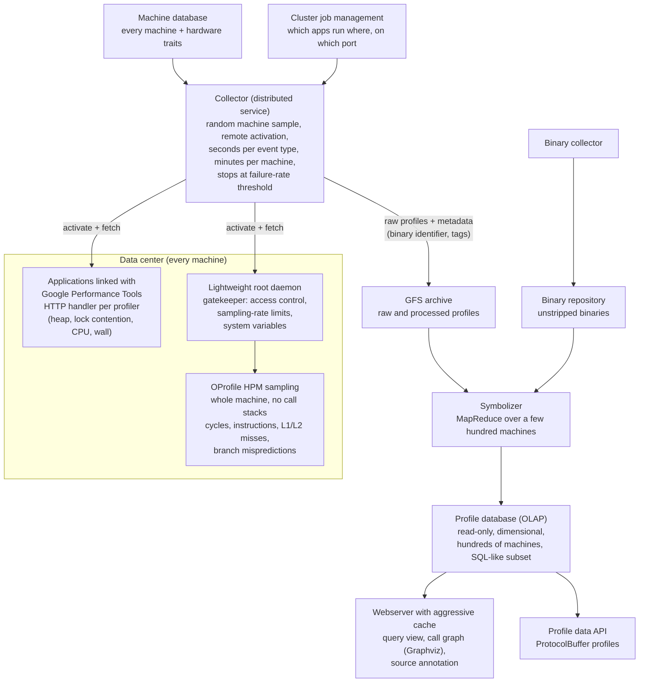

# Paper: Google-Wide Profiling: A Continuous Profiling Infrastructure for Data Centers (Ren et al. 2010)

> [!summary] Claim:
> Google-Wide Profiling (GWP) turns profiling from a per-process, on-demand activity into an always-on fleet service by sampling in two dimensions: at any moment only a small random subset of machines is profiled, and on each of those machines event-based sampling keeps the per-machine cost under "a few percent", so the aggregated fleet overhead is "less than 0.01 percent".
> Collection is separated from interpretation: machines run stripped binaries, profiles carry a binary identity, and a MapReduce symbolizer later joins raw addresses with unstripped binaries kept in a global repository.
> Every sample becomes a record `<event, sample counter, m-dimension vector>` in a read-only dimensional database, so any question (which function, which compiler, which data center, which platform) is a group-by over `k` of the `m` dimensions after the fact.
> The paper argues the sampled data is trustworthy with entropy and a top-`k` Manhattan distance, and finds the distance between a machine subset and the whole set falls roughly as `C / sqrt(N)` in the sample count `N`, which is the arithmetic that lets an operator buy precision with samples.
> Its lasting contributions are the architecture (still visible in AutoFDO, Cloud Profiler, pprof, Parca, Pyroscope, OTel Profiles, and Meta's Strobelight) and the uses it showed for fleet data: hottest shared code (zlib at nearly 5 percent of all cycles), platform affinity scheduling (10 to 15 percent potential improvement), auditing, and feedback-directed optimization from production profiles.



## 1. Bibliographic Metadata

| Field | Value |
| :--- | :--- |
| Title | Google-Wide Profiling: A Continuous Profiling Infrastructure for Data Centers |
| Authors | Gang Ren, Eric Tune, Tipp Moseley, Yixin Shi, Silvius Rus, Robert Hundt (all Google) |
| Venue | IEEE Micro, Vol. 30, No. 4, July/August 2010, pp. 65-79 (Crossref record; the article runs in the "Datacenter Computing" section and page 79 is blank) |
| DOI | 10.1109/MM.2010.68 (Crossref) |
| Primary URL | https://research.google.com/pubs/archive/36575.pdf (15-page PDF, typeset 2010-07-30) |
| Length and shape | Magazine article, not a conference paper: no formal evaluation section, seven figures, one table, seven references plus a six-reference sidebar |
| Ancestors it names | DCPI (Anderson et al., SOSP 1997), Morph (Zhang et al., SOSP 1997), OProfile, PAPI, HPCToolkit, Open\|SpeedShop, Upshot, Jumpshot |
| Companion work it cites | Chen, Vachharajani, Hundt et al., "Taming Hardware Event Samples for FDO Compilation", CGO 2010 |
| Later papers that describe the same system | Kanev et al., ISCA 2015; Chen, Li, Moseley (AutoFDO), CGO 2016; Hunter et al. (Temeraire), OSDI 2021 |

The article has four parts: the infrastructure (collector, profile sources, symbolization, storage, user interfaces), application-specific profiling, a reliability analysis of the sampled data, and a catalog of uses.
It reports almost no controlled measurements; its evidence is operational (years of fleet-wide use "with only rare complaints of system interference") plus stability statistics on its own data.
Reading it well means separating the architecture, which has aged very well, from the 2010 tooling (OProfile, GFS, MapReduce, a custom OLAP store), which has been replaced.

## 2. The Core Problem

Traditional performance analysis isolates a benchmark and profiles one execution of one program.
The paper names three reasons that fails in a data center.

1. **Benchmarks are unrepresentative or impossible.**
   Data center applications depend on live traffic and on each other, so "it's easier and more representative to monitor datacenter applications running on live traffic."
2. **Overhead has a hard ceiling and a large multiplier.**
   "Application owners won't tolerate latency degradations of more than a few percent", and at fleet scale "any unnecessary profiling overhead can cost millions of dollars in additional resources."
3. **The interesting questions span programs.**
   Which routines are hottest across all applications, how a compiler rollout is progressing, which applications run best on which hardware: no single-machine profile can answer these.

The paper also lists the problems that appear only at scale: verifying that profiles are correct when workloads change continually, managing overhead, making the data universally accessible, and the fact that GWP "is also a cloud application, with its own scalability and performance issues."

The sidebar places GWP in a lineage.
Morph used low-overhead system-wide sampling ("approximately 0.3 percent") plus binary rewriting to adapt programs continuously.
DCPI gathered richer profiles (precise stall times and causes) for Digital UNIX.
OProfile, "a DCPI-inspired tool", supported many architectures with less sophisticated analysis, and GWP uses it as a profile source.
HPC tools (HPCToolkit, Open|SpeedShop) solve a related problem across thousands of nodes, and trace tools (Upshot, Jumpshot) "aren't suitable for continuous profiling."
What none of them did was treat a whole fleet of heterogeneous machines and thousands of unrelated applications as one profiled system.

## 3. Key Innovation

The paper presents GWP as "theoretically" an extension of DCPI to data centers; the new ideas are the ones needed to make that extension work at fleet scale.

1. **Two-dimensional sampling.**
   Sample machines and sample events within a machine, so per-machine profiles stay dense enough to drill into while the fleet-wide cost stays negligible.
   The paper is explicit that "sampling in only one dimension would be unsatisfactory".
2. **Collection decoupled from symbolization.**
   Production binaries are stripped; profiles carry only addresses and a binary identifier, and symbolization runs later, in bulk, on other machines.
3. **Profiles as a dimensional dataset, not files.**
   Each sample carries a metadata vector (application, function, platform, compiler version, image, data center, kernel, build revision, builder), and analysis becomes filter-group-project queries over that vector.
4. **Statistical self-validation.**
   Because no ground truth exists for a live fleet, the paper validates the data indirectly: stability of entropy over dates, Manhattan distances between profiles, a square-root convergence law, stable derived CPI, and agreement with an independent utilization monitor.
5. **Fleet-scale uses as first-class outputs.**
   Platform affinity scheduling, hardware feature evaluation, compiler and platform auditing, deprecation coverage, and feedback-directed optimization from production profiles are presented as products of the dataset, not afterthoughts.

## 4. Mechanism Details

### 4.1 Two-dimensional sampling and the collector

A central machine database lists every machine in the fleet with its basic hardware characteristics.
The GWP collector "periodically gets a list of all machines from that database and selects a random sample of machines from that pool."
It then "remotely activates profiling on the selected machines and retrieves the results."
Different profile types are retrieved "sequentially or concurrently, depending on the machine and event type": for example hardware performance counters "for several seconds each", then lock contention or memory allocation.
"It takes a few minutes to gather profiles for a specific machine."

The second dimension is ordinary event-based sampling on the selected machine.
The paper's argument for needing both is quantitative in shape:

- Event sampling on every machine at a normal rate would use "too many resources across the fleet".
- A uniformly low event rate on every machine would make profiles "too sparse to drill down to the individual machine level".
- So "for each event type, we choose a sampling rate high enough to provide meaningful machine-level data while still minimizing the distortion caused by the profiling on critical applications."

The collector is itself a distributed service, for availability and to "reduce additional variation from the collector itself".
It "monitors error conditions and ceases profiling if the failure rate reaches a predefined threshold", which is the paper's only explicit circuit breaker.
All other GWP components are monitored "to ensure an always-on service to users."

The paper does not state how machines are weighted in the random sample, how often the collector runs, or how sampling is randomized in time of day.
Those are the details later systems had to make explicit (see the Strobelight run probability in the Industry Impact section).

### 4.2 Event-based sampling on one machine

On a selected machine, GWP's whole-machine profiles come from OProfile driving hardware performance monitoring (HPM) events.
The mechanism underneath any HPM sampler is the same: a hardware counter is programmed to overflow after `N` occurrences of an event, the overflow raises an interrupt, and the handler records where the CPU was (and optionally the call stack), so each sample stands for `N` events.
In the current Linux interface, `perf_event_open(2)` (Linux man-pages 6.19, as of 2026-11, Linux) defines a sampling event as one with `sample_period > 0` that "generates an overflow notification every N events"; setting the `freq` flag with `sample_freq` instead makes "the kernel adjust the sampling period to try and achieve the desired rate", adjusting once per timer tick.
`perf_event_open` itself was introduced in Linux 2.6.31 (as `perf_counter_open`, renamed in 2.6.32, per the man page's HISTORY section), so in 2010 it existed but GWP's whole-machine source was OProfile; [[Linux-perf-in-Depth-and-perf-c2c]] owns the perf interface, and [[Sampling-vs-Instrumentation-Skid-and-Safepoint-Bias]] owns skid, the gap between the instruction that caused an overflow and the one recorded.

To hide event heterogeneity across CPU generations, GWP defines "generic HPM events on top of the platform-specific events, using an approach similar to PAPI."
The most used generic events are "CPU cycles, retired instructions, L1 and L2 cache misses, and branch mispredictions."
Architecture-specific events are also exposed; the paper warns that aggregated profiles of those events "are biased to specific architectures" because only some machines can produce them.
Whole-machine profiles also include "kernel event traces, and power measurements".

Most users lack root and cannot program counters themselves, so GWP deploys "lightweight daemons on every machine".
"The daemons act as gate keepers to control access, enforce sampling rate limits, and collect system variables that must be synchronized with the profiles."
The modern kernel equivalents of that gate are the `perf_event_paranoid` sysctl (default 2, user-space measurements only, since Linux 4.6) and `perf_event_max_sample_rate` (default 100000 samples per second) (as of 2026-11, Linux, from `perf_event_open(2)`), but a fleet daemon still enforces policy above them, because a sysctl cannot know the fleet-wide budget.

### 4.3 Overhead control: three layers

On top of two-dimensional sampling, the paper names three further techniques.

1. **Conservative maximum rates.**
   "We measure the event-based profiling overhead on a set of benchmark applications and then conservatively set the maximum rates to ensure the overhead is always less than a few percent."
2. **No call stacks for whole-machine profiles.**
   Unwinding is expensive, so machine-wide HPM profiles are flat (program counter only); call stacks are collected "for most server profiles at lower sampling frequencies".
3. **Postprocessing elsewhere.**
   Profiles and metadata are saved "in their raw format", and symbolization runs "on a separate set of machines".

The result: "the aggregated profiling overhead is negligible - less than 0.01 percent."
The arithmetic behind a figure like that is a duty cycle, and it is worth doing once.
If profiling costs a machine at most `c` while active and a fraction `d` of machine-time is under profiling, the fleet overhead is at most `c * d`.
With an illustrative `c = 2%` (the paper says only "a few percent"), reaching `0.01%` needs `d = 0.0001 / 0.02 = 0.5%` of machine-time under profiling.
The paper does not publish `c` or `d`; the AutoFDO paper later publishes both for its GWP collector, and the arithmetic checks (section 6.1).

### 4.4 Per-process profiles and the HTTP profiling interface

The second profile category is per-process.
"Most applications include a common library that enables process-wide stacktrace-attributed profiling mechanisms for heap allocation, lock contention, wall time and CPU time, and other performance metrics."
That library is the Google Performance Tools (released publicly as google-perftools; the project is now gperftools, "originally Google Performance Tools", and was the original home of the Perl `pprof`).
"The common library includes a simple HTTP server linked with handlers for each type of profiler."
"A handler accepts requests from remote users, activates profiling (if it's not already active), and then sends the profile data back."
The collector learns "from the cluster-wide job management system what applications are running on a machine and on which port each can be contacted".

This is a pull model with an in-process endpoint, and it has a coverage cost the paper states plainly: a machine "lacking remote profiling support has some programs, which the per-process profiling doesn't capture."
The paper's check is to compare with whole-machine profiles, which "shows that remote per-process profiling captures the vast majority of Google's programs."
Go's `net/http/pprof` package is the same pull design in a language runtime: it registers handlers under `/debug/pprof/` that serve profiles "in the format expected by the pprof visualization tool" (pkg.go.dev), and the gperftools documentation calls the Go standard library "a great example" of HTTP profiling endpoints.
The Go blog (2011) describes `go tool pprof` as "a slight variant of Google's pprof C++ profiler".
No source states that Go copied GWP's handlers, so treat the shared design as parallel evolution from the same pprof tooling, not as a documented lineage.

### 4.5 Metadata and the binary identity

Profiles travel with metadata of two kinds.
Some is needed for postprocessing, "such as a unique identifier for each running binary that can be correlated across machines with unstripped versions for offline symbolization."
The rest tags profiles "so that we later correlate the profiles with job, machine, or datacenter attributes."

The paper does not say how the identifier is computed.
By 2016 the AutoFDO paper names it: "Build-ID, a unique identifier for each binary usually computed by a hash of its contents at compile time."
pprof's `profile.proto` (as of 2026-11, Both) carries the same idea in `Mapping.build_id`: "A string that uniquely identifies a particular program version with high probability. E.g., for binaries generated by GNU tools, it could be the contents of the .note.gnu.build-id field."
[[DWARF-Debug-Information-and-Symbol-Bundles]] owns build IDs and debug-info lookup; the point here is that a fleet profiler cannot work without one, because the same path name on two machines can be two different binaries.

### 4.6 Symbolization and the binary repository

Applications are deployed "without any debug or symbolic information" "to save network bandwidth and disk space".
The paper considers and rejects recompiling sampled applications at source milestones: "too resource-intensive and sometimes impossible for applications whose source isn't readily available."
Instead, "GWP stores unstripped binaries in a global repository, which other services use to symbolize stack traces for automated failure reporting."
That sharing is a design point: the crash pipeline ([[Core-Dumps-Minidumps-and-Crash-Reporting]]) and the profiler need the same artifact store keyed by the same identity.

Symbolization is the expensive step.
"Since the binaries are quite large and many unique binaries exist, symbolization for a single day of profiles would take weeks if run sequentially."
GWP distributes it "across a few hundred machines using MapReduce."

The paper names two cases that make symbolization hard or impossible, and the design implies a third:

- JIT and dynamically generated code ("Java and QEMU"): the code "is not available offline and can therefore no longer be symbolized".
- Operating system kernels and kernel loadable modules, which the symbolizer must also handle.
- Programs whose binaries never reach the repository (not stated in the paper; it follows from symbolizing only against stored unstripped binaries).

The first is still the hardest case in 2026: eBPF agents solve it with per-runtime unwinders and perf map files, which [[Continuous-Profiling-GWP-Parca-Pyroscope-and-OTel-Profiles]] owns.

### 4.7 Storage: archive, dimensional database, and the record

GFS stores profiles after collection and "archives the entire performance logs and corresponding binaries."
For querying, GWP loads samples "into a read-only dimensional database that is distributed across hundreds of machines", accessible to all users for ad hoc queries and to systems for automated analyses.
Scale at the time: "daily profiles from several thousand applications running on thousands of servers", a compressed profile database that "grows by several Gbytes every day", and "several terabytes of historical performance data".

The data model is the paper's most reusable idea.
"GWP collects roughly a dozen events, such as CPU cycles, retired instructions, L1 and L2 cache misses, branch mispredictions, heap memory allocations, and lock contention time."
"The sample must be numeric and capable of aggregation": cycles, cache misses, bytes allocated, or a thread's locking time.
With an `m`-element metadata vector, a record is the tuple `<event, sample counter, m-dimension vector>`.

A query chooses `k` keys from the `m` dimensions, filters by restrictions on the remaining `m - k`, projects samples onto the `k` keys, sums, and sorts:

```text
-- The shape of a GWP query, written as SQL for clarity (the paper says only "a subset of SQL-like semantics").
SELECT   function_name, SUM(sample_counter) AS cycles
FROM     samples
WHERE    event = 'CPU_CYCLES'
  AND    application = 'search-frontend'      -- restriction on one of the m-k other dimensions
  AND    date BETWEEN '2010-05-01' AND '2010-05-07'
GROUP BY function_name                        -- k = 1 key
ORDER BY cycles DESC;
```

The paper notes that "not every query makes sense in practice", but even a small subset is "demonstrably informative".
Some queries "can take tens of seconds to complete", and because "most queries are seen frequently, the profile server uses aggressive caching to hide the database latency."

### 4.8 User interfaces

- **Query view.**
  Lists entries (functions, executables) matching the query, with links that refine it, for example to one executable over a time window; the home page links the top results "Google-wide, for each performance metric."
- **Call graph view.**
  For server profiles with full call stacks, stacks "are aggregated to produce complete dynamic call graphs", rendered with Graphviz, each node showing a function name and its sample percentage.
  This is the ancestor of `pprof -web`; flame graphs came later ([[Flame-Graphs-Differential-Flame-Graphs-and-Visualizations]]).
- **Source annotation.**
  A source file with a per-line hotness histogram.
  Because a file has many versions across branches, GWP retrieves "a hash signature from the repository for each source file and aggregate[s] samples on files with identical signatures", which keeps a line histogram from mixing two different files that share a path.
- **Profile data API.**
  Raw and symbolized profiles are stored "in ProtocolBuffer formats", readable directly for offline analyses such as the paper's own reliability study.

### 4.9 Application-specific profiling

The default rate gives high-confidence top-level profiles but "might not collect enough samples for applications that consume relatively few cycles Google-wide."
Raising the fleet-wide rate to cover them "is too expensive because they're usually sparse."
GWP therefore adds application-specific profiling: a much smaller machine pool targeted at one application, sampled at a higher rate.
It "can target any specific set of machines", for example machines with the newest kernel, and can be limited in duration, which suits batch jobs such as MapReduce whose profiles must be collected from "hundreds or thousands of their workers."
This is stratified sampling: the uniform fleet sample serves the fleet-wide questions, and targeted strata serve the tail.

### 4.10 The same system five years later

Two later Google papers describe the GWP pipeline as it had evolved, and they fill in what the 2010 article left unstated.

- Kanev et al. (ISCA 2015): GWP collectors "(i) randomly select a small fraction of Google's server fleet to profile each day, (ii) trigger profile collection remotely on each machine-under-test for a brief period of time (most often through perf), (iii) symbolize the collected sample's callstacks ... and (iv) aggregate a large number of such samples from many machines in a Dremel database."
  So OProfile had given way to perf, and the custom OLAP store to Dremel.
- Chen, Li, Moseley (CGO 2016): each machine runs "the perf events daemon, which exposes access to a restricted set of perf events functionality"; the collector "continuously crawls machines in Borg in a random order and requests a 10-second system-wide LBR profile"; each sample becomes a Dremel row with Borg user and job, binary name, revision, timestamp, and build ID.

The architecture of the 2010 article survived both substitutions unchanged: random machine selection, brief event sampling, a gatekeeper daemon, raw samples plus identity, offline symbolization, and a dimensional store.

## 5. Evaluation and Limitations

### 5.1 Reliability analysis: how the paper argues the samples are sound

"There's no direct way to measure the datacenter applications' profiles' representativeness."
The paper uses two indirect methods: stability of the aggregated profiles under several metrics, and cross-validation against other data sources.
Unless stated otherwise the study uses CPU cycles, and the authors say "our conclusions also apply to the other types."

#### Entropy

For a profile `W` with `n` entries and `p(x_i)` the fraction of samples on entry `x_i` (the paper cites Savari and Young for the method):

$$H(W) = -\sum_{i=1}^{n} p(x_i)\,\log p(x_i)$$

High entropy means a flat profile with many populated entries; low entropy means few samples or samples concentrated on a few entries.
"We're not concerned with entropy itself": it is used as a signature that should be stable between representative profiles.
The paper does not state the logarithm base.
One useful reading (an interpretation, not the paper's): `exp(H)` is the effective number of equally weighted entries, so with natural logarithms a profile of 400 equal entries has `H = ln 400 = 5.99`.

Worked values (computed for this note with natural logarithms):

| Profile | `H` (nats) | `H` (bits) |
| :--- | :--- | :--- |
| One entry, 100% | 0 | 0 |
| 70%, 10%, 10%, 10% | 0.940 | 1.357 |
| 4 equal entries | 1.386 | 2.000 |
| 400 equal entries | 5.991 | 8.644 |

Findings, per figure:

- Figure 4: daily application-level profiles (samples broken down by application) have stable entropy across random dates, in "a small interval", while the daily sample count varies (the figure's sample axis runs to 20 million).
  The correlation between sample count and entropy is "loose": past a threshold more samples do not lower entropy, "partly because GWP sometimes samples more machines than necessary for daily application-level profiles", since users drill down to filtered subsets.
- Figure 5a: one application's function-level profile has even more stable entropy.
- Figure 5b: per-machine function-level profiles of one application: entropy is small when the sample count is small ("limited by the maximum possible uncertainty"), then stabilizes; two clusters appear (5.5 to 6, and 4.5 to 5), which the authors attribute to "the application's two behavioral states".

Entropy ignores entry names: `x%` on `foo` and `y%` on `bar` has the same entropy as `y%` on `foo` and `x%` on `bar`.

#### Manhattan distance

To compare the same entries across profiles, the paper sums absolute percentage differences over the top `k` entries:

$$M(X, Y) = \sum_{i=1}^{k} \left| p_x(x_i) - p_y(x_i) \right|$$

where `p_y(x_i)` is 0 when `x_i` is not in `Y`; the authors call it "a simplified version of relative entropy between two profiles."
Two properties follow from the definition and matter when using it, although the paper does not discuss them:

- It is asymmetric, because the top `k` entries are taken from `X`.
- With `k` covering every entry of `X`, it lies in `[0, 2)`: disjoint profiles give exactly 1, not 2, because entries of `Y` outside `X` are never summed, and 2 is only approached (for example `X = {a: 0.01, b: 0.99}`, `Y = {a: 1}` gives 1.98; computed for this note).

Worked example (computed for this note): `X = {a: 0.5, b: 0.3, c: 0.2}`, `Y = {a: 0.4, b: 0.3, d: 0.3}`.
`M(X, Y)` with `k = 3` is `|0.5 - 0.4| + |0.3 - 0.3| + |0.2 - 0| = 0.3`.
`M(Y, X)` with `k = 3` is `|0.4 - 0.5| + |0.3 - 0.3| + |0.3 - 0| = 0.4`.
With `k = 2`, `M(X, Y) = 0.1`: the vanished `c` falls outside the top 2, and the new function `d` never enters `M(X, Y)` directly at any `k`, because the sum runs over entries of `X`; its arrival shows only through the share the entries of `X` lost.

Findings: Manhattan distances between daily profiles behave like entropy (Figure 6a), and across profile types "memory and thread profiles have smaller distances", while "server CPU time profiles correlate with HPM profiles of cycles and instructions in terms of variations", which the authors read as natural workload change rather than sampling noise.

#### The square-root law

The paper's most quantitative result: pick a random subset of machines from a machine set, compute its profile's Manhattan distance against the whole set's profile, and fit a power-law trend line over the subset's sample count.
"The trend line roughly approximates a square root relationship":

$$M(X) = \frac{C}{\sqrt{N(X)}}$$

with `N(X)` the total samples in the profile and `C` "a constant that depends on the profile type."
Figure 6b plots the fit with an x-axis of 0 to 18 million samples and a distance axis of 0 to 0.85; the article prints no fitted `C` or confidence interval.

Why the exponent is one half (a derivation for this note, not in the paper): treat the subset's samples as `N` independent multinomial draws from the whole set's distribution `p`.
Each estimated share has standard error `sqrt(p_i (1 - p_i) / N)`, and for large `N` the expected absolute error of a normal variable is `sqrt(2 / pi)` times its standard deviation, so

$$E[M] \approx \frac{1}{\sqrt{N}} \sum_{i=1}^{k} \sqrt{\frac{2\,p_i (1 - p_i)}{\pi}}$$

which is the paper's form with `C` determined by the shape of the profile: flatter profiles have larger `C`.
Real machine subsets are clustered samples (all samples from one machine share that machine's workload), so the effective `N` is smaller than the raw count and `C` absorbs the difference.

The operational use is planning: with `C` fixed, halving the distance needs four times the samples.
For a profile type with `M = 0.10` at 1 million samples, 4 million gives 0.05, 16 million gives 0.025, and 250 thousand gives 0.20 (computed for this note).

#### Derived metrics and cross-validation

CPI derived from cycle and retired-instruction HPM profiles is stable across dates; the daily aggregated CPI "falls into a small interval between 1.7 and 1.8" (Figure 7).
Against the data center monitoring system, which covers every machine at coarse granularity, GWP's CPU-cycles profile matches the monitor's core-seconds by:

$$\text{CoreSeconds} = \text{Cycles} \times \text{SamplingRate}_{machine} \times \text{SamplingPeriod} \,/\, \text{CPUFrequency}_{average}$$

The paper does not define the terms.
The dimensionally consistent reading is: `Cycles` is the count of cycle samples, `SamplingPeriod` is cycles per sample (so their product is cycles observed), `SamplingRate_machine` scales from profiled machines to all machines (the inverse of the machine sampling fraction), and dividing by the average clock frequency converts cycles to core-seconds.
That reading also shows where it breaks: a fleet with frequency scaling or turbo has no single frequency, so `CPUFrequency_average` is itself an estimate.

### 5.2 The uses, read as evidence

The paper's second half is a catalog of uses, and each is evidence that the dataset answers questions nothing else could.

| Use | What GWP showed | Mechanism behind it |
| :--- | :--- | :--- |
| Application team first stop | Google's speech-recognition team "quickly optimized a previously unknown hot function" | Aggregation across many instances over time |
| Load-test calibration | Teams "design, evaluate, and calibrate their load tests" against production profiles | Production profile as ground truth for a benchmark |
| Hottest shared code | zlib "accounted for nearly 5 percent of all CPU cycles consumed", motivating zlib optimization and evaluation of alternatives | Group by function across all applications |
| Savings estimates | "Dollar amount per performance change" became a popular informal metric; "dollar per source line" was under consideration | Cycle share times fleet cost |
| Deprecation coverage | Finding callers of library functions to be deprecated; "the users might miss less common clients, but the biggest, most important callers are easy to find" | Group by caller of a function |
| Hardware evaluation | Whether a floating-point coprocessor would pay off, from the share of all computation it could accelerate; which applications run on old hardware | Share of cycles by kind of work and platform |
| Platform affinity | 10 to 15 percent potential improvement in most cases where many jobs run on multiple platforms | CPI per application and platform, then a linear program |
| Data center monitoring | Compiler versions actually in production, platform rollout and retirement speed, distribution by data center | Group by compiler, platform, builder, data center over time |
| Profile diffs | A dramatic change to hot functions in daily profiles triggers a finer comparison that "eventually points blame to the source code revision number, compiler, or data center" | Two queries with identical keys and events, differing in other dimensions |
| FDO | Profiles extracted per binary in a compiler-readable format; "an aged profile" still improves a fresh release when critical sections did not change | Per-binary sampled profiles (Chen et al. CGO 2010) |
| Benchmark QA for FDO | Identifying "which codes are ill-suited for FDO compilation" from static benchmarks | Compare benchmark profile against production profile |
| HPM and microarchitecture quality | Comparing cache latencies and HPM counters for the same application on processors with the same ISA | Same binary, two platforms |

#### Platform affinity, worked

Table 1 of the paper has two applications, NumCrunch (CPI 1 on both platforms) and MemBench (CPI 1 on Platform 1, CPI 2 on Platform 2 "because of the smaller L2 cache"), each with 200 instructions to run.
Random assignment, 100 instructions of each per platform, costs 200 cycles on Platform 1 and 100 + 200 = 300 on Platform 2, 500 in total.
The optimal assignment moves all MemBench work to Platform 1 and all NumCrunch work to Platform 2: 200 cycles each, 400 in total.
A brute-force search over assignments in steps of 10 instructions (run for this note) finds the same 400-cycle optimum.

The general problem, as printed: minimize `sum_{i,j} CPI_ij * Load_ij`, subject to `sum_j Load_ij = TotalLoad_j` and `sum_j CPI_ij * Load_ij <= Capacity_i`, where `Load_ij` is instruction samples of application `j` on platform `i`, `TotalLoad_j` is the measured total for application `j`, and `Capacity_i` is the platform's total cycle samples.
The first constraint has an index typo in the paper: summing over `j` cannot equal a quantity indexed by `j`; the intended constraint is `sum_i Load_ij = TotalLoad_j` (each application's work is fully placed across platforms).
The authors solve it with simulated annealing, which "approximates the optimal solution in seconds for workloads of around 100 jobs running on thousands of machines of four different platforms over one month."
They note CPI must be normalized "by clock rate", and that colocation decisions can use the same data (citing Mars and Hundt, CGO 2009).

### 5.3 Numbers to know

| Quantity | Value | Source |
| :--- | :--- | :--- |
| Per-machine overhead target while profiled | "always less than a few percent" | GWP 2010 |
| Aggregated fleet overhead | "less than 0.01 percent" | GWP 2010 |
| Morph system-wide sampling overhead | "approximately 0.3 percent" | GWP 2010 sidebar |
| Time to gather all profiles for one machine | "a few minutes" | GWP 2010 |
| HPM counter profiles | "several seconds each" | GWP 2010 |
| Coverage | "several thousand applications running on thousands of servers", daily | GWP 2010 |
| Database growth | "several Gbytes every day" (compressed) | GWP 2010 |
| History | "several terabytes" | GWP 2010 |
| Symbolization of one day, sequential | "would take weeks"; distributed over "a few hundred machines" | GWP 2010 |
| Events collected | "roughly a dozen" | GWP 2010 |
| Daily aggregated CPI | 1.7 to 1.8 | GWP 2010, Figure 7 |
| zlib share of all cycles | "nearly 5 percent" | GWP 2010 |
| Platform affinity potential | 10 to 15 percent, about 100 jobs, four platforms, one month | GWP 2010 |
| AutoFDO collector coverage | about 10% of machines per day, 10-second LBR profiles, about 0.001% of cycles profiled, under 1% overhead while profiling | AutoFDO 2016 |
| Binary concentration | about 750 binaries are 95% of CPU usage, tens of thousands in total | AutoFDO 2016 |
| Fleet microarchitecture study | about 20,000 Ivy Bridge machines, 1-second counter samples, studies of 12 to 36 months | Kanev 2015 |
| Datacenter tax | 22 to 27% of cycles over 11 months ("nearly 30%" in the abstract) | Kanev 2015 |
| Hottest binary share | 9.9%; top 50 binaries about 60% of cycles | Kanev 2015 |

The AutoFDO numbers check against the duty-cycle model of section 4.3: 10% of machines for 10 seconds out of 86,400 is `0.10 * 10 / 86400 = 0.00116%` of machine-time, matching "around 0.001% of observable cycles" (computed for this note).

### 5.4 Threats to validity and what the paper does not measure

- **No overhead measurement is published.**
  "A few percent" and "less than 0.01 percent" are stated without the benchmark set, the per-event rates, the duty cycle, or a latency distribution; an always-on system's real cost is often in tail latency, which the paper does not discuss.
- **No ground truth.**
  The reliability analysis shows stability and self-consistency, not accuracy; a systematic bias (skid, a blind spot for JIT code, an unprofiled class of machines) is perfectly stable and would pass every test in the section.
- **Coverage bias in per-process profiles.**
  Only programs linking the common library and registered with the job system can be profiled remotely; the paper's check against whole-machine profiles is qualitative ("the vast majority").
- **Flat whole-machine profiles.**
  Without call stacks, HPM samples attribute cost to leaf functions; shared leaf code (memcpy, malloc, hashing) looks hot without saying who called it, which Kanev et al. later turn into a deliberate convention ("we only use leaf execution profiles", which under-estimates tax).
- **Unspecified statistics.**
  The entropy base, the dates ("random dates"), the value of `k` for Manhattan distance, the confidence of the square-root fit, and the machine-set definitions are not given, so the figures cannot be reproduced from the article.
- **CPI as an efficiency metric.**
  The affinity method assumes the same work executes the same instructions on every platform; different compilers, binaries, ISA extensions, or spin-waiting change instruction counts and make CPI misleading.
- **Counter pitfalls not discussed.**
  Kanev et al. later report taking "special care to validate the performance counters" ("errata in more exotic performance counters can be common") and avoiding PMU time-multiplexing because it "often results in erroneous counter expressions"; the 2010 article is silent on both.
- **Citation slips.**
  The DCPI reference pairs the SOSP 1997 venue with pages 357-390, which are the ACM TOCS 15(4) pages; the SOSP paper is pp. 1-14.
  The Savari and Young reference reads "(FDO 02), ACM Press, 2000"; the year 2000 matches the paper itself (Journal of Instruction-Level Parallelism, vol. 2, 2000, submitted 2/00, published 4/00, https://jilp.org/vol2/v2paper4.pdf), but the "FDO 02" workshop label does not match any source checked and is left as the article printed it.
- **Privacy and access.**
  The paper says profiles are "accessible to all users"; it does not discuss access control on profile content beyond the daemons' gatekeeping, a concern for any fleet profiler that records function names, arguments in labels, or tenant identifiers.

## 6. Industry Impact

### 6.1 Inside Google: the dataset became infrastructure

- **AutoFDO (CGO 2016).**
  "AutoFDO leverages the Google-wide Profiler (GWP) to sample hardware performance counters from production machines"; samples go to Dremel, a batch job symbolizes the top binaries' samples, converts them to the compiler's profile format, and commits them to version control, where the release build picks them up.
  The resulting binaries are "on average 10% faster than binaries optimized without AutoFDO", sampled profiles reach 85% of instrumented FDO's gains (84.84% mean in its Table 1), and AutoFDO "increased the number of FDO users at Google by 8X".
  It also solves the staleness problem the 2010 article waved at ("an aged profile"): profiles are keyed by `{function name, line offset, discriminator}` rather than `{file name, line number, discriminator}`, so unrelated edits do not invalidate them.
  [[Paper-AutoFDO-Warehouse-Scale-Optimization]] owns that paper, and [[Linkers-LTO-PGO-AutoFDO-and-BOLT]] owns the toolchain mechanism.
- **Profiling a Warehouse-Scale Computer (ISCA 2015).**
  GWP data across "more than 20,000 Google machines over a three year period" established that there is "no killer application" (top 50 binaries about 60% of cycles) and that a "datacenter tax" of RPC, protobuf, hashing, compression, allocation, and data movement consumes 22 to 27% of cycles, which reframed server CPU design around shared building blocks and front-end stalls.
  Its methodology is GWP plus Top-Down counter analysis ([[Hardware-Performance-Counters-Top-Down-TMA-and-Roofline]]).
- **Temeraire, the hugepage-aware TCMalloc (OSDI 2021).**
  The fleet experiment randomly selected 1% of machines as experiment and a separate 1% as control, and "our fleetwide profiler lets us correlate performance metrics against the groupings"; the paper cites GWP.
  This is the GWP data model used as an experimentation platform: machine membership becomes one more dimension of the vector.
- **Google Cloud Profiler** productizes the same two-dimensional pattern for customers: it collects "usually for 10 seconds, every 1 minute for a single instance of the configured service in a single Compute Engine zone", with a randomized profiling period, overhead "less than 5 percent" while collecting and "commonly less than 0.5 percent" amortized (as of 2026-11, Both, Cloud Profiler documentation).
  With 10 replicas each replica is profiled 10 seconds in 600, a 1.67% duty cycle, which bounds the amortized overhead at 0.083% if the 5% figure holds (computed for this note).

### 6.2 The open ecosystem

- **pprof.**
  gperftools, "originally Google Performance Tools", was the original home of the Perl `pprof`, which "has been rewritten in Go around 2016" and now lives at `github.com/google/pprof`; "Go's own profiling facilities are based on that pprof version as well."
  `profile.proto` (copyright 2016) encodes the GWP lessons in a file format: a `Mapping` with `build_id` for offline symbolization, `period` and `period_type` to recover unsampled values ("there should be enough information present to determine the original sampled values"), and a string table for compact transfer.
- **Go PGO.**
  Go's PGO documentation recommends collecting "profiles directly from the production environment" and is explicitly "designed to support an AutoFDO style workflow", robust to source changes ("source stability") and to profiling PGO-built binaries ("iterative stability"); `-pgo=auto` with a `default.pgo` file is the default since Go 1.21, and the documented gain is "around 2-14%" as of Go 1.22 (as of 2026-11, Both).
- **Parca, Pyroscope, and the OpenTelemetry eBPF profiler.**
  These keep GWP's split (cheap capture on the host, symbolization and aggregation centrally, query by labels) but replace two-dimensional sampling with whole-fleet low-rate sampling: Parca Agent samples "19 times per second per logical CPU" on `PERF_COUNT_SW_CPU_CLOCK`, chosen prime "to avoid collisions with other things that may be happening periodically on a machine" (as of 2026-11, Linux).
  The trade is the one GWP rejected for HPM events: sampling every machine is affordable only at a software-clock rate low enough, and without hardware events.
  [[Continuous-Profiling-GWP-Parca-Pyroscope-and-OTel-Profiles]] owns these systems, eBPF unwinding, and the wire formats.
- **OTel Profiles.**
  OpenTelemetry Profiles entered public Alpha on 2026-03-26; its format is "originally inspired by the pprof format and developed in collaboration with pprof maintainers", pprof "can be round-trip converted to/from OTLP Profiles with no loss of information", and samples can carry `trace_id` and `span_id` for correlation with traces (as of 2026-11, Both).
  That last field is the "mesh-up GWP profiles with performance data from other sources" the 2010 conclusion asked for, and it is why [[Paper-Dapper-Distributed-Systems-Tracing]] is the next paper in this pillar.
- **Meta Strobelight (2025).**
  An orchestrator of 42 profilers on all production hosts that makes GWP's implicit choices explicit: curated profilers run on every host with a "run probability", which Strobelight retunes daily per service to hit a target sample count ("dynamic sampling"), and each logged sample carries a "weight" so data from hosts sampled at different rates can be aggregated without bias.
  Symbolization is deferred and centralized (DWARF, ELF, gsym, blazesym), LBR samples feed CSSPGO and BOLT for Meta's top 200 services ("up to 20% reduction in CPU cycles"), and a one-character fix (`auto` to `auto&` on a hot vector copy) found in the data was estimated at "15,000 servers in capacity savings per year."
  [[Paper-BOLT-Binary-Optimizer]] owns BOLT.

### 6.3 What changed and what did not

| GWP 2010 | Current practice (as of 2026-11) | Why it changed |
| :--- | :--- | :--- |
| OProfile for HPM, flat profiles | perf events or eBPF on perf events, usually with stacks | perf_events became the kernel interface (since Linux 2.6.31); the OProfile project removed its legacy `opcontrol` profiler in 1.0.0 (2014-09-11) |
| Random subset of machines, minutes each | Either the same (Google, Cloud Profiler, Strobelight run probability) or every machine at about 19-97 Hz (eBPF agents: Parca Agent and Grafana Alloy `pyroscope.ebpf` default to 19, Grafana's Pyroscope OTel eBPF profiler example uses 97) | eBPF stack walking made per-sample cost low enough for whole-fleet software-clock sampling |
| Unstripped binaries in a global repository | Debug info keyed by build ID in a symbol server or debuginfod | Build IDs became standard in ELF toolchains |
| MapReduce symbolization | Symbolization services with indexed formats (gsym, blazesym, Parca's debuginfo store) | Query-time latency instead of batch latency |
| Custom read-only OLAP over GFS | Dremel (Google), Scuba (Meta), columnar object storage (Parca, Pyroscope) | Same dimensional model, better engines |
| In-process HTTP profiling endpoints | Still present (Go `net/http/pprof`), plus agentless eBPF | Language runtimes standardized the endpoint |
| Generic HPM events over vendor events | Still needed; PMU access is often missing in VMs | Counters remain vendor-specific |

## 7. Concept Grounding

| Concept note | What it relies on from this paper |
| :--- | :--- |
| [[Continuous-Profiling-GWP-Parca-Pyroscope-and-OTel-Profiles]] | The template (two-dimensional sampling, collection split from symbolization, dimensional store) that every modern agent and backend follows; that note owns the modern systems |
| [[Linux-perf-in-Depth-and-perf-c2c]] | Event-based sampling via counter overflow, the interface GWP moved to after OProfile |
| [[Sampling-vs-Instrumentation-Skid-and-Safepoint-Bias]] | Why sampling is the only affordable always-on method, and the skid that GWP's HPM profiles inherit |
| [[Hardware-Performance-Counters-Top-Down-TMA-and-Roofline]] | CPI and the generic HPM events; the Kanev follow-up's Top-Down methodology on GWP data |
| [[Linkers-LTO-PGO-AutoFDO-and-BOLT]] and [[Cpp-PGO-AutoFDO-and-BOLT-Workflow]] | FDO from production profiles, aged profiles, and the AutoFDO pipeline built on GWP |
| [[DWARF-Debug-Information-and-Symbol-Bundles]] | The binary identity and unstripped-binary store that offline symbolization needs |
| [[Flame-Graphs-Differential-Flame-Graphs-and-Visualizations]] | The call graph view and the profile diff, which flame graphs and differential flame graphs replaced as the default rendering |
| [[Performance-Regression-Detection-in-CI]] | GWP's daily profile diff as the production-side regression detector |
| [[Statistics-for-Benchmarks-Coordinated-Omission-and-HDR-Histograms]] | Sampling error, and the square-root law as a sample-size rule |
| [[Rebuild-Lab-Sampling-Profiler-to-Folded-Stacks]] | A host-level sampler whose output is the raw material GWP aggregates |

## Pitfalls

> [!warning] Pitfalls:
> - **Reading "less than 0.01 percent" as the cost on a profiled machine.**
>   It is the fleet average; the machine being profiled pays up to "a few percent" while profiling, and a latency-critical service sees that as tail latency during the collection window.
> - **Sampling every machine at a low rate and calling it GWP.**
>   That is one-dimensional sampling; the paper rejects it for HPM events because per-machine profiles become too sparse to drill into, and eBPF agents accept it only for a software clock.
> - **Treating fleet share as a per-application hotspot list.**
>   zlib at 5% of the fleet can be under 1% in every application; the remedy is a shared-library optimization, not a ticket to each team.
>   The converse also holds: a small application is invisible in the fleet sample and needs application-specific profiling.
> - **Mix shift mistaken for regression.**
>   A function's fleet share rises when the applications that call it get more machines, with no code change; diff with identical keys and filter on application before blaming a revision.
> - **Losing the binary identity.**
>   A release pipeline that stops uploading unstripped binaries, or a build that drops `--build-id`, turns new samples into unsymbolized addresses silently; watch the unsymbolized share as a health metric.
> - **JIT and generated code.**
>   The paper states such code "can therefore no longer be symbolized" offline; without runtime cooperation (perf maps, runtime unwinders) a JVM-heavy fleet under-reports itself.
> - **Leaf-only profiles misassign blame.**
>   Without stacks, `malloc` called from RPC code counts as allocation; that is the right answer for "what to accelerate" and the wrong answer for "which subsystem to fix".
> - **CPI across different binaries.**
>   CPI compares efficiency only for the same instructions; a different compiler, ISA level, or spin loop changes instruction counts and can make a slower platform look better.
> - **Manhattan distance is asymmetric and `k`-sensitive.**
>   `M(X, Y)` takes the top `k` entries of `X`; a function that appears only in `Y` is never counted directly and shows only through the share it takes from entries of `X` inside the top `k`.
> - **Trusting stability as accuracy.**
>   Stable entropy and small distances prove the sampling is consistent; they do not prove the attribution is right, because a systematic bias is stable too.
> - **Multiplexed or unvalidated counters.**
>   Combining counters from different samples or time-multiplexed PMU groups produces ratios that no single execution had; collect a ratio's numerator and denominator in the same PMU group.

## At Scale

The paper's design is a set of answers to "how much data do we need, and who pays for it".
The decision rules change with fleet size.

| Fleet | Recommended shape | Reason |
| :--- | :--- | :--- |
| 1 to 100 hosts, one team | A continuous agent on every host at about 19 Hz CPU clock, pprof or OTLP to one backend | Whole-fleet sampling is cheap at this size, and machine sampling would leave too few samples |
| 100 to 5,000 hosts | Whole-fleet low-rate CPU sampling plus scheduled HPM, heap, and lock profiles on a random machine subset | HPM and allocation profiling are too expensive to run everywhere all the time |
| 5,000 to 50,000+ hosts | Full GWP shape: random machine selection with run probabilities, per-service sample targets, sample weights, application-specific strata, central symbolization keyed by build ID, a dimensional store | Storage, symbolization, and query cost dominate; sample count, not host count, sets precision |

Budget it with the two formulas this note derived from the paper.
Overhead: `fleet_overhead <= per_machine_cost * duty_cycle`, so a 0.05% budget at 2% while profiling allows a 2.5% duty cycle.
Precision: `M ~ C / sqrt(N)`, so measure `C` once per profile type by subsampling, then size `N` per service to the drill-down precision users need; every halving of error costs four times the samples, which is why GWP targets small applications separately instead of raising the global rate.

Organizational rules that follow from the paper's uses:

- Make the profile database the system of record for "is this worth optimizing": "dollar amount per performance change" works only when every team trusts the same dataset.
- Wire the binary repository into the release pipeline as a hard gate, shared with crash reporting, because a profiler without symbols is a cost with no output.
- Give the daemon, not the application, ownership of rate limits and access control; per-host gatekeeping is the only place a fleet-wide budget can be enforced.
- Use fleet profiles for deprecation and migration coverage ([[Platform-Engineering-Paved-Roads-and-Deprecation]]), but remember the paper's caveat: sampling finds the big callers and misses rare ones, so pair it with static call-site search before deleting an API.
- Keep production profiles flowing into the compiler ([[Cpp-PGO-AutoFDO-and-BOLT-Workflow]]); at Google and Meta that loop is the largest recurring return on the profiler's cost.

## Practice Drill

> [!tip] Practice Drill:
> Reproduce the square-root law on your own data.
> 1. Collect one large CPU profile as folded stacks (for example with the sampler from [[Rebuild-Lab-Sampling-Profiler-to-Folded-Stacks]], or `perf record -F 99 -a -g` on Linux) and reduce it to leaf-function sample counts; this is the "whole set".
> 2. For sample sizes `N` from 1,000 to the full count, draw `N` samples at random 30 times, build each subset's distribution, and compute the top-`k` Manhattan distance against the whole set for `k = 20`.
> 3. Fit `log M = log C - a log N` and report `a` with its spread across the 30 draws; the paper's claim is `a` near 0.5.
> 4. Repeat with subsets drawn per process or per host instead of per sample, and explain why `C` grows (clustered sampling).
> 5. Compute entropy for each subset and find the sample count past which it stops rising, which is the paper's "threshold".
> Report what you measured, not the paper's numbers, and state which profile you used.

## Interview Questions

### L5

> [!question] 1. What does "sampling in two dimensions" mean in GWP, and why does the paper say one dimension alone is not enough?
> [!success]- Answer
> GWP samples machines (only a small random subset of the fleet is profiled at any moment) and events within a machine (event-based sampling of cycles, instructions, cache misses, and so on).
> With event sampling on every machine at a normal rate, the fleet pays too much in total.
> With a rate low enough to run on every machine, each machine's profile is too sparse to drill down to the machine level.
> Sampling machines lets each selected machine run at a rate that gives meaningful machine-level data, while the fleet average stays under 0.01 percent.

> [!question] 2. Predict the output.
> Profile `X` is `{parse: 0.5, hash: 0.3, compress: 0.2}` and profile `Y` is `{parse: 0.4, hash: 0.3, alloc: 0.3}`.
> Using the paper's Manhattan distance over the top `k` entries, what are `M(X, Y)` with `k = 3`, `M(Y, X)` with `k = 3`, and `M(X, Y)` with `k = 2`?
> [!success]- Answer
> `M(X, Y), k = 3` takes the top 3 entries of `X`: `|0.5 - 0.4| + |0.3 - 0.3| + |0.2 - 0| = 0.3`, because `compress` is absent from `Y` and counts as 0.
> `M(Y, X), k = 3` takes the top 3 entries of `Y`: `|0.4 - 0.5| + |0.3 - 0.3| + |0.3 - 0| = 0.4`, so the metric is asymmetric.
> `M(X, Y), k = 2` covers only `parse` and `hash`: `0.1`; the new `alloc` entry and the vanished `compress` entry are both invisible.
> The lesson: fix `k` and the direction before comparing distances across days, and choose `k` large enough to include entries that might appear.

> [!question] 3. Why does GWP symbolize offline instead of on the profiled machine, and what must every profile carry for that to work?
> [!success]- Answer
> Production binaries are stripped to save network bandwidth and disk, so the machine has no symbols to use.
> Symbolizing on the machine would also add CPU and memory cost to the workload being measured, and it would repeat the same work on thousands of machines running the same binary.
> GWP ships raw addresses plus "a unique identifier for each running binary", keeps unstripped binaries in a global repository, and symbolizes in bulk with MapReduce on a few hundred machines.
> The identifier is the join key; in current toolchains it is the ELF build ID, which pprof stores in `Mapping.build_id`.
> JIT-generated code is the case this cannot handle, because the code does not exist offline.

### L6

> [!question] 4. Debug this.
> A week after a new release pipeline goes live, the fleet CPU profile shows the share of unsymbolized samples rising from 2% to 15%, and a widely used RPC library appears to have become 10% cheaper fleet-wide.
> Nobody changed that library.
> What happened, and how do you prove it with the profile database?
> [!success]- Answer
> The RPC library did not get cheaper; its samples moved into the unsymbolized bucket.
> The likely cause is that binaries built by the new pipeline are not reaching the unstripped-binary repository (or their build IDs no longer match what is stored), so offline symbolization fails for every binary it builds.
> To prove it, group the unsymbolized samples by binary identifier, image name, build revision, and builder: they should concentrate on binaries built by the new pipeline, and the library's apparent drop should match its share in those binaries.
> Fix the pipeline so it uploads unstripped binaries keyed by build ID before deployment, re-run symbolization over the stored raw samples (which the decoupled design makes possible), and alert on the unsymbolized share.
> JIT code is the other source of unsymbolized samples, but it would not appear suddenly after a release-pipeline change.

> [!question] 5. A team's service runs on 40 machines out of 20,000.
> Its function-level profile from the default GWP sample is noisy from day to day.
> Using the paper's results, how do you decide what to do, and what do you not do?
> [!success]- Answer
> The square-root law says error falls as `C / sqrt(N)`, so to halve the day-to-day distance the team needs four times the samples.
> Raising the fleet-wide rate to get them is the wrong move: it multiplies cost across 20,000 machines to help 40, which is exactly why the paper rejects it as "too expensive".
> Use application-specific profiling instead: target the 40 machines at a higher rate or longer duration, which costs little because the pool is small.
> Size it by measuring `C` for this profile (subsample the existing data, fit the curve) and choosing `N` for the precision the team needs.
> Also check that the noise is sampling noise and not real workload change: the paper found CPU-time variation correlated with HPM cycles and instructions, which points to workload changes that more samples will not remove.

> [!question] 6. GWP's cycle profile and the data center monitor disagree on CPU usage by 20% on one hardware platform and agree on the others.
> What in the paper's cross-validation formula would you check?
> [!success]- Answer
> The formula is `CoreSeconds = Cycles * SamplingRate_machine * SamplingPeriod / CPUFrequency_average`, so each term is a suspect.
> `CPUFrequency_average`: if that platform runs turbo or frequency scaling, a nominal frequency converts cycles to core-seconds wrongly; per-sample or per-interval frequency is needed.
> `SamplingPeriod`: if the cycles event on that platform is a different counter (reference cycles at nominal frequency against core cycles) or the period was changed by the daemon's rate limit, the samples stand for a different number of cycles.
> `SamplingRate_machine`: if machines of that platform are selected with a different probability, the scaling to the whole fleet is wrong.
> Also check SMT (the monitor may count hardware threads, the counters may count cores) and coverage (machines that could not be profiled on that platform).
> A disagreement on one platform only usually means a per-platform event definition, which is what the paper's generic HPM event layer is supposed to hide.

### L7+

> [!question] 7. Walk through the paper's platform-affinity example and its linear program.
> What is wrong with the printed program, and what would make the method give a wrong answer in production?
> [!success]- Answer
> NumCrunch has CPI 1 on both platforms; MemBench has CPI 1 on Platform 1 and 2 on Platform 2 (smaller L2).
> Splitting 200 instructions of each evenly costs 200 + 300 = 500 cycles; putting all MemBench on Platform 1 and all NumCrunch on Platform 2 costs 200 + 200 = 400.
> The program minimizes `sum CPI_ij * Load_ij` subject to each application's load being fully placed and each platform's cycles staying under capacity; as printed, the placement constraint sums over `j` instead of over `i`, an index typo.
> In production it can mislead because CPI is not a constant: it changes with colocation and interference, with load (cache contention), and with input mix over the month.
> CPI is also a valid comparison only when the same work executes the same instructions; different binaries, compilers, or ISA extensions per platform change the instruction count.
> Finally, the result is a "potential" improvement (10 to 15 percent in the paper), because availability, failure domains, and latency constraints restrict the real scheduler.

> [!question] 8. Design a continuous profiling service for 50,000 Linux hosts with a fleet overhead budget of 0.05%, CPU, heap, and lock profiles, and FDO output.
> Use the paper's architecture and give the numbers that size it.
> [!success]- Answer
> Collection: a privileged daemon per host as gatekeeper (rate limits, access control, which profilers may run concurrently, PMU ownership), plus in-process endpoints or eBPF probes for heap and lock profiles.
> Selection: a collector that draws hosts at random with a per-service run probability, retuned daily to hit per-service sample targets, and logs a weight with each sample so aggregates stay unbiased.
> Overhead: if a profile costs 2% while active, a 0.05% budget allows a 2.5% duty cycle, for example 10-second profiles on about 1,250 hosts at a time; whole-fleet 19 Hz software-clock sampling can run alongside if its measured cost fits the budget.
> Precision: measure `C` per profile type and size per-service `N` from `M = C / sqrt(N)`; add application-specific strata for small services instead of raising the global rate.
> Identity and symbols: build IDs enforced by the toolchain, unstripped binaries uploaded by the release pipeline before deployment, central symbolization shared with crash reporting, runtime cooperation for JIT code.
> Storage: raw samples plus symbolized rows in a columnar dimensional store with the record `<event, value, metadata vector>`, retention tiers, and a cached query layer.
> Outputs: daily diffs with identical keys that page owners on large hot-function changes, per-binary compiler profiles committed to the repository for AutoFDO-style builds, and fleet audits by compiler, platform, and builder.

> [!question] 9. The paper says an "aged profile" can still improve a fresh release.
> Why does that work, when does it fail, and how did AutoFDO make it robust?
> [!success]- Answer
> It works because server profiles are mostly flat and change gradually: between two releases only a few hot functions change, so most of the old profile still describes the new binary's hot paths, and many web companies ship every two weeks or less.
> It fails when the profile is keyed by something an unrelated edit moves (absolute file line numbers shift when code is added above), when a hot function is rewritten, or when the profiled binary was itself built with the profile and the next profile reflects the optimization rather than the workload.
> AutoFDO keys samples by `{function name, line offset, discriminator}`, with the offset relative to the function start, so edits outside a function do not move its samples; it reports small penalties on major data center applications.
> It also handles iterative compilation, profiling an AutoFDO-built binary to build the next one, with stable performance.
> Go PGO documents the same two properties as "source stability" and "iterative stability".

### L8+

> [!question] 10. You run infrastructure efficiency for a company that has per-team profilers and no shared profile database.
> Using GWP and its descendants as evidence, argue for and scope a fleet profiling program, including what you would not promise.
> [!success]- Answer
> The argument is the class of wins only fleet data reveals: shared code that is hot nowhere and dominant everywhere (zlib at nearly 5% of Google's cycles, a datacenter tax of 22 to 27%), platform-affinity scheduling (10 to 15 percent potential), compiler-profile feedback (AutoFDO about 10% faster binaries; Meta reports up to 20% fewer cycles for top services), and single fixes found in the data worth thousands of servers (Strobelight's one-ampersand fix).
> Scope phase one as CPU profiles on every host plus symbolization by build ID and a shared query layer; phase two as random-subset HPM, heap, and lock profiles; phase three as FDO and regression diffs wired into release.
> Make "cost per performance change" the shared currency, priced from the profile database, so prioritization across teams uses one number.
> Do not promise exact per-request attribution (sampling gives distributions), completeness for rare callers (the paper says deprecation coverage misses less common clients), JIT coverage without runtime work, or hardware-counter data on VMs without PMU access.
> State the overhead budget and the measured cost up front, because the program survives only if application owners never see more than "a few percent" while profiled.

## Further Reading

- Ren et al., [Google-Wide Profiling](https://research.google.com/pubs/archive/36575.pdf): read the Collector and Reliability analysis sections first, then the Profile uses section for the data model.
- Anderson et al., [Continuous Profiling: Where Have All the Cycles Gone?](https://doi.org/10.1145/265924.265925): DCPI, the single-system ancestor GWP extends, with precise stall attribution GWP never tried to match.
- Chen, Li, Moseley, [AutoFDO](https://research.google.com/pubs/archive/45290.pdf): the 2016 description of the GWP collector (10-second LBR profiles, build IDs, Dremel) and the FDO loop built on it.
- Kanev et al., [Profiling a Warehouse-Scale Computer](https://research.google.com/pubs/archive/44271.pdf): the best example of what a fleet profile dataset can teach hardware designers, and of careful counter methodology.
- Hunter et al., [Beyond malloc efficiency to fleet efficiency](https://www.usenix.org/system/files/osdi21-hunter.pdf): the fleet profiler used as an A/B experimentation platform.
- Rome, [Strobelight](https://engineering.fb.com/2025/01/21/production-engineering/strobelight-a-profiling-service-built-on-open-source-technology/): run probabilities, sample weights, and deferred symbolization, the GWP design written down by another hyperscaler.
- [pprof `profile.proto`](https://github.com/google/pprof/blob/main/proto/profile.proto): the file format that carries GWP's identity and period lessons to every pprof-compatible tool.
- [Cloud Profiler: About](https://cloud.google.com/profiler/docs/about-profiler): the two-dimensional sampling schedule and overhead figures as a product.
- [`perf_event_open(2)`](https://man7.org/linux/man-pages/man2/perf_event_open.2.html): sampling periods, frequencies, and the sysctls a fleet daemon sits above.

## Related

- Prerequisites: none
- Next: [[Paper-Dapper-Distributed-Systems-Tracing]]
- See also: [[15-Technical-Whitepapers/01-Systems-Performance-and-Tracing/Linux-Tracing-and-Instrumentation|Linux Tracing and Instrumentation]], [[Continuous-Profiling-GWP-Parca-Pyroscope-and-OTel-Profiles]], [[Paper-AutoFDO-Warehouse-Scale-Optimization]], [[Paper-BOLT-Binary-Optimizer]], [[Paper-The-Flame-Graph-Gregg]], [[Paper-Producing-Wrong-Data-Measurement-Bias]]
