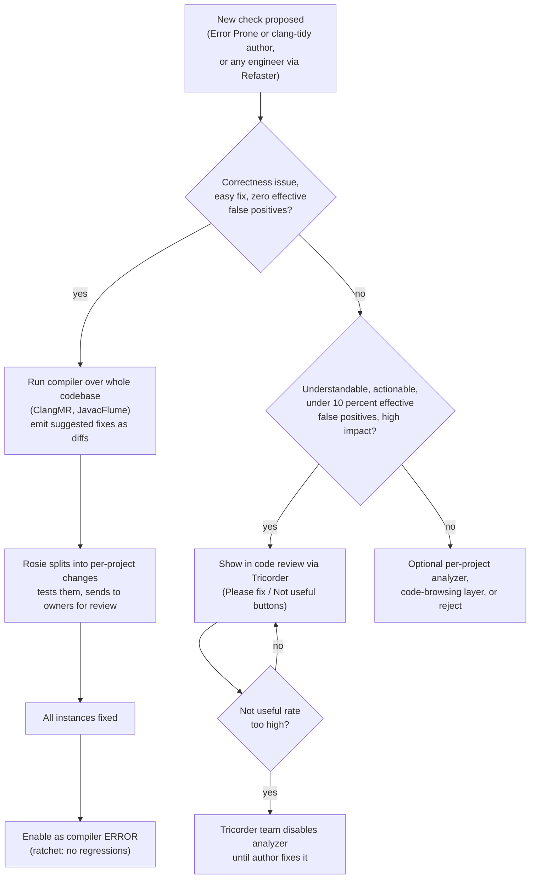

# Paper: Lessons from Building Static Analysis Tools at Google (Sadowski et al. 2018)

> [!summary] Scope
> Owns the CACM 2018 retrospective by Caitlin Sadowski, Edward Aftandilian, Alex Eagle, Liam Miller-Cushon, and Ciera Jaspan on why static analysis succeeds or fails inside a large engineering organization.
> Explains why standalone dashboard tools failed, the two admission bars the paper sets (no effective false positives for compiler errors, under 10 percent for code review), the role of developer workflow integration, and the clean-the-codebase-then-ratchet pattern built on machine-applicable fixes.
> Leaves the Tricorder platform internals to [[Paper-Tricorder-Program-Analysis-Ecosystem]] and the review-process study to [[Paper-Modern-Code-Review-at-Google]].

> [!summary] Claim:
> A static analysis program succeeds when engineers see its findings by default, at the moment they are changing the code, from a tool whose findings they have learned to trust, and the unit of success is defects fixed or prevented, not defects reported.
> Google reached that state in two steps after three failed FindBugs integrations (2006 dashboard, 2009 bug filing, 2011-era review comments): make a check a compiler error only if it has no effective false positives and, whenever possible, a mechanically applicable fix, after a distributed run has fixed every existing instance; and show everything else in code review if fewer than 10 percent of results are effective false positives.
> Effective false positive means "the developer took no positive action", so a correct warning that nobody understood counts against the tool, and a technically wrong warning that prompted a cleanup does not.
> Three practices carry the rest: tool authors own the fix, analyzers are crowdsourced from domain experts through simple authoring models such as Refaster, and every analyzer has a feedback button wired to a bug queue that can switch the analyzer off.



## Bibliographic Metadata

| Field | Value |
| :--- | :--- |
| Title | Lessons from Building Static Analysis Tools at Google |
| Authors | Caitlin Sadowski, Edward Aftandilian, Alex Eagle, Liam Miller-Cushon, Ciera Jaspan |
| Venue | Communications of the ACM, Vol. 61, No. 4, pp. 58-66, April 2018, "Contributed Articles" |
| DOI | https://doi.org/10.1145/3188720 |
| Open copy | https://research.google/pubs/lessons-from-building-static-analysis-tools-at-google/ |
| Data cutoff | The platform statistics (Error Prone check count, Tricorder scale, analyzer and optional-analysis counts) are dated "as of January 2018"; the FindBugs Fixit is May 2009, and the developer surveys and the 31 hash-bug fixes carry no date |
| Length | 9 journal pages with 38 references and three "key insights" bullets |
| Companion | Tricorder: Building a Program Analysis Ecosystem, ICSE 2015, the platform paper this article builds on (see [[Paper-Tricorder-Program-Analysis-Ecosystem]]) |
| Later restatement | Sadowski, Static Analysis, chapter 20 of Software Engineering at Google (2020), which compresses the paper into three lessons and updates a few numbers |

## The Core Problem

The paper opens by listing six reasons engineers ignore static analysis, drawn from earlier literature.
They are: the tool is not integrated into the workflow or is too slow, the warnings are not actionable, the tool is not trusted because of false positives, the reported bug does not manifest in practice, fixing is too expensive or risky, and the warning is not understood.
Each reason is a failure of the loop between finding a defect and a human changing the code.
None of them is about the analysis algorithm.

The measurable symptom is the gap between findings and fixes.
Google ran FindBugs, a bytecode pattern checker by William Pugh and David Hovemeyer, and three integration attempts failed for reasons that are separately instructive.

| Attempt | Mechanism | What happened | Why it failed (paper's words, condensed) |
| :--- | :--- | :--- | :--- |
| 1. Bug dashboard (2006) | Nightly run over the whole Java codebase into a database, viewed in a web dashboard | Found hundreds of bugs, little use | Outside the developer workflow, and it was hard to tell new issues from old ones |
| 2. Filing bugs (undated; includes the May 2009 Fixit) | BugBot team triages each nightly run and files bugs for the important ones; May 2009 companywide Fixit week | 3,954 of 9,473 warnings reviewed, 1,746 produced a bug report, 640 fixed | Many real issues were not important enough to fix; manual triage does not scale |
| 3. Code review comments (to 2011) | FindBugs runs on each change sent for review and posts comments, with suppression and confidence filtering | Worked until the review tool was replaced in 2011 | Effective false positives eroded trust; per-user customization produced inconsistent views; "new vs old" classification sometimes wrong |

Derived from the paper's Fixit numbers (arithmetic done here, not stated in the paper):
- 3,954 / 9,473 = 41.7 percent of warnings were reviewed.
- 1,746 / 3,954 = 44.2 percent of reviewed warnings produced a bug report.
- 640 / 3,954 = 16.2 percent of reviewed warnings were fixed.
- 640 / 9,473 = 6.8 percent of all warnings were fixed, roughly one in fifteen, even though a whole company spent a week on it.

The paper's reading is that a Fixit validated that FindBugs found real bugs, but "a significant fraction were not important enough to fix in practice".
That is the first of several places where the paper separates a true positive from a useful positive.

## Key Innovation

There is no new analysis algorithm in this paper.
The contribution is an operating model with four load-bearing ideas.

1. **Workflow integration as the primary design variable.**
   Push findings as early as possible: compiler error first, code review second, everything else (command line, commit gate, code browsing) third.
   The paper's conclusion states that careful workflow integration is the most important insight.
2. **Effective false positive as the metric.**
   A finding is bad if the developer did not take positive action, regardless of whether the tool was technically right.
   This turns message quality, fix quality, and importance into tool defects.
3. **Fix the existing instances, then forbid the pattern.**
   Tool authors take responsibility for fixing as well as finding.
   A check becomes a compiler error only after a distributed run has cleaned the whole codebase, so the build never breaks for existing code.
4. **Crowdsourced analyzers behind a feedback-controlled platform.**
   Domain experts write checks; developers file "Not useful" bugs; the platform team disables misbehaving analyzers.
   Management mandate is explicitly absent: "there is typically no mandate from management that engineers use static analysis tools", so analysis teams "must demonstrate impact through hard data".

## Mechanism Details

### 1. Terminology and why "effective" matters

The paper fixes four terms.
An analysis tool runs "checks" over source code and reports "issues" that may or may not be real faults.
An issue is an effective false positive if developers did not take positive action after seeing it.
Two edge cases define the term:
- The analysis wrongly reports an issue, but the developer makes the change anyway for readability or maintainability: not an effective false positive.
- The analysis reports an actual fault, but the developer did not understand it and did nothing: an effective false positive.

The consequence is that the metric is a property of the tool, the message, and the audience jointly.
The Guava printf case in the paper makes it concrete: a check flagged too many arguments to a printf-like method that accepted only `%s`.
About once a week the Error Prone team got a "Not useful" bug saying the analysis was wrong because the count of specifiers matched the count of arguments.
In every case the analysis was correct and the user was passing other specifiers.
The fix was to change the diagnostic text to say the function accepts only `%s`, after which the bug reports stopped.
A correct analysis with a bad message was an effective false positive, and the repair was a string change.

### 2. The compiler workflow: clean first, then enforce

The mechanism, as the paper describes it for both languages:

1. The check author implements the check and a suggested fix.
2. A MapReduce-style job runs the real compiler over the entire codebase: ClangMR for the Clang toolchain, and JavacFlume (built with FlumeJava) for javac.
3. The job emits the fixes as diffs, which are applied to produce a whole-codebase change.
4. Rosie splits that change into small per-project changes, tests each, and sends each to the owning team for review; Rosie commits a change when the team approves.
5. When all changes land, the team enables the check as a compiler error.

Two properties matter.
First, the order is clean-then-enforce, never enforce-then-clean, so the build is never broken by a compiler upgrade for code that was fine yesterday.
Second, the compiler is the enforcement point and Google's Bazel-derived build is the single source of truth for whether code compiles, which is why a compiler error cannot be bypassed by per-developer settings.
The paper relates this to the hermetic, from-source, checked-in-toolchain build, so a new JDK or compiler can be rolled out to everyone by checking in a new version.
See [[Paper-Build-Systems-a-la-Carte]] for the build-system theory that makes such a global flip tractable.

The paper stresses that the target of such an analyzer is "not simply to detect faults but to automatically fix all instances of a prospective compiler error throughout the codebase".
That limits what can be a compiler check: an issue that needs "significant restructuring" cannot be mechanically cleaned up across a codebase of this size, so it is demoted to code review even if it is serious.

The paper also reports the human side of the pipeline.
Developers who received a proposed fix for checked-in code were surveyed: 57 percent were happy to have received it, 41 percent were neutral, and 2 percent responded negatively ("It just created busywork for me").
Those three add up to 100 percent, so the paper reports no other response category.

### 3. Two admission bars

| Criterion | Compiler error | Code-review warning |
| :--- | :--- | :--- |
| Understandable | easily understood | easy for any engineer to understand |
| Actionable | actionable and easy to fix, with a mechanically applicable suggested fix whenever possible | actionable, "may require more time, thought, or effort than a compiler check", with guidance on how to fix |
| False positives | no effective false positives: "should never stop the build for correct code" | fewer than 10 percent effective false positives: developers should feel the check points at a real issue at least 90 percent of the time |
| Scope | correctness only, not style or best practices | potential for significant impact on code quality; need not affect correctness |
| Cost of a wrong result | breaks the build | one dismissed comment |

Footnote c in the paper states that the 10 percent number "was initially chosen by the first author somewhat arbitrarily", but "seems to be a sweet spot for developer satisfaction and matches the cutoff for similar systems in other companies".
That is a tuned heuristic, not a derived result, and the note should be read that way.

The open-source Error Prone documentation gives the same two bars in its own words (as of 2026-11, Both).
ERROR checks must be easy to understand, easy to fix, have "no false positives", represent a correctness issue, and "occur with a small but noticeable frequency".
WARNING checks must have "very few false positives" so developers feel the tool points out a real issue "at least 90% of the time".
The same page adds a nuance the paper does not: Error Prone checks "are intentionally neither 100% sound nor 100% complete", and a false positive in an ERROR check on idiomatic code is high priority precisely because it breaks builds, while a false negative in a WARNING or SUGGESTION check is low priority.

### 4. Error Prone as the vehicle

Error Prone is a javac plugin that runs pattern checks over the abstract syntax tree and attribute (type) information, rather than over bytecode as FindBugs does.
The paper gives this as the reason non-experts can contribute: checks are self-contained and written against the same tree the compiler produces.
As of January 2018 the paper reports 733 checks from 162 authors.
The open-source bug-pattern index lists 187 ERROR and 310 WARNING checks on by default, plus 158 experimental checks (24 ERROR, 79 WARNING, 55 SUGGESTION), counted from the links under each section heading of https://errorprone.info/bugpatterns (as of 2026-11, Both; the list changes with every release).

Operational facts verified from the documentation (as of 2026-11, Both):
- Severity flags: `-Xep:<CheckName>[:OFF|WARN|ERROR]`; the last flag for a check wins; blanket flags include `-XepAllErrorsAsWarnings`, `-XepDisableAllChecks`, `-XepDisableAllWarnings`, `-XepDisableWarningsInGeneratedCode`; paths can be excluded with `-XepExcludedPaths:<regex>`.
- Suggested replacements are applied through `-XepPatchChecks:<Check1,Check2>` and `-XepPatchLocation:<dir>`, which writes `error-prone.patch` (a unified diff) for `patch -p0 -u -i error-prone.patch`; `-XepPatchLocation:IN_PLACE` edits files directly; the page closes with a note that "this feature is experimental, and subject to change", placed after a horizontal rule, so it is unclear whether it covers patching as a whole or only `IN_PLACE`.
- A configuration file can be passed with `@file` to share flags across build systems.
- Error Prone must run on JDK 21 or newer; it can still build Java 8 code through `-source`, `-target`, `-bootclasspath`, or `--release`.
- Maven needs `-XDcompilePolicy=simple`, `--should-stop=ifError=FLOW`, and `-Xplugin:ErrorProne` as compiler arguments, plus `--add-exports` and `--add-opens` flags for `jdk.compiler` packages (written as `-J--add-exports=...` inside Maven `compilerArgs`) when the compiler runs as an external executable (`<fork>` true or maven-toolchains-plugin), because of JEP 396 (strong encapsulation of JDK internals).
- To see warnings under Maven the `showWarnings` parameter must also be set.

The paper's example check, `PreconditionsCheckNotNull`, flags `checkNotNull("uid was null", uid)`, where the arguments are transposed so the precondition trivially succeeds.
The Error Prone criteria page uses the same check as its positive example: the problem is clear, it is never what the programmer intended, it can cause a real problem later, and it occurs with reasonable frequency.
The criteria page also gives negative examples: `new Integer(i)` to `Integer.valueOf(i)` is correct but not a correctness issue and too frequent, and requiring `@Override` is a style rule that "would be nitpicking" as an error.

### 5. Worked example: the hashCode shift bug

The paper's "finding bugs is easy" lesson uses this snippet for a field `f` of type `long`:

```java
result = 31 * result + (int) (f ^ (f >>> 32));
```

If a developer later changes `f` to `int`, the code still compiles.
The Java Language Specification, section 15.19 (SE 21), says that when the promoted left operand is `int`, only the five lowest-order bits of the shift distance are used, as if the distance were ANDed with `0x1f`, so a distance of 32 becomes 0.
Then `f >>> 32` is `f`, `f ^ f` is 0, and the field stops contributing to the hash.
The paper reports 31 occurrences fixed in Google's codebase "while enabling the check as a compiler error in Error Prone", that is, during the cleanup that precedes enforcement.
The Error Prone check for it is `BadShiftAmount` (severity ERROR per its documentation page).

I reproduced the semantics once on this machine (macOS arm64, OpenJDK 25, `javac -Xlint:all`).
This note has no lab, so the program is shown in full and its output below is the one real run, not a recorded golden file.

```java
public class Hash {
    static int hashLong(long f) { return (int) (f ^ (f >>> 32)); }
    static int hashIntBroken(int f) { return (int) (f ^ (f >>> 32)); }
    static int hashIntFixed(int f) { return f; }
    public static void main(String[] a) {
        for (int v : new int[] {1, 42, -7, 123456789}) {
            System.out.println("f=" + v + " long-version=" + hashLong(v)
                + " int-broken=" + hashIntBroken(v) + " shift-by-32-int=" + (v >>> 32));
        }
        System.out.println("long f=2^40+5 -> " + hashLong((1L << 40) + 5));
    }
}
```

Commands: `javac -Xlint:all Hash.java` then `java Hash`.

```text
Hash.java:3: warning: [cast] redundant cast to int
    static int hashIntBroken(int f) { return (int) (f ^ (f >>> 32)); }
                                             ^
1 warning
f=1 long-version=1 int-broken=0 shift-by-32-int=1
f=42 long-version=42 int-broken=0 shift-by-32-int=42
f=-7 long-version=6 int-broken=0 shift-by-32-int=-7
f=123456789 long-version=123456789 int-broken=0 shift-by-32-int=123456789
long f=2^40+5 -> 261
```

Output captured on macOS arm64 (Darwin), OpenJDK 25 (2025-09-16), as of 2026-11.

Reading the result:
- `int-broken` is 0 for every input, as the paper predicts, and `shift-by-32-int` equals the input, which is the masking rule in action.
- `javac -Xlint:all` did not warn about the shift.
  Its only diagnostic is `[cast] redundant cast to int`, which is a side effect of the type change, not a detection of the bug.
  That is the detection gap: a stock compiler with every lint category on is silent about a statically visible, always-wrong hash.
- Error Prone's `BadShiftAmount` was not run here; its behavior is cited from the documentation page, not observed.

### 6. Code review as the second integration point

Everything that cannot meet the compiler bar goes to Google's review tool, Critique, through Tricorder.
The paper's argument for review as a "sweet spot":
- Developers are already in a critical mindset and "preparing their code to be seen", so readability and style notes are welcome there but frustrating as compiler errors (the example is an unreachable-code detector getting in the way of temporarily disabling a block while debugging).
- Results appear only when the developer is changing the code in question, which avoids the existing-versus-new triage problem that sank the FindBugs dashboard.
- After check-in, friction to make changes rises and lower-severity issues are unlikely to be addressed; the paper notes Facebook's Infer also surfaces results in code review.
- Reviewers typically withhold approval until all comments, manual and automated, are addressed, so a "Please fix" click puts social weight behind the tool.

The Software Engineering at Google chapter adds reasons the paper does not give: authors are blocked on reviewers so analyses that take minutes still finish in time; analyses see the whole change context (a dead-code check can be wrong on partial code while a function is written before its call sites); and ignoring a result means convincing a reviewer.

Platform numbers from the paper (as of January 2018):
- About 50,000 code review changes analyzed per day, with three analysis runs per second at peak.
- More than 5,000 "Please fix" clicks per day, about 3,000 automated fixes applied per day, about 250 "Not useful" clicks per day.
- 146 analyzers, 125 contributed from outside the Tricorder team, plus seven plug-in systems (Error Prone and ClangTidy are two of the seven) hosting hundreds of additional checks.
- Results for more than 30 languages.
- About 70 optional analyses, with 2,500 projects enabling at least one.

Software Engineering at Google (2020) says "more than 100 analyzers" and puts the overall effective false-positive rate "just below 5%".
That does not contradict the 146 figure, but the two sources should not be mixed in one table without dates.

The feedback loop is the control system.
Every result carries a "Not useful" button that files a bug against the analyzer owner with the result prepopulated, and a "Please fix" button for reviewers.
The paper says the team computes a ratio of the two and disables an analyzer if the ratio goes above 10 percent, until its authors improve it, and that permanent disabling has been rare.
The sentence is ambiguous about which click count is the numerator.
Using the paper's own daily counts, 250 "Not useful" over 5,000 "Please fix" is 5 percent, which is under 10 percent only if "Not useful" is the numerator; the reverse would be 2,000 percent for the platform overall.
So the operational reading is not-useful clicks divided by please-fix clicks (inference from the numbers, not an explicit statement).
Note this click ratio is a proxy for, not a measurement of, the effective false-positive rate.

### 7. Why project-level, not user-level, configuration

The paper reports that FindBugs allowed per-user customization, which produced different views of results across and within teams and "declining use of tools".
Its worked failure: if developers remove unused imports from team code but one developer does not follow the convention, the fix "would quickly backslide".
Tricorder therefore allows configuration only at the project level, so everyone changing a project sees the same results.
The chapter in Software Engineering at Google adds a striking data point: when Critique's user-level settings were removed, users immediately complained about annoying results, and instead of re-enabling settings the team asked why and found real bugs, such as the C++ linter running on Objective-C files and an HTML linter with a very high false-positive rate that was simply disabled.
The lesson is that customization hides bugs and suppresses the feedback that would fix them.

Project-level analyzers fall into four categories in the paper:
- Dichotomous results, such as the protocol buffer analyzer that flags backward-incompatible changes, useful only to teams that persist serialized data.
- Analyzers needing setup or annotations, such as Checker Framework nullness analysis, which requires annotated code, or an Android binary-size and method-count check.
- Team DSLs and guidelines with their own validators.
- Resource-intensive analyzers, such as hybrid analyses that use dynamic analysis results.

### 8. Additional integration points

The paper lists three that followed from trust earned in review:
- A command-line tool for "code janitors" who apply all fixes from one analyzer across their team's code and generate cleanup changes.
- Commit gating, requested by teams with highly specific custom checks with no false positives, usually for a custom DSL or library.
  The Software Engineering at Google chapter calls these presubmit checks and notes they run when a change is mailed for review and again at commit.
- Code browsing, which "works best for showing the scale of a problem across a large project", for example how large a deprecated-API migration is, or security and privacy analyses that specialized teams vet without disrupting other developers.
  Results are off by default and a team enables an analysis layer.

The IDE is deliberately not the primary point.
Google developers use a wide variety of editors, so consistent detection prior to the build is hard, and "requiring a particular IDE with analyses enabled is a non-starter".
Software Engineering at Google adds the latency requirement: IDE analyses typically need under 1 second, ideally under 100 ms.

### 9. Why not interprocedural analysis

The paper is explicit that in January 2018 all widely deployed analyses were "relatively simple", and that Google "does not have infrastructure support to run interprocedural or whole-program analysis at Google scale".
Four reasons are given: the up-front infrastructure investment would be prohibitive; teams would have to cut false-positive rates for research analyzers dramatically or restrict what is shown (as Infer does); plenty of simple analyzers remain to implement; and the cost-benefit ratio of complex checks is expensive to even determine.
The scale reasoning is structural: in a monorepo any code can be part of any binary, so a single review "would require analyzing the entire repository" in the worst case (see [[Paper-Google-Monorepo-Piper-and-CitC]]).
The paper adds that the calculus differs for aerospace, medical devices, and device drivers.
Software Engineering at Google (2020) repeats that "almost all analyzers are intraprocedural", so this had not changed by that edition.

### 10. The lessons, as the paper states them

| Lesson | Evidence in the paper |
| :--- | :--- |
| Finding bugs is easy | Large codebases contain any pattern; the shift-by-32 hash bug had 31 occurrences |
| Most developers will not go out of their way to use static analysis tools | The dashboard saw little use; analysis must be integrated and on by default for everyone |
| Developer happiness is key | No management mandate; show impact through data, surveys, and easy bug filing |
| Do not just find bugs, fix them | Measure success by fixes, not reports; analysis teams own fixing |
| Crowdsource analysis development | FindBugs checks needed experts; Refaster lets a contributor write before and after snippets |

## Evaluation and Limitations

### What the paper reports

| Result | Value | Where in the paper |
| :--- | :--- | :--- |
| Fixit warnings reviewed | 3,954 of 9,473 (42 percent) | Attempt 2 |
| Fixit warnings that got a bug filed | 1,746 (44 percent of reviewed) | Attempt 2 |
| Fixit warnings fixed | 640 (16 percent of reviewed) | Attempt 2 |
| Survey of patches for checked-in code: positive / neutral / negative | 57 / 41 / 2 percent | Make It a Compiler Workflow |
| Compile-time issues judged "real problems" | 74 percent, versus 21 percent for issues found in checked-in code | Reporting issues sooner is better |
| Issues judged "critical" | 6 percent at compile time, 0 percent in checked-in code | same |
| Error Prone checks contributed | 733 from 162 authors (January 2018) | same |
| Tricorder scale | about 50,000 changes per day, three runs per second at peak | Scale of Tricorder |

### Reading the survey correctly

The 74 versus 21 percent gap is the paper's strongest quantitative claim for "report early", and the paper itself attributes the gap partly to a survivor effect.
By the time code is submitted, errors "are likely to have been caught by more expensive means (such as testing and code review)", so the late-found population is what remains after cheaper filters.
The comparison is therefore not the same bug found early versus late.
The paper's logic is that the early filter is cheaper, not that the two populations are identical.
The build log was used to find the engineers who saw a given error message in a window, which means the sample is of people who hit the error, and the paper does not report response rates.

### Limitations and threats to validity

- **Self-reported and one organization.**
  All numbers are Google's, as of January 2018, with no control group and no external replication in the paper.
- **No recall.**
  The paper reports effective false positives and fixes applied; it gives no estimate of defects missed.
  Its position is the reverse of the older literature: low false positives matter more than low false negatives to adoption.
  Software Engineering at Google states this directly.
- **Preconditions are Google-specific and doing the work.**
  The paper itself lists the enabling conditions: a single monorepo, a hermetic build everyone uses, trunk-based development, path-based ownership, mandatory pre-commit review, tooling for changes touching hundreds of files, and a culture in which "changes to legacy code are typically approved because improving the code wins over risk aversion".
  An organization without these cannot copy the compiler-ratchet step as described.
- **The 10 percent bar is a heuristic.**
  The paper says so in a footnote.
  The Software Engineering at Google footnote also allows that reviewers may tolerate more false positives for critical security analyses.
- **Effective false positive is subjective and hard to measure.**
  The paper's operational proxy, the not-useful click ratio, only counts developers who bother to click.
- **Internal inconsistencies worth knowing.**
  The introduction says tooling detects "thousands of problems per day" that engineers fix before check-in, while the conclusion says it "prevents hundreds of bugs per day".
  The scope paragraph says "two-billion-line codebase" while later passages say "multibillion-line".
  Neither number is defined (problems versus bugs, lines versus files).
- **"Simple" analyses are a stated choice, not a ceiling.**
  The paper reports it as of January 2018 and as a priority decision, not an impossibility.
- **FindBugs dates are fuzzy.**
  The paper says research ran "from 2008 to 2010", the dashboard dated from 2006, the Fixit from May 2009, and review integration ended in 2011 when the review tool was replaced.

## Industry Impact

The paper's patterns show up as default behaviors in widely used open-source tools.
Flags below were read from local tool help or official documentation (as of 2026-11).

| Paper idea | Open-source realization | Verified detail |
| :--- | :--- | :--- |
| Checks as compiler errors on the AST | Error Prone, a javac plugin | `-Xep:Check:ERROR`, `-XepAllErrorsAsWarnings`; requires JDK 21 or newer (Both) |
| Fix the existing instances | Error Prone patching | `-XepPatchChecks` and `-XepPatchLocation` write `error-prone.patch`; `IN_PLACE` edits sources directly; the page flags the feature as experimental (Both) |
| Fix everything the tool can fix | clang-tidy | `--fix`, `--export-fixes=<file>`, `--warnings-as-errors=<globs>` (upgrades warnings from `--checks`, does not enable checks), `--header-filter` (LLVM 23.1.6, macOS) |
| Safe versus risky fixes | Ruff, rustc | Ruff labels fixes "safe" or "unsafe" (`--fix` applies safe fixes; `--unsafe-fixes` opts in); rustc's `Applicability::MachineApplicable` means "should be automatically applied" while `MaybeIncorrect` means it "may be what the user intended" (Both) |
| Baseline for existing violations | Ruff `--add-noqa` | inserts suppression comments for current violations so a rule can be enforced going forward (ruff 0.16.10, macOS) |
| Example-driven check authoring | Refaster templates | `@BeforeTemplate` methods and one `@AfterTemplate` method, compiled to `.refaster` files and applied by the Error Prone compiler (Both) |
| Successor of the failed first tool | SpotBugs | project page calls itself "a fork of FindBugs (which is now an abandoned project)" (Both) |
| Codebase-wide change machinery | Rosie and the LSC process | described in Software Engineering at Google chapter 22 as the tool that shards a master change into pieces tested, mailed, reviewed, and committed independently |

Notes on the table:
- The Rust and Ruff safe/unsafe split is the same idea as the paper's compiler criterion "a suggested fix that can be applied mechanically", with an explicit label so that a tool can apply only the trustworthy subset without human review.
  That mapping is mine; the paper does not mention Rust or Ruff.
- The paper's term "ratchet" for moving quality one small step at a time without regressions is the core of any baseline-and-enforce rollout.
- Software Engineering at Google presents the same three lessons as the CACM paper (developer happiness, core workflow integration, empower users to contribute) and adds presubmit checks and the "never issue compiler warnings" policy: Google's Java and C++ compilers avoid displaying warnings, and a check is either an error or hidden.

## Applying It: Decisions at Scale

### From one repository to 1,000-50,000 engineers

| Scale | What breaks | Paper-derived decision rule |
| :--- | :--- | :--- |
| One team, one repo | A noisy linter in CI trains everyone to ignore CI | Start with checks that are errors from day one on a clean baseline; add a check only after fixing every existing hit |
| 50 to 500 engineers | Per-developer settings split the team | Configure at project level, check configuration into the repository, and make CI the single enforcement point |
| 500 to 5,000 | Central team cannot write every check | Provide a low-bar authoring path (Refaster-style before and after, or a clang-tidy check template) and a visible owner per analyzer |
| 5,000 to 50,000 | Rollout of a new check requires coordinated changes across hundreds of owners | Invest in sharded codebase-wide change tooling and an auto-split-and-review pipeline before investing in deeper analysis |

### A concrete rollout for a repository that is not Google

Steps, in the paper's order of preference, with flags verified in the section above:
1. Pick one high-signal check with a mechanical fix.
   For Java that could be `DeadException` from the Error Prone documentation, which suggests prepending `throw`.
2. Produce the patch without enforcing: `-XepPatchChecks:DeadException -XepPatchLocation:/path/to/src` and review the diff.
3. Land the cleanup in small per-owner changes.
4. Enable the check as an error: `-Xep:DeadException:ERROR`.
5. Measure: count findings fixed and prevented, not findings reported.
6. For everything below the compiler bar, show it in review with a feedback channel; if you cannot build that, keep it out of the default path.

For C++ with clang-tidy (LLVM 23.1.6, macOS), the same shape is `--checks=<one-check> --export-fixes=fixes.yaml` to collect fixes, `--fix` to apply them, and `--warnings-as-errors=<one-check>` to enforce.
For Python with Ruff (0.16.10, macOS), `ruff check --diff` shows safe fixes without applying them, `--fix` applies them, and `--add-noqa` records the existing violations of a newly enabled rule so only new ones fail.

### Metrics to instrument

- Fixes applied per day by source (suggested fix click, command line, large-scale change).
- "Not useful" rate per analyzer, with a disable threshold.
- Time from analyzer disablement to re-enablement.
- Compiler-error check count over time (the ratchet count).
- Survey results: share of findings judged real problems and share judged critical, by integration point.

## Pitfalls

> [!warning] Pitfall: counting findings as success
> The paper identifies this as a fundamental flaw: tools measure utility by issues found, while integration attempts fail because few bugs are fixed.
> A dashboard of 9,473 findings with 640 fixed is a failed program regardless of the count.

> [!warning] Pitfall: enabling an error before the cleanup
> An error-severity check turned on with existing violations breaks every project that touches the pattern.
> The clean-then-enforce order in the paper exists to avoid exactly that.
> Error Prone's own patching documentation calls out first adoption on an existing codebase as the use case for `-XepPatchChecks`.

> [!warning] Pitfall: treating warnings as a middle path
> The paper's finding is that Google developers ignore compiler warnings, so Google's Java and C++ builds either error or stay silent.
> A warning that nobody must act on is the same dead end as the dashboard, only with more output.

> [!warning] Pitfall: user-level suppression and settings
> Per-user customization produced inconsistent views, backsliding fixes, and hidden analyzer bugs in both FindBugs and early Critique.
> Prefer project-level, version-controlled configuration.

> [!warning] Pitfall: reading the 10 percent bar as a test-suite metric
> Effective false-positive rate depends on message clarity and developer behavior, so a tool author cannot compute it from a labeled corpus alone.
> A technically precise check with an unclear message can fail the bar; a rule with imprecise matching and an obvious cleanup can pass.

> [!warning] Pitfall: exporting the compiler step without its preconditions
> The ratchet assumes the ability to run the compiler over the whole codebase, produce fixes, split them into reviewable pieces, and get owners to approve.
> Without hermetic builds, a single repository or a coordinated change tool, and a culture that accepts mechanical changes, the compiler-error step turns into a long-lived branch.

> [!warning] Pitfall: Error Prone setup details
> On Maven, warnings are invisible unless `showWarnings` is set, and a forked compiler needs the `--add-exports` and `--add-opens` flags listed on the installation page; building with JDK 21 additionally needs `-XDaddTypeAnnotationsToSymbol=true` per the Maven snippet on that page (as of 2026-11, Both).

## Concept Grounding

This note supplies the organizational layer for several mechanism notes.
- [[Paper-Tricorder-Program-Analysis-Ecosystem]]: the platform architecture, analyzer plug-in model, and feedback mechanics this paper summarizes and applies.
- [[Paper-Modern-Code-Review-at-Google]]: the review process in which analysis results appear; the empirical data on what reviewers do with them.
- [[Paper-Google-Monorepo-Piper-and-CitC]]: the monorepo that makes a codebase-wide compiler run and a single enforcement point possible, and that makes whole-program analysis expensive.
- [[Paper-AddressSanitizer]] and [[Paper-ThreadSanitizer]]: the dynamic analyses the paper names alongside static ones; they run during tests and sometimes on production traffic.
- [[Paper-Build-Systems-a-la-Carte]]: the build-system theory behind hermetic, from-source, globally upgradeable compilers.
- [[Paper-Zeller-Delta-Debugging]]: a complementary approach for turning a failure into a minimal case once a defect is known, as opposed to detecting patterns before a failure.

## Interview Questions

> [!question] L5: What exactly is an "effective false positive" and why did the authors define it that way?
>
> > [!success]- Answer
> > An issue is an effective false positive if developers did not take positive action after seeing it.
> > Two edge cases fix the meaning: a wrong report that prompts a readability fix anyway is not one, and a correct report the developer did not understand is one.
> > The definition shifts accountability from the analysis algorithm to the whole experience: message clarity, fix availability, importance, and trust.
> > Their Guava printf example shows it: a correct check drew weekly "Not useful" bugs until the diagnostic said the function accepts only `%s`.

> [!question] L5: Why did a nightly FindBugs dashboard fail at Google when it found hundreds of real bugs?
>
> > [!success]- Answer
> > It sat outside the developer workflow, so most developers never visited it, and findings in checked-in code that already ran in production were too late and easy to defer.
> > It also mixed new and pre-existing issues, which the paper calls distracting.
> > The Fixit confirmed the pattern: of 9,473 warnings, 3,954 were reviewed and only 640 fixed, so triage by hand did not scale and many real findings were not worth the fix risk.

> [!question] L5: Predict the output of the hash term `(int) (f ^ (f >>> 32))` for f = 42 after the field type changes from `long` to `int`, and say why it still compiles.
>
> > [!success]- Answer
> > It contributes 0 for every int value, so `f` no longer affects the hash.
> > JLS 15.19 masks the shift distance of an int with `0x1f`, so `f >>> 32` is `f >>> 0`, which is `f`.
> > `f ^ f` is 0, and the cast to int is merely redundant.
> > Running `javac -Xlint:all` on OpenJDK 25 printed only the redundant-cast warning and produced `int-broken=0` for 1, 42, -7, and 123456789; the long version produced 1, 42, 6, and 123456789 for the same values.

> [!question] L5: Debug this: a Maven build with Error Prone fails on ERROR checks but never prints WARN-level checks such as MissingOverride, so what is wrong?
>
> > [!success]- Answer
> > The Error Prone flags page says that to enable warnings under Maven the `showWarnings` parameter must also be set on the compiler plugin.
> > Errors fail the build regardless, which is why they appear, but warnings are not displayed without it.
> > Check that the `-Xplugin:ErrorProne` argument and any `-Xep:` options are in `compilerArgs`, that `showWarnings` is true, and that the check is not turned off with `-Xep:Check:OFF`.
> > This is the debug-this exercise: nothing is wrong with the check, the compiler plugin configuration is hiding its output.

> [!question] L6: Why is a compiler error the preferred integration point, and what must be true before a check is allowed to be one?
>
> > [!success]- Answer
> > A compiler error is displayed early, to every developer, through the one build everyone uses, and cannot be ignored.
> > The paper's survey found 74 percent of compile-time issues judged real problems versus 21 percent for issues found in checked-in code, though part of that gap is the survivor effect.
> > To be an error, the check must be easy to understand, actionable with a mechanically applicable fix, produce no effective false positives, and report correctness issues only.
> > And all existing instances must first be fixed across the codebase, otherwise the build breaks for unrelated teams.

> [!question] L6: Walk through how a new Error Prone check reaches "compiler error" status at Google, naming the tools.
>
> > [!success]- Answer
> > The Error Prone team implements the check and a suggested fix, then runs javac over the whole codebase with JavacFlume (built on FlumeJava), the javac analogue of ClangMR.
> > JavacFlume emits suggested fixes as diffs that are applied into a whole-codebase change.
> > Rosie splits that into per-project changes, tests each one, and sends it to the owning team for review, committing on approval.
> > When all existing instances are fixed the team enables the check as a compiler error, which ratchets quality without regressions.

> [!question] L6: Which ratio does the paper mean when it disables an analyzer above 10 percent, and does the platform-wide data fit that reading?
>
> > [!success]- Answer
> > The sentence defines the ratio as "Please fix" versus "Not useful" clicks and is ambiguous about which is the numerator.
> > Daily counts in the paper are about 5,000 "Please fix" and about 250 "Not useful"; 250 / 5,000 is 5 percent, under the 10 percent threshold, whereas the reverse ratio would be 2,000 percent for the platform overall.
> > So the consistent reading is not-useful over please-fix, which is an inference from the numbers.
> > It is also a proxy: it counts only developers who click, so it complements, and does not replace, the surveys and fix accounting.

> [!question] L7: What do you change and what do you keep when your org adopts the 10 percent false-positive bar for a new security analyzer?
>
> > [!success]- Answer
> > Keep the principle that adoption depends on trust and that the metric is effective false positives, measured through a feedback channel with an owner who can disable the analyzer.
> > Revisit the number: the paper calls 10 percent a somewhat arbitrary sweet spot, and Software Engineering at Google footnotes that reviewers may tolerate a much higher false-positive rate for critical security analyses.
> > Separate integration points by cost of a wrong result: a compiler error needs essentially zero, a review comment tolerates up to 10 percent, a security team browsing a code-browser layer can tolerate more because it is opt-in and vetted.
> > Measure per analyzer, publish the disable policy, and review the threshold against survey data instead of treating it as a constant.

> [!question] L7: Why did Google not deploy interprocedural analysis in 2018, and which of those reasons still hold for your organization?
>
> > [!success]- Answer
> > The paper gives four reasons: a prohibitive up-front infrastructure investment, the need to reduce false positives dramatically or restrict output as Infer does, plenty of simple analyzers still to write, and a high cost just to establish the cost-benefit ratio.
> > The monorepo adds a structural one: any code can be in any binary, so one review might require analyzing the entire repository.
> > In your organization, check whether you have summaries or incremental infrastructure, whether builds are hermetic enough to cache analysis inputs, whether your false-positive budget survives deeper analysis, and whether the simple-checks backlog is actually empty.
> > The paper notes the answer differs for aerospace and device drivers, where the defect cost is much higher.

> [!question] L8+: How would you design the rollout of a new analyzer to 20,000 engineers with no management mandate?
>
> > [!success]- Answer
> > Pick the integration point by the check's properties: zero effective false positives plus a mechanical fix means clean-then-compiler-error; otherwise code review with feedback buttons, and a per-project opt-in analyzer for teams with special needs.
> > Build the infrastructure before the check: a whole-codebase run, an auto-split-and-review pipeline (Rosie-like), and a project-level configuration system rather than user-level.
> > Define success as fixes applied and bugs prevented, instrument "Not useful" and "Please fix" clicks, run developer surveys, and set an explicit disable threshold owned by the platform team.
> > Make authoring cheap through example-based templates (Refaster-style) so domain experts, who find bugs by debugging, can contribute checks.
> > Name the downside: this takes years of platform investment and depends on a monorepo, hermetic build, and change culture that you may have to build first.

> [!question] L8+: A VP notes that static analysis reported 4,000 issues last quarter yet defect rates did not drop, so what does this paper say and what do you propose?
>
> > [!success]- Answer
> > The paper calls reporting counts a fundamental flaw: tools measure utility by issues identified, while integration fails because few bugs are fixed or prevented.
> > The FindBugs Fixit is the case study: 9,473 warnings, 640 fixed.
> > Propose changing the metric to defects fixed and prevented, split by integration point, then move findings from a dashboard to the compiler or review, and make tool authors own fixes.
> > Add an experiment design, since the paper has no control group: compare defect classes covered by compiler-error checks before and after the ratchet, and survey developers on whether findings were real and critical.
> > Be honest that defect-rate effects of individual checks are hard to attribute, which is why the paper's evidence is fixes and surveys, not outage statistics.

## Further Reading

- CACM paper (https://doi.org/10.1145/3188720, open copy via https://research.google/pubs/lessons-from-building-static-analysis-tools-at-google/): the primary source; read the Attempt 1-3 section and the "Criteria" sections twice.
- Tricorder ICSE 2015 (https://research.google/pubs/tricorder-building-a-program-analysis-ecosystem/): the platform architecture, covered in [[Paper-Tricorder-Program-Analysis-Ecosystem]].
- Software Engineering at Google, chapter 20 (https://abseil.io/resources/swe-book/html/ch20.html): the 2020 restatement with presubmits, the 5 percent figure, and the IDE latency requirement.
- Software Engineering at Google, chapter 22 (https://abseil.io/resources/swe-book/html/ch22.html): Rosie and the large-scale change process the compiler ratchet depends on.
- Error Prone criteria (https://errorprone.info/docs/criteria): the open-source version of the two admission bars, with positive and negative examples.
- Error Prone flags and patching (https://errorprone.info/docs/flags, https://errorprone.info/docs/patching): the exact switches for severities and for generating fix patches.
- Refaster (https://errorprone.info/docs/refaster): the before and after template model that lets non-experts write checks.
- Java Language Specification section 15.19 (https://docs.oracle.com/javase/specs/jls/se21/html/jls-15.html): the masking rule behind the worked example.
- Ayewah and Pugh, The Google FindBugs Fixit, Proceedings of the 19th International Symposium on Software Testing and Analysis (ISSTA 2010), https://doi.org/10.1145/1831708.1831738: the detailed Fixit study behind attempt 2 (bibliographic record checked against Crossref; the paper body was not read, and every Fixit number above comes from the CACM paper).

## Related

- Prerequisites: [[Paper-Tricorder-Program-Analysis-Ecosystem]]
- Next: [[Paper-Modern-Code-Review-at-Google]]
- See also: [[Paper-Google-Monorepo-Piper-and-CitC]], [[Paper-Build-Systems-a-la-Carte]], [[Paper-AddressSanitizer]], [[Paper-ThreadSanitizer]]
