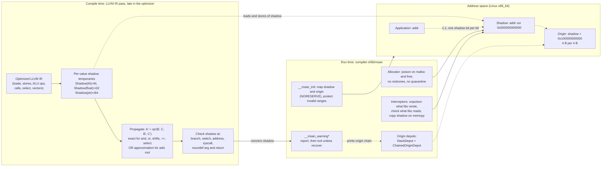

# Paper: MemorySanitizer: Fast Detector of Uninitialized Memory Use in C++ (Stepanov and Serebryany 2015)

> [!summary] Claim:
> MemorySanitizer (MSan) finds uses of uninitialized memory in C and C++ by instrumenting LLVM IR at compile time, instead of translating machine code at run time as Memcheck and Dr. Memory do.
> It keeps one shadow bit per application bit at a directly computed address, copies and propagates those bits through every instruction, and reports only when an uninitialized bit decides a branch, a pointer, a system call argument, or (in current LLVM) a `noundef` call boundary.
> Propagation rules are deliberately approximate where exactness is too slow (addition, multiplication), and deliberately exact where the optimizer's rewrites would otherwise cause false positives (bitwise logic, shifts, equality, comparisons, select).
> The price is that every byte of the program, including the C++ standard library, must be instrumented, with libc covered by interceptors; the payoff in the paper is 2.5x time and 2x memory on SPEC CPU2006 against roughly 20x for Memcheck, and a startup cost of milliseconds instead of seconds.
> Optional origin tracking assigns a 32-bit origin to every poisoned value and, in its advanced mode, chains the stack trace of every store the value passed through.



## Bibliographic Metadata

| Field | Value |
| :--- | :--- |
| Title | MemorySanitizer: fast detector of uninitialized memory use in C++ |
| Authors | Evgeniy Stepanov and Konstantin Serebryany, both Google |
| Venue | 2015 IEEE/ACM International Symposium on Code Generation and Optimization (CGO), San Francisco, CA, USA |
| Year and pages | 2015, pp. 46-55 (pages from the Google Research BibTeX record) |
| DOI | `10.1109/CGO.2015.7054186` |
| Primary URL | https://research.google/pubs/memorysanitizer-fast-detector-of-uninitialized-memory-use-in-c/ |
| Author PDF | https://static.googleusercontent.com/media/research.google.com/en//pubs/archive/43308.pdf |
| Structure | 1 Introduction, 2 Related work, 3 Algorithm (shadow, propagation, instrumentation, run-time library, origin tracking, advanced origin tracking), 4 Evaluation, 5 Future work, Conclusions, Appendix A (a report example) |
| Hardware and software | 6-core Intel Xeon W3690 at 3.47 GHz, 24 GB RAM, 64-bit Linux, SPEC CPU2006; the Appendix A report came from Clang at SVN r214393 |
| Artifact badge | The PDF carries the CGO artifact evaluation emblem (Consistent, Complete, Well Documented, Easy to Reuse, Evaluated) |
| Open source | The paper states MSan is open source and part of the LLVM compiler suite |

The paper compares against Memcheck (Seward and Nethercote, USENIX ATC 2005, bit-precise undefined value tracking), Dr. Memory (Bruening and Zhao, CGO 2011), and Intel Inspector XE, and builds on the AddressSanitizer design owned by [[Paper-AddressSanitizer]].
The Valgrind machinery that Memcheck sits on is owned by [[Paper-Valgrind-Dynamic-Binary-Instrumentation]].

This note reads the paper against the LLVM sources as fetched on 2026-11-21 (`main`, HEAD `80e7cab7ef8f` when checked).
Where the shipping implementation differs from the paper, the difference is stated and attributed to the source file.
The practitioner view (how to build an instrumented libc++, flag cheat sheet, report reading) is owned by [[Cpp-ThreadSanitizer-and-MemorySanitizer-Internals]]; this note owns the paper's algorithm, its justification, and its evidence.

## The Core Problem

### Uninitialized reads are silent, nondeterministic, and common

All stack and heap objects in C and C++ are created uninitialized, except memory from `calloc`.
The paper's authors had seen "thousands of UUM bugs" while deploying several detectors at Google.
A use of uninitialized memory (UUM) does not fail on every run: the garbage left in a stack slot or a recycled heap block depends on what ran before, so an unrelated change, another compiler, another libc, or another machine can flip the behavior.
Unlike a buffer overflow, there is no bad event at a program point; the bug is an event that did not happen, namely the initialization.
That is why the point of the report can be far from the point of the allocation, and why the paper puts so much weight on origin tracking.

### Why copying uninitialized bytes must not be an error

A naive detector would report any load of an uninitialized byte.
That produces unusable noise, for three reasons the paper states explicitly.

- The C++ standard makes an lvalue-to-rvalue conversion of an uninitialized object undefined behavior (the paper cites ISO 14882:2011 section 4.1 p1).
  C++14 relaxes this for unsigned narrow character types, where the result is an indeterminate value (the paper cites WG21 N3914 and issue 1787).
  Commonly used compilers nevertheless load uninitialized integers and floating point values with the expected results, so real code does it, and a practical tool must allow it.
- MSan is an optimizer pass, so it sees loads that do not correspond to any read in the source.
  The paper's example is `class A { char x; int y; };`, whose compiler-generated copy constructor may be a single 8-byte load that includes the uninitialized padding between the members.
- Bitfields share bytes: a program can legitimately read a field whose neighbor has never been written, and the optimizer will happily merge the two accesses.

The detector therefore has to answer "did an uninitialized bit change what the program does", not "was an uninitialized bit touched".
Answering that requires tracking, for every value, which of its bits are poisoned, through copies and arithmetic, and reporting only at instructions whose behavior depends on the bits.
This is the shadow propagation approach Memcheck pioneered; the open question the paper addresses is how to do it cheaply.

### The cost of binary translation

Existing UUM detectors (Memcheck, Dr. Memory, Intel Inspector XE) all rely on dynamic binary translation, which costs twice.

- A start-up penalty: translating code on first execution.
  For short tests or large binaries the overall slowdown "could be over 100x".
- A steady-state slowdown: the instrumentation executes inside translated code with poor register allocation.
  The paper gives Memcheck around 20x typically (more on threaded programs, because Valgrind serializes threads), Dr. Memory about twice as fast as Memcheck, and Inspector XE (2013 version) 13x to 500x with a 180x average on SPEC.
  The authors observe that network and GUI applications cannot run correctly when slowed down by 20x or more.

Code owners were "reluctant to use the tools themselves" because of this cost, which is the paper's practical motivation: a tool nobody runs finds nothing.

### Why not combine UUM and addressability checking

Memcheck and Dr. Memory detect both uninitialized reads and addressability bugs (heap overflow, use after free) in one tool.
The paper argues the two goals have opposite shadow requirements, so combining them multiplies overhead.

- Addressability needs red zones and delayed reuse (quarantine) but only about 1 shadow bit per byte, or less.
- Uninitialized-ness needs a fat shadow, up to bit-per-bit in the worst case, but no red zones and no quarantine.
- A combined tool must keep the fat shadow for the red zones and the quarantined memory too, so the memory overheads multiply.
  Memcheck and Dr. Memory therefore settle on a compact 2-bit-per-byte shadow for the common case, which slows the instrumented code and, for Dr. Memory, causes false positives from concurrent updates of adjacent shadow bits.

MSan detects only UUMs and leaves addressability to AddressSanitizer.
The paper's figure for a combined solution is the sum of the AddressSanitizer and MSan slowdowns (two runs, not one binary); it still beats Valgrind and Dr. Memory on most benchmarks.

## Key Innovation

The paper's contributions, as it lists them: static compiler instrumentation can detect UUMs, a UUM detector an order of magnitude faster than the state of the art, and a richer origin tracking scheme.
Unpacked, there are five separable ideas.

1. **Compile-time instrumentation of a UUM detector.**
   Working on LLVM IR gives the instrumentation the compiler's register allocator and optimizer, removes the translation start-up cost, and exposes types: an `i1` is a single-bit value, so there is no central flags register to model, and stack variables have names for reports.
2. **Bit-exact 1-to-1 direct shadow.**
   One shadow bit per application bit at a mask-computed address.
   No table lookup, no 2-bit encoding, no slow path, and byte-granular stores never share a shadow byte, which avoids the Dr. Memory race.
3. **Propagation rules engineered against the optimizer.**
   MSan runs "near the end of the optimizer chain", so it sees code that has undergone heavy transformation.
   The rules for `and`, `or`, shifts, multiplication by constants, comparisons, and `select` exist because LLVM's own rewrites (a bitfield test turned into `*(unsigned char *)s > 7`) would otherwise produce false positives.
4. **Interception instead of emulation for libc.**
   The runtime intercepts (the paper says close to 300) libc functions and updates shadow for what they read and write, so an uninstrumented libc is survivable, but everything else must be instrumented.
5. **Origin tracking with history.**
   A 32-bit origin per 4 bytes of memory identifies the allocation; the advanced mode turns the origin into a node in a prefix tree of stores, so a report can print the whole path of the uninitialized value.

## Mechanism Details

### 1. Shadow memory: 1-to-1 and direct

MSan keeps one shadow bit per application bit.
A shadow bit of 0 means the application bit is initialized (defined); 1 means uninitialized (poisoned).
The default shadow value is 0, so memory MSan never learned about (for example zero-initialized globals) reads as clean.

The paper's x86_64 Linux mapping (Figure 1) is a single AND with a mask.

```text
shadow_addr = Addr & ShadowMask          ShadowMask = ~0x400000000000   (x86_64 Linux, paper)

0x7fffffffffff  -+
                 |  Application   0x600000000000 - 0x7fffffffffff
0x600000000000  -+
                 |  Origin        0x400000000000 - 0x5fffffffffff   (only mapped with origin tracking)
0x400000000000  -+
                 |  Shadow        0x200000000000 - 0x3fffffffffff   (the "normally unused 32 Tb" region)
0x200000000000  -+
                 |  Protected     0x000000000000 - 0x1fffffffffff
0x000000000000  -+
```

Clearing bit 46 maps an application address `0x6000...` to `0x2000...`, which is the shadow region.
The origin region follows the shadow region at the same size.
Shadow and origin are mapped with `MAP_NORESERVE`, "similarly to AddressSanitizer", so the kernel commits only pages that are touched.
The paper notes the layout is always available at startup provided the application is linked as a PIE and ASLR is enabled, and that the tool was then limited to Linux x86_64.

#### What the shipping runtime does instead (as of 2026-11, Linux x86_64)

`compiler-rt/lib/msan/msan.h` replaced the single AND with an XOR over several application segments.
The comment above the layout lists three configurations that must all work: ASLR disabled (main executable and DSOs near `0x555550000000`), PIE with ASLR (near `0x7f0000000000`), and non-PIE (main executable below `0x100000000`, DSOs near `0x7f0000000000`), with the heap at `0x700000000000`.

```text
MEM_TO_SHADOW(mem)       = mem ^ 0x500000000000
SHADOW_TO_ORIGIN(shadow) = shadow + 0x100000000000
MEM_TO_ORIGIN(mem)       = SHADOW_TO_ORIGIN(MEM_TO_SHADOW(mem))      (msan.h)

kMemoryLayout (msan.h, SANITIZER_LINUX, 64-bit):
  app-1       0x000000000000 - 0x010000000000   1 TiB
  shadow-2    0x010000000000 - 0x100000000000  15 TiB
  origin-2    0x110000000000 - 0x200000000000  15 TiB
  shadow-3    0x200000000000 - 0x300000000000  16 TiB
  origin-3    0x300000000000 - 0x400000000000  16 TiB
  shadow-1    0x500000000000 - 0x510000000000   1 TiB
  app-2       0x510000000000 - 0x600000000000  15 TiB
  origin-1    0x600000000000 - 0x610000000000   1 TiB
  allocator   0x700000000000 - 0x740000000000   4 TiB
  app-3       0x740000000000 - 0x800000000000  12 TiB
  (the gaps 0x100000000000-0x110000000000, 0x400000000000-0x500000000000,
   0x610000000000-0x700000000000 are INVALID and are protected)
```

Shadow regions sum to 32 TiB and origin regions to 32 TiB, which matches the Clang documentation's statement that MSan "maps (but not reserves) 64 Terabytes of virtual address space".
Application regions plus the allocator sum to 32 TiB, so the mapping is 1:1 as the paper says.

Worked addresses (arithmetic from the formulas above, not a program run):

| Application address | Region | Shadow address | Origin address |
| :--- | :--- | :--- | :--- |
| `0x700000000000` (allocator base) | allocator | `0x200000000000` | `0x300000000000` |
| `0x555555554000` (typical PIE image) | app-2 | `0x055555554000` | `0x155555554000` |
| `0x7ffc12345678` (a stack address) | app-3 | `0x2ffc12345678` | `0x3ffc12345678` |

Two consequences matter operationally.
First, the Clang documentation warns that because MSan maps 64 TiB, tools like `ulimit` "may not work as usually expected".
Second, the paper's PIE-plus-ASLR requirement survives as a startup concern: `InitShadowWithReExec` in `msan_linux.cpp` first does a dry run of the layout check, and if the layout is incompatible (high-entropy ASLR) it sets `ADDR_NO_RANDOMIZE` via `personality()` and re-executes the process.
The Clang documentation says older MSan (LLVM 3.7 and earlier) "didn't work with non-position-independent executables, and could fail on some Linux kernel versions with disabled ASLR".

Why the layout changed: the compiler-rt commit "New MSan mapping layout" (`b688a479635b`, llvm-svn r249754, 2015-10-08, implementing google/sanitizers issue 579) lists the advantages over the AND mapping.
It works for non-PIE executables, does not require ASLR (so debugging under gdb no longer needs `set disable-randomization off`), supports Linux kernels 4.1.2 and newer, and makes the code "marginally faster and smaller"; the commit calls itself an ABI break.
That is why the Clang documentation dates the non-PIE and disabled-ASLR failures to "LLVM 3.7 and older".
The compile-time escape hatch back to the old layout (`MSAN_LINUX_X86_64_OLD_MAPPING`) was removed in 2022 (`99fc4d3d1636`) as long non-working.

Each platform has its own `MappingDesc` table and xor, add, and mask constants in `msan.h` and `MemorySanitizer.cpp` (`Linux_X86_64_MemoryMapParams` and siblings): the compiler pass and the runtime must agree on them, and a comment in `msan.h` says so.
Linux aarch64, loongarch64, ppc64, s390x, mips64, hexagon, and FreeBSD (aarch64 and generic 64-bit) each have their own table in `msan.h`, and NetBSD shares the generic 64-bit table above; the Clang documentation lists the supported operating systems as Linux, NetBSD, and FreeBSD.

### 2. What gets poisoned, and when

"All newly allocated memory is poisoned, i.e. corresponding shadow memory is filled with 0xFF."
In the shipping code the poisoning sites are these.

- **Heap allocation.**
  `MsanAllocate` in `msan_allocator.cpp` poisons the whole block, including allocator padding, when `poison_in_malloc` is true (default).
  `calloc` unpoisons the requested bytes and poisons only the padding.
  `realloc` that grows in place poisons only the new tail; otherwise it allocates, copies bytes plus shadow plus origin (`CopyMemory`), and frees the old block.
- **Heap free.**
  The paper says "Deallocated regions are marked uninitialized as well."
  `MsanDeallocate` poisons the block when `poison_in_free` is true (default) and the block came from the primary allocator, and with origin tracking stamps it with a `TAG_DEALLOC` heap origin.
  A read of freed memory therefore usually surfaces as a use of an uninitialized value whose origin says "created by a heap deallocation" (`msan_report.cpp`), which is an accidental, incomplete use-after-free detector; there is no quarantine, so a reallocated block hides it.
- **Stack allocation.**
  The pass emits a shadow `memset` of the `alloca`, with pattern `0xff` by default (`msan-poison-stack-pattern`), at function entry or, when `llvm.lifetime.start` markers exist and `msan-handle-lifetime-intrinsics` is true (default), at the start of the variable's scope.
  The scope-start placement matters for variables in loops: each iteration re-poisons the variable, which entry-time poisoning cannot do.
  Clang's `shouldEmitLifetimeMarkers` (`clang/lib/CodeGenUtils/FunctionUtils.cpp` on `main`, as of 2026-11) returns true whenever `-fsanitize=memory` is on, at every `-O` level including `-O0`, unless lifetime markers are disabled; without a sanitizer that uses them, only optimized builds get them.
- **Destroyed objects.**
  After a destructor runs, the object's bytes are poisoned (`__sanitizer_dtor_callback` and `poison_in_dtor`, default true), so a read of a destroyed but not yet freed object is reported.
  The paper lists this exact bug class as future work; Clang's driver now turns `-fsanitize-memory-use-after-dtor` on by default for MSan (`MsanUseAfterDtor = true` in `SanitizerArgs.h`).
- **Fully `undef` values.**
  An `undef` temporary gets shadow `0xff`, controlled by `msan-poison-undef` (default true), matching the paper's table row `A = undef => A' = 0xff`.

Not poisoned: static-storage objects (they are zero-initialized, shadow stays 0), memory from `mmap` that the program carves up itself, and arenas handed out by a custom allocator.
For the last case the interface header offers `__msan_allocated_memory(ptr, size)`, which marks the range uninitialized with an origin at the call site; without it the custom allocator's memory is a blind spot (a false negative, not a false positive).

### 3. Shadow types and shadow temporaries

For every IR temporary the pass creates a shadow temporary.
The paper's type map, which the source still follows:

```text
Shadow(iN)                 = iN
Shadow(float)              = i32
Shadow(double)             = i64
Shadow(i8*)                = i64            (any pointer is an integer of its width)
Shadow(<4 x float>)        = <4 x i32>      (vector of element shadows)
Shadow({double,{float,i1}})= {i64,{i32,i1}} (aggregates recurse)
```

Shadow values live in virtual registers next to the original values, so the optimizer and register allocator treat them like any other computation.
That is the central performance advantage over a binary translator, which must model machine registers and the flags register.
The paper's example: Memcheck needs a special less-precise representation for the x86 flags register (with rare false positives), while LLVM IR has `i1` booleans and comparison instructions that produce them, so MSan's shadow for an `i1` is an `i1`.

### 4. Propagation: the rules and the reasoning behind them

Given `A = op B, C`, the pass emits `A' = op' B, C, B', C'` where primes denote shadow.
Table 1 of the paper, with the code that implements each row in `MemorySanitizer.cpp` (as of 2026-11, function names verbatim):

```text
A = load P           check P' ; A' = load(shadow_addr(P))          visitLoadInst
store P, A           check P' ; store(shadow_addr(P)), A'          materializeStores
A = const            A' = 0
A = undef            A' = 0xff                                      (msan-poison-undef)
A = B & C            A' = (B' & C') | (B & C') | (B' & C)          visitAnd / handleBitwiseAnd
A = B | C            A' = (B' & C') | (~B & C') | (B' & ~C)        visitOr
A = B xor C          A' = B' | C'                                  visitXor -> handleShadowOr
A = B << C           A' = sext(C' != 0) | (B' << C)                handleShift
```

The AND and OR rows are exact at bit granularity, and the reasoning is the truth table: a defined 0 absorbs poison in an AND, and a defined 1 absorbs poison in an OR.
A result bit of `B & C` is poisoned in exactly three cases, one per term of the formula: both input bits are poisoned (`B' & C'`), `B` is poisoned and the corresponding bit of `C` is 1 (`B' & C`), or `C` is poisoned and the corresponding bit of `B` is 1 (`B & C'`).
The OR row is the mirror image with the roles of 0 and 1 swapped: a poisoned bit survives only where the other operand's bit is 0 (`~B` or `~C`) or is also poisoned.
Shifts are exact in the shifted operand and pessimistic in the shift amount: if any bit of the amount is poisoned the whole result is poisoned, otherwise the shadow shifts by the same amount.
The shipping code shifts the shadow with the same opcode as the value, so for an arithmetic right shift the shadow's sign bit is replicated: if the value's top bit is poisoned, the sign-extension bits are too.

#### 4.1 Approximate propagation (addition, subtraction, XOR, most else)

The paper states two requirements for any approximation.
First, zero shadow operands must give a zero shadow result.
Second, if an operand has a poisoned bit at a position where the value bit affects the result, the result shadow must be nonzero.
The fast operation with those properties is bitwise OR of the operand shadows.

```text
A = B + C   =>   A' = B' | C'
```

The justification is cost: a single undefined low bit can change any number of higher result bits through the carry chain, and modeling that "would be difficult and prohibitively slow".
For integer add, subtract, and XOR the OR rule never poisons a result bit that is actually defined: result bit i of an add is `b_i xor c_i xor carry_i`, so an undefined operand bit at position i really does make result bit i undefined.
The approximation therefore costs false negatives (the carry out of a poisoned bit is not propagated) but not false positives, for those operations.
Section 4.2 shows a concrete false negative.
In the shipping pass `add`, `sub`, `xor`, `fadd`, `fsub`, `fmul`, `fneg`, `getelementptr`, and a long tail of vector intrinsics all go through `handleShadowOr`, which ORs the operand shadows (and, with origin tracking, combines the origins).

Two edge cases are worth knowing because they follow from the rule rather than from the docs.

- Multiplication by a runtime zero: the general multiply is `A' = B' | C'`, so `x * y` with `x` poisoned and `y` equal to 0 at run time has a poisoned result although the true result is 0.
  Only multiplication by a compile-time constant is handled precisely (section 4.3).
  This is a consequence of the rule, not something the paper or docs call out; it was not run.
- Integer division and remainder are strict on the divisor: `handleIntegerDiv` checks the second operand and takes the dividend's shadow as the result's shadow.
  Floating-point division is not strict because it is side-effect free; the source cites PR37523 for that.

#### 4.2 A hand-worked example of the three kinds of rule

Take 8-bit values `B = 0x0C` with `B' = 0x03` (the low two bits uninitialized) and `C = 0x05` with `C' = 0x00`.

```text
AND:  A' = (B'&C') | (B&C') | (B'&C) = 0x00 | 0x00 | (0x03 & 0x05) = 0x01
      bit 1: C has a defined 0 there, so the poisoned B bit is absorbed; only bit 0 stays poisoned.

EQ:   D = B^C = 0x09,  D' = B'|C' = 0x03
      A' = !(D & ~D') && D' != 0 = !(0x09 & 0xFC) && true = !(0x08) && true = false
      bit 3 differs (1 vs 0) and is defined in both, so B == C is false whatever the low bits are.
      The comparison result is fully defined, and a branch on it is silent.

ADD:  A' = B' | C' = 0x03
      The possible sums for B in {0x0C..0x0F} plus 5 are 0x11, 0x12, 0x13, 0x14.
      They differ in bits 0, 1, and 2, so the exact shadow is 0x07.
      Bit 2 is a false negative of the OR approximation (carry out of bit 1).
```

These are pencil calculations from the formulas in the paper and the handlers in the source, not tool output.

#### 4.3 Integer multiplication by a constant

If one operand has zeros in its least significant bits, a multiply decomposes into a left shift: `B * (C * 2^D) = (B << D) * C`, so the low `D` result bits are defined (zero) as long as `D` itself is defined.
The authors considered computing `D` by counting trailing zeros of both operands too expensive "both in terms of run time and code size".
They noticed that every case where program logic depends on the result's low bits being zero comes from an optimization with a constant second operand, so they special-cased that:

```text
A = B * (C * 2^D)  =>  A' = B' << D      (constant operand)
A = B * C          =>  A' = B' | C'      (everything else)
```

The shipping `handleMulByConstant` computes `shadow(other) * (1 << countr_zero(const))`, which is the same shift written as a multiply.
The authors also say it would be "fine (and may be even desirable)" to forbid multiplication of partially undefined values, but cannot, because MSan "operates on LLVM IR level and not on source level" and sees optimizer output.

#### 4.4 Relational comparison: the bitfield false positive

The first implementation used OR for `A = (B > C)`, which poisons the result unless both sides are fully defined.
That produced a false positive on:

```c
struct S { int a : 3; int b : 5; };
bool f(S *s) { return s->b; }      /* with s->a uninitialized */
```

LLVM compiles the conversion of field `b` to `bool` as `*(unsigned char *)s > 7`, because that needs fewer instructions than extracting the top five bits.
The byte holds both fields, `a` is poisoned, but the comparison result does not depend on `a`.

The exact method treats a partially poisoned unsigned value `X` with shadow `X'` as the interval `[VMin, VMax]`:

```text
VMin(X, X') = X & ~X'          (all poisoned bits taken as 0)
VMax(X, X') = X |  X'          (all poisoned bits taken as 1)
A = (B < C):  A' = (VMin(B) < VMax(C))  xor  (VMax(B) < VMin(C))
```

`A'` is zero exactly when the two comparisons agree, that is when the intervals do not straddle each other.
For the example (little-endian bitfield layout, `a` in the low three bits of the byte): the byte `x` has poisoned low three bits, so its interval is `[x & 0xF8, x | 0x07]`.
Against the constant 7, if the five high bits (field `b`) are nonzero both interval ends are above 7, and if they are zero both ends are at most 7, so the two comparisons agree and the result is defined whatever the poisoned bits are.

The paper measured "slowdown of up to 50% when all relational comparisons are instrumented this way, compared to simple bitwise OR propagation".
Its compromise: use the exact formula only when one operand is a compile-time constant, "which covers all cases when a compiler generates such comparison as an optimization".
For signed integers the VMin and VMax formulas are "much more complex" in the paper.

Shipping code (as of 2026-11, LLVM main): `msan-handle-icmp` and `msan-handle-icmp-exact` both default to true in `InstrumentationOptions.td`, and `handleRelationalComparisonExact` applies to all relational comparisons of integers, pointers, and vectors of those.
It handles signed compares by XOR-ing the sign bit to map to unsigned order, then compares `Amin` with `Bmax` and `Amax` with `Bmin` using the unsigned predicate and XOR-ing the two results.
So the paper's "exact only against constants" compromise is no longer the default.
The default flipped in LLVM 20: commit `395093ec150a` ("[msan] Switch to -msan-handle-icmp-exact my default", #113200, 2024-10-22, relanded as `c77d8edf8057`), and the option is `cl::init(false)` in `llvmorg-19.1.7` but `cl::init(true)` in `llvmorg-20.1.0`.
Before that, the 2013 commits `5ec2ff57e97a` ("Make msan-handle-icmp-exact=0 by default") and `6f85ef300d76` ("Mostly disable msan-handle-icmp-exact") had turned the general exact path off, consistent with the compromise the paper describes.
The cost of making it the default was measured by the LLVM authors in the commit message of #113200: `.text` grew 5.3% on CTMark (2.6% on a large internal binary) and performance regressed 1.6%, accepted "to fix correctness" (issue #111212).
That is far below the paper's "up to 50%" worst case, which was a 2015 SPEC measurement with every relational comparison instrumented, and the two numbers measure different things (the commit reports a whole-benchmark delta, the paper the slowdown of the comparisons' instrumentation); the 1.6% is a single reported figure (as of 2026-11), not a re-measurement.
When `msan-handle-icmp-exact` is turned off, the code falls back to a sign-bit special case for signed compares against 0 or -1, the exact path for unsigned compares with a constant, and `handleShadowOr` otherwise.

#### 4.5 Equality comparison

A compare `B == C` is rewritten as `D = B xor C; A = (D == 0)`.
The result is defined in exactly two cases: both operands fully defined, or some bit position exists where both are defined and they differ (then the answer is "not equal" regardless of the poisoned bits).

```text
D' = B' | C'
A' = (!(D & ~D')) && (D' != 0)
```

The shipping `propagateEqualityComparison` has the same shape: `Si = (Sc != 0) && ((~Sc & C) == 0)`, with `C = A xor B`.
`visitSwitchInst` reuses it, because the compiler sometimes turns `icmp` plus `br` into a `switch`: a switch whose condition does not match any case still gets a defined result if a defined differing bit exists, which the source comment explains.
`msan-switch-precision` (default 99) bounds how many cases are considered, trading false negatives for compile time and run time.

#### 4.6 The ternary operator (`select`)

`A = B ? C : D` can be defined even when the condition `B` is poisoned: wherever `C` and `D` have equal, defined bits, the result bit does not depend on `B`.

```text
A' = B' ? [ (C xor D) | C' | D' ]  :  [ B ? C' : D' ]
```

If the condition is defined, the result shadow is just the shadow of the chosen arm.
If the condition is poisoned, the result is poisoned wherever the arms differ or either is poisoned.
The shipping `handleSelectLikeInst` is the same formula with extra cases for aggregate and scalable types.

#### 4.7 Vectors, casts, and the tail of the instruction set

LLVM vectors are first-class, so most rules apply element-wise: parallel add is parallel OR, parallel select is the same formula on vector values, and `extractelement`, `insertelement`, and `shufflevector` apply the same operation to the shadow vector.
`zext`, `sext`, and `trunc` apply the same cast to the shadow, so a `zext` makes the new high bits defined and a `sext` copies a poisoned sign bit.
The paper says that, unlike AddressSanitizer and ThreadSanitizer, which only care about memory accesses, MSan has to handle every LLVM IR instruction either by checking its operand shadow or by propagating it to the result shadow.
That is why the pass is large: `MemorySanitizer.cpp` is 9,771 lines on `main` as fetched, most of it per-intrinsic handlers for SSE, AVX, NEON, masked and gather operations.
Instructions with no handler fall into `visitInstruction`, whose comment is "Everything else: stop propagating and check for poisoned shadow": every sized operand is checked and the result is marked clean.
That default is safe against false positives from unknown instructions only in the sense that it reports rather than propagates, which can turn an unmodeled intrinsic into a false positive; `msan-dump-strict-instructions` and `msan-dump-heuristic-instructions` print which instructions took the default or a heuristic.

### 5. Where MSan reports

The paper says a subset of operations must have initialized operands, "at minimum: conditional branch, system call and pointer dereference".
The shipping pass checks more:

| Check site | Source | Default (as of 2026-11, Linux) |
| :--- | :--- | :--- |
| Conditional branch, other unmodeled instructions | `visitInstruction` checks all sized operands | Always |
| Load or store address (pointer is poisoned) | `msan-check-access-address` | On; the option comment says it added about 20% slowdown as of 2012-08-28 |
| Integer division and remainder, divisor | `handleIntegerDiv` | Always |
| `switch` condition | `visitSwitchInst` | Always, bounded by `msan-switch-precision` |
| `noundef` call arguments and `noundef` return values | `MemorySanitizerVisitor` call and return handling | On (`-fsanitize-memory-param-retval`, Clang 16.0.0) |
| Return value of `main` | `visitReturnInst` hardcodes the name `main` | Always |
| Arguments to intercepted libc functions that read memory | `CHECK_UNPOISONED` in `msan_interceptors.cpp` | Always |
| Inline assembly operands | `instrumentAsmArgument` | `msan-handle-asm-conservative` on |

How a check is emitted (`materializeOneCheck`, `materializeInstructionChecks`):

- Without origin tracking, all checks attached to one instruction are OR-combined into one test, so an instruction with several operands costs one compare and branch.
  With origin tracking each shadow is checked separately so the right origin is reported.
- The test is a conditional branch to a cold block (`ColdCallWeights`, "unlikely" branch weights) that calls `__msan_warning` or one of its variants; when recovery is off the block ends in an unreachable.
- For a function with more than `msan-instrumentation-with-call-threshold` (3500) checks and origin stores, the pass emits calls to `__msan_maybe_warning_N` and `__msan_maybe_store_origin_N` instead of inline code, trading run time for code size.
- With origin tracking at level 2, if three or more checks share a debug location (`msan-disambiguate-warning-threshold`), the pass inserts an origin update with the origin instruction's debug location just before the check, so the report can still tell the checks apart.

A check whose shadow is a compile-time constant is dropped if it is zero; if it is a known nonzero constant it becomes an unconditional warning at the use (`msan-check-constant-shadow`, default true).
MSan is not a "report on load" tool; a program that copies uninitialized memory and never branches on it, indexes with it, or passes it out gets no report.

The runtime side is `__msan_warning`, `__msan_warning_noreturn`, `__msan_warning_with_origin`, and `__msan_warning_with_origin_noreturn` in `msan.cpp`.
The `_noreturn` variants always print "Exiting" and die; the others honor `halt_on_error`.
The runtime flag default is the expression `!&__msan_keep_going` in `msan_flags.inc`: the pass emits a weak global `__msan_keep_going` only when the module was compiled in recover mode, so a normal build halts on the first error and a recover build (Memory is not in Clang's `RecoverableByDefault` set, so it takes an explicit `-fsanitize-recover=memory`) continues and reports every error.
Likewise the origin tracking level reaches the runtime through the weak global `__msan_track_origins`, which `__msan_get_track_origins()` reads, so the mode is fixed at build and link time and no environment variable turns it on.

### 6. Threads and atomics

Plain stores need no special treatment.
LLVM IR follows the C++ memory model and forbids data races, so whenever a store and a load are ordered by happens-before, the corresponding shadow store and shadow load are ordered the same way.
Because shadow is 1:1 and byte-granular, two threads writing different application bytes never write the same shadow byte.
This is the property Dr. Memory's 2-bit shadow lacked, which gave it false positives under threads.

Atomics are different, because one atomic store would have to update the application word and its shadow word atomically as a pair.
The paper considers locking each location (with a global hash table of locks to reduce contention) and rejects it, as it "would significantly slow down atomic operations".
The adopted scheme is biased toward no false positives, at the cost of possible false negatives:

- An atomic load gets a shadow load placed after the original instruction.
- An atomic store gets a shadow store of zero (clean) placed before the original instruction.
- Atomic loads get acquire ordering and atomic stores get release ordering.
- Compare-and-swap and read-modify-write store a zero shadow before the operation and treat the loaded old value as always initialized.

The invariant: any atomically accessed location can only move from uninitialized to initialized, never back.
If a store-load pair forms a happens-before edge, the load sees either the stored (clean) shadow or a later one, which is also clean.
The source header says the same, and adds that the load half of CAS and RMW is simply ignored ("always returning a clean value").
An uninitialized value stored with an atomic store is therefore laundered, which is the false-negative direction by design.

### 7. Calls, returns, varargs, and the TLS shadow

Arguments and return values usually travel in registers, which have no memory address for shadow.
MSan passes their shadow through thread-local arrays: `__msan_param_tls` for parameters, `__msan_retval_tls` for the return value, `__msan_va_arg_tls` for variadic arguments, and parallel origin arrays when origins are on.
Each is 800 bytes in the shipping code (`kParamTLSSize` and `kRetvalTLSSize`, which must match between `MemorySanitizer.cpp` and `msan.h`); when a by-value argument does not fit in the array the callee's shadow for it is zeroed (clean) in the code read here, and the source carries a TODO to raise the size for SVE.
Register conventions are owned by [[Calling-Conventions-System-V-AMD64-and-AAPCS64]]; the point here is that shadow cannot ride in the same registers, so a parallel out-of-band channel is needed, and thread-local storage makes the channel per thread.

The consequence, by construction, is a load-bearing limitation: a callee that was not compiled by MSan never writes `__msan_retval_tls`, so the caller reads whatever shadow an earlier call left there.
The runtime copes at the boundaries it controls: `UnpoisonParam(n)` (in `msan.cpp`) zeroes the first `n` parameter slots, and the allocator calls it for the arguments of `malloc` and `free`.
That is the same reason the runtime needs interceptors for libc, and why the paper concludes that all code must be instrumented.

Variadic functions are "quite complicated" because LLVM lowers them asymmetrically.
On the caller side a variadic call looks like a normal call.
On the callee side the platform's `va_list` layout is exposed in IR by compiler-generated code, while the setup is hidden behind an opaque `va_start` intrinsic.
MSan instruments `va_start` to initialize the shadow for the resulting `va_list`; this is platform-specific and mirrors the backend's lowering, so each target has its own `VarArgHelper` (the shipping source has separate helpers per architecture).

#### 7.1 Eager checks of `noundef` parameters and returns (post-paper)

In 2015 an uninitialized argument simply carried its shadow through the TLS array and was reported later at a branch, if ever.
Clang 16.0.0 turned `-fsanitize-memory-param-retval` on by default (release notes: "passing uninitialized variables to functions and returning uninitialized variables from functions is more aggressively reported"; `-fno-sanitize-memory-param-retval` restores the old behavior).
In the pass, when the option is on and a parameter or return carries `noundef`, the shadow is checked at the boundary instead of being stored in the TLS array: the caller checks a `noundef` argument at the call, and the returning function checks a `noundef` return value in `visitReturnInst`.
The Clang documentation says passing or returning an uninitialized value "is considered as an undefined behavior".
Effect: the report moves from the eventual branch, if any, to the call boundary.
Cost: a function-boundary check on every `noundef` argument, and reports for values that the old rules would have treated as legal copies.

### 8. The run-time library

The paper says the library "shares much common code with AddressSanitizer and ThreadSanitizer libraries" (the `sanitizer_common` layer); it is now `compiler-rt/lib/msan`, with `msan_allocator.cpp`, `msan_interceptors.cpp`, `msan_poisoning.cpp`, `msan_origin.h`, and `msan_report.cpp` as the main files.

- **Startup.**
  The pass appends `msan.module_ctor` as a global constructor with priority 0, and it calls `__msan_init`.
  The runtime verifies and then maps the layout: `MmapFixedSuperNoReserve` for shadow and origin ranges, `MmapFixedNoAccess` for invalid ranges (the paper's "lower protected area").
  With a hostile ASLR layout it re-executes itself with randomization off, as described in section 1.
- **Allocator.**
  MSan uses the same sanitizer_common allocator as the other sanitizers and, per the paper, "does not add redzones around memory allocations, and does not implement memory quarantine".
  That is the memory saving over a combined tool.
  The allocator has its own address range in the layout (`0x700000000000` to `0x740000000000` on Linux x86_64) and a maximum allocation size that depends on the platform (`kMaxAllowedMallocSize` in `msan_allocator.cpp` is `1ULL << 40`, 1 TiB, on x86_64 Linux and NetBSD, and `8UL << 30`, 8 GiB, on loongarch64, as of 2026-11).
- **Interceptors.**
  The paper says "close to 300" libc functions are intercepted; the Clang documentation says "70+ interceptors for the most common libc functions".
  In `msan_interceptors.cpp` as fetched (as of 2026-11) there are 99 `INTERCEPTOR(` occurrences, 93 top-level definitions and 6 inside the `strto*` generator macros that expand into several functions each, plus the shared `sanitizer_common_interceptors.inc` set pulled in through `COMMON_INTERCEPTOR_*` macros, so the real total is larger than the file's count; this note does not state a precise total.
  Their semantics, from the macros in `msan_interceptors.cpp`: a range the function writes is passed to `__msan_unpoison` (`COMMON_INTERCEPTOR_WRITE_RANGE`), a range it reads is checked with `CHECK_UNPOISONED` (`COMMON_INTERCEPTOR_READ_RANGE`), and `memcpy`, `memmove`, and friends call `__msan_memcpy` and copy shadow and origin along with the bytes.
  Signals are wrapped (`wrap_signals`, default true) and `ioctl` is handled (`handle_ioctl` is forced true in `InitializeFlags`).
  An interceptor miss does not crash; it silently under-unpoisons, which shows up as a false positive later.

### 9. Origin tracking

The paper's framing: a UUM report is "notoriously hard to debug", because it states that something did not happen, and the point of use may be far from the point of allocation.
Origin tracking (the approach is "very similar" to Memcheck's `--track-origins`, itself "partially based" on Bond et al.'s value-piggybacking paper) attaches a 32-bit origin to every application value.

- Memory: a second shadow region, one 32-bit origin per 4 aligned bytes of application memory.
  The paper: "If such 4 bytes combine undefined data coming from different memory allocations, their origin ID will correspond to the last undefined store in this range."
  The origin address in the shipping pass is the shadow address plus the origin base, rounded down to a multiple of 4 (`kMinOriginAlignment = 4`).
- Propagation: origins follow shadow with chains of selects.
  For `A = op B, C, D` the paper gives `A'' = D' ? D'' : (C' ? C'' : B'')`: take the origin of the last poisoned operand.
  For `select` it is `A'' = B' ? B'' : (B ? C'' : D'')`.
  Origins of fully defined values are meaningless, so they are neither propagated nor stored: a clean store never overwrites the origin slot (this also keeps a 1-byte clean store from erasing the origin of the other three bytes of its word).
- Creation: each allocation gets a new origin.
  Heap origins are keyed by the allocation stack trace in a concurrent hash map (the shipping `StackDepot`), so the same stack yields the same ID.
  Stack allocations get no stack trace "for performance reasons": they record only the function and variable names (shipping: an index into a table of descriptors, with a program counter).
  Looking up a trace by ID happens only when a report prints, which is rare.

Origin ID layout in the shipping runtime (`msan_origin.h`; the bit patterns below follow the code, because the file's header comment shows the heap and non-heap top bit the other way round):

| Top bits | Kind | Payload |
| :--- | :--- | :--- |
| `0xxx` | Heap origin | 31-bit `StackDepot` ID of the allocation (or deallocation) stack |
| `1000` | Stack origin | Index into the stack-origin descriptor table (name plus PC), no stack trace |
| `1zzz`, zzz not 000 | Chained origin | `ChainedOriginDepot` ID, with `zzz` the chain depth |

Stack origin creation shows how the pass and runtime cooperate: the pass emits a private global `id_ptr` per `alloca` and calls `__msan_set_alloca_origin_with_descr` (or `_no_descr`), and the first call at that site allocates a descriptor and writes the ID back through the pointer.
Names appear in reports only with `msan-print-stack-names` (default true), which is the paper's advantage over Valgrind (variable names, not just function names).

### 10. Advanced origin tracking: stores as a prefix tree

Basic origin tracking tells you the allocation.
If the value was copied through memory ten times first, that is not enough.
Advanced mode records "stack traces of all memory stores along the path from the allocation to the use".

- When an undefined value is stored to memory, the pass calls the runtime with the value's current origin, and the runtime creates a new origin ID for the pair (previous origin ID, current stack trace).
  The new ID is stored to the origin shadow instead of the old one.
- All histories that start at the same allocation form a prefix tree rooted at the allocation's origin ID.
  Edges live in a second hash map keyed by (previous origin ID, store stack ID), which deduplicates: if many values follow the same path they share one ID.
- Extra work happens only when the stored value is poisoned, which is "relatively uncommon", so the mode adds little over basic origin tracking.
  The origin store is guarded by a test of the stored value's shadow: inline in the pass, or in the runtime helper `__msan_maybe_store_origin_N`, which tests `UNLIKELY(s)` first.
- Bulk copies (`memcpy`, `memmove`) create a new history node for the copy for poisoned words only (`CopyOrigin`, `MoveOrigin`, `ReverseCopyOrigin` in `msan_poisoning.cpp`), because "origin of initialized memory is meaningless, and we may end up creating a lot of extra history nodes".
  A side effect the paper reports: if a program copies a lot of initialized memory, fewer origin pages are touched, and on 433.milc advanced mode reduced total RAM usage by 17%.

#### Bounding the history tree

Some programs have "practically, unlimited growth" of the tree.
The paper's example is povray: store chains of average length 76 where each store has more than 20 distinct stack traces, so there are up to 20^76 possible histories.
Two limits stop it:

- **History depth.**
  The chain length is stored in the top bits of the ID.
  Only the first 6 stores are recorded; later ones are ignored.
- **Per-stack use count.**
  Each store stack may create a new history node only a limited number of times.

When a limit is hit, MSan stops creating new IDs and propagates the unmodified one, which falls back to basic tracking for that store.
The shipping defaults, from `msan_flags.inc` and `msan_origin.h`:

| Knob | Default | Meaning (as of 2026-11, Linux) |
| :--- | :--- | :--- |
| `origin_history_size` | 7 (`Origin::kMaxDepth`) | 3 depth bits; the runtime accepts 0 (the code comment calls it unlimited) or 1 to 7; with 7, `CreateChainedOrigin` returns the previous ID when `depth + 1 >= 7`, so a chain is the allocation plus 6 stores, matching the paper |
| `origin_history_per_stack_limit` | 20000 | Uses of one store stack in new chain nodes; 0 means unlimited |
| `store_context_size` | 20 | Frames kept per store stack trace, like `malloc_context_size` for allocations |

Reports print the chain newest-first, then the root (`DescribeOrigin` in `msan_report.cpp`): each chained step prints "Uninitialized value was stored to memory at" and a stack, then the stack origin ("created by an allocation of 'x' in the stack frame") or a heap origin ("created by a heap allocation", "created by a heap deallocation", "outside of heap allocation" for allocator padding, and variants for explicitly poisoned memory and destroyed members or vtable pointers).
Origins are not reported when an ID is invalid; the runtime then prints `ORIGIN: invalid`.
In a signal handler `ChainOrigin` returns the incoming ID unchanged, so signal handlers do not extend histories.

The paper's Appendix A report (Clang SVN r214393, quoted from the paper; the current format prints a one-frame stack for the stack origin and omits "of function"):

```text
WARNING: MemorySanitizer: use-of-uninitialized-value
  #0 0x7fa14df37e1d in main test.c:19:10
  Uninitialized value was stored to memory at
  #0 0x7fa14df37a57 in pop() test.c:8:3
  #1 0x7fa14df37dd5 in main test.c:19:10
  Uninitialized value was stored to memory at
  #0 0x7fa14df37733 in shift() test.c:2:16
  #1 0x7fa14df37dbb in main test.c:18:3
  Uninitialized value was stored to memory at
  #0 0x7fa14df3793f in push(int*) test.c:5:3
  #1 0x7fa14df37b2f in func1() test.c:14:3
  #2 0x7fa14df37db6 in main test.c:17:3
  Uninitialized value was created by an allocation of 'local_var' in the stack frame of function 'func1'
  #0 0x7fa14df37ad0 in func1() test.c:12
```

The program that produced it (paper Appendix A, line numbers as in the paper):

```c
 1  int arr[2];
 2  void shift() { arr[1] = arr[0]; }
 3  void push(int *p) {
 4    shift();
 5    arr[0] = *p;
 6  }
 7  int pop() {
 8    int x = arr[1];
 9    shift();
10    return x;
11  }
12  void func1() {
13    int local_var;
14    push(&local_var);
15  }
16  int main() {
17    func1();
18    shift();
19    return pop();
20  }
```

Read bottom up: `local_var` is born poisoned (line 13); `push` copies it into `arr[0]` (line 5); `shift` from `main` copies `arr[0]` to `arr[1]` (line 2, called at line 18); `pop` copies `arr[1]` into `x` (line 8); `main` uses the returned value (line 19).
The `shift()` calls at lines 4 and 9 do not appear: at line 4 `arr[0]` is still the zero-initialized global (clean, so no origin is recorded), and the call at line 9 runs after `x` was read.

### 11. What the paper's design assumes, and what changed

| Topic | Paper (2015) | Shipping LLVM (as of 2026-11, Linux) |
| :--- | :--- | :--- |
| Platforms | Linux x86_64 only | Linux (several architectures), FreeBSD, NetBSD in the layout tables; documentation lists Linux, NetBSD, FreeBSD; not Darwin |
| Mapping | `Addr & ~0x400000000000`, one app region | `Addr ^ 0x500000000000`, three app segments, non-PIE supported |
| Relational compares | Exact only against a constant; OR otherwise | Exact for all relational compares by default (`msan-handle-icmp-exact`, since LLVM 20) |
| Call boundaries | Shadow rides TLS arrays; reported later | `noundef` arguments and returns checked eagerly (Clang 16.0.0 default) |
| Use after destructor | Future work | Detected; `-fsanitize-memory-use-after-dtor` is on in the driver |
| Origin mode default | "considering" making advanced origin tracking the default | `-fsanitize-memory-track-origins` with no value means level 2 (allocation plus stores); level 1 is allocation only; tracking is still off unless requested |
| Interceptors | "close to 300" | Clang docs: "70+"; `msan_interceptors.cpp` alone has 93 top-level `INTERCEPTOR(` definitions plus `strto*` generator macros |
| Kernel | Not covered | KMSAN variant in the same pass (`Kernel` mode, per-page metadata, origins always on, keep-going always on) |
| Checks | Branch, syscall, dereference "at minimum" | Plus division, switch, `noundef` boundaries, `main` return, inline asm, intercepted reads |

## Evaluation and Limitations

### What the paper measured

Hardware: 6-core Xeon W3690 at 3.47 GHz, 24 GB RAM, 64-bit Linux; benchmark: SPEC CPU2006.
Memcheck and Dr. Memory numbers were not rerun: the paper took them from the Dr. Memory CGO 2011 paper, and 447.dealII was excluded from the Valgrind series because it "seems to run forever under Memcheck".

**Time.**
The abstract states MSan "finds bugs at a modest cost of 2.5x in execution time and 2x in memory usage".
Figure 2 plots relative slowdown of MSan, AddressSanitizer plus MemorySanitizer (the sum), Dr. Memory, and Valgrind per SPEC benchmark on an axis up to about 45x; the per-benchmark bar heights are not recoverable from the extracted text, so none are quoted here.
Intel Inspector XE (2013, flags `-collect=mi3 -knob analyze-stack=true`) ranged from 13x to 500x with 180x on average, so the paper drops it from further discussion.
Figure 3 compares default, origin, and advanced origin modes; the text says the difference between basic and advanced origin tracking is small enough that making the latter the default was being considered.

**Memory.**
Table 2 (maximum resident set size, `time -f %M`, the largest process for multi-process benchmarks) gives MSan between 1.71x (482.sphinx3) and 5.22x (453.povray, base 4 MB) with most benchmarks near 2.0x; origin tracking is mostly near 3.0x.

| Benchmark | Base | MSan | Origin (M/O) | Advanced origin (M/AO) |
| :--- | :--- | :--- | :--- | :--- |
| 400.perlbench | 661 MB | 2.05x | 3.04x | 3.04x |
| 401.bzip2 | 849 MB | 2.00x | 3.00x | 3.00x |
| 429.mcf | 1676 MB | 2.00x | 2.99x | 2.99x |
| 433.milc | 679 MB | 1.99x | 2.34x | 2.00x |
| 450.soplex | 425 MB | 2.86x | 4.40x | 4.40x |
| 453.povray | 4 MB | 5.22x | 7.23x | 8.04x |
| 482.sphinx3 | 42 MB | 1.71x | 1.85x | 1.84x |
| 483.xalancbmk | 419 MB | 2.50x | 3.74x | 3.76x |

The arithmetic explains the headline: a 1:1 shadow doubles memory, and a 4-byte origin per 4 bytes doubles it again, so about 2x and 3x.
The rows above are a subset of Table 2 copied from the PDF text; the others fall in the same pattern.
A critical-reading note: for 433.milc the text claims advanced origin tracking reduces total RAM by 17%, while the table's 2.34x to 2.00x is a 14.5% drop (my arithmetic on the table); the two are close but not identical.
Only povray gets worse in advanced mode (7.23x to 8.04x), the unbounded-history case the depth and per-stack limits target.

**Start-up.**
Table 3 (application startup time, milliseconds):

| Benchmark | Base | MSan | MSan with origins | Valgrind | Valgrind with origins | Dr. Memory |
| :--- | :--- | :--- | :--- | :--- | :--- | :--- |
| Clang, compile hello world | 17 | 106 | 118 | 4525 | 6053 | 828 |
| Chromium, to HTML `onload` | 586 | 898 | 1257 | 97996 | 158230 | n/a |

From the table: MSan costs about 6.2x on the Clang case and about 1.5x on Chromium; Valgrind about 266x and 167x (ratios are my division).
Dr. Memory was not run on Chromium because it "does not officially support Linux/x64".
This is the paper's strongest evidence for compile-time instrumentation on short tests, which is the fuzzing workload (ClusterFuzz).

### Experience at scale (section 4.2)

- LLVM bootstrap: a continuous process builds LLVM with MSan, runs all tests, then rebuilds with the instrumented compiler.
  It found over 15 regressions in 10 months, usually reported to LLVM developers within hours of the introducing change.
  GCC was also built, and one UUM bug was reported.
  Both are easy to instrument because they have no external dependencies and no hand-written assembly.
- Google server-side code: over 100 million lines of C++, mostly without binary-only dependencies or assembly, so whole-program instrumentation worked for most tests, and over 500 bugs were found in the initial deployment.
  It could not be used for tests with mixed code (Python or Java with C++).
- Chromium: over 50 Linux system libraries rebuilt with MSan; the V8 JavaScript engine's generated code was run on the built-in AArch64 simulator, which was itself instrumented, so memory accesses from JavaScript were visible; hundreds of bugs found by ClusterFuzz fuzzing.

### Comparison with binary instrumentation (section 4.1)

- Types and structure: IR has `i1` and named stack variables; Memcheck's flags-register model has rare false positives and its reports name only a function, not a variable.
- Optimization sensitivity: Memcheck's paper acknowledges "a few" false positives under optimization; the authors' Chromium experience was that continuous testing has very low tolerance for them, and stable results needed `-O1 -g -fno-inline -fno-omit-frame-pointer -fno-builtin -fno-optimize-sibling-calls`, which in turn slows the program under Memcheck.
- C++ semantics applied to machine code: `A || B` short-circuits in source, but a compiler may evaluate `B` speculatively when it has no side effects; a binary tool can then see an "impossible" use of uninitialized `B` while `A` is true.
  An IR pass sees the optimizer's already-legal form of the code.

### Limitations (paper, plus what the shipping docs add)

- **All code must be instrumented.**
  Pre-built binaries, hand-written assembly, JIT output, and mixed-language processes cause false positives.
  The paper lists combining compile-time and run-time instrumentation as future work and notes the one attempt (Iskhodzhanov, Kleckner, Stepanov 2013) "was too complex and slow".
  The Clang documentation repeats the requirement, including for libc, and says "Full MemorySanitizer instrumentation is very difficult to achieve."
- **False negatives by design:** the OR approximation for add, multiplication by non-constants, atomics, 4-byte origin granularity, checks only at use sites, no origin or report when a value is copied and never used.
- **It is not a memory-safety tool:** no overflow or use-after-free detection (use [[Paper-AddressSanitizer]] in a separate build).
  ASan and MSan cannot be linked into one binary: Clang's driver lists Address as incompatible with Thread and Memory (`IncompatibleGroups` in `SanitizerArgs.cpp`).
- **Platform:** Linux, NetBSD, and FreeBSD only; the driver on this macOS host rejects it (section Commands and Numbers).
  Static linking is unsupported.
- **Overhead and address space:** documented as typically 3x time, 2x real memory (3x with origins), origin tracking adds 1.5x to 2x time on top (Clang documentation, which the paper's own 2.5x does not contradict); 64 TiB of address space is mapped.
- **Not for production:** the Clang documentation warns the runtime "was not developed with security-sensitive constraints in mind and may compromise the security of the resulting executable".
- **Paper-specific open items:** static analysis to eliminate redundant checks (the paper cites Ye, Sui, and Xue, CGO 2014), and reducing origin-mode memory.

## Industry Impact

- **LLVM and Clang.**
  The paper ends with "MemorySanitizer is open-source and a part of LLVM"; it is now `-fsanitize=memory` with a pass in `llvm/lib/Transforms/Instrumentation/MemorySanitizer.cpp` and a runtime in `compiler-rt/lib/msan`.
  The pass's own header describes the algorithm as "similar to Memcheck" with "compiler instrumentation instead of binary instrumentation".
- **Fuzzing pipelines.**
  The paper's motivation was ClusterFuzz and large test fleets: MSan's low startup cost makes it practical on short inputs.
  The vault's fuzzing note [[Cpp-Clang-Tidy-Static-Analyzer-and-Fuzzing-libFuzzer-AFLPlusPlus]] covers how sanitizers pair with fuzzers.
- **The Linux kernel.**
  KMSAN is described by the kernel documentation as "based on compiler instrumentation, and is quite similar to the userspace MemorySanitizer tool" and "not intended for production use"; it needs Clang 14.0.6 or newer.
  In the same pass, kernel mode tracks origins always, keeps going after reports, allocates shadow and origin per page, and gets metadata pointers from `__msan_metadata_ptr_for_load_X` and `__msan_metadata_ptr_for_store_X` helpers instead of computing addresses (pass header comment).
- **Post-paper features that came from the paper's list.**
  Use-after-destructor detection (future work in the paper, now default in the driver), advanced origin tracking as the meaning of the bare `-fsanitize-memory-track-origins` flag, and eager `noundef` checks (Clang 16.0.0).
- **The shape of the sanitizer family.**
  The design (direct shadow, compile-time instrumentation, intercepted libc, no redzones where unneeded) is the same family as [[Paper-AddressSanitizer]] and [[Paper-ThreadSanitizer]]; each tool pays for exactly one class of bug.
  That separation is why a vendor needs three builds (address, thread, memory) rather than one.
- **Why a Mac developer has none of this.**
  The "all code instrumented" requirement is the structural obstacle on a platform where every process loads uninstrumented system libraries.
  [[Cpp-Sanitizers-and-Memory-Debugging-on-macOS]] owns the macOS alternatives.

## Concept Grounding

- [[Cpp-ThreadSanitizer-and-MemorySanitizer-Internals]] relies on this paper for the shadow encoding, propagation rules, check points, and origin design, and adds the build recipe (instrumented libc++), flags, and report reading.
- [[Cpp-AddressSanitizer-and-LeakSanitizer-Internals]] is the addressability half that MSan deliberately leaves out; the shadow-and-interceptor architecture is shared.
- [[Cpp-Valgrind-Memcheck-Helgrind-and-DRD]] is the binary-translation alternative the paper measures against, and the right choice when you cannot rebuild a dependency.
- [[Paper-Valgrind-Dynamic-Binary-Instrumentation]] explains the VEX translation whose cost (start-up and steady state) is the paper's baseline.
- [[Compiler-Pipeline-and-Debuggability]] places an LLVM IR pass near the end of the optimizer chain and explains why optimized IR differs from source.
- [[Virtual-Memory-Mmap-and-Process-Address-Space]] explains `MAP_NORESERVE`, ASLR, and PIE, which decide whether the 64 TiB shadow layout fits.
- [[Cpp-UndefinedBehaviorSanitizer-and-UB-Field-Guide]] covers the other half of the "the standard says UB, the compiler does something specific" story that MSan's relaxed rules for loads depend on.
- [[Cpp-HWASan-and-Hardware-Memory-Tagging]] is the hardware route for addressability, which MSan's bit-exact shadow cannot imitate for initialization state.
- [[Paper-Tricorder-Program-Analysis-Ecosystem]] and [[Static-Analysis-at-Scale-Tricorder-and-Autofix]] cover the static-analysis side of the same bug class and the deployment lessons on false-positive tolerance that the MSan authors learned independently.

## Commands and Numbers to Know

| Item | Value | Platform and date | What it controls |
| :--- | :--- | :--- | :--- |
| `-fsanitize=memory` | Supported OS: Linux, NetBSD, FreeBSD | Linux (as of 2026-11) | Enables the pass and links the runtime; link with `clang`, not `ld` |
| Same flag on Darwin | `clang++: error: unsupported option '-fsanitize=memory' for target 'arm64-apple-darwin27.3.0'` | macOS arm64, Apple clang 21.0.0 (captured in this job, 2026-11-21) | The driver refuses it; there is no MSan build on this host |
| `-fno-omit-frame-pointer`, `-O1` or higher | Recommended by the docs | Linux (as of 2026-11) | Stack traces; "reasonable performance" |
| `-fsanitize-memory-track-origins[=N]` | N in 0, 1, 2; bare flag means 2 | Linux (as of 2026-11) | 1 = allocation only, 2 = allocation plus every store of a poisoned value |
| `-fsanitize-memory-use-after-dtor` | On by default in the driver | Linux (as of 2026-11) | Poison objects after the destructor; off with `-fno-sanitize-memory-use-after-dtor` or `MSAN_OPTIONS=poison_in_dtor=0` |
| `-fsanitize-memory-param-retval` | On by default since Clang 16.0.0 | Linux (as of 2026-11) | Eager `noundef` argument and return checks |
| `-fsanitize-recover=memory` | Off (Memory is not recoverable by default) | Linux (as of 2026-11) | Emits `__msan_keep_going`; the runtime then defaults to `halt_on_error=false` |
| Documented slowdown | About 3x typical; origins add 1.5x to 2x | Linux (as of 2026-11, Clang docs) | Budget for CI; the paper measured 2.5x |
| Documented memory | 2x real memory, 3x with origins | Linux (as of 2026-11, Clang docs) | Matches 1:1 shadow plus 4 B origin per 4 B |
| Mapped address space | 64 TiB mapped, not reserved | Linux x86_64 (as of 2026-11) | Interacts with `ulimit -v` and container limits |
| Linux x86_64 mapping | shadow = addr xor `0x500000000000`; origin = shadow + `0x100000000000` | Linux x86_64 (as of 2026-11, `msan.h`) | Compiler pass and runtime must agree |
| TLS shadow arrays | 800 bytes each for params and return | Linux (as of 2026-11, `kParamTLSSize`) | Max argument shadow carried out of band |
| Inline-check threshold | `msan-instrumentation-with-call-threshold` = 3500 | LLVM main (as of 2026-11) | More checks than this in a function use runtime calls |
| `msan-check-access-address` | On | LLVM main (as of 2026-11) | Reports poisoned pointers at loads and stores |
| `msan-handle-icmp`, `msan-handle-icmp-exact` | On, on | LLVM main (as of 2026-11) | Exact equality and relational propagation |
| `msan-poison-stack`, `msan-poison-stack-pattern` | On, `0xff` | LLVM main (as of 2026-11) | Stack variable poisoning |
| `msan-poison-undef` | On | LLVM main (as of 2026-11) | `undef` temporaries have shadow `0xff` |
| `msan-disambiguate-warning-threshold` | 3 | LLVM main (as of 2026-11) | Extra origin updates when 3 or more checks share a debug location |
| `MSAN_OPTIONS=halt_on_error` | Default depends on `__msan_keep_going` | Linux (as of 2026-11) | Stop at the first report or continue |
| `MSAN_OPTIONS=poison_in_malloc`, `poison_in_free` | `true`, `true` | Linux (as of 2026-11) | Poison on allocation and on free |
| `MSAN_OPTIONS=origin_history_size` | 7 | Linux (as of 2026-11) | Chain depth, 1 to 7 or 0 |
| `MSAN_OPTIONS=origin_history_per_stack_limit` | 20000 | Linux (as of 2026-11) | Cap on chained nodes per store stack |
| `MSAN_OPTIONS=store_context_size` | 20 | Linux (as of 2026-11) | Frames per store stack |
| `MSAN_SYMBOLIZER_PATH` | Path to `llvm-symbolizer` | Linux (as of 2026-11) | Symbolization of reports |
| `__msan_unpoison(p, n)` | Marks a range initialized without changing bytes | Linux (as of 2026-11) | For data written by code MSan cannot see |
| `__msan_allocated_memory(p, n)` | Marks a range uninitialized with an origin at the call site | Linux (as of 2026-11) | Custom allocators |
| `__msan_print_shadow(p, n)`, `__msan_test_shadow(p, n)` | Dump shadow; offset of the first poisoned byte or -1 | Linux (as of 2026-11) | Debugging inside gdb, per the wiki |
| `__attribute__((no_sanitize("memory")))` | Disables checks; the function may still be instrumented to avoid false positives | Linux (as of 2026-11) | Per-function opt-out |
| Ignorelist `src:` and `fun:` entries | Loaded values are considered fully initialized | Linux (as of 2026-11) | Relaxes checks per file or function |
| Paper SPEC2006 numbers | 2.5x time, 2x memory; startup 17 ms to 106 ms (Clang), 586 ms to 898 ms (Chromium) | Linux x86_64, 2015, Xeon W3690 | Paper-measured, not reproduced here |

The `msan-*` rows are LLVM-internal options declared in `InstrumentationOptions.td` on `main`; they are not a stable interface.
`InstrumentationOptions.cpp` registers the struct with `LLVM_REGISTER_LIBRARY_OPTIONS`, which `llvm/include/llvm/Option/LibraryOptions.h` documents as registering it with `cl::parseCommandLineOptions`, so the `-mllvm -msan-...` spelling still reaches them and only `-help-hidden` lists them (read from source, not run).

## Pitfalls

> [!warning] Pitfall: linking against an uninstrumented C++ standard library
> The most common MSan "bug" is a false positive from library code MSan never saw writing the memory.
> The gtest example on the wiki's MemorySanitizerLibcxxHowTo page shows the shape: `Uninitialized bytes in __interceptor_strlen at offset 7 inside [0x60400000eff8, 8)` followed by a use-of-uninitialized-value report whose top frames are in `testing::internal::String::String(char const*)`.
> The fix is to build libc++ and libc++abi, and every third-party library that touches your data, with MSan, as [[Cpp-ThreadSanitizer-and-MemorySanitizer-Internals]] describes.

> [!warning] Pitfall: a clean run proves less than it looks
> No report means no uninitialized bit decided a checked instruction on this run.
> The approximations (add, multiplication by a non-constant), atomics, custom allocators the runtime does not know about, and copies that are never used can all hide an uninitialized value.
> Treat MSan as a bug finder, not a proof.

> [!warning] Pitfall: expecting AddressSanitizer and MemorySanitizer in one binary
> The paper's "ASan + MSan" figure is the sum of two runs.
> Clang's driver rejects the combination, and the shadow layouts are incompatible by design.
> Run two builds in CI.

> [!warning] Pitfall: papering over a false positive with `__msan_unpoison`
> `__msan_unpoison` and the ignorelist make loaded values look initialized, which also hides real bugs in the same range.
> Use them for data written by code you cannot instrument (a syscall MSan does not intercept, hardware, a JIT), and narrow them to the exact bytes.

> [!warning] Pitfall: reading an origin as a certainty
> An origin is a 32-bit ID per 4 aligned bytes and "the last store wins" if several allocations' poisoned bytes share a word.
> A report can name an unrelated allocation; origin depth is capped at 6 stores, so a long copy chain falls back to the last recorded step.

> [!warning] Pitfall: custom allocators and pools
> Memory carved from an arena or `mmap` is never poisoned, so a read of it is a silent false negative.
> Call `__msan_allocated_memory` at each logical allocation.

> [!warning] Pitfall: `ulimit -v` and container memory limits
> MSan maps 64 TiB of virtual address space.
> A virtual-memory rlimit that the process hits at startup fails in the runtime, not in your code.
> Limit resident memory (cgroup limits) instead.

> [!warning] Pitfall: trusting a performance number from a different era
> The paper's 2.5x and 2x are SPEC CPU2006 on a 2010 Xeon; the Clang documentation's typical 3x is not a measurement of your program.
> Pass defaults moved (exact comparisons, eager `noundef` checks, use-after-destructor), so measure your own workload before committing a CI budget.

## Practice Drill

> [!tip] Practice Drill:
> MSan is not available on this Mac, so this drill must run on Linux (a container with `clang` is enough); none of it was run while writing this note.
> 1. Compile the documentation's origin example, run it, and predict the report before reading it.
>    ```sh
>    cat > umr2.cc <<'EOF'
>    #include <stdio.h>
>    int main(int argc, char** argv) {
>      int* a = new int[10];
>      a[5] = 0;
>      volatile int b = a[argc];
>      if (b)
>        printf("xx\n");
>      return 0;
>    }
>    EOF
>    clang++ -fsanitize=memory -fsanitize-memory-track-origins=2 -fno-omit-frame-pointer -g -O1 umr2.cc -o umr2
>    ./umr2; echo "exit=$?"
>    ```
>    The Clang documentation shows a use-of-uninitialized-value report with an "Uninitialized value was stored to memory at" section for the `volatile` store and a "created by a heap allocation" section naming `operator new[]`.
> 2. Run `./umr2 1 2 3 4` (so `argc` is 5).
>    By the mechanism, `a[5]` was explicitly set to 0 and no branch uses an uninitialized value, so expect no report and exit status 0, although nine of the ten elements are still poisoned.
> 3. Rebuild with `-fsanitize-memory-track-origins=1` and then without the flag, and compare which sections of the report disappear.
> 4. Add `__msan_print_shadow(&b, sizeof b)` (from `<sanitizer/msan_interface.h>`) before the branch and check that the shadow bytes are `0xff`-valued for the poisoned case and zero otherwise.
> 5. Add `volatile int z = a[5];` (an initialized zero) and change the branch to `if (b & z)`.
>    With `argc` of 1, `b` is fully poisoned, but the AND rule `A' = (B'&C') | (B&C') | (B'&C)` with `C = 0` and `C' = 0` gives a zero shadow in every bit, so expect no report: a defined 0 absorbs poison.
>    The `volatile` qualifiers stop the optimizer from folding the expression away.
>    Then change `z` to `a[argc]` as well and expect the report to return.

## Interview Questions

> [!question] L5: Why does MSan not report every load of an uninitialized byte?
>
> > [!success]- Answer
> > Because copying uninitialized memory is legal and common, and the optimizer creates loads that are not in the source.
> > The paper's example is a compiler-generated copy constructor for `class A { char x; int y; };` that is a single 8-byte load including the padding.
> > MSan therefore tracks which bits are poisoned through loads, stores, and arithmetic (shadow propagation) and reports only at instructions whose behavior depends on the value: conditional branches, pointer dereferences, system call arguments, `noundef` call boundaries, and a few more.
> > A report on every load would be unusable noise.

> [!question] L5: A teammate's MSan run of a program using `std::string` reports use-of-uninitialized-value inside `__interceptor_strlen`, but the code looks correct; what is likely wrong?
>
> > [!success]- Answer
> > The program is probably linked against an uninstrumented C++ standard library, so MSan never saw the library write the string bytes and their shadow is still poisoned from `operator new`.
> > The Google sanitizers wiki (MemorySanitizerLibcxxHowTo page) shows this exact failure for googletest: `Uninitialized bytes in __interceptor_strlen at offset 7 inside [0x60400000eff8, 8)` with the first frames in `testing::internal::String::String(char const*)`.
> > MSan requires all code, including libc++ and third-party libraries, to be built with `-fsanitize=memory`; the wiki's fix is an MSan-built libc++, libc++abi, and gtest.
> > Interceptors cover libc, not the C++ standard library.

> [!question] L5: Why can you not run AddressSanitizer and MemorySanitizer in a single build, and what does the paper's "ASan + MSan" bar mean?
>
> > [!success]- Answer
> > They use different shadow layouts for different problems, and Clang's driver lists Address as incompatible with Memory.
> > The paper argues that combining the two (as Memcheck does) multiplies the overheads: addressability needs red zones and quarantine, uninitialized tracking needs a fat shadow, and the combination needs the fat shadow for the red zones too.
> > The "ASan + MSan" bar is the sum of the two separate slowdowns, which is what you actually pay by running two builds, and it is still faster than Valgrind or Dr. Memory on most benchmarks.

> [!question] L6: Predict the shadows. With 8-bit `B = 0x0C`, `B' = 0x03`, `C = 0x05`, `C' = 0x00`, what are the result shadows of `B & C`, `B == C`, and `B + C`, and is any of them wrong?
>
> > [!success]- Answer
> > Using the paper's formulas (and the source's `handleBitwiseAnd`, `propagateEqualityComparison`, `handleShadowOr`):
> > - `B & C`: `A' = (B'&C') | (B&C') | (B'&C) = 0 | 0 | (0x03 & 0x05) = 0x01`.
> >   Bit 1 is absorbed because `C` has a defined 0 there.
> > - `B == C`: `D = B^C = 0x09`, `D' = 0x03`, `A' = !(D & ~D') && D' != 0 = !(0x08) && true = 0`.
> >   Bit 3 differs and is defined in both, so the comparison is false regardless of the poisoned bits; a branch on it is silent.
> > - `B + C`: `A' = B' | C' = 0x03`.
> >   The sums for `B` in `0x0C..0x0F` plus 5 are `0x11..0x14`, which differ in bits 0, 1, and 2, so the exact shadow is `0x07`.
> >   The OR approximation misses bit 2 (the carry), which is a false negative, never a false positive.
> > This is hand arithmetic, not tool output.

> [!question] L6: Why does the paper use an exact interval formula for relational comparisons only against constants, and what bug forced it?
>
> > [!success]- Answer
> > The first implementation used OR for `B > C`, which poisoned the result unless both sides were fully defined, and it gave a false positive on `struct S { int a : 3; int b : 5; }; bool f(S *s) { return s->b; }` when `s->a` is uninitialized.
> > LLVM compiles the `bool` conversion of `b` as `*(unsigned char *)s > 7`, which does not depend on the three poisoned low bits.
> > The exact method treats a partially poisoned `X` as the interval `[X & ~X', X | X']` and marks the result poisoned only if the two comparison outcomes at the interval ends differ.
> > It cost up to 50% slowdown if used on all comparisons, so the authors used it only when one operand is a compile-time constant, which covers compiler-generated comparisons.
> > In current LLVM `msan-handle-icmp-exact` is on by default and the exact path applies to all relational comparisons, so the paper's compromise has not been the default since LLVM 20 (as of 2026-11).

> [!question] L6: In the Appendix A report (three "stored to memory" entries, then "created by an allocation of 'local_var'"), why are there no entries for the `shift()` calls on lines 4 and 9?
>
> > [!success]- Answer
> > Origins and history nodes are created only when a poisoned value is stored.
> > At line 4, `shift()` copies `arr[0]` while it is still the zero-initialized global, which is clean, so no origin is recorded.
> > The call at line 9 runs after `x = arr[1]` on line 8 already captured the value being returned, so it is not on the value's path.
> > The three recorded stores are `push` line 5 (`arr[0] = *p`, called from `func1`), `shift` line 2 (`arr[1] = arr[0]`, called from `main` line 18), and `pop` line 8 (`x = arr[1]`); the root is the stack allocation of `local_var` in `func1`.

> [!question] L6: Why does MSan store a clean shadow before an atomic store and load the shadow after an atomic load, and what does that cost?
>
> > [!success]- Answer
> > An application store and its shadow store are two separate memory operations, and making them atomic as a pair would need a lock per location.
> > The paper chooses a scheme that avoids false positives: the shadow store of zero precedes the application store, the shadow load follows the application load, atomic loads get acquire and atomic stores get release.
> > Then if a store-load pair is a happens-before edge, the load sees the stored (clean) shadow or a later (also clean) one, so a location only moves from uninitialized to initialized.
> > The cost is false negatives: an uninitialized value stored with an atomic store is treated as clean afterwards, and CAS and RMW operations treat the old value as always initialized.

> [!question] L7: Shipping LLVM moved MSan's shadow from the paper's `Addr & ShadowMask` to an XOR layout; what constraint does the old layout impose, and what does the new one require of the runtime at startup?
>
> > [!success]- Answer
> > The paper's single AND (`~0x400000000000`) maps one contiguous application range `0x600000000000..0x7fffffffffff` onto one shadow range, so the paper says the tool works only when the program is a PIE with ASLR enabled, because only then do all application mappings land in that range.
> > Shipping `msan.h` defines `shadow = addr ^ 0x500000000000` over three application segments (low, middle, high), which supports ASLR off (images near `0x555550000000`), PIE with ASLR (near `0x7f0000000000`), and non-PIE executables.
> > At startup `InitShadowWithReExec` does a dry-run layout check; if the layout is incompatible, typically because of high-entropy ASLR, it sets `ADDR_NO_RANDOMIZE` with `personality()` and re-executes the process, and if that is forbidden (for example by a sandbox) it aborts with a fatal message.
> > The documentation's "64 Terabytes mapped, not reserved" falls out of the table: 32 TiB of shadow plus 32 TiB of origin.
> > The change landed in 2015 (compiler-rt commit `b688a479635b`, r249754), whose message gives the motivation: non-PIE support, no ASLR requirement (gdb works without `set disable-randomization off`), support for Linux 4.1.2 and newer kernels, and marginally faster, smaller code, at the cost of an ABI break.

> [!question] L7: Describe how advanced origin tracking represents history, why it is bounded, and what bound the shipping runtime uses.
>
> > [!success]- Answer
> > An origin is a 32-bit ID; in advanced mode a store of a poisoned value creates a new ID for the pair (previous origin ID, stack ID of this store) in a `ChainedOriginDepot`, so all histories rooted at one allocation form a prefix tree, and identical histories share an ID.
> > The depth is kept in 3 bits of the ID (`1zzz` pattern, `zzz` nonzero), so with the default `origin_history_size` of 7 a chain is the allocation plus at most 6 stores, matching the paper's "first 6 stores".
> > It must be bounded because some programs grow it without limit: the paper's povray has store chains of average length 76 with more than 20 distinct stacks per store, up to 20^76 histories, and its memory grew from 7.23x to 8.04x in advanced mode.
> > A second bound, `origin_history_per_stack_limit` (20000), stops one hot store site from flooding the depot.
> > When a bound is hit the runtime returns the previous ID unchanged, falling back to basic tracking for that store.
> > A consequence: reports for long copy chains show the first steps and the root, not every step.

> [!question] L7: Debug this: a function takes `int x` by value with `noundef`, the caller passes an uninitialized local, and MSan (Clang 15) says nothing, but after upgrading to Clang 16 it reports at the call. Explain both behaviors.
>
> > [!success]- Answer
> > Before Clang 16 the argument's shadow was only copied into `__msan_param_tls`, and the callee loaded it from there; nothing was checked at the call, so the report appeared only if and where the callee branched on, indexed with, or passed on the value, and never if it did not.
> > Clang 16.0.0 turned `-fsanitize-memory-param-retval` on by default: for a parameter or return value marked `noundef` the caller (or the returning function) calls the check directly and does not use the TLS slot.
> > The Clang documentation says passing or returning an uninitialized value this way is undefined behavior, so reporting at the boundary is both earlier and more precise.
> > `-fno-sanitize-memory-param-retval` restores the old behavior, and `main`'s return value is checked regardless.
> > The trade-off is more reports from code that merely forwards a poisoned value.

> [!question] L8+: Your company runs 50 million lines of C++ with prebuilt third-party libraries, a Python extension layer, and a fleet-wide fuzzing farm; design an MSan rollout and say what you would not instrument.
>
> > [!success]- Answer
> > Make instrumentation a property of the build graph rather than a flag: a hermetic MSan configuration that builds libc++, libc++abi, and every library whose source you can compile with `-fsanitize=memory` (the paper's Chromium effort rebuilt over 50 system libraries), and treats any prebuilt binary as an explicit exception.
> > Run only pure-C++ test targets under MSan: the paper reports it could not be used for tests mixing Python or Java with C++, because uninstrumented interpreter code breaks the "all code instrumented" invariant, so mixed targets stay on ASan, TSan, or Valgrind.
> > Put it in the fuzzing farm first: start-up in the paper was 17 ms to 106 ms for Clang against 4,525 ms under Valgrind, which is what makes short inputs affordable.
> > Budget about 3x time and 2x memory (3x with origins; origin tracking costs 1.5x to 2x more time), turn origins on only for triage reruns or nightly runs, and keep ASan and TSan as separate jobs.
> > Rules: a new `__msan_unpoison` needs a comment naming the uninstrumented writer; a recurring false positive means a missing interceptor or an uninstrumented dependency, so fix the build, not the report; custom allocators call `__msan_allocated_memory`.
> > Measure the actual slowdown on your own workloads before setting capacity, because the paper's SPEC figures are not yours.

> [!question] L8+: A vendor ships a binary-only library your service depends on. Compare MSan, Memcheck, and DieHard-style heap initialization for finding uninitialized reads in your own code that calls it.
>
> > [!success]- Answer
> > MSan will report false positives from the library's writes unless each entry point is covered by an interceptor or an explicit `__msan_unpoison` wrapper, and its stale TLS return and parameter shadow can mislead the first uses after a call, so the maintenance cost scales with the vendor API surface.
> > Memcheck needs no recompilation and tracks bit-precise definedness through the vendor's code, at roughly 20x typical slowdown, a start-up penalty that is large on big binaries (Chromium 586 ms to 97,996 ms in the paper's Table 3), and serialized threads; see [[Cpp-Valgrind-Memcheck-Helgrind-and-DRD]].
> > DieHard and DieHarder fill heap memory with patterns: simpler and faster, but, as the paper says, probabilistic, non-guaranteed, and without detailed reports.
> > A sound decision: run MSan on your own code with the vendor calls wrapped (tests that stub the vendor library), run Memcheck on the integration tests that must use the real binary, and treat any difference between the two as a wrapper bug.

## Further Reading

- Stepanov and Serebryany, "MemorySanitizer: fast detector of uninitialized memory use in C++" (CGO 2015): the primary source; read Section 3 with the source open, and Appendix A for the report format.
- Seward and Nethercote, "Using Valgrind to detect undefined value errors with bit-precision" (USENIX ATC 2005): the Memcheck algorithm MSan re-implements with compiler instrumentation.
- Clang documentation, "MemorySanitizer": current flags, ignorelists, origin tracking, supported platforms, limitations, and the security warning.
- `llvm/lib/Transforms/Instrumentation/MemorySanitizer.cpp`: start at the file header comment, then `visitAnd`, `handleEqualityComparison`, `handleRelationalComparisonExact`, `handleSelectLikeInst`, `visitLoadInst`, `materializeStores`, and `visitInstruction`.
- `compiler-rt/lib/msan` (`msan.h` for the layout, `msan_origin.h` for the origin ID format, `msan_allocator.cpp` for poisoning, `msan_poisoning.cpp` for origin copying, `msan_report.cpp` for report printing).
- Google sanitizers wiki, "MemorySanitizerLibcxxHowTo": the instrumented libc++ recipe; the page itself says it is "severely outdated", so prefer the build recipe in [[Cpp-ThreadSanitizer-and-MemorySanitizer-Internals]].
- Linux kernel documentation, "Kernel Memory Sanitizer (KMSAN)": the same algorithm applied to a kernel.
- Bond, Guyer, Nethercote, Kent, and McKinley, "Tracking bad apples: reporting the origin of null and undefined value errors" (OOPSLA 2007): the value-piggybacking origin tracking the paper compares against.
- Ye, Sui, and Xue, "Accelerating dynamic detection of uses of undefined values with static value-flow analysis" (CGO 2014): the static-analysis approach to eliminating checks the paper names as future work.

## Related

- Prerequisites: [[Paper-AddressSanitizer]]
- Next: [[Paper-Tricorder-Program-Analysis-Ecosystem]]
- See also: [[Paper-ThreadSanitizer]], [[Paper-Valgrind-Dynamic-Binary-Instrumentation]], [[Cpp-ThreadSanitizer-and-MemorySanitizer-Internals]], [[Cpp-AddressSanitizer-and-LeakSanitizer-Internals]], [[Cpp-Valgrind-Memcheck-Helgrind-and-DRD]], [[Cpp-Sanitizers-and-Memory-Debugging-on-macOS]], [[Compiler-Pipeline-and-Debuggability]], [[Virtual-Memory-Mmap-and-Process-Address-Space]], [[Calling-Conventions-System-V-AMD64-and-AAPCS64]]
