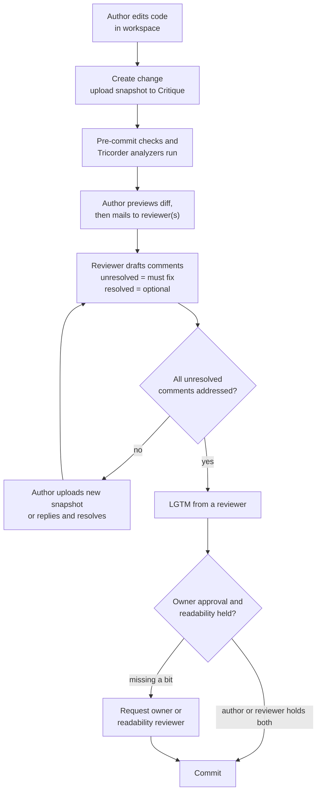

# Paper: Modern Code Review: A Case Study at Google (Sadowski et al. 2018)

> [!summary] Claim:
> Sadowski et al. combined 12 interviews, a 44-response survey, and Critique logs for about 9 million changes (January 2014 to July 2016) to describe code review at Google.
> The central finding is that review exists there mainly for readability, maintainability, and education, not for defect hunting: only 2 of 44 surveyed authors said a review found a bug.
> The process is lighter than any previously studied: one reviewer in the median case, a median change of 24 lines, a median overall latency under 4 hours, and a median of about 3 changes authored per developer per week.
> The mechanism that makes one reviewer sufficient is the split of approval into three independent bits (LGTM, owner, readability) that a single person can often hold at once.



## Bibliographic Metadata

| Field | Value |
| :--- | :--- |
| Title | Modern Code Review: A Case Study at Google |
| Authors | Caitlin Sadowski, Emma Soderberg, Luke Church, Michal Sipko (Google); Alberto Bacchelli (University of Zurich) |
| Venue | ICSE-SEIP 2018, the Software Engineering in Practice track of the 40th International Conference on Software Engineering, Gothenburg, Sweden, 27 May to 3 June 2018 |
| Pages | 181-190 (10 pages) |
| DOI | 10.1145/3183519.3183525 |
| Author PDF | https://sback.it/publications/icse2018seip.pdf |
| Study design | Exploratory, mixed method: 12 semi-structured interviews, one survey, and tool logs |
| Log window | About 9 million changes from January 2014 to July 2016; about 13 million comments from September 2014 to July 2016 |
| Review-time window | Five weeks starting October 2016 (reviewer time-on-task analysis only) |

Citation note: the Crossref record for this DOI gives the page range 181-190 and a title field that reads only "Modern code review"; the full title used here comes from the author-hosted PDF.

## The Core Problem

By 2018 "modern code review" (informal, tool-based, asynchronous, focused on changes) was the norm, but the empirical literature was thin and broad rather than deep.
Rigby and Bird had analyzed several projects at once (OSS projects reviewed by email, OSS projects on Gerrit, one AMD project, and Microsoft with CodeFlow) and extracted five "convergent practices" (CP1 to CP5 in the paper).

| Id | Convergent practice (Rigby and Bird 2013, as listed in the paper's Table 1) |
| :--- | :--- |
| CP1 | Contemporary peer review follows a lightweight, flexible process |
| CP2 | Reviews happen early (before a change is committed), quickly, and frequently |
| CP3 | Change sizes are small |
| CP4 | Two reviewers find an optimal number of defects |
| CP5 | Review has changed from a defect finding activity to a group problem solving activity |

Two gaps motivated the Google study.
- No single-company, longitudinal case existed for a firm with a multi-decade review culture and very high volume.
  The paper reports more than 25,000 developers making more than 20,000 source code changes each workday.
- Nobody had checked whether the five convergent practices hold at that end of the maturity and volume scale, or whether the motivation for review ever shifted away from defect finding.

The paper frames three research questions.

| RQ | Question | Primary data source |
| :--- | :--- | :--- |
| RQ1 | What are the motivations for code review at Google? | 12 interviews, validated by the survey |
| RQ2 | What is the practice of code review at Google? | Critique logs (about 9M changes) |
| RQ3 | How do Google developers perceive code review? | Interviews (breakdowns) and survey (satisfaction) plus a time-on-task measurement |

## Key Innovation

The paper is an empirical study, so its "innovation" is a set of findings and a measurement approach, not an algorithm.
The paper states five findings.

| Finding | Statement (paraphrased from the paper) |
| :--- | :--- |
| 1 | Expectations do not center on problem solving. Review was introduced for readability and maintainability. Developers also value education, maintaining norms, tracking history, gatekeeping, and accident prevention. Defect finding is welcomed but not the only focus. |
| 2 | Expectations for a specific review depend on the work relationship between author and reviewers. |
| 3 | The process matches the convergent practice of being lightweight and flexible, but ownership and readability are explicit and central, and the tool includes reviewer recommendation and analysis results. |
| 4 | Reviews are markedly quicker and changes smaller than in previously studied projects, and one reviewer is often sufficient (versus two elsewhere). |
| 5 | Breakdowns persist after years of refinement, mostly from the complexity of interactions around reviews, yet developers value review and spend around 3 hours a week on it. |

The measurement contribution is that the authors replicate Rigby and Bird's quantitative analyses (frequency, speed, size, reviewer count, comment count) on a single company's corpus of about 9 million changes, then add two Google-specific measures:
- an iteration count, defined as the number of times the author mails out a set of comments that resolve previously unresolved comments, with zero iterations meaning the author could commit immediately;
- a review-session heuristic for time-on-task: a sequence of interactions by a non-author on the same uncommitted change with no more than 10 minutes between successive interactions.

## Mechanism Details

This note owns the review model the paper describes, the way its numbers were produced, and what each number does and does not license.
The repository model it sits on belongs to [[Paper-Google-Monorepo-Piper-and-CitC]], and the analyzer platform belongs to [[Paper-Tricorder-Program-Analysis-Ecosystem]].

### Why review was introduced (RQ1, paper section 4)

The first author interviewed an early Google employee (referred to only as "E" in the paper) about the origin of review.
E's account, as reported:
- The main impetus was to force developers to write code that other developers could understand, because code must act as a teacher for future developers.
- Introducing review signaled the transition from a research codebase (optimized for quick prototyping) to a production codebase (optimized for future readers).
- A second benefit was that more than one person would be familiar with each piece of code, increasing the chance that knowledge stays in the company.
- E was explicit that bug-finding was welcome but not the foremost reason.
- Three further benefits became clear soon after: checking consistency of style and design, ensuring adequate tests, and improving security by ensuring no single developer can commit arbitrary code without oversight.

Current expectations come from open coding of the interviews and were validated by the survey.

| Theme | Meaning in the paper |
| :--- | :--- |
| Education | Teaching or learning from a review |
| Maintaining norms | An organizational preference for a discretionary choice, such as formatting or API usage patterns |
| Gatekeeping | Establishing and maintaining boundaries around source code, design choices, or another artifact |
| Accident prevention | Stopping bugs, defects, or other quality problems from being introduced |

A fifth use appears outside the review itself: developers treat review history as an audit trail, browsing what comments occurred and how a change evolved, and use it to understand how a bug was introduced.
In the survey, each of the four themes was selected by between 8 and 11 respondents in the context of a particular review.

Finding 2 adds that the dominant theme depends on who reviews whom (the paper's Figure 1).
Maintaining norms came up mostly between an engineer and someone of different seniority (project leads, expert readability reviewers, new team members), while gatekeeping and accident prevention dominated between peers or across teams.
Education was valued across several relationships.

The method note matters: the interview coding supports stable themes but "cannot meaningfully discuss relative frequencies of occurrence", as the paper says, so no theme ranking can be derived from it.

### The three approval bits (paper section 5.1, expanded by the book chapters)

Three concepts define the gate on committing a change at Google.

| Bit | Who grants it | What it certifies |
| :--- | :--- | :--- |
| LGTM | Any engineer other than the author | The change does what it claims and is understandable |
| Ownership (owner approval) | An owner of the directory, or of a parent directory | The change is appropriate for this part of the codebase |
| Readability | An engineer certified in the language | The change follows that language's style and best practices |

Details from the paper and from *Software Engineering at Google* (chapters 9 and 19):
- The codebase is a tree and each directory is explicitly owned by a set of people.
  Any developer can propose a change anywhere, but an owner of the directory or a parent directory must approve before commit, and owners' own changes are expected to be reviewed too.
- Ownership is recorded in `OWNERS` files.
  The book says ownership is hierarchically additive: a file is generally owned by the union of the members of all `OWNERS` files above it in the tree, and a new project needs no central registration, only a new `OWNERS` file.
- Readability is a per-language certification, earned by sending changes to readability reviewers until they are confident the developer understands the language's style and best practices.
  The paper states that every change must be either authored or reviewed by someone with readability in the language(s) used.
- The author can hold the owner and readability bits.
  The book states that an author with both still needs an LGTM from another engineer.
  In Critique's scoring model, "every change requires an LGTM regardless of approval status, ensuring that at least two pairs of eyes viewed the change" (book chapter 19).
- Only one LGTM is required by default.
  An author can tag a change as needing an LGTM from all reviewers, which the paper's Critique-customization breakdown says was added in response to feedback.

The combinations give the gate its flexibility.

| Author | Reviewer | Extra step needed to commit |
| :--- | :--- | :--- |
| Owner with readability | Any peer | None: peer LGTM is enough |
| Owner without readability | Peer without readability | Readability reviewer |
| Non-owner with readability | Peer without ownership | Owner approval |
| Intern with neither | Owner who has readability | None: that one reviewer supplies LGTM, owner, and readability |
| Anyone | Reviewers tagged "all must LGTM" | Every tagged reviewer |

The table is derived from the three-bit rules above, not copied from the paper.
The book describes the common two-step pattern: a peer LGTM first, then an owner or readability approval, so the roles can look at different aspects (the peer at correctness, the owner at fit and maintenance burden).

### The review flow and Critique (paper section 5.1)

The paper's five steps are Creating, Previewing, Commenting, Addressing Feedback, and Approving.
Mechanics worth knowing:
- Authors preview the diff and the automatic analyzer results (for example from Tricorder) before mailing the change to reviewers.
- A comment is by default unresolved, which means an action item the author must definitely address.
  Resolved comments are optional or informational.
  The book adds that unresolved comments are a soft requirement: the author can mark one resolved while replying, and a reviewer can LGTM with comments outstanding.
- Each upload is a snapshot, and diffs between any pair of snapshots are viewable.
- Pre-commit hooks run before commit, and a failure needs an explicit override by the developer.
  They cover things like basic style checking and running tests related to the change.
  Results show in the review tool, teams can configure project-specific invariants, and hooks can add mailing lists to changes.
- Tricorder results appear alongside human comments in a different color and may not block commit.
  The paper reports 110 analyzers, 5 of which are plugin systems for hundreds of additional checks, covering more than 30 languages.
  Analyzers and reviewers can propose suggested edits that are applied through Critique.
- Reviewers can click "Please fix" on an analyzer comment, and either authors or reviewers can click "Not useful".
  Analyzers with high "Not useful" rates are fixed or disabled, and the paper calls this loop critical for developer trust.
  [[Paper-Lessons-From-Static-Analysis-at-Google]] and [[Static-Analysis-at-Scale-Tricorder-and-Autofix]] own that mechanism.

Reviewer suggestion works from ownership data:
- The tool identifies the smallest set of reviewers needed to satisfy the review requirements for all files in the change.
- It prioritizes people who recently edited or reviewed the files.
- It explicitly adds new team members, who have no history yet.
- Within a team, many teams use an email alias that assigns incoming reviews round-robin, accounting for load and vacations (the book names this tool GwsQ, after the Google Web Server team that first used the technique).

The book later added a mechanism the 2018 paper does not describe: the attention set, the people on whom a change is currently blocked.
It is a post-paper tool refinement, listed here so readers do not look for it in the paper.

### How the numbers were produced (paper section 3.3)

The data filters determine what every statistic means.

| Choice | Effect on interpretation |
| :--- | :--- |
| Changes with no reviewers are excluded | All statistics are conditional on a review having happened; the share of unreviewed changes is not reported |
| A "reviewer" is any user who approves | Reviewer count is an approver count, so it understates participation |
| Robot-authored changes removed by a name-based heuristic | Some may leak through; the paper mitigates this by only keeping robot changes that have a human reviewer |
| Only the main codebase | Reviews outside the main codebase are out; Git-hosted projects reviewed in Gerrit (Chrome, Android, per book chapter 19) are therefore not in the data (inference, the paper does not list what it excluded) |
| Changes not yet committed at study time and zero-line-delta changes excluded | Changes that never commit (abandoned) are invisible, which probably biases latency downward (inference, not stated by the paper); binary-only changes are dropped |
| Interactions logged for every action in the tool | Enables the session heuristic, but only for activity inside Critique and "other tools" the paper does not enumerate |

Comment-per-change counts come from a shorter window (September 2014 to July 2016) than the change counts.

### The session heuristic, concretely

The paper defines a review session as a sequence of interactions by a non-author on the same uncommitted change with no more than 10 minutes between successive interactions, sums session hours over five weeks starting October 2016, and averages per user per week, dropping users without data for all five weeks.
The paper does not say how a session with a single interaction is costed.
The snippet below fixes one convention (duration = last minus first interaction) to show how the gap rule behaves; the convention is this note's, not the paper's.

```python
def sessions(minutes, max_gap=10):
    out, cur = [], [minutes[0]]
    for t in minutes[1:]:
        if t - cur[-1] <= max_gap:
            cur.append(t)
        else:
            out.append(cur)
            cur = [t]
    out.append(cur)
    return out

events = [0, 4, 9, 21, 25, 40]
ss = sessions(events)
print("sessions:", ss)
print("span minutes per session:", [s[-1] - s[0] for s in ss])
print("total span minutes:", sum(s[-1] - s[0] for s in ss))
```

Output (Python 3.15.2, darwin-arm64, run 2026-11-26; this snippet is inline and is not a lab):

```text
sessions: [[0, 4, 9], [21, 25], [40]]
span minutes per session: [9, 4, 0]
total span minutes: 13
```

The 40-minute event costs 0 minutes under this convention.
Any gap-based heuristic is sensitive to that convention and to the gap threshold, so the 3.2-hour figure is an estimate of observable activity, not of cognitive effort.

## Evaluation and Limitations

### Reported results

Every row below is a number printed in the paper.
Rigby and Bird comparison values are quoted as the paper reports them.

| Dimension | Google (this study) | Comparison reported in the paper |
| :--- | :--- | :--- |
| Dataset | About 9M changes, more than 25,000 authors and reviewers, January 2014 to July 2016; about 13M comments, September 2014 to July 2016 | n/a |
| Changes per day | About 20,000 committed on an average workday | n/a |
| Iterations | Over 80% of changes involve at most one iteration of resolving comments | n/a |
| Authored per week | Median about 3; 80% of authors under 7 | n/a |
| Reviewed per week | Median 4; 80% of reviewers under 10 | n/a |
| Time to initial feedback | Median under 1 hour for small changes; about 5 hours for very large changes | n/a |
| Overall review latency | Median under 4 hours (all sizes) | Time to approval: AMD 17.5 h, Chrome OS 15.7 h, three Microsoft projects 14.7, 19.8, 18.9 h; another Microsoft study 24 h |
| Single-file changes | Over 35% | n/a |
| Fewer than 10 files | About 90% | n/a |
| One-line changes | Over 10% | n/a |
| Median lines changed | 24 | AMD 44, Lucent 263, Bing/Office/SQL Server between those; OSS 11 to 32 |
| More than one reviewer | Fewer than 25% | Two reviewers is the convergent count elsewhere |
| At most five reviewers | Over 99% | n/a |
| Median reviewers | 1 | 2 elsewhere |
| Peak comments per change | 12.5, at about 1250 changed lines | n/a |
| Reviewer time | Mean 3.2 h per week, median 2.6 h | 6.4 h per week self-reported for OSS |
| Committed within 24 h of first mail-out | 70% of changes, during the week | n/a |
| Survey: "review is valuable" | All 44 agree (counts 0, 0, 0, 14, 30 across the five-point scale) | n/a |
| Survey: "good use of my time" for this change | Counts 2, 4, 14, 11, 13 | n/a |
| Survey: amount of feedback | Counts 2, 2, 34, 5, 0 (sums to 43, not 44; the paper does not explain the difference) | n/a |
| Critique satisfaction (separate internal survey) | 97% of developers satisfied | n/a |

Further reported details:
- The least satisfied replies came from very small changes (one word or two lines) or changes needed only to trigger some other process.
- Eight respondents called the comments unhelpful; of the three who explained, all described small configuration changes.
  Only 2 of 44 said the review found a bug.
- Footnote 1: 30% of changes have comments from more than one commenter, so about 5% have extra comments from someone who was not an approver.
  That is how "fewer than 25% have more than one reviewer" and "30% have more than one commenter" are both true.
- Contradicting CP4: more reviewers meant more comments on average at Google, where Rigby and Bird saw a minimal increase beyond two.
  The paper also notes that larger changes get more reviewers on average, so size is a confounder it does not control for (the confounder reading is this note's, not the paper's).
- Comments per change fall as author tenure grows: authors in their first year typically receive more than twice as many comments per change (the paper's Figure 2).
  Distinct files edited and reviewed grow with tenure, and the files reviewed exceed the files edited (Figure 3, 3-month tenure buckets over 18 months).
  The paper presents this as support for knowledge spreading, and states it as a postulate, not a demonstrated causal effect.

### Breakdowns (RQ3, paper section 6.1)

| Theme | What interviewees described |
| :--- | :--- |
| Distance | Geographic or organizational distance between author and reviewer causes delays or misunderstanding |
| Social interactions | Tone (sensitive authors; negative-tone comments judged less useful in prior work) and power (dragging out reviews or withholding approvals to change someone's behavior) |
| Review subject | Disagreement on whether review is the right place for design discussion, giving mismatched expectations |
| Context | Not knowing why a change exists (urgent production fix versus nice-to-have) |
| Customization | Teams need different policies, such as number of reviewers, and the tool does not support arbitrary customization |

### Threats to validity the paper states

- Internal validity: the robot filter is a heuristic; open coding could reflect the coders' own experience (mitigated with multiple coders); self-selection into the interviews and survey; snowball sampling for interviewees; moderator acceptance bias (mitigated because the interviewers were not on the Critique team); social desirability bias (argued down by Google culture encouraging criticism of workflows).
- Coverage: no research scientists and no developers who deal with specialist reviewers (for example security reviews), so results skew toward general developers.
- Transferability: results may not generalize beyond Google, though the authors argue similar tooling and maturity would produce similar experiences.
- Survey scale: 98 invited, 44 valid responses (45%), small enough that the Likert counts above carry wide uncertainty.
- Interviews: 12 interviews of about an hour with staff from 1 month to 10 years of tenure (median 5 years), in Software Engineering and Site Reliability Engineering, run until saturation.

### What the paper does not show

- It reports no defect rates, no post-release bug counts, and no counterfactual (changes without review).
  The inventory heading for this note mentions "Defect Rates", but the paper contains none; the only defect-adjacent datum is the 2-of-44 survey count above.
- It does not demonstrate that single-reviewer review is as effective as two-reviewer review, only that it is what a culture of quick, required, small-change review converged on.
  The authors hypothesize that one reviewer keeps reviews fast and lightweight, and they say both low review time and low reviewer count may stem from review being mandatory, from culture, or from small changes.
- It does not isolate the contribution of ownership and readability to code quality, though it describes both in detail.
- It does not measure review quality, only process shape, volume, latency, and perception.

> [!warning] Pitfalls:
> - Quoting "under 4 hours" as a service-level target: it is a median over committed, reviewed changes, so it hides the tail and every abandoned change.
> - Treating "one reviewer" as a recommendation: the paper explains that often only one reviewer is needed because authors often hold ownership and/or readability, and it pairs the practice with small changes and a pre-commit analysis stack.
> - Counting commenters as reviewers and concluding the paper is wrong; the paper counts approvers (see the interview question on this).
> - Comparing Google's 24-line median to your repository without matching what is counted (lines added plus deleted? generated files? zero-line deltas dropped?).
> - Reading the 97% Critique satisfaction as a review-quality measure; it is a tool-satisfaction survey from the same culture that mandates review.
> - Importing the 3.2 hours per week as a budget without noting that it is a session-gap estimate over five weeks in one October 2016 window.

## Industry Impact

### The paper's own legacy

- The Google Engineering Practices documentation (public, open source) states the doctrine the paper describes: the primary purpose is that overall code health improves over time, reviewers should favor approving a change once it definitely improves code health even if it is not perfect, and purely optional points should carry a "Nit:" prefix (as of 2026-11, from the page itself).
- The same documentation (as of 2026-11) sets the speed expectation: one business day is the maximum time to respond to a review request, and the response time (not total time to submit) is the thing to optimize.
  It also permits "LGTM with comments" when the author can be trusted to address the remainder, and tells reviewers to ask authors to split changes that are too large rather than review them whole.
  The book states a related expectation of feedback within 24 working hours.
- *Software Engineering at Google* chapters 9 and 19 expand the paper into a process chapter and a tool chapter, by an overlapping author set (Sadowski appears on both).
  They add details absent from the paper: the three-part scoring (LGTM, Approval, number of unresolved comments), the removal of earlier "Needs More Work" and "LGTM++" ratings in favor of always-positive scoring, the attention set, and a note that most changes are under 100 lines (chapter 19 footnote 2).
- Critique is internal-only because of its dependence on the monorepo and internal tools.
  Teams hosting Git repositories (Chrome, Android) use Gerrit, which the book says shares the model that each commit is reviewed separately.

### Influence on practice elsewhere

The paper documents no adopters, and this note does not claim any.
The documented lineage is narrower:
- The "analysis results inline with a 'Not useful' feedback channel" design is described in the paper and continues in [[Paper-Tricorder-Program-Analysis-Ecosystem]] and [[Paper-Lessons-From-Static-Analysis-at-Google]].
- The latency and size numbers give a baseline to compare your own review data against, with the caveats in the pitfalls above; pair them with the delivery metrics in [[Developer-Productivity-Metrics-DORA-SPACE-and-GSM]] rather than using them alone.

### Follow-on at Google

A 2024 Google paper (Vijayvergiya et al., AIware 2024, arXiv:2405.13565) reports AutoCommenter, an LLM-backed system that learns and enforces coding best practices in review, implemented for C++, Java, Python, and Go and deployed to tens of thousands of developers.
It targets exactly the "norms" theme the 2018 paper identified, where human reviewers were left enforcing best practices that tools could not.
This note makes no claim about its measured effect; read the paper for its evaluation.

## Concept Grounding

| Concept note | What it takes from this paper |
| :--- | :--- |
| [[Code-Review-and-Readability-Systems-at-Scale]] | The numbers (size, latency, reviewer count) that the scale decisions are measured against, and the ownership plus readability model |
| [[Static-Analysis-at-Scale-Tricorder-and-Autofix]] | The review-time integration contract: analyzers inline, "Please fix", "Not useful", disable noisy analyzers |
| [[Git-Branching-Models-Merge-Queues-and-Code-Review]] | Review as a pre-commit gate in a trunk-based flow, and how Gerrit-style per-commit review compares |
| [[Paper-Google-Monorepo-Piper-and-CitC]] | The repository model (single tree, uniform workflow) that makes tree-structured ownership and a uniform review process possible |
| [[Paper-Tricorder-Program-Analysis-Ecosystem]] | The analyzer platform whose results Critique displays |
| [[Paper-Lessons-From-Static-Analysis-at-Google]] | The later retrospective on why developer-facing analysis succeeded, including the review integration point |
| [[Developer-Productivity-Metrics-DORA-SPACE-and-GSM]] | Why latency-style review metrics need paired quality measures |
| [[Large-Scale-Changes-and-Codemods-Across-Repos]] | The book's treatment of machine-authored changes that still require review under a reduced-scope reviewer rule |

## Interview Questions

> [!question] L5: What did the paper conclude about why Google introduced code review, and what evidence supports it?
> Explain the evidence type and its limit.

> [!success]- Answer
> The conclusion (Finding 1) is that review was introduced to keep code understandable and maintainable, not mainly to find defects, and today's developers also value education, maintaining norms, tracking history, gatekeeping, and accident prevention.
> The origin story comes from one interview with an early employee, and the current-expectations themes come from 12 interviews validated by a 44-response survey where each theme was chosen by 8 to 11 respondents.
> The limit is that open coding yields stable themes, not relative frequencies, so the paper cannot rank them.
> Supporting datum: only 2 of 44 respondents said a review found a bug.

> [!question] L5: Name the three approval bits needed to commit a change at Google and say how one reviewer can satisfy all of them.

> [!success]- Answer
> LGTM (a non-author engineer says the change does what it claims and is understandable), owner approval (an owner of the directory or a parent directory, via `OWNERS` files), and readability (a reviewer certified in the language).
> The bits are independent permissions, so a single reviewer who is both an owner of the path and readability-certified in the language supplies all three at once.
> That is why one reviewer is the median case.
> The author can also hold owner and readability, but still needs an LGTM from another engineer.

> [!question] L5: Predict the output
> The paper counts a review session as consecutive non-author interactions on one uncommitted change with no more than 10 minutes between them.
> What does this print, using duration = last interaction minus first?
> ```python
> def sessions(minutes, max_gap=10):
>     out, cur = [], [minutes[0]]
>     for t in minutes[1:]:
>         if t - cur[-1] <= max_gap:
>             cur.append(t)
>         else:
>             out.append(cur)
>             cur = [t]
>     out.append(cur)
>     return out
>
> ss = sessions([0, 4, 9, 21, 25, 40])
> print(ss)
> print(sum(s[-1] - s[0] for s in ss))
> ```

> [!success]- Answer
> It prints `[[0, 4, 9], [21, 25], [40]]` and then `13` (9 plus 4 plus 0), matching the run recorded in this note on Python 3.15.2, darwin-arm64.
> The gap from 9 to 21 is 12 minutes and from 25 to 40 is 15, both above 10, so each starts a new session.
> The lesson is that the paper does not say how a single-event session is costed, so the 3.2 hours per week figure depends on an unstated convention.

> [!question] L6: Debug this
> You replicate the paper's reviewer-count figure on your own review data and get "more than one reviewer" far above the paper's "fewer than 25%".
> ```python
> more_than_one = sum(len(c["commenters"]) > 1 for c in changes)
> ```
> On a ten-change sample this reports 3 of 10 while the paper's definition reports 1 of 10.
> What is wrong?

> [!success]- Answer
> The code counts distinct commenters; the paper counts approvers ("a reviewer is any user who approves a code change, regardless of whether they were explicitly asked").
> The paper's footnote 1 reports the same gap: 30% of changes have comments from more than one commenter, while about 5% have extra comments from someone who did not approve.
> The fix is `len(c["approvers"]) > 1`.
> A ten-change sample that reproduces the numbers in the question:
> ```python
> changes = [
>     {"approvers": {"a", "b"}, "commenters": {"a", "b"}},
>     {"approvers": {"a"}, "commenters": {"a", "c"}},
>     {"approvers": {"b"}, "commenters": {"b", "d"}},
> ] + [{"approvers": {"a"}, "commenters": {"a"}} for _ in range(4)] + [
>     {"approvers": {"b"}, "commenters": set()} for _ in range(3)
> ]
> print("commenter rule:", sum(len(c["commenters"]) > 1 for c in changes))
> print("approver rule:", sum(len(c["approvers"]) > 1 for c in changes))
> print("non-approving commenter:", sum(bool(c["commenters"] - c["approvers"]) for c in changes))
> ```
> Run once (Python 3.15.2, darwin-arm64, 2026-11-26) it prints `commenter rule: 3`, `approver rule: 1`, and `non-approving commenter: 2`.
> Also exclude changes with zero reviewers and robot-authored changes to match the paper's filter before comparing.

> [!question] L6: Is it a contradiction that median latency is under 4 hours but only 70% of changes commit within 24 hours of the first mail-out?

> [!success]- Answer
> No: a median and a tail statistic describe different parts of one distribution.
> The paper's 70% figure is for changes during the week and the under-4-hours figure is the median for the entire review process across all sizes, so a heavy tail past 24 hours is consistent with both.
> Remember also the filters: uncommitted changes are excluded, so abandoned reviews do not enter the latency statistics.
> A fair replication reports p50, p90, and the abandoned fraction separately.

> [!question] L6: Why does the paper's data not refute "two reviewers find an optimal number of defects" (Rigby and Bird), yet contradict their comment-count claim?

> [!success]- Answer
> The paper never measures defects, so it cannot confirm or refute "optimal number of defects found".
> What it measures is comments: at Google more reviewers meant more comments per change on average, unlike the minimal increase Rigby and Bird saw beyond two reviewers.
> A confounder is change size, since larger changes have more reviewers and also more comments (the average rises to 12.5 comments at about 1250 lines, then falls because very large changes tend to be generated code or large deletions).
> The paper's own position on one reviewer is a hypothesis that it keeps reviews fast, not a measured quality equivalence.

> [!question] L7+: Design a review service-level objective for a 2,000-engineer company from this paper and the eng-practices speed guidance.
> Which metrics do you track, and how do they get gamed?

> [!success]- Answer
> Anchor on response time, because the eng-practices text says first response matters more than total time: track time-to-first-response (p50 and p90) and time-to-commit (p50, p90) separately, plus the abandoned fraction, change size distribution (median and share above a threshold), and iterations per change.
> Pair latency with a quality counter-metric (for example rollbacks or post-merge defects linked to the change) because the paper reports no quality measure and latency alone rewards rubber-stamping.
> Gaming paths: drive-by "LGTM" within minutes with no reading (the eng-practices doc demands enough time that LGTM means the code meets standards), splitting changes artificially to improve size statistics, and auto-resolving comments to cut iteration counts.
> Normalize by size and exclude generated or large-deletion changes, as the paper does implicitly when it explains the comment-count peak.

> [!question] L7+: What can you not conclude from the paper's 97% satisfaction and "all respondents agreed review is valuable"?

> [!success]- Answer
> The satisfaction figure is a tool survey (Critique, 97%) and the value result is 44 respondents who had just sent a reviewed change, from a population where review is mandatory and culture rewards it.
> The authors themselves list self-selection, snowball sampling, and social desirability bias.
> It does not show review reduces defects or that the process would satisfy developers elsewhere.
> The per-change questions were more varied: 14 of 44 were neutral that the review was a good use of time and 6 disagreed to some degree (2 and 4 in the two disagreement columns).

> [!question] L8+: A 3,000-engineer company with many repositories and no `OWNERS`-style ownership asks to "adopt Google's single-reviewer model." What must be true first, and what do you recommend?

> [!success]- Answer
> The single-reviewer median works at Google because several conditions co-occur: path-level ownership that identifies the right approver programmatically, a readability certification that moves style review into a trained pool, small changes (median 24 lines), a pre-commit and Tricorder stack that removes trivial comments, and a culture of fast response.
> Without ownership data the reviewer-recommendation step degrades to guesswork, and without small changes one reviewer cannot hold the whole change in mind.
> Recommend building the prerequisites in order: ownership files and enforcement (see [[Code-Review-and-Readability-Systems-at-Scale]]), automated style and analysis feedback ([[Static-Analysis-at-Scale-Tricorder-and-Autofix]]), a norm for small changes with stacked review ([[Git-Branching-Models-Merge-Queues-and-Code-Review]]), then measure, and keep a second reviewer for high-risk paths.
> The downside is a long period in which review is lighter but the quality benefits are not yet established; a quality counter-metric is the only way to know.

## Further Reading

- Sadowski et al., *Modern Code Review: A Case Study at Google* (author PDF: https://sback.it/publications/icse2018seip.pdf): the primary source; read sections 3.3, 5, and 6.2 for the measurement definitions.
- Rigby and Bird, *Convergent contemporary software peer review practices* (https://doi.org/10.1145/2491411.2491444): the CP1 to CP5 baseline the paper replicates.
- Bacchelli and Bird, *Expectations, outcomes, and challenges of modern code review* (https://doi.org/10.1109/ICSE.2013.6606617): the Microsoft study of expectations the paper compares its themes to.
- Czerwonka, Greiler, Tilford, *Code Reviews Do Not Find Bugs* (https://doi.org/10.1109/ICSE.2015.131): the Microsoft counterpoint, cited in the paper for time-to-approval and comment usefulness.
- Google eng-practices review documentation (https://google.github.io/eng-practices/review/): the public statement of the standard, the speed expectations, and small-change advice.
- *Software Engineering at Google*, chapters 9 and 19 (https://abseil.io/resources/swe-book/html/ch09.html, https://abseil.io/resources/swe-book/html/ch19.html): the process and tool descriptions that expand this paper.
- Vijayvergiya et al., *AI-Assisted Assessment of Coding Practices in Modern Code Review* (https://arxiv.org/abs/2405.13565): the later Google system for the norms theme.

## Related

- Prerequisites: none
- Next: [[Paper-Build-Systems-a-la-Carte]]
- See also: [[09-Engineering-Leadership/03-Code-Review/checklist|checklist]]
- Also in this pillar: [[Paper-Google-Monorepo-Piper-and-CitC]], [[Paper-Tricorder-Program-Analysis-Ecosystem]], [[Paper-Lessons-From-Static-Analysis-at-Google]]
- Also in the toolchain: [[Code-Review-and-Readability-Systems-at-Scale]], [[Static-Analysis-at-Scale-Tricorder-and-Autofix]], [[Git-Branching-Models-Merge-Queues-and-Code-Review]], [[Developer-Productivity-Metrics-DORA-SPACE-and-GSM]], [[Large-Scale-Changes-and-Codemods-Across-Repos]]
