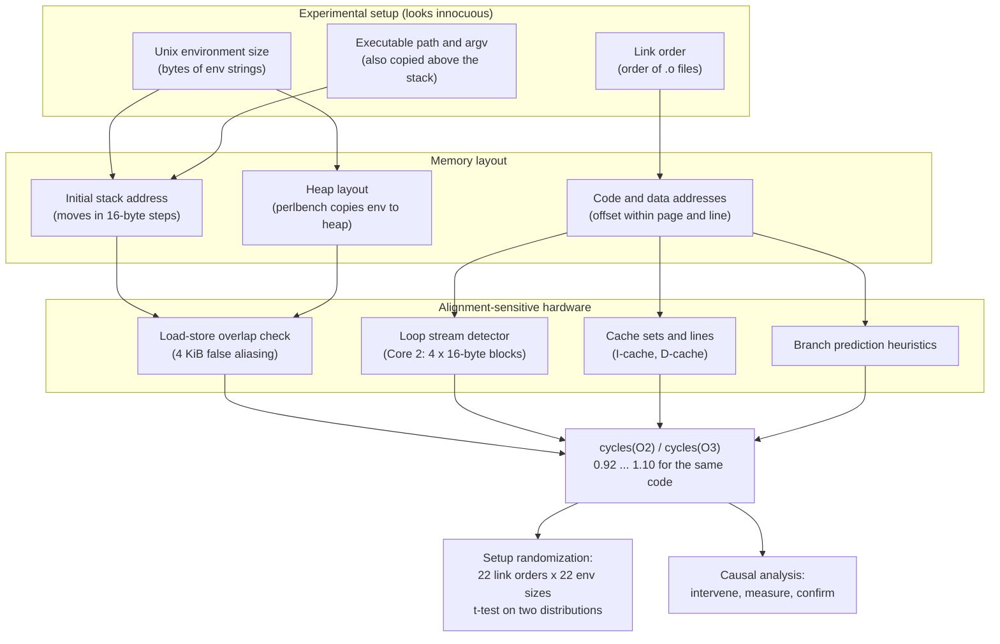

# Paper: Producing Wrong Data Without Doing Anything Obviously Wrong! (Mytkowicz et al. 2009)

> [!summary] Scope
> Owns the foundational ASPLOS 2009 empirical measurement study by Todd Mytkowicz et al. demonstrating how innocuous experimental variations fundamentally bias performance benchmarks.
> Dissects how Unix environment variable size and linker object order alter hardware memory layouts, cache alignments, and branch target buffers to invert benchmark conclusions.
> Grounds measurement methodology and benchmark randomization techniques.
> Hands host noise control to [[Benchmark-Methodology-Noise-and-Environment-Control]], the runnable reproduction to [[Drill-Measurement-Methodology-Environment-Size-Bias]], and the statistics of comparing distributions to [[Statistics-for-Benchmarks-Coordinated-Omission-and-HDR-Histograms]].

> [!summary] Claim:
> A performance experiment has a setup, and parts of the setup that look irrelevant (the byte size of the Unix environment, the order of `.o` files on the link line) move the stack and the code to different addresses, which changes how the program interacts with alignment-sensitive hardware.
> On a Core 2 with gcc, that alone moved the measured O3-over-O2 speedup of perlbench between 0.92 and 1.10 across 33 link orders and of lbm between 0.88 and 1.09 across environment sizes, so the same experiment can prove that O3 helps or that it hurts.
> The bias appeared on every machine (Pentium 4, Core 2, the m5 O3CPU simulator) and with both compilers (gcc, Intel icc), it is not predictable from the knob's value or across machines, and none of the 88 methodology-bearing papers the authors surveyed addressed it.
> The remedies are borrowed from the experimental sciences: sample many setups and compare distributions (setup randomization), and test a conclusion by intervening on its supposed cause (causal analysis).



## Bibliographic Metadata

| Field | Value |
| :--- | :--- |
| Title | Producing Wrong Data Without Doing Anything Obviously Wrong! |
| Authors | Todd Mytkowicz and Amer Diwan (University of Colorado, Boulder), Matthias Hauswirth (University of Lugano), Peter F. Sweeney (IBM Research, Hawthorne, NY) |
| Venue | ASPLOS XIV, the 14th International Conference on Architectural Support for Programming Languages and Operating Systems, Washington, DC, March 7-11, 2009 |
| Pages | 265-276 (12 pages) |
| DOI | `10.1145/1508244.1508275` |
| ACM classification | C.4 Performance of Systems: Design studies; general terms Experimentation, Measurement, Performance |
| Citations | 203 in Crossref's `is-referenced-by-count` (as of 2026-11; Crossref counts only DOI-registered citing works, so it undercounts) |
| Funding noted | NSF ITR CCR-0085792, CSE-SMA 0509521, IBM, a ThinkSwiss scholarship, DARPA HR0011-07-9-0002 |

The paper's own copy is the reference for every number below.
Section and figure numbers are the paper's.

## The Core Problem

Systems research and day-to-day performance engineering both run the same loop: measure system S, measure S plus optimization O, and attribute the difference to O.
That attribution is only valid if the experimental setup does not itself favor one side.
The authors borrow the name for the failure from the natural and social sciences: **measurement bias** arises "whenever the experimental setup favors S1 over S2 or vice versa" (Section 3).

Measurement bias is not noise.
Noise is variation between repeated runs of one setup, and more runs shrink its effect on the mean.
Bias is a systematic offset that every run of a setup shares, so the confidence interval around a biased mean can be tight and still exclude the true answer.
The paper's error bars make the point: the whiskers on each point are 95% confidence intervals of the mean of five runs, they are narrow, and the points still land on both sides of 1.0 (Sections 4.1.1 and 4.2.1).

The experiment the authors chose to expose this is deliberately ordinary: is gcc's `-O3` faster than `-O2`?
"Speedup of O3" is defined as `cycles(O2) / cycles(O3)`, so a value above 1.0 means O3 helps (Section 1).
They stress that the point is not to grade O3; it is to show how easily a reasonable experiment reaches opposite conclusions.

The setup dimensions they vary were chosen because "it is well known that program performance is sensitive to memory layout and thus anything that affects memory layout is also likely to exhibit measurement bias" (Section 3):

- **Unix environment size**: the total bytes needed to store the environment variables, which changes the start address of the stack.
- **Link order**: the order of `.o` files given to the linker, which changes code and data layout.

They name others they did not study: room temperature affecting clock speed and so the balance between memory-bound and compute-bound code, and benchmark selection, since a suite of tiny working sets rewards different optimizations than a suite of large ones (Section 3).

## Key Innovation

The contribution is empirical and methodological, not an algorithm.

1. **A demonstration that bias is significant, commonplace, and unpredictable.**
   Significant: large enough to flip the sign of a conclusion.
   Commonplace: present on all three machines (one simulated), with both compilers, across the SPEC CPU2006 C programs.
   Unpredictable: monotone changes in the knob give non-monotone changes in the result, and the best setting on one machine is not the best on another.
2. **A diagnosis down to hardware events where the hardware allowed it**, and an explicit statement of where it did not: the loop stream detector was undocumented and unobservable, and the event that pointed at load-store overlap was not supported by precise sampling.
3. **A literature survey** showing the field did not account for the problem.
4. **Two remedies imported from other sciences**: experimental setup randomization, which tries to avoid bias, and causal analysis, which detects when bias has produced a wrong conclusion.
5. **A call to action** aimed at both benchmark designers and hardware vendors: diverse suites, tools that randomize setups automatically, published microarchitecture details, switchable hardware features, and events that map to instructions.

## Mechanism Details

### 1. The micro-kernel (Section 2, Figure 1)

The paper opens with a kernel compiled with all optimizations disabled, so that the loop is not removed as dead code; a footnote says a slightly more complex version shows the same effect with optimizations enabled.

```c
static int i = 0, j = 0, k = 0;

int main() {
  int g = 0, inc = 1;
  for (; g < 65536; g++) {
    i += inc;
    j += inc;
    k += inc;
  }
  return 0;
}
```

The authors grew an unused environment variable from 0 to about 4,000 bytes and plotted cycles, each point the mean of five runs on the Core 2.
Run time changed "frequently by about 33% and once by almost 300%".
Their explanation is one sentence: the environment is loaded into memory before the call stack, so a larger environment moves the stack, which moves `g` and `inc` relative to alignment-sensitive hardware structures.

At `-O0` every iteration stores and reloads the stack slots of `g` and `inc` and the static variables `i`, `j`, and `k`.
The statics sit at fixed addresses; only the stack slots move with the environment.
A hypothesis of this note, not a result of the paper, is the false load-store dependence described in Subsection 3: when a stack slot and a static variable share the same address bits 0-11, a load can be falsely held behind a store to the other address.
The paper names no hardware event for Figure 1, so treat this as a candidate explanation to test with the events in Subsection 3, not as an established cause; the load-store overlap evidence the paper does give is for perlbench (Section 4.2.2).

### 2. How Linux decides where the stack starts

The paper says only that the environment is placed before the stack.
The current mechanism, read from Linux v6.12, makes the knob precise.

**Copy order in `execve`.**
`do_execveat_common()` in `fs/exec.c` copies, from the top of the new stack downwards, the executable's path (`copy_string_kernel(bprm->filename, bprm)`), then the environment strings (`copy_strings(bprm->envc, envp, bprm)`), then the argument strings (`copy_strings(bprm->argc, argv, bprm)`).
So three things shift the stack below them byte for byte: the path used to start the program, every environment string, and every argument string.

**Alignment in `create_elf_tables()`.**
`fs/binfmt_elf.c` then builds the initial process stack below the strings:

1. `p = arch_align_stack(p);` on x86-64 subtracts a random value in `[0, 8192)` when randomization is on, then rounds down with `sp & ~0xf`; on arm64 the random value is in `[0, PAGE_SIZE)`.
   With randomization off (`ADDR_NO_RANDOMIZE` in the personality, or `randomize_va_space` 0) only the 16-byte rounding remains.
2. The platform string (`ELF_PLATFORM`) and 16 random bytes for `AT_RANDOM` are pushed.
3. The auxiliary vector, then `items = (argc + 1) + (envc + 1) + 1` pointer slots for `argc`, `argv[]`, and `envp[]`, and the result is rounded down again: `STACK_ROUND(sp, items)` is `((sp - items) & ~15UL)` on downward-growing stacks.

Two consequences follow directly from that code (derived from the v6.12 source, x86-64, randomization off):

- The initial stack pointer moves only in 16-byte steps: adding 1 byte to an environment value moves it by 0 or 16 bytes, adding 16 bytes moves it by exactly 16.
- Adding a new variable costs its string bytes plus one 8-byte `envp[]` slot, so the pointer count also enters the rounding.

Everything `main()` puts on the stack then sits at a fixed distance below that pointer for a given binary, libc, and code path, so the low 12 bits of every stack variable's address cycle through the 256 possible 16-byte offsets of a 4 KiB page as the environment grows by 4,096 bytes.
That is exactly the range the paper swept (0 to about 4,000 bytes in Figure 1, up to 4,096 bytes in the causal-analysis intervention of Section 7.2).
See [[Program-Startup-C-Runtime-Init-and-Auxiliary-Vectors]] for the full layout of the initial stack and [[Virtual-Memory-Mmap-and-Process-Address-Space]] for where the stack mapping itself lives.

### 3. Why a 16-byte stack shift can matter: false load-store aliasing

When a load executes, the core must decide whether an earlier store still in flight writes the same bytes.
Intel cores of this era made that check on partial addresses.
Agner Fog's microarchitecture manual (Section 8.12, Core 2 and Nehalem) states that the store-forwarding check "does not distinguish between different memory addresses with the same set-value in the cache", which causes "stalls for failed bogus store forwardings when addresses are spaced a multiple of 4 kb apart", and Section 8.13 repeats that both cores have "a false dependence between memory addresses with the same set and offset, i.e. with a distance that is a multiple of 4 kB".

The paper found the same signature for perlbench (Section 4.2.2).
With the heap start pinned so that only the stack moved, the authors took the fastest and slowest environment sizes, collected all 340 Core 2 events that perfmon offered, and found 42 that differed by more than 25%.
One "stood out with a 10-fold increase": `LOAD_BLOCK:OVERLAP_STORE`, loads blocked for reasons that include preceding stores.
libpfm4's Core event table spells it as event `LOAD_BLOCK` with umask `OVERLAP_STORE` and describes it as "Loads that partially overlap an earlier store, or 4K equived with a previous store", so the counter itself includes the 4 KiB aliasing case (`lib/events/intel_core_events.h`, as of 2026-11, Linux).
Their conclusion is hedged on purpose: the hardware uses "conservative heuristics based on alignment and other factors to determine load-store overlaps", the stack shift "probably" changed their outcome, and they could not confirm which stack locations were involved because Core 2 precise event-based sampling (PEBS) did not support that event.

Later Intel cores expose the mechanism directly.
The Skylake event file in `intel/perfmon` lists `LD_BLOCKS_PARTIAL.ADDRESS_ALIAS` (event `0x07`, umask `0x01`), "False dependencies in MOB due to partial compare on address", next to `LD_BLOCKS.STORE_FORWARD` (event `0x03`, umask `0x02`), "Loads blocked due to overlapping with a preceding store that cannot be forwarded" (as of 2026-11, Linux).

### 4. The second environment effect: perlbench copies the environment to the heap

For every benchmark except perlbench, pinning the stack start while varying the environment gave the same O3 speedup at every size, which confirmed the stack-address explanation (Section 4.2.2).
perlbench was different because at startup it copies the environment into the heap, so a bigger environment also moves heap-allocated structures.
With the heap start fixed so that every tested environment fit below it, the environment's effect on perlbench became "much smaller", and the residual was attributed to the stack shift.
The lesson generalizes: any program that copies its environment, arguments, or path into data structures turns those bytes into heap layout too.

### 5. Link order: code alignment and the loop stream detector (Section 4.1.2)

Changing link order changes the address of every function in every later object file, so it moves code relative to cache lines, fetch blocks, and the branch predictor's indexing.
The paper says link order "affects the alignment of code, causing conflicts within various hardware buffers (e.g. caches) and hardware heuristics (e.g. branch prediction)", and that the dominant structure can differ by program.
It does not identify a branch target buffer effect specifically; the seed's mention of branch target buffers is this general branch-prediction claim, not a measured result.

To find a concrete cause the authors used the m5 simulator, whose internals they could read.
For bzip2 they found that "whether or not a particular hot loop fit in a single cache line determined the performance of the program": if the loop fit in one line, m5's O3CPU latched it in the instruction queue and issued no I-cache accesses while it ran.

They then looked for the analogous structure on the Core 2 and found the **loop stream detector** (LSD).
Agner Fog describes it as the Core 2 decoder queue reused as "a 64-bytes, 18 instructions, loop buffer", organized "as 4 lines of 16 bytes each", and advises that critical loops be "aligned by 16 and be no bigger than 64 bytes or 18 instructions on the Core 2".
A loop that fits in four aligned 16-byte blocks in one link order can straddle a fifth block in another, and then it no longer streams from the buffer.

Three obstacles stopped the authors from confirming the hypothesis: Intel did not publish a full description of the LSD, no performance counter measured it, and it could not be switched off the way prefetching could.
On current Intel cores the second obstacle is gone: the Skylake event file lists `LSD.UOPS` (event `0xA8`, umask `0x01`), "Number of Uops delivered by the LSD" (as of 2026-11, Linux).

### 6. The experimental infrastructure (Section 3)

| Component | Detail |
| :--- | :--- |
| Benchmarks | All C programs of SPEC CPU2006 V1.0: CINT gcc, libquantum, perlbench, bzip2, h264ref, mcf, gobmk, hmmer, sjeng; CFP sphinx3, milc, lbm (12 in total) |
| Input | `train`, to finish in reasonable time; generating the data still took 12 days for sjeng, the longest |
| Run count | Each benchmark run 5,940 times for the figures |
| Baseline sizes | From 3.1 billion cycles (gcc, 1.3 s) to 420 billion cycles (sjeng, 175.0 s), mean of 15 runs with an empty environment and default link order (Table 1) |
| Counters | PAPI, through an "inter-loper": a shared library loaded with `LD_PRELOAD` that overloads `__libc_start_main`, starts counting before `main` and reads out after it exits, so no source change or recompilation alters the static layout |
| Environment | Minimal: all inessential variables unset, except in the experiments that add one |
| Load | Minimally loaded machines, local disks only, each experiment repeated |
| Stack randomization | Disabled on the Core 2 kernel, because it "can make experiments hard to repeat" |
| OS interference argument | Back-to-back runs; OS activity would have to persist over 6.5 s to bias even the shortest benchmark |

| Machine | Core 2 | Pentium 4 | m5 O3CPU |
| :--- | :--- | :--- | :--- |
| OS | Linux 2.6.25 | Linux 2.4.21 | n/a |
| Toolchain | gcc 4.1.3, icc 10.1 | gcc 4.2.1 | gcc 4.1.0 |
| Measurement | papi-3.5.1 / perfmon-2.8 | papi-3.0.8 / perfctr-5.2.16 | n/a |
| Microarchitecture | Core | NetBurst | Alpha |
| Clock | 2.4 GHz | 2.4 GHz | 1 GHz |
| Memory | 8 GB | 2 GB | 512 MB |
| L1 | 32K I, 32K D | 12K I, 8K D | 32K I, 64K D |
| L2 | 128K unified (as printed in Table 2) | 512K unified | 2M unified |
| L3 | 4096K | none | none |
| TLB entries | 512 | 64 | 48 I, 64 D |

The Core 2 was a quad core, and the single-threaded benchmarks used one core at a time.
All data in the paper is for the Core 2 unless stated otherwise.

### 7. Bias is unpredictable (Section 5)

Two results make "just pick a good setting" impossible:

- Increasing the environment size does not monotonically increase or decrease the O3 benefit: perlbench's speedup rises and falls across 0.91 to 1.07 as the environment grows (Figure 3a).
- The best link order and the best environment size for perlbench on the Pentium 4 are not the best on the Core 2 (Figure 5, which plots O2 cycles on one machine against the other for the same setups).

The second result has a commercial consequence the authors draw out: a vendor that ships a pre-linked binary tuned for one machine's link order has no guarantee that order is good on another.

### 8. Setup randomization (Section 7.1.2)

The remedy for a biased sample is a bigger, more varied sample.
Generate many setups by varying the parameters known to cause bias, measure both systems in each, and compare the two resulting distributions with a statistical test.

For perlbench the authors built 484 setups as the cross product of 22 link orders and 22 environment sizes, ran each combination 3 times with O2 and with O3, and applied a t-test (citing Georges et al. for the calculation).
The result, Figure 7: the mean O3 speedup is **1.007 +/- 0.003** at 95% confidence, so O3 does speed perlbench up, by less than 1%, a long way from both the 0.92 and the 1.10 that single setups produced.

They also tested whether the benchmark suite itself averages the bias out (Section 7.1.1).
Across 66 setups that differed in memory layout, they computed one number per setup, the suite-average speedup, and plotted the distribution (Figure 6).
A diverse suite would have given a tight distribution; instead the suite average varied by 7% between setups.
The authors' conclusion: what matters is the diversity of the suite, not its size, and SPEC CPU2006's C programs are not diverse enough to cancel layout bias.

They are explicit that randomization is not a complete cure: if the setup is not varied along the right dimensions, a different bias survives.

### 9. Causal analysis (Section 7.2)

Causal analysis, citing Pearl, tests a conclusion "X caused Y" in three steps:

1. **Intervene**: devise a change that affects X while having a minimal effect on everything else.
2. **Measure**: run the changed system.
3. **Confirm**: if Y changed as the hypothesis predicts, the conclusion gains credibility.

The paper applies it to its own chain "environment size changes the stack start, and the stack start changes the O3 speedup".
The first link was checked directly: when the environment grew by `b` bytes, stack variable addresses moved by `b` bytes modulo alignment.
For the second, the intervention fixed the stack start for any environment up to 4,096 bytes, the measurement swept the environment, and the confirmation was that the environment size no longer affected the O3 speedup.
That held for every benchmark except perlbench, where the analysis rejected the conclusion and led to the heap explanation in Subsection 4, which was then confirmed in turn.

The authors draw the distinction sharply: setup randomization tries to obtain untainted data, while causal analysis does not try to remove bias; it gains confidence that a conclusion is valid in spite of it.
They also note that causal analysis "does not guarantee" a correct conclusion, and that alternative interventions exist, for example changing the stack start while keeping the environment fixed.

### 10. What ASLR changes today, and what it does not

The authors disabled stack randomization to make runs repeatable.
On current Linux, leaving randomization on turns part of the bias into run-to-run noise, which is the tractable failure: launch enough fresh processes and the layout effect is averaged instead of fixed on one side.
Reading the v6.12 source shows how far that goes (derived, Linux, as of 2026-11):

| Region | How it is randomized | Offset within a 4 KiB page |
| :--- | :--- | :--- |
| Initial stack | `randomize_stack_top()` shifts the top by whole pages (`STACK_RND_MASK` is `0x3fffff` pages on x86-64); `arch_align_stack()` subtracts `[0, 8192)` bytes on x86-64 or `[0, PAGE_SIZE)` on arm64, then rounds to 16 | Randomized: each process lands on one of the 256 16-byte slots of a 4 KiB page |
| PIE executable | `load_bias = ELF_ET_DYN_BASE; load_bias += arch_mmap_rnd();` and `arch_rnd()` returns random bits shifted left by `PAGE_SHIFT` | Not randomized: fixed by the link |
| Shared libraries and mmap | The mmap base uses the same page-granular random value | Not randomized |
| `brk` heap | `arch_randomize_brk()` uses `randomize_page()` (whole pages) when `randomize_va_space` is 2 | Not randomized for the heap start; allocations inside it depend on the program |

The kernel's own comment above the `arch_align_stack()` call in `create_elf_tables()` (`fs/binfmt_elf.c`) gives a performance reason for the sub-page shuffle: "In some cases (e.g. Hyper-Threading), we want to avoid L1 evictions by the processes running on the same package."

The consequence for this paper's two knobs is asymmetric:

- **Environment-size bias** acts through the sub-page stack offset, which ASLR re-rolls on every exec, so a benchmark that runs many fresh processes with ASLR on samples the same space the paper swept by hand.
- **Link-order bias** acts through the offset of code within a page, a 64-byte line, and the 16- or 32-byte fetch windows, and on Linux ASLR moves code only in whole pages, so it never changes those offsets: every run of one binary sees the same code alignment however many processes you launch.
  The L1 set index of a 32 KiB, 8-way, 64-byte-line cache (the Core 2's L1 per Agner Fog's Section 8.13 table) is address bits 6-11, inside the page offset, so ASLR does not change L1 conflicts between code or static data of one binary either.

This is why the Stabilizer authors later wrote that "a single binary constitutes just one sample from the space of program layouts, regardless of the number of runs".

## Evaluation and Limitations

### Results on the Core 2 with gcc

| Experiment | Result | Section |
| :--- | :--- | :--- |
| perlbench, 33 link orders (default, alphabetical, 31 random), 5 runs each of O2 and O3 | Speedup 0.92 to 1.10; some random orders beat both default and alphabetical | 4.1.1, Figure 2a |
| All 12 benchmarks, link order | Violins of libquantum, perlbench, bzip2, sphinx, and lbm straddle 1.0; median violin height 0.02 | 4.1.1, Figure 2b |
| perlbench violin height, link order | 0.15: "we may think we have a 7% slowdown when in fact we have a 8% speedup" | 4.1.1 |
| perlbench, environment grown in 63-byte steps from 0 | Speedup 0.91 to 1.07, non-monotone | 4.2.1, Figure 3a |
| All benchmarks, environment size | Violins of libquantum, perlbench, sphinx, and lbm straddle 1.0; median height 0.01 | 4.2.1, Figure 3b |
| lbm, environment size | 0.88 to 1.09: "a 12% slowdown when in fact we have a 9% speedup" | 4.2.1 |
| perlbench events, fastest vs slowest environment, heap pinned | 340 events, 42 differ by more than 25%, `LOAD_BLOCK:OVERLAP_STORE` up 10-fold | 4.2.2 |
| Suite average over 66 layouts | 7% variation between setups | 7.1.1, Figure 6 |
| perlbench, 484 randomized setups x 3 runs | 1.007 +/- 0.003 at 95% | 7.1.2, Figure 7 |

### Results on the other platforms

| Platform | Link order | Environment size |
| :--- | :--- | :--- |
| Pentium 4, gcc 4.2.1 | All non-FP violins straddle 1.0; median height 0.08 (CFP not collected) | 6 of the 9 CINT violins straddle 1.0; median height 0.04 |
| Core 2, icc 10.1 | 10 violins straddle 1.0; median height 0.03 | 6 violins straddle 1.0; median height 0.006 |
| m5 O3CPU, smaller inputs | bzip2 speedup 0.8 to 1.1 | not reported |

The authors expected Intel's compiler, which might know Intel's alignment preferences, to show little bias; "We were wrong" (Section 4.3).

### Literature survey (Section 6)

| Item | Count |
| :--- | :--- |
| Papers surveyed: ASPLOS 2008, PACT 2007, PLDI 2007, CGO 2007 | 133 |
| With at least one section on experimental methodology | 88 |
| Using simulation | 36 of the 88 |
| Using more than one benchmark or input set | 83, mean 10.6 +/- 1.8 benchmarks |
| Addressing measurement bias satisfactorily | none |
| Median reported speedup | 10% |

The 10% median is the sharpest number in the paper: the bias the authors measured on ordinary setups is large enough to manufacture or erase an effect of the size the field typically reported.
The authors gave each surveyed paper "the benefit of the doubt" when its methodology was unclear.

### Limitations stated by the authors

- Only two sources of bias were studied, chosen because layout sensitivity is well known; the authors report similar phenomena with others they tried but do not present them.
- Mechanisms are "probable" rather than proved, because the hardware does not document or expose the relevant structures.
- Setup randomization only removes the biases whose parameters you vary, and causal analysis raises confidence without guaranteeing correctness.
- Results use the `train` inputs and, for m5, smaller inputs still.

### Limitations a careful reader adds

- **Internal inconsistencies in the printed text.**
  Section 4.1.1 lists five link-order violins straddling 1.0 for gcc, while Section 4.3 says "10 (6 for gcc)".
  Section 4.1.1 quotes perlbench's link-order range as 0.92 to 1.10, a span of 0.18, but calls the violin height 0.15 and translates it as a 7% slowdown against an 8% speedup.
  Section 6 names "APLOS 2008", a typo for ASPLOS.
  None of these changes the conclusion, but quote the figures you can trace to a specific sentence.
- **Small samples per setup.**
  Five runs per point, and three runs per setup in the randomized experiment, are enough because the per-setup noise was small on that hardware; on a noisy modern host the same design needs more runs or the host controls in [[Design-a-Low-Noise-Benchmark-Harness-Playbook]].
- **The t-test assumes roughly normal sample means.**
  The Stabilizer authors later found that without re-randomization, execution times of astar, cactusADM, gromacs, h264ref, and perlbench were not normally distributed (Shapiro-Wilk at 95%), which argues for a rank test or a large number of setups.
  See [[Statistics-for-Benchmarks-Coordinated-Omission-and-HDR-Histograms]] for distribution-free comparisons.
- **One randomized benchmark.**
  The 22 x 22 design was shown for perlbench only.
- **Era-specific hardware.**
  The specific structures (the Core 2 LSD, the Core 2 store-forwarding check) have changed, so the magnitudes do not transfer; the existence of alignment-sensitive structures does.
- **Single-threaded CPU-bound programs only.**
  Multithreaded schedules, I/O, managed runtimes, and JIT compilation add their own setup dimensions, several of which the related-work section names (input shaking for parallel simulations, many heap sizes for garbage collectors).

## Industry Impact

- **Stabilizer (Curtsinger and Berger, ASPLOS 2013).**
  The direct follow-on turns setup randomization into a runtime: an LLVM pass and runtime that re-randomize code, stack, and heap placement every 500 ms by default.
  Stack randomization adds a random pad of up to 4,096 bytes between frames, read from a per-function 256-byte table and multiplied by 16 for x86-64 alignment; heap randomization uses a shuffling layer over a power-of-two size-segregated allocator.
  Re-randomization makes layout effects average out within one run, so by the central limit theorem the run times become approximately Gaussian, which licenses ANOVA.
  The paper reports a median overhead of 6.7% (below 40% for every benchmark) and finds that across 18 SPEC CPU2006 benchmarks LLVM's `-O2` over `-O1` is significant only at 90% (F = 3.235, p = 0.0898) and `-O3` over `-O2` is not significant (F = 1.335, p = 0.264).
  It also reports that link order alone could degrade performance "by as much as 57%".
  Its README now says the project "is no longer being actively maintained, and only works on quite old versions of LLVM" and requires LLVM 3.1 (as of 2026-11, Both).
- **Causal profiling.**
  Curtsinger and Berger's later tool, Coz (SOSP 2015), measures what speeding up a line would do by slowing everything else, an intervention in the paper's sense; see [[Paper-Coz-Causal-Profiling]] and [[Off-CPU-Analysis-Thread-States-and-Causal-Profiling]].
- **Benchmark harness defaults.**
  pyperf spawns 20 worker processes by default (6 for a JIT-based interpreter such as PyPy), explains that the number of runs "should be large enough to reduce the effect of random factors like randomized address space layer (ASLR) and the Python randomized hash function", says in its system-tuning page that "ASLR must not be disabled manually!", and by default passes workers only `PATH`, `PYTHONPATH`, `HOME`, `TEMP`, `COMSPEC`, `SystemRoot`, `SystemDrive`, and the locale variables unless `--inherit-environ` or `--copy-env` is given (as of 2026-11, Both).
  That is setup randomization over the stack offset plus control of the environment, the two halves of this paper's advice.
  Google Benchmark's `--benchmark_enable_random_interleaving=true` interleaves repetitions of different benchmarks in random order to lower run-to-run variance, which its documentation reports as 40% on average (as of 2026-11, Both); it addresses ordering and state drift within a process, not code layout.
- **Debuggers that change the setup.**
  GDB's `set disable-randomization` is "enabled by default" and runs the program through `$SHELL`, whose non-interactive startup files can change the environment; LLDB's `target.disable-aslr` defaults to true (as of 2026-11, Both).
  A timing taken under a debugger is therefore one fixed layout and a different environment from the shell's.
- **Compiler and assembler alignment controls.**
  GCC's `-falign-functions`, `-falign-loops`, `-falign-jumps`, and `-falign-labels` are enabled at `-O2` and `-O3`, take `n:m:n2:m2` forms, and skip alignment for functions, loops, and jumps considered cold; LLVM has hidden options `-align-all-functions`, `-align-all-blocks`, and `-align-all-nofallthru-blocks` in log2 units (as of 2026-11, Both).
  GNU `as` has `-mbranches-within-32B-boundaries` (added in binutils 2.34 per `gas/NEWS`), equivalent to `-malign-branch-boundary=32 -malign-branch=jcc+fused+jmp -malign-branch-prefix-size=5`, and documents that the default does not align branches (as of 2026-11, Linux).
  These are intervention tools in the causal-analysis sense: pin an alignment and see whether the effect survives.
  LLVM's assembler backend describes enabling this kind of branch padding as "basically the skx102 erratum" in a source comment (`llvm/lib/Target/X86/MCTargetDesc/X86AsmBackend.cpp`, as of 2026-11); the erratum details are left to [[Drill-Measurement-Methodology-Environment-Size-Bias]].
- **Layout as a deliberate optimization.**
  The paper's Figure 5 observation, that the best link order depends on the machine, is the other face of profile-guided function ordering and post-link layout: BOLT and PGO choose layout from a profile of the target workload instead of leaving it to the link line.
  See [[Paper-BOLT-Binary-Optimizer]] and [[Linkers-LTO-PGO-AutoFDO-and-BOLT]].
- **Hardware observability.**
  Section 8.4 asked for counters on every major structure and events that map to instructions; Intel's later event lists include LSD delivery and partial-address aliasing events, which turn two of the paper's "probably" explanations into checkable hypotheses on newer cores.
- **Research methodology.**
  In August 2017 SIGPLAN formed an ad hoc committee on empirical evaluation, chaired by Steve Blackburn with Matthias Hauswirth (a co-author of this paper), Emery Berger (a Stabilizer author), and Michael Hicks; its seven-category checklist is dated October 26, 2018 (as of 2026-11).
  The checklist's individual items were not fetched for this note.

## Commands and Numbers to Know

| Item | Value | Platform and date | Source |
| :--- | :--- | :--- | :--- |
| Speedup definition | `cycles(O2) / cycles(O3)`, above 1.0 means O3 helps | Core 2, Pentium 4, m5; 2009 | Section 1 |
| perlbench link-order spread | 0.92 to 1.10 over 33 orders | Core 2, gcc 4.1.3, Linux 2.6.25; 2009 | Section 4.1.1 |
| perlbench environment spread | 0.91 to 1.07 | Core 2, gcc 4.1.3; 2009 | Section 4.2.1 |
| lbm environment spread | 0.88 to 1.09 | Core 2, gcc 4.1.3; 2009 | Section 4.2.1 |
| Median violin height, link order | 0.02 Core 2, 0.08 Pentium 4, 0.03 Core 2 with icc | 2009 | Sections 4.1.1, 4.3 |
| Median violin height, environment | 0.01 Core 2, 0.04 Pentium 4, 0.006 Core 2 with icc | 2009 | Sections 4.2.1, 4.3 |
| Figure 1 kernel sensitivity | "frequently by about 33% and once by almost 300%" | Core 2, `-O0`; 2009 | Section 2 |
| Randomized perlbench result | 1.007 +/- 0.003 at 95%, 484 setups (22 x 22) x 3 runs | Core 2; 2009 | Section 7.1.2 |
| Suite-average variation | 7% across 66 layouts | Core 2; 2009 | Section 7.1.1 |
| Survey | 133 papers, 88 with methodology, none adequate, median speedup 10% | 2007-2008 venues | Section 6 |
| Initial stack rounding | 16 bytes (`sp & ~0xf`, `STACK_ROUND`) | Linux v6.12, x86-64 and arm64 (as of 2026-11) | `binfmt_elf.c`, `process.c` |
| Sub-page stack randomization | `[0, 8192)` bytes x86-64, `[0, PAGE_SIZE)` arm64 | Linux v6.12 (as of 2026-11) | `arch_align_stack()` |
| Code and heap randomization granularity | Whole pages | Linux v6.12 (as of 2026-11) | `arch_rnd()`, `randomize_page()` |
| `randomize_va_space` | 0 off, 1 stack/mmap/VDSO, 2 adds heap | Linux (as of 2026-11) | `kernel.rst` |
| Run one process without ASLR | `setarch "$(uname -m)" -R ./bench` (`-R` is `--addr-no-randomize`, sets `ADDR_NO_RANDOMIZE`, since Linux 2.6.12) | Linux (as of 2026-11) | `setarch(8)`, `personality(2)` |
| Debugger defaults | GDB `disable-randomization` on, LLDB `target.disable-aslr` true | Both (as of 2026-11) | GDB manual, `TargetProperties.td` |
| Core 2 LSD | 64 bytes, 18 instructions, 4 lines of 16 bytes | Core 2 | Agner Fog, Section 8.2 |
| 4 KiB false aliasing events | `LD_BLOCKS_PARTIAL.ADDRESS_ALIAS` (`0x07`/`0x01`), `LD_BLOCKS.STORE_FORWARD` (`0x03`/`0x02`) | Skylake, Linux (as of 2026-11) | `intel/perfmon` |
| Stabilizer | Re-randomize every 500 ms, median overhead 6.7%, LLVM 3.1 only, unmaintained | Both (as of 2026-11) | Stabilizer paper and README |

## Multi-Language Comparison

| Ecosystem | What the default harness does about layout bias | What it leaves to you |
| :--- | :--- | :--- |
| C and C++ (Google Benchmark) | Runs all benchmarks in one process; `--benchmark_enable_random_interleaving=true` randomizes the order of repetitions | One process means one stack offset and one code layout; vary link order or rebuild with different alignment to sample layouts (see [[Cpp-Google-Benchmark-and-nanobench]]) |
| Python (pyperf) | 20 worker processes by default (6 with a JIT), ASLR left on, environment filtered to a short allow-list | The interpreter binary's code layout is fixed per build, so comparisons of two CPython builds still sample one layout each (see [[Python-Benchmarking-pyperf-asv-and-NumPy-Pandas-Profiling]]) |
| Any native binary on Linux | Fresh processes with ASLR on sample the sub-page stack offset | Code alignment needs different links; the environment and the executable path must match between A and B |
| Any binary under GDB or LLDB | ASLR disabled by default, environment passed through the debugger and, for GDB, a shell | Never time under a debugger |

## Worked Example: A Setup-Randomized A/B Comparison

This note has no lab; the runnable environment-size reproduction is owned by [[Drill-Measurement-Methodology-Environment-Size-Bias]].
The sketch below shows the shape of the paper's Section 7.1.2 design applied to two builds of one program, and was not run for this note.

```bash
#!/usr/bin/env bash
# Setup randomization in the style of Mytkowicz et al. 2009, Section 7.1.2.
# Not run for this note: an illustration of the design, not verified output.
set -euo pipefail

OBJS=(main.o parse.o eval.o util.o)   # the program's object files
ORDERS=22                             # link orders per variant
ENVS=22                               # environment sizes per link order
RUNS=3                                # runs per setup and variant

for o in $(seq 1 "$ORDERS"); do
  # One shuffled link order, shared by both variants so only the treatment differs.
  mapfile -t order < <(printf '%s\n' "${OBJS[@]}" | shuf --random-source=<(yes "$o"))
  for v in O2 O3; do
    objs=("${order[@]/#/build-$v/}")
    cc "-$v" -o "bin-$v-$o" "${objs[@]}"
  done
  for e in $(seq 0 $((ENVS - 1))); do
    pad=$(head -c $((e * 63)) /dev/zero | tr '\0' x)   # 63-byte steps, as in Figure 3a
    for r in $(seq 1 "$RUNS"); do
      for v in $(printf 'O2\nO3\n' | shuf); do        # randomize A/B order per run
        env -i PAD="$pad" "$PWD/bin-$v-$o" >/dev/null
        # record cycles for (v, o, e, r) with your counter tool here
      done
    done
  done
done
# Compare the two distributions of per-setup means, not two single runs.
```

Design notes, each traceable to the paper:

- Both variants share each link order and each environment, so the setup is crossed with the treatment instead of confounded with it.
- `env -i` plus one padding variable reproduces the paper's minimal environment with a controlled size; the absolute path is identical for both variants because the path is copied above the stack too.
- Keeping ASLR on adds the sub-page stack offset as an extra randomized factor for free; the paper turned it off because it wanted to control that factor by hand.
- The comparison is over distributions of per-setup results, as in Figure 7, and the test should not assume normality unless the setup count is large (see [[Performance-Regression-Detection-in-CI]] for the Mann-Whitney gate).

## Pitfalls

> [!warning] Pitfall: tight confidence intervals read as correctness
> Repeated runs of one setup shrink noise and leave bias untouched.
> Every biased point in Figures 2 and 3 had a narrow 95% interval.
> Report the spread across setups, not the interval within one.

> [!warning] Pitfall: A and B measured in different setups
> Running the baseline from one shell and the candidate from another, from different directories, with different absolute paths, or from different user accounts changes the bytes above the stack.
> The kernel copies the executable path, every environment string, and every argument string above the initial stack, so `./bench` and `/home/ci-runner/work/bench` start at different stack offsets.

> [!warning] Pitfall: assuming more processes randomize code layout
> On Linux, ASLR moves executables, shared libraries, and the `brk` heap in whole pages.
> The alignment of code within a page, a cache line, or a fetch window is fixed by the link, so a thousand runs of one binary are still one sample of code layout.
> To sample it, vary link order, function alignment, or padding, or use a runtime randomizer.

> [!warning] Pitfall: timing under a debugger or a wrapper
> GDB and LLDB disable ASLR by default, and GDB launches through `$SHELL`, whose startup files may add variables.
> Wrappers such as `perf`, `time`, `taskset`, and container entrypoints also change the environment or the argument vector.
> Use the same wrapper for A and B, and prefer launching with an explicit `env -i` environment.

> [!warning] Pitfall: disabling ASLR to reduce variance
> Disabling ASLR makes runs more repeatable by freezing one stack offset, which converts a noise source back into a bias.
> pyperf's documentation says plainly that ASLR must not be disabled manually.
> Disable it only for a causal experiment that then sweeps the offset on purpose.

> [!warning] Pitfall: trusting the suite to average it out
> Twelve SPEC CPU2006 programs still left a 7% swing in the suite average across layouts.
> A larger suite helps only if it is more diverse; ten microbenchmarks of the same loop shape share one bias.

> [!warning] Pitfall: tuning to a lucky layout
> A change that "fixes" a regression by reordering functions or adding padding may only have moved a hot loop back into a good alignment on one machine.
> Figure 5 shows that the best layout on one machine is not the best on another.
> Treat layout changes as treatments that need their own randomized evaluation on every target microarchitecture.

> [!warning] Pitfall: treating instruction counts as immunity
> Instruction counts are almost insensitive to layout, which makes them good for detecting that code changed and useless for detecting a layout-induced slowdown such as a loop falling out of a loop buffer.
> The paper's effects are in cycles per instruction, not in instruction counts.

## At Scale

- **Single developer.**
  Run A and B from the same directory with the same command line and `env -i` plus an explicit variable list, interleave them in random order, and keep ASLR on.
  Before believing a change under 5% on a native binary, rebuild both sides with two or three different link orders or alignment settings and check that the sign survives.
- **Team with a CI performance gate.**
  Run each benchmark as many fresh processes, not one long process, so the stack offset is sampled.
  Build the baseline and candidate with the same toolchain and flags and, where the budget allows, several layout variants each; flag a regression only when the distributions differ across variants.
  Use instruction counts or simulated counts as a cheap first signal that code changed, and wall-clock or cycles across layouts as the decision.
  [[Performance-Regression-Detection-in-CI]] owns the statistical gate.
- **Organization with 1,000 to 50,000 engineers.**
  The fleet itself is a randomized setup: many machines, kernels, environments, and builds.
  Fleet-wide profiling ([[Paper-Google-Wide-Profiling]]) sidesteps lab bias for production decisions, at the price of confounding from load and hardware mix.
  Decision rules:
  - A claimed speedup smaller than the layout spread measured for that benchmark family is not evidence until it is shown across layouts.
  - Layout-changing optimizations (PGO ordering, BOLT, alignment flags) are evaluated on each production microarchitecture separately, because the best layout is machine-specific.
  - Benchmarks that cannot be layout-randomized cheaply are paired with A/A runs of rebuilt binaries to measure their own layout noise floor, and that floor is published next to every result.
  - Standard harness configuration (process count, environment allow-list, ASLR on, interleaving) is a paved road owned by one team, not a per-benchmark choice.

## Practice Drill

> [!tip] Practice Drill:
> Work through [[Drill-Measurement-Methodology-Environment-Size-Bias]], which reproduces the Figure 1 environment sweep and its code-alignment twin.
> Then extend it with the paper's causal analysis: state the hypothesis "environment size changes the stack start, which changes run time", choose an intervention that fixes the stack start while the environment varies (for example by adjusting a second padding variable so the total stays constant), and confirm or reject.
> Finally, run the same comparison with ASLR on across at least 30 fresh processes and explain, from the `arch_align_stack()` code, why the spread now appears as noise instead of as a step function of the environment size.

## Interview Questions

> [!question] L5: What is measurement bias, how does it differ from noise, and why can running a benchmark 100 times not fix it?
>
> > [!success]- Answer
> > Noise is variation between repeated runs of one experimental setup; averaging more runs shrinks its effect on the mean.
> > Measurement bias is a systematic effect of the setup itself that every run of that setup shares, so more runs produce a tighter interval around the wrong value.
> > Mytkowicz et al. showed it with tight 95% confidence intervals that still fell on both sides of 1.0 depending on environment size or link order.
> > The fix is to vary the setup, measuring both systems across many setups, and to compare distributions.

> [!question] L5: Why does the size of an unused environment variable change a program's performance at all?
>
> > [!success]- Answer
> > At `execve` the kernel copies the executable path, the environment strings, and the argument strings to the top of the new stack, and builds the initial stack frame below them.
> > A larger environment therefore moves the initial stack pointer, and with it every stack variable, by the added bytes rounded to 16.
> > Hardware structures that use partial addresses or alignment, such as the load-store overlap check that confuses addresses 4 KiB apart, then see different interactions between stack variables and other data.
> > For perlbench there was a second path: it copies the environment into the heap, so the heap layout moved too.

> [!question] L5: Predict the output: on x86-64 Linux v6.12 with ASLR off, how far does the initial stack pointer move when you (a) add 1 byte to an existing variable's value, (b) add 16 bytes, (c) add a new variable `A=1`?
>
> > [!success]- Answer
> > (a) 0 or 16 bytes: the strings shift by 1 byte, but `arch_align_stack()` rounds down to 16 and `STACK_ROUND` rounds the final pointer down to 16 again.
> > (b) Exactly 16 bytes, because the shift is already a multiple of 16.
> > (c) 0, 16, or 32 bytes: the string `A=1` with its terminator adds 4 bytes, and the new `envp[]` entry adds one 8-byte pointer to the `items` count before the final 16-byte rounding.
> > The general rule: the stack moves in 16-byte quanta as a function of total string bytes and pointer count, so sweeping 4,096 bytes of environment walks stack variables through all 256 16-byte offsets of a page.

> [!question] L6: Debug this: a pull request claims a 6% speedup in a C++ parser from reordering two functions; it reproduces every time on the author's workstation and not at all in CI; what do you check, and what do you ask for?
>
> > [!success]- Answer
> > The change is a layout change, so it is exactly the kind of result the paper warns about.
> > Check the setup differences first: CI runs from a different absolute path, user, and environment, so the stack offset differs; a different compiler or linker version changes code addresses; a different CPU model has different alignment-sensitive structures.
> > On the workstation, see whether the author timed under a debugger (ASLR off) or in one long process, which samples one stack offset.
> > Ask for a randomized comparison: both variants built with several link orders or function alignments, run as many fresh processes with a fixed `env -i` environment, compared as distributions on the CI hardware.
> > If the speedup survives across layouts it is real; if it appears only in some layouts, the reorder moved a hot loop into a lucky alignment on one machine, and Figure 5 says that luck does not transfer.

> [!question] L6: Walk through the paper's causal analysis of the environment-size effect, and propose a causal test for a link-order effect.
>
> > [!success]- Answer
> > The hypothesis was "environment size changes the stack start, which changes the O3 speedup".
> > Intervene: fix the stack start for any environment up to 4,096 bytes; measure: sweep the environment and compute the speedup at each size; confirm: the speedup stopped depending on the environment for every benchmark except perlbench.
> > For perlbench the test rejected the hypothesis, which led to the heap-copy explanation, confirmed by pinning the heap start.
> > For link order, hypothesize "the hot loop's alignment relative to the loop buffer decides the speedup"; intervene by forcing loop or function alignment (GCC `-falign-loops`, `-falign-functions`, or LLVM's `-align-all-blocks`) while varying link order; confirm that the link-order spread collapses, and on cores that expose it, that `LSD.UOPS` tracks the fast and slow layouts.

> [!question] L6: The authors used all 12 C programs of SPEC CPU2006, so why did that not average the bias out?
>
> > [!success]- Answer
> > Averaging across benchmarks only cancels bias if the benchmarks' biases are independent and point in different directions, which requires a diverse suite.
> > The authors computed the suite-average speedup in 66 setups with different memory layouts and found it varied by 7%, so a whole-suite average is itself a biased single sample of layout.
> > Their conclusion is that diversity, not size, decides whether a suite factors out bias, and that SPEC CPU2006's C programs are not diverse enough.

> [!question] L6: How do you respond when a colleague proposes disabling ASLR on the benchmark hosts to reduce variance?
>
> > [!success]- Answer
> > Disabling ASLR freezes the sub-page stack offset, so variance drops because the experiment now always measures one layout, which is the bias the paper warns about.
> > With ASLR on, each fresh process lands on one of 256 16-byte stack offsets of a 4 KiB page on x86-64, which is setup randomization over the environment knob for free.
> > pyperf's documentation says ASLR must not be disabled manually for this reason.
> > The right response to variance is more processes and host noise controls, not a frozen layout; disable ASLR only in a causal experiment that then sweeps the offset deliberately.

> [!question] L7: Design a CI performance gate for a native service that is robust to the biases in this paper, within a 20-minute budget.
>
> > [!success]- Answer
> > Build baseline and candidate with identical toolchains, and for each produce two or three layout variants (different link orders or function alignment) so that code alignment is sampled; ASLR alone never changes it on Linux.
> > Run each binary as many short fresh processes with ASLR on, a fixed `env -i` environment, and the same absolute path and wrapper, interleaving A and B in random order on the same host.
> > Use instruction counts as a fast deterministic pre-check that code changed, and decide on cycles or wall time with a rank test across all layout variants and processes, plus a minimum effect size larger than the measured A/A layout spread.
> > Calibrate with periodic A/A runs of two rebuilt identical commits; if A/A fails, the gate is measuring its own layout noise.
> > Spend the budget on more layouts before more repetitions of one layout, because repetitions only shrink noise.

> [!question] L7: How does static setup randomization as in the paper compare with Stabilizer's runtime re-randomization, and when would you use each today?
>
> > [!success]- Answer
> > Static randomization builds and launches many setups, each a fixed layout, and compares distributions of per-setup results; it needs no special runtime and works with any toolchain, but costs a build per link order and many runs.
> > Stabilizer re-randomizes code, stack, and heap placement every 500 ms in one run, so each run averages many layouts, run times become approximately Gaussian by the central limit theorem, and ANOVA applies; it reported a 6.7% median overhead.
> > Its overhead and its own allocator also change the system under test, and it requires LLVM 3.1 and is no longer maintained, so it is a research reference rather than a production option.
> > Today, use static randomization over link order or alignment plus fresh-process ASLR for native code, and keep Stabilizer's insight that one binary is one sample of layout.

> [!question] L8+: Your organization is evaluating BOLT and profile-guided function ordering, which change layout on purpose, so how do you evaluate them without either falling for this paper's bias or randomizing away the effect you want?
>
> > [!success]- Answer
> > Separate the treatment from the nuisance: the treatment is "layout chosen from a profile", the nuisance is "whatever layout the link line happened to produce".
> > Compare the optimized binary against a distribution of baseline layouts (several link orders and alignments), not against one baseline binary, so the question is whether the profile-chosen layout beats typical layouts, not one possibly unlucky one.
> > Evaluate on each production microarchitecture separately, because Figure 5 shows the best layout is machine-specific, and use a held-out workload to check that the profile did not overfit.
> > Within each variant, still sample the stack offset with fresh processes and ASLR on, since BOLT does not control it.
> > Confirm causally with counters on cores that expose them, such as I-cache and iTLB misses or frontend-bound cycles, that the mechanism the optimization claims actually moved.

> [!question] L8+: You are setting the standard for performance claims in design reviews and papers across a large engineering organization; what do you require, and what does it cost?
>
> > [!success]- Answer
> > Require the setup to be stated in full (hardware model, kernel, toolchain versions, environment policy, ASLR state, how processes were launched) and the claimed effect to be reported against the spread across setups, not a single setup's interval.
> > Require layout randomization for native-code claims below a threshold set from measured layout spreads, a causal check for any claimed mechanism, and results on each target microarchitecture for layout-sensitive changes.
> > Provide a paved-road harness that does this by default, because the paper's own conclusion is that the techniques are not easy to apply by hand.
> > The cost is more build and machine time per claim and slower acceptance of small wins; the benefit is not shipping, or building roadmaps on, effects of the 10% median size that the paper showed layout alone can manufacture.

## Further Reading

- Mytkowicz, Diwan, Hauswirth, and Sweeney, "Producing Wrong Data Without Doing Anything Obviously Wrong!" (ASPLOS 2009): read Section 4 for the measurements, Section 7 for the remedies, and Section 8 for the call to action.
- Curtsinger and Berger, "STABILIZER: Statistically Sound Performance Evaluation" (ASPLOS 2013): runtime re-randomization, the normality argument, and the LLVM `-O2` and `-O3` ANOVA.
- Linux `fs/exec.c` and `fs/binfmt_elf.c` at v6.12: the exact copy order and rounding that turn environment bytes into stack offsets.
- Linux `arch/x86/kernel/process.c`, `mm/util.c`, and `arch/x86/mm/mmap.c` at v6.12: which address-space regions ASLR randomizes and at what granularity.
- Agner Fog, "The microarchitecture of Intel, AMD and VIA CPUs", Sections 8.2 and 8.12: the Core 2 loop buffer and the 4 KiB false store-forwarding stall the paper's hypotheses rely on.
- `intel/perfmon` event files: the events (`LD_BLOCKS_PARTIAL.ADDRESS_ALIAS`, `LSD.UOPS`) that make the paper's hypotheses testable on newer cores.
- pyperf documentation, "Run a benchmark" and "Tune the system": a production harness designed around multiple processes, ASLR, and an environment allow-list.
- Georges, Buytaert, and Eeckhout, "Statistically Rigorous Java Performance Evaluation" (OOPSLA 2007): the statistics reference the paper cites for its t-test (cited by the paper; not fetched for this note).
- Ioannidis, "Contradicted and Initially Stronger Effects in Highly Cited Clinical Research" (JAMA 2005): the medical analogy the paper uses, 16% of 49 highly cited articles contradicted and 16% with overly strong claims (as reported by the paper; not fetched for this note).
- ACM SIGPLAN Empirical Evaluation Guidelines: the community checklist co-authored by one of this paper's authors.

## Concept Grounding

| Concept note | What it relies on from this paper |
| :--- | :--- |
| [[Benchmark-Methodology-Noise-and-Environment-Control\|Benchmark Methodology: Noise and Environment Control]] | The noise versus bias distinction, the environment and link-order measurements, and setup randomization as the remedy for bias |
| [[Drill-Measurement-Methodology-Environment-Size-Bias\|Drill: Environment Size and Code Alignment Bias]] | The Figure 1 micro-kernel and both setup knobs, reproduced as a runnable lab |
| [[Design-a-Low-Noise-Benchmark-Harness-Playbook\|Design a Low-Noise Benchmark Harness]] | Fresh pinned processes, randomized A/B interleaving, and A/A calibration as practical setup randomization |
| [[Statistics-for-Benchmarks-Coordinated-Omission-and-HDR-Histograms\|Statistics for Benchmarks]] | Comparing distributions instead of single values, and why non-normal layout effects need robust tests |
| [[Performance-Regression-Detection-in-CI\|Performance Regression Detection in CI]] | Why a gate must sample layouts and calibrate against A/A spread before flagging small changes |
| [[Hardware-Performance-Counters-Top-Down-TMA-and-Roofline\|Hardware Performance Counters]] | Event-level causal analysis, as in the paper's 340-event comparison |
| [[Program-Startup-C-Runtime-Init-and-Auxiliary-Vectors\|Program Startup and Auxiliary Vectors]] | The initial stack layout that environment bytes shift |
| [[Linkers-LTO-PGO-AutoFDO-and-BOLT\|Linkers, LTO, PGO, AutoFDO, and BOLT]] | Link order and profile-guided layout as the controlled version of the paper's link-order knob |
| [[Paper-Coz-Causal-Profiling]] | Intervention-based measurement descended from the same causal reasoning |

## See Also

- [[Paper-Valgrind-Dynamic-Binary-Instrumentation]]: the preceding paper in the canon; simulated cache and instruction counts are one way to measure without layout-dependent timing, at the price of not seeing real-hardware effects.
- [[Paper-BOLT-Binary-Optimizer]]: post-link layout chosen from profiles, the deliberate use of the effect this paper treats as bias.
- [[Paper-Google-Wide-Profiling]]: fleet-wide measurement as a different answer to lab-setup bias.
- [[Cpp-Google-Benchmark-and-nanobench]] and [[Python-Benchmarking-pyperf-asv-and-NumPy-Pandas-Profiling]]: harness defaults that interact with the biases described here.
- [[15-Technical-Whitepapers/01-Systems-Performance-and-Tracing/Brendan-Gregg-Performance-Canon|Brendan Gregg Performance Canon]]: the broader performance methodology canon outside this book.

## Related

- Prerequisites: none
- Next: [[Paper-ThreadSanitizer]]
- See also: [[15-Technical-Whitepapers/01-Systems-Performance-and-Tracing/Brendan-Gregg-Performance-Canon|Brendan Gregg Performance Canon]]
