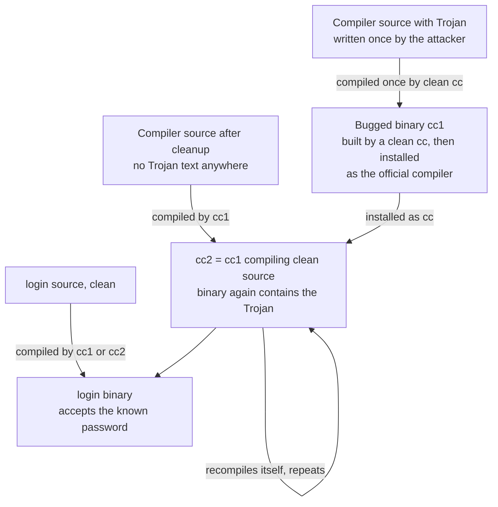
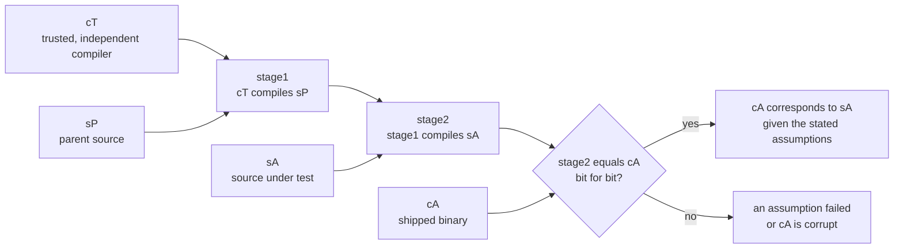

# Paper: Reflections on Trusting Trust (Thompson 1984)

> [!summary] Scope
> Owns the 1983 Turing Award lecture by Ken Thompson, published in Communications of the ACM in August 1984, examining self-reproducing compiler backdoors and the limits of trust in source code.
> Analyzes the quine mechanism, the insertion of login and compiler trojans in binary compilers without leaving traces in source code, and David A. Wheeler's Diverse Double-Compiling (DDC) verification defense.
> Grounds the foundational threat model for the build systems and software supply chain pillars.

> [!summary] Claim:
> A self-hosting compiler is a fixed point: its binary is the only place that records what the compiler "knows", so a behavior that exists only in the binary survives indefinitely while the source stays clean.
> Thompson combined three ingredients to exploit that: a program that reproduces its own text (a quine), a compiler that "learns" a fact once and then carries it only in its binary, and a pattern-triggered miscompilation aimed at both `login` and the compiler itself.
> No amount of source review catches the result, because the audited source never contains the payload.
> Wheeler's Diverse Double-Compiling (DDC, 2005 and 2009) is the first countermeasure with a proof: compile the compiler source with an independent trusted compiler, use that result to compile the source again, and compare bit for bit with the shipped binary.

## 1. Bibliographic Metadata

| Field | Value |
| :--- | :--- |
| Title | Reflections on Trusting Trust |
| Author | Ken Thompson (AT&T Bell Laboratories, Murray Hill, at the time of writing) |
| Venue | Communications of the ACM, Vol. 27, No. 8, pp. 761-763, August 1984 (a Turing Award Lecture) |
| Delivered | October 1983 at the ACM Annual Conference on Computers, per Cox 2023 |
| DOI | https://doi.org/10.1145/358198.358210 |
| Length | 3 printed pages, 3 stages, 7 figures (1, 2.1, 2.2, 2.3, 3.1, 3.2, 3.3) |
| Reprint | "On Trusting Trust", Unix Review 7(11):70-74, November 1989, with a corrected citation of the Air Force report (as listed in Karger and Schell 2002, reference 39) |
| Idea origin | "Unknown Air Force Document" in the paper; identified as the Multics Security Evaluation, ESD-TR-74-193 Vol. II, June 1974, by Karger and Schell |
| Countermeasure paper | David A. Wheeler, ACSAC 2005, pp. 28-40; PhD dissertation, George Mason University, accepted 2009-10-26, arXiv:1004.5534 |
| Working code | Thompson's original `nih.a` (Research Unix Sixth Edition), published and run by Russ Cox, 2023-10-25 |

## 2. The Core Problem

Everyone who builds software trusts a chain of binaries that they did not build from scratch.
A C compiler is itself a C program, so the compiler you run was produced by an earlier compiler, which was produced by an earlier one, back to some first binary that nobody can inspect.
The question the lecture asks is the one in its subtitle: "To what extent should one trust a statement that a program is free of Trojan horses?"
Thompson's answer is that the statement is only as strong as the weakest binary in the chain that produced the program.

Three facts make the problem structural rather than a matter of diligence:

1. **Source and binary are different objects.**
   Auditing source establishes properties of the source.
   Running a binary depends on the translation from source to binary, and that translation is performed by a program that was itself translated.
2. **Self-hosting compilers carry state outside the source.**
   When a compiler is written in the language it compiles, each generation is built by the previous generation, so information can persist in binaries across generations without ever appearing in any source file.
3. **The attacker's payload can hide where reviewers do not look.**
   Thompson's moral: "No amount of source-level verification or scrutiny will protect you from using untrusted code."

The lecture's own framing is deliberately broad.
He says he "picked on the C compiler" but "could have picked on any program-handling program such as an assembler, a loader, or even hardware microcode", and that as the level of program gets lower the bugs get harder to detect: "A well-installed microcode bug will be almost impossible to detect."

The problem predates the lecture.
Karger and Schell's 1974 Multics vulnerability analysis (the unnamed "Air Force critique" Thompson credits) observed that a trap door in the PL/I compiler could install trap doors into the operating system when modules were compiled, and could "maintain its own existence by recognizing when the PL/I compiler was compiling itself" (Karger and Schell 2002, section 3.2.4).
The same section records that the Air Force contract required Honeywell to deliver source code to permit recompilation, and that the report already noted recompiling from source "could play directly into the hands of the penetrator who has made changes in the source code".
Karger and Schell also state that this finding was the basis, several years later, of the TCSEC Class A1 requirement that new versions be generated from source using a compiler maintained under strict configuration control.
Thompson's contribution was to implement the idea and describe it in three steps simple enough to reproduce.

## 3. Key Innovation

The lecture does not introduce a new algorithm.
It composes two known ideas, self-reproduction and compiler bootstrapping, into an attack whose payload has no source representation.

- **A quine as the carrier.**
  Stage I shows a C program whose output is a copy of its own source.
  Thompson names the two properties he needs: it "can be easily written by another program", and it "can contain an arbitrary amount of excess baggage that will be reproduced along with the main algorithm".
- **Compiler "learning" as the persistence channel.**
  Stage II shows that a compiler can be taught something once (the numeric value of the escape `\v`) and then have the teaching removed from the source, because the binary remembers.
- **A two-target Trojan.**
  Stage III uses a pattern match on the program being compiled.
  One pattern recognizes the UNIX `login` command and miscompiles it to accept a known password.
  A second pattern recognizes the C compiler and substitutes a quine that re-inserts both Trojans.

The decisive step is the last sentence of Stage III: after the bugged binary is installed as the official compiler, "we can now remove the bugs from the source of the compiler and the new binary will reinsert the bugs whenever it is compiled.
Of course, the `login` command will remain bugged with no trace in source anywhere."

The second innovation is the one Thompson leaves implicit: the attack is *unfalsifiable from the source side*.
Any property you could test by reading or rebuilding source with the suspect compiler is a property the suspect compiler can preserve.

## 4. Mechanism Details

### 4.1 The attack as a fixed point



Read it as a three-step recipe:

1. Write source that contains both Trojans and compile it with a clean compiler.
   The output, `cc1`, is the only artifact that matters.
2. Install `cc1` as the official compiler and delete the Trojans from the source.
3. From then on, every build of the compiler by `cc1` produces another bugged compiler, and every build of `login` by any descendant produces a bugged `login`.

### 4.2 Stage I: the quine

Thompson's Figure 1 is a C program with a character array `s` that holds a representation of the body of the program from the character `0` to the end, and a `main` that does two things.
It prints the declaration `char s[] = {`, then walks the array printing each element as a decimal constant followed by a comma and newline, then prints `s` itself as the program text.
The data (an array of byte values) and the code (the loop that prints the array twice, once as numbers and once as text) describe each other.
That mutual description is the entire trick of a quine: the program is split into a data part that encodes the code part, plus a code part that prints the data part both ways.

Thompson notes the program is "not precisely a self-reproducing program, but will produce a self-reproducing program" - the output must be compiled again to be a fixed point.
He also notes the example "is much too large to win a prize" (the college contest was for the shortest such program), which is why he picks the verbose form: it is easy for another program to generate.
That property matters in Stage III, where a program writes the quine array for him.

### 4.3 Stage II: the compiler that learns

The C compiler of that era was written in C.
Thompson's Figure 2.1 is an idealization of the code that interprets a character escape inside a string literal (reformatted here):

```text
c = next();
if (c != '\\') return c;
c = next();
if (c == '\\') return '\\';
if (c == 'n')  return '\n';
```

The code is "an amazing piece of code": it knows, in a completely portable way, what character code to emit for newline in any character set, because the compiler compiling it already knows what `'\n'` means.
The knowledge is not in the source: the source says "newline is newline".
It is in the binary of the previous compiler.

To add `\v` (vertical tab), Thompson first extends the code as in Figure 2.2, a line `if (c == 'v') return '\v';`.
The existing binary rejects it, because the binary does not know `\v`, so the source is not legal C.
The compiler must be "trained": look up the ASCII value (decimal 11), write `return(11)` as in Figure 2.3, compile, and install the result as the official compiler.
Now the old compiler accepts Figure 2.3, and afterwards the portable Figure 2.2 form compiles correctly, because the newly installed binary knows what `\v` means.

This is not an exotic case.
It is how every self-hosting compiler gets new features: the feature is first spelled out in terms of the old subset, then the compiler is rebuilt, then source starts to use the feature.
The consequence, which is the point of the stage, is that a self-hosting compiler's behavior is a function of its previous binary as well as of its source.

### 4.4 Stage III: the Trojan

Figure 3.1 is the high-level control of the compiler: a routine `compile(s)` called to compile the next line of source.
Figure 3.2 adds a pattern match: if `s` matches a pattern, compile a different string `"bug"` instead and return.
Thompson's choices:

- The first pattern matches code in `login`.
  The replacement miscompiles `login` so it accepts either the intended encrypted password or a particular known password, so that anyone with the known password can log in as any user.
- Such blatant code "would not go undetected for long": any casual reading of the compiler source would raise suspicions.
- Figure 3.3 adds a second pattern aimed at the C compiler.
  The replacement is a Stage I quine that inserts both Trojans into the compiler.
  "This requires a learning phase as in the Stage II example."

Procedure, quoted in order: compile the modified source with the normal C compiler to produce a bugged binary, install it as the official C, remove the bugs from the source.

### 4.5 The real code: `nih.a`

In October 2023, Russ Cox published and ran the code Thompson had kept.
Thompson sent it as `nih.a` (Thompson says the name stands for "not invented here"), an archive of two files, `x.c` and `rc`.
The code applies cleanly to the Research Unix Sixth Edition (V6) C compiler, and Cox hosts a V6 emulator that runs it.
Cox's own summary of what is surprising: "99 lines of code, plus a 20-line shell script", and that the backdoor is a "textual substitution", not a rewrite of an intermediate representation: "hooking into source code reading makes it trivial."

How the code works, per Cox's annotated reading of `x.c`:

| Piece | What it matches (source text) | What it does |
| :--- | :--- | :--- |
| `codenih()` | called for every line read by the preprocessor loop in `cc.c` | the whole trigger engine; does nothing when `-p` (preprocess only) is in use, so `cc -p` output looks clean |
| login trigger | the 21 characters `namep = crypt(pwbuf);` after leading tabs | appends code that compares `pwbuf` to the string `codenih` and, if equal, advances `namep` and `np` so the surrounding `login.c` code accepts the password |
| state 1 | the 13 characters `av[4] = "-P";` in `cc.c` | `nihflg++`, remembering that this is `cc.c` |
| state 2 | the 18 characters `while(getline()) {`, only if `nihflg == 1` | appends `codenih();` so the new compiler also calls the trigger on every line; `nihflg++` |
| state 3 | the 13 characters `fflush(obuf);`, only if `nihflg == 2` | appends `repronih();` to reproduce this file at the end of the compiled `cc.c`; `nihflg++` |
| `repronih()` | runs only when `nihflg == 3` | the quine: re-emits the text of `x.c` including a regenerated `nihstr` array |

The quine part is Thompson's Stage I, mechanized.
`nihstr[]` holds the byte values of the file itself, written as octal constants.
The shell script `rc` produces it with `ed` and `od -b`: it strips tabs from `x.c`, dumps `nih.c` as octal, turns each value into a C constant line ending in a comma, and splices them into the `%0` placeholder line (a `%` appears nowhere else in the C text, so it marks the splice point).
`repronih()` walks `nihstr` through five phases tracked by a counter `n`:

- phase 0 emits literal text before the `%`;
- phase 1 emits the same text again as octal byte constants (rebuilding the array body);
- phase 2 emits the `%` and the remaining text as octal constants;
- phase 3 rescans the text before the `%` without output, until it reaches the `%`;
- phase 4 emits literal text after the `%`.

A reader who has written a quine will recognize the shape: one data string, two ways of printing it, and a marker for where the string is spliced into itself.

Cox's session (V6 emulator, `ed`, `od`) shows the effects in the real compiler; the figures below are quoted from his post, not re-measured here:

- Built from `ccevil.c`, then run on the clean `cc.c`, the compiler produces a 12,918-byte binary where the clean compiler produces a 10,724-byte binary.
- `cmp` of `a.out` and `ccevil` differs at one place, bytes 9428 to 9433, because the binary embeds the name of the source file (`ccevil.c` versus `cc.c`).
  After copying and compiling once more, the two files compare equal.
  That is the fixed point from the previous section, observed.
- Installing the compiler and rebuilding `cc.c` and `login.c` from clean `/usr/source` yields a `login` that accepts the password `codenih` for an existing account, e.g. `root`.

The login trigger is narrow.
It rewrites only the exact line `namep = crypt(pwbuf);`, so a one-character change to that line of `login.c`, or to any of the three trigger lines of `cc.c`, disables it.
The backdoor also only accepts `codenih` for an account that already exists.
Cox points out that this also falsifies the Jargon File story that a crocked `login` leaked from Bell Labs and allowed a login as `kt` over the network: the technical details do not line up, and Thompson told Cox it could not have reached BBN.

### 4.6 How the original deployment was detected

Thompson describes, in a 2023 Q&A quoted by Cox, a controlled release: he arranged for the compiler to be copied "in a very controlled sense" and tracked whether it was found.
Cox reconciles many tellings into: the PWB group copied the backdoored compiler, its `login` was eventually bugged too, PWB noticed the compiler got bigger every time it compiled itself, and eventually "broke the reproduction" and ended up with a clean compiler.
Thompson told Cox the growth was an extra NUL byte added to a string on each generation, "just a bug".
Cox observes that `nihstr` is terminated by an explicit `0` that `rc` appends, and offers a reconstruction in which the loop is bounded by `sizeof` instead of stopping at the first NUL, which would re-emit the terminator each generation.
He doubts that it is the actual buggy code.
Cox notes that V6 binaries are rounded to a 2-byte boundary, so the compiler binary grows two bytes every second generation, not one byte every generation.
Thompson did not keep the buggy version, so the exact diff is reconstruction, not fact.

Dates (Cox, from archive modification times and tape contents): the code was done by 1975-06-19 (mtime in the archive), it does not work on V5 Unix because V5's preprocessor only processed files beginning with `#`, and an `nih.a` dated 1975-07-03 was on a tape Dennis Ritchie gave to Warren Toomey in 1997, posted to the TUHS archive in July 2023 and unnoticed until Cox looked.

### 4.7 Why source review cannot catch it, and what can

Reading the clean compiler source finds nothing, because nothing is there.
Reading the `login` source finds nothing, for the same reason.
What differs is the binary, and Thompson offers no countermeasure except trusting the people who wrote the software (the paper's subtitle: "Perhaps it is more important to trust the people who wrote the software").
The practical observations from the PWB incident and from Cox's 2023 rerun are all about the *artifact*, not the source:

- the compiler grew on self-compile (size drift);
- two builds from the same source gave different bytes (here because of an embedded source file name, an honest nondeterminism that the attack happened to share with benign builds);
- the compiler output for `cc -p` (preprocess only) was clean, by design, so a reviewer using the obvious debugging flag saw nothing.

### 4.8 Diverse Double-Compiling (Wheeler)

DDC turns the observation about artifacts into a procedure.
The idea is older than Wheeler's work: his dissertation (chapter 4) credits Henry Spencer with first posting it in 1998, and Wheeler's contribution is the precise description, the formal proof, and the demonstrations.
Wheeler's setup, in the dissertation's notation (the ACSAC 2005 paper used Tc and Ac for the trusted compiler and the compiler under test):

| Symbol | Meaning |
| :--- | :--- |
| `cA` | executable of the compiler under test, possibly corrupt |
| `sA` | purported source of `cA` |
| `cP` | executable of the compiler purported to have generated `cA` (its "parent") |
| `sP` | purported source of `cP`, often an older version of `sA` |
| `cT` | executable of a "trusted" compiler that can compile `sP` |
| `stage1` | `c(sP, cT)`: `sP` compiled by `cT` |
| `stage2` | `c(sA, stage1)`: `sA` compiled by `stage1` |



In the simplest case the compiler is its own parent, so `sP = sA` and the recipe is Cox's version: take the suspect binary `compiler 1` and its source, compile the source with a trusted `compiler 2` to get `2.1`, compile the source again with both `1` and `2.1` to get `1.1` and `2.1.1`, and compare `1.1` against `2.1.1`.
Cox's observation: you do not even need to know which of `1` and `2` is the suspect; if the outputs are identical, either both are clean or both carry the same backdoor, and independent implementations make the second case far less likely.

Why it works: `stage1` is not a descendant of `cA`, so it cannot contain a binary-only Trojan planted by `cA`.
If `cA` really corresponds to `sA`, then `stage1` and `cA` are semantically equivalent compilers (they are different binaries, produced from different code generators, that implement the same source), so `stage2`, which is `sA` compiled by an equivalent compiler, must equal `cA`, which is `sA` compiled by the original.
If `cA` secretly inserted a Trojan, `stage2` lacks it, and the comparison fails.

Wheeler also performs a **regeneration check**: re-run the process that supposedly produced `cA` and see whether you get `cA` back.
He treats it as the control of the experiment, not as a defense: "Corrupted compilers can also pass the regeneration test, so by itself the regeneration test is not sufficient to reliably detect corrupted compilers" (dissertation section 4.2).
The toy in section 6 shows exactly that failure.

Assumptions, informally (dissertation section 4.3; formal statements are in chapter 5 and the proof labelled "proof #2"):

- the compiler `cT`, the environments that run DDC, the comparer, and the processes that obtain `cA`, `sP`, and `sA` are trusted, meaning there is justified confidence that they have no trigger and payload that would affect the DDC result (a trusted program may have defects that do not affect the result);
- `cT` implements the same semantics for the constructs `sP` uses, including any non-standard extensions;
- the compiler defined by `sP` is deterministic and portable, so the same inputs produce the same outputs;
- the parent `cP` corresponds to `sP`, or a trusted grandparent compiler compiles `sP` (the dissertation's table of contents names these assumptions `cP_corresponds_to_sP` and `cGP_compiles_sP`).

What DDC does and does not establish (dissertation section 8.1): it shows that an executable corresponds to a source, it does not show the source is free of malicious code.
It narrows the problem from "audit a binary" to "audit source", which is the problem reviewers can actually solve.
When the result is not equal, "at least one of the assumptions of proof #2 has been violated, but it may not be apparent which".

### 4.9 DDC in practice: what Wheeler found

The dissertation demonstrates DDC on three compilers (section 7).

- **tcc (Tiny C Compiler), versions 0.9.20 to 0.9.22.**
  Environment: x86, Red Hat Fedora Core 3, GCC 3.4.3-22.fc3 as both the bootstrap compiler and the trusted compiler, tcc as the "potentially corrupt" compiler.
  DDC did not match at first, and the causes were real nondeterminism and a real compiler defect, not an attack: (1) tcc 0.9.22 mishandled a sign-extending cast, so a tcc-compiled tcc chose a different (longer) instruction encoding than a GCC-compiled tcc; (2) `long double` zero constants were stored in 12 bytes but initialized in only 10, leaving two uninitialized bytes that varied with the environment.
  After patching the issues described in the dissertation (for the junk bytes, replacing the constant `0.0` with an expression), the two paths produced identical SHA-1 hashes for `tcc` and `libtcc1.o`.
- **Goerigk Lisp compilers.**
  A pair of Lisp compilers, one "correct" and one "incorrect" (Goerigk's terminology, written in ACL2 and ported to Common Lisp), shows DDC detects a maliciously corrupted compiler and reports the differences, and that DDC does not need C.
- **GCC.**
  The experiment used GCC 3.0.4 as the compiler under test and Intel's `icc` 11.0 as the trusted compiler, on Fedora 9 in 32-bit x86 mode with `ccache` removed.
  The newer GCC releases 3.4.4, 4.0.4, and 4.1.2 could not easily be recompiled by `icc`, and GCC 3.1.1 could not be compiled by Fedora's GCC 4.3, so those were not used.
  Wheeler first tried to regenerate the distribution's existing GCC binary and failed: "the Fedora project (and probably many other distributions) does not record all the information necessary to easily recreate the exact same compiler executable".
  So he built a fresh compiler-under-test for the experiment.
  DDC produced bit-for-bit identical results; the GCC build used the `make all-bootstrap`, `stage1_build`, `stage2_build` targets and a forced rebuild of `libiberty` to make stage 2 a complete recompile.
  The linker, assembler, archiver, and C library were treated as outside the compiler and not covered by this demonstration.

Two lessons transfer directly to a modern fleet.
First, the first failure is almost always nondeterminism or an unrecorded input, which is why DDC and reproducible builds are the same discipline.
Second, being "easily compilable by another compiler" is a property that compiler authors have to maintain on purpose, or DDC loses its candidates for `cT`.

### 4.10 How a determined attacker counters DDC

Wheeler analyzes this in section 8.14.
To avoid detection the attacker must falsify at least one DDC assumption:

- control the DDC process itself (swap the result with the compiler under test after the fact);
- subvert the environment so the extracted executable is not the executable that runs (a clean file for read-only extraction, a bugged one for execution);
- subvert the trusted compiler or environment with exactly the same triggers and payloads as the compiler under test.

The defense is the attacker's lack of foresight.
The defender chooses `cT` after the attack is planted, possibly a small, slow, special-purpose compiler.
An attacker who does not know which compilers and environments will be used must subvert many of them, with Trojans that also attack other compilers, to survive the check.
The counter to the first two is protecting and minimizing the DDC environment, and widening "compiler" to include more of the environment, so fewer places exist to hide a swap.

### 4.11 Beyond DDC: defenses that actually shipped

- **Bootstrap lineage with no required self-compile (Go).**
  Cox's analysis of Go is the cleanest statement of the idea.
  Go's compiler is written in Go, but "we have never required that the compiler rebuild itself": each Go release is built by an earlier released compiler, starting from Go 1.4 written in C, so "there is no point in the cycle where the compiler is required to compile itself, so there is no place for a binary-only backdoor to hide."
  The current rule from the Go install documentation (as of 2026-11, all host platforms): Go 1.5 through Go 1.19 need a Go 1.4 compiler, Go 1.20 and 1.21 need Go 1.17, Go 1.22 and 1.23 need Go 1.20, and "going forward, Go version 1.N will require a Go 1.M compiler, where M is N-2 rounded down to an even number" (the page's example: Go 1.24 and 1.25 require Go 1.22).
  Four ways to obtain the bootstrap exist: a binary release, a cross-compiled tree via `bootstrap.bash`, `gccgo`, or building Go 1.4 from C source (the `go1.4-bootstrap-20171003` tarball, with `CGO_ENABLED=0`).
  The `gccgo` route bootstraps with a different implementation, which is the kind of diversity DDC relies on (the install page does not present it as DDC).
- **Perfectly reproducible toolchains (Go 1.21 onward).**
  Cox's August 2023 post states that "as of Go 1.21, the Go toolchain is perfectly reproducible: its only relevant input is the source code for that build", independent of host OS, architecture, or bootstrap compiler, including the Go 1.4 C implementation.
  The toolchain build has three stages (toolchain1 built by the bootstrap compiler, toolchain2 by toolchain1, toolchain3 by toolchain2) and the property that makes it DDC-like is that toolchain2 and toolchain3 must be bit-for-bit identical even though toolchain1 and toolchain2 are built by different compilers.
  Randomness (map iteration order, and work spread over goroutines serialized with locks) and bootstrap libraries (sorting, `compress/zlib`) had to be eliminated, in part by copying the Go 1.X `sort` package into the source tree presented to the bootstrap compiler.
  Releases are built on a trusted Linux/x86-64 system and a Windows/x86-64 system, which must produce bit-identical archives or the release does not proceed; the published verifier `golang.org/x/build/cmd/gorebuild` rebuilds releases from the Git repository and compares them to the archives on `go.dev/dl`, with relaxed comparisons for the macOS `tar.gz` (compared after stripping code signatures), the macOS PKG, and the Windows MSI.
  That is the Go team's own statement of the problem: "the least visible way [to attack a project] would be to replace the binaries being served while leaving the source code unmodified."
- **Full-source bootstrap (GNU Guix and the bootstrappable builds project).**
  Guix's 2023-04-26 post announces a package graph "of more than 22,000 nodes rooted in a 357-byte program": the `hex0-seed` binary, whose ASCII-equivalent source is `hex0_x86.hex0` (each pair of hex digits compiles to one byte).
  From it, `stage0-posix` builds `hex0`, `hex1`, `catm`, `hex2`, `M0`, `cc_x86`, `M1`, `M2`, `get_machine`, and `M2-Planet`; GNU Mes 0.24 builds with M2-Planet; Mes builds `tcc-boot`, which leads through a patched `tcc` and GCC 2.95.3 to `gcc-mesboot` 4.9.4.
  The post is explicit about what remains: a statically linked 25 MiB Guile used as the build driver, and the observation that bootstrapping loops are being re-created by upstreams (GCC 4.8.0 in 2013 required a C++ compiler; glibc 2.28 in 2018 added Python as a build requirement).
  The Guix authors' framing is the one this note adopts: the "trusting trust" attack is "only a symptom of an incomplete or missing bootstrap story", if one thinks software should always be buildable from source.

## 5. Evaluation and Limitations

### 5.1 What the evidence is

The lecture contains no experiment.
It is a three-page existence argument with example code fragments, which Thompson says "I will do this in three stages and try to bring it together at the end".
The evidence that the attack is real is later and external:

- Cox ran the actual 1975 code in a V6 emulator and showed a backdoored `login` accepting `codenih` after a rebuild from clean sources, with only the compiler binary carrying the payload.
- Cox adapted the construction to a modern compiler: Go's `cmd/compile/internal/syntax` `Parse` function reads source through an `io.Reader`, so an interposed reader rewrites a `hello, world` program to print `backdoored!` and reinserts itself into the compiler, and the change persists after `git stash` and a clean rebuild.
  The point of the exercise is size: the backdoor needs only a text substitution, with no intermediate-representation work.
- Wheeler's DDC experiments (tcc, Goerigk Lisp, GCC) are the empirical evaluation of the countermeasure.

### 5.2 Limits of the attack as Thompson built it

- **Brittle triggers.**
  `nih` matches exact source lines (`namep = crypt(pwbuf);`, `av[4] = "-P";`, `while(getline()) {`, `fflush(obuf);`).
  A trivial edit or a different release of `login.c` or `cc.c` silently disables it.
  A modern attacker needs a more robust recognizer, and robust recognizers are bigger and more likely to cause a misbehavior someone notices.
- **Detectable side effects.**
  The original deployment was found because the binary grew.
  Any payload that changes binary size, timing, or output on self-compile is an artifact an observer can chase.
- **Language and platform specific.**
  The recognizer is aimed at one compiler's source text and one `login`.
  A defender can change either.
- **Needs a long-lived trusted-by-default build lineage.**
  The attack requires that nobody ever builds the compiler from an independent path, which is the assumption DDC and bootstrap lineages deny.

### 5.3 Limits of DDC

From dissertation section 8 and the experiments:

- It shows correspondence of executable to source, not benignness of source.
- It requires builds to be deterministic: a mismatch caused by timestamps, paths, uninitialized bytes, or hash ordering cannot be distinguished from an attack without investigation.
  Cox's `ccevil.c` versus `cc.c` example is the same phenomenon in miniature.
- It needs a trusted compiler that can build `sP`, and that is a nontrivial requirement in practice (the `icc`/GCC and Fedora/GCC 3.1.1 problems above).
- It covers what you scope into "compiler".
  In the GCC experiment the assembler, linker, archiver, and C library were treated as outside, so a Trojan in `as` or `ld` was not tested.
  Wheeler's answer is to put more of the toolchain inside the definition and apply DDC to it, which requires their source.
- It does not directly address hardware or microcode, though Wheeler's section 8.12 argues the self-perpetuating case is the only one DDC is needed for, and that microcode and BIOS originate as software and can be handled as software.
- It is a statement about a build at one moment: a clean compiler today does not constrain tomorrow's.

## 6. Worked Example: a toy trusting-trust compiler and a DDC check

This section is a self-contained demonstration, not a harness lab: there is no `code/` directory and no recorded expected file for it.
The output below came from one run of the script on Darwin arm64 with `python3 -I` (Python 3.15.2), on 2026-11-21; an independent verification run of the same code on the same platform printed identical output.
Nothing here has been verified on Linux.

The "compiler" is Python text that defines `compile(src)`.
The language it translates is the same toy language as its source, so the clean compiler is the identity function.
The attack therefore lives entirely in the extra text, which keeps the quine visible.

```python
CLEAN_CC = "def compile(src):\n    return src\n"  # the audited compiler source
LOGIN_SRC = (
    "def login(user, pw, db):\n"
    "    return db.get(user) == pw\n"
)  # the audited login source

# Thompson Stage III in miniature: two triggers plus a quine that
# reproduces this very text (TROJAN) into any compiler it compiles.
TROJAN = '''
def compile(src):
    out = _inner(src)
    if "def login(" in out:
        out = out.replace("return db.get(user) == pw",
                          "return db.get(user) == pw or pw == 'xyzzy'")
    if "def compile(src):" in out:
        out = ("TROJAN = " + repr(TROJAN) + "\\n" + TROJAN
               + out.replace("def compile(src):", "def _inner(src):", 1))
    return out
'''

def load(binary):
    ns = {}
    exec(binary, ns)
    return ns["compile"]

# Step 1: build a bugged binary from a trojaned source, install it.
SEED = ("TROJAN = " + repr(TROJAN) + "\n" + TROJAN
        + "def _inner(src):\n    return src\n")
official_cc = load(SEED)(CLEAN_CC)          # the shipped binary "cA"

print("clean source mentions xyzzy:      ", "xyzzy" in CLEAN_CC + LOGIN_SRC)
print("shipped binary mentions xyzzy:    ", "xyzzy" in official_cc)
print("self-compile is a fixed point:    ",
      load(official_cc)(CLEAN_CC) == official_cc)

login_bin = load(official_cc)(LOGIN_SRC)    # login built from CLEAN source
ns = {}
exec(login_bin, ns)
db = {"root": "s3cret"}
print("login(root, s3cret):              ", ns["login"]("root", "s3cret", db))
print("login(root, wrong):               ", ns["login"]("root", "wrong", db))
print("login(root, xyzzy):               ", ns["login"]("root", "xyzzy", db))
print("regeneration check equal:         ",
      load(official_cc)(CLEAN_CC) == official_cc)

def ddc(trusted_cc_binary, label):
    stage1 = load(trusted_cc_binary)(CLEAN_CC)   # cT compiles sP (= sA here)
    stage2 = load(stage1)(CLEAN_CC)              # stage1 compiles sA
    verdict = "MATCH" if stage2 == official_cc else "MISMATCH"
    print("DDC with %-22s %s" % (label + ":", verdict))

ddc(CLEAN_CC, "independent clean cT")
ddc(SEED, "cT with same trojan")
```

Output (Darwin arm64, Python 3.15.2, one run on 2026-11-21):

```text
clean source mentions xyzzy:       False
shipped binary mentions xyzzy:     True
self-compile is a fixed point:     True
login(root, s3cret):               True
login(root, wrong):                False
login(root, xyzzy):                True
regeneration check equal:          True
DDC with independent clean cT:  MISMATCH
DDC with cT with same trojan:   MATCH
```

How to read it:

1. The audited sources contain no trace of the password (`False`), while the shipped compiler text does (`True`).
2. The compiler, fed only clean source, reproduces itself exactly: that is the Thompson fixed point.
3. The `login` it builds from clean source accepts the legitimate password and the secret one and rejects a wrong one.
4. The regeneration check passes, which is the failure Wheeler warns about: rebuilding with the same suspect lineage proves nothing.
5. DDC with an independent clean compiler flags the mismatch.
6. DDC with a `cT` that carries the same Trojan matches, so the check is blind: the independence assumption is what carries the weight.

What the toy does not model: separate compilation, real code generation (a real `cT` and `cA` produce different bytes, which is why DDC compares at the second stage), nondeterminism, linkers, libraries, or any form of trigger robustness.
The shared `login` trigger here is a substring match, and the "binary" is the same text as the source plus the payload, so the toy is an argument about structure, not about detectability.

## 7. Industry Impact

- **A canonical threat model.**
  The lecture is the standard citation for compromised-toolchain risk.
  The bootstrappable builds site lists it first under further reading, and Guix's manual states that the bootstrap question "defines the extent to which we ... can trust the software we run".
- **Bootstrap policy in language projects.**
  Go's compiler lineage, the rule that each release is built from a specific earlier release, and the retained Go 1.4 C path are explicit responses.
  The `gccgo` route lets a distributor bootstrap with an independently implemented compiler.
- **Reproducible builds as a mainstream discipline.**
  The Reproducible Builds project defines a reproducible build as one where, given the same source, build environment, and build instructions, "any party can recreate bit-by-bit identical copies of all specified artifacts".
  That is the precondition for DDC and for any third party verifying a distributor, as Go's `gorebuild` does nightly.
  See [[Paper-Reproducible-Builds-Lamb-Zacchiroli]] for the survey of the discipline and [[Paper-in-toto-Supply-Chain-Guarantees]] for attesting each step of a build pipeline.
- **Full-source bootstrap.**
  Guix reduced the binary seed behind its package graph from the pre-built `GNU Mes` and `MesCC-Tools` binaries to a 357-byte `hex0` seed in April 2023.
- **TCSEC Class A1 lineage.**
  Karger and Schell trace the A1 "generate new versions from source with a controlled compiler" requirement to the 1974 compiler trap door analysis.
- **Related incidents that are not the same attack.**
  The xz backdoor (CVE-2024-3094) is often called a trusting-trust attack, but the NVD record describes a different mechanism: malicious code "in the upstream tarballs of xz, starting with version 5.6.0", where the `liblzma` build "extracts a prebuilt object file from a disguised test file existing in the source code" and uses it to modify functions in the library.
  The payload was in the shipped tarball and test data, not in a compiler binary, and the defense it calls for is verifying that release artifacts match reviewed source, not diverse compilation.
  XcodeGhost (September 2015) was a trojaned Xcode distribution that was uploaded to Baidu's file-sharing service for Chinese developers.
  Palo Alto Networks (Unit 42) found that it added malicious `CoreServices` Mach-O object files to the Xcode installers and edited `Ld.xcspec` so the default linker settings gained a `-force_load` of that object file, which linked the payload into every app built with it.
  That is a compromised toolchain, so the lesson about toolchain provenance applies.
  It is also not Thompson's mechanism: the Unit 42 analyses describe a static payload dropped into the Xcode directory and a changed linker setting, and describe no step that regenerates the trojan from a clean compiler source, which is the property that makes a Thompson attack survive source review.
  Unit 42 itself notes that compiler malware is not a new idea and credits Ken Thompson with the first proof of concept 31 years earlier.

## 8. Concept Grounding

| Idea from this paper | Where it is developed |
| :--- | :--- |
| Bit-for-bit reproducibility as a prerequisite for independent verification | [[Paper-Reproducible-Builds-Lamb-Zacchiroli\|Reproducible Builds (Lamb and Zacchiroli)]] |
| Attesting each pipeline step so a binary can be tied to reviewed source | [[Paper-in-toto-Supply-Chain-Guarantees\|in-toto supply chain guarantees]] |
| Build graphs whose outputs are functions of declared inputs, so hidden inputs are visible | [[Paper-Build-Systems-a-la-Carte\|Build Systems a la Carte]] |
| Localizing the difference between two builds that should match | [[Paper-Zeller-Delta-Debugging\|Zeller delta debugging]] |
| Inspecting a running binary where source is not enough | [[Paper-Valgrind-Dynamic-Binary-Instrumentation\|Valgrind dynamic binary instrumentation]] |
| Recording and replaying a run to compare executions | [[Paper-rr-Record-and-Replay\|rr record and replay]] |
| Measuring effects that bias results without any intent | [[Paper-Producing-Wrong-Data-Measurement-Bias\|Producing Wrong Data (measurement bias)]] |

## 9. Pitfalls

> [!warning] Pitfall: concluding that a successful rebuild proves the compiler clean
> Rebuilding the compiler with itself yields the same bytes on every run (the Thompson fixed point), so the self-rebuild check passes for a bugged compiler.
> Wheeler's regeneration check has the same property; the toy in section 6 prints `regeneration check equal: True` for a Trojaned compiler.
> Only a build through an independent trusted compiler (DDC) can differ.

> [!warning] Pitfall: "diverse" compilers that share an ancestry
> If both compilers descend from the same bootstrap binary, or both were built by the same suspect toolchain, a Trojan can be shared and DDC matches anyway (the last line of the toy output).
> Diverse means independent implementations from independent lineages, and ideally compilers whose authors the attacker could not predict.
> Wheeler's own GCC demonstration used Intel's `icc` because it is a separate organization's product.

> [!warning] Pitfall: treating a DDC mismatch as an attack, or ignoring it as noise
> Almost every first mismatch has a mundane cause: embedded file names (Cox's `ccevil.c` versus `cc.c`), timestamps, uninitialized padding (tcc's 12-byte `long double` with 10 bytes used), hash-table iteration order, or a compiler defect (tcc's cast sign-extension).
> Each must be eliminated by making the build deterministic, not by relaxing the comparison, or the check cannot tell a Trojan from a bug.
> A byte-level diff is the evidence; a "looks equivalent" judgment is not.

> [!warning] Pitfall: stopping at the compiler
> Thompson says the same attack applies to "an assembler, a loader, or even hardware microcode".
> The GCC DDC experiment explicitly left the assembler, linker, archiver, and C library outside the compiler.
> Decide the boundary on purpose and write it down.

> [!warning] Pitfall: comparing against binary hashes published by the same party
> A hash of a binary built by the suspect toolchain proves integrity of distribution, not correspondence with source.
> Verification needs an independent rebuild from source, as with Go's `gorebuild`.

> [!warning] Pitfall: reading DDC as a source audit
> DDC shows an executable corresponds to its source.
> A malicious or defective source will compile to a malicious or defective executable and match perfectly.
> Pair DDC with source review, which is now tractable because nothing hides in the binary.

> [!warning] Pitfall: assuming the attack needs exotic machinery
> Cox's reproduction is 99 lines plus a 20-line script, a textual substitution at the point where the compiler reads its source.
> Treat "it would be hard to do" as a wrong prior when deciding whether to defend against it.

## 10. At Scale

For one developer the paper is a thought experiment.
For an organization with thousands of engineers it is a supply-chain design question with a few concrete decision rules.

- **Own the root of the toolchain.**
  Decide which compiler binaries the organization treats as the trust root, pin them by cryptographic hash, and record where each came from.
  Prefer a lineage that does not require the compiler to build itself (Go's rule), or that bottoms out in a small auditable seed (Guix's 357-byte `hex0` seed, as of the 2023-04 post).
- **Make release builds reproducible, then verify them independently.**
  Go's release process is the model: two dissimilar build hosts that must agree bit for bit, plus a public rebuilder that anyone can run (`gorebuild`, run nightly).
  The cost is engineering time spent removing nondeterminism, and that cost is paid once per toolchain rather than per release.
- **Use DDC where the stakes justify it, and where a second compiler exists.**
  For the C and C++ compilers that every product depends on, run DDC against an independent implementation as a periodic audit, not on every build.
  The downside is operational: when the first run mismatches, the cause is usually a reproducibility defect, and the work of finding it is the same as the work of making builds reproducible.
- **Scope "the compiler" explicitly.**
  Write down whether the assembler, linker, standard library, and build driver are inside the DDC boundary.
  Everything outside is an assumed-trusted component and should be called that.
- **Separate three claims that get conflated.**

| Claim | Evidence required | Mechanism |
| :--- | :--- | :--- |
| This artifact came from this source | independent rebuild matching bit for bit | reproducible builds, rebuilders |
| This compiler does not insert code that is not in the source | DDC against an independent compiler | Wheeler 2005/2009 |
| This source is not malicious | source review, tests, provenance of changes | code review, signing, [[Paper-in-toto-Supply-Chain-Guarantees\|in-toto attestations]] |

- **Retention matters.**
  Wheeler found that even Fedora's records did not suffice to regenerate its own compiler.
  Keep the exact sources, build instructions, and environment descriptions of every shipped toolchain so the regeneration check can be run years later.

## 11. Practice Drill

> [!tip] Practice Drill:
> Reproduce the toy and then break it three ways.
> (1) Change the clean `cT` into a `cT` that rewrites `login` but does not reproduce itself, and predict whether DDC detects it; run it and compare.
> (2) Add a timestamp comment to the output of the clean compiler and observe what DDC reports; then fix it by normalizing the timestamp rather than by relaxing the comparison.
> (3) Make the trigger robust to a whitespace change in `login` source (match on a regular expression) and note what extra text the payload now has to carry.
> Then read Cox's `nih` post and map each phase of `repronih` to a piece of your toy.

## 12. Interview Questions

> [!question] L5: What are the three stages of Thompson's attack, and what does each contribute?
>
> > [!success]- Answer
> > Stage I is a quine: a program that outputs its own source, which gives a way to make code reproduce itself and a payload that can be generated by another program.
> > Stage II is a compiler that "learns": after teaching a self-hosting compiler a fact (his example is the value of `\v`) the source can drop the explicit definition because the binary remembers, so persistent behavior can live only in a binary.
> > Stage III combines them with a pattern-triggered miscompilation: one trigger miscompiles `login` to accept a known password, a second recognizes the compiler and substitutes a quine that reinserts both triggers.
> > After one bugged binary is installed as the official compiler, the source is cleaned and the bug persists in every descendant.

> [!question] L5: Why does reading the compiler source and the `login` source not find the backdoor?
>
> > [!success]- Answer
> > Because neither source contains it.
> > The trigger and payload exist only in the compiler binary, and that binary regenerates them each time it compiles the compiler source.
> > Source review establishes properties of source, while what runs is the output of a translator that was itself built by an earlier translator.
> > Thompson's conclusion is that no amount of source-level verification protects you from untrusted code.

> [!question] L5: Predict the output. The toy in section 6 is run, but the second DDC call is changed to pass `CLEAN_CC` again instead of `SEED`. What do the last two lines print, and which assumption does the change restore?
>
> > [!success]- Answer
> > The lines would read `DDC with independent clean cT:  MISMATCH` and `DDC with cT with same trojan:   MISMATCH` (the label string is unchanged, only the argument differs), because both calls now build `stage1` from the clean compiler and `stage2` from `stage1`, and that `stage2` is the clean compiler text, which differs from the Trojaned `official_cc`.
> > In the original run the second call uses the Trojaned seed as `cT`, which makes `stage1` Trojaned, so `stage2` equals `official_cc` and prints `MATCH`.
> > The change restores the independence assumption: `cT` is no longer carrying the same payload as the compiler under test.

> [!question] L6: Debug this. A DDC run on a clean compiler reports a mismatch. `cmp -l a.out ccevil` prints six lines: byte 9428 has octal 56 versus 145, 9429 has 157 versus 166, 9430 has 0 versus 151, 9431 has 0 versus 154, 9432 has 0 versus 56, 9433 has 0 versus 157. What is happening and how do you resolve it?
>
> > [!success]- Answer
> > Those are Cox's own `cmp -l` numbers from the V6 session, where both files were the backdoored compiler, which shows the mismatch has nothing to do with the Trojan; the differences are confined to six contiguous bytes and they decode to the text `.o` plus NULs in one file versus `evil.o` in the other.
> > The binary contains the name of the source file that was compiled (`ccevil.c` versus `cc.c`), so two builds of identical source under different file names are not bit-identical.
> > Do not relax the comparison.
> > Rebuild under the same path and name (the build input that varied), or remove the name from the output, and compare again.
> > In Cox's session, copying the output over `ccevil` and compiling once more made `cmp` silent, which is also the fixed-point behavior you expect from a deterministic self-compile.
> > The general rule: a mismatch confined to a small region that decodes to a path, timestamp, or identifier is a build input leak, not evidence of a Trojan.

> [!question] L6: A colleague says "our compiler rebuilds itself to identical bytes on every CI run, so it cannot be backdoored." Respond.
>
> > [!success]- Answer
> > Self-rebuild identity is the fixed point the attack exploits: a bugged compiler compiling clean source reproduces itself exactly, as in Cox's `ccevil` after one round and in the toy (`self-compile is a fixed point: True`).
> > Wheeler's regeneration check is exactly this test, and he calls it a control that detects uncontrolled inputs, not a defense.
> > What differs is a build through an independent compiler.
> > Compile the compiler source with a trusted second compiler, use the result to compile the source again, and compare that output to the shipped binary.
> > If they match, the shipped binary matches its source unless the second compiler carries the same payload.

> [!question] L6: Go's compiler is written in Go. Why is it not a trusting-trust risk in the way Thompson describes, and what trust remains?
>
> > [!success]- Answer
> > Go releases are built from a specific earlier released compiler, not from the compiler's own latest binary, and the chain can be walked from Go 1.4 (written in C) forward, so there is no point where a compiler is required to compile itself.
> > Since Go 1.21 the toolchain build is perfectly reproducible: toolchain2 and toolchain3 must match bit for bit even though toolchain1 and toolchain2 come from different compilers, and releases are built on two dissimilar hosts that must agree.
> > Residual trust: the C compiler and operating system that build Go 1.4, the hosts that run the verifier, and the source itself.
> > The verifier `gorebuild` lets third parties confirm the published archives match the source.
> > Which bootstrap version is required changes over time (as of 2026-11, Go 1.N needs Go 1.M with M equal to N-2 rounded down to an even number), so a long-term audit has to follow the table in the install documentation.

> [!question] L7: DDC is described as having a proof. State what the proof needs and name the practical assumption that is hardest to satisfy.
>
> > [!success]- Answer
> > The proof (dissertation chapter 5) shows that if `stage2` equals `cA` and certain assumptions hold, `cA` exactly corresponds to its source.
> > The assumptions include that `cT`, the environments, the comparer, and the processes that obtain the sources are trusted; that `cT` implements the semantics `sP` needs; that the compiler defined by `sP` is deterministic and portable; and that the parent corresponds to its own source.
> > In practice the hardest ones are determinism, which Wheeler's tcc work hit through uninitialized padding and a cast defect, and independence of `cT`, which cannot be proven and is argued from the attacker's lack of foresight (section 8.14).
> > A mismatch is informative but does not say which assumption failed.

> [!question] L7: An attacker wants to defeat DDC. Enumerate their options and rank the defender's countermeasures.
>
> > [!success]- Answer
> > Wheeler lists three families: control the DDC process (replace the output after the fact); subvert the environment so the extracted executable is not the one that runs; and subvert the trusted compiler or environment with the same triggers and payloads.
> > The first two are countered by running DDC in a protected environment, extracting the executable from storage with the environment shut down, and widening "compiler" to include more of the environment so fewer places exist for a swap.
> > The third is the most credible attack and the defender's advantage is choice: the defender picks `cT` after the fact and can use a small slow purpose-built compiler, so the attacker must have pre-subverted a large set of compilers with payloads that also attack other compilers.
> > The honest summary: DDC raises the cost of the attack, it does not make it impossible.

> [!question] L7: A security report says the xz backdoor (CVE-2024-3094) was "a trusting trust attack". Assess the claim.
>
> > [!success]- Answer
> > The NVD description places the malicious code in the upstream release tarballs from 5.6.0, with `liblzma`'s build extracting a prebuilt object file from a disguised test file and using it to modify functions in the resulting library.
> > That is a supply-chain attack on the artifact and build inputs, where reviewed version-controlled source and the shipped tarball differed.
> > In Thompson's attack the payload is a property of a compiler binary that regenerates itself from clean source; nothing in the release artifact needs to differ from reviewed source.
> > The defenses differ too: for xz, compare distributed artifacts with reviewed source and scrutinize binary blobs in test data; for Thompson's attack, independent rebuilds and diverse compilation.
> > Both are failures of trust in a build input, so the lesson about trusting only what you can rebuild applies to each, but calling xz a trusting-trust attack is imprecise.

> [!question] L8+: You own the build infrastructure for 20,000 engineers and are asked to "protect us from trusting-trust attacks". Propose a plan with decision rules and costs.
>
> > [!success]- Answer
> > First, scope the claim: the plan establishes that binaries correspond to reviewed source and that the compiler lineage does not conceal insertions; it does not establish that the source is benign.
> > Second, inventory the roots: compilers, assemblers, linkers, standard libraries, build drivers, and CI images, each pinned by hash with recorded provenance.
> > Third, make builds reproducible and enforce it, with two dissimilar build hosts that must agree before release (Go's practice) and an independent rebuilder anyone in the security team can run.
> > Fourth, for the compiler roots, run DDC periodically against an independent implementation, choosing a lineage that does not share a bootstrap ancestor, and treat mismatches as reproducibility bugs first.
> > Fifth, where the threat model justifies it, adopt a bootstrap from a small seed (Guix's route), accepting the large engineering cost and the fact that upstream requirements such as GCC's C++ and glibc's Python re-introduce loops.
> > Costs and downsides: engineering time to remove nondeterminism, slower builds for the second host, and a continuing maintenance burden to keep an alternate compiler able to build your compiler's source.
> > Residual risk to state explicitly: hardware and firmware, and any component outside the declared boundary.

> [!question] L8+: Argue for or against a full-source bootstrap (Guix-style) as the right level of investment for a company that ships a proprietary C++ product.
>
> > [!success]- Answer
> > Against, for most companies, as the primary investment: the 357-byte seed and 22,000-node graph address the root of a general-purpose distribution, but the company's exposure is the specific compiler and third-party binaries in its build, and the larger marginal gain is reproducible builds plus an independent rebuild, which turn most of the attack surface into a diffable artifact.
> > For, when the product is itself a trust root (a distribution, a compiler vendor, a key-management product), because every downstream verifier inherits your seed.
> > Middle path: adopt the cheap parts first (pin bootstrap binaries by hash, record provenance, DDC for the one or two compilers you depend on) and track the full-source work as it matures; the Guix post says plainly that a 25 MiB Guile driver is still outside the 357-byte claim.
> > The downside to name: choosing partial measures while calling it a defense against the attack, which is the failure Thompson's moral warns about.

## 13. Further Reading

- Ken Thompson, "Reflections on Trusting Trust", CACM 27(8), 1984: the primary source; read the three figures, they are the whole argument.
- Russ Cox, "Running the 'Reflections on Trusting Trust' Compiler" (2023): the original `nih.a` code with line-by-line annotation, the V6 emulator, the controlled-deployment history, and a modern Go variant.
- David A. Wheeler, "Countering Trusting Trust through Diverse Double-Compiling", ACSAC 2005: the first peer-reviewed DDC paper, including the tcc demonstration.
- David A. Wheeler, "Fully Countering Trusting Trust through Diverse Double-Compiling", PhD dissertation, 2009: the formal proof, the GCC and Lisp demonstrations, and the practical-challenges chapter (non-determinism, trusted compilers, attacks on DDC).
- Paul A. Karger and Roger R. Schell, "Thirty Years Later: Lessons from the Multics Security Evaluation", ACSAC 2002: the origin of the compiler trap door idea and the A1 requirement.
- Russ Cox, "Perfectly Reproducible, Verified Go Toolchains", The Go Blog (2023): what it took to make a self-hosting toolchain bit-for-bit reproducible and how releases are verified.
- Janneke Nieuwenhuizen and Ludovic Courtes, "The Full-Source Bootstrap", GNU Guix blog (2023): the state of bootstrapping from a 357-byte seed and what is still missing.
- Reproducible Builds project, "Definitions": the precise definition of a reproducible build that DDC and independent rebuilders rely on.

## 14. See Also

- Prerequisites: none.
- [[Paper-Reproducible-Builds-Lamb-Zacchiroli]]: reproducibility as the practical foundation for verifying binaries.
- [[Paper-in-toto-Supply-Chain-Guarantees]]: attestations for each step of a pipeline.
- [[Paper-Zeller-Delta-Debugging]]: next in the Papers pillar; a method for isolating what differs between two inputs, useful when a DDC comparison fails.

## Related

- Prerequisites: none
- Next: [[Paper-Zeller-Delta-Debugging]]
- See also: [[Paper-Reproducible-Builds-Lamb-Zacchiroli]], [[Paper-in-toto-Supply-Chain-Guarantees]], [[Paper-Build-Systems-a-la-Carte]]
