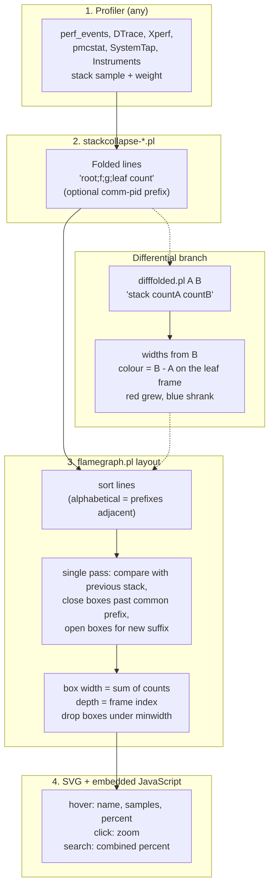

# Paper: The Flame Graph (Gregg 2016)

> [!summary] Claim:
> A flame graph is a prefix tree of sampled stack traces drawn as an adjacency diagram: each box is one call path, its width is the number of samples whose stack began with that path, its height position is stack depth, and its left-to-right position carries no meaning because siblings are sorted alphabetically to maximize merging.
> The x-axis is therefore a population, not a timeline: the picture answers "where did the samples go", and discards order, concurrency, and call counts on purpose, which is what lets a 591,622-line DTrace dump collapse into one screen.
> The paper's engineering contribution is the pipeline around that idea: a profiler-neutral "folded" text format (one stack per line, frames joined by `;`, then a count) that decouples dozens of profilers from one renderer, so any stack-with-a-weight dataset (CPU, blocked time, bytes, page faults) becomes a flame graph.
> Differential flame graphs reuse the same layout for regression hunting: draw profile B, colour each frame red or blue by its self-sample delta from profile A, and accept the known blind spot that code paths present only in A are not drawn.
> Everything the picture can show is bounded by the profiler: truncated stacks (omitted frame pointers), missing symbols (JIT code), and sampling noise limit it, not the rectangles.



## 1. Bibliographic Metadata

| Field | Value |
| :--- | :--- |
| Title | The Flame Graph |
| Author | Brendan Gregg (Netflix at publication) |
| Venue | Communications of the ACM, Vol. 59, No. 6, pp. 48-57, June 2016 (Crossref records the online date as 2016-05-23) |
| DOI | https://doi.org/10.1145/2909476 |
| First publication | ACM Queue, Vol. 14, No. 2, April 20, 2016, https://queue.acm.org/detail.cfm?id=2927301 |
| Rights line | "Copyright 2016 held by owner/author. Publication rights licensed to ACM." |
| Length | 15 references; seven figures (interactive SVG versions of figures 4, 5, and 7 were hosted by ACM Queue) |
| Artifact | FlameGraph, Perl, https://github.com/brendangregg/FlameGraph; its `flamegraph.pl` header records "10-Sep-2011 Brendan Gregg Created this", and the project page says flame graphs "were released in Dec 2011" |
| Related talks | Before the paper: USENIX LISA 2013 plenary "Blazing Performance with Flame Graphs" (Gregg was at Joyent); after it: USENIX ATC 2017 "Visualizing Performance with Flame Graphs" |

How this note was read (as of 2026-11-26): the ACM sites returned HTTP 403 to non-browser fetches, so the full text was read from the Queue edition through an Internet Archive snapshot, and the CACM pagination and date come from the Crossref record.
The figures were not viewable in text form, so claims about what a figure looks like are taken from the surrounding prose.
The CACM edition is described by the author's project page as "also published" from the Queue article; no difference between the editions was checked.

The paper is an industry practice article, not an experimental paper.
It has no controlled user study, no overhead measurement of the visualization, and no benchmark; its evidence is one worked case and the author's deployment experience at Joyent and Netflix.
Section 5 lists exactly which numbers it does give.

## 2. The Core Problem

### 2.1 Profiler output is a wall of text

CPU profiling by stack sampling is cheap to collect and expensive to read.
The paper's typical collection is 99 Hz for 30 seconds across all CPUs, and "for a 16-CPU system, the resulting profile would contain 47,520 stack-trace samples", which as text is "hundreds of thousands of lines".
The arithmetic checks: 99 x 30 x 16 = 47,520.
99 Hz rather than 100 Hz is deliberate, "to avoid lock-step sampling": a sampler whose period equals a periodic activity in the target would see the same phase of that activity every time.

Profilers already condensed the text before flame graphs existed, in two ways the paper describes:

- DTrace prints each unique stack once with an occurrence count, which works because loops and idle CPUs repeat identical stacks.
- Linux `perf` goes further and coalesces shared prefixes into a tree with a percentage per branch (figure 1), which is the same hierarchy a flame graph draws, but as indented text.

"In practice, the output summary from either DTrace or perf_events is sufficient to solve the problem in many cases, but there are also cases where the output produces a wall of text."

### 2.2 The case that produced the visualization

The motivating problem was a MySQL database on the Joyent public cloud consuming "around 40 percent more CPU resources than expected".
The paper gives these measurements:

| Quantity | Value in the paper | Derived here |
| :--- | :--- | :--- |
| Collection | DTrace, user-mode stacks, 997 Hz, 60 seconds | 997 x 60 = 59,820 samples per CPU if the probe fires once per CPU per period (an assumption about the probe) |
| Output size | 591,622 lines, 27,053 unique stacks | about 21.9 lines per unique stack |
| Total samples | 348,427 | about 12.9 samples per unique stack on average; 348,427 / 59,820 is about 5.8 CPUs busy on average under the assumption above |
| Most frequent single stack | contained `calc_sum_of_all_status()`, 5,530 samples | 5,530 / 348,427 = 1.587 percent, which the paper rounds to 1.6 percent |
| Same function, all stacks merged | "only 3.28 percent of the profile" | 3.28 percent of 348,427 is about 11,428 samples |
| Bulk of the profile | "MySQL join" | the interactivity example `mysqld'JOIN::exec` shows 272,959 samples, 78.34 percent; 272,959 / 348,427 = 78.34 percent, so it is consistent with this profile (an inference, the paper does not say so) |
| Outcome | "the problem was located and fixed, and CPU usage was reduced by 40 percent" | the paper does not say what the join problem was |

The teaching point is in the first two rows of the stack columns.
The top single stack, the obvious lead ("perhaps the customer had enabled aggressive monitoring"), was 1.6 percent; merged across its 27,053-stack neighbourhood the same function was 3.28 percent, still small, and the bulk was elsewhere.
Ranking unique stacks hides a cost that is spread across many stacks that differ only in a leaf or a mid-path frame.
The paper's own words on the DTrace output: "browsing more stack traces became an exercise in diminishing returns", and figure 3, the whole output rendered small, "becomes a featureless gray square".

### 2.3 The prototypes that failed first

The project page adds history the article only hints at.
Gregg first traced CPU function calls and drew them with Neelakanth Nadgir's time-ordered call-stack visualization (`function_call_graph.rb`, Oracle blog, 2007-11-01, which itself descends from Roch Bourbonnais's CallStackAnalyzer and Jan Boerhout's vftrace).
That showed time on the x-axis and had two problems, in Gregg's words: the overhead of function tracing "was too high, perturbing the target", and the picture "was too dense to read when spanning multiple seconds".
He switched to timed sampling to fix the overhead, but "since the function flow is no longer known (sampling has gaps)" he "ditched time on the x-axis and reordered samples to maximize frame merging".
Nadgir's post states the limit of the time-ordered design plainly: the script "does not work reliably for asynchronous function calls, or cases where the thread changes CPU".

## 3. Key Innovation

Three decisions, each separable, make the paper's contribution.

1. **Draw the stack-prefix hierarchy as a space-filling adjacency diagram with a length encoding.**
   The paper classifies the result as "an adjacency diagram with an inverted icicle layout", citing Heer, Bostock, and Ogievetsky's visualization survey.
   That survey defines the adjacency diagram as a space-filling variant of the node-link diagram where "nodes are drawn as solid areas (either arcs or bars)" and the icicle layout as the Cartesian form with the root on top; the sunburst is "equivalent to the icicle layout, but in polar coordinates".
   A flame graph is an icicle flipped so the root is at the bottom.
2. **Replace time on the x-axis with a sorted population.**
   "The x-axis spans the stack trace collection. It does not show the passage of time, so the left-to-right ordering has no special meaning."
   Samples are sorted so identical call-path prefixes sit side by side and merge into one box.
   The project page states the rationale: alphabetical ordering "maximizes frame merging, and better shows the big picture of the profile".
3. **Standardize a text intermediate: the folded format.**
   One line per unique stack, so profiler support is a small converter (`stackcollapse-*.pl`), and the same file can be filtered with `grep`, `sed`, and `awk` before rendering.
   The paper lists converters for DTrace, Linux `perf_events`, FreeBSD `pmcstat`, Xperf, SystemTap, Xcode Instruments, Intel VTune, Lightweight Java Profiler, Java `jstack`, and gdb.

Two further ideas ride on those:

- **Weights are not limited to samples.**
  "Stack traces may be collected from different profiler targets, and widths can reflect measures other than sample counts", for example total blocked time, so the same renderer draws off-CPU, I/O, memory, and stall-cycle graphs.
- **The static picture is still useful.**
  "While only wide boxes have enough room to contain the function label text, they are also sufficient to show the bulk of the profile", so a flame graph survives as a PNG or on paper, and interactivity is additive.

## 4. Mechanism Details

[[Flame-Graphs-Differential-Flame-Graphs-and-Visualizations]] owns the current tool landscape (pprof, speedscope, inferno, `perf script report flamegraph`, language profilers).
This note owns what the 2016 paper defines and why; where it cites the Perl source, it is `flamegraph.pl`, `difffolded.pl`, and `stackcollapse-perf.pl` at commit `41fee1f` (2024-10-20).

### 4.1 What every box and axis means

The paper's characteristics, restated as a contract:

| Element | Meaning | What it does not mean |
| :--- | :--- | :--- |
| Box | One stack frame at one position in the call tree | A function in general; the same function under two callers is two boxes |
| Column of boxes | A stack, root at the bottom | One moment in time |
| y position | Stack depth, root lowest | Cost |
| Width | Number (or weight) of samples whose stack started with this box's whole path, so it is inclusive of children | Time per call, call count, or wall-clock span |
| Exposed top edge | Frames that were the leaf of samples: for CPU profiles, the function "directly consuming CPU cycles" | The caller's total |
| x position | Alphabetical order of sibling names | Chronology or importance |
| Colour | Random warm hue by default (not significant); palettes and differentials encode extra data | A measurement, in the default palette |

Two consequences are easy to lose:

- **Width is a share of a population.**
  Under constant-rate sampling, a box's width divided by the total is an estimate of the fraction of on-CPU samples that went through that path.
  When the weight is blocked time or bytes, the population is the weighted one, and the box is the share of that weight.
- **Self versus total.**
  A box's width is its total (inclusive) weight.
  Its self weight is its width minus the widths of the boxes directly above it, and that visible remainder on the top edge is what the paper calls the function that "was on-CPU".
  Reading the plateau finds self cost; reading the width finds total cost.

The paper's interpretation rules, with its caveat attached:

- Top edge: what was running.
  Large plateaus on the top edge mean a single stack was frequently present.
- Reading downward gives ancestry ("why was this called"); reading upward gives code flow and "the big picture before various forks split execution into smaller towers".
- Compare widths directly, but "if a function box is wider than another, this may be because it consumes more CPU per function call or that the function was simply called more often. The function-call count is not shown or known via sampling."
- A major fork, two or more large towers on one function, indicates stages or a conditional.
- In the paper's mock figure 6, `g()` is on-CPU the most; `d()` is wider but its exposed top edge is on-CPU the least; `b()` was on-CPU about four times as much as `h()`; `b()` and `c()` were never sampled as the leaf, so their children ran.

### 4.2 The folded format and the layout pass

The format, as the paper states it: "puts stack traces on a single line, with functions separated by semicolons, followed by a space and then a count".
An optional application name, or `name-pid`, leads the line to group code paths per process; `stackcollapse-perf.pl` builds `comm-pid` or `comm-pid/tid` for that prefix (its `--pid` and `--tid` options).

The paper's own example, with three samples becoming two lines:

```text
start_thread;func_a;func_b;func_c 1
start_thread;func_a;func_d 2
```

Rendering exactly that file through `flamegraph.pl` (commit `41fee1f`, Perl 5.34.1, darwin-arm64, hand run on 2026-11-26) produced these box titles and the warning on stderr:

```text
Stack count is low (3). Did something go wrong?
all (3 samples, 100%)
start_thread (3 samples, 100.00%)
func_a (3 samples, 100.00%)
func_b (1 samples, 33.33%)
func_c (1 samples, 33.33%)
func_d (2 samples, 66.67%)
```

(Titles reordered here for reading; the file emits them in hash order.)
The synthetic `all` box at width 100 percent is added by the renderer; it is the empty root `''` that the layout pass prefixes to every stack.

The layout, read from `flamegraph.pl`:

1. Parse each line with the regular expression `^(.*)\s+?(\d+(?:\.\d*)?)$`.
   The last token is the count and may be fractional; everything before it, including spaces, is the stack, which is why frames with whitespace work (the header credits Dave Pacheco, 15-Dec-2011).
   Lines that do not match are counted and reported as "Ignored N lines with invalid format".
2. Sort all lines as strings (`sort @Data`).
   In `--flamechart` mode it does not sort and only reverses the input, so time moves left to right.
3. For each line in order, call `flow(previous_stack, this_stack, running_total)`.
   `flow` finds the length of the common prefix, closes (records an end position for) every box of the previous stack deeper than that prefix, and opens a new box for each remaining frame of this stack.
   A box is stored under the key `func;depth;end`, with a start and end in count units, so its width is the sum of the counts of all consecutive stacks sharing its path.
4. Convert count units to pixels with `widthpertime = (imagewidth - 2 * xpad) / total`, and drop any box narrower than `--minwidth` (default 0.1 pixels; a trailing `%` makes it a percentage of the total), where the usable width is the image width minus `2 * xpad` with `xpad = 10`.
5. Emit one SVG rectangle plus title per surviving box, with embedded JavaScript for hover, zoom, and search.

Complexity: the sort is O(L log L) in the number of distinct folded lines L, and the merge pass is linear in the total number of frames; box count equals the number of distinct call-path prefixes, which is the node count of the trie of stacks.
This is why the paper can say large profiles stay "readable on one screen" while the text form does not: the drawing's size depends on distinct prefixes, not on samples.

### 4.3 Why sorted order is the whole trick

A box can only be as wide as the run of adjacent stacks sharing its prefix.
So the number of boxes drawn depends on the order of samples, not just their set.
This is checkable with a synthetic experiment.
The program below draws 5,000 samples from a 15-path call tree with a skewed weight, counts boxes under "arrival order" (a flame chart's order) and under sorted order, using the same merge rule as `flow`:

```python
import random
random.seed(7)
TREE = {"main": ["parse", "exec", "io"], "parse": ["lex", "ast"],
        "exec": ["join", "scan", "sort"], "io": ["read", "write"],
        "join": ["hash", "probe"], "scan": ["filter", "decode"]}

def all_paths(frame, prefix):
    yield prefix
    for child in TREE.get(frame, []):
        yield from all_paths(child, prefix + (child,))

stacks = list(all_paths("main", ("main",)))
weights = [1 / (i + 1) for i in range(len(stacks))]
samples = random.choices(stacks, weights, k=5000)

def boxes(seq):
    total, prev = 0, ()
    for s in seq:
        common = 0
        while common < min(len(prev), len(s)) and prev[common] == s[common]:
            common += 1
        total += len(s) - common
        prev = s
    return total

print("distinct stacks:", len(set(samples)))
print("boxes in arrival order :", boxes(samples))
print("boxes in sorted order  :", boxes(sorted(samples)))
```

Output (Python 3.15.2, darwin-arm64, hand run on 2026-11-26; synthetic data, so the 5,151 is a property of this seed and not a measurement of any real profile):

```text
distinct stacks: 15
boxes in arrival order : 5151
boxes in sorted order  : 15
```

Sorted order gives one box per distinct path (15); arrival order gives more boxes than samples (5,151 for 5,000) because every change of path closes and reopens boxes.
That is the paper's statement that time-ordered charts "can greatly reduce merging, however, a problem exacerbated when profiling multiple threads".

"Alphabetical" is a canonical choice, not a requirement: any order that keeps equal prefixes contiguous produces the same box count.
Sorting siblings by weight ("left heavy" in some tools) draws the same boxes in a different arrangement; the paper itself only commits to alphabetical order, and the sibling concept note covers the tools that offer the alternatives.
One consequence worth knowing (an inference, not a claim in the paper): because sibling order is deterministic, the same call path tends to land near the same place in two profiles of similar code, which helps the "blink between two browser tabs" comparison Gregg says he used before differential flame graphs existed.

### 4.4 Interactivity

The Perl implementation emits an SVG with embedded JavaScript and three features:

- **Mouse-over** shows the full function name, the sample count, and the percentage, for example `Function: mysqld'JOIN::exec (272,959 samples, 78.34 percent)`.
  The paper stresses that the percentage "quantifies code paths in the profile, which helps the user prioritize leads and estimate improvements from proposed changes", which is an upper bound: eliminating a path that is p percent of the samples cannot save more than p percent of the CPU in that profile.
- **Click to zoom** rescales horizontally so thin boxes get readable names; ancestors beneath the clicked box fade to show they are partly displayed.
- **Search** takes a regular expression, highlights matches in magenta, and shows the summed percentage, which the paper motivates with spin-lock functions that appear in "20 or more locations".
  In the source, the JavaScript sorts matched frames by x position and counts only the widest non-overlapping ones ("excluding vertical overlap"), so a match inside a match (recursion, or a matched parent and matched child) is not double-counted.

### 4.5 Colour

The paper separates colour as a presentation channel:

- **Default.** "Picked at random to be a warm hue", to help the eye separate adjacent thin towers, and a warm palette because the picture explains why the CPUs are "hot".
  In the current source the "random" colour is a deterministic function of the function name: `random_namehash` seeds Perl's generator with `sum_namehash`, the byte sum of the name modulo 2^32, so the same name gets the same colour in every graph.
  The three colour inputs are drawn after re-seeding with the same seed, so they are equal; a hand run printed `func_a 0.068259 0.068259 0.068259`, `func_b 0.939062 0.939062 0.939062`, and `tcp_sendmsg 0.363541 0.363541 0.363541` for three draws each (Perl 5.34.1, darwin-arm64).
  The `hot` palette is `rgb(205 + int(50*v3), int(230*v1), int(55*v2))`, so with `v1 = v2 = v3` the colours lie on one curve from `rgb(205,0,0)` to `rgb(255,230,55)`: red through orange to yellow.
  Two different names with the same byte sum get the same colour (the sum ignores order), a harmless collision.
- **Hash palette.** The paper's "hashing color scheme" keys colour on the function name so graphs of the same system stay comparable.
- **`java` palette.** Green for Java methods, yellow for C++, red for other user-mode, orange for kernel (figure 7), driven by name annotations: `_[k]` (kernel) and `_[j]` (JIT) from `stackcollapse-perf.pl --kernel --jit`, `_[i]` (inlined, drawn aqua) that `stackcollapse-perf.pl` adds for inlined frames, and `_[w]` (waker), which `flamegraph.pl` itself adds to waker frames under `--colors chain`; a frame named `-` is drawn gray as a separator between user and kernel stacks.
- **Differential colours.** Next section.

### 4.6 Differential flame graphs

The paper's definition: "A differential flame graph shows the difference between two profiles, A and B."
The Perl software at the time implemented one method: display profile B, "colored using the delta from A to B", red for functions that increased and blue for those that decreased.
Its stated weakness: "some code paths present in the A profile may be missing entirely in the B profile, and so will be missing from the final visualization. This could be misleading."

The mechanism, from the 2014 blog post and `difffolded.pl` and `flamegraph.pl`:

- `difffolded.pl A B` merges the two folded files by stack string and prints three columns, `stack countA countB`, with 0 for a stack missing from one file.
- `flamegraph.pl` auto-detects the second count column and sizes boxes by it (profile B), computing `delta = countB - countA` per stack.
- The delta is attached only to the leaf frame of each stack (the code adds the delta only when `i == len_b`, the last frame), so a box is coloured by its self-sample change, which matches the blog's "the colors show the difference that function directly contributed (eg, being on-CPU), not its children".
- Colour saturation is linear in the delta divided by the largest absolute delta in the whole graph (`maxdelta`, initially 1): a positive delta gives `rgb(255, g, g)` with `g = int(210 * (max - delta) / max)`, a negative one gives the blue mirror, and zero is white.

A hand run on a small pair of profiles shows all of this together (FlameGraph `41fee1f`, Perl 5.34.1, darwin-arm64, hand run on 2026-11-26).
Profile A has `main;a 100`, `main;a;x 50`, `main;b 20`, `main;gone 30`; profile B has `main;a 100`, `main;a;x 120`, `main;b 20`, `main;new 10`:

```text
$ difffolded.pl A.folded B.folded | sort
main;a 100 100
main;a;x 50 120
main;b 20 20
main;gone 30 0
main;new 0 10

$ ... | flamegraph.pl      (box title | fill colour; lines reordered for reading)
x (120 samples, 48.00%; +28.00%) | rgb(255,0,0)
new (10 samples, 4.00%; +4.00%) | rgb(255,180,180)
a (220 samples, 88.00%; 0.00%) | rgb(255,255,255)
b (20 samples, 8.00%; 0.00%) | rgb(255,255,255)
main (250 samples, 100.00%; 0.00%) | rgb(255,255,255)
all (250 samples, 100%) | rgb(255,255,255)
```

Four things are visible in it:

- `x` grew by 70 samples, which is 28.00 percent of B's 250, and is fully saturated because it is the largest delta; `new` grew by 10 and gets `g = int(210 * (70 - 10) / 70) = 180`, a pale red.
- `a` is white even though its total grew by 70 samples, because `a`'s own self delta is 0; the growth is entirely in its child `x`.
  A parent is never coloured by its children's change.
- `gone` (30 samples in A, none in B) is not drawn at all: that is the "missing code path" problem in the paper, reproduced.
- Widths are B's, so the graph answers "where is the CPU now, and what changed under each box".

The two mitigations for the blind spot, both in the paper or its blog:

- **Negation.** Swap the arguments and pass `--negate` to flip the hues: `difffolded.pl B A | flamegraph.pl --negate`.
  Now widths show A (the "before") and colours show what will happen; in the blog's words, `diff1.svg` is "colored by what WILL happen" and `diff2.svg` "colored by what DID happen".
  Running the example's `d.txt` through `--negate` gave `x ... -28.00% | rgb(0,0,255)` and `new ... -4.00% | rgb(180,180,255)`, the same boxes with mirrored sign and hue.
  The blog says that for automated non-regression testing it would "generate and show both side by side".
- **Three-view tools.** Cor-Paul Bezemer's `flamegraphdiff` (the paper cites Bezemer, Pouwelse, and Gregg, SANER 2015, pp. 535-539) shows A, B, and a graph of only the delta, with mouse-over highlighting the same function in all three; Gregg's blog finds it "a bit slow for complex profiles" since it more than doubles the rectangles drawn.
  The blog also describes Netflix's internal FlameCommander drawing an "elided" flame graph for vanishing paths and showing only an "X% elided" text link by default.

Two hazards with the first-party tool, both reproduced above:

- **Different totals make everything one colour.**
  If the two profiles sum to different totals (different load or duration), every count differs and "everything will look red if the load increased".
  `difffolded.pl -n` scales profile A's counts to B's total (`int(count * total2 / total1)`).
  In the hand run, `-n` printed `main;a 125 100`, `main;a;x 62 120`, `main;b 25 20`, `main;gone 37 0`: integer truncation (62.5 becomes 62, 37.5 becomes 37), and `a`, unchanged at 100 samples, now carries a delta of -25 and turns blue.
  Normalization converts "one function grew" into "everything else shrank", so a normalized graph shows share changes, not absolute changes.
- **Documentation drift.**
  The blog says `difffolded.pl -x` strips hex addresses; the script at `41fee1f` accepts `-n` and `-s`, and `-x` prints `Unknown option: x`.
  The paper does not mention either flag.

The 2014 blog also states the use case that motivated the paper's closing remark about nightly generation: a Netflix workload saw a CPU increase after a system update, and the red frames under `deflate_slow()` showed that ZFS compression had been turned on.
Gregg adds he "didn't really need a differential flame graph for this one", and wanted it for "subtle regressions, of less than 5%".

### 4.7 Other targets, as the paper defines them

Any (stack, weight) dataset works.
The paper's catalogue, with what each width means:

| Flame graph | Stack collected at | Width = | Caveat given in the paper |
| :--- | :--- | :--- | :--- |
| CPU | timed samples (99 or 997 Hz) | samples on-CPU | frame pointers and symbols must work |
| Stall cycles | PMC overflow, via a PMC profiler such as `perf_events` | cycles stalled on processor or hardware resources, typically memory I/O | points optimization at memory traffic, not instruction count |
| CPI | two profiles: CPU samples and instruction counts | CPU cycles, with a red to blue colour scale for CPI | built with the differential machinery |
| `malloc()` | tracing the allocator | allocation events | allocator calls can be so frequent that tracing is "prohibitive" |
| `brk()` and `mmap()` | tracing those syscalls | virtual memory growth | lower frequency, so cheaper; may also show asynchronous expansion |
| Page faults | tracing faults | physical memory growth | shows the code that populated memory, not the allocator path |
| I/O | tracing file system, device, and network issue paths | synchronous I/O issues | revealed I/O types "otherwise not known": synchronous, read-ahead, async flush, background scrub |
| Off-CPU | scheduler events when a thread leaves the CPU, closed when it returns | time blocked | inconclusive for condition variables; frequent events |
| Wakeup | thread wakeup events | not stated in the paper; the waker stacks "shed light on why they were blocked" | needs the off-CPU graph beside it |
| Chain | off-CPU plus every wakeup stack stacked on top, read bottom up | off-CPU and wakeup time | "experimental"; events "extremely frequent, however, and impractical to instrument in production using current tools" |

Two details from Gregg's off-CPU page sharpen the paper's table: off-CPU widths are time summed over threads (in his MySQL example some columns are 25 to 30 seconds wide in a 30-second window, which he attributes to single threads, and some, such as `io_handler_thread`, are wider than 30 seconds, which he attributes to thread pools whose wait time sums past the elapsed window), and the page warns that scheduler and I/O tracing can fire millions of times per second, so per-event cost multiplies.
The CPI graph's colour direction differs between sources: the paper says "red for a high CPI and blue for a low CPI", while the 2014 CPI blog's own scale colours "the highest CPI blue (slowest instructions), and lowest CPI red", and builds it from stall cycles against unhalted cycles rather than from instruction counts.
Treat the legend of any CPI graph as part of the data.

### 4.8 Challenges the paper assigns to profilers, not to flame graphs

"Challenges with flame graphs mostly involve system profilers and not flame graphs themselves."
The two it names:

1. **Incomplete stacks.**
   Some profilers truncate to a fixed depth (the paper's example is 10 frames), so merging fails at the truncated root; and compilers that reuse the frame pointer register break stack walking, fixed with `gcc -fno-omit-frame-pointer` or "a different stack-walking technique".
2. **Missing function names.**
   Stacks are complete but frames are hexadecimal addresses, "commonly" for JIT code that creates no standard symbol table.
   Fix per runtime; Linux `perf_events` accepts supplemental symbol files the application writes.

At Netflix both appeared for Java: the first was fixed by the JVM option `-XX:+PreserveFramePointer`, the second by `perf-map-agent`, a Java agent that writes a symbol table.
The Netflix post adds numbers: the option cost "between 0 and 3%" depending on workload, it landed in JDK 8 update 60 build 19 and JDK 9 early access, and flame graphs "look perhaps one third as deep" as `jstack` stacks because inlined frames never reach a frame-pointer walk.
Gregg's 2024 retrospective reports that enabling frame pointers for libc and Java was "usually less than 1%" with an outlier near 10% for an application producing stack traces over 1000 frames deep through Groovy.

A third engineering problem is size: for profiles with "many thousands of unique code paths" the Perl SVG "can be tens of megabytes in size, which becomes sluggish to load in a browser"; the fix was to elide paths "so thin they are normally invisible", which is `--minwidth` (default 0.1 pixels on a 1,180-pixel usable width, so a box under about 1/11,800 of the profile disappears).

One folded-format hazard shows up in the converters: Java method descriptors contain `;` (the `stackcollapse-perf.pl` comments give `Lorg/mozilla/javascript/ContextFactory;.call(...)`), so the tool tidies Java names by default (`$tidy_java = 1`), turning that into `org/mozilla/javascript/ContextFactory:.call`.
A custom converter that does not do something similar will split one frame into two.

### 4.9 Layout variants, and what the paper says about each

- **Linux `perf` tree and KCachegrind.**
  Text trees lose their percentages when zoomed out; a DAG with arrows and bar icons (KCachegrind) loses its annotations the same way.
- **Sunburst.**
  Equivalent to the icicle layout in polar coordinates, but names are harder to draw on slices and "comparing two functions becomes a matter of comparing two angles rather than two line lengths, which has been evaluated as a more difficult perceptual task".
  The paper's support for that perceptual claim is a design-press article (Odds 2013, Creative Bloq), not primary perception research; the 2017 Gregg blog repeats it for sunbursts, calling them "the new pie chart".
- **Flame charts.**
  "Inspired by flame graphs" (the WebKit Web Inspector, bug 111162), but with time on the x-axis; they show time-ordered issues and reduce merging, worst for multi-threaded programs.
  The project page adds that "some analysis tools have implemented flame charts and mistakingly called them flame graphs".
- **Icicle (`--inverted`).**
  A flame graph upside down; Gregg's stated trade-off is that for very deep stacks the flame layout's initial view may be mostly empty at the top, so many implementations default to the icicle.
- **Reversed merge order.**
  `flamegraph.pl --reverse` flips each stack before merging so merging happens at the leaf end, which the paper says "groups together leaf paths, such as spin locks".
  A hand run of `a;b;c 3 / a;b;d 1 / a;e 4` through `--reverse` produced 9 boxes (three separate `a` boxes of 1, 3, and 4 samples) against 6 for the normal merge (one `a` of 8), showing the trade: you gain a leaf-rooted view and lose root-side merging.

## 5. Evaluation and Limitations

### 5.1 What the paper measures, and what it does not

The numbers in the paper are all in the MySQL case and the collection arithmetic in section 2; see the table there.
Beyond them the claims are qualitative: "much faster comprehension", "reducing the time for root cause analysis", and a conclusion that flame graphs have been "instrumental in countless performance wins".
There is no user study comparing time to diagnosis, no baseline against `perf report` or KCachegrind on the same task, no measured overhead of generating the SVG, and no error analysis of sampled widths.
The honest reading is that the paper is a well-argued practitioner's account plus a reusable artifact; it is evidence that the design works for its author and was adopted, not an experiment that proves it works better.

### 5.2 Numbers to know

| Quantity | Value | Source and platform |
| :--- | :--- | :--- |
| Typical CPU profile | 99 Hz, 30 s, 16 CPUs, 47,520 samples | Paper |
| Example collection command | `perf record -F 99 -a -g -- sleep 60`, then `perf script \| ./stackcollapse-perf.pl \| ./flamegraph.pl > out.svg` | Paper, Linux |
| MySQL case | 591,622 lines, 27,053 unique stacks, 348,427 samples at 997 Hz for 60 s | Paper, DTrace on a Joyent public cloud host |
| Top single stack versus merged | 5,530 samples (1.6 percent) versus 3.28 percent merged | Paper |
| Fix outcome | CPU "reduced by 40 percent" | Paper |
| SVG size | "tens of megabytes" for many thousands of unique paths, before eliding thin boxes | Paper, Perl implementation |
| Default `--minwidth` | 0.1 pixels | `flamegraph.pl` at `41fee1f` (as of 2026-11, Both) |
| Default image width, frame height | 1200 pixels, 16 pixels | `flamegraph.pl` at `41fee1f` (as of 2026-11, Both) |
| `-XX:+PreserveFramePointer` cost | 0 to 3 percent depending on workload | Gregg and Spier, Netflix Tech Blog 2015, JVM on Linux |
| Frame pointers everywhere (libc and Java) | usually under 1 percent; outlier 10 percent | Gregg 2024, Linux; Ubuntu's analysis says 1-2 percent for most 64-bit cases |

### 5.3 Sampling error is not drawn

A flame graph presents counts as if they were exact, and they are estimates.
Under the simplifying assumption that samples are independent draws, a frame holding a fraction p of N samples has a standard error of about sqrt(p(1-p)/N) in that fraction.
For N = 47,520 and p = 1 percent, that is sqrt(0.0099 / 47,520), about 0.046 percentage points, so a 1 percent box is 1 percent plus or minus roughly 0.05 (one standard deviation); for the paper's 5,530-sample stack the relative standard error is about 1/sqrt(5,530), roughly 1.3 percent of its own value.
These are derived here, not in the paper, and they ignore correlation between samples and systematic bias (for example skid, safepoints, and aliasing with periodic activity), which [[Sampling-vs-Instrumentation-Skid-and-Safepoint-Bias]] and [[Paper-Producing-Wrong-Data-Measurement-Bias]] own.
For differentials the noise doubles in variance (two independent counts), and a red or blue box carries no significance test: a 30-sample frame moving to 40 draws the same saturated colour as a 3,000-sample frame moving to 4,000, if both are the largest delta.

### 5.4 Limitations, stated against the paper's own scope

- **Order is gone.**
  A periodic stall, a startup phase, or a pathology that occurs once a minute is averaged into the same box as steady-state work.
  The paper's remedy is to pair it with a flame chart; the sibling concept note covers the time-resolved tools.
- **Call counts and latency per call are gone.**
  The paper says so for sampling; a wide box can be many calls or an expensive call, and only a different measurement tells them apart.
- **On-CPU only by default.**
  The paper devotes its off-CPU, wakeup, and chain material to this: threads that wait do not appear in a CPU graph.
  [[Off-CPU-Analysis-Thread-States-and-Causal-Profiling]] owns the methodology, and [[Paper-Coz-Causal-Profiling]] addresses a different question the flame graph cannot answer, which is what speeding a box up would do to end-to-end throughput.
- **Differential blind spots.**
  Vanishing paths are not drawn, parents are not coloured by their children, normalization manufactures blue, and nothing marks noise.
- **Concurrency is flattened.**
  Samples from every thread merge into one graph unless the process name, pid, or tid is a prefix frame; widths sum thread time, not elapsed time.
- **The paper's future work was partly done and partly not.**
  The white/black differential (the single graph plus a region for missing paths) is described as "in-progress" in the paper; `flamegraph.pl` at `41fee1f` has no such mode, so the note treats it as unreleased in the reference tooling and makes no claim about other tools.
  The `d3-flame-graph` library with zoom transitions and top-down merge toggling was in development by Martin Spier at Netflix; the sibling concept note lists its current state.

## 6. Industry Impact

The paper's closing claim is that the flame graph "has become an essential tool for understanding profiles quickly".
The evidence in the sources read for this note, dated:

- **Fast uptake of the artifact.**
  The project page logs, within about 16 months of the December 2011 release, flame graphs of the X server, Node.js functions, and an IP scaling problem (Max Bruning), Mark Probst's Xcode Instruments version (November 2012), and Bruce Dawson's Windows Xperf work (March 2013).
  By the 2016 paper there were `stackcollapse` converters for ten profiler sources.
- **Built into mainstream profilers.**
  The project page lists Linux `perf` (`perf script report flamegraph`), Windows Performance Analyzer and PerfView as having built-in support; Qt Creator 4.0.0 (May 2016) included them; and the page lists many commercial products.
  Current, per-tool status is in [[Flame-Graphs-Differential-Flame-Graphs-and-Visualizations]].
- **A formal chain through profiler infrastructure.**
  Gregg's October 2016 post describes Linux 4.9 letting a BPF program attach to timed `perf_events` and aggregate stacks in an in-kernel hash keyed by the whole stack, emitting only (stack, count) pairs, which is the folded form produced at the source and avoids `perf.data` and the `stackcollapse` pass; Linux 4.5 had added `perf report -g folded`.
  The paper's central data structure became something kernels emit.
  See [[eBPF-bpftrace-ftrace-uprobes-and-USDT]] and [[Linux-perf-in-Depth-and-perf-c2c]].
- **Frame pointers as a distribution default.**
  The paper's incomplete-stack challenge is why the Fedora change `fno-omit-frame-pointer` (targeted for Fedora Linux 38, to be evaluated by Fedora Linux 40) and Ubuntu 24.04 LTS (GCC enables frame pointers by default for 64-bit platforms) exist; Gregg's 2024 post presents both as fixing flame graphs and off-CPU graphs that were broken by libc built without frame pointers.
  Canonical's post says the penalty is "between 1-2% in most cases" and keeps frame pointers off for cases such as the Python interpreter where the cost is high (as of 2024, Linux).
- **Netflix practice the paper previews.**
  Differential flame graphs generated nightly for microservices, in the paper's future-work paragraph, and a Netflix tech blog post by Mike Huang, "Saving 13 Million Computational Minutes per Day with Flame Graphs" (April 2016), listed on the project page.
- **New weights.**
  Recent posts on the same site are titled "AI Flame Graphs" (2024-10-29) and "Doom GPU Flame Graphs" (2025-05-01), consistent with the paper's claim that any stack-with-weight data fits; the contents of those posts were not read for this note.

What did not survive unchanged: the Perl/SVG pipeline is now one option among many (the sibling concept note covers `pprof`, `speedscope`, `inferno`, and language-native collectors), and fleet systems store profiles in structured formats and render flame graphs as a view, which [[Paper-Google-Wide-Profiling]] and [[Continuous-Profiling-GWP-Parca-Pyroscope-and-OTel-Profiles]] cover.
The folded text format remains a lingua franca for ad hoc work because it can be filtered with line tools.

## 7. Concept Grounding

| Concept in this curriculum | How it relies on the paper |
| :--- | :--- |
| [[Flame-Graphs-Differential-Flame-Graphs-and-Visualizations]] | Owns the tool-level treatment (folded format, merge machine, differentials, layouts, current implementations); this note supplies the paper's definitions and rationale |
| [[Rebuild-Lab-Sampling-Profiler-to-Folded-Stacks]] | The rebuild lab produces exactly the folded format the paper defines |
| [[Linux-perf-in-Depth-and-perf-c2c]] | `perf record -g` and `perf script` are the paper's profiler step on Linux |
| [[Off-CPU-Analysis-Thread-States-and-Causal-Profiling]] | Expands the paper's off-CPU, wakeup, and chain graphs |
| [[Sampling-vs-Instrumentation-Skid-and-Safepoint-Bias]] | Owns the bias that makes widths estimates |
| [[Performance-Regression-Detection-in-CI]] | The nightly differential idea from the paper's future work, with statistics |
| [[Continuous-Profiling-GWP-Parca-Pyroscope-and-OTel-Profiles]] and [[Paper-Google-Wide-Profiling]] | Fleet-scale profile storage that renders flame graphs as one view |
| [[Paper-Coz-Causal-Profiling]] | The contrast case: a profile of where time goes versus an experiment on what speeding code up would change |

## Pitfalls

> [!warning] Pitfalls:
> - **Reading the x-axis as time.**
>   Left to right is alphabetical.
>   A box at the left was not run first, and two boxes side by side were not adjacent in execution.
> - **Reading width as time per call.**
>   Width is total samples; the same width can be one slow call or a million fast ones.
>   Sampling cannot tell them apart.
> - **Ranking unique stacks instead of merged paths.**
>   The paper's own case: the top stack was 1.6 percent while the same function across all stacks was 3.28 percent, and the real cost was elsewhere.
> - **Trusting a truncated or frame-pointerless stack.**
>   If stacks are cut at a fixed depth or lose frames to an omitted frame pointer, merging fails or shows wrong parents.
>   Check the root of the graph before reading anything above it.
> - **Hex-address frames and "unknown" towers.**
>   JIT code without a symbol map shows as addresses; symbolize first.
> - **Comparing two profiles with different totals.**
>   Without `difffolded.pl -n` the whole graph is one colour; with it, an unchanged function turns blue whenever another grew.
> - **Believing the saturation.**
>   Colour is relative to the largest delta and carries no significance, so one big outlier washes out the rest and a noisy small frame can look decisive.
> - **Reading a differential as complete.**
>   Code paths that disappeared are not drawn; generate the negated graph too.
> - **A parent that is white in a differential.**
>   Only leaf self-samples carry the delta; the cost moved to a child, so look one row up.
> - **Mixing flame charts and flame graphs.**
>   A time-ordered chart merges little and can be mislabelled "flame graph"; check what the x-axis is before drawing a conclusion.
> - **Sampling at a round frequency.**
>   100 Hz can lock-step with a 10 ms timer; the paper uses 99 and 997.
> - **Splitting frames on `;` in your own converter.**
>   A frame name that contains `;` (JVM descriptors) corrupts the stack; tidy or escape it.
> - **Shipping an SVG as the data.**
>   The paper reports tens of megabytes for large profiles and drops thin boxes, so the SVG cannot be re-queried; keep the folded file.

## At Scale

The paper's setting is one engineer and one profile; its pipeline scales by what it stores.

| Scale | What changes | Decision rule |
| :--- | :--- | :--- |
| One engineer | Ad hoc `perf record -F 99 -a -g -- sleep 60`, read plateaus first, then widths | Always save the folded file next to the SVG |
| One team, one service | The same workload before and after a change | Generate A to B and B to A (negated) with equal duration and the same workload; normalize only when work differs, and report share changes, not absolute |
| 1,000+ engineers, microservices | Nightly differentials (the paper's own plan at Netflix), one per service | Store folded or structured profiles with build id and commit; gate on a threshold plus a sample-count floor, not on colour |
| 10,000 to 50,000 engineers, fleet | The flame graph is a view over a profile database, not a file | Collect continuously with two-dimensional sampling ([[Paper-Google-Wide-Profiling]]); decide frame-pointer policy once for the base image, since the 1-2 percent cost is paid by everyone and the benefit (complete stacks) by everyone |

Cost considerations that change with scale:

- Frame pointers: a fleet-wide policy decision with a measured cost range (under 1 percent to 2 percent for most workloads, about 10 percent outliers) against complete stacks for CPU and off-CPU profiling.
- Tracing-based graphs (off-CPU, `malloc`, chain): the paper warns the event rates make them "impractical to instrument in production"; in-kernel aggregation in eBPF is what Gregg's later pages rely on to cut that cost (his off-CPU page gives Linux 4.8 as the minimum for eBPF stack traces, his profiler post says stack walking arrived in 4.6 and attaching to timed samples in 4.9; the pages disagree on the first number, as of 2026-11, Linux), so require it before turning them on fleet-wide.
- Regression automation: the hardest part is not drawing, it is deciding which diffs to page on.
  The paper offers colour; a production system needs a significance threshold per service ([[Performance-Regression-Detection-in-CI]]).

## Practice Drill

> [!tip] Practice Drill:
> 1. Save the two profiles from the differential example as `A.folded` and `B.folded`, clone `https://github.com/brendangregg/FlameGraph`, and check out commit `41fee1f99f9276008b7cd112fca19dc3ea84ac32`.
> 2. Predict, before running, the three-column output of `difffolded.pl A.folded B.folded`, the percentage and colour of each box, and which stack will be missing from the graph.
> 3. Run it, then run it with `-n`, and explain every number that changes, including the two that truncate.
> 4. Swap the arguments, add `--negate`, and check that `gone` now appears in blue.
> 5. Capture a real profile (`perf record -F 99 -a -g -- sleep 30` on Linux, or any sampler that emits stacks), fold it, and find one box where the widest plateau is not the widest total.
>    Explain the difference in terms of self versus total.
> 6. Take the fifth step's folded file, run it through `grep -v` for one function, and re-render: confirm the percentages renormalize, and say why that makes the filtered graph answer a different question.

## Interview Questions

### L5

> [!question] 1. What does the x-axis of a flame graph mean, and why are the stacks sorted alphabetically?
> [!success]- Answer
> The x-axis is a population: its span is the whole collection, and each box's width is the share of samples whose stack began with that call path.
> It is not time, so the left-to-right order carries no meaning.
> Sorting puts stacks that share a prefix next to each other so they merge into one box; any order that keeps equal prefixes contiguous gives the same number of boxes, and alphabetical is a deterministic choice.
> A time-ordered layout (a flame chart) merges far less, because every change of path closes and reopens boxes.

> [!question] 2. Predict the output.
> `flamegraph.pl` is given this folded input:
> ```text
> a;b;c 3
> a;b;d 1
> a;e 4
> ```
> List every box title it will draw, with its sample count and percentage.
> [!success]- Answer
> There are six boxes: `all (8 samples, 100%)`, `a (8 samples, 100.00%)`, `b (4 samples, 50.00%)`, `c (3 samples, 37.50%)`, `d (1 samples, 12.50%)`, and `e (4 samples, 50.00%)`.
> `all` is the synthetic root the renderer adds above every stack.
> `b` and `e` are siblings under `a`, with `b` splitting into `c` and `d`.
> It also warns on stderr that the stack count is low (8), because the renderer warns when the total is under 100 and the unit is samples.
> This output was produced on darwin-arm64 with FlameGraph at `41fee1f`.

> [!question] 3. Why does the paper sample at 99 Hz, and how many samples is a 30-second, all-CPU profile on 16 CPUs?
> [!success]- Answer
> A round rate such as 100 Hz can run in lock-step with periodic activity in the target (a 10 ms timer, for instance), so the sampler would always see the same phase and bias the profile; 99 Hz drifts relative to such activity.
> Samples are 99 x 30 x 16 = 47,520, which as text is hundreds of thousands of lines.

> [!question] 4. A function has a wide box but nothing sits on its top edge.
> Is it a good optimization target?
> [!success]- Answer
> Its total cost is large, but its self cost is near zero, so the time is in its callees (the boxes above it).
> Optimize the callee that owns the plateau, or reduce how often the wide function calls them.
> Width is inclusive; the exposed top edge is where the CPU was.
> The paper's mock figure makes the same point with `b()` and `c()`, which were never the sampled leaf.

### L6

> [!question] 5. Debug this: a nightly differential job reports that "everything is red, the service got slower everywhere".
> The workflow is `difffolded.pl night1.folded night2.folded | flamegraph.pl > diff.svg`.
> Night 2's profile has 25 percent more samples because traffic was higher.
> How do you find the real change?
> [!success]- Answer
> The profiles sum to different totals, so almost every stack has a positive delta; the colours track load, not code.
> `difffolded.pl -n` scales profile 1 to profile 2's total, which restores the red and blue spectrum, but it converts absolute changes into share changes: in a hand run, a function unchanged at 100 samples printed `125 100` and turned blue because another frame grew by 70.
> So use `-n`, then read colour as "share of the profile moved", look at the self-delta frames (not their parents), and also generate the negated graph for paths that vanished.
> Better still, make the two profiles comparable at the source: the same duration and the same request mix, or counts divided by completed requests, so no normalization is needed.
> Finally check significance: red or blue says nothing about noise.

> [!question] 6. The CPU flame graph for a slow service shows nothing hot, yet requests take 800 ms with 40 ms of CPU.
> What do you do, and what does the paper say about its limits?
> [!success]- Answer
> The time is off-CPU: waiting on I/O, locks, timers, scheduling, or paging.
> Collect an off-CPU flame graph, where stacks are captured when a thread leaves the CPU and the width is time until it returns.
> If the blocked stacks end in a condition-variable wait, the paper notes the graph is inconclusive: add a wakeup flame graph, and if the waker is itself blocked, a chain graph (which the paper labels experimental).
> The limits: scheduler events are very frequent, so tracing overhead needs in-kernel aggregation (eBPF); off-CPU widths sum thread time, so a graph can be wider than the wall-clock window; and a blocked stack shows where, not why.

> [!question] 7. A flame graph of a C++ service built with `-O2` has towers only two or three frames deep and many `[unknown]` frames.
> Diagnose and fix without changing the visualization.
> [!success]- Answer
> The shallow towers are broken stack walks: with the frame pointer reused as a general register, a frame-pointer unwinder cannot follow the chain.
> The paper's fixes are recompiling with `-fno-omit-frame-pointer` or using a different unwinding technique (DWARF unwinding, or LBR, at their own costs).
> `[unknown]` frames are missing symbols: stripped binaries, or JIT code without a symbol map.
> Provide symbols (unstripped build id match, or a runtime symbol file such as `perf-map-agent` output for the JVM).
> Expect a cost: Netflix measured 0 to 3 percent for the JVM option, and a distribution default such as Ubuntu 24.04 estimates 1-2 percent for most workloads.

> [!question] 8. Why is a parent frame white in a differential flame graph when its total went up by 70 samples?
> [!success]- Answer
> Only the leaf frame of each stack carries the delta, so a box's colour is its change in self samples; the blog says the colour shows what a function "directly contributed", not its children.
> If all 70 extra samples are in a child, the child is saturated red and the parent has delta 0 and renders white.
> In the hand run, `a` was white (0.00 percent) while its child `x` was `+28.00%` at full red.
> Read differentials bottom up for where the width is, then look at the coloured boxes on the top edge for what changed.

### L7+

> [!question] 9. Design a nightly differential flame graph system for 400 microservices, as the paper proposes.
> What would you store, compare, normalize, alert on, and refuse to promise?
> [!success]- Answer
> Store folded or structured profiles per service per build (commit, build id, workload id), not SVGs, so any diff can be re-rendered and filtered.
> Collect on a fixed protocol: same duration, same sampling rate (99 Hz), a synthetic or replayed load at a fixed request rate, because normalization hides absolute change.
> Compare the new build to a rolling baseline of several nights, not one prior night, to estimate noise; flag frames whose self-share moved beyond that noise and a sample-count floor, since colour has no significance.
> Draw both the A to B and negated B to A graphs, and surface the "X percent elided" figure so vanished paths are not missed.
> Require complete stacks and symbols as a precondition (frame pointers and symbol maps), and fail the job if the stack-depth distribution looks truncated.
> Do not promise attribution of a regression to a commit (the diff shows where, not why), detection of regressions below the noise floor (the blog's target is under 5 percent, which needs many samples), or coverage of off-CPU regressions without a separate off-CPU job.

> [!question] 10. A colleague says "flame graph widths are exact CPU time".
> Argue the precise claim, with numbers.
> [!success]- Answer
> Widths are sample counts, so they are statistical estimates of share, with error and bias.
> Under independent sampling, a frame at fraction p of N samples has standard error about sqrt(p(1-p)/N); for N = 47,520 and p = 1 percent that is about 0.046 percentage points, and for a 5,530-sample stack about 1.3 percent relative.
> Real error is larger: samples are correlated, a fixed rate can alias with periodic work (hence 99 Hz), skid and safepoint bias move samples between frames, inlining removes frames from a frame-pointer walk (Netflix saw stacks about a third as deep as `jstack`), and thin boxes below `--minwidth` are dropped.
> The honest statement: widths estimate the share of on-CPU samples through a path, accurate enough to rank large boxes and poor for small deltas; confirm any small win with a controlled benchmark ([[Benchmark-Methodology-Noise-and-Environment-Control]]).

> [!question] 11. The folded format has no field for time, thread, or call count.
> Defend it as a design, then say what you lose and how to recover it.
> [!success]- Answer
> It is one line per unique stack with a count, so a profiler adapter is a small converter, the data is `grep`-able and diff-able, and its size grows with distinct stacks rather than samples, which is what let dozens of profilers share one renderer and why the paper puts it at the centre.
> Costs: time order is lost (use a flame chart or a time-resolved view), thread identity is lost unless it is a prefix frame (`comm-pid/tid`), call counts are not representable (use uprobes or tracing for counts), `;` inside names must be escaped, and a single weight column forces one metric per file (the differential form adds a second column).
> Recover time by also keeping the raw timestamped samples; recover threads with prefix frames; recover counts with a separate tracer.

> [!question] 12. Where does the flame graph stop being the right tool, and what do you reach for?
> [!success]- Answer
> It answers "where do samples go", so it is wrong for questions about causality, latency distributions, ordering, or per-call cost.
> For "what would speeding this up change end to end", use [[Paper-Coz-Causal-Profiling]]; for a stall that occurs once per minute, a time-resolved view such as a flame chart or a heat map; for latency across services, distributed tracing ([[Paper-Dapper-Distributed-Systems-Tracing]]); for off-CPU waits, the paper's off-CPU, wakeup, and chain graphs, with the overhead caveat.
> For fleet-wide questions, aggregate profiles continuously ([[Paper-Google-Wide-Profiling]]) and render flame graphs as one view of the stored data.

## Further Reading

- Gregg, [The Flame Graph, CACM 59(6)](https://doi.org/10.1145/2909476) and the [ACM Queue edition](https://queue.acm.org/detail.cfm?id=2927301): the primary source; read the Flame Graphs Explained, Challenges, and Differential Flame Graphs sections first.
- Gregg, [Flame Graphs](https://www.brendangregg.com/flamegraphs.html): the Origin section (the failed time-ordered prototype), Variations (icicle, flame chart, sunburst), and the dated Updates log of adoption.
- Gregg, [Differential Flame Graphs](https://www.brendangregg.com/blog/2014-11-09/differential-flame-graphs.html): the three-column format, `-n`, negation, and elided graphs.
- Gregg, [CPU Flame Graphs](https://www.brendangregg.com/FlameGraphs/cpuflamegraphs.html) and [Off-CPU Flame Graphs](https://www.brendangregg.com/FlameGraphs/offcpuflamegraphs.html): command lines per profiler, with the eBPF versions.
- [FlameGraph repository](https://github.com/brendangregg/FlameGraph): `flamegraph.pl`, `difffolded.pl`, and the `stackcollapse` family, the reference for the folded format.
- Gregg and Spier, [Java in Flames](http://techblog.netflix.com/2015/07/java-in-flames.html): `PreserveFramePointer`, `perf-map-agent`, and the inlining caveat.
- Gregg, [The Return of the Frame Pointers](https://www.brendangregg.com/blog/2024-03-17/the-return-of-the-frame-pointers.html): the cost and distribution-default story behind the paper's incomplete-stack challenge.
- Heer, Bostock, Ogievetsky, [A Tour through the Visualization Zoo](https://queue.acm.org/detail.cfm?id=1805128): the adjacency, icicle, and sunburst vocabulary the paper uses.
- Bezemer, Pouwelse, Gregg, [Understanding software performance regressions using differential flame graphs](https://doi.org/10.1109/SANER.2015.7081872): the research source for the three-graph differential.
- [Nadgir, Visualizing callgraphs via dtrace and ruby](https://blogs.oracle.com/realneel/entry/visualizing_callstacks_via_dtrace_and): the time-ordered ancestor the paper credits.

## Related

- Prerequisites: none
- Next: [[Paper-Google-Monorepo-Piper-and-CitC]]
- See also: [[15-Technical-Whitepapers/01-Systems-Performance-and-Tracing/Brendan-Gregg-Performance-Canon|Brendan Gregg Performance Canon]], [[Flame-Graphs-Differential-Flame-Graphs-and-Visualizations]], [[Rebuild-Lab-Sampling-Profiler-to-Folded-Stacks]], [[Off-CPU-Analysis-Thread-States-and-Causal-Profiling]], [[Sampling-vs-Instrumentation-Skid-and-Safepoint-Bias]], [[Linux-perf-in-Depth-and-perf-c2c]], [[Performance-Regression-Detection-in-CI]], [[Paper-Google-Wide-Profiling]], [[Paper-Coz-Causal-Profiling]], [[Paper-Producing-Wrong-Data-Measurement-Bias]]
