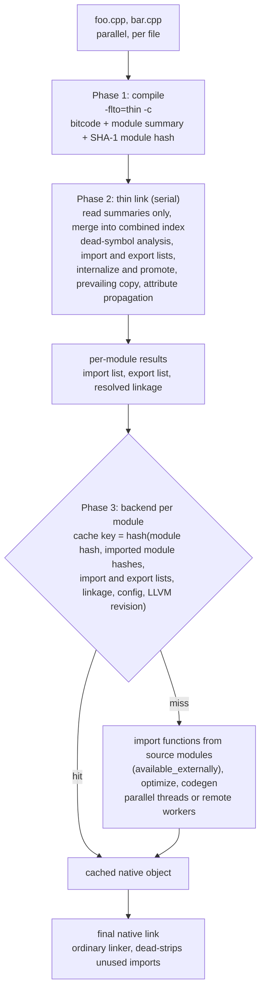

# Paper: ThinLTO: Scalable and Incremental LTO (Johnson et al. 2017)

> [!summary] Scope
> Owns the CGO 2017 compiler paper by Teresa Johnson, Mehdi Amini, and Xinliang David Li on scalable whole-program optimization in LLVM.
> Dissects the limitations of monolithic Link-Time Optimization, the construction of compact module summary indexes, global whole-program analysis, and parallel backend function importing with module-granular caching.
> Hands the PGO, AutoFDO, and BOLT workflow to [[Cpp-PGO-AutoFDO-and-BOLT-Workflow]], the linker mechanics to [[Linkers-LTO-PGO-AutoFDO-and-BOLT]], and the build-system view of rebuild decisions to [[Build-System-Theory-Schedulers-and-Rebuilders]].

> [!summary] Claim:
> Monolithic LTO is slow and memory-hungry because it merges every module's IR into one LLVM module and runs interprocedural analysis serially over it.
> ThinLTO splits whole-program optimization into an analysis that runs only over a compact per-module summary (the "thin link", the only serial step) and a transformation that runs later in fully parallel per-module backends, where "function importing" pulls just the callees worth inlining into each module.
> Because each backend's input is its own bitcode, an import list, and a few summary-derived results, a hash of those inputs is a complete cache key, so the final binary is identical whether the build was incremental or clean.
> The price is less internalization, module-granular (not function-granular) invalidation, optimization decisions limited to what the summary records, and large debug-info overhead from importing.



## Bibliographic Metadata

- Title: ThinLTO: Scalable and Incremental LTO.
- Authors: Teresa Johnson (Google), Mehdi Amini (Apple), Xinliang David Li (Google); affiliations as printed on the paper.
- Venue: 2017 IEEE/ACM International Symposium on Code Generation and Optimization (CGO), Austin, Texas, USA; IEEE Press, pages 111-121, 2017.
- DOI: https://doi.org/10.1109/CGO.2017.7863733.
- Free copy: the author PDF linked from the Google Research publication page, `https://storage.googleapis.com/gweb-research2023-media/pubtools/4743.pdf` (an 11-page PDF, printed pages 111-121, per `pdfinfo` on the copy fetched 2026-11-26).
- Precursor: the LLVM project blog post of 2016-06-21 by the same three authors, which reports the same design against Clang 3.9 and is easier to read than the paper.
- Earlier public introduction: the paper's own blog post says ThinLTO "was first introduced at EuroLLVM in 2015" with a prototype, then reviewed through several RFCs before landing in LLVM.
- Implementation evaluated: Clang/LLVM "v4.0" development sources and GCC "v7.0" development sources, both built from August 2016 upstream (paper Section 8).

## The Core Problem

The paper's introduction frames cross-module optimization (CMO) as the way to extend interprocedural optimization (IPO), above all inlining, across translation-unit boundaries.
A compiler normally sees one translation unit, so a callee defined in another `.c` or `.cpp` file can never be inlined.
Whole-program analysis (WPA) enlarges the scope, but the paper names the cost: memory to hold the IR and analysis data of many modules at once, and build time that grows because modules are no longer compiled independently and "some algorithms scale non-linearly with the increased scope".

Four existing approaches define the baseline the authors argue against:

| Approach | How it works | Limitation the paper cites |
| :--- | :--- | :--- |
| LLVM monolithic LTO | The linker plugin loads every bitcode file and merges them into one module; IPA and IPO run serially on it; only code generation can be split into chunks afterward. | Large memory (all IR resident), slow, and worse with `-g` (the paper: "particularly true with debug information"); any changed input forces the whole serial step again, so incremental builds are ineffective. |
| GCC WHOPR | Serial WPA over summaries read from the IR, then partitions of the call graph are optimized in parallel (LTRANS). | The serial step "requires additional extensive I/O ... to clone function bodies across partition boundaries"; in the paper's measurements GCC's WPA could not complete on the largest application. |
| LIPO (Google GCC branch) | Uses the FDO training run to build a dynamic call graph, assigns each module a set of auxiliary modules, and includes them at parse time in the profile-use build. | Requires profiling, needs frontend changes, coarse module-granular grouping with memory overhead, no cross-language CMO. |
| HP-UX/SYZYGY and Open64 IPA | Summary-based IPO decisions, but the IR is rewritten several times before backends parallelize. | Serial inlining and repeated IR rewrites. |

The paper also notes that Microsoft Visual Studio 2015 advertised incremental LTO, but concludes from "the very limited information available" that it patches the binary with updated functions and that "the results are not the same as with a clean rebuild".
That sentence is the origin of ThinLTO's determinism requirement: incremental and clean builds must produce the same binary.

The common failure is a serial IPA/IPO step that is both memory-intensive and slow, so LTO could not be the default for large applications or on small workstations.

## Key Innovation

Three decisions, each stated in the paper, make the design:

1. **Split every CMO into analysis and transformation.**
   The analysis runs in the thin link over the reference and call graph recorded in summaries, with no IR parsed or written.
   The transformation applies the recorded decision to the IR inside a parallel backend.
   The paper calls this split "key for ThinLTO high-scalability".
2. **Function importing instead of module merging.**
   Each backend imports only the external functions "deemed likely to be inlined", chosen by a size threshold that decays along call chains.
   This is finer than LIPO's module groups or WHOPR's graph partitions, which keeps per-backend memory low and parallelism high.
3. **Make a backend's input closed and hashable.**
   The backend's result depends only on its module bitcode, the bitcode of modules it imports from, and a small set of thin-link results, so one hash covers it.
   That yields a cache that is correct by construction rather than a heuristic.

The authors also design the summary to be "separately loaded without any expensive construction", meaning it can be read without an `LLVMContext` or parsing IR.
Because the summary is produced in the middle end, the frontend only passes options through, and ThinLTO "supports cross-language CMO, since it operates exclusively on IR".

## Mechanism Details

This section follows the paper and then states, for each mechanism, what LLVM 23.1.6 does (as of 2026-11, Both), because the code has moved on in places.

### 1. Phase 1: compile with a module summary

`clang -flto=thin -c` emits bitcode and, in a new bitcode block, a module summary.
Per the paper (Section 2.1), each global variable and function has a summary entry.
A function entry holds the linkage type, the instruction count, optional PGO information, and flags.
Every reference (address taken, load or store) and call (direct targets, plus indirect targets discovered from value profile data) is recorded.
Calls can carry a PGO hotness.

In LLVM 23.1.6 the record is `FunctionSummary` (`ModuleSummaryIndex.h`), built by `computeFunctionSummary` in `ModuleSummaryAnalysis.cpp`:

- `InstCount` counts every instruction except debug and pseudo instructions (`I.isDebugOrPseudoInst()` is skipped), so `-g` does not change the size used for import decisions.
- `FFlags` carries `ReadNone`, `ReadOnly`, `NoRecurse`, `ReturnDoesNotAlias`, `NoInline`, `AlwaysInline`, `NoUnwind`, `MayThrow`, `HasUnknownCall`, and `MustBeUnreachable`.
- Reference edges are split into plain references, non-volatile load references, and non-volatile store references, which is what later lets a global variable be proven read-only or write-only across the whole program.
- A function summary has `notEligibleToImport` set when importing it would be unsafe, for example when it references a local value that cannot be promoted (`CantBePromoted`), has a basic block whose address is taken by anything other than a `callbr` (`HasIndirBranchToBlockAddress`, an indirect-branch target that inlining could break), or contains inline assembly that might reference an internal symbol.
- A module compiled as regular LTO (module flag `ThinLTO` = 0) still gets a summary, but `IsThinLTO` is false and every summary is marked `notEligibleToImport`, so it participates in dead-stripping but never in importing.

The summary is stored in its own bitcode block.
`LLVMBitCodes.h` defines `GLOBALVAL_SUMMARY_BLOCK_ID` for per-module summaries and `FULL_LTO_GLOBALVAL_SUMMARY_BLOCK_ID` for the regular-LTO flavor; per-module records are `FS_PERMODULE`, `FS_PERMODULE_PROFILE`, and relatives, and combined-index records are `FS_COMBINED` and relatives.

The paper (Section 7.1.1) adds a second requirement for incrementality: "a hash of the serialized bitcode is computed on the fly and the resulting SHA1 identifier is recorded in the file".
In code this is `ModuleBitcodeWriter::writeModuleHash`, which feeds the serialized buffer into a SHA-1 hasher and emits `MODULE_CODE_HASH` as five 32-bit words (`ModuleHash = std::array<uint32_t, 5>`).
Because the hash covers the serialized bytes, anything in the bitcode (debug-info paths, `source_filename`, profile annotations) feeds it; this is the root of most "why does the cache never hit" reports (see the debug-this question below).

Two identifiers must be stable across independent processes, so the paper defines them carefully:

| Identifier | Paper (Section 7.1.2) | LLVM 23.1.6 source |
| :--- | :--- | :--- |
| GUID | MD5 hash of an identifier formed from the symbol name, "with the source file path appended for local values" | `GlobalValue::getGUIDAssumingExternalLinkage` returns `MD5Hash(identifier)`, a 64-bit value; `getGlobalIdentifier` builds the identifier by prepending `source_filename` and the delimiter `;` for local-linkage symbols (the delimiter constant `GlobalIdentifierDelimiter` is `';'`). |
| GUID storage | Computed from names. | Assigned once by `AssignGUIDPass` and stored as metadata (`MD_unique_id`), so it survives renaming; `llvm-dis` shows it as `!guid !N` on each definition in the local run below. |
| Promoted local name | Original name plus the SHA-1 of the source module's IR file (Section 4.1). | `ModuleSummaryIndex::getGlobalNameForLocal` appends `.llvm.` plus the first 64 bits of the module hash printed as a decimal integer. An option `-use-source-filename-for-promoted-locals` swaps in the sanitized source file name instead. |

The reason for the hash in the promoted name is a distributed-systems constraint, stated in Section 4.1: the same promoted symbol must be renamed identically in the exporting backend and in every importing backend, none of which share memory.
A name derived from the module hash recorded in the combined index satisfies that.

### 2. Phase 2: the thin link

The thin link "starts by reading just the summary sections from the IR files, and simply aggregating them into a single combined summary index" (Section 2.2).
The combined index also carries a module path symbol table: for each symbol, the path of each IR file that defines it.
Weak and COMDAT symbols can have several summaries for one GUID.
Local symbols get a unique deterministic identifier in the index by appending the defining module path.

In LLVM, the serial portion is `LTO::run` followed by `LTO::runThinLTO` (`LTO.cpp`).
The order of work in `runThinLTO` at 23.1.6 is:

1. `computeDeadSymbolsWithConstProp` (called from `LTO::run`): mark live roots, then propagate liveness along reference and call edges, then (if optimization is on) `propagateAttributes` for read-only and write-only variables.
   Roots are symbols visible outside the summaries and prevailing, plus values in `llvm.used`, `llvm.compiler.used`, `llvm.global_ctors`, `llvm.global_dtors`, and `llvm.global.annotations`.
   This is the paper's Section 9 "global dead symbol stripping" idea, implemented.
2. Index-based whole-program devirtualization: `updateVCallVisibilityInIndex` then `runWholeProgramDevirtOnIndex`.
   This is the paper's Section 9 plan to "rebuild the full class hierarchy at link-time" for devirtualization and Control Flow Integrity, implemented on the index.
3. `ComputeCrossModuleImport`, but only when `Conf.OptLevel > 0`; at `-O0` there is no importing.
4. `thinLTOInternalizeAndPromoteInIndex`: any local symbol that some other module will reference is promoted; any non-exported external symbol is internalized (see section 5).
5. `thinLTOResolvePrevailingInIndex`: resolves weak and linkonce copies to one prevailing definition and records new linkage per module.
6. `thinLTOPropagateFunctionAttrs` and `generateParamAccessSummary`: propagate `readnone`-style facts and parameter access summaries across the combined call graph.

A memory detail worth knowing is a comment in `runThinLTO`: the global symbol resolutions are released "before computing cross module importing, which adds to peak memory via the computed import and export lists".
So at scale the thin link's peak memory is dominated by import and export lists, not the summary graph itself.

The thin link needs no IR, which is why the paper reports memory that "is not affected by debug information" and small even for a 1.9M-node graph (Section 8.2, below).

### 3. Function importing: the analysis half

The paper's rule (Section 4): traverse the merged call graph from each module's own functions, follow each call chain "until no profitable imports are found", and apply a size threshold that decays with depth.
Defaults in the evaluation: import callees with fewer than 100 summary instructions, decay factor 0.7 per level (so first-level imported functions' callees are limited to 70, then 49, and so on), and for call edges marked hot by PGO a limit of 300 with decay 1.0.

LLVM 23.1.6 implements this in `ModuleImportsManager::computeImportForModule` and `computeImportForFunction`:

- Entry thresholds are hidden `cl::opt` options: `import-instr-limit` = 100, `import-instr-evolution-factor` = 0.7, `import-hot-evolution-factor` = 1.0, `import-hot-multiplier` = 10.0, `import-critical-multiplier` = 100.0, `import-cold-multiplier` = 0.
- A callee's effective threshold is `Threshold * multiplier(hotness)`.
  For a hot call site that is `100 * 10.0 = 1000`, not the paper's 300 (as of 2026-11; the paper's number describes the 2016 implementation).
  A cold call site gets `0`, so only `AlwaysInline` callees are imported across cold edges.
- The worklist is a stack: `Worklist.pop_back_val()` makes the traversal depth-first, as the source comment says.
  A callee reached a second time with a strictly higher threshold is re-queued so its own callees get the higher threshold; otherwise it is skipped.
- `selectCallee` picks among the candidate definitions of a GUID.
  It first filters by `qualifyCalleeCandidates`: the symbol must be live, must not have interposable linkage (so `weak` and `linkonce_any` definitions are never imported, only ODR variants), must be a function, must not be a same-named local from another module, and must not be `notEligibleToImport`.
  Then it rejects functions over the threshold unless they are `AlwaysInline`, and rejects `NoInline` functions.
  It returns the first candidate that fits; a source comment (`FIXME: select "best"`) says picking the best one is open.
- Chosen callees are added to the importing module's `ImportList` keyed by source module, and recorded in that source module's export list.
  After all import decisions are made, `ComputeCrossModuleImport` marks as exported everything those imported definitions call or reference that is defined in the exporting module.
  This is why "symbols referenced by imported functions will be marked exported" (paper Section 4) and why importing can force promotion of local symbols.
- Read-only and write-only global variables are imported by a separate `GlobalsImporter`, driven by the same traversal.
- Debugging aids, all hidden options: `-print-import-failures` (thin link: prints rejected candidates with a reason such as `TooLarge`, `NoInline`, `NotEligible`, `InterposableLinkage`, `LocalLinkageNotInModule`, `NotLive`, `GlobalVar`), `-print-imports` (backend: prints each imported function), `-import-cutoff=N`, `-force-import-all`, `-enable-import-metadata`.
- A `-thinlto-workload-def` option takes a JSON map from root functions to functions that must be imported into the root's module, a way to declare that, for example, the functions executed to serve one RPC request must be imported into the module defining the request's root function; it requires `-funique-internal-linkage-names`.

### 4. Function importing: the transformation half

In each backend, `FunctionImporter::importFunctions` runs very early so that inlining and IPO see the extended module (paper Section 4).
For each source module in the import list, the importer loads the source bitcode lazily, materializes only the chosen functions and variables, and links them in with `IRMover` after `renameModuleForThinLTO` promotes and renames locals.
Source modules are opened once per backend; the paper adds that "functions to be imported from each module are batched" and that each bitcode file carries an offset table so function bodies can be loaded individually.

The importing linkage rules are in `FunctionImportUtils.cpp`:

| Source linkage | Imported definition becomes | Why |
| :--- | :--- | :--- |
| `external`, `linkonce_odr` | `available_externally` | Available for inlining; "turned into declarations later during the EliminateAvailableExternally pass". |
| `weak_odr` | `available_externally` | All copies are equivalent, so importing is safe. |
| `internal` or `private`, when promoted | `available_externally` after promotion to a global with a renamed symbol | Needed because the importing module must name the local. |
| `linkonce_any`, `weak_any` | Not importable as a definition | Importing would change which definition the linker sees first. |
| `appending` | Never imported | Would run constructors or destructors more than once. |

So an imported function that is inlined everywhere costs nothing in the final object, and one that is not inlined is dropped before code generation.
The real cost is transient: the backend parses and optimizes extra IR and debug metadata.

### 5. Whole-program decisions recorded in the index

These are the other optimizations of the paper's Section 5, all following the analyze-in-thin-link, transform-in-backend pattern.

**Internalization (Section 5.1).**
Regular LTO can internalize any symbol not visible outside the merged module.
ThinLTO cannot, because modules stay separate and importing creates new cross-module references.
The thin link flags for internalization any global symbol referenced only from its defining module.
`thinLTOInternalizeAndPromoteGUID` in `LTO.cpp` does: if a symbol is in some export list and local, promote it (rename and make global); otherwise, if it has external linkage, make it internal; weak-for-linker values are internalized only when there is a single copy that is prevailing in IR.
The paper shows this matters more than importing for 473.astar (about 90% of its gain remains with importing disabled).
The text-size cost is recovered by linker dead-stripping: the paper reports ThinLTO text size "nearly the same" as regular LTO for Clang (Section 8.5).

**Weak symbol resolution (Section 5.2).**
The linker plugin tells the compiler which copy of a weak or COMDAT symbol prevails.
Non-prevailing copies are converted to `available_externally` (so they can be inlined and then dropped), and a prevailing `linkonce` symbol that has an exported reference is promoted to `weak` so it is retained.
`thinLTOFinalizeInModule` applies this per module; when a non-prevailing definition has interposable linkage it cannot become `available_externally` without losing the interposition property, so the definition is deleted instead (`convertToDeclaration`).

**Indirect call promotion (Section 5.3 and 7.2.2).**
PGO value-profile metadata on indirect calls (up to two frequent targets) is translated at compile time into extra call edges to the targets' GUIDs.
Because GUIDs are hashes of names, the transformation works only for targets present in the combined index; those edges look like direct calls, so they are imported by the normal mechanism, and the backend's promotion pass can then replace the indirect call with guarded direct calls and inline them.
The paper measures about 6% on 453.povray and about 5% on 483.xalancbmk from this.

**Attribute propagation (not in the paper's text, in LLVM now).**
The `FFlags` bits above are propagated across the combined call graph, and `thinLTOFinalizeInModule` applies `readnone`, `readonly`, `norecurse`, and `nounwind` to the module's functions in each backend.

### 6. Phase 3: backends, caching, and distribution

By default the linker "launches the ThinLTO threads in parallel from the linker process via a thread pool", so phases two and three look like one link step to the user (paper Section 2.3).
LLVM exposes the two modes as backend objects: `createInProcessThinBackend` (a thread pool in the linker process) and `createWriteIndexesThinBackend` (write index files and exit, for external orchestration).

**Scheduling.**
When more than one thread runs, `runThinLTO` sorts modules so the largest bitcode goes first, with a comment saying this "saves about 15 sec on a 36-core machine while link `clang.exe` (out of 100 sec)".
That is a source comment by the implementer, not a measurement made for this note.
`WriteIndexesThinBackend` instead processes modules in command-line order so the emitted list of linked objects keeps the original link order.

**The cache.**
The paper's scheme (Section 3): the module IR hash, combined with thin-link results, is the key; a hit returns the stored object, a miss compiles and commits it; "the final binary is the same whether an incremental build was involved or not".
The paper admits this is "relatively coarse grain, since it operates at the module level even if a single function is modified".

`computeLTOCacheKey` in `LTO.cpp` at 23.1.6 hashes, with SHA-1, in this order:

1. The LLVM version string and, when defined, the LLVM revision.
2. The code-generation configuration: CPU, `MAttrs`, relocation and code model, optimization levels, file type, `-mllvm` arguments, the optimization and alias-analysis pipeline strings, triples, `DwoDir`, `Freestanding`, `Dtlto`, and a few `Options` fields (`X86RelaxRelocations`, `FunctionSections`, `DataSections`, debugger tuning).
3. The module's own SHA-1 from the combined index.
4. The export list's GUIDs, sorted.
5. The import list, sorted by source-module hash (so module names and link order do not matter): for each source module, its hash and number of imports, then each imported GUID and whether it is a definition or declaration.
6. The resolved linkage for each ODR-resolved GUID.
7. For every global defined in this module, its linkage (so internalization and weak resolution change the key); for those globals and every imported summary: visibility, liveness, `canAutoHide`, `dsoLocal` of referenced and called values, read-only and write-only flags, type-test and CFI data, and the whole-program-devirtualization resolutions for type ids used.
8. The contents of the sample-profile file and its remapping file, if `Conf.SampleProfile` is set.

Two consequences follow directly from the source.
First, an importing module's key contains the hash of each module it imports from, not of the individual functions imported, so editing an unrelated function in a source module invalidates every backend that imports anything from it.
Second, the sample profile (AutoFDO) is part of the key, so refreshing the profile invalidates the whole cache; see [[Paper-AutoFDO-Warehouse-Scale-Optimization]].

`localCache` (`Caching.cpp`) stores each entry as a file named `llvmcache-<key>` in the cache directory.
A hit opens the file with `OF_UpdateAtime`, so access time drives pruning.
A miss writes to a temporary file named `<prefix>-%%%%%%.tmp.o`, then renames it into place; on POSIX the rename atomically replaces an existing entry, so concurrent linkers sharing a directory are safe.
If the module has no recorded hash (all five words zero) or the cache is off, the backend simply compiles.

The paper's invalidation rules for a backend, restated: redo it if (1) its module bitcode changed, (2) its import or export list changed, (3) the bitcode of any module it imports from changed, or (4) any global analysis result affecting it or its imports changed.
All four are present in the key above, which is why this scheme needs no dependency tracking.

**Distributed builds (Section 6).**
For remote execution the results of the thin link are serialized.
Instead of shipping the whole combined index, one file per module is written containing "the summaries for the module's own defined symbols as well [as] the functions it should import, along with a module path symbol table entry for each module being imported from".
For systems without a shared filesystem, a plain-text list of the bitcode files each backend imports from is emitted so the build system can stage them.
The LLVM blog post's example, written against Clang 3.9 era tools, is:

```sh
clang -flto=thin -O2 file1.c file2.c -c
clang -flto=thin -O2 file1.o file2.o -Wl,-plugin-opt,-thinlto-index-only
clang -O2 -o file1.native.o -x ir file1.o -c -fthinlto-index=./file1.o.thinlto.bc
clang -O2 -o file2.native.o -x ir file2.o -c -fthinlto-index=./file2.o.thinlto.bc
clang file1.native.o file2.native.o -o a.out
```

On LLD (as of 2026-11) the same flow uses `--thinlto-index-only` and `--thinlto-emit-imports-files`.
The paper's evaluation used experimental support in Bazel for this model.

**DTLTO (not in the paper).**
LLVM 23.1.6 documents Integrated Distributed ThinLTO: LLD itself writes each backend's index and a JSON job description and runs a user-supplied distributor program, so any build system that supports in-process ThinLTO can distribute its backends (`-fthinlto-distributor=` and `-Xthinlto-distributor=` in Clang, `--thinlto-distributor=` in ELF LLD).
Its documented limitations as of 2026-11 are: ELF and COFF only, a limited set of code-generation configurations, and no sharing of cache entries with in-process ThinLTO because "identical code generation is not yet guaranteed".

### 7. A local run, end to end

One ad hoc run on this host confirms the moving parts; it was run once by the drafter and once more during verification with the same output, and is not a harness-recorded lab (macOS arm64, Homebrew LLVM and LLD 23.1.6, `ld64.lld` selected by `-fuse-ld=lld`, as of 2026-11).
Sources:

```c
/* b.c */
static int bump(int x) { return x + 1; }
int small(int x) { return bump(x) * 2; }
int big_unused(int x) { return x; }
/* a.c */
int small(int x);
int main(int argc, char **argv) { (void)argv; return small(argc); }
```

Commands, using the Homebrew toolchain's `clang`, `llvm-nm`, and `llvm-dis`:

```sh
clang -flto=thin -O2 -c a.c b.c
clang -flto=thin -O2 a.o b.o -o a.out -fuse-ld=lld \
      -Wl,--thinlto-index-only -Wl,--thinlto-emit-imports-files
clang -O2 -c -x ir a.o -fthinlto-index=a.o.thinlto.bc -o a.native.o
clang -O2 -c -x ir b.o -fthinlto-index=b.o.thinlto.bc -o b.native.o
clang a.native.o b.native.o -o a.out && ./a.out; echo exit=$?
llvm-nm a.native.o b.native.o
```

Observed:

- `a.o.imports` contained the single line `b.o`, and `b.o.imports` was empty: `main` in `a.o` imports `small` from `b.o`, and `b.o` imports nothing.
- `a.o.thinlto.bc` is an individual index with only the two module entries (path and five-word hash) and summaries for `main` and `small`; the combined summary entries print `guid: <number>` rather than names, as in `guid: 15822663052811949562` for `main`.
- In `b.o.thinlto.bc`, the entry for `big_unused` (GUID 1603968770460869906, the value `llvm-dis` shows as its `!guid` in `b.o`) appeared with `linkage: internal` and `live: 0`: the thin link had found it dead and internalized it.
- Running the result printed `exit=4`, which is `small(1) = (1 + 1) * 2`.
- `llvm-nm` listed `_main` as the only defined global in `a.native.o` and `_small` as the only one in `b.native.o`: the static helper `bump` was already inlined into `small` in phase 1 (`b.o` has no `bump` definition or summary), `small` was then imported and inlined into `main`, and `big_unused` was removed from `b.native.o`.
- Re-running the thin link with `-Wl,-mllvm,-import-instr-limit=1 -Wl,-mllvm,-print-import-failures` printed `2027026276230061291 (small): Reason = TooLarge, Threshold = 1, Size = 3, MaxHotness = unknown, Attempts = 1` under "Missed imports into module a.o", and `a.o.imports` became empty: the summary says `small` has 3 instructions, over a threshold of 1.
  Rebuilding the backends from that index still printed `exit=4`, but `llvm-nm a.native.o` now lists `U _small` and `main` disassembles to a single tail branch to `small`.
- Marking `small` `__attribute__((noinline))` and re-running the thin link at the default limit printed `Reason = NoInline, Threshold = 100, Size = 3` and left `a.o.imports` empty.

That last check is a falsifiable test of the mechanism: the import decision is a pure function of summary instruction counts and thresholds, and lowering the threshold removed the import without touching any IR.

## Evaluation and Limitations

### What the paper measured

Setup (Section 8): Clang/LLVM v4.0 and GCC v7.0 from August 2016 sources.
Runtime on C/C++ SPEC cpu2006 on an 8-core 2.6GHz Xeon E5-2689; each benchmark run five times, reporting the mean of three after discarding the highest and lowest.
Build time and memory on a 16-core (32 logical) 2.9GHz Xeon E5-2690 with 64GB of memory, Linux, gold linker; memory is the peak of resident set size minus shared memory as reported by the kernel.
Importing defaults: callees under 100 instructions, decay 0.7, and 300 with decay 1.0 on hot edges.

| Result | Value (paper) | Notes |
| :--- | :--- | :--- |
| Runtime vs LTO on SPEC cpu2006 | ThinLTO "in many cases matching" LTO, and sometimes better | Better cases are attributed to LTO needing a less aggressive optimization pipeline for scalability. |
| Cross-module indirect call promotion with PGO | about 6% on 453.povray, about 5% on 483.xalancbmk | From importing profiled indirect call targets. |
| Importing threshold sensitivity | Doubling the limit 100 to 200: about 2% on 447.dealII and 483.xalancbmk, others similar. Halving to 50: 5% worse on 453.povray and 6.7% worse on 433.milc | Default thresholds enable "most of the available benefit". |
| Gain with importing disabled | Most of the gain is lost, except 473.astar keeps about 90% | Attributed to internalization found in the thin link. |
| Clang binary built with ThinLTO | 5-8% faster than a non-LTO Clang, "very similar" to a regular-LTO Clang | |
| IR size growth from summaries | 0.8% for Clang at `-g0` (less with `-g`) | |
| Thin link graph, Clang | 169k nodes, 414k edges | Table 2. |
| Thin link graph, Chromium | 858k nodes, 2,403k edges | Table 2. |
| Thin link graph, Ad Delivery (internal Google datacenter application) | 1,953k nodes, 4,856k edges | Table 2. |
| Ad Delivery full link | 1m42s thin link plus 5m43s backends, peak 3.6GB | Only ThinLTO completed; LLVM LTO had not finished after 2 hours and GCC could not finish its serial WPA step. |
| Imports per module (Table 1) | 400.perlbench averages 52.38 imported functions per module (max 108); 403.gcc averages 50.51 (max 329) | Most modules import from fewer than 10 other modules, a few from about 50. |
| Debug binary size, Clang | 622MB LTO, 2429MB ThinLTO, 1335MB with a prototype fix, 1203MB non-LTO | The paper attributes the gap to "known weaknesses in handling of imported LLVM debug metadata types". |

The incremental-build experiment (Figure 7, values shown only in a chart that this note does not transcribe) compares three Clang situations: a clean build, an edit to "a frequently referenced function in a widely used header", and an edit to "an infrequently called function in an implementation file"; the 2016 blog post names the same two edits as `DenseMap::grow()` and `visitCallInst()` in `InstCombineCalls.cpp`.
The paper's conclusion is that ThinLTO's incremental link time is "very close to a non-LTO build" with a warm cache, and can even be faster because a header edit that does not change the IR of an including module leaves that module's hash and cache entry intact.
The distributed experiment (Figure 8) shows ThinLTO benefiting from distribution as much as a non-LTO build, with Amdahl's law visible between 200 and 500 nodes where the critical path is reached.

### Limitations, from the paper and from the code

- **Less internalization.** Modules stay separate, so some symbols stay externally visible; the dead-stripping linker must compensate (Section 5.1, 8.5).
- **Debug info.** Importing duplicates debug metadata; "ThinLTO is still somewhat slower than a non-LTO build" with full debug info (blog) and debug binaries were several times larger than LTO at the time (Section 8.5).
- **Module-granular cache.** One changed byte invalidates the module and every module that imports from it (Section 3; confirmed by the key construction above).
  The paper lists finer-grained dependency tracking on the call graph as future work and expects overhead trade-offs.
- **Analysis is limited to what the summary records.** Optimizations that need function bodies (the paper's example is interprocedural constant propagation) require new summary data first (Section 9).
- **Serial thin link remains serial.** It reads all summaries and computes import lists for every module, so it is the Amdahl term for very large programs.
- **No IR means no thin-link-time inlining.** Importing only sets up inlining; the inliner decides later with a different cost model, so many imports are never inlined (Table 1 shows 22% to 86% of imported functions inlined, depending on the benchmark).
- **Interposable definitions.** `weak_any` and `linkonce_any` definitions are not imported at all (see the linkage table above), so code written with such linkage sees less cross-module inlining than ODR-linkage code.
- **Single-machine measurements.** The numbers are from one 2016 evaluation on specific hardware, a pre-release compiler, and a Google-internal application that no reader can reproduce; treat the ratios as shape, not as current performance.
- **The paper's claim "enabled by default".** The conclusion calls ThinLTO "a good candidate to be enabled by default and replace the standard non-LTO flow"; as of 2026-11, the Clang documentation presents it as opt-in through `-flto=thin`; this note did not check any build-system defaults.

## Industry Impact

- **Toolchain support (Clang documentation, as of 2026-11).**
  ThinLTO ships in Clang since 3.9.
  Linkers: gold through its plugin, `ld64` from Xcode 8, and LLD from r284050 for ELF and r298942 for COFF.
  Cache flags arrived per linker: gold in LLVM 4.0, `ld64` with Clang 3.9, ELF LLD in LLVM 5.0, COFF LLD in LLVM 6.0, Mach-O `ld64.lld` in LLVM 15.0.
- **Rust.** `-C lto=thin` selects ThinLTO across crates, and when `-C lto` is not given rustc performs "thin local LTO" across a crate's codegen units, disabled when `codegen-units=1` or `opt-level=0` (rustc book, as of 2026-11).
  Rust's own documentation says ThinLTO "can even result in better performance than fat LTO" for large projects such as the Rust compiler.
- **Linux kernel.** `arch/Kconfig` on master defines `LTO_CLANG_THIN` ("Clang ThinLTO (EXPERIMENTAL)", "If unsure, say Y") and `LTO_CLANG_THIN_DIST`, a distributed mode where "the linker performs the thin-link" and the build system invokes the backends explicitly, producing `.thinlto-native.o` objects (fetched 2026-11-26).
- **LLVM itself.** The Clang documentation gives `-DLLVM_ENABLE_LTO=Thin` as the way to bootstrap Clang/LLVM with ThinLTO.
- **Profile-guided stacks.** ThinLTO consumes profile data at both ends: PGO hotness on summary edges steers importing, and `--lto-sample-profile` (AutoFDO, see [[Paper-AutoFDO-Warehouse-Scale-Optimization]]) is hashed into the cache key.
  The DTLTO JSON example in the LLVM docs even passes `-fprofile-sample-use` as a common compiler argument.
  Post-link layout then runs on the ThinLTO output; see [[Paper-BOLT-Binary-Optimizer]].
- **GCC.** GCC's LTO manual describes WHOPR (LGEN, WPA, LTRANS) and its current option reference lists `-flto-partition=` (default `balanced`) and `-flto-incremental=<path>`, a cache of the output of translation units inside LTO.
  The internals manual says "distributed compilation is not implemented yet" (as of 2026-11, Both).
  GCC's design shares the analyze-then-transform split but partitions the call graph rather than importing individual functions.
- **Chromium.** The paper evaluates Chromium, and Chromium's `build/config/compiler/compiler.gni` (main, fetched 2026-11-26) declares `use_thin_lto` as true for CFI builds and for official Clang builds on Linux, Windows, Apple with lld, Android (not ChromeOS-on-Android), and ChromeOS devices, except the first PGO phase; it asserts that CFI requires ThinLTO and warns that ThinLTO does not work with `is_debug=true`.
  Adoption by the Android platform (AOSP) itself was not checked, and this note makes no claim about it.

## Commands and Numbers to Know

All rows are for LLVM and LLD 23.1.6 documentation and sources unless noted (as of 2026-11).

| Concern | Value | Platform |
| :--- | :--- | :--- |
| Enable ThinLTO | `-flto=thin` at both compile and link (with `lld-link`, only the compile step) | Both |
| Backend threads | default: as many as cores; `N=0` one per physical core, `1` disable threading, `all` one per logical core | Both |
| Set backend threads | gold `-Wl,-plugin-opt,jobs=N`; ld64 `-Wl,-mllvm,-threads=N`; ld.lld and ld64.lld `-Wl,--thinlto-jobs=N`; lld-link `/opt:lldltojobs=N`; Clang driver `-flto-jobs=N` | Both |
| Cache directory | gold `-Wl,-plugin-opt,cache-dir=<d>`; ld64 and Mach-O ld64.lld `-Wl,-cache_path_lto,<d>`; ELF ld.lld `-Wl,--thinlto-cache-dir=<d>`; COFF `/lldltocache:<d>` | Both |
| Cache policy flag | gold `-Wl,-plugin-opt,cache-policy=<p>`; ELF ld.lld and Mach-O ld64.lld `-Wl,--thinlto-cache-policy=<p>`; lld-link `/lldltocachepolicy:<p>` | Both |
| Cache policy defaults | `prune_interval` 20 minutes, `prune_after` 1 week, `cache_size` 75% of available disk, `cache_size_files` 1,000,000, no byte limit | Both |
| Cache entry name | `llvmcache-<hex SHA-1 key>` in the cache directory | Both |
| Distributed, index only | ld.lld `--thinlto-index-only` and `--thinlto-emit-imports-files` (gold: `-Wl,-plugin-opt,thinlto-index-only`); then `clang -c -x ir <f>.o -fthinlto-index=<f>.o.thinlto.bc` | Both |
| DTLTO | Clang `-fthinlto-distributor=<path>`; ELF LLD `--thinlto-distributor=`, `--thinlto-remote-compiler=`; ELF and COFF only | Linux and Windows targets; not Mach-O |
| Import threshold (hidden) | `-mllvm -import-instr-limit=100`; evolution factor 0.7; hot factor 1.0; hot multiplier 10.0; critical multiplier 100.0; cold multiplier 0 | Both |
| Import diagnostics (hidden) | `-print-import-failures` (thin link), `-print-imports` (backend), `-import-cutoff=N`, `-force-import-all` | Both |
| Single-module debugging | ld.lld `--thinlto-single-module=<path>`, "for debugging only" | Linux |
| Promoted local suffix | `<name>.llvm.<decimal of first 64 bits of module hash>` | Both |
| Module hash | SHA-1 of serialized bitcode, 160 bits, `MODULE_CODE_HASH` | Both |
| GUID | 64-bit MD5-derived hash of the global identifier | Both |
| Paper: Ad Delivery thin link | 1m42s, backends 5m43s, peak 3.6GB (paper, 2016, 16-core Xeon E5-2690) | Linux |
| Paper: Clang runtime gain | 5-8% over non-LTO (paper, 2016) | Linux |

## Multi-Language Comparison

| Toolchain | How whole-program optimization is split | Incrementality and parallelism |
| :--- | :--- | :--- |
| C and C++ with Clang and LLD, gold, or ld64 | `-flto=thin`: summaries, thin link, importing backends | `--thinlto-cache-dir` module-granular cache; threads in the linker, or index-only and DTLTO for remote workers |
| C and C++ with GCC | `-flto=auto`: LGEN, WPA (serial), LTRANS partitions; `-flto-partition=balanced` by default | Partitions run in parallel through a job server; `-flto-incremental=<path>` caches translation-unit output; distribution is described as not implemented |
| Rust with rustc | `-C lto=thin` across crates; thin local LTO across codegen units when `-C lto` is unspecified | The same LLVM ThinLTO machinery; local LTO disabled at `codegen-units=1` or `opt-level=0`; `-C linker-plugin-lto` for cross-language LTO with a linker that supports it |
| Python | Not applicable to the language; only the interpreter and C extensions are built this way, using their compiler's LTO flags | Whatever the C compiler's LTO mode provides |

Ownership of the neighbors: [[Cargo-Build-Graph-and-Rustc-Pipelining]] owns Rust build structure, and [[Compiler-Caches-ccache-and-sccache]] owns compile-level caches, which are separate from the ThinLTO backend cache described here (a compiler cache keyed on preprocessed source cannot see the thin link's import decisions).

## Pitfalls

> [!warning] Pitfall: ThinLTO is not "LTO but faster", it optimizes less in specific ways
> Full LTO internalizes against the whole program and can see every definition; ThinLTO internalizes only what the index proves is unreferenced outside a module and imports only small callees.
> If a hot path crosses modules through a function larger than the threshold (100 instructions at the default, 1000 on a hot edge with profile data), it will not be inlined across the boundary.
> Use `-Wl,-mllvm,-print-import-failures` to see the `TooLarge` rejections before assuming the optimizer is at fault.

> [!warning] Pitfall: cache that never hits
> The module hash covers every serialized byte, and the cache key covers the LLVM revision and `-mllvm` arguments.
> Absolute paths in debug info, a different checkout directory in `source_filename`, an embedded timestamp, or a different compiler build all produce new keys.
> Different `-mllvm` flags between developers also split the cache.

> [!warning] Pitfall: reading the 100-instruction threshold as the whole story
> The effective threshold depends on call-site hotness: 10 times the base for hot edges and 0 for cold edges in the 23.1.6 source, plus a 0.7 decay per level of call depth.
> The paper's 300 for hot edges is an older value; do not copy it into tuning notes.

> [!warning] Pitfall: expecting weak or `linkonce_any` code to be inlined across modules
> The importer refuses interposable definitions, so only ODR linkage (`linkonce_odr`, `weak_odr`) participates.
> A header-only library written with non-ODR weak symbols will show `InterposableLinkage` failures.

> [!warning] Pitfall: mixing DTLTO and in-process caches
> The LLVM documentation says in-process ThinLTO cache entries are not shared with DTLTO because identical code generation is not guaranteed.
> A CI that switches between the two modes will pay a full rebuild at the switch.

> [!warning] Pitfall: `-O0` and importing
> `ComputeCrossModuleImport` runs only when the LTO optimization level is above zero, so a debug configuration built with `-flto=thin -O0` gets no cross-module inlining, only summary-based decisions that do not need imports.

> [!warning] Pitfall: summary-based DCE can remove what only a non-IR object references
> Liveness roots come from symbols the linker reports as visible outside the summaries and prevailing (`GUIDPreservedSymbols` in `LTO::run`).
> A symbol reached only at runtime, for example through `dlsym` or a later-loaded plugin, is removable unless the link marks it as exported.
> In ELF ld.lld (`lld/ELF/LTO.cpp`, 23.1.6) a bitcode symbol is preserved when `VisibleToRegularObj` is set: it is used from a regular object, referenced after `--wrap`, a `__start_`/`__stop_` section symbol, any symbol in a `-r` link, or prevailing and marked `isExported` for the dynamic symbol table; `isExported` is set for defined non-local symbols by `--export-dynamic` (`Driver.cpp`), for symbols matched by `--dynamic-list` or `--export-dynamic-symbol` (`SymbolTable::handleDynamicList`), and for symbols that resolve against a shared library (`Symbol::resolve` of a `SharedSymbol`), so a `dlsym` target survives summary DCE under ld.lld only if one of those applies or a regular object references it.
> This note makes no claim about the equivalent rules in gold or ld64.
> See [[Cpp-ODR-Violations-Static-Init-and-Linker-Template-Errors]] for the related ODR and linkage failures.

## At Scale

The paper's own scale story is a single 1.9M-node, 4.9M-edge Google application: the serial phase took 1m42s with 3.6GB peak while regular LTO could not finish.
Beyond that, the operational questions are about caching and orchestration rather than the algorithm.

Decision rules:

1. **One developer or a small team.** Use in-process ThinLTO with a persistent `--thinlto-cache-dir`; the defaults (75% of free disk, one week) are reasonable on a workstation, but set `cache_size_bytes` on shared CI hosts so the cache cannot fill a build volume.
2. **A CI fleet with many identical builds.** Pin the compiler build (the key includes the LLVM revision, so a nightly compiler gives a different key namespace) and normalize paths and `-mllvm` arguments so keys match across machines; see [[Hermetic-and-Reproducible-Builds]].
3. **A large monorepo with a remote-execution build system.** Use either the index-only flow with the build system modeling each backend as an action, or DTLTO if your build system only knows how to run the link as one action.
   The first gives the build system per-backend cache visibility (see [[Bazel-Skyframe-Bzlmod-and-Execution-Model]] and [[Buck2-DICE-Starlark-and-BXL]]); the second keeps the build graph simple but, as of 2026-11, is limited to ELF and COFF and a narrower set of code-generation options.
4. **Cache misses at scale.** Debug misses by comparing per-module hashes and import lists between two builds.
   [[Diagnose-Bazel-and-Buck2-Cache-Misses]] describes the general method for build-system caches.
   In the Linux kernel's distributed mode the backend outputs are visible as `.thinlto-native.o` files, which makes this inspection direct.
5. **Where time goes.** The thin link is Amdahl's serial term; if it dominates, reduce the number of modules or edges.
   If backends dominate, the lever is parallelism or the import thresholds, and the paper's data says halving the threshold costs real performance on some programs, so tune with measurements, not by guessing.
   Use [[Cpp-Compile-Time-Profiling-ftime-trace-and-ClangBuildAnalyzer]] and the linker's `--time-trace` to see which phase is slow.
6. **Profile refresh cost.** Because the AutoFDO sample profile is hashed into every module's key, a profile refresh is a full backend rebuild; schedule it with the release cadence, not per commit.

Costs and trade-offs to name explicitly: ThinLTO trades some optimization quality versus full LTO for scalability; the cache trades disk for time; DTLTO trades build-system simplicity for a narrower feature set.
Build economics in general belong to [[Build-Performance-Economics-and-Decision-Record]].

## Practice Drill

> [!tip] Practice Drill: Break the import decision on purpose
> Build two C files as in the local run above, where `main` calls a small function in another file.
> Run the thin link with `--thinlto-index-only --thinlto-emit-imports-files`, then check which files appear in `a.o.imports`.
> Re-run with `-Wl,-mllvm,-import-instr-limit=1 -Wl,-mllvm,-print-import-failures` and confirm the import disappears and a `TooLarge` line names the function.
> Mark the callee `__attribute__((noinline))` and check that the reason changes to `NoInline` at the default limit (it did in the verification run: `Reason = NoInline, Threshold = 100, Size = 3`).
> Finally add a cache directory (`-Wl,--thinlto-cache-dir=./cache` for ELF ld.lld, `-Wl,-cache_path_lto,./cache` for Mach-O ld64.lld), touch only a comment in `b.c`, rebuild, and decide by listing the `llvmcache-*` files whether `a.o` hit the cache.
> Measured once on macOS arm64 with Homebrew clang and ld64.lld 23.1.6 (as of 2026-11, without `-g`, `-O2 -flto=thin`): the first link created two `llvmcache-*` entries (one per module) plus `llvmcache.timestamp`; appending a comment to `b.c` and relinking created no new entry, so both backends hit the cache; appending `int extra(void){return 7;}` to `b.c` created two new entries, because `b.o` changed and `a.o`'s key includes the hash of the module it imports from.
> The `-g` case was not run.

## Interview Questions

> [!question] L5: In one paragraph, what are the three ThinLTO phases and which one is serial?
>
> > [!success]- Answer
> > Phase one compiles each source file to bitcode plus a compact module summary and a hash, in parallel.
> > Phase two, the thin link, reads only the summaries, merges them into a combined index, and runs the whole-program analyses (liveness, import and export lists, internalization and promotion, weak symbol resolution); it is the only serial phase.
> > Phase three runs one backend per module in parallel, each importing the functions chosen for it, optimizing, and emitting a native object, after which an ordinary native link finishes.
> > The key design rule is that analysis uses summaries only, while all IR transformation happens in the backends.

> [!question] L5: Why does ThinLTO use less memory than monolithic LTO, and where does it still use a lot?
>
> > [!success]- Answer
> > Monolithic LTO holds all IR in one module, plus debug info, while ThinLTO's serial step holds only summaries and no IR, so the paper reports the thin link memory is not affected by debug information.
> > Each backend holds one module plus the imported functions, which is small when the import threshold is respected.
> > Memory still grows in the thin link with the import and export lists (a source comment releases the global resolutions before importing for this reason) and in backends that import from many modules with large debug-metadata footprints.

> [!question] L6: Predict the output of the index-only ThinLTO flow from the local run above.
>
> `a.c` has `main` calling `small()` from `b.c`, which also defines an unused `big_unused()`.
> You run the index-only thin link and then the two backends.
> What does `a.o.imports` contain, what does `llvm-nm` show for each native object, and what exit code does `main(argc = 1)` return with `small(x) = (x + 1) * 2`?
>
> > [!success]- Answer
> > `a.o.imports` contains `b.o` and `b.o.imports` is empty.
> > `a.native.o` defines only `main` because `small` was imported as `available_externally` and inlined; `b.native.o` still defines `small` (it was exported to satisfy the import) but not `big_unused`, which the thin link found dead and internalized.
> > The program returns 4.
> > This is the output observed in the local run above on macOS arm64 with LLVM 23.1.6; if the threshold is lowered to 1, `small` (3 instructions) is rejected as `TooLarge`, `a.o.imports` is empty, and the program still returns 4, only through a real call instead of an inlined body (observed: `llvm-nm` shows `U _small` in `a.native.o`).

> [!question] L6: Debug this: the ThinLTO cache never hits.
>
> After enabling `-Wl,--thinlto-cache-dir=$HOME/.cache/thinlto`, every incremental link still recompiles every backend, although you changed one `.cpp`.
> Name the checks you would make, in order.
>
> > [!success]- Answer
> > First, confirm the cache is being used at all: look for `llvmcache-*` files, check that `--thinlto-cache-policy` is not pruning aggressively (default interval 20 minutes, expiry one week), and check that modules have a nonzero hash (a zero hash disables caching for the module).
> > Second, test whether the per-module hashes are stable between two builds of identical sources: the hash covers the serialized bitcode, so absolute paths in debug info, `source_filename`, or timestamps produce a new hash on every compile and invalidate that module and everything that imports from it.
> > Third, check that the key's other inputs are constant: the compiler build (the key includes the LLVM revision), `-mllvm` arguments, `-march` and CPU, optimization pipeline, and sample-profile file contents.
> > Fourth, remember the expected blast radius: editing a widely imported module legitimately invalidates every backend that imports from it, because the key contains the whole source-module hash, not per-function hashes.
> > If the first three are clean, the remaining misses are by design, and the fix is to reduce coupling or accept the cost.

> [!question] L6: Why must a promoted local symbol be renamed using something derived from the source module, and why not just a counter?
>
> > [!success]- Answer
> > In the same link, the exporting module's backend and each importing module's backend run independently, possibly on different machines, and must agree on the new name without communicating.
> > A counter would need shared state; a name derived from data in the combined index (the module's hash, in LLVM the first 64 bits printed as decimal after `.llvm.`) is computed identically everywhere and also disambiguates same-named statics from different files.
> > It also keeps names stable across rebuilds when a module is unchanged, which the cache relies on.

> [!question] L6: Which linkage types can ThinLTO import as definitions, and why not the others?
>
> > [!success]- Answer
> > External, `linkonce_odr`, and `weak_odr` definitions, and promoted internals, are imported as `available_externally`, so they can be inlined and are then dropped.
> > `linkonce_any` and `weak_any` cannot be imported as definitions because the linker picks the first one it sees, and importing would change which definition wins; `appending` linkage cannot be imported because constructors or destructors would run more than once.
> > Source: `FunctionImportUtils.cpp` and the interposable-linkage check in `qualifyCalleeCandidates`.

> [!question] L7: Evaluate a proposal to cut `import-instr-limit` from 100 to 50 to speed up builds, using the paper and the code.
>
> > [!success]- Answer
> > The paper measured exactly this: halving the limit to 50 cost 5% on 453.povray and 6.7% on 433.milc, while doubling it to 200 gained about 2% on two benchmarks and was otherwise neutral, so the default captures most of the benefit.
> > Lower thresholds shrink imports and therefore backend time and memory, and enable more internalization, but it is not free; the paper concludes it "must not be done indiscriminately".
> > In the 23.1.6 code the limit is the base threshold only; hot call sites get 10 times it and cold ones 0, so with profile data you can lower the base while still importing hot callees.
> > The right process is to measure on your own binaries, since the paper's figures come from SPEC cpu2006 and 2016 compilers, and to use `-print-import-failures` to see which callees are rejected.

> [!question] L7: Explain why the ThinLTO cache is correct by construction, and the one scenario where its granularity wastes work.
>
> > [!success]- Answer
> > A backend's output is a pure function of its module's bitcode, the bitcode of modules it imports from, the import and export lists, the resolved linkage and liveness of the symbols it touches, the code-generation configuration, and the compiler revision; the key hashes exactly those, so equal keys imply equal inputs and therefore equal output, and the paper guarantees an incremental build equals a clean one.
> > The granularity waste appears when an imported-from module changes in a function that the importer did not import: the key includes the whole source module's hash, so the importer recompiles anyway.
> > The paper lists function-level dependency tracking as future work and expects overhead trade-offs.

> [!question] L8+: Choose a ThinLTO execution model for a 30,000-engineer monorepo with remote execution.
>
> The options are in-process ThinLTO with a shared network cache, an index-only flow modeled in your build system, and DTLTO.
> What would you decide and what would you measure first?
>
> > [!success]- Answer
> > Default to the index-only flow if the build system can model per-backend actions with the per-module index and imports files as inputs, because it makes every backend a cacheable, remotely executable action with fine visibility into misses, which is the route the paper evaluated with Bazel and that the Linux kernel's distributed mode mirrors.
> > Choose DTLTO when the build system can only run the link as a single action, accepting its documented limits (ELF and COFF only, narrower code-generation options, no shared cache with in-process ThinLTO).
> > Choose in-process with a shared cache only for small teams or hermetic CI, since a network cache keyed on a hash of everything, including the compiler revision, needs pinned toolchains and normalized paths to hit.
> > Before choosing, measure the thin link's wall time and peak memory on the real binary, the backend time distribution (a few large modules often dominate), and the cache hit rate on a representative commit stream; the thin link is the Amdahl term and sets the floor.
> > Also decide the AutoFDO refresh cadence, since the profile is hashed into every key.

> [!question] L8+: Which of the paper's future-work items exist in LLVM 23.1.6, and what does the pattern tell you about extending the design?
>
> The paper lists dead symbol stripping, class-hierarchy summaries for devirtualization and CFI, constant propagation summaries, and finer-grained dependency tracking.
>
> > [!success]- Answer
> > Index-based dead-symbol computation (`computeDeadSymbolsAndUpdateIndirectCalls`), index-based whole-program devirtualization (`runWholeProgramDevirtOnIndex` with type-id resolutions hashed into the cache key), CFI support through the LTO unit split in `ThinLTOBitcodeWriter.cpp`, and function-attribute and variable-access propagation are present in the sources read for this note.
> > A narrow relative of the paper's constant-propagation idea exists: `computeDeadSymbolsWithConstProp` calls `ModuleSummaryIndex::propagateAttributes`, which proves global variables read-only or write-only across the program so `GlobalsImporter` can import read-only initializers for folding in the importer; the other summary fields that sound similar are not general constant propagation: `ParamAccess` records the offset ranges a function uses of each pointer parameter and feeds `StackSafetyAnalysis` (`generateParamAccessSummary` in `LTO::run`), and `ConstVCall` with `VirtualConstProp` serves virtual constant propagation for devirtualized virtual calls, so propagation of general argument or return values across modules through the summary does not exist in 23.1.6 (checked in `ModuleSummaryIndex.h`, `ModuleSummaryAnalysis.cpp`, `FunctionImport.cpp`, and `LTO.cpp`), and the cache is still module-granular, so finer-grained tracking is not implemented as of 2026-11.
> > The pattern is consistent: every new global optimization needs (a) new summary fields emitted in the compile phase, (b) an index-only analysis in the thin link whose results are stored in the per-module index, and (c) a backend transformation that reads the stored result, and each result consumed by a backend must also be folded into the cache key, as the code does for type-id resolutions and visibility.

## Further Reading

- Johnson, Amini, Li, "ThinLTO: Scalable and Incremental LTO", CGO 2017: the primary source; Sections 3, 4, and 8.2 carry the design and measurements this note relies on.
- The LLVM blog post "ThinLTO: Scalable and Incremental LTO" (2016-06-21): the shortest authoritative statement of the three phases, the invalidation rules, and the distributed example.
- Clang documentation, "ThinLTO": current linker flags, cache policy syntax, bootstrap recipe, and DTLTO options.
- LLVM documentation, "DTLTO": the JSON job schema and the distributor contract.
- LLVM sources `llvm/lib/Transforms/IPO/FunctionImport.cpp` and `llvm/lib/LTO/LTO.cpp`: the importing algorithm and the cache key, which are the shortest route to the exact behavior of your compiler version.
- GCC Internals, "Link Time Optimization Overview": the WHOPR design the paper compares against.
- Li, Ashok, Hundt, "Lightweight feedback-directed cross-module optimization", CGO 2010: the LIPO paper, cited in the ThinLTO paper's Section 1 and not fetched for this note.
- Ayers, de Jong, Peyton, Schooler, "Scalable cross-module optimization", PLDI 1998: the HP-UX monolithic LTO the paper cites; not fetched.

## Concept Grounding

| Concept note | What it relies on from this paper |
| :--- | :--- |
| [[Linkers-LTO-PGO-AutoFDO-and-BOLT]] | The three-phase pipeline, the thin link, the backend cache and its key, and the memory contrast with full LTO. |
| [[Cpp-PGO-AutoFDO-and-BOLT-Workflow]] | How PGO hotness on summary edges and sample profiles interact with importing and the cache key. |
| [[Paper-AutoFDO-Warehouse-Scale-Optimization]] | The sample profile that ThinLTO hashes into every backend key and consumes during importing. |
| [[Paper-BOLT-Binary-Optimizer]] | Post-link optimization that assumes an already ThinLTO-built binary; the BOLT note lists this paper as a prerequisite. |
| [[Build-System-Theory-Schedulers-and-Rebuilders]] | The cache is a constructive-trace rebuilder in miniature: a hash of all inputs, including dynamically discovered ones (the imports), decides whether to rebuild. |
| [[Diagnose-Bazel-and-Buck2-Cache-Misses]] | Diagnosing why a hash-keyed action cache misses, applied to per-backend ThinLTO actions. |
| [[Compiler-Caches-ccache-and-sccache]] | Contrast: a compile-level cache keyed on preprocessed source versus a link-time cache keyed on import decisions. |

## See Also

- [[ELF-Mach-O-and-PE-Object-Formats]]: object containers that hold the bitcode (a Mach-O wrapper appears in the local run, as `file` reports "LLVM bitcode, wrapper").
- [[Cpp-Debugging-Optimized-Code]]: what inlined imported code looks like to a debugger.
- [[Cpp-Hardened-Release-Builds-and-Separate-Debug-Symbols]]: the debug-info size pressure that importing amplifies.
- [[Cargo-Build-Graph-and-Rustc-Pipelining]]: Rust's thin local LTO and codegen units.
- [[02-Programming-Languages/C++/CPP_Zero_to_Godhood/Volume_08_Advanced_Systems/Chapter_102_Linking_Loading_ABI/Chapter_102_Linking_Loading_ABI_and_WPO|Chapter_102_Linking_Loading_ABI_and_WPO]]: the C++ book chapter on linking, loading, and whole-program optimization.

## Related

- Prerequisites: none
- Next: [[Paper-rr-Record-and-Replay]]
- See also: [[02-Programming-Languages/C++/CPP_Zero_to_Godhood/Volume_08_Advanced_Systems/Chapter_102_Linking_Loading_ABI/Chapter_102_Linking_Loading_ABI_and_WPO|Chapter_102_Linking_Loading_ABI_and_WPO]]
