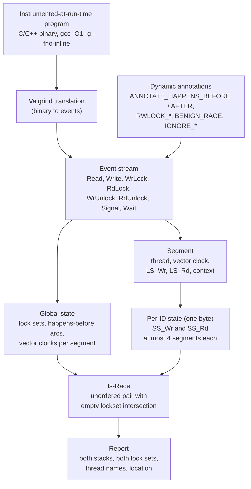
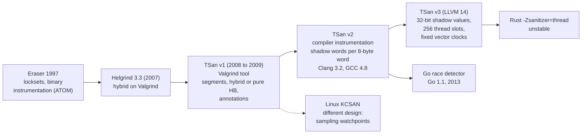

# Paper: ThreadSanitizer: Data Race Detection in Practice (Serebryany and Iskhodzhanov 2009)

> [!summary] Scope
> Owns the seminal data race detection paper by Konstantin Serebryany and Timur Iskhodzhanov and the architectural evolution to TSan version 2.
> Analyzes vector-clock happens-before algorithms, lockset state machines, fixed shadow memory cells per 8-byte application word, and dynamic synchronization annotations.
> Grounds concurrent debugging tools and compiler race sanitizers across C++, Rust, and Go.

> [!summary] Claim:
> The 2009 paper describes a Valgrind-based race detector that keeps, per memory byte, a set of writer segments and a set of reader segments, where a segment is a run of one thread's memory accesses between synchronization events.
> Each segment carries a vector clock and the original lockset, and a race is declared when two segments that no happens-before arc orders have disjoint locksets and at least one is a write.
> Because the locksets are intersected at check time instead of being folded into one candidate set, the detector can name every lock involved, avoids Eraser's three-lock false positive, and collapses into a pure happens-before detector with one flag.
> Dynamic annotations let the program teach the detector about custom synchronization, which is what made the tool usable on Google's C++ code and on Chromium.
> The product line then moved from binary translation to compiler instrumentation (version 2, with fixed shadow cells per 8-byte word) and became the race detector in Clang, GCC, Go, and Rust.



## 1. Bibliographic Metadata

| Field | Value |
| :--- | :--- |
| Title | ThreadSanitizer - data race detection in practice |
| Authors | Konstantin Serebryany (OOO Google, Moscow); Timur Iskhodzhanov (MIPT, Dolgoprudny) |
| Venue | WBIA '09, Workshop on Binary Instrumentation and Applications, New York City, 12 December 2009 |
| Pages | 62 to 71 (10 pages) |
| DOI | https://doi.org/10.1145/1791194.1791203 |
| Author PDF | https://static.googleusercontent.com/media/research.google.com/en//pubs/archive/35604.pdf |
| Subject | ACM D.2.5 Testing and Debugging, Testing tools; keywords: concurrency bugs, dynamic data race detection, Valgrind |
| Implementation | A Valgrind tool, GPL, project name "data-race-test" at code.google.com in the paper's reference [7] |
| Acknowledged | Mike Burrows (co-author of Eraser) for support and algorithmic suggestions; Julian Seward (author of Valgrind and Helgrind) |

The paper is a workshop paper and an experience report as much as an algorithm paper.
Half of its pages describe how to deploy the tool: common real races, common false positives, advice for C++ programmers, and results on Chromium.
That balance is the reason it outlived the Valgrind implementation: the lessons (annotate custom synchronization, make tests tolerate slowdown, notify the committer of a new race) survived every rewrite.

Reading context in this curriculum:

- [[Paper-Valgrind-Dynamic-Binary-Instrumentation]] explains the framework the 2009 tool was built on.
- [[Paper-AddressSanitizer]] is the 2012 sibling that applies the same compiler-instrumentation-plus-shadow-memory pattern to memory errors, by an overlapping group of authors.
- [[Cpp-ThreadSanitizer-and-MemorySanitizer-Internals]] owns the current (v3) runtime mechanism; this note owns the paper, the algorithm it introduced, and the lineage that leads to that runtime.

## 2. The Core Problem

### 2.1 What a data race is, and why it is not a testing problem

The paper defines a data race as two threads concurrently accessing a shared memory location with at least one access being a write.
The C++ standard states the same idea in terms of happens-before: a program has a data race if it contains two potentially concurrent conflicting actions, at least one not atomic, and neither happens before the other, and any such race is undefined behavior ([intro.races] in the C++ working draft read 2026-11-21).
The 2009 paper predates that wording; it argues from experience that a race can produce "data corruption or segmentation fault" and that a passing test run proves nothing, because the failure needs a rare interleaving that testing may never produce.

The paper's motivating case (section 7.1) is the clearest evidence.
A Chromium class named `RefCounted` incremented and decremented a reference count from several threads without synchronization.
When the interleaving happened, the count went wrong, which produced either a leak or two `delete` calls on the same memory, which corrupted the allocator and made a later `malloc` segfault.
The crash had been observed for months, was not understood because it never reproduced under a debugger and the crash stacks were far from the cause, and ThreadSanitizer found the race in a single run.
The fix was to use `RefCountedThreadSafe`, the class that does atomic reference counting.

### 2.2 Precise detection is NP-hard, so every tool picks its errors

The paper cites Netzer and Miller (LOPLAS 1992) for the result that precise race detection is NP-hard and concludes that practical tools "will miss some races and/or report false warnings".
This framing is the paper's real contribution to how engineers should think about the tool: the question is never "does it find all races" but "which errors does it prefer, and can I steer it".
The paper's answer is a dial: three modes ranging "from the most conservative mode (which has few false positives but also misses real races) to a very aggressive one".

### 2.3 What existed, and why it did not work at Google

The paper's section 3 gives the project history, and it is a compact case study in tool evaluation.

| When | What happened |
| :--- | :--- |
| Late 2007 | Several public race detectors tried on Google's code; none worked "out of the box". The best was Helgrind 3.3, a hybrid detector, but it had too many false positives and missed real races. |
| Early 2008 | The authors modified Helgrind's hybrid algorithm, added an optional pure happens-before mode (fewer false positives, even more missed races), and introduced dynamic annotations to eliminate false positives even in hybrid mode. |
| Later 2008 | Helgrind was still too slow, missed too many races in pure mode, and was too noisy in hybrid mode, so the authors wrote their own tool: ThreadSanitizer, "a new simple hybrid algorithm" that can be run in pure happens-before mode. |
| Dec 2009 | Paper published at WBIA '09. |

Two environmental facts shaped the design.
First, "virtually every C++ application developed at Google is multithreaded" and most code is covered by tests from unit to integration level, but the codebase "had never been studied using a data race detector"; the stated goal was "a continuous process for finding data races", not a one-off audit.
Second, static detectors were rejected because Google's code was large enough that adding the annotations a typical static detector needs "would be expensive".
That is the same argument that later pushed Google toward dynamic sanitizers over annotation-heavy static analysis (see [[Paper-Tricorder-Program-Analysis-Ecosystem]] for the static side of that decision).

The paper's related-work taxonomy is worth keeping: static versus dynamic, and within dynamic, on-the-fly (events processed in parallel with execution) versus postmortem (events written to a file and analyzed afterward); and within the dynamic algorithms, happens-before, lockset, or both (hybrid), with O'Callahan and Choi (PPoPP 2003) cited for a detailed description of the algorithms.

### 2.4 The two algorithm families the paper builds on

| Family | Idea | Original source | Strength | Weakness |
| :--- | :--- | :--- | :--- | :--- |
| Lockset | Every shared variable should be consistently protected by some lock; track the candidate set C(v) as the intersection of locks held at each access; report when it becomes empty | Eraser, Savage et al., TOCS 1997 | Finds races that did not manifest in this schedule; independent of timing | False positives for correct code that synchronizes without locks (signal/wait, queues, fork/join) |
| Happens-before | Order events by Lamport's relation built from synchronization (program order plus send/receive arcs, transitive); a race is a conflicting pair with no order | Lamport, CACM 1978 (the paper notes Lamport's Send and Receive are Signal and Wait) | No false positives for the synchronization it models | Only judges the observed schedule; a race hidden by an unrelated ordering this run is missed; timing dependent |
| Hybrid | Report only if both disagree: unordered by happens-before and no common lock | O'Callahan and Choi 2003 (as cited by the paper) | Finds more than pure happens-before, quieter than pure lockset | Still has false positives (see section 4.6), and is only as good as its lockset model |

Eraser details that matter for the comparison, verified against the TOCS paper read for this note:

- Eraser keeps, per shared variable v, a candidate set C(v) initialized to all locks and refined by intersection with the locks held at each access; an empty C(v) triggers a warning.
- To avoid false alarms from initialization and read-sharing, Eraser adds states: Virgin, Exclusive (accessed by one thread only, no refinement), Shared (read by more threads, refine but do not report), and Shared-Modified (refine and report).
- It was implemented by binary modification with ATOM on Digital Unix for the Alpha, and the authors report that applications typically slow down by a factor of 10 to 30.

## 3. Key Innovation

The paper contributes six things, in decreasing order of how much of them survives in today's runtimes.

1. **Dynamic annotations.**
   A small API of C macros (`ANNOTATE_HAPPENS_BEFORE(ptr)`, `ANNOTATE_HAPPENS_AFTER(ptr)`, and others) that tells the detector about synchronization it cannot infer.
   This is the idea with the longest life: the same calls exist in the current LLVM runtime (`AnnotateHappensBefore` in `tsan_interface_ann.cpp`) and, in a cleaner form, as `__tsan_acquire(addr)` and `__tsan_release(addr)` in `sanitizer/tsan_interface.h`.
2. **A hybrid state machine that stores original locksets and intersects late.**
   Per-location state holds segments, and the lockset intersection is computed when a race is checked, not when an access is recorded.
3. **A mode dial.**
   Pure happens-before, full hybrid, and a "fast mode" that skips locations touched by only one thread, chosen per run with command-line flags.
4. **Reports designed to be acted on.**
   Stack traces for both accesses, thread names, every lock held at each access with its creation stack, and a description of the memory location; the paper claims "the most detailed output" among the tools it surveys.
5. **Segments as the unit of history.**
   Grouping consecutive accesses into segments lets the tool keep a bounded amount of per-location state and one vector clock per segment instead of per access.
6. **An operations story.**
   State flushing when memory runs out, a recommended mode per project phase, tolerance for slowdown in tests, and attribution of each new race to the committer who introduced it (section 7 of the paper, for Chromium).

What was not new: vector clocks and the happens-before relation (Lamport 1978), locksets (Eraser, 1997), and the hybrid idea (O'Callahan and Choi, 2003).
The paper's own claim is a new "simple" hybrid algorithm plus the engineering around it, and that is the right way to read it.

## 4. Mechanism Details

### 4.1 Events and definitions (paper section 4.1)

The detector sees a program as a sequence of events and is driven by Valgrind's binary translation.

| Term | Meaning in the paper |
| :--- | :--- |
| Tid | Unique number identifying a thread |
| ID | Identifies a memory location; in the implementation one ID is one byte of memory, so on a 64-bit system it is the 64-bit address |
| Event | A triple of event type, Tid, and ID |
| Event types | `Read`, `Write` (memory accesses); `WrLock`, `RdLock`, `WrUnlock`, `RdUnlock` (locking events); `Signal`, `Wait` (happens-before events) |
| Write-held lock | A lock L is write-held by T when the count of `WrLock_T(L)` observed so far exceeds the count of `WrUnlock_T(L)` |
| Read-held lock | Write-held, or the count of `RdLock_T(L)` exceeds `RdUnlock_T(L)` |
| Writer lockset LS_Wr | All write-held locks of a thread; this is the event lockset of a `Write` |
| Reader lockset LS_Rd | All read-held locks of a thread; this is the event lockset of a `Read` |
| Segment | A sequence of one thread's events containing only memory accesses, no synchronization events; its context is the context (usually a stack trace) of its first event; it has its own LS_Wr and LS_Rd |
| Happens-before arc | A pair `Signal_TX(A)`, `Wait_TY(A)` with the same address, different threads, Signal observed first |
| Happens-before (X precedes Y) | X observed before Y and one of: same thread; the pair is an arc; transitivity through some E1, E2 |
| Segment set | A set of segments none of which precedes another |
| Concurrent | X does not precede Y, Y does not precede X, and the intersection of the event locksets is empty |
| Data race | Two concurrent memory access events (two threads) at least one a `Write` |

Two consequences are easy to miss.
First, because a segment contains no synchronization events, the happens-before relation can be defined on segments rather than events; the paper's Figure 1 shows three threads cut into segments S1 to S7 with arcs `Signal(H1)`/`Wait(H1)` and `Signal(H2)`/`Wait(H2)`, where S1 precedes S4 (same thread), S1 precedes S5 (arc), S1 precedes S7 (transitivity), and S4 does not precede S2 (no relation).
Second, "concurrent" bakes the lockset test into the definition, so a pair of accesses that share a lock is never concurrent even if no happens-before arc orders them; that is the "hybrid" in the name.

### 4.2 Per-ID state and the update procedure (section 4.2)

The global state is everything learned from synchronization events: lock sets and happens-before arcs.
The per-ID state (the paper also calls it shadow memory or metadata) is two segment sets:

- `SS_Wr`: the segments in which writes to this ID appeared.
- `SS_Rd`: all segments in which reads appeared, constrained so that no reader segment precedes any writer segment in `SS_Wr`.

On every read or write the detector does the following (a paraphrase of the paper's `Handle-Read-Or-Write-Event`):

```
handle_access(is_write, tid, id):
    (ss_wr, ss_rd) = per_id_state(id)
    seg = current_segment(tid)
    if is_write:
        ss_rd = { s in ss_rd if not (s precedes seg) }
        ss_wr = { s in ss_wr if not (s precedes seg) } + { seg }
    else:
        ss_rd = { s in ss_rd if not (s precedes seg) } + { seg }
    store(id, ss_wr, ss_rd)
    if is_race(ss_wr, ss_rd): report_race(...)
```

The rule is "drop every old segment that happens-before the new one, then add the new one".
This keeps the sets as small as the true concurrency requires: a location written under a mutex by many threads in turn keeps only the latest segment, because each writer segment is ordered after the previous.
The paper caps each segment set at a small constant, currently 4, "to avoid huge slowdowns in corner cases"; an evicted segment is a segment that can no longer be raced against, which is one source of false negatives that the paper does not quantify.

The race check follows the definition of race.

```
is_race(ss_wr, ss_rd):
    for each writer W1 in ss_wr:
        for each later writer W2 in ss_wr:             # write-write pairs
            if lockset(W1) intersect lockset(W2) is empty: return true
        for each reader R in ss_rd:                    # write-read pairs
            if not (W1 precedes R) and
               lockset(W1) intersect lockset(R) is empty: return true
    return false
```

Once a race is reported on an ID, later accesses to that ID are ignored.
The report lists the current access with its context and locks, then the concurrent writes and, for a write, the concurrent reads, each with segment context and locksets.
Printing the previous accesses is possible only because segments store a context, which is why the next subsection exists.

### 4.3 Segment contexts and how precise a previous stack is (section 4.3)

The context of a segment is the context of its first event, so a report's second stack is only as exact as the segmentation policy.
The tool has three modes, selected with `--keep-history=[012]`.

| Mode | Segment boundary | Quality of the previous-access stack | Cost |
| :--- | :--- | :--- | :--- |
| 1 (default) | Each time the program enters a new super-block (single-entry multiple-exit code region) | Nearly exact: the top frame's line number may be wrong, all other frames and function names are exact | Default |
| 0 (fast) | Only after synchronization events | Previous-access contexts are not printed at all | Useful only for regression testing |
| 2 (precise, slow) | Every memory access (one event per segment) | Exact for all previous accesses | Very slow; "almost never required" |

Valgrind's Memcheck and Helgrind have analogous knobs: `--track-origins=yes|no` and `--history-level=none|approx|full` respectively (paper footnote 5).
This trade-off, how much history to keep so that the second stack can be printed, reappears in every later version as a per-thread trace buffer and the "failed to restore the stack" message.

### 4.4 Two lockset designs and the three-lock example (section 4.5)

Eraser keeps in the per-location state the intersection of all locksets seen.
ThreadSanitizer keeps the original locksets inside segments and computes intersections pairwise each time it checks for a race.
The paper gives two reasons: it can report all locks involved in a race, and it avoids a false positive on code that is correctly synchronized yet has no single common lock.
Its example has three threads, each taking two of three mutexes in a pairwise pattern:

| Thread | Locks held while calling `obj->Change()` |
| :--- | :--- |
| 1 | `mu1`, `mu2` |
| 2 | `mu2`, `mu3` |
| 3 | `mu1`, `mu3` |

Every pair of threads shares a lock, so any two accesses are mutually excluded, yet the intersection of all three locksets is empty, so an Eraser-style refinement reports a race.
The paper notes the extra work of intersecting at every check "adds only a negligible overhead" and that this situation is rare (it was seen "only twice" with Helgrind 3.3 on Google's code).
The toy detector in section 4.8 reproduces exactly this difference.

### 4.5 Pure happens-before mode and fast mode (section 4.4)

**Pure happens-before** (`--pure-happens-before`).
The paper defines extended happens-before arcs: a `WrUnlock_T1(L)` followed in observation order by a `WrLock_T2(L)`, a `WrUnlock` followed by an `RdLock`, an `RdUnlock` followed by a `WrLock`, and any ordinary Signal/Wait arc (the read-unlock followed by read-lock pair gives no arc, because two readers do not order each other).
Adding these arcs to the definition of happens-before yields a pure happens-before detector that, the authors say, finds the same races as Lamport's classical detector (they did not prove it), and that on their unit tests behaves like other pure happens-before detectors.
It still has the advantage of reporting all locks involved, which a classical detector cannot, since the classical detector knows nothing about locks.

The paper's example of the difference:

```
Thread1                    Thread2
obj->UpdateMe();           mu.Lock();
mu.Lock();                 bool f = flag;
flag = true;               mu.Unlock();
mu.Unlock();               if (f) obj->UpdateMe();
```

If `flag` starts false and Thread1 runs first, the program is correct: Thread2 sees `true` only after Thread1's unlock, so the two `UpdateMe` calls are ordered.
If `flag` starts true, Thread2 can touch `obj` concurrently with Thread1, which is a race.
The detector cannot tell the two cases apart from the access pattern.
In hybrid mode it reports a race on this code every time, because the two accesses hold no common lock and no signal/wait arc orders them.
In pure mode, if the race is real it "may or may not be reported" depending on timing, and if there is no race the tool stays silent.
This is the whole trade-off in one example: hybrid is deterministic and noisy, pure happens-before is quiet and timing dependent.

**Fast mode** (`--fast-mode`).
Most memory is never shared.
IDs are grouped into cache lines of 64 IDs, each line remembering the Tid of the thread that touched it first, and in fast mode all accesses to a line are ignored until a different thread accesses it.
The authors measured up to a 2x speedup, and note the cost: like Eraser's Virgin and Exclusive states, it reduces false positives and "may as well hide real races".
They did not combine fast mode with pure happens-before because "the resulting detector will miss too many real races".

### 4.6 Dynamic annotations in detail (section 5)

A detector must understand every synchronization mechanism the program uses.
POSIX mutexes can be hard-coded; anything else (spin locks, lock-free queues, custom reference counting, synchronization through I/O, condition variables in some patterns) has to be explained.
Each annotation is a C macro that expands to a function call the tool intercepts (the paper notes the expansion "is subject to change").

| Annotation | Effect |
| :--- | :--- |
| `ANNOTATE_HAPPENS_BEFORE(ptr)` | Creates a `Signal(ptr)` event on the current thread |
| `ANNOTATE_HAPPENS_AFTER(ptr)` | Creates a `Wait(ptr)` event on the current thread; the pair is the primitive for lock-free handoff |
| `ANNOTATE_PURE_HAPPENS_BEFORE_MUTEX(lock)` | Treat this lock as in pure-happens-before mode even when the others are hybrid; a no-op in pure mode |
| `ANNOTATE_CONDVAR_LOCK_WAIT(cv, mu)` | Creates the `Wait(cv)` that matches `cv.Signal()` |
| `ANNOTATE_BENIGN_RACE(ptr)` | Races on this address are benign |
| `ANNOTATE_IGNORE_WRITES_BEGIN/END` (reads have twins) | Ignore accesses between the markers |
| `ANNOTATE_RWLOCK_CREATE/DESTROY/ACQUIRED/RELEASED` | Describe a custom lock implementation |
| `ANNOTATE_PUBLISH_MEMORY_RANGE(ptr, size)` | Safe publication: a happens-before arc from this call to later accesses to the range; needed mostly by hybrid detectors |
| `ANNOTATE_UNPUBLISH_MEMORY_RANGE(ptr, size)` | The range is no longer shared; arc from all previous accesses to this call |
| `ANNOTATE_NEW_MEMORY(ptr, size)` | A custom allocator handed out new memory |
| `ANNOTATE_THREAD_NAME(name)` | Names the thread for reports |
| `ANNOTATE_EXPECT_RACE(ptr)` | For writing unit tests of the detector itself |

With annotations "we can eliminate all false reports of the hybrid detector and hide benign races", so the combination of annotations plus the most aggressive mode finds the most real races at the lowest noise.
Section 7.2 of the paper claims the run on Chromium kept "zero noise level (no false positives or benign races are reported)", a claim about the tuned deployment, not about the tool out of the box.

Where the annotations went (verified against `compiler-rt` main, 2026-11-21):

| Artifact | What it is | Platform |
| :--- | :--- | :--- |
| `AnnotateHappensBefore`, `AnnotateCondVarSignal`, `AnnotateCondVarWait`, `AnnotateRWLockCreate`, and others in `tsan_interface_ann.cpp` | The Valgrind-era dynamic-annotation entry points, kept for compatibility | Both |
| `enable_annotations` flag, default `true` | "Enable dynamic annotations, otherwise they are no-ops" (`tsan_flags.inc`) | Both |
| `__tsan_acquire(addr)`, `__tsan_release(addr)` | Header comment: "`__tsan_release` establishes a happens-before relation with a preceding `__tsan_acquire` on the same address"; the wording reads inverted, but the runtime's `Release` merges the thread clock into the address's sync clock and `Acquire` takes the elementwise maximum from it (`tsan_rtl_mutex.cpp`), so a release is ordered before a later acquire on the same address, the paper's `Signal`/`Wait` pair | Both |
| `__tsan_mutex_create`, `__tsan_mutex_pre_lock`, and the other `__tsan_mutex_*` calls with flags such as `__tsan_mutex_try_lock` | Annotating a user-written mutex, replacing the paper's `RWLOCK_*` family | Both |
| `__attribute__((no_sanitize("thread")))`, ignorelist, runtime suppressions | Replacements for `ANNOTATE_IGNORE_*` and `--ignore` (see [[Cpp-ThreadSanitizer-and-MemorySanitizer-Internals]]) | Both |

### 4.7 The false positives and the real races the paper catalogs (sections 6.3 and 6.4)

Common real races at Google (section 6.3), ordered by the paper's own list:

| Pattern | Why it is a bug |
| :--- | :--- |
| Simple race on a built-in type (`v++` in two threads) | Most frequent; sometimes a harmless statistic, sometimes harmful |
| Race on a complex type (two threads on one `std::map`) | Almost always dangerous |
| Notification through a plain `bool done` polled with `sleep(1)` | Works on some compiler and hardware combinations only; the compiler may also move or cache the load |
| Publishing an object pointer without synchronization (`while (obj == NULL) yield();`) | Compiler code motion can reorder initialization after publication; some architectures reorder in hardware |
| Initializing a static pointer without synchronization (`if (!obj) obj = new MyObj();`) | The object may be constructed twice and leak |
| Write during a `ReaderLock` | Two readers both increment under a shared lock |
| Adjacent bit fields (`struct { int a:4, b:4; }`, one thread `x.a++`, another `x.b++`) | The two fields share a byte, so the writes race even though the source names different fields |
| Double-checked locking | The paper calls it a known anti-pattern that still appears "mostly in old code" |
| Race during destruction (a stack object handed to another thread and destroyed first) | Use after scope in the other thread |
| Race on the vptr | A base destructor rewrites the vptr while another thread calls a virtual method, so `A::F` runs instead of `B::F` |

The vptr case is why the version 2 compiler pass instruments vtable-pointer reads with `__tsan_vptr_update` (see the wiki's instrumentation list in section 6.2).

Common false positives of the hybrid mode (section 6.4), each cured by an annotation:

| Pattern | Why the hybrid detector is fooled | Annotation |
| :--- | :--- | :--- |
| Condition variable | Thread1 may set the condition and leave the critical section before Thread2 first waits, so `cv.Wait` is never called and the signal-to-wait dependency is never observed | `ANNOTATE_CONDVAR_LOCK_WAIT(&cv, &mu)` after the wait loop |
| Message queue | The queue creates a happens-before dependency between `Put` and `Get` through a mutex, but not through any primitive the detector knows | `ANNOTATE_HAPPENS_BEFORE(ptr)` in `Put`, `ANNOTATE_HAPPENS_AFTER(res)` in `Get` |
| Reference counting | A mutex-based count confuses the hybrid mode; an atomic-based count even confuses the pure happens-before mode, because atomics were invisible to it | `ANNOTATE_HAPPENS_BEFORE(&ref_)` before the decrement, `ANNOTATE_HAPPENS_AFTER(&ref_)` when it reaches zero, before `delete this` |

A queue implemented with atomics instead of a mutex defeats even the pure happens-before detector, and the paper's advice is to hide such primitives behind classes that carry the annotations once.
Its general advice (section 6.5): protect shared variables with a mutex unless profiling says otherwise; reuse standard primitives; wrap `while(!c) cv.Wait(&mu)` in an annotated function (Google's internal Mutex API did this); do not use atomics directly, wrap them; never hard-code timeouts, because dynamic analysis is slow; never use `sleep()` as synchronization, even in tests; and do not over-synchronize, because excess synchronization hides real races from detectors.

Which mode to choose (section 6.5.1):

| Situation | Recommended mode | Why |
| :--- | :--- | :--- |
| Testing an existing project for the first time | Pure happens-before | Unless you have lock-free synchronization (which you must annotate), every reported race is real |
| After the pure-mode reports are fixed, or a new project | Fast mode | A few false reports, easily eliminated |
| Maximize bugs and accept time on annotations | Full hybrid | Finds the most races |
| Regression testing | Hybrid (full or fast) | More predictable: a race is often found by pure mode on only 1 run in 10 to 100, while hybrid finds it on each run |

### 4.8 Rebuild: a toy hybrid detector, run once

The following toy implements the paper's segments, per-ID segment sets, `precedes` via vector clocks, the `is_race` check, and a pure-happens-before switch that turns lock and unlock into signal and wait.
It adds an Eraser-style candidate set for comparison.
It simplifies in four ways: all locks are write locks, there is no segment-set cap, there are no shadow cells or fast mode, and addresses are strings.
It is a model of the paper's algorithm, not of TSan v2 or v3.

```python
"""Toy of the 2009 ThreadSanitizer state machine (paper section 4), trace driven.

Simplifications: every lock is a write lock, no segment-set size cap, no shadow
cells; one address is checked at a time and reported once.
"""
from dataclasses import dataclass


@dataclass(eq=False)
class Seg:
    tid: int
    seq: int            # the thread's own clock when the segment began
    vc: tuple           # full vector clock when the segment began
    locks: frozenset    # locks held by the thread during the whole segment
    ctx: str            # context of the first event in the segment


def precedes(a, b):     # a happens-before b (a was observed first)
    if a.tid == b.tid:
        return a.seq < b.seq
    return b.vc[a.tid] >= a.seq


class Detector:
    def __init__(self, nthreads, pure_hb):
        self.pure_hb = pure_hb
        self.vc = [[0] * (nthreads + 1) for _ in range(nthreads + 1)]
        self.held = [set() for _ in range(nthreads + 1)]
        self.seg = [None] * (nthreads + 1)
        self.sync = {}
        self.state = {}         # addr -> (SSWr, SSRd)
        self.reported = set()
        self.reports = []
        self.eraser = {}        # addr -> Eraser-style candidate set C(v)

    def signal(self, t, h):
        cur = self.sync.get(h, [0] * len(self.vc))
        self.sync[h] = [max(x, y) for x, y in zip(cur, self.vc[t])]
        self.seg[t] = None

    def wait(self, t, h):
        cur = self.sync.get(h)
        if cur:
            self.vc[t] = [max(x, y) for x, y in zip(self.vc[t], cur)]
        self.seg[t] = None

    def lock(self, t, m):
        if self.pure_hb:
            self.wait(t, m)
        self.held[t].add(m)
        self.seg[t] = None

    def unlock(self, t, m):
        self.held[t].discard(m)
        if self.pure_hb:
            self.signal(t, m)
        self.seg[t] = None

    def access(self, t, is_write, addr, ctx):
        if self.seg[t] is None:
            self.vc[t][t] += 1
            self.seg[t] = Seg(t, self.vc[t][t], tuple(self.vc[t]),
                              frozenset(self.held[t]), ctx)
        seg = self.seg[t]
        c = self.eraser.get(addr)
        self.eraser[addr] = set(seg.locks) if c is None else c & seg.locks
        ssw, ssr = self.state.setdefault(addr, ([], []))
        keep = lambda ss: [s for s in ss if s is not seg and not precedes(s, seg)]
        if is_write:
            ssr[:] = keep(ssr)
            ssw[:] = keep(ssw) + [seg]
        else:
            ssr[:] = keep(ssr) + [seg]
        if addr not in self.reported:
            race = self.is_race(ssw, ssr)
            if race:
                self.reported.add(addr)
                self.reports.append((addr,) + race)

    @staticmethod
    def is_race(ssw, ssr):
        for i, w1 in enumerate(ssw):
            for w2 in ssw[i + 1:]:
                if not (w1.locks & w2.locks):
                    return w1, w2
            for r in ssr:
                if r is not w1 and not precedes(w1, r) and not (w1.locks & r.locks):
                    return w1, r
        return None


def run(trace, nthreads, pure_hb):
    d = Detector(nthreads, pure_hb)
    for t, op, arg in trace:
        if op in "RW":
            d.access(t, op == "W", arg, f"T{t} {op}({arg})")
        else:
            getattr(d, op)(t, arg)
    return d


def show(title, trace, nthreads, addr):
    print(f"== {title}")
    for pure in (False, True):
        d = run(trace, nthreads, pure)
        mode = "pure-HB" if pure else "hybrid "
        if not d.reports:
            print(f"  {mode}: no report")
        for addr, a, b in d.reports:
            print(f"  {mode}: RACE on {addr}: {a.ctx} locks={sorted(a.locks)}"
                  f" vs {b.ctx} locks={sorted(b.locks)}")
    d = run(trace, nthreads, False)
    cand = sorted(d.eraser[addr])
    print(f"  Eraser-style C({addr}) at end: {cand} -> {'warns' if not cand else 'silent'}")


FLAG_TRUE_T1_FIRST = [
    (1, "W", "obj"), (1, "lock", "mu"), (1, "W", "flag"), (1, "unlock", "mu"),
    (2, "lock", "mu"), (2, "R", "flag"), (2, "unlock", "mu"), (2, "W", "obj")]
FLAG_TRUE_T2_FIRST = [
    (2, "lock", "mu"), (2, "R", "flag"), (2, "unlock", "mu"), (2, "W", "obj"),
    (1, "W", "obj"), (1, "lock", "mu"), (1, "W", "flag"), (1, "unlock", "mu")]
WRONG_MUTEX = [
    (1, "lock", "mu1"), (1, "W", "var"), (1, "unlock", "mu1"),
    (2, "lock", "mu2"), (2, "W", "var"), (2, "unlock", "mu2")]
THREE_LOCKS = [
    (1, "lock", "mu1"), (1, "lock", "mu2"), (1, "W", "obj"),
    (1, "unlock", "mu2"), (1, "unlock", "mu1"),
    (2, "lock", "mu2"), (2, "lock", "mu3"), (2, "W", "obj"),
    (2, "unlock", "mu3"), (2, "unlock", "mu2"),
    (3, "lock", "mu1"), (3, "lock", "mu3"), (3, "W", "obj"),
    (3, "unlock", "mu3"), (3, "unlock", "mu1")]

if __name__ == "__main__":
    show("paper 4.4.1, T1 ran first (flag was false, code is correct)", FLAG_TRUE_T1_FIRST, 2, "obj")
    show("paper 4.4.1, T2 ran first (flag was true, real race)", FLAG_TRUE_T2_FIRST, 2, "obj")
    show("paper appendix B, wrong mutex", WRONG_MUTEX, 2, "var")
    show("paper 4.5, three locks pairwise", THREE_LOCKS, 3, "obj")
```

Output of a single run on 2026-11-21 (`python3 -I hybrid_toy.py`, Python 3.15.2, macOS arm64; this is a one-off run of the toy kept in the job's `scratch` directory, not a harness-verified lab):

```text
== paper 4.4.1, T1 ran first (flag was false, code is correct)
  hybrid : RACE on obj: T1 W(obj) locks=[] vs T2 W(obj) locks=[]
  pure-HB: no report
  Eraser-style C(obj) at end: [] -> warns
== paper 4.4.1, T2 ran first (flag was true, real race)
  hybrid : RACE on obj: T2 W(obj) locks=[] vs T1 W(obj) locks=[]
  pure-HB: RACE on obj: T2 W(obj) locks=[] vs T1 W(obj) locks=[]
  Eraser-style C(obj) at end: [] -> warns
== paper appendix B, wrong mutex
  hybrid : RACE on var: T1 W(var) locks=['mu1'] vs T2 W(var) locks=['mu2']
  pure-HB: RACE on var: T1 W(var) locks=['mu1'] vs T2 W(var) locks=['mu2']
  Eraser-style C(var) at end: [] -> warns
== paper 4.5, three locks pairwise
  hybrid : no report
  pure-HB: no report
  Eraser-style C(obj) at end: [] -> warns
```

What the output demonstrates, and what it does not:

- Scenario 1 (T1 ran first): hybrid reports, pure happens-before is silent, matching the paper's statement that in hybrid mode the tool "will always report" on this code while in pure mode it stays silent if there is no race.
- Scenario 2 (T2 ran first, flag was true): both modes report, because T1's first `obj` write precedes its own `lock`, so T2's `unlock` cannot order it.
- Scenario 3: the wrong-mutex example from the paper's appendix B reports both lock names, mu1 and mu2, which is the "locks involved in this report" capability.
- Scenario 4: the three-lock example is silent in both modes while the Eraser-style intersection is empty and would warn, which is the paper's section 4.5 claim reproduced.
- It does not model the 4-segment cap, flushing, cache-line fast mode, read locks, the `Signal`/`Wait` annotations on real programs, or Valgrind's event stream, so it says nothing about the paper's overhead or false-negative rates.

## 5. Evaluation and Limitations

### 5.1 What the paper measured

Setup (paper section 7.2): Chromium test sets named `app`, `base`, `ipc`, `net`, and `unit`; ThreadSanitizer in three modes (`--pure-happens-before=yes`, `--fast-mode=yes`, `--fast-mode=no`) compared with Helgrind 3.5.0 and Memcheck 3.5.0; tests built with `gcc -O1 -g -fno-inline -fno-omit-frame-pointer -fno-builtin` for x86_64; run on an Intel Core 2 Duo Q6600 with 8 GB of RAM.
Memcheck is not a race detector but "performs similar instrumentation" and served as the quality-and-cost yardstick.
The paper's Table 1 reports slowdown and memory ratio against native for each tool; a subset (the modes with access history on) follows, in the form time ratio / memory ratio.

| Tool | app (native 3 s, 172 MB) | base (77 s, 1811 MB) | ipc (5 s, 325 MB) | net (50 s, 808 MB) | unit (43 s, 914 MB) |
| :--- | :--- | :--- | :--- | :--- | :--- |
| Memcheck | 10.5x / 2.6x | 2.2x / 1.1x | 8.2x / 1.2x | 5.1x / 2.3x | 29.7x / 1.9x |
| Helgrind | 14.9x / 3.8x | 1.7x / 1.9x | 6.7x / 1.7x | 11.9x / 2.5x | 62.3x / 3.8x |
| TS-fast | 7.9x / 7.6x | 2.4x / 1.5x | 12.0x / 3.6x | 4.7x / 2.4x | 21.6x / 2.8x |
| TS-full (hybrid) | 13.8x / 7.4x | 2.8x / 1.5x | 11.9x / 3.6x | 6.3x / 2.3x | 28.6x / 2.5x |
| TS-phb (pure happens-before) | 14.2x / 7.4x | 2.6x / 1.5x | 11.8x / 3.6x | 6.2x / 2.3x | 28.6x / 2.5x |

All numbers in this table are the paper's, measured in 2009 on that hardware, and are history, not a statement about today's tools.
My reading of the cell alignment is that each test set owns a time ratio followed by a memory ratio; the PDF text extraction I read keeps that order consistently across rows.

Claims the paper draws from them and from its text:

- "The performance of ThreadSanitizer is close to Memcheck", with an average slowdown "less than 30x" and, on large tests such as `unit`, up to twice as fast as Helgrind.
- On a typical Google unit test or application the slowdown is 20 to 50 times, as high as 10,000 times for an artificial stress test of a race detector and as low as 2 times for a test that mostly sleeps or waits for I/O.
- Helgrind 3.3 made almost 90% of Google's unit tests fail by slowdown (timeouts); the improved Helgrind and then ThreadSanitizer reached more than a 95% pass rate, and the remaining tests needed their timeouts raised.
  A side effect the authors note: many tests that failed regularly under the tool were already flaky natively, and slowing them down exposed why.
- Memory: constant 2^23 segments of about 100 bytes (about 50 bytes in 32-bit mode), "so the buffer is about 800M" (about 250M without segment contexts); plus per-segment vector clocks, per-ID state, and segment sets.
  The PDF text extraction renders the segment count as "223"; 2^23 times roughly 100 bytes matches the paper's own stated 800M, so I read it as 2^23.
  Average memory overhead on a Google unit test is 3x to 4x; almost all unit tests needed under 4 GB, real applications 8 GB or more.
- Flushing: ThreadSanitizer flushes all internal state when the memory overhead exceeds a limit or when no segment can be recycled; on the Chromium sets it flushed 90 times on `unit`, 34 on `net`, and 4 on `base` in full or pure modes with history on, and never in fast mode with history off.
- Using a mildly optimized build (`-O1 -g -fno-inline -fno-omit-frame-pointer -fno-builtin`, gcc 4.4 on x86_64) gave a 50% to 100% speedup over an unoptimized build; fully optimized code (gcc `-O2`) did not work well with the implementation, which the paper attributes to gcc, Valgrind, and ThreadSanitizer together.
- Ignoring "a single hot spot" with `--ignore` sped some runs by 2 to 3 times; the threading library's internals are not instrumented.
- Each instrumented access becomes a call to "a quite sophisticated function that usually runs for few hundreds of CPU cycles", which is why the authors expected the overhead to "always remain significant".
- The PIN-based earlier variant was about twice as slow as the Valgrind-based one (footnote 2).
- The tool found "a few dozen data races" in Chromium and in third-party components used by it, tracked under the label `ThreadSanitizer` in the Chromium bug tracker.

### 5.2 Limitations, stated by the paper

| Limitation | Source in paper | Consequence |
| :--- | :--- | :--- |
| Slowdown of 20x to 50x on average, up to 10,000x | Section 6.1 | Tests time out; timeouts must be parameterized; sleep-based tests misbehave |
| Does not work well on fully optimized code | Section 6.1, footnote 13 | You test a different binary than you ship |
| Fast mode "may as well hide real races" | Section 4.4.2 | Choose it only after clean pure-mode runs |
| Pure happens-before mode is timing dependent and may miss races | Sections 4.4.1, 6.5.1 | A race may surface on 1 run in 10 to 100 |
| Hybrid mode has false positives | Section 6.4 | Needs annotations on condition variables, queues, reference counts |
| Flushing state loses history | Section 6.2.1 | A race whose accesses straddle a flush is missed ("the probability of such situation is low") |
| Segment sets capped at 4 | Section 6.1 | Heavily shared locations can lose evidence |
| Only races that execute are found | Implicit in dynamic analysis | Coverage of tests bounds coverage of races |
| Accuracy comparison limited to unit tests | Footnote 9 | Other detectors "did not work with our OS and compiler or did not support our custom synchronization", so no real-program accuracy comparison exists in the paper |
| No formal proof that pure mode equals Lamport's detector | Section 4.5 | Equivalence is empirical on the authors' test set |

### 5.3 Limitations the paper does not address (analysis added here)

These are consequences of 2009 and of the design, and I mark them as my analysis rather than claims of the paper.

- **Memory model.**
  The paper discusses compilers and hardware informally ("may work correctly with some combination of compiler and hardware") because it predates the C++ memory model.
  A modern detector has to decide what each memory order means; the lineage that followed has a documented gap (fences), covered in Industry Impact.
- **Per-byte state.**
  One ID per byte is simple and precise and expensive; every later version moved to a fixed number of shadow entries per 8-byte word.
- **Binary translation cost model.**
  Every access in Valgrind-translated code pays the translation and the callout; the compiler-instrumented designs inline cheaper fast paths, which is where most of the later 2x to 10x improvement comes from.
- **Granularity of reporting.**
  Segment contexts (first event only) make the previous-access line number approximate in the default mode.

## 6. Industry Impact

### 6.1 Lineage: version 1, 2, and 3



The relation to KCSAN is an analogy in goals, not a code lineage; the dotted edge only marks "dynamic race detector in a different environment".

The three generations differ along the same axes, so a table is the most compact comparison.
Rows for v1 come from the paper; v2 from the Google Sanitizers wiki page `ThreadSanitizerAlgorithm` (which describes itself as "work-in-progress" and describes the second version) and the C++ manual; v3 from `compiler-rt` main read 2026-11-21.

| Axis | v1 (paper, 2009) | v2 (wiki, 2012 era) | v3 (compiler-rt main, 2026-11) |
| :--- | :--- | :--- | :--- |
| How it sees accesses | Valgrind translates the unmodified binary | Compiler pass inserts a call such as `__tsan_read4(addr)` before each access that cannot be proven race-free or redundant; function entry and exit via `__tsan_func_entry(caller_pc)` and `__tsan_func_exit`; atomics via `__tsan_atomic_*`; vtable-pointer reads via `__tsan_vptr_update` | Same instrumentation model (LLVM pass plus libc interceptors) |
| Unit of location | One ID per byte | Aligned 8-byte word maps by direct address mapping to N shadow words, N one of 2, 4, 8 (configurable) | Aligned 8-byte word maps to 4 shadow values (`kShadowCnt = 4`, `kShadowCell = 8` in `tsan_defs.h`) |
| One shadow entry | A segment: thread, vector clock, LS_Wr, LS_Rd, context | 64 bits: TID 16 bits, scalar clock 42 bits, IsWrite 1 bit, access size 2 bits, address offset 3 bits (fields configurable) | 32 bits: 8-bit byte mask of the bytes accessed, 8-bit thread-slot id, 14-bit epoch, read bit, atomic bit (`tsan_shadow.h`) |
| Shadow to application size | Not stated as a ratio; per-ID state is "a linear function of all memory" in full and pure modes | Not stated on the page | 2x (`kShadowMultiplier = kShadowSize * kShadowCnt / kShadowCell` = 4 x 4 / 8) |
| Time and ordering | Segments, vector clocks per segment; locksets intersected at check time | Thread's scalar clock incremented on every access; the new shadow word is compared with each old one by `HappensBefore` | 256 thread slots (`kThreadSlotCount`), 14-bit epochs, one 512-byte vector clock (256 x 16-bit) per thread and per sync object; epochs advance on release-type operations rather than on every access |
| Locksets | Yes (hybrid), or no (pure mode) | None in the pseudo-code; mutexes matter only through happens-before | None in `CheckRaces`; mutex lock acquires and unlock releases vector clocks (`tsan_rtl_mutex.cpp`); lock identity matters only to the deadlock detector |
| Previous-access stack | Segment context (`--keep-history`) | `LogEvent(tid, pc)` into a large thread-local circular buffer | Per-thread trace of 8-byte compressed access events and 16-byte extended ones; `history_size` flag (default 0 in `tsan_flags.inc` on main) |
| When state is too big | Flush all state at a memory limit or when no segment is free | A full set evicts a random shadow word; `memory_limit_mb` and `flush_memory_ms` flags | A random shadow slot is replaced in a full cell; when all thread slots are exhausted the runtime performs a full reset (`DoReset`) of shadow and clocks |
| Documented cost | 20x to 50x average slowdown, 3x to 4x memory (Chromium unit: 21.6x to 28.6x) | Wiki C++ manual: execution time 2x to 20x, memory 5x to 10x | Clang docs: typical slowdown 5x to 15x, memory 5x to 10x; default 5x plus 1 MB per thread, with 3x and 9x settings available |
| Platforms | Linux and Mac (via Valgrind) | Wiki list (dated Dec 2018): Linux x86_64, mips64, aarch64, powerpc64; Mac x86_64, aarch64; FreeBSD x86_64; NetBSD x86_64 | Clang docs: Android aarch64 and x86_64; Darwin arm64 and x86_64; FreeBSD; Linux aarch64, x86_64, powerpc64, powerpc64le; NetBSD; 32-bit "is problematic and is not planned" |

Stamps for the right-hand column: all platform and overhead statements in the v3 column are `(as of 2026-11)`, Both (Linux and macOS), taken from documentation, not measured here.

The version label "v3" is the engineering name from the commit title "tsan: new runtime (v3)" by Dmitry Vyukov; in the history of `tsan_shadow.h` that title appears several times with intervening reverts in November and December 2021, and the file exists at tag `llvmorg-14.0.0` and does not exist at `llvmorg-13.0.0` (GitHub contents API, 2026-11-21).
I therefore date the shipping of the v3 shadow layout to LLVM 14, and do not claim a finer date.
The mechanism details of v3 (slots, epochs, the vectorized check, resets, restoring stacks) belong to [[Cpp-ThreadSanitizer-and-MemorySanitizer-Internals]]; this note keeps them to the table above.

Two invariants hold across all three generations, and they are what the 2009 paper established:

1. Every access updates a bounded per-location history of earlier accesses, and a race is a pair from different threads, at least one write, with no happens-before order between them.
2. The program teaches the detector about synchronization it cannot see, and the report prints the earlier access using a stored history.

### 6.2 Version 2 in more detail (the "fixed shadow cell per 8-byte word" design)

The wiki's algorithm page gives the version 2 design; its state machine, in the page's own pseudo-code shape, is:

```
handle_access(addr, tid, is_write, size, pc):
    shadow = shadow_cells_for(addr)               # N shadow words, direct mapping
    thread_clock[tid] += 1
    log_event(tid, pc)                            # circular buffer for later stack recovery
    new = {tid, clock[tid], is_write, size, addr & 7}
    for each of the N old shadow words:
        if old is empty:                  store new in place; done with the store
        elif same bytes, same thread:     (the page leaves this case as TODO)
        elif same bytes, different thread:
            if not happens_before(old, new): report_race(old, new)
        elif bytes intersect, different thread:
            if not happens_before(old, new): report_race(old, new)
        else:                             disjoint bytes, nothing to do
    if new was not stored:                evict one random old word and store new there
```

Design points the page states:

- All shadow loads and stores are 64-bit atomic, "but otherwise no locking is involved"; two threads updating one shadow state at once leave it consistent, with a "tiny probability to miss a data race".
- Race-free accesses (reads of constant globals including vtables, accesses to non-escaping locals) and redundant accesses (a read followed by a write of the same location) are not instrumented.
- The page links the "GNU Tools Cauldron 2012" talk "Finding races and memory errors with compiler instrumentation" as the presentation of this design.

What changed from v1 in design terms: the second stack no longer comes from a stored segment context but from replaying a per-thread event log, shadow state is fixed size per 8 bytes instead of unbounded sets capped at 4, locksets vanish from the check, and the instrumentation moves into the compiler.
What it gave up: the ability to test an unmodified binary, fast mode and hybrid mode (a precise, quiet pure happens-before detector is the only mode), and the paper's all-locks-in-the-report property.
The wiki's report format still prints held mutexes ("mutexes: write M1") when the threads hold any, so the report keeps the lock information even though the algorithm no longer uses it for the decision; the same page documents "As if synchronized via sleep" blocks, a diagnostic hint for tests that use sleep to order threads.

### 6.3 How a report reads today (single manual run, not a lab)

The following was produced once on 2026-11-21 on macOS 27.3 (arm64) with Apple clang 21.0.0, `clang -fsanitize=thread -O1 -g`, from a program in which two threads each run `for (i = 0; i < 1000; i++) racy_counter++;` on a plain global.
Addresses, module offsets, the process id, and OS thread ids are elided as `...`; thread labels, function names, and line numbers are as printed.
The process ended with status 134 (signal 6), which is the Apple `abort_on_error=1` default at work.
It is one run, so it shows the report format, not a statistic.

```text
==================
WARNING: ThreadSanitizer: data race (pid=...)
  Write of size 4 at 0x... by thread T2:
    #0 bump_racy tsan_demo.c:17 (tsan_demo:arm64+0x...)

  Previous write of size 4 at 0x... by thread T1:
    #0 bump_racy tsan_demo.c:17 (tsan_demo:arm64+0x...)

  Location is global 'racy_counter' at 0x... (tsan_demo+0x...)

  Thread T2 (tid=..., running) created by main thread at:
    #0 pthread_create <null> (libclang_rt.tsan_osx_dynamic.dylib:arm64e+0x...)
    #1 run2 tsan_demo.c:60 (tsan_demo:arm64+0x...)
    #2 main tsan_demo.c:66 (tsan_demo:arm64+0x...)

  Thread T1 (tid=..., finished) created by main thread at:
    #0 pthread_create <null> (libclang_rt.tsan_osx_dynamic.dylib:arm64e+0x...)
    #1 run2 tsan_demo.c:59 (tsan_demo:arm64+0x...)
    #2 main tsan_demo.c:66 (tsan_demo:arm64+0x...)

SUMMARY: ThreadSanitizer: data race tsan_demo.c:17 in bump_racy
==================
```

Compare with the paper's appendix B report: both give the current access with its stack, the previous access with its stack, the thread identities, and a description of the location (the paper's "0 bytes inside data symbol var" is today's "Location is global ..."); today's report adds the thread creation stacks and drops the lock lines unless mutexes were held.
The same program also contained a mutex-protected counter and a release/acquire publication, and in that run neither produced a report, while a relaxed-order publication of a plain integer did, as the next paragraphs and the vault lab show.

The vault's own lab `code/03-Debugging/tsan_race_vector/` records harness-verified output on darwin-arm64 for the cases that matter to this paper (`expected/darwin-arm64.txt`, platform darwin-arm64, read 2026-11-21):

| Scenario | Warnings | Why |
| :--- | :--- | :--- |
| `racy_counter` | 1, exit 66 | Plain unsynchronized writes |
| `mutex_counter` | 0, exit 0 | Lock and unlock create happens-before |
| `relaxed_publish` | 1, exit 66 | Relaxed atomics are not races themselves but order nothing |
| `acqrel_publish` | 0, exit 0 | Release store and acquire load create the arc |
| `fence_publish` | 1, exit 66 | Correct C++ using fences, reported anyway (the runtime does not model fences) |
| `sleep_ordered` | 1, exit 66, note "as if synchronized via sleep" | Wall-clock ordering is not happens-before |

In the same file, a racy run with only `atexit_sleep_ms=0` ends by signal 6, with `abort_on_error=0` it exits 66, with `exitcode=3` it exits 3, and with `report_bugs=0` it exits 0.
That matches the `abort_on_error` default in `sanitizer_flags.inc` on main, which is true on Apple and Android and false elsewhere, and explains why CI scripts that test for exit code 66 fail on macOS until `abort_on_error=0` is set.

### 6.4 The fence gap, in the source

The fence case is the one place the paper's annotation philosophy still shows through.
In `tsan_interface_atomic.cpp` on main, the `OpFence` operation that backs `__tsan_atomic_thread_fence` carries the comment "FIXME(dvyukov): not implemented" and executes only `__sync_synchronize()`; `__tsan_atomic_signal_fence` is an empty function.
GCC documents the consequence: its warning list carries `-Wno-tsan`, "Disable warnings about unsupported features in ThreadSanitizer", so `-Wtsan` is on by default, and the entry says "ThreadSanitizer does not support `std::atomic_thread_fence` and can report false positives" (GCC Warning Options, read 2026-11-21).
The Rust unstable book says the same for `std::sync::atomic::fence` and adds that synchronization through inline assembly is unsupported.
The fix, in the paper's own vocabulary, is to establish the arc with something the detector understands: a release store and acquire load on the flag, or `__tsan_release(addr)` and `__tsan_acquire(addr)` around the handoff.

How atomics and mutexes become vector-clock operations in the current runtime (`tsan_interface_atomic.cpp`, `tsan_rtl_mutex.cpp`, `tsan_vector_clock.cpp`):

| Operation | Clock effect |
| :--- | :--- |
| Mutex lock (first acquisition) | Thread clock acquires the mutex's clock and its read clock (elementwise max) |
| Mutex unlock (write, last release) | `ReleaseStore`: the mutex clock becomes a copy of the thread clock |
| Read-unlock | `Release` into the mutex's read clock (merge) |
| Atomic read-modify-write, acquire-release | `ReleaseAcquire` on the address's sync object |
| Atomic release store | `ReleaseStore` into the sync object, then the thread epoch is incremented |
| Atomic acquire load | `Acquire` from the sync object |
| Relaxed atomic | Recorded as an atomic access, moves no clock |
| `force_seq_cst_atomics=1` | Treats every atomic as `seq_cst` (`tsan_flags.inc` on main: "all atomics are effectively sequentially consistent (seq_cst), regardless of what user actually specified"); the wiki's `ThreadSanitizerFlags` page adds that this helps "check whether a race is caused by incorrect memory ordering" |

Vector clock `Acquire` is an elementwise maximum and `Release` merges the thread's clock into the destination; both are written with SSE (`_mm_max_epu16`) when `TSAN_VECTORIZE` is set.

### 6.5 Descendants and cousins

| System | Relation to the paper | Verified detail | Stamp |
| :--- | :--- | :--- | :--- |
| Clang `-fsanitize=thread` | The mainline descendant | Wiki: "part of clang 3.2 and gcc 4.8"; Clang docs: beta stage; non-position-independent executables are not supported, so `-fsanitize=thread` makes Clang act as though `-fPIE` (when compiling without `-fPIC`) and `-pie` (when linking an executable) were given; static linking of libc or libstdc++ not supported; all code should be instrumented | Both, as of 2026-11 |
| GCC `-fsanitize=thread` | Same runtime, GCC front end | Cannot be combined with `-fsanitize=address` or `-fsanitize=leak`; `-Wtsan` (on by default; `-Wno-tsan` disables it) warns about unsupported features such as `std::atomic_thread_fence` | Both, as of 2026-11 |
| Go `-race` | Same runtime, Go compiler | Introduced in Go 1.1 for 64-bit x86 on Linux, OS X, and Windows; blog dated 26 June 2013 says the technology was integrated with Go in September 2012 and had found 42 races in the standard library; today requires cgo and supports linux/amd64, ppc64le, arm64, s390x, loong64, freebsd/amd64, netbsd/amd64, darwin/amd64, darwin/arm64, windows/amd64; `GORACE` options with `history_size` default 1 (history of `32K * 2**history_size` elements), `exitcode` default 66, `atexit_sleep_ms` default 1000; documented overhead memory 5x to 10x and time 2x to 20x; 8 extra bytes per `defer` and `recover` that live until the goroutine exits | Both, as of 2026-11 |
| Rust `-Zsanitizer=thread` | Same runtime via LLVM | Unstable (a `-Z` flag); the book's example needs `-Zbuild-std` and a target; supported targets include `x86_64-unknown-linux-gnu`, `aarch64-unknown-linux-gnu`, `aarch64-apple-darwin`, `x86_64-apple-darwin`, `x86_64-unknown-freebsd`; unsupported: atomic fences and inline-assembly synchronization; requires all code instrumented or false positives follow | Both, as of 2026-11 |
| Helgrind (Valgrind) | The tool the authors started from | Manual: detects misuse of the POSIX pthreads API, inconsistent lock orderings, and data races; explains races with the happens-before relation | Both |
| DRD (Valgrind) | A contemporary Valgrind race detector | Manual: "DRD is based on the happens-before algorithm" and reports segments; the paper's appendix calls it "similar" in properties | Both |
| Linux KCSAN | Different mechanism, same goal | Compile-time instrumentation plus "soft watchpoints" and sampling; per the doc "unsound (false negatives possible), but aims to be complete (no false positives)"; supported with GCC 11 or later and Clang 11 or later; the doc names KTSAN as an alternative considered, a happens-before detector | Linux, as of 2026-11 |

The deadlock detector in v2 and later is the one place lock identity still drives a decision.
The wiki describes a directed graph of lock acquisitions where holding A while acquiring B adds an edge A to B and a cycle is a potential deadlock, and called the detector experimental at the time of writing.
The Clang page lists `detect_deadlocks` with default true, and `sanitizer_flags.inc` on main also has `COMMON_FLAG(bool, detect_deadlocks, true, ...)`, so on main the detector is on by default, as of 2026-11; the "experimental" wording is the wiki's, from an earlier period.

### 6.6 What a large organization takes from the paper

The paper's section 7 describes a pipeline that is still the template for sanitizer rollouts.

1. Run the tests under the detector continuously on a large number of machines with different operating systems, not once.
2. When a new error appears after a commit, notify the committer, and make the reports visible to other developers and maintainers.
3. Track the bugs under one label so progress is queryable.
4. Treat slowdown as a first-class constraint: parameterize timeouts, avoid sleeping as synchronization, accept a few raised timeouts in the tests that remain.
5. Pay for annotations once, in the shared primitives (mutex wrapper, queue, refcount), not at every call site.
6. Start with the quiet mode, then widen.

Decision rules that follow, for a fleet of 1,000 to 50,000 engineers:

| Decision | Rule | Basis |
| :--- | :--- | :--- |
| Which mode on day one | The quietest the tool offers; widen only when it is clean | Paper section 6.5.1 |
| Where to pay for custom synchronization | In library primitives, never in application code | Paper section 6.5 |
| Where TSan runs | Test builds in CI on every change that touches threaded code, plus a realistic-workload run; never production | Clang docs: runtime "not meant to be linked against production executables" |
| What to do with a flaky test that fails only under TSan | Treat as a real signal first; slowdown changes timing, which is how the paper found flakiness causes | Paper footnote 11 |
| How to handle third-party uninstrumented code | Rebuild with the sanitizer, or use `ignore_noninstrumented_modules` and `ignore_interceptors_accesses` and accept false negatives; both already default to true on Apple and false elsewhere (`tsan_flags.inc` on main, as of 2026-11) | Wiki manual, `tsan_flags.inc` |
| How to handle a benign race | Fix it with an atomic, or suppress it with an owner and a bug; a bare "benign" label rots | Paper (benign race annotation exists, but "sometimes extremely harmful") |

## 7. Concept Grounding

This paper is the origin of the ideas that these notes rely on; each link names the mechanism it takes from here.

| Note | What it takes from this paper |
| :--- | :--- |
| [[Cpp-ThreadSanitizer-and-MemorySanitizer-Internals]] | The current runtime: shadow cells, slots, epochs, the vectorized race check, resets, stack restoration; this note gives the algorithmic ancestry and the v1 to v3 deltas |
| [[Cpp-Valgrind-Memcheck-Helgrind-and-DRD]] | The Valgrind tools the authors started from and measured against; Helgrind and DRD as contemporaries |
| [[Paper-Valgrind-Dynamic-Binary-Instrumentation]] | The binary-translation framework the 2009 tool runs on, and its cost model |
| [[Paper-AddressSanitizer]] | The same compiler-instrumentation and shadow-memory pattern applied to memory errors, 2012 |
| [[Paper-MemorySanitizer]] | The third member of the family; bit-exact shadow for uninitialized reads |
| [[Debugging-Without-a-Debugger-and-Concurrency-Bugs]] | Where race detection sits among the other concurrency debugging techniques |
| [[Paper-rr-Record-and-Replay]] | Deterministic replay as the complement: TSan finds the race, rr replays the failure it caused |
| [[Paper-Coz-Causal-Profiling]] | Another tool that perturbs thread timing (virtual speedups) to learn something about a concurrent program |
| [[Cpp-Sanitizers-and-Memory-Debugging-on-macOS]] | What the sanitizer family looks like on this Mac, including the macOS TSan caveats |
| [[Rust-Miri-Sanitizers-Loom-and-Cargo-Fuzz]] | The Rust side: `-Zsanitizer=thread`, Miri, and model checking with loom |
| [[Python-Concurrency-Asyncio-Multiprocessing-and-Free-Threading-Bugs]] | Race classes in Python, including free-threaded builds |
| [[Paper-Google-Wide-Profiling]] | The next paper in the canon; the same organization's approach to continuous, fleet-wide measurement |

## Pitfalls

> [!warning] Pitfall: reading the 2009 overheads as today's
> The 20x to 50x average slowdown and 3x to 4x memory in the paper describe a Valgrind tool on 2009 hardware.
> Current Clang documentation gives 5x to 15x time and 5x to 10x memory for the compiler-instrumented runtime (as of 2026-11, Both); the Go documentation gives 2x to 20x and 5x to 10x.
> Budget CI from the current documentation and from your own measurement, never from the paper.

> [!warning] Pitfall: assuming "no false positives" means "no false negatives"
> A happens-before detector judges the observed schedule.
> A race that this run happened to order through some unrelated lock or atomic is missed, and the paper says so for its pure mode (a race found on only 1 run in 10 to 100).
> A clean TSan run is evidence, not proof.

> [!warning] Pitfall: using sleep as synchronization in tests
> A `sleep` orders accesses in wall-clock time, not in happens-before, so TSan reports the race and says "as if synchronized via sleep".
> The paper's advice is "Never use sleep() as synchronization between threads, even in unit tests".
> The vault lab's `sleep_ordered` scenario demonstrates the report.

> [!warning] Pitfall: custom synchronization the detector cannot see
> Fences (not modeled by the runtime), inline assembly, and uninstrumented libraries produce false reports, and the cure is the paper's: tell the detector with an annotation or restructure to release and acquire operations.
> Annotating a primitive once, in a library, is cheap; sprinkling `ANNOTATE_BENIGN_RACE` is how real races get buried.

> [!warning] Pitfall: silent loss of history at a flush or reset
> The paper flushes all state at a memory limit or when segments run out, and the v3 runtime resets all shadow memory when thread slots are exhausted (14-bit epochs, 255 usable slots: `TidSlot slots[kThreadSlotCount - 1]` in `tsan_rtl.h`, with sid 255 reserved as `kFreeSid` in `tsan_defs.h`).
> A race whose two accesses straddle the flush is never reported.
> Very long, sync-heavy tests have periodic blind spots; split them or restart workers.

> [!warning] Pitfall: trusting the wiki pages for current defaults
> The Google Sanitizers wiki pages describe version 2 and carry dates such as "last updated on Dec 2018"; they say `history_size` defaults to 2 and describe the deadlock detector as experimental, while `tsan_flags.inc` on main has `history_size` default 0 and `sanitizer_flags.inc` has `detect_deadlocks` true.
> For any flag default, read `tsan_flags.inc`, `sanitizer_flags.inc`, or run the binary with `TSAN_OPTIONS=help=1`.

> [!warning] Pitfall: CI that tests for exit code 66
> The default exit code is 66 (TSan overrides the common default of 1 with `cf.exitcode = 66` in `tsan_flags.cpp` on main), but on Apple and Android `abort_on_error` defaults to true and the process dies with signal 6 (the vault lab records this on darwin-arm64).
> Set `abort_on_error=0` on macOS runners, or test for "any nonzero".

## Practice Drill

> [!tip] Practice Drill:
> Extend the toy detector in Rebuild: a toy hybrid detector in three steps.
> First, add the paper's cap of 4 segments per set with random eviction, and construct a trace of 6 threads where eviction hides a race.
> Second, add read locks and the `RdLock`/`RdUnlock` arcs the paper lists, so that read-unlock followed by read-lock yields no arc.
> Third, add the cache-line fast mode (64 IDs per line, ignore until a second thread appears) and find the smallest trace on which fast mode hides a real race that pure mode finds.
> Then compile a three-line race with `clang -fsanitize=thread -O1 -g`, run it, and compare the report fields with the paper's appendix B.

## Interview Questions

> [!question] L5: What is a data race, why does a green test suite not rule one out, and what does ThreadSanitizer need in order to catch it?
>
> > [!success]- Answer
> > A data race is two concurrent conflicting accesses to the same location, at least one a write and at least one not atomic, with no happens-before order between them; in C++ it is undefined behavior.
> > A suite can pass because the failing interleaving is rare; the paper's Chromium `RefCounted` bug crashed for months without being understood and was found by the detector in one run.
> > TSan needs the racy code path to execute at least once (it finds only races that happen at run time) and needs to see the program's synchronization, either by interception or annotation.
> > It does not need the bad interleaving to occur, because it checks ordering rather than timing, which is why it finds races that testing does not.

> [!question] L5: Predict the output: for the toy detector in this note, scenario "T1 ran first" (T1 writes `obj`, then locks `mu`, sets `flag`, unlocks; T2 locks `mu`, reads `flag`, unlocks, then writes `obj`), what do hybrid and pure happens-before modes print?
>
> > [!success]- Answer
> > Hybrid prints a race on `obj` between T1's write and T2's write, with empty locksets on both sides.
> > Pure happens-before prints no report.
> > In hybrid mode the two writes hold no common lock and no signal/wait arc orders them, so they are concurrent by the paper's definition.
> > In pure mode T1's unlock followed by T2's lock is an extended happens-before arc.
> > T1's `obj` write precedes T1's unlock by program order, and T2's `obj` write follows T2's lock by program order, so by transitivity the first write happens before the second and the pair is not concurrent.
> > In the toy this shows up as T2's vector clock carrying T1's component 2 after the lock, which is at least the sequence number 1 of T1's segment holding the `obj` write.
> > The paper's remark applies: the detector cannot tell this correct program (flag started false) from the racy one (flag started true) by looking at accesses alone.

> [!question] L5: A test that does `sleep(1)` between a write in thread A and a read in thread B passes natively. What does TSan do, and what should you change?
>
> > [!success]- Answer
> > TSan reports a race, and adds "As if synchronized via sleep" with the sleep's stack, because a sleep creates no happens-before edge.
> > The vault lab's `sleep_ordered` scenario shows the report and exit 66 (abort on macOS by default).
> > Replace the sleep with a real synchronization primitive (join, a condition variable with its predicate, or a release store with an acquire load).
> > The paper's rule is blunt: never use sleep as synchronization, even in unit tests.

> [!question] L6: Why does ThreadSanitizer keep original locksets in each segment and intersect at check time, and what does that buy over Eraser?
>
> > [!success]- Answer
> > Eraser folds every access into one candidate set per variable by intersection; once folded, the individual locksets are lost.
> > Keeping originals lets the report name every lock involved in the race, and lets the detector accept the pairwise-consistent three-lock pattern (threads holding {mu1,mu2}, {mu2,mu3}, {mu1,mu3}), where the full intersection is empty but every pair shares a lock.
> > The paper says the extra computation adds negligible overhead, and the toy in this note reproduces the three-lock result: hybrid and pure are silent while the Eraser-style set is empty.
> > The cost is memory for segments and segment sets, which the paper bounds by capping each set at 4.

> [!question] L6: Explain why a mutex-based reference count makes the hybrid mode report a false race, and an atomic one confuses even the pure happens-before mode. What is the fix?
>
> > [!success]- Answer
> > In hybrid mode, accesses to the object by different threads that are ordered only through a count protected by a lock hold no common lock for the object itself and no signal/wait arc, so they look concurrent.
> > With an atomic count there is no lock at all, and a 2009 pure happens-before detector had no model of atomics, so it also saw no arc between the last `Unref` and the `delete`.
> > The fix is to annotate once in the primitive: `ANNOTATE_HAPPENS_BEFORE(&ref_)` before the decrement and `ANNOTATE_HAPPENS_AFTER(&ref_)` when the count reaches zero, before `delete this`.
> > In today's runtime, atomics are instrumented by the compiler pass and carry release/acquire semantics, and `__tsan_release`/`__tsan_acquire` are the annotation equivalents.

> [!question] L6: Debug this: a lock-free queue uses `std::atomic_thread_fence(std::memory_order_release)` before a relaxed store of a flag and `std::atomic_thread_fence(std::memory_order_acquire)` after a relaxed load of that flag, then reads a plain payload. It is correct C++, but TSan reports a race on the payload. What is happening and what are your options?
>
> > [!success]- Answer
> > The runtime does not model fences: in `tsan_interface_atomic.cpp` the fence operation is marked "FIXME(dvyukov): not implemented" and only calls `__sync_synchronize()`, so the relaxed flag operations move no vector clock and the payload accesses look unordered.
> > GCC documents the same limitation under `-Wtsan` ("does not support `std::atomic_thread_fence` and can report false positives"), and the vault lab's `fence_publish` scenario records one warning and exit 66 on darwin-arm64.
> > Options, in order: use `memory_order_release` on the store and `memory_order_acquire` on the load, which TSan models; or keep the fences and add `__tsan_release(&flag)` and `__tsan_acquire(&flag)` under a `__has_feature(thread_sanitizer)` guard; or exclude the function with `no_sanitize("thread")` and cover it with a model checker.
> > Do not suppress the report without recording why, because the same pattern written wrongly produces the same report.

> [!question] L7: The paper's detector flushes all state under memory pressure and v3 resets shadow memory when thread slots run out. What are the correctness consequences, and how do you design a CI policy around them?
>
> > [!success]- Answer
> > Any race whose two accesses fall on different sides of a flush or reset is missed, because the earlier access is gone; the paper estimates the probability as low and reports 90 flushes on the Chromium `unit` set in full mode with history.
> > In v3 the trigger is epoch exhaustion: 14-bit epochs advance on release operations, a thread that exhausts its slot's epoch moves to another slot, and when none is free the runtime resets everything.
> > A sync-heavy long-running test therefore has periodic blind spots, and a test that never resets has none, so reports are evidence of presence only.
> > Policy: prefer many short tests over one long soak under TSan, set `memory_limit_mb` deliberately rather than letting the OOM killer decide, count resets if the runtime exposes them, and run a separate schedule-perturbation job for long tests.

> [!question] L7: Why did ThreadSanitizer move from Valgrind to compiler instrumentation, and what did the move cost?
>
> > [!success]- Answer
> > Gains: a typical slowdown of 5x to 15x in current Clang documentation versus 20x to 50x average for the Valgrind tool in 2009, an inlined fast path, real source-level knowledge (atomics, vtable accesses, provably race-free accesses skipped), and portability across Linux, macOS, BSDs, and Android.
> > Costs: you must rebuild everything (the paper's tool tested unmodified binaries), uninstrumented libraries yield false positives or false negatives and stack frames go missing, fences and inline-assembly synchronization are not understood, and hybrid mode and its all-locks reporting were dropped in favor of a pure happens-before check.
> > The wiki C++ manual gives the structural reason the rebuild is required rather than optional: atomic operations and thread-safe static initialization "can only be intercepted during compilation", and stack collection also relies on compiler instrumentation because unwinding on every access is too expensive.
> > The decision rule is to prefer compiler instrumentation whenever you control the build, and keep Valgrind-class tools for binaries you cannot rebuild.

> [!question] L8+: You are rolling out race detection to 10,000 engineers in a C++ and Go monorepo. Using the paper's lessons, design the program, including mode selection, annotations, noise control, and ownership.
>
> > [!success]- Answer
> > Start in the quietest mode (pure happens-before in the paper's terms, which is what modern TSan is) on a pilot set of heavily threaded targets, fix the real races, then widen coverage.
> > Run the tests continuously across configurations, not as a one-off, and attribute each new race to the change that introduced it, notifying the author, as Chromium did.
> > Concentrate annotations in shared primitives (mutex wrapper, queue, refcount, thread pool), review them like security code, and ban ad hoc annotations in application code.
> > Parameterize every timeout in tests, forbid sleep-based synchronization, and expect a small number of tests to need larger limits under the sanitizer; budget CI capacity from measured overhead, not from the paper's numbers.
> > Keep suppressions in one reviewed file per tier, each with an owner and a bug, and track suppression count and new-report rate as program metrics.
> > For Go use `go test -race` in the same pipeline, with its documented memory and time overhead; for code TSan cannot judge (fences, assembly) require annotations or model-checking tests.
> > Accept that the program finds only races that execute, and pair it with schedule perturbation, static lock-discipline checks, and code review for the rest.

> [!question] L8+: A colleague argues that lockset-based and hybrid detectors are obsolete because modern TSan is pure happens-before and has no false positives. Evaluate the argument.
>
> > [!success]- Answer
> > The no-false-positives claim holds only for synchronization the tool models; fences, inline assembly, and uninstrumented code still cause false reports.
> > The real cost of pure happens-before is false negatives: it judges the observed schedule, so a race that this run ordered through an unrelated lock is missed, which is why the 2009 authors recommended hybrid mode for regression testing, where a race is found on every run instead of 1 in 10 to 100.
> > The 2009 authors also say hybrid is noisier, and the engineering judgement moved toward precision because noisy tools are abandoned.
> > Lockset reasoning has a modern role in static lock-discipline checks (for example Clang's thread-safety annotations) and in lock-order analysis, which TSan still does with a graph in its deadlock detector.
> > The defensible position: pure happens-before for dynamic reports engineers will act on, layered with static and perturbation techniques for what it cannot see.

## Further Reading

- Serebryany and Iskhodzhanov, "ThreadSanitizer: data race detection in practice" (WBIA 2009): the primary source for everything in sections 3 and 4 of this note; read it for the Chromium case study and the list of common races.
- Savage, Burrows, Nelson, Sobalvarro, Anderson, "Eraser: A Dynamic Data Race Detector for Multithreaded Programs" (TOCS 1997): the lockset algorithm and the Virgin, Exclusive, Shared, Shared-Modified state machine the paper positions itself against.
- Lamport, "Time, Clocks, and the Ordering of Events in a Distributed System" (CACM 1978): the happens-before relation and logical clocks that every race detector since builds on.
- O'Callahan and Choi, "Hybrid Dynamic Data Race Detection" (PPoPP 2003): the hybrid formulation the paper cites for a detailed description of the algorithm families.
- Flanagan and Freund, "FastTrack: Efficient and Precise Dynamic Race Detection" (PLDI 2009, https://doi.org/10.1145/1542476.1542490; author PDF https://www.cs.williams.edu/~freund/papers/09-pldi.pdf): contemporary work on making happens-before detection cheaper with epoch-based state; the paper records a single epoch instead of a full vector clock for most accesses and switches adaptively to vector clocks only for read-shared data, cutting the common case to O(1) time and space.
- Serebryany, Potapenko, Iskhodzhanov, Vyukov, "Dynamic Race Detection with LLVM Compiler: Compile-Time Instrumentation for ThreadSanitizer" (Runtime Verification 2011, LNCS proceedings published 2012, pp. 110-114, https://doi.org/10.1007/978-3-642-29860-8_9): the paper on the move to compiler instrumentation; authors, pages, and year verified through Crossref, whose record carries only the main title "Dynamic Race Detection with LLVM Compiler"; the subtitle "Compile-Time Instrumentation for ThreadSanitizer" appears on the Springer chapter page and in the Semantic Scholar record (both fetched 2026-11-22); contents not read for this note.
- Google Sanitizers wiki, `ThreadSanitizerAlgorithm`: the version 2 design in about two screens, with explicit caveats that it is work in progress.
- `compiler-rt/lib/tsan/rtl` on LLVM main: `tsan_shadow.h`, `tsan_rtl_access.cpp`, `tsan_vector_clock.cpp`, and `tsan_interface_atomic.cpp` are the authoritative description of the current algorithm, including the fence gap.
- Clang ThreadSanitizer documentation: supported platforms, attributes, ignorelists, suppressions, flags, and limitations.
- Go "Data Race Detector" article: the best user-level description of race reports and typical races, and the `GORACE` option table.
- Linux kernel KCSAN documentation: a different design point (sampling soft watchpoints), useful for understanding which assumptions of TSan are not universal.
- Valgrind Helgrind and DRD manuals: how happens-before is explained to users, and what the two Valgrind detectors report.

## See Also

- [[Paper-Valgrind-Dynamic-Binary-Instrumentation]]: the host framework for the 2009 implementation.
- [[Paper-AddressSanitizer]]: the sibling sanitizer paper that shares authors and the shadow-memory pattern.
- [[Paper-MemorySanitizer]]: the third sanitizer paper in the family.
- [[Paper-rr-Record-and-Replay]]: replay as the complement to race detection.
- [[Paper-Coz-Causal-Profiling]]: timing perturbation as an analysis technique.
- [[Cpp-ThreadSanitizer-and-MemorySanitizer-Internals]]: the owning note for the current runtime and its lab.
- [[Cpp-Valgrind-Memcheck-Helgrind-and-DRD]]: the Valgrind tools in practice.
- [[Debugging-Without-a-Debugger-and-Concurrency-Bugs]]: concurrency debugging beyond detectors.

## Related

- Prerequisites: none
- Next: [[Paper-Google-Wide-Profiling]]
- See also: [[Cpp-ThreadSanitizer-and-MemorySanitizer-Internals]], [[Paper-AddressSanitizer]], [[Paper-Valgrind-Dynamic-Binary-Instrumentation]]
- Lab: none (the toy detector in Rebuild: a toy hybrid detector is a one-off run, not a harness lab; the harness-verified TSan lab is `code/03-Debugging/tsan_race_vector/`, owned by [[Cpp-ThreadSanitizer-and-MemorySanitizer-Internals]])
