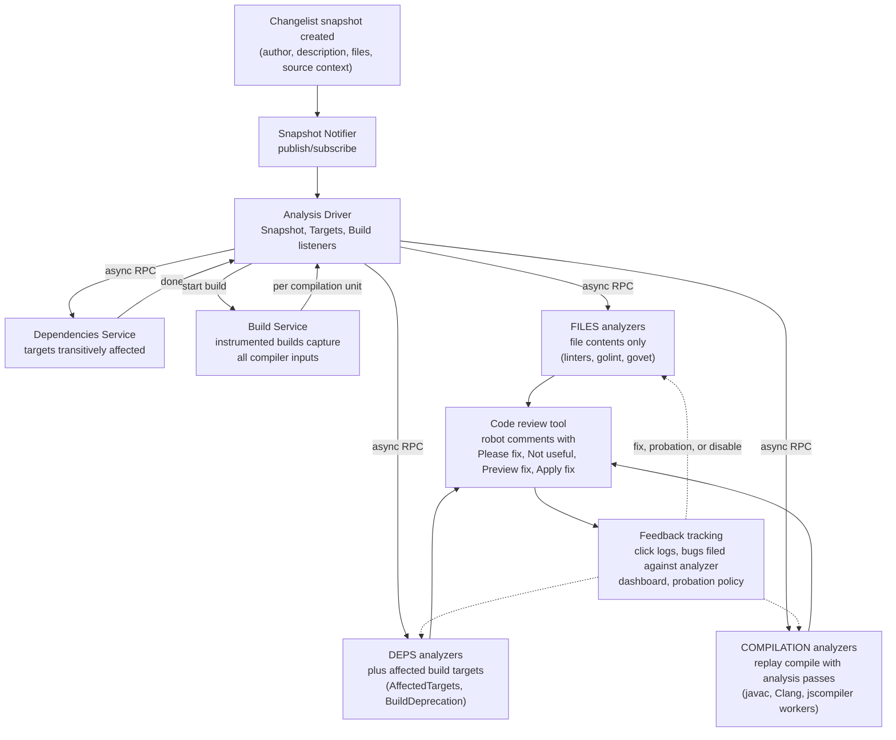

# Paper: Tricorder: Building a Program Analysis Ecosystem (Sadowski et al. 2015)

> [!summary] Claim:
> Tricorder is Google's program analysis platform, deployed since July 2013, built on the thesis that analysis adoption is a product and workflow problem, not an algorithms problem.
> Analyzers are stateless, replicated microservices behind one protocol buffer API (`GetCategory`, `GetStage`, `Analyze`) that run at three stages of increasing information (FILES, DEPS, COMPILATION) and return structured `Note`s with ordered machine-applicable fixes, which are posted as robot comments in the code review tool.
> Quality is enforced by a feedback loop, not by the analysis: every result carries "Not useful" and "Please fix" links, the not-useful rate is computed per analyzer, and an analyzer at 10 percent or more goes on probation while above 25 percent it may be turned off at once.
> The reported evidence is observational and in situ: about 93,000 findings and 716 "Please fix" clicks per day against 48 "Not useful" clicks, from checks the authors call "relatively simple".



## 1. Bibliographic Metadata

- Authors: Caitlin Sadowski, Jeffrey van Gogh, Ciera Jaspan, Emma Soederberg, Collin Winter, all Google at the time of publication.
- Title: Tricorder: Building a Program Analysis Ecosystem.
- Venue: 2015 IEEE/ACM 37th International Conference on Software Engineering (ICSE), pp. 598-608, DOI `10.1109/ICSE.2015.76` (page range confirmed against the Crossref record for that DOI; the author PDF carries no page numbers).
- Primary URL: `https://research.google/pubs/tricorder-building-a-program-analysis-ecosystem/`.
- Author PDF: `https://static.googleusercontent.com/media/research.google.com/en//pubs/archive/43322.pdf`.
- Time frame: the platform has been in production since July 2013 (paper, Section VII); the numbers are for calendar year 2014 (usage clicks) and a 90 day window (Figure 9), with the paper written in early 2015 (its references are dated up to 2015-02-11).
- Open-source sibling: Shipshape, `github.com/google/shipshape`, created 2015-01-21 and archived; the repository's README states it is "not actively maintained" and its last push is 2019-02-21 (as of 2026-11, GitHub API).
- Follow-up: Sadowski, Aftandilian, Eagle, Miller-Cushon, Jaspan, "Lessons from Building Static Analysis Tools at Google", CACM 61(4), 2018, pp. 58-66, owned by [[Paper-Lessons-From-Static-Analysis-at-Google]].

## 2. The Core Problem

The paper opens from a failure history, not a research gap.
Before Tricorder, Google had tried FindBugs, Coverity, Klocwork, and fault prediction; the paper says all of these "have largely fallen out of use" because of workflow integration, scaling, and false positives (Section II-B).
Specific numbers: the FindBugs command-line tool was used by only 35 developers in 2014, and 20 of those used it exactly once.
An earlier attempt to show FindBugs results in code review "ran into scaling problems (resulting in stale or delayed results) and produced many results developers were uninterested in addressing".

This note groups the problems the paper describes (Sections I, II-B, and III-E) into five bottlenecks; the grouping is the note's, not a list in the paper.

| Bottleneck | What the paper says went wrong | Design response |
| :--- | :--- | :--- |
| Timing | Some tools showed results too late (after submit), others too early (while still experimenting in the editor). | Show results at changelist creation and update, in code review, before submit. |
| Scale | No machine holds the repository or all compilation results; analyses must be "shardable and able to run as part of a distributed computation with only partial information"; results must arrive "within a couple of minutes". | Stateless replicated workers, staged pipeline, per-compilation-unit parallelism. |
| Workflow | "When developers have to navigate to a dashboard or run a standalone command line tool, analysis usage drops off." Editor-only tools hit latency limits at codebase scale, and Google engineers use many editors. | Trigger on developer events; show results in the one tool every engineer uses, the code review tool. |
| Trust | High false positive rates, confusing messages, and per-user severity settings that fragment the team's view. | Effective false positive policy, feedback loop, no severity ratings, project-level customization only. |
| Extensibility | No single team has the domain knowledge to write all analyses for Google's many languages and frameworks. | Plug-in model so domain experts write only the analysis, not the pipeline. |

Context numbers from Section II-A: every workday Google engineers run more than 800k builds, run 100M test cases, produce 2PB of build outputs, and send 30k changelist snapshots for review.
Most development happens at head in one very large codebase, with hermetic builds from a centrally maintained distributed build system, and every changelist is reviewed by someone other than its author.
The paper notes that most shipped code is server code, so the cost of pushing a new version is very low and bugs are relatively easy to fix after release.
See [[Paper-Google-Monorepo-Piper-and-CitC]] for the repository model and [[Paper-Modern-Code-Review-at-Google]] for the review process these results are embedded in.

## 3. Key Innovation

There is no new analysis algorithm in the paper.
The authors state this directly: every check in their Figure 2 is "relatively simple", with no control or data flow information, pointer analysis, whole-program analysis, or abstract interpretation (Section VII).
The contribution is a set of five principles plus an architecture that makes the principles cheap to follow.

### 3.1 The five principles (Section III)

1. **No (effective) false positives.**
   The paper redefines the term.
   An "effective false positive" is "any report from the tool where a user chooses not to take action to resolve the report".
   By that definition a correct report the developer ignores is a false positive, and an incorrect report whose suggested fix would still improve readability is not.
   An analysis can also have theoretical false positives that never occur in practice under a strictly enforced style guide.
   "The bottom line is that developers will decide whether an analysis tool has high impact, and what a false positive is."
2. **Empower users to contribute.**
   Analyzer authors keep pride of ownership, and Tricorder keeps a contract that lets it disable an analyzer if nobody fixes bugs filed against it, if its CPU, disk, or memory use hurts Tricorder (the author must then run a standalone service), or if its results are annoying developers.
3. **Make data-driven usability improvements.**
   Clicks and bugs from the feedback links drive changes.
   One analyzer had 75 percent of its bugs caused by misreading the result text; fixing the message and linking documentation removed them.
4. **Workflow integration is key.**
   Analyses should be triggered by developer events (editing, building, creating or updating a changelist, submitting one) and shown before check-in.
   The paper's survey evidence: developers were twice as likely to say an error "represented a significant bug" when they met it as a compiler error than when it was sent to them in a changelist.
5. **Project customization, not user customization.**
   Per-user settings produced discrepancies within and across teams, and teams saw a developer abandon a tool after discovering teammates committing code the tool flagged.
   Tricorder therefore removed all priority and severity ratings from results.
   It shows only high priority results, makes debatable analyses optional, and allows customization only at project level (for example, a team may enable optional analyses for all its code, and style checkers are disabled on third-party code with different conventions).

### 3.2 Why removing severity is a mechanism, not a slogan

The paper lists three observed effects of deleting severity ratings: low-priority checks were removed or improved instead of being filtered by users; "instead of having developers filter out analyzer results, we started getting bug reports about broken analyzers"; and complaints about inconsistent views dropped.
The concrete example: the C++ linter was also linting Objective-C files, and Objective-C developers had silently hidden all linter results, so the bug stayed invisible until filtering stopped being possible.
This is the general pattern: a user-side filter converts a defect in the tool into private noise, while no filter converts it into a bug report that reaches the owner.

## 4. Mechanism Details

### 4.1 Pipeline, stages, and why there are three

Tricorder has three stages at which it calls analyzers, "each stage has successively more information" (Section IV-A).

| Stage | Listener in the driver | Information available to the analyzer | Example analyzers in Figure 2 |
| :--- | :--- | :--- | :--- |
| FILES | Snapshot Listener | Contents of files in the change. | Linter, Golint, Govet |
| DEPS | Targets Listener | Plus the list of build targets affected by the change, transitively. | AffectedTargets, BuildDeprecation |
| COMPILATION | Build Listener | Plus "the complete AST for the entire program with fully resolved types and implicit expressions". | ErrorProne, ClangTidy, AutoRefaster, Unused, UnusedDeps, DocComments, JavacWarnings |

The stated benefits of staging: earlier stages return faster because they do not wait for a build; resource use can be rate limited at the costlier stages; and "problems with infrastructure we depend on (such as the build service) will not affect analyses from earlier stages".
Footnote 3 adds that the dependency stage is needed because the codebase is large and projects have far reaching dependencies, and "for smaller codebases, this stage can likely be skipped in favor of building the entire project".

The event sequence, from the paper:

1. The changelist snapshot notifier publishes a new-snapshot message over publish/subscribe, carrying metadata (author, description, file list) and a source context (repository, revision) usable both to read the edited files and to post robot comments later.
   On receipt Tricorder fires, asynchronously, analyze requests to FILES analyzers and a request to the dependencies service.
2. When the dependencies service finishes, Tricorder sends analyze requests to DEPS analyzers with the transitively affected targets, and asks the build service to build all targets directly affected by the change.
3. The build is instrumented to capture every input of each compiler invocation (jars, compiler arguments, headers, and so on) for all supported languages.
   As each independent compilation unit finishes, Tricorder sends RPCs to COMPILATION analyzers; the compiler-specific workers (javac, Clang, jscompiler) replay the compilation from the captured inputs with analysis passes added.

Because every step is an asynchronous callback, early analyzers run in parallel with the build and all compilation units are analyzed in parallel; "even the slowest analyses provide results within a few minutes".
Design assumption stated by the authors: "parts of the system will go down", so workers are "replicated and stateless".
The paper does not describe retries, ordering guarantees, or what happens to results for a superseded snapshot; those are not specified (see the list of unspecified operational details under limitations).

### 4.2 The analyzer API and the plug-in model

All analyzers implement one language-agnostic RPC API defined in protocol buffers and served over a Google-specific RPC library.
Each analyzer must support three operations (Section IV-B):

1. `GetCategory`: the set of categories the analyzer produces; a category is "a unique human-readable name displayed as part of the robocomments".
2. `GetStage`: which stage the analyzer runs in.
3. `Analyze`: takes information about the change and returns a list of `Note`s.

A `Note` carries the category (and optional subcategory), the location (file and line/column range), the message, a URL with more detail, and an ordered list of fixes.
Notes are rendered as robot comments in the review tool; because the output is structured, the paper observes it can be reused in other contexts, such as source browsing.

The platform ships analyzer worker services in Java, C++, Python, and Go, each exposing a language-specific interface that hides the RPC handling, plus compiler-specific services for jscompiler, javac, and Clang, plus a binary multiplexor "Linter Worker" for linters in arbitrary languages.
An author can instead run a standalone service that speaks the same API directly, which is also the remedy when an analyzer's resource use harms Tricorder.
Analyzers may analyze any language, and some are process analyzers (for example, one warns when a changelist needs merging with head, another warns when a changelist transitively affects a large percentage of Google's code).

#### Analyzer taxonomy (Section IV-C, Figure 2)

About 30 analyzers were running, with more arriving monthly.
Six of the 16 in Figure 2 are themselves frameworks; the table gives plugin counts for four of them: ErrorProne (more than 80) and ClangTidy (more than 30) do AST pattern matching for Java and C++ with each check a plugin, the Linter (more than 35 individual linters behind a binary multiplexor configured by file extension and path, with a regex to parse each linter's output; it includes Google-configured Checkstyle and Pylint), and AutoRefaster (an implementation of Refaster, more than 60 plugins).
Seven analyzers are domain-specific (for example AndroidLint and validators for project-specific configuration schemas) and seven concern changelist metadata.

Selected rows from Figure 2, all in the paper's units (results per day averaged; unique users who clicked in 2014):

| Analyzer | Stage | Results per day | "Please fix" users | "Not useful" users |
| :--- | :--- | ---: | ---: | ---: |
| Linter | FILES | 79,079 | 18,675 | 8,316 |
| ClangTidy | COMP | 4,908 | 5,823 | 1,823 |
| Builder | COMP | 4,927 | none (informational) | 491 |
| BuildDeprecation | DEPS | 1,689 | 1,890 | 381 |
| ErrorProne | COMP | 80 | 2,638 | 206 |
| AutoRefaster | COMP | 122 | 3,630 | 670 |

The Linter alone produces about 85 percent of the 93K daily findings (79,079 per day), while ErrorProne, at 80 results per day, still drew 2,638 unique please-fix users in 2014.
Read against the "small but noticeable frequency" criterion below (this note's reading, not the paper's), the two rows show it working from both ends: a rare, high-signal check and a high-volume style check both survive, but only the first needs to be rare.
The paper's Figure 2 spells the AndroidLint row "AndoidLint"; use the corrected name.

#### Admission criteria for a new analyzer (Section IV-C)

1. Easy to understand, with a clear fix; cyclomatic complexity and location-based fault prediction are named as failing this.
2. Very few false positives: developers should feel the tool points at an actual issue "at least 90% of the time", measured by running the analyzer on existing code and manually checking "a statistically sound sample size".
   The 10 percent figure is footnoted as matching Coverity's.
3. Potential for significant impact; language focused analyzers are vetted by language experts.
4. Occurs "with a small but noticeable frequency": never-occurring warnings are pointless, over-frequent ones are likely harmless.

These closely track the Error Prone project's public "Criteria for new checks" page for `Severity.ERROR` checks (as of 2026-11, Both), which lists five bullets: easy to understand, easy to fix, no false positives, a correctness issue and not style, and small but noticeable frequency.
Trial path before launch: run the new analysis for a whitelisted set of volunteer users who view experimental results, and where possible run it as a MapReduce over all existing code to measure the false positive rate first.

### 4.3 Where results appear: integration points and their budgets

The paper is explicit that there are different false positive and latency budgets at different integration points (Section III-D).

| Integration point | Budget stated in the paper | Consequence |
| :--- | :--- | :--- |
| Compile time (ErrorProne on javac, Clang) | Breaks the build on a finding, so the effective false positive rate must be "essentially zero"; compile overhead must be under 5 percent. | Only the most certain, cheapest checks. Only results that fail the build are shown, because "warnings shown when building are often ignored". |
| Code review (Tricorder) | Effective false positive rate under 10 percent. Mean review time of a change with more than one line is over 1 hour; analyses should typically finish in under 5 to 10 minutes, "ideally much less". | Primary integration point. Results default to changed lines only, with some exceptions (for example an unused variable on an unchanged line after the block using it was deleted); authors can opt to see unchanged lines. |
| Testing (dynamic tools such as ThreadSanitizer and AddressSanitizer) | "Typically have no false positives and < 10x slowdowns." | Run through the test infrastructure instead of the review pipeline; see [[Paper-ThreadSanitizer]] and [[Paper-AddressSanitizer]]. |
| Code search nightly layer | Optional layer; most developers do not use it. | Useful for noisier analyses that have a dedicated cleanup team. |

IDE integration is not precluded because an IDE can issue RPCs to the Tricorder service, but IDE-only integration was "untenable" because most Google developers do not use IDEs for all tasks.
Review integration also gives "peer accountability": the reviewer can see whether the author ignored a result.

### 4.4 Fixes

Analyzers are encouraged to attach fixes, and the review tool can show and apply them (Section IV-D).
The paper gives three benefits: a fix clarifies the result, applying it avoids a context switch, and a tool-provided fix lowers the bar to fixing.
Fixes "are not tied to a particular IDE, they are part of each analysis and are language-agnostic".

The apply mechanism relies on "a system that makes the content of a changelist available for edits": edits such as applying a fix are made directly to the code in the changelist and appear in the changelist owner's workspace.
The paper does not name this system; the vault's [[Paper-Google-Monorepo-Piper-and-CitC]] describes the Piper and CitC workspace model, but the identification is an inference, not a statement in the Tricorder paper.
For Gerrit, the authors suggest using existing APIs to apply fixes as a patch to the code under review.

The Shipshape open-source API shows the wire shape of a fix (`shipshape/proto/note.proto`, as of the archived master branch, Both):

- `Note` has `category`, `subcategory`, `location`, `description`, `more_info`, `additional_data`, `repeated Fix fix` ("if multiple ones are present, they should be ordered by descending preference"), and a `severity` enum of `BUILD_ERROR`, `WARNING`, `OTHER` (default `WARNING`).
- `Fix` has a `description`, a `source_context`, and `repeated Replacement`; replacements "must be grouped by file and within the file ordered by the range" and "must not overlap".
- `Replacement` has a `path`, a `FixRange`, and `new_content`; the doc comment says replacements "are independent, that is if there are multiple ones touching the same file, the location always refers to the original file rather than the file with other Replacements applied".
- `FixRange` is line-based or byte-based (start and end must use the same unit), zero-indexed, start inclusive, end exclusive.

The consequence of "independent, original coordinates" is that an applier must either sort and apply back to front or track offset shifts, and must reject overlaps; Section 7 shows both behaviors in a short script with its real output.

The same pattern exists in today's public analyzers (as of 2026-11, Both):

- clang-tidy: `--fix` applies suggested fixes and bails on compile errors unless `--fix-errors` is given; `--export-fixes=<filename>` writes fixes to YAML that `clang-apply-replacements` can apply.
- Error Prone: `-XepPatchChecks:<checks>` selects checks to turn into fixes and `-XepPatchLocation:<dir>` writes a unified diff `error-prone.patch` there; the special value `IN_PLACE` edits sources directly, and the docs mark this feature experimental.

### 4.5 Feedback loop, metrics, and the probation policy

Each robot comment carries four links (Section IV-E):

| Link | Who sees it | Effect |
| :--- | :--- | :--- |
| NOT USEFUL | Developers (the 2015 paper states no role restriction; the 2018 CACM paper says "reviewers or proposers") | Offers to file a bug against the analyzer's owning project, prepopulated with the robot comment's details. |
| PLEASE FIX | Reviewers only | Creates a review comment asking the author to fix the finding. |
| PREVIEW FIX | Any developer (no role restriction stated), when a fix exists | Shows a diff of the suggested fix. |
| APPLY FIX | Authors only, after preview, when a fix exists | Applies the fix to the changelist. |

The paper's metric, quoted exactly: `not-useful rate = NOT_USEFUL / (NOT_USEFUL + PLEASE_FIX + APPLY_FIX)`.

Policy (Section IV-E): analyzer writers are expected to watch a dashboard; a rate of 10 percent or more puts the analyzer on probation and the writer must show progress; above 25 percent Tricorder "may decide to turn the analyzer off immediately".
In practice the team works with writers to fix problems rather than disabling at once, and it is "not as concerned about a temporary increase" for analyzers affecting few developers.
"Having a policy in place has proven invaluable in making expectations clear."

Observed rates (Section V-a): the overall weekly not-useful rate was typically about 5 percent in recent months of 2014 and under 4 percent without probationary analyzers; the most successful analyzers sit at 0 to 3 percent; of "Not useful" clicks, between 10 and 60 percent (depending on analyzer) result in a bug being filed.
The 2018 CACM follow-up describes the policy as "computing the ratio of 'Please fix' vs. 'Not useful' clicks", and says that above 10 percent the team "disables the analyzer until the author(s) improve it"; it does not give the formula, it drops APPLY FIX from the description, and its 10 percent threshold disables rather than starting probation, so do not mix numbers from the two papers without noticing that.

## 5. Evaluation and Limitations

### 5.1 What the paper measures

Four claims, each with its own evidence (Section V):

| Claim | Evidence | Reading |
| :--- | :--- | :--- |
| Usability | Click counts and the not-useful rate per analyzer and overall (Figures 2, 5, 6, 7). | Developers engage; about 5 percent overall not-useful rate; 0 to 3 percent for the best analyzers. |
| Codebase impact | ClangTidy `misc-redundant-smartptr-get` instance counts per week (Figure 8); current clang-tidy documents this check as `readability-redundant-smartptr-get` (as of 2026-11, Both). After the check was shown in Tricorder the number of instances in the codebase dropped sharply; other ClangTidy checks "drop off or level off". | Review-time display both prevents new violations and drives cleanup of old ones, as developers learn the pattern. Checks with "more complicated, non-local fixes" only level off. |
| Pluggability | 13 of the 16 analyzers in Figure 2 (all except Formatter, BuildDeprecation, Builder) were contributed by members of more than 10 other teams; most analyzers overall are contributed from outside the Tricorder team. | The plug-in model works for contributors. |
| Scalability | Figure 9, 90 days of production data. | See the table below. |

Figure 9, scalability numbers, collected over 90 days (average, median, max):

| Metric | Average | Median | Max |
| :--- | ---: | ---: | ---: |
| Tricorder runs per day | 31K | 38K | 66K |
| Findings per day | 93K | 127K | 183K |
| Builds per day | 4K | 6K | 9K |
| Analyzer runs per day | 81K | 93K | 208K |
| Files per changelist | 12 | 1 | 333K |
| Languages per changelist | 1 | 1 | 22 |
| Findings per changelist | 14 | 1 | 5K |
| "Please fix" per changelist | 2 | 1 | 81 |
| "Not useful" per changelist | 0.14 | 0 | 20 |
| "Please fix" per day | 716 | 907 | 1786 |
| "Not useful" per day | 48 | 52 | 123 |

Two readings the paper itself supports: an average changelist has two please-fix clicks and no not-useful clicks; and most findings are never shown, because they fall on unchanged lines.
The paper also gives the aggregate "5117 please-fix clicks per week" in the discussion.

Two internal inconsistencies worth knowing before you quote the paper: Section V-d says "close to 5K builds per day" while Figure 9 lists an average of 4K; and for several daily metrics the median exceeds the average, which the paper does not explain (it says only that the data were collected over 90 days).
Reading them: the daily distribution is skewed by low-volume days such as weekends, but that is an inference, not stated.

Derived rates computed in Section 7 (real output below), clearly not the paper's metric: 48 / (48 + 716) = 0.0628, using the Figure 9 averages and omitting the apply-fix clicks the paper puts in the denominator; and 716 / 93,000 is about 0.77 percent of findings receiving a please-fix click.

### 5.2 The paper's own caveats on clicks

Clicks are "an imperfect measure of analyzer quality" for four stated reasons: developers fix issues before their reviewer sees them (so please-fix is undercounted); they fix in their own editor rather than via Apply Fix (undercounting applies); they may ignore a finding without clicking Not useful (so the rate may reflect only how strongly they feel); and they may click by accident.
Also, footnote 6: "we do not have the ability to measure how many results are viewed by developers", so the denominator of exposure is unknown.
Yet "clicks have been a good signal for developer annoyance".
The authors hypothesize the strong correlation between Please fix and Preview fix is reviewers asking and authors previewing, and that low Apply fix reflects authors fixing in their editor while handling other review comments; this is explicitly a hypothesis from developer observation, not a measurement.

### 5.3 Limitations the paper does not close

- **No counterfactual.**
  There is no controlled comparison, no measure of defects prevented in production, and no estimate of recall.
  The claim "analyses find real problems" rests on clicks, not on bug-escape data.
- **Survivorship in the numbers (this note's analysis, not the paper's).**
  The metric only observes analyzers that survived the admission criteria and probation policy, so low reported rates are partly a product of the gating, not independent evidence that analysis in general is liked.
- **Definition drift.**
  The effective false positive definition makes "false positive rate" a social quantity that depends on code review norms and on whether findings are shown on changed lines only; it is not comparable to a rate on a benchmark.
- **Simple checks only.**
  The authors say the analyzers use no dataflow or whole-program analysis, and they stress the payoff comes from low-cost checks.
  They believe more sophisticated analyses are "also worthwhile" (footnote 7) but report none.
- **Unspecified operational details.**
  The paper does not describe retry or timeout behavior, ordering between a late result and a newer snapshot, deduplication of the same finding across snapshots, how robot comments are updated or resolved, per-analyzer resource quotas beyond "rate limiting at costlier stages", or the actual size of the worker fleet.
  It states only that a 2 to 3 person team maintains Tricorder (and also works on the open-source version).
- **Related work comparison is thin.**
  The comparison with ReviewBot rests on ReviewBot being evaluated on 34 review requests, against "millions" for Tricorder; the paper's statement is that ReviewBot needs explicit invocation, does not show results to reviewers, supports only three Java tools, and decouples fixes from analysis results.
- **Generalization.**
  The COMPILATION stage depends on a centrally maintained, hermetic, distributed build system that records every compiler input; a codebase without one cannot replay compiles the same way.
  The paper itself says only that the DEPS stage can probably be skipped for smaller codebases (footnote 3).

## 6. Industry Impact

What can be sourced to documents fetched for this note:

- **Follow-up scale, as of January 2018 (CACM paper).**
  Tricorder included 146 analyzers, 125 contributed from outside the Tricorder team, plus seven plug-in systems for hundreds of additional checks; it reported results for more than 30 languages; it analyzed about 50,000 code review changes per day with three analysis runs per second at peak; reviewers clicked "Please fix" more than 5,000 times per day, authors applied automated fixes about 3,000 times per day, and analyzers received "Not useful" clicks 250 times per day.
  About 70 optional analyses were available and 2,500 projects had enabled at least one.
  The default for C++ and Java builds at Google was "compiler warnings-free", with analysis results shown either as compiler errors or in code review.
  These are the CACM paper's figures for Google at that date, not current numbers.
  Compare the 2015 numbers (about 93K findings and 716 please-fix clicks per day) to see the growth: please-fix volume grew roughly sevenfold in about three years, though the two papers count slightly differently.
- **The 2018 paper's headline consequence.**
  It formalizes the admission criteria into "compile time" and "code review" tiers with the same 0 and 10 percent effective false positive budgets, which is the 2015 principle turned into policy; see [[Paper-Lessons-From-Static-Analysis-at-Google]].
- **Error Prone and clang-tidy as the public counterparts.**
  Error Prone is not a Tricorder descendant: the 2015 paper treats it as an existing javac extension (citing its 2014 project page) that also runs at compile time, outside Tricorder.
  The paper's COMPILATION stage replays javac and Clang with added passes, and Error Prone and ClangTidy are two of the plug-in frameworks inside Tricorder (Figure 2: more than 80 and more than 30 plugins; the Linter, more than 35, and AutoRefaster, more than 60, are larger than ClangTidy).
  Both are public today, with a fix-application path (see Section 4.4), and Error Prone's published admission criteria mirror the paper's.
  The 2018 paper says Error Prone also "inspired a new set of analyses for C++ that are integrated with Tricorder and called ClangTidy".
- **Shipshape.**
  The open-source attempt shipped a Docker image with a `ShipshapeAnalyzer` service (`GetCategory`, `GetStage`, `Analyze`) and a `Shipshape` service (`Run`), a CLI (`shipshape <Directory>`), and a Jenkins plugin, built with Bazel; its README lists bundled analyzers go vet, JSHint, PyLint, and an unfinished Error Prone integration, plus contributed AndroidLint, CTADetector, and ExtendJ analyzers.
  Its stage enum has only `PRE_BUILD` and `POST_BUILD` and its environment enum names `CODE_REVIEW`, `LOCAL_CLIENT`, `BATCH`, `IDE`, and `POST_SUBMIT`, which shows that the open-source design collapsed FILES and DEPS into one pre-build stage, an inference from the two enums, in line with the paper's remark that "Shipshape has a different architecture to support the needs of open-source projects".
  The repository is archived and read-only (as of 2026-11).
- **Prior art and what is new.**
  Tricorder did not invent analysis in code review: the paper cites ReviewBot, which showed static analysis results in code review, supported only three Java tools, required reviewers to call it explicitly, and kept its fix system decoupled from the analysis results.
  The paper's claimed differences are analysis results shown to reviewers without being requested, analyzers written by other teams, a feedback loop to analyzer writers, and fixes produced by the analyzers themselves and applied through a language-agnostic mechanism.
  This note makes no claim about how far later industry tools were influenced by Tricorder, because no adoption source was checked.

## 7. Worked Example: The Two Mechanisms Rebuilt

Rebuild rung: the smallest runnable model of two mechanisms the paper depends on, fix application in original coordinates and the not-useful policy.
It uses only published figures, not Google data.
The script below is `scratch/tricorder_toy.py` in the job directory; it was run once with `python3 -I` and the output block is its real output.

```python
"""Toy model of two Tricorder mechanisms, using only published figures.

1. Fix application: replacements are expressed in ORIGINAL-file byte
   coordinates (Shipshape note.proto, message Replacement), so they must
   be non-overlapping and applied back to front.
2. Analyzer health: not-useful rate and the probation policy from
   Sadowski et al., ICSE 2015, Section IV-E.
"""
from __future__ import annotations

from dataclasses import dataclass


@dataclass(frozen=True)
class Replacement:
    start: int  # inclusive byte offset in the ORIGINAL text
    end: int  # exclusive
    new: str


def apply_fix(text: str, repls: list[Replacement]) -> str:
    ordered = sorted(repls, key=lambda r: r.start)
    for a, b in zip(ordered, ordered[1:]):
        if a.end > b.start:
            raise ValueError(f"overlap: [{a.start},{a.end}) vs [{b.start},{b.end})")
    for r in reversed(ordered):  # back to front keeps earlier offsets valid
        text = text[: r.start] + r.new + text[r.end :]
    return text


def apply_naive_forward(text: str, repls: list[Replacement]) -> str:
    for r in sorted(repls, key=lambda r: r.start):  # offsets go stale
        text = text[: r.start] + r.new + text[r.end :]
    return text


def not_useful_rate(not_useful: int, please_fix: int, apply_fix_clicks: int) -> float:
    return not_useful / (not_useful + please_fix + apply_fix_clicks)


def policy(rate: float) -> str:
    if rate > 0.25:
        return "may disable immediately"
    if rate >= 0.10:
        return "probation"
    return "healthy"


src = "if (p.get() != nullptr) use(p.get());"
i1 = src.index("p.get()")
i2 = src.index("p.get()", i1 + 1)
fix = [Replacement(i1, i1 + 7, "p"), Replacement(i2, i2 + 7, "p")]
print("original :", src)
print("reverse  :", apply_fix(src, fix))
print("forward  :", apply_naive_forward(src, fix))
try:
    apply_fix(src, [Replacement(0, 10, "x"), Replacement(5, 12, "y")])
except ValueError as e:
    print("rejected :", e)

print()
print("2015 Fig 9 averages per day: please_fix=716 not_useful=48 findings=93000")
print("  not_useful / (not_useful + please_fix) = %.4f" % not_useful_rate(48, 716, 0))
print("  please_fix clicks per finding          = %.4f" % (716 / 93000))
print("2018 CACM (Jan 2018) per day: please_fix>5000 applied~3000 not_useful=250")
print("  not_useful rate = %.4f" % not_useful_rate(250, 5000, 3000))
print()
for name, nu, pf, af in [("A", 3, 90, 7), ("B", 12, 80, 8), ("C", 40, 50, 10)]:
    r = not_useful_rate(nu, pf, af)
    print(f"analyzer {name}: nu={nu} pf={pf} af={af} rate={r:.2f} -> {policy(r)}")
```

Output, captured on darwin-arm64 with Python 3.15.2 (`python3 -I`):

```text
original : if (p.get() != nullptr) use(p.get());
reverse  : if (p != nullptr) use(p);
forward  : if (p != nullptr) use(p.get(p
rejected : overlap: [0,10) vs [5,12)

2015 Fig 9 averages per day: please_fix=716 not_useful=48 findings=93000
  not_useful / (not_useful + please_fix) = 0.0628
  please_fix clicks per finding          = 0.0077
2018 CACM (Jan 2018) per day: please_fix>5000 applied~3000 not_useful=250
  not_useful rate = 0.0303

analyzer A: nu=3 pf=90 af=7 rate=0.03 -> healthy
analyzer B: nu=12 pf=80 af=8 rate=0.12 -> probation
analyzer C: nu=40 pf=50 af=10 rate=0.40 -> may disable immediately
```

Reading the output:

- `forward` shows the failure the Shipshape comment is guarding against: the first replacement shortened the text by 6 bytes, so the second replacement's original offsets now point 6 bytes past where `p.get()` sits, and the result is corrupted without any error.
  Applying back to front, or rewriting offsets as you go, avoids it.
- The overlap check is the other half of the contract: two replacements that touch the same original bytes have no defined merge, so the applier must reject them rather than choose.
- The 2018 CACM numbers give a 3.0 percent rate under the paper's 2015 formula using "more than 5,000", "approximately 3,000", and "250"; they are bounds and approximations, so treat 0.0303 as a rough check, not a measured value.
  The 2018 paper does not publish its rate under this formula.

What the model does not prove: nothing in it measures Tricorder, shows any latency, or validates the paper's claims; it only makes two stated mechanisms concrete.

## 8. Concept Grounding

- [[Paper-Lessons-From-Static-Analysis-at-Google]]: the 2018 follow-up; owns the compile-time versus code-review tiering and the long-run lessons, and this note owns only the 2015 platform.
- [[Paper-Modern-Code-Review-at-Google]]: the code review system whose comments Tricorder posts to; owns review statistics.
- [[Paper-Google-Monorepo-Piper-and-CitC]]: the repository and workspace model behind changelist snapshots and fix application; owns the monorepo.
- [[Paper-ThreadSanitizer]] and [[Paper-AddressSanitizer]]: the dynamic analyses the paper runs via testing instead of in review.
- [[Paper-Build-Systems-a-la-Carte]] and [[Hermetic-and-Reproducible-Builds]]: why hermetic, centrally maintained builds let the COMPILATION stage replay a compile from captured inputs.
- [[Code-Review-and-Readability-Systems-at-Scale]]: the review-system practices (latency, ownership, readability) that determine how much an analysis bot can add.
- [[Build-and-Test-Latency-Economics-and-Flaky-Tests]]: the latency budgets (minutes, not hours) that the staged pipeline is designed against.

> [!warning] Pitfalls:
> - Quoting "no false positives" without the paper's definition of effective false positive; the policy is about developer action, not analysis soundness.
> - Using the 2015 numbers (93K findings per day) and the 2018 numbers (50,000 changes per day, 146 analyzers) as one time series; they come from different papers, different definitions, and different dates.
> - Mixing the not-useful formulas: 2015 is `NU / (NU + PF + AF)` with probation at 10 percent; the 2018 text describes a ratio of "Please fix" and "Not useful" clicks with disabling above 10 percent.
> - Treating the clicks as exposure-normalized; footnote 6 says view counts are not measured.
> - Copying the open-source Shipshape layout and assuming it matches the internal three-stage pipeline: its public stage enum is `PRE_BUILD` and `POST_BUILD` only.
> - Building severity or per-user filters "because users asked"; the paper's evidence is that these hide defects in the tool and fragment the team's view.
> - Reusing the paper's thresholds (under 5 percent compile overhead, under 10 percent effective false positives, 5 to 10 minute analysis time) as universal; they are Google's budgets for its own review times.
> - Writing a fix that reports edits in post-edit coordinates; see the Replacement contract in Section 4.4.

> [!tip] Practice Drill:
> Pick an open-source repository, run clang-tidy with `--export-fixes=fixes.yaml` on a small subset of files for one check (for example `readability-redundant-smartptr-get`), and apply the result with `clang-apply-replacements` into a scratch copy.
> Then edit the YAML so two replacements overlap and observe what the applier does; compare with the rejection rule in Section 7.
> Not run here: the flags are from the fetched clang-tidy documentation; the drill itself was not executed for this note.

## 9. Interview Questions

### L5

> [!question] L5: What is an "effective false positive" and why did Tricorder adopt it?
>
> > [!success]- Answer
> > It is any report where the user chooses not to take action to resolve it.
> > The analysis writer's definition (an incorrect report) differs from the developer's (any report they did not want), and adoption and trust are driven by the developer's.
> > The paper also excludes some incorrect reports from the count when acting on them would still improve readability, and notes some analyses have false positives in theory but not in practice.
> > The consequence is that the policy is enforced against click data and review behavior instead of a benchmark.

> [!question] L5: Name the three stages and what extra information each stage has.
>
> > [!success]- Answer
> > FILES: file contents of the change.
> > DEPS: additionally the transitive list of build targets affected.
> > COMPILATION: additionally the complete AST with fully resolved types and implicit expressions, from a replayed compile.
> > Benefits: earlier stages are faster, costlier stages can be rate limited, and build service outages do not affect earlier stages.

> [!question] L5: Predict the output.
> A fix applies two replacements, each in original coordinates, to `if (p.get() != nullptr) use(p.get());`, replacing each `p.get()` with `p`.
> What does an applier that applies them in ascending start order, using the original offsets and updating the string after each, produce?
>
> > [!success]- Answer
> > The first replacement is correct.
> > The second replacement's offsets are now stale by 6 bytes, so it replaces the wrong span.
> > The real output from Section 7 is `if (p != nullptr) use(p.get(p`.
> > Correct application goes back to front (or adjusts offsets) and gives `if (p != nullptr) use(p);`.

### L6

> [!question] L6: Debug this: a new Java analyzer launches in code review.
> The first week shows 14 "Not useful" bugs filed per week, all of the form "the analysis is wrong, my format specifiers match the arguments".
> The not-useful rate is 14 percent, and the analyzer is on probation.
> What do you check first and what do you change?
>
> > [!success]- Answer
> > Read the filed bugs and test whether the analysis is actually correct, because a click rate does not say which.
> > In the 2018 CACM account of a closely similar case (an Error Prone check on a printf-like Guava function that accepts only `%s`), the analysis was correct every time and the users misread what it meant.
> > The fix was the diagnostic text, which was changed to state that the function accepts only `%s`, after which the bugs stopped.
> > Generalizing from the 2015 paper: 75 percent of bugs against one analyzer were wording misreads, so first suspect the message, link to documentation, and only then the logic.
> > Also check that the analyzer is not misfiring on a language it was not meant for (the Objective-C linter case) before changing logic.

> [!question] L6: Why did Tricorder drop severity ratings and per-user customization, and what is the downside?
>
> > [!success]- Answer
> > User filters hide tool defects as private noise and make different teammates see different results, which led developers to abandon tools when teammates committed flagged code.
> > Removing ratings pushed the team to remove or fix low-value checks and produced bug reports about broken analyzers instead of silent filtering.
> > The downside is that every analyzer must clear a high bar to be shown at all, so legitimate but lower-confidence findings go to optional analyzers, project-level opt-ins, or the code search layer, which fewer developers see; the paper notes most developers do not use the code search layer.

> [!question] L6: A compile-time check and a code-review check both can flag the same pattern.
> What decides which one it becomes?
>
> > [!success]- Answer
> > The false positive budget and cost.
> > The paper's compile-time budget is essentially zero effective false positives and under 5 percent compile overhead, and it only shows results that break the build.
> > The code review budget is under 10 percent effective false positives and a result in under 5 to 10 minutes.
> > Build integration is also impractical when false positives are too high, the analysis is slow, or only changed lines are worth reporting.

### L7+

> [!question] L7: Design the feedback loop for an analysis bot at a 5,000 engineer company without copying Google's data volume.
> What would you keep, change, and measure?
>
> > [!success]- Answer
> > Keep: structured notes with ordered fixes, a Not useful link that files a bug to the owning team, a per-analyzer not-useful rate with documented probation and disable thresholds, and project-level customization only.
> > Change: you have far fewer events, so the weekly rate is noisy; set a minimum click count before a threshold triggers, and track the denominator you can measure (comments shown) since the paper could not.
> > Measure: not-useful rate, please-fix rate, fix-apply rate, time to first result, and share of results on changed lines.
> > Caveats from the paper: clicks undercount, and "ignored" is invisible, so periodically sample results by hand for a real false positive rate.
> > The 10 and 25 percent thresholds are Google's, not derived; calibrate against your own review culture.

> [!question] L7: The paper argues an analysis is only as good as developers' willingness to act.
> What evidence in the paper supports that claim, and what evidence is missing?
>
> > [!success]- Answer
> > Supporting: the FindBugs history (35 users of the command line in 2014, 20 of them once), the survey showing developers were twice as likely to call an error significant when met as a compiler error, the ClangTidy trend where review-time display lowered the number of instances in the codebase, and a sustained overall not-useful rate of about 5 percent.
> > Missing: any measure of bugs that escaped to production with and without the system, any estimate of recall, any control group, and exposure data (footnote 6).
> > The claim is therefore an adoption claim, not a bug-reduction claim; a distinguished reviewer would ask for incident data before attributing quality gains to the platform.

> [!question] L7: Debug this architecture: your FILES stage returns in seconds but a DEPS analyzer shows stale results after a second snapshot is uploaded.
> What does the paper tell you, and what does it not?
>
> > [!success]- Answer
> > The paper shows that each stage is triggered per snapshot by asynchronous messages and that results are forwarded to the review system as they arrive, with workers stateless and replicated.
> > It does not specify how late results for an older snapshot are discarded or superseded, so you must design that yourself: tag each result with snapshot identity, drop or mark stale results on arrival, and make the robot comment idempotent per (analyzer, location, snapshot).
> > The paper's guarantee is that no stage waits on another except via the dependency and build services, so a slow stage cannot delay FILES results.
> > This is design extrapolation from the stated architecture, not a documented Tricorder behavior.

> [!question] L8+: You own the static analysis strategy for a 20,000 engineer company with a multi-language monorepo and no staged pipeline.
> What is your sequencing, and where would you deviate from Tricorder?
>
> > [!success]- Answer
> > Sequence: pick the review tool as the single integration point; ship one linter-class analyzer and the Not useful and Please fix links before anything sophisticated; add a plug-in contract and analyzer admission criteria; add fixes; then add compile-time enforcement only for checks with near-zero false positives and negligible overhead.
> > Deviations: build the staged pipeline only if you have a hermetic build that records compiler inputs; otherwise start with FILES-equivalent analyses and the build's own compiler plugins.
> > Accept the paper's limits: you will not get a controlled evaluation unless you deliberately stagger rollout; do that for at least one analyzer to measure effects beyond clicks.
> > Owners must have authority and an escalation path to disable analyzers, since the policy only works if enforced.

## 10. Further Reading

- Sadowski et al., Tricorder (ICSE 2015), `https://research.google/pubs/tricorder-building-a-program-analysis-ecosystem/` - the primary source this note summarizes.
- Sadowski et al., "Lessons from Building Static Analysis Tools at Google", CACM 61(4), 2018, `https://storage.googleapis.com/gweb-research2023-media/pubtools/4365.pdf` - three years later: scale numbers, compile-time versus review tiers, and the ratio policy.
- `https://github.com/google/shipshape` and its `shipshape/proto/` directory - the only public form of the Tricorder API; archived, so read it as a design artifact.
- `https://errorprone.info/docs/criteria` - the public admission criteria for compile-time checks, which match the paper's principles.
- `https://errorprone.info/docs/patching` and `https://clang.llvm.org/extra/clang-tidy/` - the current public fix-application mechanisms.

## Related

- Prerequisites: none
- Next: [[Paper-Coz-Causal-Profiling]]
- See also: [[Paper-Lessons-From-Static-Analysis-at-Google]], [[Paper-Modern-Code-Review-at-Google]], [[Paper-Google-Monorepo-Piper-and-CitC]], [[Code-Review-and-Readability-Systems-at-Scale]], [[Hermetic-and-Reproducible-Builds]], [[Paper-ThreadSanitizer]], [[Paper-AddressSanitizer]]
