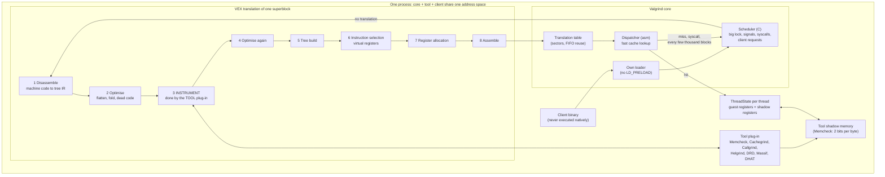

# Paper: Valgrind: A Framework for Heavyweight Dynamic Binary Instrumentation (Nethercote and Seward 2007)

> [!summary] Claim:
> Valgrind is a dynamic binary instrumentation framework built around one decision: it disassembles every client machine code block into an architecture-neutral SSA IR, lets a tool rewrite that IR, and resynthesizes new machine code from it, so client code and analysis code are the same kind of thing and are scheduled and register-allocated together.
> That decision (disassemble-and-resynthesize, "D&R", against the copy-and-annotate, "C&A", approach of Pin and DynamoRIO) is what makes shadow value tools feasible: first-class shadow registers, an events system for system calls and stack changes, and thread serialization that makes a load and its shadow load effectively atomic.
> The price is speed: the paper reports a 4.3x geometric-mean slowdown for the do-nothing tool and 22.1x for Memcheck on SPEC CPU2000, and openly concedes that lightweight tools are better built elsewhere.
> The mechanism has aged well in structure and changed in detail: Valgrind 3.28.0 (2026-10-23) still serializes threads behind one big lock and still translates superblocks through VEX, but it now chains translations, uses a 4-way fast cache, and defaults to a different self-modifying-code policy, and upstream has no arm64 macOS port.



## 1. Bibliographic Metadata

| Field | Value |
| :--- | :--- |
| Title | Valgrind: A Framework for Heavyweight Dynamic Binary Instrumentation |
| Authors | Nicholas Nethercote (National ICT Australia, Melbourne), Julian Seward (OpenWorks LLP, Cambridge, UK) |
| Venue | PLDI '07, June 11-13, 2007, San Diego, California (from the paper's own copyright footer) |
| Pages | 89-100 (Crossref record for the DOI, "Proceedings of the 28th ACM SIGPLAN Conference on Programming Language Design and Implementation") |
| DOI | 10.1145/1250734.1250746 (Crossref record resolves to this paper, pages 89-100) |
| Primary URL | https://valgrind.org/docs/valgrind2007.pdf |
| Tool version evaluated | Valgrind 3.2.1 |
| Companion papers | VEE 2007 (shadow memory data structures), USENIX ATC 2005 (Memcheck's bit-precise definedness), Nethercote's 2004 Cambridge PhD thesis (the earlier UCode-based design) |
| Valgrind first released | 2002 (stated in the paper, section 3) |

The paper has two jobs.
It characterizes a class of tools, shadow value tools, and it argues that a DBI framework should be judged by what tools it lets you build and not only by how fast it runs a do-nothing client.
The performance numbers are therefore the least important part of the paper and the part most often quoted.

The paper itself describes Memcheck, Cachegrind, Massif, and Nulgrind.
It says the 3.2.1 distribution "contains four tools" and does not name them in the text I read.
It does not discuss Callgrind, Helgrind, DRD, or DHAT; those are later tools in the same plug-in architecture, and the 3.28.0 tool list is in the Mechanism section below.

## 2. The Core Problem

A dynamic binary analysis (DBA) tool analyzes a program at run time at the machine-code level.
Dynamic binary instrumentation (DBI) is the implementation technique: add analysis code to the client at run time, with no recompilation or relinking, and with coverage of every user-mode instruction including libraries and code with no source.
By 2007 several generic DBI frameworks existed (Pin, DynamoRIO, Valgrind), and the literature compared them almost entirely on how fast they ran an empty or trivial tool.

The paper argues that this measures the wrong thing, because the tools are what make a framework useful.
It singles out shadow value tools: tools that shadow every register and every memory value with another value that says something about it.
The paper's list of examples shows the range:

| Tool | What each shadow value says | Granularity |
| :--- | :--- | :--- |
| Memcheck | is this bit undefined (uninitialized or derived from undefined) | one shadow bit per bit |
| TaintCheck, TaintTrace, LIFT | is this byte tainted (from an untrusted source) | one bit or byte per byte |
| McCamant and Ernst's secret tracker | is this bit secret | per bit |
| Hobbes, DynCompB | abstract type of the value | per value or byte |
| Annelid | is this word an array pointer (bounds errors) | per word |
| Redux | the dynamic dataflow that produced the value | per value |

These are "heavyweight" tools in the paper's sense: they hold large analysis data accessed in irregular patterns, and they instrument many operations differently (loads, adds, shifts, FP, SIMD, allocations).
The analysis state is as complicated as the client state.
A lightweight tool (a trace collector, a basic-block counter) appends events or increments counters and does not have this problem.

The paper's central technical claim is that heavyweight tools need nine capabilities from the framework, and that most frameworks supply few of them.
Those nine requirements (R1 to R9) are listed in the Mechanism section with the Valgrind mechanism that satisfies each.

## 3. Key Innovation

The paper's contribution is a way of looking at DBI, a design that follows from it, and an evaluation that weighs capability next to speed.

1. **Two ways to represent code.**
   Section 3.5 of the paper names two basic DBI code representations.
   Copy-and-annotate (C&A) copies the original instructions through nearly verbatim and attaches a description of their effects (a data structure in DynamoRIO, a query API in Pin).
   Disassemble-and-resynthesize (D&R) converts each instruction to IR operations, discards the original instruction, and generates the final code purely from the IR.
   Valgrind is D&R, and the paper calls that the single feature that most distinguishes it.
2. **The same IR for client and analysis code.**
   Because both are IR, analysis code is exactly as expressive as client code (it can use FP and SIMD), the optimizer and register allocator treat both equally, and no special care is needed to keep analysis code from clobbering condition codes, since the IR computes them explicitly.
3. **First-class shadow registers and an unlimited supply of IR temporaries.**
   Shadow registers live in the same per-thread state block as guest registers, and a tool manipulates them with the same IR operations.
4. **An events system.**
   The IR cannot express what a system call reads or writes, so the core wraps every system call and calls tool callbacks (`pre_mem_read`, `post_mem_write`, `new_mem_mmap`, and so on).
5. **Thread serialization.**
   Only one client thread runs at a time, which sidesteps the non-atomicity of "load plus shadow load" without locking the shadow memory.
6. **Capability-weighted evaluation.**
   The evaluation compares Valgrind against Pin on the nine requirements, then reports performance as one axis among four (ease of tool writing, robustness, instrumentation capabilities, performance).

## 4. Mechanism Details

Source key for this section: "paper" is the PLDI 2007 text; "3.28.0" is the source and manual of Valgrind 3.28.0 read from the sourceware tarball (as of 2026-11, Linux unless stated).

### 4.1 One process, its own loader

Valgrind's goal at start-up is to load the core, the tool, and the client into a single process that shares one address space.
The paper describes the third start-up design Valgrind has used:

- Each tool is a statically linked executable containing the tool code plus the core code (the paper says the core is about 2.5 MB), linked to load at a non-standard address (0x38000000 on x86/Linux).
- The `valgrind` command is a small wrapper that scans for `--tool=` and `execve`s the tool's static executable.
- The core initializes its address space manager and its own allocator, loads the client itself (an ELF executable or a script interpreter), builds the client stack and data segment, then lets the tool initialize and loads debug info.

The first design used `LD_PRELOAD` to inject the core and tool.
The paper says it failed for statically linked executables, let some client code run natively before Valgrind took control, and was not portable.
The second needed large empty mappings to force components into place, which the paper calls "somewhat unreliable".
The third avoids the dynamic linker entirely, which gives Valgrind full control of memory layout.
The paper also says Valgrind no longer uses the standard C library, to avoid two copies of libc in one address space, and that since mid-2005 Valgrind has been able to run itself.

Consequence you can still observe: because the client is loaded by Valgrind's loader and every instruction runs translated, the client's view of the process (addresses, auxv, `/proc/self/maps` content) is not the native view.
See [[Virtual-Memory-Mmap-and-Process-Address-Space]] for the address space it is being squeezed into and [[Dynamic-Linking-PLT-GOT-and-Loaders]] for the loader behavior it replaces.

### 4.2 Guest state, host state, shadow registers

Valgrind "runs" the client on a simulated guest CPU while itself executing on the host CPU.
Each client thread has a `ThreadState` block in memory holding all guest registers and all shadow registers.
Guest registers sit in that block between code blocks and are pulled into host registers inside a block as needed.
The paper concedes this "sounds like a bad idea" and argues it is reasonable for heavyweight tools that already have high register pressure, so the optimistic alternative (keep guest registers in host registers across blocks) buys little.

In the paper's x86 example, `%eax` is at `ThreadState` offset 0 and its shadow is at offset 320.
Every instrumented operation is preceded by the corresponding shadow operation.
In the paper's Figure 2, 11 of the 18 statements of the instrumented `movl` were added by Memcheck, so the analysis code is larger than the original code.

### 4.3 Disassemble-and-resynthesize against copy-and-annotate

The paper's comparison, which still frames how people choose a DBI framework:

| Aspect | D&R (Valgrind) | C&A (Pin, DynamoRIO) |
| :--- | :--- | :--- |
| Original instruction | Discarded after translation | Copied through, with control-flow fixes |
| Effects of an instruction | Explicit in the IR (including condition codes) | Described by annotations (data structure or query API) |
| Analysis code | Same IR as client code, interleaved by the back end | Separate description (Pin: C functions) fitted around original instructions |
| Optimizing client plus analysis together | Yes, one optimizer and one register allocator | Framework or tool must do it safely, per case |
| Condition codes | Computed explicitly from four stored values; analysis code cannot perturb them | "Free" side effect of running the code, but analysis code must save and restore them (expensive on x86) |
| Exact opcode and prefix information | May be lost; `IMark` statements keep address and length | Available |
| Verifiability | A translation error tends to make the client misbehave visibly | An annotation error gives wrong analysis of a correctly running client |
| Cost | More design and implementation effort, a real JIT back end, slower translation | Good client code stays good with less effort |
| Fit | Heavyweight tools | Lightweight tools |

The paper gives a concrete example of the verifiability point: Valgrind's older IR used C&A for SIMD instructions, and some SIMD loads were annotated as stores and some stores as loads "for more than a year before being noticed".
It also reports that a memory-trace tool is about 30 lines in Pin and about 100 in Valgrind, and argues that for tools worth writing, the effort goes into analysis and presentation, not into extracting the trace.

### 4.4 VEX IR

The paper describes the IR at the level of detail relevant to tool writers.
The 3.28.0 header `VEX/pub/libvex_ir.h` is the authoritative current description, and it agrees with the paper on structure.

- **Superblocks.**
  Code is broken into `IRSB`s, single-entry multiple-exit blocks.
  The header says each typically represents 1 to perhaps 50 instructions and may cover up to 3 non-consecutive sequences of code.
  An `IRSB` holds a type environment (the type of each temporary), a list of statements, and a final jump with a jump kind.
- **Statements have side effects, expressions do not.**
  A statement writes a guest register, stores to memory, or assigns a temporary.
  An expression computes a pure value: a constant, a register read, a load, arithmetic.
- **Tree IR and flat IR.**
  Expressions can be nested trees, or flattened into one operation per temporary so that all operands are constants or temporaries.
  The 3.28.0 header states that IR is guaranteed to be flat at instrumentation time, because that makes instrumentation easier.
- **SSA and typing.**
  Each temporary is assigned once.
  The header says VEX typechecks IR and checks the SSA property at various points and aborts on violation, which it says "makes it a great deal easier to build a reliable JIT".
- **Guest state access.**
  `Get` and `Put` read and write a byte offset into the guest state block; `GetI` and `PutI` index a circular register array, which exists to model rotating register files such as the x87 stack.
- **Architecture neutral.**
  The paper says more than 200 primitive arithmetic and logical operations are needed to cover integer, FP, and SIMD operations of different sizes.
  Unusual instructions such as `cpuid` are emulated by a C helper call annotated with the guest registers and memory it touches.

The statement and expression kinds in the 3.28.0 header (as of 2026-11):

| Kind | Constructors in `libvex_ir.h` |
| :--- | :--- |
| Statements (`IRStmtTag`) | `Ist_NoOp`, `Ist_IMark`, `Ist_AbiHint`, `Ist_Put`, `Ist_PutI`, `Ist_WrTmp`, `Ist_Store`, `Ist_LoadG`, `Ist_StoreG`, `Ist_CAS`, `Ist_LLSC`, `Ist_Dirty`, `Ist_MBE`, `Ist_Exit` |
| Expressions (`IRExprTag`) | `Iex_Binder`, `Iex_Get`, `Iex_GetI`, `Iex_RdTmp`, `Iex_Qop`, `Iex_Triop`, `Iex_Binop`, `Iex_Unop`, `Iex_Load`, `Iex_Const`, `Iex_ITE`, `Iex_CCall`, `Iex_VECRET`, `Iex_GSPTR` |
| Types (`IRType`) | `Ity_I1`, `Ity_I8`, `Ity_I16`, `Ity_I32`, `Ity_I64`, `Ity_I128`, `Ity_F16`, `Ity_F32`, `Ity_F64`, `Ity_F128`, decimal `Ity_D32`, `Ity_D64`, `Ity_D128`, `Ity_V128`, `Ity_V256` |
| Jump kinds (`IRJumpKind`) | `Ijk_Boring`, `Ijk_Call`, `Ijk_Ret`, `Ijk_ClientReq`, `Ijk_Yield`, `Ijk_NoDecode`, `Ijk_InvalICache`, `Ijk_Sys_syscall`, `Ijk_Sys_int128`, `Ijk_Sys_sysenter`, `Ijk_SigSEGV`, and others |

Two statements matter most to tool authors.
`Ist_IMark` is a no-op that records the address and length of an original instruction, so profilers can see instruction boundaries.
`Ist_Dirty` is a call to a C helper that may read or write guest state and memory, annotated with exactly what it touches.
The header warns that `Ist_Dirty` inhibits IR optimizations and that wrong annotations make derived instrumentation wrong.
Its pure sibling, `Iex_CCall`, must have no side effects and may not look at guest state or memory.

The header's own example shows the style (it ignores condition codes and the instruction pointer for brevity):

```text
addl %edx,4(%eax)

------ IMark(0x4000ABA, 3, 0) ------
t3 = Add32(GET:I32(0),0x4:I32)
t2 = LDle:I32(t3)
t1 = GET:I32(8)
t0 = Add32(t2,t1)
STle(t3) = t0
```

The paper's Figure 1 shows the unoptimized x86 case: three x86 instructions become 17 tree IR statements, because each instruction fully updates the guest registers in memory and the condition codes are materialized.
Four `PUT`s per flag-setting instruction (the paper's Figure 1, statements 9 to 12) store the operation and operands that last set `%eflags`, and the flags are computed from those four values lazily when something reads them.
Most of those `PUT`s are dead and removed by the first optimization pass.
The paper notes this is more expensive up front than C&A's free flags, but degrades less when heavy analysis code forces flag saves and restores.

The IR described here replaced an older design.
The paper says that before Valgrind 3.0.0 (August 2005) there was an x86-specific, part D&R and part C&A IR in units of basic blocks, and that since then the IR has been architecture-neutral, fully D&R, and SSA.
Nethercote's thesis describes that older UCode design with five translation steps (disassembly, optimization, instrumentation, register allocation, code generation) and an x86-only guest.

### 4.5 Translating one code block

Valgrind translates on demand, one superblock at a time.
The paper's block-ending rules: stop at an instruction limit (about 50, depending on architecture), a conditional branch, a branch to an unknown target, or more than three unconditional branches to known targets.
The paper notes this policy is less sophisticated than Pin or DynamoRIO, and in particular Valgrind does not recompile hot code.

The paper's eight phases (marked "arch" are architecture-specific):

| # | Phase | Transformation | Done by | Notes from the paper |
| :--- | :--- | :--- | :--- | :--- |
| 1 | Disassembly (arch) | machine code to tree IR | core | Each instruction independently; fully updates guest registers in `ThreadState` |
| 2 | Optimization 1 | tree IR to flat IR | core | Redundant `Get`/`Put` elimination, copy and constant propagation, constant folding, dead code, common subexpression elimination, simple intra-block loop unrolling; callbacks can partially evaluate platform helpers (used for `%eflags` on x86 and AMD64) |
| 3 | Instrumentation | flat IR to flat IR | **tool** | The only phase the tool owns; flat IR makes it easier |
| 4 | Optimization 2 | flat IR to flat IR | core | Constant folding and dead code; in the paper's Figure 2 it shrank the instrumented block from 48 statements to 18 |
| 5 | Tree building | flat IR to tree IR | core | Single-use temporaries are substituted back; loads may be reordered but never moved past stores |
| 6 | Instruction selection (arch) | tree IR to instruction list | core | Greedy top-down tree matching; virtual registers except where instructions hard-wire registers |
| 7 | Register allocation | instruction list to instruction list | core | Linear scan; one general-purpose host register is permanently reserved to point at `ThreadState`; platform-independent via callbacks |
| 8 | Assembly (arch) | instruction list to machine code | core | Encodes and writes to a block of memory |

Why the Memcheck instrumentation is so large is visible in the paper's Figure 2.
For a 4-byte load, Memcheck emits: shadow reads of the address registers, shifts and `Or`/`Neg` chains to compute the shadow of the address expression, a comparison of that shadow to zero, a conditional `DIRTY` call to an error reporter if the address is not fully defined, and a `DIRTY` call to `helperc_LOADV32le` for the shadow load, because the shadow load is too complex to write inline.

Controls in 3.28.0 (as of 2026-11, Linux):

| Knob | Value in 3.28.0 | Where |
| :--- | :--- | :--- |
| Max guest instructions per block | default 60 (`LibVEX_default_VexControl`, which `m_main.c` calls at start-up), command line `--vex-guest-max-insns` accepts 1 to 100; the `--help-debug` text still prints `[50]` | `VEX/pub/libvex.h`, `VEX/priv/main_main.c`, `coregrind/m_main.c` |
| Superblock chasing across unconditional branches | `guest_chase` default True; `--vex-guest-chase`; the header says disabling it risks "certain kinds of false positives in Memcheck" | `VEX/pub/libvex.h` |
| Optimizer level | `iropt_level` default 2 (0 none, 1 simple, 2 max) | `VEX/pub/libvex.h` |
| Loop unrolling threshold | default 120 (header comment), `--vex-iropt-unroll-thresh` 0 to 400 | `VEX/pub/libvex.h`, `coregrind/m_main.c` |
| Register allocator | `regalloc_version` 2 ("previous, good and slow") or 3 ("current, faster", possibly worse spilling); default 3 (`--vex-regalloc-version`) | `VEX/pub/libvex.h`, `VEX/priv/main_main.c` |

The paper's block limit ("about 50") and the 3.28.0 default (60) differ.
In 3.28.0 the 60 comes from `LibVEX_default_VexControl` in `main_main.c`, and the only override in `coregrind` is the `--vex-guest-max-insns` option, so the `[50]` printed by the debug help text in `m_main.c` is stale; I did not check whether an individual front end stops earlier for its own reasons.

### 4.6 What Memcheck instrumentation computes

The mechanism the paper delegates to the 2005 Memcheck paper is where the cost of "heavyweight" comes from, so it belongs here.
The V-bit algebra below is from that paper (section 2.5 and 2.6; a V bit of 1 means undefined and 0 means defined, in that paper's encoding), and `mc_translate.c` in 3.28.0 still builds its shadow operations from the same family (`mkLeft32`, `mkPCastTo`, `Iop_Left32`, with per-operation cheap and expensive variants).

| Operation | Shadow rule | Why |
| :--- | :--- | :--- |
| Copy, load, store | move the shadow along | no check, undefined values may be copied freely |
| `Add`, `Sub`, `Mul` | `Left(UifU(v1, v2))` | an undefined bit may propagate upward through the carry chain |
| `Xor` | `UifU(v1, v2)` | `Not` leaves V bits unchanged |
| `And`, `Or` | `UifU` merged by `DifD` with `ImproveAND` or `ImproveOR` terms | a defined 0 ANDed with anything is a defined 0, a defined 1 ORed is a defined 1 |
| Shift, rotate | `UifU(PCast(v2), OP(v1, d2))` | an undefined shift amount makes the whole result undefined; otherwise shift the V bits like the data |
| Literal | defined | constants have no undefined bits |

The helper vocabulary: `UifU` (undefined if either undefined) is a bitwise OR; `DifD` (defined if either defined) is a bitwise AND; `Left(v)` sets every bit left of the rightmost 1 in `v`, so `Left(00010100)` is `11111100` in 8 bits and is implementable as a negation plus an OR; `PCast` is a "pessimizing cast" that produces all ones if any input bit is undefined.
The paper states `%eflags` is approximated by a single V bit.
3.28.0 has a precision knob for what `mc_translate.c` calls "a few (maybe 1%) IROps" (the option first appeared in 3.11.0 per `NEWS.old`): `--expensive-definedness-checks` (default `auto`) chooses between a cheap scheme and a more exact one for `Add`/`Sub`, equality compares, and unsigned `<` and `<=` compares, and `mc_translate.c` implements this as `DLcheap`, `DLauto`, `DLexpensive` per operation class.
The 3.28.0 NEWS lists a fixed Memcheck false positive for "unsigned compares of partially-defined words (clang bitfield idiom)" (bug 523434), which is the kind of residue a bit-precise but approximate scheme leaves.

Definedness is checked in exactly three places, per the 3.28.0 Memcheck manual: when a value forms a memory address, when a value steers a control-flow decision, and when a system call is about to consume it.
After an error is reported the checked value is treated as defined to avoid error cascades.
The manual's reason for this lazy policy is the padded struct: `struct S { int x; char c; }` is 8 bytes, only 5 are initialized, and `s2 = s1` copies all 8, so checking at every load would complain on a correct program.

### 4.7 Storing and dispatching translations

The paper's description (Valgrind 3.2.1):

- The translation table is a fixed-size linear-probe hash table of about 400,000 entries.
  Past 80% full, translations are evicted in chunks of 1/8 of the table, FIFO, chosen over LRU for simplicity.
  Translations are also evicted when a shared object is unmapped or self-modifying code obsoletes them.
- After each translation, control returns to the dispatcher, a hand-written assembly loop with only two live host registers (the guest program counter, and a value used for unusual events).
  The dispatcher probes a small direct-mapped cache; the paper reports a hit rate around 98%, and the fast path takes 14 instructions on x86.
- A miss falls to the scheduler, written in C, which searches the full table and translates if needed.
- Every few thousand translation executions the dispatcher drops to the scheduler so it can check for a due thread switch or pending signals.
- **No chaining.**
  Valgrind does not patch branches to link translations.
  Earlier versions did; the new JIT did not yet.
  The paper argues the loss hurts Valgrind less than other frameworks because its dispatcher is fast and it chases across many unconditional branches, and cites a result that chaining took Strata's basic slowdown from 22.1x to 4.1x (where dispatch costs about 250 cycles) while Valgrind's slowdown without chaining is 4.3x.

What the 3.28.0 source shows (as of 2026-11, Linux):

| Item | Paper (3.2.1) | 3.28.0 source |
| :--- | :--- | :--- |
| Fast lookup structure | direct-mapped cache | 4-way set-associative, 2^13 sets, the set index XORs two slices of the address, way 0 is MRU (`coregrind/pub_core_transtab_asm.h`) |
| Chaining | none | present: `dispatch-amd64-linux.S` has `VG_(disp_cp_chain_me_to_slowEP)` and `VG_(disp_cp_chain_me_to_fastEP)` entry points, and `m_transtab.c` tracks the in-edges of the chain graph |
| Table organization | one table, about 400,000 entries | an array of sectors, each with a hash table of 65521 slots filled to 65% (`N_TTES_PER_SECTOR`, derived: 42,588 translations per sector), `N_SECTORS_DEFAULT` 32 (12 on Android), `MAX_N_SECTORS` 48 |
| Eviction | FIFO, 1/8 of the table | FIFO by sector: when the youngest sector fills, the oldest sector is emptied and reused |

Release history I verified from the bundled `NEWS.old`: translation chaining ("296422  Add translation chaining support") is in the Valgrind 3.8.0 notes (10 August 2012), and `--fair-sched` is in the same release.
A comment in `pub_core_transtab.h` claims 32 sectors give "about 880MB of JITted code in 2.1 million translations"; the constants as I read them give 32 x 42,588 = 1,362,816 translation slots (derived), so that comment appears stale.
The 3.28.0 manual says `--num-transtab-sectors` defaults to "6 for Android platforms, 16 for all others", but the source wins: `VG_(clo_num_transtab_sectors)` is initialized to `N_SECTORS_DEFAULT` (`m_transtab.c`), which is 12 on Android and 32 elsewhere, and `--help` prints that same constant through a `%d` (`m_main.c`), so the manual's numbers are stale (read from source, not from a running binary).
The manual also says about 40 MB per sector for Memcheck.

### 4.8 System calls, the events system, and the wrapper bill

Valgrind cannot trace into the kernel.
At a system call the scheduler saves the tool's stack pointer, copies the guest registers into host registers (not the program counter), executes the call on the client's stack, copies registers back, and restores the tool's stack pointer.
Calls on partitioned resources (mmap, open) are pre-checked: if the client tries to map memory the tool uses, Valgrind fails the call without asking the kernel.

The IR cannot say which registers and memory regions a system call reads and writes, and there are too many system calls (the paper says around 300 on Linux) to encode in the IR.
So the core provides a wrapper per system call that raises events, and a tool registers callbacks.
The paper's Table 1, with Memcheck's handlers:

| Requirement | Event | Raised from | Memcheck callback |
| :--- | :--- | :--- | :--- |
| R4 | `pre_reg_read`, `post_reg_write` | every system call wrapper | `check_reg_is_defined`, `make_reg_defined` |
| R4 | `pre_mem_read{,_asciiz}` | many wrappers | `check_mem_is_defined{,_asciiz}` |
| R4 | `pre_mem_write`, `post_mem_write` | many wrappers | `check_mem_is_addressable`, `make_mem_defined` |
| R5 | `new_mem_startup` | the code loader | `make_mem_defined` |
| R6 | `new_mem_mmap`, `die_mem_munmap` | mmap and munmap wrappers | `make_mem_defined`, `make_mem_noaccess` |
| R6 | `new_mem_brk`, `die_mem_brk` | brk wrapper | `make_mem_undefined`, `make_mem_noaccess` |
| R6 | `copy_mem_mremap` | mremap wrapper | `copy_range` |
| R7 | `new_mem_stack`, `die_mem_stack` | instrumentation of stack pointer changes | `make_mem_undefined`, `make_mem_noaccess` |

The paper's size accounting: the system call wrappers were almost 15,000 lines of C in 3.2.1, against 10,509 lines for Memcheck.
The paper also says several wrapper bugs were found because they caused Memcheck false positives or false negatives, which is the sense in which the wrappers are part of Memcheck's accuracy.
In the 3.28.0 tarball, the `coregrind/m_syswrap` directory holds about 80,600 lines of `.c` and `.h` across Linux, Darwin, FreeBSD, Solaris, and the per-architecture variants (counted here with `wc -l`, not a lab output), which shows how much of porting cost lives there.

Stack allocation is special-cased because the stack pointer changes constantly.
The core instruments SP changes and raises `new_mem_stack` and `die_mem_stack`, and distinguishes a stack switch from a large allocation with a threshold: the paper says 2 MB, and 3.28.0's `--max-stackframe` default is 2000000 bytes.
Clients with their own stacks (coroutines, green threads) register them with client requests; the 3.28.0 header has `VALGRIND_STACK_REGISTER`.
The thesis adds that common SP deltas (4, 8, 12, 16, 32 bytes) were optimized with unrolled loops, and `mc_main.c` in 3.28.0 still registers per-size handlers (`mc_new_mem_stack_4` up to `_160`, with `_w_ECU` variants when origin tracking is on).

Heap events are not part of the events system; the paper says tools use function replacement or wrapping of `malloc` and `free` (R8).

### 4.9 Client requests, function replacement, and function wrapping

Client requests are a trap door: the client embeds macros from `valgrind.h` that compile to a magic instruction sequence which is a no-op natively and a message to the core or tool under Valgrind.
Two paper examples are discarding translations for an address range (for JIT compilers) and registering stacks.
`valgrind.h` in 3.28.0 still defines `RUNNING_ON_VALGRIND` and `VALGRIND_DISCARD_TRANSLATIONS`, and 3.28.0 adds a `VALGRIND_RUNNING_VERSION` request that returns the version as a decimal (328 for this release, and 0 when not running under Valgrind or under a version older than 3.28).

Function replacement lets a tool substitute any function; a replacement can call the original, which gives function wrapping for inspecting arguments and return values.
The 3.28.0 header exposes this as `I_REPLACE_SONAME_FNNAME_ZU` and `I_WRAP_SONAME_FNNAME_ZU`.
Memcheck uses replacement for the allocator, which is where red zones (16 bytes by default, `MC_MALLOC_DEFAULT_REDZONE_SZB`) and the freed-block quarantine (`--freelist-vol`, default 20000000 bytes) come from.
See [[Cpp-Valgrind-Memcheck-Helgrind-and-DRD]] for how those flags behave in practice.

### 4.10 Threads, signals, and self-modifying code

**Threads.**
The paper's problem statement: under a shadow value tool a load becomes "the load plus a shadow load", which is no longer atomic.
On a uniprocessor a context switch can land between the two; on a multiprocessor, concurrent accesses to a location can complete in a different order than their shadow accesses.
Fine-grained locking of shadow memory would likely be slow.
Valgrind's answer is serialization: only the thread holding a lock runs client code, and a thread releases it before a blocking system call or after about 100,000 code blocks.
The paper's lock is a pipe holding one character; threads race to read it, the loser blocks, and the winner puts the character back to release.
The kernel still chooses who runs next; Valgrind decides when switches happen.
The paper says this is the third thread serialization design (the first provided a serialized libpthread and worked only for pthreads programs; the second needed extra kernel threads for blocking I/O) and is "by far the most robust".

What 3.28.0 shows (as of 2026-11, Linux):

- `coregrind/m_scheduler/scheduler.c` opens by saying Valgrind creates the same process structure as without it ("There are no extra threads") and allows only one client thread to run at a time, controlled by `the_BigLock`.
- `VG_(clo_scheduling_quantum)` defaults to 100000, the paper's number, and `--scheduling-quantum` changes it.
- The default lock is still pipe-based, with no fairness guarantee: the manual says a thread that just released it may well reacquire it while others wait, and that different runs of one multithreaded program may schedule very differently.
- `--fair-sched=yes` selects a futex-based ticket lock (`ticket-lock-linux.c`) that gives round-robin scheduling among ready threads; `yes` terminates with an error where it is unavailable, while `try` falls back to `no`; default `no`; added in 3.8.0.
  The 3.28.0 NEWS lists bug 519574 (`--fair-sched=yes` not working in 3.27) as fixed.

The paper is candid that this will hurt as machines gain cores and names removing the serialization without breaking shadow-tool correctness as the main open problem; the 3.28.0 manual's own description shows it was not solved.

**Signals.**
Valgrind intercepts all system calls that register handlers and catches all signals itself, because a handler address in the client would otherwise run natively, and a handler that `longjmp`s out would permanently lose control.
It also delivers asynchronous signals only between code blocks, so a signal can never fall between a load and its shadow load.
The 3.28.0 manual still says its signal simulation is "not as robust as it could be", with basic POSIX `sigaction` and `sigprocmask` supported.

**Self-modifying code.**
Detection on x86 and AMD64 is hard because there is no required flush instruction (PowerPC has one).
Valgrind's mechanism is a per-block hash of the original code bytes, rechecked on each execution, which is expensive, so the paper's default applied it only to code on the stack (enough for GCC nested-function trampolines; the paper says Ada programs use them so often that Valgrind was "more or less unusable" on Ada until this existed).
A client request can discard translations for a range, the right tool for JITs.

3.28.0 changed the default: `--smc-check` defaults to `all-non-file` on x86, amd64, and s390x (checks all code except file-backed mappings), and to `stack` on other architectures, where Valgrind "observes and honours" the cache-invalidation actions that correct programs must perform, so SMC costs nothing there.
The manual's limitation list still says that on x86 and amd64 code regenerated outside the stack needs `--smc-check=all` or client requests; that paragraph predates the default change and is stale.
The option text in the same manual says `all-non-file` "covers the normal case of generating code into an anonymous (non-file-backed) mmap'd area", and `coregrind/m_options.c` sets `Vg_SmcAllNonFile` on x86, amd64, and s390x, so only code rewritten inside a file-backed mapping still needs `--smc-check=all` or `VALGRIND_DISCARD_TRANSLATIONS` (from source and manual, not from a run).

### 4.11 The nine requirements and how each is met

| Req | Meaning | Valgrind's mechanism | Pin per the paper (section 5.3, from conversations with two Pin developers) |
| :--- | :--- | :--- | :--- |
| R1 | shadow registers (integer, FP, SIMD) multiplexed onto the register file | first-class shadow registers in `ThreadState`, unlimited IR temporaries, allocator treats guest and shadow alike | "virtual registers", not fully first-class, no 128-bit virtual register so SIMD cannot be fully shadowed |
| R2 | shadow memory, accessed safely with threads | no built-in structure (it varies too much by tool); thread serialization and between-block signals remove the atomicity problem | none; tools must handle non-atomicity (pinSEL sets an interference bit on every shadow load) |
| R3 | instrument reads and writes of instructions | every register and memory access is visible in the load/store IR | all accesses visible, but analysis is C, so SIMD analysis code needs inline assembly |
| R4 | instrument system call reads and writes | wrappers and events | possible per tool, "a large effort" to reimplement the wrappers |
| R5 | start-up allocations | `new_mem_startup` from the loader | supported directly |
| R6 | system call (de)allocations | mmap, munmap, brk, mremap events | not direct, feasible manually |
| R7 | stack (de)allocations, including stack switches | `new_mem_stack`, `die_mem_stack`, the 2 MB heuristic plus stack client requests | not direct, feasible manually |
| R8 | heap (de)allocations and library-level addressability | function replacement or wrapping of `malloc` and `free` | supported directly |
| R9 | extra output through a side channel | tool I/O to stderr, a file, or a socket, error recording, suppressions, stack traces, debug info reading | supported directly |

The paper says R1 is the hardest for a tool to fulfil without framework help, because without it tools must "steal" registers for themselves.

### 4.12 Memcheck's shadow memory, then and now

The PLDI paper treats shadow memory as the tool's business and delegates to the VEE 2007 paper, whose abstract reports a mean 22.2x slowdown, 8.9x faster and 8.5x smaller than a naive implementation, and "about half" of Memcheck's time spent in shadow memory operations.
The state per client byte is one addressability (A) bit and eight validity (V) bits, which the thesis calls a 9:8 ratio.

The VEE paper's central moves, and the 3.28.0 `mc_main.c` they became (as of 2026-11, Linux):

| Idea | Detail |
| :--- | :--- |
| Two-level table | A primary map indexed by the high address bits points to secondary maps (SMs) that each cover 64 KiB |
| Distinguished secondary maps | Three shared read-only SMs (`sm_distinguished[3]`: NOACCESS, UNDEFINED, DEFINED) stand in for untouched or uniform regions; writing a different state to part of one copies it into a private SM first |
| Compression to 2 bits per byte | A byte's state is `00` noaccess, `01` undefined, `10` defined, `11` partdefined, packed four bytes per `vabits8` byte, so an SM is 16384 bytes covering 64 KiB (`SM_CHUNKS` 16384) |
| Side table for partial definedness | A partdefined byte keeps its real eight V bits in a sparse secondary V-bits table (an AVL tree in the VEE paper); the paper says partially defined bytes are "rarely involved in more than 0.1% of memory accesses" |
| Registers are not compressed | Shadow registers keep eight V bits per byte, so shadow loads and stores expand and compress |
| 64-bit | VEE: a primary map of 2^19 entries covering 32 GB plus a slow auxiliary map above; 3.28.0: `N_PRIMARY_BITS` 21 on 64-bit, so the main primary map covers 2^21 x 64 KiB = 128 GiB (derived), and 16 bits on 32-bit hosts to cover all 4 GiB |

The VEE paper reports the compression made shadow memory 4.29x smaller and Memcheck 1.16x faster on average, and removed the reason for the cut-down Addrcheck tool (1 bit per byte against slightly more than 2).
Derived from the constants above, not measured: fully populated shadow state costs 2 bits per client byte, or 25% of mapped client memory, plus a primary map of 2^21 pointers (16 MiB on a 64-bit host).
Origin tracking adds more on top: the 3.28.0 manual says `--track-origins=yes` "halves Memcheck's speed and increases memory use by a minimum of 100MB".

The VEE paper also records two honest weaknesses of the design:

- A buggy client can overwrite shadow memory with a wild write; the old x86 segment-register protection was dropped when Valgrind was ported, and Memcheck relies on keeping its data far from client data and on marking its own memory NOACCESS so a wild write is usually reported first.
- A table design that assumes a modest address space does not scale to 64-bit address spaces, which the paper calls an open research question.

How the other two A/V-bit facts surface to users is in [[Cpp-Valgrind-Memcheck-Helgrind-and-DRD]].
The sanitizer way to do the same job (direct-mapped shadow, no secondary map walk) is the subject of [[Paper-AddressSanitizer]] and [[Paper-MemorySanitizer]].

### 4.13 The tool interface and the tool zoo

A tool is a plug-in written in C that registers with the core.
In 3.28.0, `mc_main.c` shows the shape: `VG_(basic_tool_funcs)` takes post-command-line init, the instrument function, and a finalizer; `VG_(needs_*)` calls declare services wanted (core and tool errors, command-line options, client requests, sanity checks, final IR tidy pass); and `VG_(track_*)` calls register the event callbacks from Table 1.
The `none` tool's source, `none/nl_main.c`, is 80 lines in 3.28.0 against the paper's 39 for Nulgrind in 3.2.1 (counted here with `wc -l`, including comments and blank lines).

The 3.28.0 manual and README list these tools (as of 2026-11):

| Tool | One-line role per the 3.28.0 manual |
| :--- | :--- |
| Memcheck | memory error detector (the default tool) |
| Cachegrind | cache and branch-prediction profiler |
| Callgrind | call-graph generating cache profiler, overlaps Cachegrind |
| Helgrind | thread error detector |
| DRD | thread error detector with different analysis techniques |
| Massif | heap profiler that helps programs use less memory |
| DHAT | heap profiler for block lifetimes, utilization, and layout inefficiencies |
| BBV (`exp-bbv`) | experimental SimPoint basic-block-vector generator |
| Lackey | example tool illustrating instrumentation basics |
| Nulgrind (`none`) | does no analysis or instrumentation, for testing |

The 3.28.0 README counts seven production-quality tools (Memcheck, Cachegrind, Callgrind, Helgrind, DRD, Massif, DHAT) and one experimental tool (BBV).
Tool internals and usage are owned by [[Cpp-Valgrind-Memcheck-Helgrind-and-DRD]], [[Cpp-CPU-Profiling-perf-samply-Callgrind-and-llvm-mca]], and [[Cpp-Memory-Profiling-heaptrack-Massif-DHAT-and-Allocators]]; the race detection algorithms are compared with ThreadSanitizer in [[Paper-ThreadSanitizer]].

## 5. Evaluation and Limitations

### 5.1 What the paper measured

- **Hardware and software:** 25 of the 26 SPEC CPU2000 benchmarks (`galgel` excluded because gfortran failed to compile it), "reference" inputs, 32-bit mode, a 2.4 GHz Intel Core 2 Duo with 1 GB RAM and a 4 MB L2 cache, SUSE Linux 10.2, kernel 2.6.18.2, tools built with Valgrind 3.2.1.
- **Tools:** Nulgrind (no instrumentation), ICntI (inline instruction counter), ICntC (counter via a C call per instruction), and Memcheck with leak checking off because it runs at exit and would cloud the comparison.

Table 2 of the paper, selected rows and the geometric means (native seconds, then slowdown factors):

| Program | Native (s) | Nulgrind | ICntI | ICntC | Memcheck |
| :--- | :--- | :--- | :--- | :--- | :--- |
| mcf | 87.0 | 2.0 | 3.5 | 5.4 | 7.0 |
| swim | 388.2 | 3.2 | 11.9 | 15.3 | 10.7 |
| applu | 583.0 | 5.2 | 14.1 | 28.1 | 19.7 |
| gcc | 90.0 | 5.3 | 9.0 | 14.1 | 39.0 |
| eon | 408.5 | 7.5 | 11.8 | 21.0 | 51.4 |
| mesa | 148.9 | 5.9 | 10.3 | 15.9 | 57.9 |
| geometric mean | | 4.3 | 8.8 | 13.5 | 22.1 |

Reported by the authors (Core 2 Duo, Linux 2.6.18, 32-bit, Valgrind 3.2.1, 2007), not reproduced here: no lab accompanies this note.

What the numbers say:

- Memcheck ranges from 7.0x (`mcf`) to 57.9x (`mesa`), an 8x spread behind a single 22x headline.
- For `swim` and `applu`, the C-call instruction counter (ICntC) is slower than Memcheck, because the cost of an analysis is the amount and shape of its instrumentation and not how "heavy" the tool is by reputation.
- The difference between ICntI and ICntC (8.8x against 13.5x) is the value of inlining analysis code in the IR instead of calling out, which only D&R makes this easy.
- Nulgrind's 4.3x is "high compared to other frameworks"; the paper cites a prior comparison showing Valgrind 4.0x slower than Pin and 4.4x slower than DynamoRIO on SPECint without instrumentation, and 3.3x and 2.0x slower on a basic-block counter, and says Valgrind "will never be as fast as Pin or DynamoRIO" for such tools.
- Memcheck's slowdown for `bzip2` equals 16.1x, and the paper's context for other shadow tools is: TaintCheck 37x on `bzip2`, Annelid 35.2x on SPEC "train" inputs, the secret tracker 10x to 100x, Hobbes 30x to 187x (a built-from-scratch interpreter, not a JIT).
- The faster rivals are narrower: TaintTrace (DynamoRIO) 5.5x and LIFT (StarDBT) 3.5x on subsets of SPEC, but TaintTrace reserves the upper half of the address space for shadow memory (wasting 7/8 of that half since one taint bit fills one shadow byte), LIFT runs 32-bit code on a 64-bit machine to gain eight extra registers, and neither handles FP, SIMD, or multithreaded programs.

Tool-writing effort measured by lines (Valgrind 3.2.1): core 170,280 lines of C and 3,207 of assembly, Memcheck 10,509, Cachegrind 2,431, Massif 1,764, Nulgrind 39, all counting comments and blanks.
Robustness is argued anecdotally: users (the paper lists Firefox, OpenOffice, KDE, GNOME, Qt, MySQL, Perl, Python, Samba, and others), programs up to 25 million lines, Memcheck at about 80% of Valgrind tool use, more than 1,000 unique visitors a day to the website, and Valgrind running itself since mid-2005.

### 5.2 Threats to validity

The paper is unusually frank about some of these and silent on others.

- **Headline number differs between the paper's own text and table.**
  The Table 2 geometric mean for Memcheck is 22.1; the text says 22.2; the VEE paper reports 22.2 with Nulgrind at 4.6 on its own runs, against 4.3 here.
  I do not know why (different run, rounding of the same data, or configuration), so treat "22x, plus or minus a little" as the honest statement.
- **No variance reported.**
  The text I read does not state the number of runs, a confidence interval, or run-to-run variation, and one slowdown ratio per program feeds a geometric mean.
  The thesis is more candid: its performance numbers come from running each program "once normally, and once under each of the Valgrind tools", described as "not a very rigorous approach" that gives "a broad idea of performance".
  That is exactly the reporting style the sibling note [[Paper-Producing-Wrong-Data-Measurement-Bias]] teaches you to distrust: a ratio of two single runs also inherits whatever layout and environment bias each run happened to have.
- **A benchmark suite chosen for compute, not for the use case.**
  The paper's own footnote says SPEC is "single-threaded, compute-bound, not particularly large, do not use many system calls, and do not do tricky things with memory layout or signals".
  Those are the areas where Valgrind is weakest (thread serialization, syscall wrappers) or most relevant (a real server), so the numbers say little about them.
- **Cross-framework numbers are not head to head.**
  The Valgrind-versus-Pin and DynamoRIO comparison is quoted from a prior publication, and the Pin capability comparison rests on "discussions with two Pin developers".
  The paper compares frameworks on its own chosen axes (nine requirements), with the authors of one of the systems writing the comparison.
- **Lines of code as effort, anecdotes as robustness.**
  The paper says lines of code is not a good measure of effort and robustness "is not easy to quantify".
- **No accuracy evaluation.**
  Memcheck's false positive and false negative rates are not measured in this paper; they are argued in the 2005 paper and by user adoption.
  A framework paper cannot tell you how often Memcheck is wrong.

### 5.3 Limitations the authors state, and what 2026 adds

| Limitation | Paper (2007) | As of 2026-11 (3.28.0) |
| :--- | :--- | :--- |
| Serialized threads | named as future work, "increasingly important" | unchanged: one big lock; the quantum is 100000 blocks; a fair futex ticket lock is optional (`--fair-sched=yes`) |
| No chaining | explicit | removed in 3.8.0 (2012) |
| Lightweight tools slow | by design | the manual still says Nulgrind causes about a 4x slowdown and Memcheck 10-50x |
| Self-modifying code expensive | default only for stack | default `all-non-file` on x86, amd64, s390x; `stack` elsewhere, where cache-flush instructions are honoured |
| Kernel is opaque | wrappers recover side effects | wrappers still hand-written per OS and architecture |
| Hot code not recompiled | explicit | not addressed; no profile-driven re-optimization is described in the 3.28.0 manual I read |
| Platforms | x86/Linux, AMD64/Linux, PPC/Linux and AIX; experimental x86/MacOS X, x86/FreeBSD, x86/Solaris | README lists X86, AMD64, PPC32, PPC64, ARM, ARM64, S390X, MIPS32, MIPS64 on Linux, nanoMIPS, X86 and AMD64 on macOS and Solaris, and X86, AMD64, ARM64 on FreeBSD; the 3.28.0 NEWS header also lists RISCV64/Linux and ARM, ARM64, MIPS32, X86 on Android, which the README omits |
| macOS | experimental x86 | 3.28.0 NEWS: supported "up to version 13 Ventura (amd64 only)"; no ARM64/macOS entry in the platform list |
| x87 FP | not discussed | the 3.28.0 manual says 80-bit arithmetic is not supported, long double is held in 64 bits |
| Memcheck blind spot | not discussed | the FAQ says Memcheck does not do bounds checking on global or stack arrays |

The last two rows deserve emphasis for engineers on Apple Silicon.
This repository's authoring host is arm64 macOS, so upstream Valgrind is not usable there and the practical options are the compile-time sanitizers in [[Cpp-Sanitizers-and-Memory-Debugging-on-macOS]] or a Linux container (see [[macOS-vs-Linux-Toolchain-Mechanics]]).
Third-party macOS forks exist and I did not evaluate them.

## 6. Industry Impact

**A durable architecture.**
The core-plus-plug-in structure, the IR-as-the-instrumentation-surface idea, and the wrapper-plus-events approach to system calls survive in the 3.28.0 tree, 19 years later, still maintained (3.28.0 is dated 2026-10-23 on the sourceware release index, and 3.27.1 dates 2026-05-20).
The 2026 tree has VEX guest front ends for many architectures; the `VEX/priv` directory has `guest_*_toIR.c` files for amd64, arm, arm64, mips (plus a separate `mipsdsp` file for the DSP extension), nanomips, ppc, riscv64, s390, and x86.
Porting still follows the paper's recipe: new decoder and encoder, new machine-state description, new syscall wrappers, and "Memcheck (and other shadow value tools) usually do not need to be changed".

**Memcheck as the template for sanitizers.**
The V-bit idea (track definedness per bit, propagate it through operations, complain only when it affects an address, branch, or system call) is the direct ancestor of the compile-time approach in [[Paper-MemorySanitizer]], and the A-bit plus red-zone-plus-quarantine heap is the ancestor of [[Paper-AddressSanitizer]]'s approach; those notes own the compile-time mechanisms and I do not re-derive them here.

**DBI against compile-time instrumentation.**
The seed asks for this contrast, so here it is in numbers where I have a primary source (slowdowns as stated by each project, platform-dependent and workload-dependent):

| Property | Valgrind Memcheck (DBI) | Clang sanitizers (compile-time) |
| :--- | :--- | :--- |
| Slowdown | 10-50x (3.28.0 manual); 22.1x geometric mean on SPEC CPU2000 in the paper | AddressSanitizer "typical" 2x, MemorySanitizer 3x, ThreadSanitizer 5x-15x (Clang docs, as of 2026-11) |
| Needs recompilation | no | yes, and instrumented libraries for full coverage (MSan especially) |
| Third-party and closed-source code | covered, including libc and the dynamic linker | only what you rebuild |
| Stack and global array overruns | not detected (Memcheck FAQ) | detected by ASan |
| Uninitialized values | bit precise, lazily reported | MSan detects uninitialized reads (see [[Paper-MemorySanitizer]]) |
| Threads | serialized, so a multithreaded program runs on effectively one core | TSan runs threads concurrently |
| Platform reach | per-architecture and per-OS port of the core | follows the compiler's targets |
| Determinism | scheduling is Valgrind's own (the pipe lock is unfair by default) | native scheduling |

The decision rule that follows is in the At Scale section.

**Same engine, other products.**
Cachegrind and Callgrind use the same instruction stream to produce instruction-count and simulated-cache profiles that do not depend on wall-clock noise; the trade-offs against sampling are in [[Sampling-vs-Instrumentation-Skid-and-Safepoint-Bias]] and [[Cpp-CPU-Profiling-perf-samply-Callgrind-and-llvm-mca]].
Helgrind and DRD are shadow value tools for races; [[Paper-ThreadSanitizer]] is the compile-time counterpart.
Record-and-replay ([[Paper-rr-Record-and-Replay]]) takes the opposite approach to the same observability problem: run natively and record, instead of simulating.

## 7. Concept Grounding

| Concept note | What it relies on from this paper |
| :--- | :--- |
| [[Cpp-Valgrind-Memcheck-Helgrind-and-DRD]] | The core mechanism (VEX, serialization, shadow bits) and the practical flags; this paper note owns the design argument and the evaluation |
| [[Cpp-AddressSanitizer-and-LeakSanitizer-Internals]] and [[Paper-AddressSanitizer]] | The A-bit, red-zone, and quarantine design that ASan reimplements at compile time |
| [[Cpp-ThreadSanitizer-and-MemorySanitizer-Internals]] | Shadow state per memory location and the cost of making shadow updates atomic |
| [[Cpp-Sanitizers-and-Memory-Debugging-on-macOS]] | Why Valgrind is not the macOS arm64 answer |
| [[Cpp-CPU-Profiling-perf-samply-Callgrind-and-llvm-mca]] | Callgrind and Cachegrind as DBI profilers |
| [[Cpp-Memory-Profiling-heaptrack-Massif-DHAT-and-Allocators]] | Massif and DHAT as heap-event tools built on function replacement |
| [[How-Debuggers-Work-ptrace-Mach-and-Breakpoints]] | The other way to control a running program from outside; Valgrind's gdbserver is an adapter between the two |
| [[Sampling-vs-Instrumentation-Skid-and-Safepoint-Bias]] | Why exact instrumentation distorts timing and sampling does not |

## Pitfalls

> [!warning] Pitfalls:
> - **Quoting "20x" as a property of Valgrind.**
>   It is a property of Memcheck on compute-bound single-threaded programs on one 2007 machine: 7.0x to 57.9x across 25 programs in the paper's own table, and 10-50x in the 3.28.0 manual.
>   Nulgrind is about 4x, and `--track-origins=yes` halves Memcheck's speed again.
> - **Expecting parallel speedup.**
>   A multithreaded program under any tool runs one client thread at a time.
>   A program that scales 8x natively gets no scaling under Valgrind, on top of the tool slowdown.
> - **Spin-waiting on a flag.**
>   With the default pipe lock a thread that just released the lock tends to reacquire it, so a spinner can starve the thread that would set the flag; use `--fair-sched=yes` where available.
> - **Trusting silence on array bounds.**
>   Memcheck does not bounds-check global or stack arrays (FAQ).
>   A clean Valgrind run does not mean no overflow of `char buf[16]` on the stack.
> - **Custom allocators.**
>   Memcheck sees `malloc` and `free` through function replacement.
>   A program that carves objects out of one big block is invisible to it unless the allocator is annotated with client requests.
> - **JITs and self-modifying code.**
>   Stale translations execute old code silently.
>   Check `--smc-check` against the 3.28.0 manual text and use `VALGRIND_DISCARD_TRANSLATIONS` in the code generator.
> - **Using shadow-tool output as a profile.**
>   Wall-clock behavior under Valgrind has different cache, branch, and scheduling behavior; counts (Cachegrind) transfer, timings do not.
> - **Assuming it runs on your laptop.**
>   Upstream 3.28.0 has no ARM64/macOS target, and macOS support stops at version 13 on amd64.
> - **Treating the paper as the current implementation.**
>   The IR, the dispatch structure, chaining, and the SMC default all differ in 3.28.0, as the comparison tables above show.

## At Scale

The paper's frame (capability against speed) turns into a decision rule once there are thousands of engineers and a CI fleet:

| Situation | Choose | Reason |
| :--- | :--- | :--- |
| You own the source and the build, Linux or macOS, CI latency matters | compile-time sanitizers (ASan, UBSan, TSan, MSan as appropriate) | 2x to 15x against 10x to 50x, concurrent threads, and stack and global coverage |
| You must check a binary you cannot rebuild, or a prebuilt third-party library, or code whose build system cannot take `-fsanitize` | Valgrind Memcheck | DBI needs no source and covers libc and the linker |
| You need an uninitialized-read check but cannot rebuild every dependency for MSan | Valgrind Memcheck | MSan needs instrumented libraries to avoid false positives; DBI covers all user-mode code |
| You want repeatable instruction counts for a regression gate | Cachegrind or Callgrind | counts are insensitive to scheduling noise (see [[Benchmark-Methodology-Noise-and-Environment-Control]] for the noise it avoids) |
| The failure needs a debugger replay of a specific bad interleaving | [[Record-and-Replay-rr-UDB-and-Pernosco]] | recording a native run captures the nondeterminism |
| Developer hardware is arm64 macOS | sanitizers locally, Linux container or CI for Valgrind | no upstream ARM64/macOS port |

Operational costs to budget: Valgrind holds translations of 12 to 18 times the original code size (3.28.0 manual), "150+ MB" for a browser, and about 40 MB per translation sector for Memcheck.
A nightly Valgrind job over a test suite should be sized with the slowdown at the pessimistic end of the range and with threads scheduled as serial.
A suppression file for known-benign reports in system libraries is part of the setup, and its maintenance is the recurring cost.

## Practice Drill

> [!tip] Practice Drill:
> On a Linux host (x86-64 or aarch64) with Valgrind installed, replicate the paper's shape at small scale and report what you actually measure, not the paper's numbers:
> 1. Pick two single-threaded compute-bound programs and one multithreaded program with at least 4 busy threads.
> 2. Time each natively, under `--tool=none`, and under `--tool=memcheck`, with at least 10 repetitions each, and report median and spread, not one ratio.
> 3. For the multithreaded program, report the slowdown at 1 thread and at 4 threads, and then rerun with `--fair-sched=yes`.
> 4. State which of your three ratios match the paper's ranges, and which hardware or workload differences you think explain the rest.
> Use [[Benchmark-Methodology-Noise-and-Environment-Control]] for the harness, and read your results next to [[Paper-Producing-Wrong-Data-Measurement-Bias]].

## Interview Questions

### L5

> [!question] 1. What does "disassemble-and-resynthesize" mean, and what does it buy Memcheck that "copy-and-annotate" would not?
> [!success]- Answer
> D&R converts each machine instruction into IR operations, throws the original instruction away, instruments the IR, and generates machine code purely from the IR.
> C&A (Pin, DynamoRIO) copies the original instructions and annotates their effects.
> For Memcheck, D&R gives: analysis code in the same IR as client code, so shadow operations can use FP and SIMD and are optimized and register-allocated together with client code; explicit condition codes, so analysis code cannot clobber flags; an unlimited supply of temporaries for shadow intermediates; and first-class shadow registers.
> The cost is more up-front engineering (a real JIT back end), slower translation, and a slower no-instrumentation baseline (4.3x for Nulgrind in the paper).

> [!question] 2. Predict the output.
> The program below is run under Memcheck.
> Which lines does Memcheck report, and why?
> ```c
> #include <stdio.h>
> int main(void) {
>     int a[4], b[4];          /* line 3: both uninitialised */
>     int j = 0;
>     for (int i = 0; i < 4; i++) b[i] = a[i];   /* line 5 */
>     for (int i = 0; i < 4; i++) j += b[i];     /* line 6 */
>     if (j == 77) puts("hello");                /* line 7 */
>     return 0;
> }
> ```
> [!success]- Answer
> Expected, from the documented behavior in the Memcheck manual (not run here, because upstream Valgrind has no arm64 macOS target): one error, a "Conditional jump or move depends on uninitialised value(s)" at line 7.
> Line 5 only copies undefined values, and line 6 only combines them; the shadow bits propagate but no check fires because neither is observable behavior.
> The check fires where the undefined value steers a branch (line 7).
> The three check points are address formation, control-flow decisions, and system calls.
> If line 7 were replaced with `printf("%d\n", j)` the report would move into libc: the manual's own example of exactly this case shows "Conditional jump or move depends on uninitialised value(s)" at `_IO_vfprintf`, because the digit conversion branches on the value, and the formatted bytes may additionally be reported at the `write` system call; if `j` indexed an array it would be reported at the address use.
> Optimization level can move where the report lands, so compile with `-O0 -g` for a stable line number.

> [!question] 3. Why can a multithreaded program not use more than one core under Valgrind, and where is that in the source?
> [!success]- Answer
> Under a shadow value tool every load or store is the original access plus a shadow access, which is not atomic.
> Valgrind avoids shadow-memory locking by allowing only one client thread to run at a time, controlled by a big lock (`the_BigLock` in `coregrind/m_scheduler/scheduler.c`), released before blocking system calls and after a scheduling quantum (default 100000 code blocks, `--scheduling-quantum`).
> Asynchronous signals are delivered only between code blocks, so they cannot split a load from its shadow load either.
> The kernel can still run in parallel with client code in a blocking call, because kernel code does not touch shadow memory.

### L6

> [!question] 4. Debug this.
> A service passes its tests natively, but under `valgrind --tool=memcheck` the main thread hangs forever waiting for a worker that is spin-waiting on an atomic flag the main thread is supposed to set.
> No error is reported.
> Why, and what do you try?
> [!success]- Answer
> The worker spinning never makes a blocking system call, and the default pipe-based big lock gives no fairness guarantee: the manual says the thread that just released the lock is quite likely to reacquire it.
> The quantum (100000 code blocks) makes the spinner yield, but it can win the next acquisition again, so the thread that would set the flag is starved or runs very rarely.
> This is a Valgrind scheduling artifact, not a bug in the program, though a spin loop with no pause or yield is still fragile.
> First try `--fair-sched=yes` (futex-based round-robin, on platforms that support it; `try` falls back safely), and consider a smaller `--scheduling-quantum`.
> Then fix the program: block on a condition variable or futex, or at least yield, instead of burning the quantum.
> Compare against Helgrind or DRD only after the hang is gone, since their results depend on the schedule too.

> [!question] 5. Compute the shadow bits.
> In the 2005 Memcheck paper's encoding (1 means undefined), `d3 = Add(d1, d2)` has `v1 = 00000100` and `v2 = 00000000` in 8 bits.
> What are `v3` and how many result bits are undefined, and why is the answer not just one bit?
> [!success]- Answer
> `v3 = Left(UifU(v1, v2))`.
> `UifU` is bitwise OR, so `UifU(v1, v2) = 00000100`.
> `Left` sets every bit at and left of the rightmost 1, giving `11111100`.
> So six result bits (bits 2 through 7) are undefined, and bits 0 and 1 are defined.
> An undefined bit 2 of an operand can change the carry into bit 3 and onward, so every higher bit may be wrong; bits below it cannot be affected because carries only propagate upward.
> The paper notes the same rule is used for multiplies, which is conservative (N and M defined low bits give N+M defined low bits for a product, not min(N, M)) and deliberately left that way because users rarely complain.

> [!question] 6. A team wants to pick Valgrind or sanitizers for CI.
> Give the decision and the numbers you would cite, and name two cases where Memcheck is still right.
> [!success]- Answer
> Default to sanitizers when the team controls the build: Clang documents typical slowdowns of 2x (ASan), 3x (MSan), and 5x-15x (TSan), against 10-50x for Memcheck and effectively single-core execution of multithreaded programs, and ASan catches stack and global overruns that Memcheck cannot (Memcheck FAQ).
> Keep Memcheck for binaries you cannot rebuild (prebuilt vendor libraries, closed-source plug-ins) and for uninitialized-read checks where rebuilding every dependency with MSan instrumentation is impractical.
> Caveat the numbers: they are each project's stated typical figures on different workloads, not a controlled comparison, so run both on your own suite before setting CI budgets.

### L7+

> [!question] 7. Why does Memcheck's shadow memory use 2 bits per byte plus a side table, and what does that cost and save?
> [!success]- Answer
> Naively each client byte needs 1 A bit and 8 V bits, a 9:8 ratio.
> The VEE 2007 paper observes that partially defined bytes are rarely involved in more than 0.1% of memory accesses, so it stores one of four states per byte (noaccess, undefined, defined, partdefined) in 2 bits, and keeps real V bits only for partdefined bytes in a sparse AVL-tree table.
> The paper reports shadow memory 4.29x smaller and the tool 1.16x faster on average, because the common cases (all defined, all undefined) become single-word compares and whole 64 KiB regions can point at a shared distinguished secondary map.
> The cost is that partdefined loads and stores are much slower, and registers still carry eight V bits per byte, so loads and stores convert between the expanded and compressed forms.
> In the 3.28.0 source the secondary map is 16384 bytes for 64 KiB of client memory, and the main primary map covers 128 GiB on 64-bit hosts (`N_PRIMARY_BITS` 21) with an auxiliary map beyond.

> [!question] 7b. The paper's headline is "22x".
> How would you challenge that number if a colleague used it to size a CI budget?
> [!success]- Answer
> Name the source and its limits: one 2.4 GHz Core 2 Duo, 32-bit mode, Valgrind 3.2.1, SPEC CPU2000 (single-threaded, compute-bound), one ratio per program, no variance reported, and a geometric mean that hides a 7.0x to 57.9x spread.
> Point out the paper's own table says 22.1 and its text says 22.2, and that the thesis calls its run-once method "not a very rigorous approach".
> Point out that single-run ratios inherit link-order and environment layout bias, which is the subject of [[Paper-Producing-Wrong-Data-Measurement-Bias]].
> Then measure on your own suite: median and spread of at least 10 runs, at your thread counts, with and without `--track-origins`, and size the CI budget from the p95 of the slowdown, not the mean.

> [!question] 8. The authors name thread serialization as the main open problem.
> Sketch three ways to remove it and what each does to shadow-value correctness.
> [!success]- Answer
> (a) Lock shadow memory per access: correct but the paper judges it slow, since every load and store would take a lock.
> (b) Keep per-location versioning or an "interference bit" that a shadow load checks, as the Pin tool pinSEL does: lets threads run in parallel but the tool must handle the interference on every shadow load, and the paper says pinSEL does not handle multi-processor runs correctly.
> (c) Accept racy shadow updates and make the shadow transitions monotone and idempotent, so a lost update only makes a report later or conservative, which is the direction compile-time sanitizers took (see [[Paper-ThreadSanitizer]] for how shadow words are updated with atomics and what races they tolerate).
> None of these is free for Memcheck, whose V-bit propagation reads and writes both a value and its shadow across many instructions in one translation; 3.28.0 still serializes, which is evidence that the problem is hard, not that it was not tried.

> [!question] 9. What in the paper's design is structural and what is incidental, judged by the 3.28.0 tree?
> [!success]- Answer
> Structural (still true in 3.28.0): the core plus plug-in split, D&R through an SSA IR with a tool instrumentation phase, shadow registers in the thread state, wrapper-generated events for system calls, function replacement for heap tracking, and one-thread-at-a-time scheduling with a 100000-block quantum.
> Incidental (changed): the direct-mapped fast cache became 4-way set associative with chaining added in 3.8.0, the translation table became an array of sectors reused FIFO, the SMC default moved to `all-non-file` on x86, amd64, and s390x, the Memcheck shadow primary map grew from 32 GB to 128 GiB of fast coverage, and the platform list grew to many architectures.
> The lesson for reading papers: the architecture generalizes, the constants are a snapshot, and you verify each one against the current source.

### L8+

> [!question] 10. You lead a toolchain team at a company with 5,000 engineers, a C++ monorepo, and developer laptops that are mostly Apple Silicon.
> Where do you spend Valgrind effort and where do you not?
> [!success]- Answer
> Do not make Valgrind the default correctness gate: it is not available on the dominant developer platform (no ARM64/macOS target in 3.28.0), it serializes threads, and a 10-50x slowdown makes it a poor per-commit check at monorepo scale.
> Make the compile-time sanitizers the paved road (ASan plus UBSan on every presubmit that links the code, TSan on a rotating subset, MSan where the whole dependency closure can be instrumented), because the build already controls compilation.
> Keep a small Linux Valgrind lane for the cases DBI uniquely covers: prebuilt or closed-source dependencies, uninitialized-read checks across uninstrumented libraries, and instruction-count regression gates with Cachegrind or Callgrind where wall-clock noise defeats a threshold.
> Budget it as nightly, not presubmit, maintain a shared suppression file with owners, and measure the slowdown on your own suite before promising turnaround.
> The paper's own conclusion supports this split: Valgrind is for heavyweight analysis you cannot do another way, not the cheapest instrumentation.

## Further Reading

- Nethercote and Seward, [Valgrind: A Framework for Heavyweight Dynamic Binary Instrumentation](https://valgrind.org/docs/valgrind2007.pdf): the paper itself; read sections 2 (the nine requirements), 3.5 (D&R against C&A), and 5.4 (the performance argument).
- Nethercote and Seward, [How to Shadow Every Byte of Memory Used by a Program](https://valgrind.org/docs/shadow-memory2007.pdf): the two-level table, distinguished secondary maps, and 2-bit compression, with the evaluation table of six Memcheck variants.
- Seward and Nethercote, [Using Valgrind to Detect Undefined Value Errors with Bit-Precision](https://valgrind.org/docs/memcheck2005.pdf): the V-bit algebra (`UifU`, `DifD`, `Left`, `PCast`, `ImproveAND`) that section 4.6 summarizes.
- Nethercote, [Dynamic Binary Analysis and Instrumentation](https://valgrind.org/docs/phd2004.pdf): the earlier UCode design, a survey of eleven DBI frameworks, and the thesis-era performance tables.
- Valgrind 3.28.0 sources, [sourceware release directory](https://sourceware.org/pub/valgrind/): read `VEX/pub/libvex_ir.h` first, then `memcheck/mc_main.c` (shadow maps) and `coregrind/m_scheduler/scheduler.c` (big lock).
- [Clang AddressSanitizer documentation](https://clang.llvm.org/docs/AddressSanitizer.html): the compile-time alternative and its stated slowdowns.

## Related

- Prerequisites: none
- Next: [[Paper-Producing-Wrong-Data-Measurement-Bias]]
- See also: [[Cpp-Valgrind-Memcheck-Helgrind-and-DRD]], [[Paper-AddressSanitizer]], [[Paper-MemorySanitizer]], [[Paper-ThreadSanitizer]], [[Paper-rr-Record-and-Replay]], [[Cpp-Sanitizers-and-Memory-Debugging-on-macOS]]
