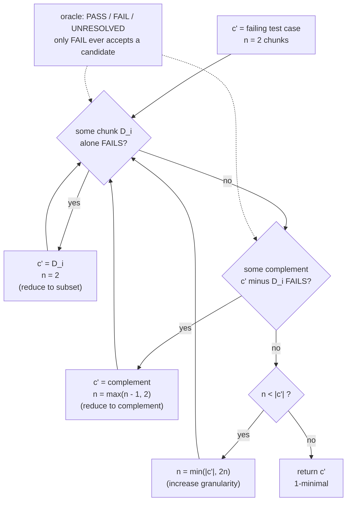

# Paper: Simplifying and Isolating Failure-Inducing Input (Zeller and Hildebrandt 2002)

> [!summary] Scope
> Owns the paper itself: the formal model of a failing test as a set of changes, the `ddmin` minimizer and the `dd` isolator, their minimality guarantees and complexity propositions, and the paper's own measurements on GCC, Mozilla, and fuzzed UNIX utilities.
> Reaches the Explain and Rebuild rungs with a reference implementation and a hand-checkable trace.
> Hands heisenbug stabilization and the general scientific-debugging method to [[Scientific-Debugging-Delta-Debugging-and-Heisenbugs]], and commit-level search to [[Drill-Git-Automated-Bisect-on-Non-Linear-History]].

> [!summary] Claim:
> Model a failing run as the passing run plus a set of elementary changes, give an automated test function three outcomes (pass, fail, unresolved), and a greedy search with an adaptive chunk size, `ddmin`, returns a 1-minimal failing subset: removing any single remaining change makes the failure disappear.
> The search costs at most `|c|^2 + 3|c|` tests in the worst case and at most `2 log2 |c|` when a single change induces the failure and every test case containing it fails, so cost is governed by how often a cut produces an unresolved (invalid) input.
> The sibling algorithm `dd` also grows a passing test case toward the failing one and returns a 1-minimal difference between the two, which is much cheaper when a passing case exists: 7 tests against 26 on the paper's Mozilla line.
> Everything rests on a deterministic, fast, automated oracle, and on an oracle that recognizes the original failure rather than any failure.



## Bibliographic Metadata

| Field | Value |
| :--- | :--- |
| Title | Simplifying and Isolating Failure-Inducing Input |
| Authors | Andreas Zeller (Universitaet des Saarlandes, Saarbruecken) and Ralf Hildebrandt (DeTeLine, Deutsche Telekom, Berlin) |
| Venue | IEEE Transactions on Software Engineering, Vol. 28, No. 2, pp. 183-200, February 2002 (page range confirmed in the Crossref record for the DOI, checked 2026-11-21) |
| DOI | `10.1109/32.988498` (resolves to IEEE Xplore document 988498, checked 2026-11-21) |
| Author copy | `https://www.cs.purdue.edu/homes/xyzhang/fall07/Papers/delta-debugging.pdf` (17 pages, numbered 1-17 in that copy) |
| Conference precursor | Hildebrandt and Zeller, "Simplifying failure-inducing input", ISSTA 2000, pp. 135-145, doi `10.1145/347324.348938` (title and pages confirmed in the Crossref record; the paper itself not read) |
| Predecessor algorithm | `dd+`, Zeller, "Yesterday, my program worked. Today, it does not. Why?", ESEC/FSE 1999, pp. 253-267 (the paper's reference [3], "In Nierstrasz and Lemoine [15], pp. 253-267"; applied to code changes) |
| Prototype | `WYNOT`, "Worked Yesterday, NOt Today" (the paper's footnote 8) |
| Hardware for all timings | Linux PC, 500 MHz Pentium III (footnote 9); times are user CPU time including child processes |

The paper's own summary is the abstract: Mozilla crashed after 95 user actions, the prototype reduced them to 3, and it reduced 896 lines of HTML to the single line that caused the failure, with 139 automated test runs or 35 minutes in total.
The 139 is the sum of two runs the paper reports separately: 82 tests for the user actions and 57 for the HTML lines (my arithmetic; the paper does not itemize the abstract's total).

## The Core Problem

A failing run is a conjunction of many circumstances, and almost all of them are irrelevant.
Bug trackers need the opposite: the paper opens with the Mozilla project in July 1999, with more than 370 open reports in Bugzilla that had not been simplified, and a "BugAThon" that offered volunteers a launch-party invitation for 5 simplified reports and a signed T-shirt for 20.
"Simplifying" meant turning a report into a test case where every part of the input is significant.

The state of the art before the paper, in the authors' words, was that textbooks tell you to use binary search to isolate the problem, "based on the assumption that tests are carried out manually, too".
Three requirements pull against one another:

1. A bug report should be specific enough to recreate the failure.
2. A test case should be as small as possible, because a minimal test case "implies a most general context" and subsumes several current and future reports.
3. Nobody can afford to remove the irrelevant parts by hand when the input is 39,094 characters, or 711 recorded X events.

Plain binary search fails on the third point as soon as the failure needs elements from both halves: both halves pass, the search has no signal, and a manual engineer falls back to guessing.
The paper's problem statement is therefore algorithmic: given a failing test case and a test function, find a small subset that still fails, using only the pass/fail answers, with guaranteed progress even when the answers are mostly uninformative.

## Key Innovation

Three ideas, none of which is individually deep, combine into something that works on real software.

1. **A test function with three outcomes.**
   The POSIX 1003.3 test-framework outcomes PASS, FAIL, and UNRESOLVED (the paper notes the standard also has UNTESTED and UNSUPPORTED, "of no relevance here").
   UNRESOLVED is what lets the algorithm be domain-free: a candidate that is not even a valid input does not count as evidence either way.
2. **Adaptive granularity over both subsets and complements.**
   Testing small chunks makes progress fast but rarely fails; testing large complements fails often but makes slow progress.
   `ddmin` starts at two chunks, tests each chunk and each complement, and doubles the chunk count only when nothing fails, so it behaves like binary search when the structure is kind and degrades gracefully to single-element removal when it is not.
3. **An explicit minimality target that is checkable.**
   Global minimality needs an exponential number of tests, local minimality (no proper subset fails) still needs `2^|c| - 2`, so the paper settles for **1-minimality**, which `ddmin` certifies as a side effect of terminating.

The second contribution is `dd`, which treats `ddmin` as the special case where the passing side is the empty set and generalizes it to shrink the gap between a passing and a failing test case from both ends.

## Mechanism Details

### 1. The model: circumstances, changes, and the test function

The paper builds the model in Section II.

- A run `r` is determined by **changeable circumstances**: program code, input data, environment, hardware.
  Only those whose change may alter the test outcome matter.
- Fix a passing run `r_pass` and a failing run `r_fail`.
  A **change** is a mapping from circumstances to circumstances, and the relevant change `delta` turns `r_pass` into `r_fail` (Definition 1).
- The relevant change is decomposed into elementary changes `delta_1 ... delta_n` (Definition 2 gives the composition operator `o`; the paper "does not assume any particular properties" of it).
  The decomposition is problem specific: characters, lines, HTML tags, user actions, GCC option flags.
  The paper's advice: follow the structure of what is being changed, and "in doubt, an atomic decomposition" (changes that cannot be split further).
- A run is identified by the set of changes applied to `r_pass`.
  `c_pass = {}` is the empty set (no changes, the passing run) and `c_fail = {delta_1, ..., delta_n}` is the failing run.
  Subsets of `c_fail` are **test cases** (Definition 5).
- The `test` function takes a test case, applies its changes to `r_pass`, and returns one of PASS, FAIL, UNRESOLVED (Definition 6).
  Footnote 4 matters in implementations: `test` "must sort the applied changes in some canonical way", because a set has no order but a program run does.

Axiom 4 and Corollary 7 fix the two anchors: `test({}) = PASS` and `test(c_fail) = FAIL`.
For simplification the passing run is "some trivial program run (such as a run on an empty input)", so minimizing the difference between passing and failing becomes minimizing `c_fail` itself.

### 2. The minimality ladder (Section III-A)

| Definition | Statement | Tests needed to certify |
| :--- | :--- | :--- |
| Global minimum (Def. 8) | No smaller subset of `c_fail` fails | All `2^|c_fail|` subsets; footnote 5 trims this to `2^|c_fail| - 2` because the empty set and `c_fail` are known |
| Local minimum, "minimal" (Def. 9) | No proper subset of `c` fails | `2^|c| - 2` |
| n-minimal (Def. 10) | Removing any combination of up to `n` changes makes the failure disappear | Grows combinatorially with `n` |
| 1-minimal (Def. 10 with `n = 1`) | Removing any single change makes the failure disappear | `|c|` tests, one per element |
| `|c|`-minimal | Equivalent to local minimum (Def. 9) | `2^|c| - 2` |

The paper says plainly that a 1-minimal result is not necessarily the smallest: "there may be some other test case that is even smaller", but "each element of c is relevant in producing the failure".
The paper establishes the exponential cost of the global minimum only by counting subsets for a black-box test.
The NP-completeness of the problem is not in this paper: it is Theorem 3.5 of the HDD paper (Misherghi and Su 2006), which reduces the hitting-set problem to the decision version of global-tree-minimality with the oracle treated as a constant-time predicate.

A hand-derivable counterexample shows what 1-minimal gives up.
Let the elements be `1..8` and let the test return FAIL exactly when `{1,8}` is a subset or `{2,3,4}` is a subset, and PASS otherwise.
The global minimum is `{1,8}` (size 2).
`ddmin` tests `{1,2,3,4}` first, which fails because it contains `{2,3,4}`, so it commits to that half and can never see `{1,8}` again.
It returns `{2,3,4}`, which is 1-minimal (remove any one element and the failure disappears) but one element larger than the global minimum.
The reference implementation below returned `[2, 3, 4]` for exactly this oracle.

### 3. `ddmin` as specified (Figure 5)

Precondition: `test({}) = PASS` and `test(c_fail) = FAIL`.
Goal: `c'` with `c' subset-of c_fail`, `test(c') = FAIL`, and `c'` 1-minimal.

`ddmin(c) = ddmin2(c, 2)`, and for the current failing set `c'` partitioned into `n` pairwise disjoint chunks `D_1 ... D_n` of roughly `|c'|/n` elements each, with complements `N_i = c' - D_i`:

| Rule | Condition | Next call |
| :--- | :--- | :--- |
| Reduce to subset | some `test(D_i) = FAIL` | `ddmin2(D_i, 2)` |
| Reduce to complement | else some `test(N_i) = FAIL` | `ddmin2(N_i, max(n - 1, 2))` |
| Increase granularity | else `n < |c'|` | `ddmin2(c', min(|c'|, 2n))` |
| Done | otherwise | return `c'` |

The recursion invariant is `test(c') = FAIL` and `n <= |c'|`.
Three consequences follow directly from the invariant and are easy to miss.

- **`ddmin` is an anytime algorithm.**
  Every accepted `c'` is itself a valid, smaller failing test case.
  Stopping at a time limit, which the paper lists as a pragmatic approach in Section V, returns a correct but possibly non-minimal result, never a wrong one.
- **The oracle is only ever asked to accept, never to reject, a candidate.**
  PASS and UNRESOLVED are treated identically by the search.
  The difference between them matters only for the proofs, for the caching and monotonicity shortcuts, and for `dd`, where PASS is informative and UNRESOLVED is not.
- **Rule order matters.**
  Subsets are tried first because a failing subset discards the most input at once.
  Complements are tried second because they are "large" and so fail more often.
  For `n = 2` a complement equals the other subset, so the complement step is redundant and the paper's Figure 6 lists those two tests once.

Why continue with `n - 1` after a failing complement instead of restarting at 2?
Splitting `N_i` into `n - 1` chunks reproduces the chunks `D_j` (`j != i`) of the old partition, so granularity stays the same and "every subset of `c_fail` eventually gets tested".
The paper's example: with `n = 32` and `N_30` failing, continuing with `n = 31` makes the 30 chunk tests redundant (a cache hit) and the next new test is a complement, so removal of small chunks simply continues.
Restarting at 2 would force the search to climb `2, 4, 8, ...` back up to 32 again.

The paper also says to keep track of tests already run, so that `test` is memoized.
This is what makes the starred rows in Figure 6 free.
Footnote 6 notes the other small saving: when two chunks are of similar size and the first fails, the second need not be tested.

### 4. A complete trace (Figure 6)

The scenario is eight changes, where the failure needs changes 1, 7, and 8 together.
Any test case holding some but not all of them is UNRESOLVED, and any test case holding none of them passes.
The table is the trace of a step-printing variant of the reference implementation below (same rules, same oracle), run once while preparing this note.
It matches the paper's Figure 6 row by row; a `*` marks a configuration identical to an earlier one (a cache hit).
`?` is UNRESOLVED.

| Step | Tested | Config | Result |
| :--- | :--- | :--- | :--- |
| 1 | D1 = N2 | `1234....` | `?` |
| 2 | D2 = N1 | `....5678` | `?` |
| 3-6 | D1..D4 (n = 4) | `12......`, `..34....`, `....56..`, `......78` | `?`, PASS, PASS, `?` |
| 7 | N1 | `..345678` | `?` |
| 8 | N2 | `12..5678` | FAIL, so `c' = N2`, `n = 3` |
| 9-11 | D1..D3 (n = 3) | `12......`, `....56..`, `......78` | all cache hits `*` |
| 12 | N1 | `....5678` | `?` (the paper does not star this row, but it equals step 2) |
| 13 | N2 | `12....78` | FAIL, so `c' = N2`, `n = 2` |
| 14-15 | D1, D2 (n = 2) | `12......`, `......78` | cache hits `*` |
| 16-19 | D1..D4 (n = 4) | `1.......`, `.2......`, `......7.`, `.......8` | `?`, PASS, `?`, `?` |
| 20 | N1 | `.2....78` | `?` |
| 21 | N2 | `1.....78` | FAIL, so `c' = N2`, `n = 3` |
| 22-24 | D1..D3 (n = 3) | `1.......`, `......7.`, `.......8` | cache hits `*` |
| 25 | N1 | `......78` | `?` (equals step 6; also a cache hit) |
| 26 | N2 | `1......8` | `?` |
| 27 | N3 | `1.....7.` | `?`, then `n = |c'| = 3` and nothing failed: done |

The paper states "a total of 19 different tests was required", which is 27 steps minus the 8 rows it stars (9, 10, 11, 14, 15, 22, 23, 24).
Steps 12 and 25 are also repeats of earlier configurations (steps 2 and 6), so the number of distinct configurations is 17.
That is a slip in the paper's bookkeeping, not in the algorithm; with a memoizing oracle you pay for 17 runs (18 if you count the precondition run of the full set, which the figure does not list).
The result is `{1, 7, 8}`, and steps 25-27 are the certification: each of the three single removals leaves an UNRESOLVED test case.

### 5. Complexity (Propositions 11-13)

**Proposition 11.**
`ddmin` returns a 1-minimal test case.
Proof idea: it can only return when `n >= |c'|` and no complement fails.
At `n = |c'|` every chunk has one element, so the complements are exactly the `|c'|` single-removals, and none of them fails.

**Proposition 12, worst case: `|c|^2 + 3|c|` tests.**
The proof has two phases.

1. Every test is UNRESOLVED until `n = |c|`.
   Each round at granularity `n` costs `2n` tests (`n` chunks plus `n` complements, uncached), and the paper bounds the doubling phase as `2 + 4 + 8 + ... + 2|c| = 2|c| + |c| + |c|/2 + ... = 4|c|`.
2. Then only the last complement fails each time, so one element goes per round and `n` falls by one until it reaches 2: `2(|c|-1) + 2(|c|-2) + ... + 2 = |c|(|c|-1) = |c|^2 - |c|` tests.

The sum is `4|c| + |c|^2 - |c| = |c|^2 + 3|c|`.
The paper adds that it is "unlikely that an n-character input requires n^2 + 3n tests".
Note that the proof counts tests, not distinct tests; a memoized oracle pays less.

**Proposition 13, best case: `t <= 2 log2 |c|`.**
If exactly one change is failure-inducing and every test case that includes it fails, then one of the two halves fails at each level, `n = 2` always holds, and the cost is that of binary search.
The factor 2 is the possible second half-test per level.

These two bounds bracket reality, and the paper's own data show where real inputs land.
With no structure knowledge at all, the single-character fuzz reductions are near the logarithmic end (24 tests to reduce a 10^6 character input to one character, `CRTPLOT` t16), while the line-by-line and character-by-character Mozilla and `FLEX` cases are nowhere near it (see the evaluation).

### 6. `dd`: isolating a failure-inducing difference (Section V)

When a passing test case exists, shrinking only the failing side wastes the information the passing side carries.
`dd` keeps two sets, `c'_pass` (initially `{}`) growing from below and `c'_fail` (initially `c_fail`) shrinking from above, with `c'_pass subset-of c'_fail`, and works on their difference `Delta = c'_fail - c'_pass`, partitioned into `n` chunks.
The goal is a pair whose difference is 1-minimal (Definition 14 and 15): for every subset `Delta_i` of the difference, `test(c'_pass + Delta_i) != PASS` and `test(c'_fail - Delta_i) != FAIL`.

The paper compares branch and bound without backtracking: `c'_pass` is a lower bound and `c'_fail` an upper bound on the search space, and each test moves one of them.
Figure 15 gives six rules, applied in order:

| Rule | Condition | Next call |
| :--- | :--- | :--- |
| Reduce to subset | `test(c'_pass + Delta_i) = FAIL` | `dd2(c'_pass, c'_pass + Delta_i, 2)` |
| Increase to complement | `test(c'_fail - Delta_i) = PASS` | `dd2(c'_fail - Delta_i, c'_fail, 2)` |
| Increase to subset | `test(c'_pass + Delta_i) = PASS` | `dd2(c'_pass + Delta_i, c'_fail, max(n-1, 2))` |
| Reduce to complement | `test(c'_fail - Delta_i) = FAIL` | `dd2(c'_pass, c'_fail - Delta_i, max(n-1, 2))` |
| Increase granularity | `n < |Delta|` | `dd2(c'_pass, c'_fail, min(2n, |Delta|))` |
| Done | otherwise | `(c'_pass, c'_fail)` |

Because PASS now makes progress too, the "increase granularity" rule only fires when every previous test was UNRESOLVED.
The results mirror the `ddmin` ones:

- **Proposition 16:** `dd` returns a 1-minimal difference.
- **Proposition 17:** the worst case is the same `|c|^2 + 3|c|` tests.
- **Proposition 18:** if every test returns PASS or FAIL, the cost is at most `log2 |c|` tests (half of `ddmin`'s best case, since no test is wasted on a non-informative outcome).
- **Corollary 19:** with no UNRESOLVED outcomes `dd` always returns a difference of exactly one change.
- `ddmin` is the instance of `dd` where `test` returns PASS only for `c_pass = {}`, so `c'_pass = {}` always holds and only the failing side shrinks (Section V, the paragraph after Proposition 17).
- Footnote 15 also names the mirror instance `ddmax`: `test` returns FAIL only for `c_fail`, so `c'_fail = c_fail` always holds and only the passing side grows ("maximizing").

The illustration is the Mozilla `SELECT` line, 26 steps to simplify (Figure 2) and 7 to isolate (Figure 3).
`dd` ends with the passing text `SELECT NAty" MULTIPLE SIZE=7>` and the failing text `<SELECT NAME="priority" MULTIPLE SIZE=7>`: the whole difference is the single leading `<`, which turns the text into a real HTML `<SELECT>` tag.
The paper's honest trade-off: isolation leaves the programmer with two long test cases to keep in mind, while simplification leaves one short one.

### 7. Reference implementation

The paper contains no code.
The listing is a direct transcription of Figure 5, with a memoizing oracle and the `n = 2` complement shortcut; it is the implementation whose outputs are quoted below.
The Debugging Book's `ddmin` is an independent implementation that differs in two ways worth knowing: it tests only complements (it never takes the "reduce to subset" rule for `n > 2`), and its `DeltaDebugger` class takes the subset operations only while `n` is 2 and, after a successful subset operation, restarts scanning from the offset `i` rather than 0 "to distribute reduction operations more evenly across the input".

```python
from typing import Callable, Hashable, Sequence

PASS, FAIL, UNRESOLVED = "PASS", "FAIL", "UNRESOLVED"


def split(items: Sequence, n: int) -> list[Sequence]:
    """n contiguous chunks of near-equal size, larger chunks first (n <= len(items))."""
    size, extra = divmod(len(items), n)
    chunks, start = [], 0
    for i in range(n):
        end = start + size + (1 if i < extra else 0)
        chunks.append(items[start:end])
        start = end
    return chunks


def ddmin(test: Callable[[Sequence], str], c: Sequence) -> tuple[Sequence, int]:
    """Return (1-minimal failing subsequence of c, number of distinct oracle calls)."""
    cache: dict[Hashable, str] = {}

    def run(cfg: Sequence) -> str:
        key = tuple(cfg)
        if key not in cache:
            cache[key] = test(cfg)
        return cache[key]

    assert run(c) == FAIL, "precondition: test(c) == FAIL"
    n = 2
    while len(c) >= 2:
        chunks = split(c, n)
        nxt = None
        for d in chunks:  # reduce to subset
            if run(d) == FAIL:
                nxt = (d, 2)
                break
        if nxt is None and n > 2:  # reduce to complement (n == 2: equals a subset)
            for i in range(n):
                comp = [x for j, d in enumerate(chunks) if j != i for x in d]
                if run(comp) == FAIL:
                    nxt = (comp, max(n - 1, 2))
                    break
        if nxt is not None:
            c, n = nxt
        elif n < len(c):  # increase granularity
            n = min(2 * n, len(c))
        else:
            break  # n == len(c) and nothing failed: 1-minimal
    return list(c), len(cache)
```

Five oracles exercise it.
The driver below is appended to the listing above.
The run was made once on darwin-arm64 (Darwin arm64, Python 3.15.2, 2026-11-21); this note has no lab, so there is no golden file for these lines, and the counts include the precondition run of the full input.

```python
if __name__ == "__main__":
    # A: needs elements 1 and 4 together.
    print("A", ddmin(lambda s: FAIL if {1, 4} <= set(s) else PASS, [1, 2, 3, 4]))
    # B: ddmin is 1-minimal, not globally minimal.
    print("B", ddmin(lambda s: FAIL if {1, 8} <= set(s) or {2, 3, 4} <= set(s) else PASS, list(range(1, 9))))

    # C: Figure 6 oracle.
    def fig6(s: Sequence) -> str:
        need = {1, 7, 8}
        return FAIL if need <= set(s) else (PASS if not need & set(s) else UNRESOLVED)

    print("C", ddmin(fig6, list(range(1, 9))))
    # D: string input, failure iff the substring "<SELECT>" is present.
    html = '<td align=left><SELECT><OPTION VALUE="P1">P1</SELECT></td>'
    out, calls = ddmin(lambda s: FAIL if "<SELECT>" in "".join(s) else PASS, html)
    print("D", len(html), "->", "".join(out), calls)

    # E: why UNRESOLVED matters: treating it as FAIL.
    def sloppy(s: Sequence) -> str:
        return FAIL if fig6(s) != PASS else PASS

    print("E", ddmin(sloppy, list(range(1, 9))))
```

Output of that run (darwin-arm64, Python 3.15.2, captured 2026-11-21):

```text
A ([1, 4], 10)
B ([2, 3, 4], 11)
C ([1, 7, 8], 18)
D 58 -> <SELECT> 38
E ([1], 4)
```

| Line | Oracle |
| :--- | :--- |
| `A` | Needs elements 1 and 4 together |
| `B` | FAIL if `{1,8}` or `{2,3,4}` is present: 1-minimal, not minimum |
| `C` | The Figure 6 oracle |
| `D` | 58-character HTML string, failure iff `<SELECT>` is a substring |
| `E` | Figure 6 oracle with UNRESOLVED wrongly treated as FAIL |

Line `E` is the instructive failure: when the oracle answers FAIL for "anything that is not PASS", the search happily "reduces" to `[1]`, a test case that is not failing at all.
Line `D` shows that a substring failure over a 58-character input costs 38 distinct oracle calls with no structure knowledge: the tail of the search, removing characters one at a time at `n = |c'|`, dominates.
Line `D` is reproducible from the `html` string in the driver (58 characters, counted by the run itself); all five lines were produced by the listing plus driver as written.

### 8. The assumptions the paper makes, stated and unstated

1. **Determinism.**
   `test` must give the same answer for the same configuration.
   The paper's data contain one case where this failed: UNITS t11 and t12 in Table II "could not be reproduced deterministically", so they are marked n/a.
   C-Reduce's authors state the same assumption for every reducer they know of: buggy executions must be detectable deterministically.
2. **Automation and speed.**
   The method is practical when the cost "may be so low that we can easily use a large amount of tests just to simplify a test case".
   The paper's arithmetic for `FLEX` at about 0.1 seconds per test is one hour for the whole simplification; the same test count at 1 second per test would be 10 hours.
3. **Monotonicity is not required by `ddmin`/`dd`.**
   It is the assumption of `dd+`, which the paper compares in Section VII: "whenever `test(c) = PASS` holds, then `test(c') = PASS` holds for every subset `c'`".
   The paper says `dd+` performed better when most tests gave determinate results, is not well suited when a failure is induced by a large combination of changes, and does not guarantee a 1-minimal subset; it recommends `dd` as a general replacement.
   You can still exploit monotonicity inside `dd` through the oracle: return PASS whenever a superset of `c` has already passed, and FAIL whenever a subset of `c` has already failed.
4. **No "undoing" changes (Section VIII).**
   The failure is assumed monotone: once it occurs, adding changes cannot remove it.
   Formally, no change `delta-bar` exists with `(delta o delta-bar)(r) = r`.
   The paper's counterexample is an HTML processor that fails when the input contains an opening tag without its closing tag.
   Simplifying `<A></A><B>` can give `<A>`, although the real cause is the unclosed `<B>`, because `</A>` undid the failure of `<A>`.
   Detecting this by tests alone would take testing up to `2^|c_fail|` supersets of the minimized test case.
5. **A passing run exists and is trivial.**
   `ddmin` never actually runs `test({})`; it relies on the assumption.
   If the "empty" run is not passing in the program under test (for instance an empty input that itself crashes), the minimization is meaningless.

### 9. The precision effect (Section IV-D)

In the first fuzz series the test function returned FAIL "whenever a program crashed, regardless of further circumstances".
That is how a minimized input can trigger a different failure than the original one.
The paper repeats the runs at "increased precision": the test returns FAIL only if the program crashed with an identical backtrace (current program counter and stack of calling functions, not argument values), UNRESOLVED if it failed with a different backtrace, and PASS if it did not crash.

The measured effect on `NROFF` t1: 2 characters at low precision (55 tests) against 60 characters at high precision (3,547 tests).
The two characters induce a different failure than the original; only the 60 reproduce the same backtrace.
Cost went up by a factor of about 64 (3,547 / 55) for that cell.
The paper's conclusion: higher precision always increases the size of the minimized test case, because only the complete original input can induce the complete original failure, and "a simple backtrace ... should provide sufficient precision".
Modern equivalents are the sanitizer report kind and top frames, the compiler's internal-error text, or an exception type plus line number (the Hypothesis evaluation uses the exception type and line number).

## Evaluation and Limitations

### Case study 1: GCC gets a fatal signal (Section IV-A, VI-A)

`bug.c` (Figure 7) crashes GCC 2.95.2 on Intel-Linux with optimization enabled: `gcc -O bug.c` ends with `Internal compiler error: program cc1 got fatal signal 11`.
Before crashing, GCC grabs all available memory for its stack, so that other processes may run out of resources; the paper prevents that by limiting the stack, `(ulimit -H -s 256; gcc -O bug.c)`, and the crash remains.
A change is the insertion of one character of `bug.c`; no syntactic or semantic knowledge is used, so most candidates are invalid C programs.

| Measurement | Value |
| :--- | :--- |
| Original input | 755 characters |
| After test 1 and 2 | 377 then 188 characters (only the `mult` function remains) |
| Tests for full minimization with `ddmin` | 731 tests (Section VI-A; Section IV-A says "731 more tests" after the first two), 34 seconds (500 MHz Pentium III) |
| 1-minimal result | 77 characters, function renamed to `t`, whitespace removed |
| `dd` isolation | 59 tests, difference of 2 characters (the assignment `i =` in `i = i + j + 1;`) |
| GCC options that prevent the failure | `-ffast-math` found in 7 tests, then `-fforce-addr` in 7 more, out of 31 documented options; the remaining 29 prevent nothing |

The result is `t(double z[],int n){int i,j;for(;;){i=i+j+1;z[i]=z[i]*(z[0]+0);}return z[n];}`, 77 characters.
It declares `i` and `j` and never initializes `j`, and contains an infinite loop: a perfectly good compiler-crash input, and a bad runtime test.
That is the test-case validity problem in the paper's own output, which C-Reduce was built to fix.
The paper is also explicit about what the output does not do: "we cannot identify a place in the GCC code that causes the problem".

### Case study 2: Mozilla cannot print (Sections IV-B, V-A)

Bugzilla bug #24735 reads: go to bugzilla.mozilla.org, search for a bug, print to a file with the bottom and right margins set to .50, do the exact same thing again on the same file, and the browser crashes with a segmentation fault.
The input has two parts, and the paper minimizes each.

| Input | Original | Result | Tests / time |
| :--- | :--- | :--- | :--- |
| User actions, captured and replayed with the `XLAB` tool | 711 recorded X events, 95 of them user actions (the rest are X server notifications) | 3 actions: press P with Alt held, press mouse button 1 on Print, release mouse button 1 | 82 tests, 21 minutes |
| HTML code, one line per change | 39,094 characters, 896 lines | the single line `<SELECT NAME="priority" MULTIPLE SIZE=7>` | 57 tests |
| That line, one character per change | 1 line | `<SELECT>` | 26 tests (Figure 2) |
| That line, `dd` instead | 1 line | the one character `<` | 7 tests (Figure 3) |

Two subtleties from the paper: the original page contains several `SELECT` tags and `ddmin` returns only one, because the implementation goes for the first failing subset and "it is wiser to fix the first failure before checking for further similar failures"; and, per footnote 11, it is relevant that the mouse button is pressed before it is released.
The abstract's "139 test runs" is `82 + 57`.
The paper extrapolates that the procedure "could easily be applied automatically" to the 12,479 open bugs in Bugzilla (as of 15 February 2001).

### Case study 3: minimizing fuzz (Sections IV-C, IV-D, VI-B)

The experiment re-runs Miller's 1990 fuzz study on a subset of the UNIX utilities he used, here on Sun's Solaris 2.6: `NROFF`, `TROFF`, `FLEX`, `CRTPLOT`, `UL`, `UNITS`.
There are 16 input kinds (sizes `10^3` to `10^6` characters, either all characters or printable only, with or without NUL), so 6 x 16 = 96 runs, of which 42 crashed (43%); in the paper's summary of Miller's studies (its references [6] and [7]), in the worst case 40% of basic programs crashed or went into infinite loops.

Crash causes the paper finds in the minimized inputs:

| Program | Minimized crash cause | Threshold |
| :--- | :--- | :--- |
| `FLEX` | buffer overrun | sequences of 2,121 or more non-newline, non-NUL characters |
| `UL` | buffer overrun | sequences of 516 or more printable non-newline characters |
| `UNITS` | buffer overrun | sequences of 77 or more 8-bit characters |
| `NROFF`, `TROFF` | random malformed commands, for example `"\\D^J%0F"` or the 8-bit input `"\302\n"` | 2 to 7 characters at low precision |
| `CRTPLOT` | one-letter input `"t"` or `"f"` | 1 character |

Cost of `ddmin` against `dd`, selected cells from Table II(d), II(f), and III(c) (test counts, high precision unless stated):

| Case | `ddmin` tests | `dd` tests | Note |
| :--- | :--- | :--- | :--- |
| `CRTPLOT` t16 (10^6 characters to 1) | 24 | 22 | Both are near `log2` because no test is UNRESOLVED |
| `UL` t5-t8 | 6,058 to 7,138 | 12 to 22 | `ddmin` cost tracks the 516-character minimum, not the input size (about the same at every size from 10^3 to 10^6); `dd` grows like `log2` of the input |
| `FLEX` t14-t16 | 34,450 to 37,454 (low precision 10,619 to 17,960) | 23 to 51 | At 0.1 s per test, about one hour for `ddmin` |
| `NROFF` t1 | 3,547 | 24 | 9 UNRESOLVED outcomes in the `dd` run; still 24 tests |

`dd` returned a difference of exactly one character wherever the unresolved count in Table III(d) was zero (`CRTPLOT`, `UL`, `UNITS`, the printable `NROFF` and `TROFF` cases), as Corollary 19 predicts.
Only `NROFF` returned larger differences, all in cells with many UNRESOLVED outcomes (t2: 62, difference 6; t9: 119, difference 2; t11: 390, difference 17), which is what the Section VI-B text says: "Except for NROFF, the minimal failure-inducing difference is always just 1 character".
UNRESOLVED outcomes are necessary but not sufficient for a larger difference: `FLEX` t14-t16 had 10 to 29 and `NROFF` t1 had 9, yet all returned one character.
For `FLEX` the passing context is 7,804 to 7,811 characters: adding one character to a passing base of that size overruns the buffer.

The most useful operational number is in Section IV-C: on `FLEX`, after 494 tests the input is 2,122 characters, one more than the final 2,121 characters, "however, it takes more than 10,000 further tests to eliminate one more character".
The expensive part of `ddmin` is the end game, the single-element sweep that certifies 1-minimality, and it grows with the size of the minimum, not of the input.

### Limitations, from the paper and from later work

| Limitation | Source and evidence |
| :--- | :--- |
| Cost grows with the size of the simplified result, so large minima are expensive | Section V: "the larger the size of the simplified input, the higher is the number of tests required", since certifying 1-minimality of `n` entities needs at least `n` tests |
| Domain knowledge is ignored: most candidates for structured input are invalid | Authors' own future work: partition by grammar, replace instead of delete (GCC: replace arithmetic by constants), restrict by version-control constraints |
| First failing subset only, so one failure cause at a time | Section VIII; deliberate for economy |
| Result depends on the input order and chunk boundaries | Consequence of the greedy search; shown by the counterexample in the mechanism section |
| Cache can exhaust memory | HDD paper: on a 433-line, 16,500 character Mozilla XSLT crash (`ms-tour.xsl`, Bugzilla 248258), `ddmin`'s test cache exhausted memory on a 4 GB machine, and with the cache disabled it had not completed a significant percentage of the testing after one day |
| Line-level `ddmin` can end far from small | Same file: 92 lines after 1,092 tests, against HDD's 8 lines after 129 tests |
| Validity: reduced C programs may rely on undefined behavior | C-Reduce paper: delta-style reduction "typically yields test cases that are too large or even invalid (relying on undefined behavior)" |
| Reducing the input does not locate the defect | The GCC study: the one-liner says nothing about where in GCC the failure occurs |

## Industry Impact

The paper's central pattern is the **interestingness test**: a script that answers "does this candidate still reproduce the failure" and a reducer that calls it as often as needed.
Almost every test-case reducer since is a variation on that contract.

- **`git bisect run`.**
  The script protocol is the three-outcome test function in miniature: exit code 0 means good/old, 1 to 127 except 125 means bad/new, 125 means "cannot be tested", so that revision is skipped, and any other code aborts the bisect; the manual explains that 125 was chosen as the highest sensible value because 126 and 127 are shell errors (as of 2026-11, Both, `git-scm.com/docs/git-bisect`).
  The mapping to the paper is PASS, FAIL, UNRESOLVED.
  The algorithms differ: bisect assumes one transition along an ordered history and costs about `log2 N` tests on linear history, while `dd` over a set of changes handles interacting changes at the price of more tests.
  See [[Drill-Git-Automated-Bisect-on-Non-Linear-History]] and [[Git-Archaeology-Log-Blame-and-Bisect]].
- **C-Reduce and C-Vise.**
  The C-Reduce paper (PLDI 2012) cites `ddmin` as the generic precursor and notes its approach "works by removing substrings of the original input".
  It builds on `ddmin`'s chunk-removal idea with Clang-based transformation passes and reports outputs "on average, more than 25 times smaller" than those of its other reducers or of "Berkeley delta", the `ddmin` variant by McPeak and Wilkerson that compiler developers commonly used.
  C-Vise is "a super-parallel Python port" that reuses the same `clang_delta` tool, ships a `cvise-delta` wrapper that simulates the original `delta` tool, and notes that it also works reasonably on JavaScript and Rust.
  In its README example the interestingness script greps the compiler's crash text and requires Clang to accept the same file, which is the precision effect applied to a pipeline.
- **Picire.**
  A Python implementation of the original algorithm with a `--parallel` mode and a `--complement-first` option; its README notes that for some inputs subset-based reduction is less effective than complement-based because "aggressively removing too big parts of the input eliminates the interestingness as well".
- **Hierarchical Delta Debugging (HDD).**
  Misherghi and Su run `ddmin` level by level over the AST from coarsest to finest so that every candidate is syntactically valid.
  On the HDD paper's own GCC example (a different program from `bug.c`) HDD used 86 tests against `ddmin`'s 680.
  The price is that HDD "may not always produce 1-minimal configurations", because it does not revisit higher levels.
- **libFuzzer and AFL.**
  libFuzzer's `-minimize_crash=1` minimizes a crash input and is bounded with `-runs=N` or `-max_total_time=N`.
  Its driver keeps a candidate only when the sanitizer's `DEDUP_TOKEN` matches the original crash's and stops with "CRASH_MIN: mismatch in dedup tokens" otherwise, which is the paper's backtrace-precision oracle built in (`compiler-rt/lib/fuzzer/FuzzerDriver.cpp`, as of 2026-11).
  `afl-tmin` (AFL 2.57b) is a related but different design: after a block-normalization stage, it starts deleting blocks of `next_p2(len / 16)` bytes (`TRIM_START_STEPS` is 16), deletes a block when the target still behaves the same, halves the block size down to 1 byte, then minimizes the alphabet and character values, and repeats whole passes while anything changed.
  That fixpoint over repeated sweeps is its route to a stable result, where `ddmin`'s route is the final single-element sweep.
  In crash mode it accepts any crash by default, the low-precision oracle of the paper's Section IV-D; `AFL_TMIN_EXACT` additionally requires the same instrumented path, and its non-crashing mode keeps the same instrumentation checksum instead of a crash (`afl-tmin.c`, `run_target`).
  Rust's `cargo fuzz tmin <target> <input>` is the analogous single-case minimizer, a front end that passes through to libFuzzer (cargo-fuzz README, as of 2026-11; see also the sibling note [[Rust-Miri-Sanitizers-Loom-and-Cargo-Fuzz]]).
- **Property-based testing: Hypothesis.**
  MacIver and Donaldson's ECOOP 2020 paper describes "internal test-case reduction": instead of reducing the generated value, Hypothesis reduces the sequence of random choices that generated it, as a shortlex optimization (shorter sequences first, then lexicographically smaller), so every reduced case is one the generator could have produced and the validity problem largely disappears.
  Against a delta-debugging implementation on SymPy failures, the geometric mean was 20.6 times as many calls to the system under test for results 83% of the size, which the authors call "relatively expensive for a marginal gain".
  The paper credits the pass-based architecture to C-Reduce and the marked regions of the choice sequence to HDD.
  Whether Hypothesis gives a 1-minimal result in the paper's sense is a different question: like any practical reducer it is a local minimizer that runs its reduction passes until no pass reduces the case further (ECOOP 2020, Section 2.1), which is weaker than 1-minimality over a fixed element set (see [[Python-Hypothesis-and-Type-Checkers-as-Bug-Prevention]]).
- **Teaching and infrastructure.**
  The Debugging Book ships `ddmin`, a general `dd`, and a `DeltaDebugger` context manager that reduces the arguments of a failing function call.
  Zeller's later work extended the idea from input to code changes, thread schedules, and program states, listed on the archived Saarland project page as applications of Delta Debugging.

A caution on attribution: `git bisect`, property-based shrinking, and `afl-tmin` do not descend from `ddmin`'s code, and the paper does not claim they do.
They share the problem (find the small cause with a black-box test), the oracle contract, and the 1-minimal fixed-point goal.

## Commands and Numbers to Know

| Item | Value | Platform and date | Source |
| :--- | :--- | :--- | :--- |
| `ddmin` worst case | `|c|^2 + 3|c|` tests | Both (algorithmic, not time dependent) | Proposition 12 |
| `ddmin` best case | `<= 2 log2 |c|` tests | Both | Proposition 13 |
| `dd` best case | `<= log2 |c|` tests, difference of 1 change | Both | Proposition 18, Corollary 19 |
| Tests to certify local minimality | `2^|c| - 2` | Both | Definition 9 and footnote 5 |
| Tests to certify 1-minimality | at least `|c|` | Both | Section V |
| Mozilla: actions | 95 reduced to 3 in 82 tests, 21 minutes | 500 MHz Pentium III, 2002 | Section IV-B |
| Mozilla: HTML | 896 lines (39,094 chars) to 1 line in 57 tests | 500 MHz Pentium III, 2002 | Section IV-B |
| GCC 2.95.2 `bug.c` | 755 to 77 characters, 731 tests after the first two, 34 s | 500 MHz Pentium III, 2002 | Section IV-A |
| Fuzz, Solaris 2.6 | 42 of 96 runs crashed (43%) | Sun Solaris 2.6, 2002 | Section IV-C |
| `CRTPLOT` t16 | 10^6 characters to 1 in 24 tests (`ddmin`), 22 (`dd`) | 2002 | Tables II(d), III(c) |
| `FLEX` | 10,619 to 17,960 tests low precision (the Section V text says 11,589 to 17,960, omitting t16), 34,450 to 37,454 high precision | 2002 | Tables II(d), II(f) |
| `git bisect run` exit codes | 0 good, 1-127 except 125 bad, 125 skip, other aborts | Both (as of 2026-11) | git-bisect manual |
| libFuzzer crash minimization | `-minimize_crash=1` with `-runs=N` or `-max_total_time=N` | Both (as of 2026-11) | LLVM LibFuzzer docs |
| `afl-tmin` block schedule | start at `next_p2(len / 16)`, halve to 1, maximum file `10 * 1024 * 1024` | Both (AFL 2.57b, as of 2026-11) | `afl-tmin.c`, `config.h` |
| Picire flags | `--parallel`, `-j <num>`, `--complement-first` | Both (as of 2026-11) | Picire README |

## Multi-Language Comparison

| Language | Tool | Unit of reduction | Interestingness contract |
| :--- | :--- | :--- | :--- |
| C and C++ | C-Reduce, C-Vise; `llvm-reduce` once the bug reproduces from LLVM IR (it reduces IR or MIR with delta passes, not C or C++ source; LLVM `llvm-reduce` docs, as of 2026-11) | Tokens, lines, and Clang AST transformations (`clang_delta`); IR constructs for `llvm-reduce` | A script that exits 0 while the property still holds (the C-Vise README example uses a pipeline whose last command is `grep`) |
| C and C++ fuzzing | libFuzzer `-minimize_crash=1`, `afl-tmin` | Bytes of the crashing input | Same sanitizer `DEDUP_TOKEN` (libFuzzer); any crash by default, same path with `AFL_TMIN_EXACT`, or same instrumentation checksum for non-crashing inputs (`afl-tmin`) |
| Python | Hypothesis internal reduction, Picire, Debugging Book `DeltaDebugger` | The choice sequence (Hypothesis), characters or lines (Picire), arguments of a call (`DeltaDebugger`) | Same exception type, and in the Hypothesis evaluation, same line |
| Rust | `cargo fuzz tmin`, C-Vise on Rust source | Bytes, or source text | Same crash |
| Any language with a shell | `git bisect run` over commits | Commits | Exit code protocol with 125 as skip |

## Pitfalls

> [!warning] Pitfall: an oracle that accepts any failure
> The reducer will converge on whatever failure is cheapest to reach, usually a syntax error or an early exit.
> The paper's `NROFF` t1 shrank to 2 characters that cause a different failure than the original, and only a backtrace-equality oracle kept the real 60-character input.
> Match a signature: sanitizer report kind and top frames, ICE text, exception type and line.

> [!warning] Pitfall: collapsing UNRESOLVED into FAIL (or into PASS)
> Treating "not PASS" as FAIL makes the search accept invalid candidates; in the reference implementation run `E` it returns `[1]`, a test case that is not failing.
> Treating UNRESOLVED as PASS is safe for `ddmin` (it only accepts FAIL) but blind for `dd`, which uses PASS as evidence.

> [!warning] Pitfall: running at the wrong granularity
> Character-level `ddmin` on structured text spends most of its tests on candidates the program rejects at parse time.
> The paper itself minimized the Mozilla HTML first by line (896 lines to 1) and only then by character, and the HDD paper could not finish `ms-tour.xsl` with flat `ddmin` in a day.
> Reduce coarse-first, or use a structure-aware reducer.

> [!warning] Pitfall: nondeterministic or slow oracles
> The correctness proofs assume `test(c)` is a function of `c`.
> A flaky failure makes `ddmin` accept a candidate that happened to fail once and then reject its own descendants.
> The paper's UNITS t11 and t12 runs were dropped for this reason.
> Stabilize first (fixed seeds, a recorded execution; see [[Paper-rr-Record-and-Replay]] and [[Scientific-Debugging-Delta-Debugging-and-Heisenbugs]]) and cap each test with a timeout, as footnote 10 advises.

> [!warning] Pitfall: reading 1-minimal as minimum
> A 1-minimal result can be larger than the best reduction, as the `{2,3,4}` against `{1,8}` example shows, and it depends on the order of the input.
> If the result matters, run the reducer again on a shuffled or differently chunked input and keep the smaller.

> [!warning] Pitfall: confusing a reduced input with a root cause
> `ddmin` returns circumstances that are relevant for the failure, not a diagnosis.
> The paper's `<A></A><B>` example shows the reduced input `<A>` pointing at the wrong tag when failures are not monotone.

> [!warning] Pitfall: forgetting the changes' canonical order
> Footnote 4: `test` must apply changes in a canonical order.
> If a candidate's order differs between calls, the cache key is wrong and so is determinism.

## At Scale

For one developer a reducer is a command run when a report is too big to read.
At 1,000 to 50,000 engineers it becomes a service, and the economics change:

- **Reduce on first failure, automatically.**
  The paper's conclusion recommends making automated simplification "an integrated part of automated testing": each time a test fails, run it.
  CI systems and fuzzers do this with a crash-minimization step.
- **Budget by time, not by tests.**
  Total cost is `tests x seconds per test`.
  The paper's `FLEX` arithmetic is 36,000 tests x 0.1 s = 1 hour; a 10-second integration test makes the same search 100 hours.
  Because every accepted candidate still fails, a time cap gives a valid, possibly non-minimal result.
- **Make the unit follow the structure.**
  Decision rule: if more than a small fraction of candidates come back UNRESOLVED, stop at the current granularity and switch to a structure-aware reducer; flat `ddmin` has the quadratic tail.
- **Own the oracle.**
  Package the interestingness test per bug class (crash signature, sanitizer kind, wrong-output diff against a reference) rather than writing one per report; the precision effect is the largest source of wasted reductions.
- **Parallelize at the candidate level.**
  Candidates in one round are independent, so C-Vise and Picire run them concurrently; wall-clock time drops, total work does not.
- **Guard for validity.**
  For C and C++ test cases that feed a compiler team, validity means no undefined behavior, which the compiler under test cannot detect (the C-Reduce paper's point); that paper used KCC and Frama-C as detectors of dynamic violations of the C standard, and it also runs external pretty-printers inside the reduction loop because reformatting can by itself make a failure disappear.
- **Store reduced cases as regression tests.**
  A minimal case subsumes duplicates, which is the Mozilla observation that a simplified report "subsumes several other bug reports".

## Practice Drill

> [!tip] Practice Drill:
> Take a crashing input for any C program you can build with `-fsanitize=address`, and write the interestingness test twice: first as "exit status is not 0", then as "the ASan report names the same error kind and the same top frame".
> Before running anything, hand-predict the oracle-call count for a four-element toy oracle with the rules of Figure 5, as the L5 prediction question in this note does.
> Reduce it with the reference implementation from this note (bytes, then lines first and bytes second) and with `cvise` or `libFuzzer -minimize_crash=1`.
> Record the size and the number of oracle calls for each combination, and check that the weak oracle reduces to a smaller input that crashes for a different reason.
> Then shuffle the lines of the original and reduce again to see how much the 1-minimal result depends on order.

## Interview Questions

> [!question] L5: Why does the paper's test function have three outcomes, and what does `ddmin` do with the third?
>
> > [!success]- Answer
> > PASS and FAIL are not enough, because a candidate such as a half-deleted C program fails to parse, which says nothing about the original bug.
> > The paper therefore adds UNRESOLVED (from the POSIX 1003.3 outcomes) for "indeterminate results".
> > `ddmin` accepts a candidate only on FAIL, so PASS and UNRESOLVED behave the same for it; they only differ for `dd`, which uses PASS as progress, and for the complexity proofs, where a run of UNRESOLVED outcomes forces the granularity up to `n = |c|` and is the source of the quadratic worst case.

> [!question] L5: Predict the result and the number of distinct oracle calls (including the initial test of the full input) for `ddmin` on `[1, 2, 3, 4]` where the test returns FAIL if and only if both 1 and 4 are present, otherwise PASS?
>
> > [!success]- Answer
> > The result is `[1, 4]` with 10 distinct oracle calls.
> > Calls in order: `[1,2,3,4]` FAIL (precondition); `n = 2`: `[1,2]` PASS, `[3,4]` PASS; `n = 4`: `[1]`, `[2]`, `[3]`, `[4]` all PASS (calls 4 to 7); complements `[2,3,4]` PASS and `[1,3,4]` FAIL (calls 8 and 9), so `c' = [1,3,4]` and `n = max(4-1, 2) = 3`.
> > At `n = 3` the subsets `[1]`, `[3]`, `[4]` and the complement `[3,4]` are cache hits, and `[1,4]` FAIL is call 10, so `c' = [1,4]` and `n = 2`.
> > Both chunks are cache hits, `n < |c'|` is false, and the algorithm returns.
> > This is the value the reference implementation printed on line `A`; without the cache the same rules would run more tests.

> [!question] L5: What is the difference between a 1-minimal and a minimum failing test case?
>
> > [!success]- Answer
> > 1-minimal (Definition 10 with `n = 1`): removing any single remaining change makes the failure disappear, so every element is relevant.
> > Minimum (Definition 8, global): no smaller failing subset exists anywhere, which needs all `2^|c|` subsets to certify.
> > With failure when `{1,8}` or `{2,3,4}` is present, `ddmin` over `1..8` returns `{2,3,4}` (1-minimal) although `{1,8}` is smaller: the first half it tests, `{1,2,3,4}`, already fails.
> > The paper accepts that trade for polynomial cost; the exponential result cannot be avoided, and the hitting-set reduction in the HDD paper shows why.

> [!question] L6: Debug this: a reducer for compiler crashes uses the script `gcc -c "$1" 2>/dev/null; test $? -ne 0` and ends with a three-character file, so what went wrong and what do you change?
>
> > [!success]- Answer
> > The oracle answers FAIL for any non-zero exit, so a file like `{` that produces a syntax error is "interesting", and the reducer converges on the cheapest failure, not the original one.
> > This is the precision effect of Section IV-D, where a 2-character `NROFF` input caused a different failure than the 60-character one that reproduced the original backtrace.
> > Fix the interestingness test to recognize the original signature, for example `gcc -c "$1" 2>&1 | grep -q 'internal compiler error: Segmentation fault'`, and require that a reference compiler accepts the input, as the C-Vise README example does with Clang.
> > Return UNRESOLVED (or just non-interesting) for everything else, and add a timeout.
> > The same bug exists in the reference implementation oracle `E`, which accepts any non-PASS and returns `[1]`.

> [!question] L6: Why is the worst case `|c|^2 + 3|c|` and when does it occur?
>
> > [!success]- Answer
> > Phase one: every test is UNRESOLVED until `n = |c|`; at granularity `n` a round costs `2n` tests, and the paper bounds the doubling phase by `2 + 4 + ... + 2|c| = 4|c|`.
> > Phase two: only the last complement fails each round, so one element is dropped per round and `n` falls by one to 2; round `k` costs `2k` tests before it succeeds, summing to `|c|^2 - |c|`.
> > Total `|c|^2 + 3|c|` (Proposition 12).
> > It needs both an extreme oracle and an adversarial order, which the paper calls unlikely in practice; but it explains why flat `ddmin` on large input with a high UNRESOLVED rate is hopeless, as for `ms-tour.xsl` in the HDD paper.

> [!question] L6: When does `dd` beat `ddmin`, and when does it not?
>
> > [!success]- Answer
> > When a passing test case exists and tests mostly return PASS or FAIL, `dd` needs at most `log2 |c|` tests (Proposition 18) and returns a one-change difference (Corollary 19), against `ddmin`'s `2 log2 |c|` best case and a result as large as the minimum.
> > The paper's `SELECT` line took 7 tests for `dd` against 26 for `ddmin`, and `FLEX` took 23 to 51 tests against more than 34,000.
> > With many UNRESOLVED outcomes `dd` degrades to the same quadratic worst case (Proposition 17), and the difference it returns can be several changes (NROFF t11: 17 characters with 390 UNRESOLVED outcomes).
> > It also hands the engineer two long test cases instead of one short one.

> [!question] L7: Your team reduces 10 MB XML crash files and flat `ddmin` has run for days; how do you diagnose it and what do you change?
>
> > [!success]- Answer
> > Almost every candidate that cuts in the middle of a tag is not well-formed XML, so the oracle returns UNRESOLVED and the search is in the quadratic regime of Proposition 12; the test cache may also be growing without bound.
> > The HDD paper reports exactly this for `ms-tour.xsl` (433 lines): `ddmin` did not finish in a day and its cache exhausted 4 GB; line-level `ddmin` gave 92 lines in 1,092 tests, HDD gave 8 lines in 129 tests.
> > Switch to a structure-aware reducer (HDD, Perses-style syntax-guided reduction (Sun, Li, Zhang, Gu, and Su, "Perses: Syntax-Guided Program Reduction", ICSE 2018, pp. 361-371, per its Crossref record; the paper itself not read), or C-Reduce passes where applicable), or at least reduce by line before byte, put a timeout on the oracle, and cap the cache.
> > Keep the signature-matching oracle so the reduction stays on the original failure.

> [!question] L7: Why can Hypothesis shrink structured values without a grammar, and what does it give up compared with `ddmin`'s guarantee?
>
> > [!success]- Answer
> > It never edits the output value: it reduces the sequence of random choices that produced it in shortlex order, and re-runs the generator, so every candidate is something the generator could have produced and the validity problem largely disappears (MacIver and Donaldson, ECOOP 2020).
> > What it gives up is the clean certificate: its passes are heuristics, it stops at a local minimum of those passes, and `ddmin`'s "removing any single element makes the failure vanish" does not apply to the generated value.
> > It also costs more oracle calls: on SymPy failures the geometric mean was 20.6 times as many calls as a delta-debugging implementation, for results 83% of the size.

> [!question] L7: Your oracle is flaky: the crash reproduces 1 time in 3. What breaks in `ddmin`, and what are your options?
>
> > [!success]- Answer
> > A false PASS on a failing candidate makes `ddmin` discard the very chunk it should keep, and a lucky FAIL on a candidate that does not really fail makes it accept a bogus reduction; both violate the determinism the proofs assume.
> > The paper only notes the issue in passing (UNITS t11 and t12 could not be reproduced deterministically) and C-Reduce's authors say reducers assume deterministic detection.
> > Options, in order of preference: make the failure deterministic (fixed seeds, single-threaded, a recorded execution replayed with [[Paper-rr-Record-and-Replay]]), repeat each oracle call `k` times and answer FAIL if any run fails (an engineering heuristic, not from the paper, whose cost is `k` times as many runs and whose `k` you must choose from the observed reproduction rate), and re-verify the final result several times before reporting.

> [!question] L8+: A colleague says `git bisect` is delta debugging on commits and that you can drop one in favor of the other; do you agree?
>
> > [!success]- Answer
> > They share the oracle contract (the `git bisect run` exit codes are PASS, FAIL, and UNRESOLVED as 125) and the aim of isolating a cause with a black-box test, but they search different spaces.
> > Bisect assumes one good-to-bad transition on an ordered history and finds it in about `log2 N` tests; it returns one commit.
> > `dd` over a set of changes does not need an order and can isolate interacting changes in a failing set, at up to `|c|^2 + 3|c|` tests, and can return a set of several changes; Zeller's `dd+` (1999) was the original application to code changes.
> > Use bisect when history is linear, each commit builds, and the regression is one commit; use delta debugging over changes when changes interact, when intermediate states are not buildable (many UNRESOLVED), or when the circumstance is not a commit at all (input, option set, thread schedule).
> > The paper's GCC option search (`-ffast-math`, then `-fforce-addr`, 7 tests each) is the second kind of case.

> [!question] L8+: Design a reduction service for a monorepo with a fuzzing farm, a flaky-test system, and a compiler team. What are the decision rules?
>
> > [!success]- Answer
> > Interface: one interestingness-test contract with three outcomes, a timeout, and a stable failure signature; every client (fuzzer crash, CI failure, compiler report) supplies a signature extractor.
> > Algorithm choice by input type: byte inputs go to chunk-removal with the signature oracle (libFuzzer `-minimize_crash` for fuzz crashes); text with a grammar goes to a tree reducer; C and C++ going to the compiler team goes to a C-Reduce-class reducer that keeps programs valid; commit ranges go to bisect, and multi-change regressions to `dd` over changes.
> > Economics: run candidates in parallel, cap by wall-clock (every accepted candidate is a valid failing case, so a cap loses only minimality), cache by canonical configuration, and bound the cache.
> > Quality: re-run the final case a fixed number of times to catch flakiness, record the size and oracle-call counts, and store the reduced case as a regression test; track the fraction of UNRESOLVED outcomes per client as the early warning that the unit of reduction is wrong.

## Further Reading

- Zeller and Hildebrandt, "Simplifying and Isolating Failure-Inducing Input" (IEEE TSE 2002): read Sections III and V for the algorithms, the proofs of Propositions 11 to 13 and 16 to 18, and Tables II and III for the fuzz data.
- Misherghi and Su, "HDD: Hierarchical Delta Debugging" (ICSE 2006): Theorem 3.5 (NP-completeness of global minimality), the 1-tree-minimal definition, and the ms-tour.xsl failure of flat `ddmin`.
- Regehr et al., "Test-Case Reduction for C Compiler Bugs" (PLDI 2012): why delta-style reduction is not enough for C, and the generalized transformation and search framework.
- MacIver and Donaldson, "Test-Case Reduction via Test-Case Generation" (ECOOP 2020): shortlex reduction of the choice sequence and the SymPy comparison with delta debugging.
- The Debugging Book, chapter on reducing failure-inducing inputs: runnable `ddmin` and `dd` in Python, with the `DeltaDebugger` class.
- `git-bisect` manual, sections "Bisect run" and "Bisect skip": the exit-code protocol that mirrors the paper's three outcomes.
- LLVM LibFuzzer documentation and AFL's `afl-tmin.c`: production crash minimizers with different search strategies.
- C-Vise and Picire READMEs: current, parallel implementations of the same contract.
- Zeller, "Why Programs Fail: A Guide to Systematic Debugging" (2nd ed., Morgan Kaufmann 2009): the book-length treatment by the first author, cited by the sibling debugging note.
- Miller, Fredriksen, and So, "An empirical study of the reliability of UNIX utilities" (CACM Vol. 33, No. 12, pp. 32-44, December 1990), the fuzz experiment the paper re-runs (bibliographic data from the paper's reference [6]; not fetched).

## Concept Grounding

| Concept note | What it relies on from this paper |
| :--- | :--- |
| [[Scientific-Debugging-Delta-Debugging-and-Heisenbugs]] | The `ddmin` rules, 1-minimality, and the complexity bounds, and the debugging loop of hypothesis, experiment, refine; owns heisenbug stabilization |
| [[Drill-Git-Automated-Bisect-on-Non-Linear-History]] | The three-outcome oracle and the skip semantics of `git bisect run`; the drill covers bisect on non-linear history |
| [[Git-Archaeology-Log-Blame-and-Bisect]] | Failure isolation over history as the commit-level application of the same test-driven search |
| [[Python-Hypothesis-and-Type-Checkers-as-Bug-Prevention]] | Test-case reduction after a property failure, and why shrinking yields small and valid but not necessarily minimum inputs |
| [[Cpp-Clang-Tidy-Static-Analyzer-and-Fuzzing-libFuzzer-AFLPlusPlus]] | Crash minimization (`-minimize_crash`, `afl-tmin`) as the automated simplification step after a fuzzer finds a crash |
| [[Paper-rr-Record-and-Replay]] | Determinism as the precondition of every reducer: a recorded execution makes the oracle a function |

## See Also

- [[Debugging-Without-a-Debugger-and-Concurrency-Bugs]]: reducing concurrency failures needs schedule control before delta debugging applies.
- [[Record-and-Replay-rr-UDB-and-Pernosco]]: the tool side of making a flaky failure replayable.
- [[Paper-Valgrind-Dynamic-Binary-Instrumentation]]: the next paper in the canon; a dynamic binary instrumentation framework whose error reports make a good reduction oracle signature.

## Related

- Prerequisites: none
- Next: [[Paper-Valgrind-Dynamic-Binary-Instrumentation]]
