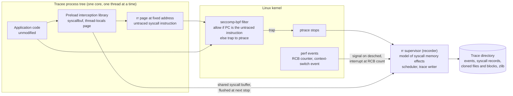

# Paper: Engineering Record and Replay for Deployability (O'Callahan et al. 2017)

> [!summary] Scope
> Owns the USENIX ATC 2017 systems paper on deterministic record and replay debugging by Robert O'Callahan et al.
> Details how rr achieves low recording overhead on commodity Linux hardware through single-core thread scheduling, hardware performance counters for retired conditional branches, and seccomp-bpf syscall buffering.
> Analyzes copy-on-write memory checkpointing and reverse execution mechanics that make deterministic debugging practical on stock Linux.

> [!summary] TL;DR
> rr replays a Linux process tree bit-for-bit by recording only what crosses the user-space/kernel boundary: system call results, signal delivery points, and a handful of nondeterministic instructions.
> It runs one thread at a time on one core, so shared-memory races cannot occur unrecorded, and it locates asynchronous events by pairing a count of retired conditional branches (the one deterministic counter on Intel) with the full general-purpose register state.
> An in-process system call interception library plus a seccomp-bpf filter removes the ptrace round trips for common system calls, which the paper measures as the difference between 24.53x and 1.49x recording slowdown on a `cp` workload.
> The cost is real: no parallel speedup, a fragile dependence on a deterministic PMU counter, and a per-system-call memory-effects model that someone has to maintain.

## Bibliographic Metadata

| Field | Value |
| :--- | :--- |
| Title | Engineering Record And Replay For Deployability |
| Authors | Robert O'Callahan and Chris Jones (unaffiliated), Nathan Froyd (Mozilla Corporation), Kyle Huey (unaffiliated), Albert Noll (Swisscom AG), Nimrod Partush (Technion), as listed on the USENIX cover page |
| Venue | 2017 USENIX Annual Technical Conference (USENIX ATC '17), Santa Clara, CA, July 12-14, 2017 |
| Pages | 377-389 (USENIX Association) |
| ISBN | 978-1-931971-38-6 |
| Primary URL | https://www.usenix.org/system/files/conference/atc17/atc17-o_callahan.pdf |
| Extended report | arXiv:1705.05937 (v1 dated 16 May 2017), https://arxiv.org/abs/1705.05937 |
| Artifact | rr, free software, originally `mozilla/rr`, now https://github.com/rr-debugger/rr |

The paper uses the name "RR" in capitals; the tool is invoked as `rr` and this note writes `rr`.
The footnote on the paper's first page says the majority of the work of the starred authors (all but Froyd) was carried out while supported by Mozilla Research.
The ATC paper runs 13 pages including references.
The arXiv extended report adds the signal-handling, ptrace emulation, seccomp, scratch buffer, and thread-local-storage details, plus a "Lessons Learned" section (6) that the ATC version omits.
Section references below say which of the two documents they come from.

## The Core Problem

Record and replay (R&R) means capturing an execution once and re-running it deterministically any number of times, which enables reverse execution, debugging of failures that occur once in thousands of runs, and forensic analysis of deployed software.
By 2017 R&R was not new.
The paper's claim is that every existing approach paid a deployability tax:

| Approach | Examples cited | Why it limits deployment (the paper's argument) |
| :--- | :--- | :--- |
| Record the whole virtual machine | ReVirt, VMware Workstation, Simics | Heavyweight: users must set up a VM, the recorded state is a whole OS when the user cares about one process, and checkpoints (needed for reverse execution) are expensive |
| Modify the OS kernel | Scribe, dOS, Arnold | Deployment and maintenance cost, security and stability risk |
| Modify compilers and language runtimes | Castor | Barrier to adoption, and breaks for applications with their own JIT |
| Pervasive code instrumentation | PinPlay, iDNA, UndoDB, TotalView | Complexity and overhead, worst for self-modifying code such as polymorphic inline caches in JITs |
| Custom hardware | FDR, BugNet, Rerun, DeLorean, QuickRec | Not available |

The project goal (extended report, Section 1) was to record and replay unmodified user-space applications on stock Linux kernels, compilers, language runtimes and x86/x86-64 CPUs, with a fully user-space implementation running without special privileges, and without pervasive instrumentation.
The origin was practical: Mozilla developers observed that developers spend a lot of time debugging, "particularly on deterministic bugs", and none of the existing record-and-replay systems were easy to deploy, so the project set out to build one suitable for Mozilla's use or discover why it could not be built.
The extended report says about "a couple of person-years" went into a prototype able to debug Firefox and "perhaps five person-years total to date", which is itself a design constraint: approaches demanding a large engineering effort were excluded.

Two explicit assumptions bound the problem.
The recorded applications may contain data races that must be faithfully recorded and replayed, but they are assumed not to maliciously subvert recording or replay.

## Key Innovation

The paper says plainly that it combines known techniques "not previously demonstrated working together in a practical system", and it adds one novel optimization.
The contribution list is four items:

1. Record and replay of user-space processes on stock modern hardware and software without pervasive code instrumentation is possible and practical.
2. In-process system call interception, which the paper introduces, dramatically reduces overhead.
3. For low-parallelism workloads, overhead is reasonably low, lower than other approaches with comparable deployability.
4. The hardware and OS design constraints required for this approach are identified, as a message to CPU and kernel designers.

The insight underneath all four is the boundary argument (Section 2.1): most CPU execution is deterministic, so choose a boundary, record every input crossing it and every source of nondeterminism inside it, and re-execute.
rr puts the boundary at the user/kernel interface.
Inputs are system call results and signal timing, and almost nothing about the kernel is reproduced during replay: file descriptors are not opened, signal handlers are not installed, filesystem operations are not performed.
Replay recreates only user-space state, one replay thread per recorded thread and one replay address space per recorded address space with matching mappings.
User-space memory and register values are preserved exactly, which makes control flow and memory layout identical between recording and replay.

Three ingredients make this practical, and each one is borrowed from a feature built for another purpose:

| Ingredient | Built for | rr's use |
| :--- | :--- | :--- |
| ptrace | Debuggers | Observe and record system calls and signals synchronously |
| `PERF_COUNT_SW_CONTEXT_SWITCHES` and a retired-conditional-branch hardware counter via perf events | Profiling | Detect blocking syscalls; measure application progress |
| seccomp-bpf | Sandboxing | Suppress ptrace stops for selected system calls |

The paper's conclusion calls this fortuitous: "we use software and hardware features for purposes they were not designed to serve", and five years before 2017 the seccomp-bpf and file-cloning APIs did not exist and a deterministic user-space-readable counter "had only just appeared (Intel Westmere)".

## Mechanism Details

### The recording boundary and what replay skips

Replay is not re-execution of the original program in a normal kernel context.
For an intercepted system call, replay does not perform the call at all.
It runs the tracee to the recorded system call instruction using a temporary breakpoint, advances the program counter past the instruction, and applies the recorded register and memory changes (Section 2.3 of the ATC paper).
The extended report (Section 2.3.7) explains the choice: a breakpoint yields one ptrace stop per replayed syscall, against two for `PTRACE_SYSEMU` (entry and exit).
The fallback is `PTRACE_SYSEMU` when the syscall instruction sits in writable or shared memory, where a software breakpoint could be overwritten, and where hardware breakpoints are unattractive because x86 has typically four and the tracee may use them.

Some calls need real work during replay.
A recorded file `mmap` is replayed with `MAP_FIXED` so the mapping lands at the recorded address.
`execve` is the hardest: after a recorded `execve` rr reads `/proc/.../maps` to record the new mappings, and in replay it `execve`s a small stub executable of the right word size, removes all existing mappings (they may differ because of ASLR), and recreates the recorded ones.

### One thread at a time

Threads on multiple cores that race on a memory location are nondeterminism that would have to be recorded.
rr takes "the common approach" of running one thread at a time, so context-switch timing is the only scheduling nondeterminism, and it is recorded.
The consequences stated by the paper:

- Data race bugs are still observable if a context switch lands in the right place, but bugs that require a weak memory model cannot be observed.
- Overhead is high for workloads with consistently high parallelism, and the authors argue users often apply rr to small test inputs with limited parallelism.
- The extended report (Section 2.2) says the one-thread-at-a-time rule is implemented by supervising every tracee via ptrace: at a potentially blocking syscall rr allows a context switch, uses `PTRACE_SYSCALL` to let the thread run to syscall exit, picks another thread, and later polls with `waitpid` for threads ready to exit blocking calls.
- Preemption is driven by an asynchronous signal.
  The scheduler honors Linux thread priorities strictly, and equal priorities are round-robin.

### System call recording and scratch buffers

For a traced (ptrace-trapped) syscall rr models "most Linux system calls", meaning for each call it knows which user-space memory the kernel may write given the arguments and the result.
Figure 1 of the paper shows the sequence for `read(fd, buf, size)`: the tracee enters the syscall and stops, rr redirects the output buffer (argument 2) to per-thread scratch memory and resumes the thread to the syscall exit, the kernel runs `sys_read`, rr stops again at exit, reads the result register N, saves N scratch bytes to the trace, and copies them to the real `buf`.
That is two ptrace stops, so four context switches (tracee to rr and back, twice).

Why scratch buffers: if a syscall blocks and rr schedules another thread, that thread could in principle read the output buffer while the kernel writes it, an unrecorded race.
Redirecting writes to a private buffer and copying while no other thread runs removes it.
The extended report (Section 2.3.1) adds that the authors "actually have no evidence that the races prevented by scratch buffers occur in practice" and that scratch buffers might be worth eliminating.

The memory-effects model is the standing cost of the design (extended report, Section 2.3.6).
`ioctl` is the worst case: each device defines its own namespace, there is a convention for encoding the address and length of written memory that "is often not followed", and rr's built-in knowledge of ioctls is "necessarily incomplete".
The report notes Valgrind Memcheck needs the same information (see [[Paper-Valgrind-Dynamic-Binary-Instrumentation]]) and wishes for a shared machine-readable repository of syscall descriptions.
The alternative the authors considered and did not try was Linux's soft-dirty page tracking, which would not work with applications that use soft-dirty themselves and would hide new syscalls that need special handling.

### Tracees that use ptrace, namespaces, seccomp, and signals themselves

These details come from the extended report (Section 2.3) and explain why a faithful recorder is large.

- **ptrace inside the tracee.** Linux allows one ptrace supervisor per thread, and rr already is one, so a tracee that tries to ptrace another tracee would fail (Firefox crash reporting and Wine do this).
  rr emulates all tracee ptrace operations and relationships, which the report calls "rather complicated" because ptrace semantics are.
- **Running syscalls in tracee context.** For mmap handling and similar jobs rr finds a syscall instruction in the tracee, uses ptrace to alter the execution context so it runs with the wanted registers, and when memory parameters are needed temporarily overwrites readable memory (a stack location, in extremis anywhere) and restores it afterwards.
- **Namespaces and sandboxes.** Sandboxed tracees (Firefox, Chromium) sometimes must talk to rr, so rr allocates a reserved file descriptor in every tracee referring to the root directory as rr sees it.
  The report says a malicious sandboxed tracee could use this hole to escape, one reason tracees are assumed non-malicious.
- **seccomp in the tracee.** A tracee's own seccomp-bpf filter could block the syscalls rr performs in its context, so rr detects filter installation and patches the bytecode with a prologue that returns "allow" when the program counter is at the privileged instruction on the "rr page".
  rr records the effect of the tracee's filter on regular syscalls by observing kernel behavior, without implementing a BPF interpreter.
- **Signal handlers.** When a signal triggers a handler during recording, rr advances into the handler with `PTRACE_SINGLESTEP` and records the stack frame and registers the kernel built.
  During replay no handler is installed and no real signal is delivered: rr writes the recorded frame into memory and sets the recorded registers.
  rr must know in advance which signals have handlers, and must handle quirks such as a blocked synchronous `SIGSEGV`, which is delivered without running a handler (usually fatal).
- **Interrupted and restarted syscalls.** The kernel restarts an interrupted call by backing the program counter up and restoring the syscall number when it sees `-ERESTARTSYS` and other conditions.
  rr lets the kernel do it, but must tell a restart from a new call at a ptrace syscall stop.
  There is "no foolproof way", so rr keeps a stack of pending interrupted syscalls with their parameter registers, treats an entry whose parameters match the most recent pending call as the restart, and pops a pending call it concludes was abandoned.

### Asynchronous events: retired conditional branches

An asynchronous event (a signal, or a preemptive context switch which rr implements as a signal) must be delivered during replay when the program is in exactly the state it was in during recording.
The standard tool is a hardware performance counter that measures progress.

**Requirement.** Every execution of a given instruction sequence must change the counter by an amount that depends only on the instruction sequence, not on state invisible to user space such as caches, page tables, or speculation.
Retired-instructions counters fail this on every known x86 model, for example because an instruction that page-faults is restarted and counted twice.
The paper states modern Intel CPUs have exactly one such deterministic counter: retired conditional branches (RCB).

**Uniqueness problem.** The RCB count does not identify a unique execution point, so rr pairs it with the full general-purpose register state including the program counter.
The paper concedes this is still not unique in principle (its example: the infinite loop `inc [global var]; jmp label`, which has no conditional branch) and states that it works reliably in practice, since code returning to the same instruction with no intervening conditional branch is rare and only matters when an asynchronous event lands there.
The extended report (Section 2.4.1) records a real failure of the uniqueness assumption in reverse execution: a function A calling function B several times, with no conditional branches in A or B, where the registers at some instruction in B happen to match across two invocations.
Reverse execution compares stopping points constantly, so it is more sensitive than plain replay.
The fix was to add data collected from the stack at each stopping point to the program-state identifier, and the report says no new issues in this area appeared "for a couple of years".

**Late interrupt firing.** A counter can be programmed to interrupt after N events, but the interrupt "does not fire immediately": the paper observes dozens more instructions retiring first.
During replay rr therefore programs the interrupt to fire some number of events earlier than the recorded RCB count, sets a temporary breakpoint at the recorded program counter, and repeatedly runs to the breakpoint until RCB count and general-purpose registers both match.
That margin is the "skid" constant rr carries per CPU model.
As of 2026-11 on Linux, `src/PerfCounters.cc` carries `skid_size` 100 for the Intel Core entries from Nehalem through Rocket Lake and for the Atom-lineage entries, 125 for the Alder Lake and later Core entries, and 10000 for AMD Zen entries flagged `PMU_SKID_UNBOUNDED`, meaning the value "is exceeded in rare cases".
(These are values read from the source tree, not measured here.)

**Why not branches, as other work did.** The extended report (Section 2.4.2) notes that counting all retired branches avoids the uniqueness problem (an instruction cannot be reached twice without an intervening branch, except for `rep` string instructions, which need RCX added to the state) but the branch counter is nondeterministic: a transition out of a hardware interrupt is counted against the user process but invisible to rr, and System Management Mode interrupts are counted and not even visible to the host kernel.

**Why not binary instrumentation to count.** The authors judge its overhead and implementation complexity worse than hardware counters.

**Hardware transactions.** RTM (`XBEGIN`/`XEND`) is nondeterministic from user space because a transaction can fail depending on cache state, and in 2017 the only user the authors found was the system pthreads library, which rr patched dynamically to disable transactions.
HLE is a backward-compatible hint, cannot be disabled through CPUID because code may use the prefixes without checking, and makes the plain RCB counter nondeterministic because conditional branches retired in a failed HLE transaction are counted.
Intel's IN_TXCP option counts only committed-transaction events, but on Linux an IN_TXCP counter cannot be programmed to interrupt after N events (the infinite-loop scenario in Section 2.6.1 of the report), so rr uses a non-IN_TXCP counter to trigger interrupts and an IN_TXCP counter to count.
Because that interrupt can fire early, and the design already fires early, it composes.

### Nondeterministic instructions

| Instruction or feature | Problem | rr's 2017 handling (paper) |
| :--- | :--- | :--- |
| `RDTSC` | Time-stamp counter varies | Configure the CPU to trap via the prctl API, then trap, emulate and record each one |
| `RDRAND` | Random numbers, nondeterministic by design | One use found, in GNU libstdc++, and rr patches it explicitly |
| `XBEGIN` and HLE | See above | Patch libpthread; counter workaround |
| `CPUID` | One feature returns the running core index, which changes as the kernel migrates the process | Force all tracee threads to one fixed core with `sched_setaffinity`, both recording and replay |
| `CPUID` trapping | Would allow masking feature bits and recording results | "CPUID faulting" on modern Intel; the paper says an API was being added and the extended report says it "just landed in Linux 4.12" |

The Linux manual pages confirm the two interfaces on x86.
`PR_SET_TSC` with `PR_TSC_SIGSEGV` makes timestamp-counter reads raise `SIGSEGV` (Linux 2.6.26, x86 only).
`arch_prctl(ARCH_SET_CPUID, 0)` makes `cpuid` raise `SIGSEGV` (since Linux 4.12), is preserved across `fork` and `clone`, is reset on `execve`, and fails with `ENODEV` where the hardware lacks CPUID faulting (as of 2026-11, man-pages 6.19, Linux).
Current rr exposes `rr record --disable-cpuid-features`, `--disable-cpuid-features-ext`, `--disable-cpuid-features-xsave`, and `--disable-avx-512` ("can improve trace portability") built on this mechanism (rr master `RecordCommand.cc`, as of 2026-11, Linux).

### Shared memory with non-recorded code

One-thread-at-a-time only protects memory written solely by tracee threads.
The paper finds four common cases of sharing with non-recorded code on Linux desktops: the PulseAudio daemon, the X server, kernel graphics drivers and GPUs, and vDSO system calls.
rr disables the first three by falling back to socket transport for PulseAudio and X and by denying direct GPU access, and it patches the user-space vDSO implementations (such as `gettimeofday`) to issue the real system call instead.
Remaining cases can sometimes be solved by enlarging the recorded process group.
The extended report notes denying GPU access can cause performance problems.

### In-process system call interception (the novel part)

**The bottleneck.** With plain ptrace each system call costs four context switches, and for cheap calls such as `gettimeofday` or `read` from a cached file the context-switch cost dwarfs the call (ATC Section 3).

**The design.** Inject a library into every tracee that intercepts common system calls, performs them without a ptrace stop, and records the results into a buffer shared with rr, which flushes it to the trace at the next synchronous stop (the extended report says "every time it receives a synchronous stop notification"; the ATC version says "periodically").
Figure 2 shows the fast path: `syscall_hook()` redirects output arguments into the syscall buffer, the seccomp filter allows the call, the kernel executes it, the library copies N bytes back to the real buffer and appends a record.

Four problems had to be solved:

1. **How to get calls into the library.** Dynamic-linker interposition fails for direct system calls, varies across C libraries, and conflicts with applications that preload their own libraries (the paper cites AddressSanitizer and Wine; see [[Paper-AddressSanitizer]]).
   rr instead gets a ptrace trap on the call and rewrites the syscall instruction.
   On x86 that instruction is two bytes and a `call` is five, so rr exploits the fact that hot syscall instructions are followed by a few fixed sequences (for example `cmpl $0xfffff001,%eax` testing the result): five hand-written stubs execute the post-syscall instructions and return into the patched code, and the syscall instruction plus its follower are replaced with a call to the matching stub.
   On x86-64 the extended report adds that trampolines must be allocated within 2 GB of the patched code.
   The library has wrappers only for the most common calls; others take the normal ptrace path.
2. **How to avoid ptrace stops for only some calls.** seccomp-bpf: the kernel runs a filter per syscall with the register values including the program counter, and the filter's verdict can allow, fail with an errno, kill, or trigger a ptrace trap.
   rr maps a special page at a fixed address immediately after `execve` containing the "untraced instruction".
   The filter allows the call when the program counter is at that instruction and traps otherwise.
   Filters are native-code compiled on most architectures so their cost is negligible.
   Man page cross-check (Linux man-pages 6.19): per seccomp(2), `SECCOMP_RET_TRACE` notifies a ptrace tracer that requested `PTRACE_O_TRACESECCOMP`, and the filter data includes `instruction_pointer`; per ptrace(2), `PTRACE_O_TRACESECCOMP` exists since Linux 3.5.
3. **How to detect a blocking call that rr never saw.** Because rr runs one thread at a time, a thread blocking in the kernel without telling rr could deadlock the whole recording, for example if the thread that would write to the pipe is not scheduled.
   rr uses a perf event on `PERF_COUNT_SW_CONTEXT_SWITCHES`, which fires whenever the kernel deschedules the thread, and asks the kernel to deliver a signal to the thread on each event.
   The signal makes ptrace notify rr and keeps the thread from running further.
   The event is normally disabled and explicitly enabled only during an untraced syscall that might block, to avoid spurious signals on ordinary timeslice expiry, and spurious events between enable and disable are handled by "careful inspection of the tracee state".
   In rr master the signal is configurable: `rr record --syscall-buffer-sig` sets "the signal used for communication with the syscall buffer", `SIGPWR` by default (as of 2026-11, Linux).
   Figure 3 shows the flow: thread T blocks in `read`, the event fires and the signal interrupts the call, rr notes T was interrupted in intercepted code, finds another thread T2 whose blocking `futex` has completed, and runs it.
   T's `read` is later restarted as a regular traced call with scratch buffers, and rr sets an "abort commit" flag so the interception library does not also record it.
4. **Making the library replay identically.** The library is part of the replayed execution so it must execute the same instructions in record and replay.
   Its outputs are written directly into the trace buffer, then copied to the real buffers.
   During replay the untraced syscall instruction is replaced by a no-op, so the call does not happen, and the results already in the trace buffer are copied out.
   The result register is set differently in recording and replay without branching, by a conditional move keyed on an `is_replay` global, and in-out parameters use a conditional move to turn the first copy into a self-copy during replay.
   The authors avoid divergence in control flow because RCB counts and register values must match at every exit from the library, "it's simplest to minimize the divergence".

**Signals and the interception library (extended report Section 3.4 to 3.7).**
A signal landing mid-library is stashed (at most one per thread) while rr resumes the thread without delivering it, then a traced "dummy" syscall is forced before returning to application code so rr can drain stashed signals first.
An untraced `sigprocmask` with a stashed signal is emulated to return `EAGAIN`, forcing a traced retry.
Blocking all further signals while one is stashed avoids delivering a second signal that, because of `sa_mask`, would never be handled by any thread but would have been handled by another thread natively.
Thread-local storage for the library cannot use normal TLS (the raw `clone` calls used by Chromium break it), so rr maps a "thread locals" page at a fixed address and copies values in and out on every context switch.
The library switches to a private stack so it does not clobber the 128-byte x86-64 red zone.

**Retrospective.** The extended report (Section 3.10) calls it "a large maintenance burden": it must work unchanged in recording and replay, behave like a normal syscall (atomic with respect to signals), and be protected from application misbehavior, though not from malicious applications.
Without it "we could not meet our performance targets".

**Block cloning.** For large block-aligned reads, when the input file is on the same filesystem as the trace and the filesystem supports copy-on-write cloning, the interception code clones the data into a per-thread "cloned-data" trace file and then reads from the original file.
This opens a window where another process overwrites the file between clone and read, producing a replay mismatch.
The authors judge it acceptable because a reader racing a writer under Linux can see an arbitrary mix of old and new bytes, which would be a severe bug anyway.
Reading from the cloned file instead is safe but defeats readahead and "performs very poorly".
The relevant kernel API, `FICLONE`/`FICLONERANGE`, dates to Linux 4.5 (previously Btrfs-private `BTRFS_IOC_CLONE`) per ioctl_ficlone(2).

### Trace size

Executables and libraries mapped by tracees are hard-linked into the trace instead of copied, valid as long as updates replace files rather than write into them.
On filesystems with cloning (XFS and Btrfs in the paper), rr clones them instead, "essentially free in time and space".
rr makes no attempt to deduplicate clones.
All remaining trace data is compressed with zlib deflate, and the report says better algorithms exist and the choice should be revisited.

### Checkpointing and reverse execution

The seed lists these; here is exactly what the sources support.

**What the paper says.** The ATC paper does not describe the reverse-execution algorithm.
Its related-work discussion says "Many applications of record-and-replay require cheap checkpointing, and checkpointing a VM image is generally more expensive than checkpointing one or a few processes", and the extended report (Section 6.1) says:

- Frequent checkpoint creation and resumption, "e.g. to simulate reverse execution", makes cheap checkpoints "an often-overlooked design constraint".
- rr's process-level design made them cheap: it uses `fork` to copy address spaces, which is mostly copy-on-write and well optimized on Linux, and it delays creating the non-main threads until the checkpoint is resumed, "and most checkpoints are never resumed".
- Creating a checkpoint "typically takes less than ten milliseconds" (anecdotal, unmeasured in a table).
- Checkpointing a general Linux process from user space is complicated (the report cites CRIU) because much kernel state must be saved, but for replay only a minimal amount of kernel state exists, so it is "relatively simple".
- Replay performance matters more than record performance for debugging: recording executes code once while reverse execution may run it many times.

**What the code does today (not in the paper).** `src/ReplayTimeline.cc` in rr master (as of 2026-11, Linux) implements the strategy the paper only gestures at:

- A `ReplayTimeline` keeps marks keyed by `(trace time, ticks, replay step)` and explicit checkpoints that are clones of the replay session (`current->clone()`).
- Reverse execution is built from forward replay: `reverse_continue` seeks to a checkpoint before the current position, replays forward with breakpoints and watchpoints armed, remembers the last stop before the original position, and seeks back to that mark; it adds checkpoints during the forward run so later reverse moves are cheap.
- A source comment defines the checkpoint policy: intervals of increasing length ending at the current position, at most N checkpoints in interval N, lengths growing exponentially "in the limit", so "the maximum number of checkpoints for a given execution length L is O(log L)".
  In `next_interval_length` the length grows linearly by `expecting_reverse_exec_inter_checkpoint_interval` until it reaches `low_overhead_inter_checkpoint_interval`, then multiplies by `checkpoint_interval_exponent = 2`.
  Checkpoints after the current replay point are always discarded.
- Spacing constants: `expecting_reverse_exec_inter_checkpoint_interval = 100000` and `low_overhead_inter_checkpoint_interval = 500000`, in units of a fitted "progress" metric that estimates replay microseconds.
  A comment says the low-overhead value aims for about 0.5 s of replay time and, on a guess that checkpointing Firefox costs about 50 ms, about 10 percent checkpoint overhead.
  The progress metric `estimate_progress` is a least-squares fit from Firefox startup and shutdown on a Lenovo W530 laptop (for example 0.0020503143 microseconds per tick and 39.6793587609 microseconds per syscall).
- A documented quirk: Intel CPUs "coalesce iterations of REP-prefixed string instructions" so a watchpoint can fire after the iteration that writes byte L+63, which does not occur when single-stepping, so rr rewinds and replays with single-stepping near the target.

The full reverse-execution walkthrough, gdb remote protocol integration, and Pernosco's use of rr traces belong to [[Record-and-Replay-rr-UDB-and-Pernosco]], which owns the mechanism; this note keeps only the paper's design argument and the code facts needed to judge it.

### Chaos mode and the scheduler (future work in the paper, present in the code)

Section 7 of the ATC paper says that forcing all threads onto one core can fail to reproduce bugs that manifest only outside rr, and states the authors "addressed this problem by introducing a chaos mode that intelligently adds randomness to scheduling decisions", out of scope for the paper.
In rr master (as of 2026-11, Linux): `rr record -h` or `--chaos` enables it; the default timeslice cap `DEFAULT_MAX_TICKS` is 2,500,000 ticks, which the header comment describes as 50 ms at an assumed 50,000 ticks per millisecond; with chaos on the scheduler pretends to have 1 to 8 cores at random unless `--num-cores` overrides it, and per `Scheduler.cc` makes 10 percent of timeslices very short (up to 100 ticks) and 10 percent short (up to 10,000 ticks), marks some threads low priority at random (probability 0.1, and 0.3 for main threads, per the constants in `Scheduler.cc`), and lets low-priority threads be starved during high-priority-only intervals.
That is the machinery behind rr's reputation for reproducing flaky tests.

## Evaluation and Limitations

### Setup (ATC Section 4)

Machine: Dell XPS15 laptop, quad-core Intel Skylake CPU (8 SMT threads), 16 GB RAM, 512 GB SSD, Btrfs, Fedora Core 23.
Each test ran six times, the first discarded, geometric mean of five reported, so results are warm-cache.
Workloads were tuned to fit in RAM and run about 30 seconds except `cp`:

| Workload | What it is |
| :--- | :--- |
| `cp` | `cp -a` of a glibc git checkout, 15200 files, 732 MB; single-threaded, intensive synchronous reads and filesystem syscalls |
| `make` | `make -j8` building DynamoRio 6.1.0; many short-lived processes (the paper counts 2430 forks and execs) |
| `octane` | Google Octane under Mozilla SpiderMonkey; CPU-intensive code in a complex language runtime |
| `htmltest` | Firefox HTML forms tests with the harness excluded from recording; real-world usage, about 30 percent of user-space CPU is in the harness |
| `sambatest` | Samba UDP echo test through `make test`; real-world usage |

### Table 1: run-time overhead (copied from the paper, normalized to baseline)

| Workload | Baseline | Record | Replay | Single core | Record no-intercept | Replay no-intercept | Record no-cloning | DynamoRio-null |
| :--- | ---: | ---: | ---: | ---: | ---: | ---: | ---: | ---: |
| cp | 1.04 s | 1.49x | 0.72x | 0.98x | 24.53x | 15.39x | 3.68x | 1.24x |
| make | 20.99 s | 7.85x | 11.93x | 3.36x | 11.32x | 14.36x | 7.84x | 10.97x |
| octane | 32.73 s | 1.79x | 1.56x | 1.36x | 2.65x | 2.43x | 1.80x | crash |
| htmltest | 23.74 s | 1.49x | 1.01x | 1.07x | 4.66x | 3.43x | 1.50x | 14.03x |
| sambatest | 31.75 s | 1.57x | 1.23x | 0.95x | 2.23x | 1.74x | 1.57x | 1.43x |

Measured by the paper on the machine above (Linux, Skylake, 2017); not re-measured here.

Reading it:

- "Single core" is only `taskset` to one core.
  It isolates the cost of serialization from the cost of recording: for `make` single-core alone is 3.36x, and the paper attributes `make`'s high overhead to the forced single core plus the process churn.
- The interception optimization, derived by dividing record no-intercept by record: `cp` 16.5x, `htmltest` 3.1x, `octane` 1.5x, `make` 1.4x, `sambatest` 1.4x.
  (Arithmetic on the table, not a separate measurement.)
- Block cloning matters for `cp` (3.68x without, 1.49x with) and "essentially no effect on the other workloads".
- Replay can be faster than the original: 0.72x on `cp` "because system calls do less work", and the paper notes interactive applications would see replay much shorter because idle periods vanish.
- `make` is the outlier because 2430 processes are created and interception only starts in a process after the library loads, and "at least 80 system calls are performed before that completes".
- DynamoRio's null tool, used as a lower bound for instrumentation-based designs, crashed on `octane` (reported upstream by the paper authors as DynamoRIO issue 1930, "DynamoRio null tool crashes on Mozilla Spidermonkey Octane test", opened 2016-04-28 and still open as of 2026-11), cost 14.03x on `htmltest` (probably JIT-generated and modified code, the paper speculates), and roughly matched rr on `make` and `sambatest`.
  The paper's inference is that a replay system built on dynamic instrumentation would add more on top.

### Tables 2 and 3: storage and memory

| Workload | Compressed trace MB/s | Deflate ratio | Cloned blocks MB/s | Peak PSS MB: baseline / record / replay / single core |
| :--- | ---: | ---: | ---: | :--- |
| cp | 19.03 | 4.87x | 586.14 | 0.51 / 34.54 / 9.11 / 0.51 |
| make | 15.82 | 8.32x | 5.50 | 510.51 / 327.19 / 314.16 / 288.65 |
| octane | 0.08 | 8.33x | 0.00 | 419.47 / 610.48 / 588.01 / 392.95 |
| htmltest | 0.79 | 5.94x | 0.00 | 690.81 / 692.06 / 324.71 / 689.75 |
| sambatest | 6.85 | 21.87x | 0.00 | 298.68 / 400.49 / 428.79 / 303.03 |

Storage rates are the geometric mean of trace bytes divided by baseline runtime.
Memory is peak summed proportional set size sampled every 10 ms across all workload processes including rr.
The paper's reading: "several MB/s is easy for modern systems to handle" and "trace storage has not been a concern".
Memory: `cp` shows 34.54 MB under record against 0.51 baseline, which is almost entirely the rr process (Figure 7 colors it); `htmltest` replay is lower because the harness is not replayed; `make` memory drops on a single core because fewer processes run at once.

### Limitations, as stated and as implied

| Limitation | Source | Consequence |
| :--- | :--- | :--- |
| No parallel speedup | Section 2.2 | Highly parallel workloads see large slowdowns; `make` 7.85x recording and 11.93x replay |
| Perturbs execution | Section 7 | Bugs that need true parallelism may not reproduce; weak-memory-model bugs are unobservable; chaos mode mitigates |
| Needs a deterministic counter | Sections 2.4, 5.1 | Intel only in the paper; ARM "failed" because every ARM atomic uses load-linked/store-conditional, whose conditional store can fail for reasons user space cannot observe, and the primitives are inlined in "very many code locations" |
| Needs PMU virtualization | ATC 5.1, extended 2.4.2 and 8 | Works under KVM and VMware (VMware's VM-exit clustering breaks RCB determinism and must be disabled by hand); the extended report says most cloud providers virtualized no counters in 2017, with Digital Ocean the exception |
| Per-syscall memory model | Extended 2.3.6 | `ioctl` coverage is permanently incomplete |
| Not secure against malicious tracees | Section 1, extended 2.3.4, 3.10 | The reserved file descriptor hole in sandboxes and the unprotected interception library let a hostile tracee escape or corrupt recording |
| Shared memory with unrecorded processes | Section 2.5 | Works only because PulseAudio, X, and GPU sharing are disabled |
| Traces are not portable | Extended Section 8 | CPUID differences across machines; "RR does not really support yet" moving a recording between machines |
| Windows would be much harder | Section 5.2 | Undocumented, less stable user/kernel interface |
| Small recorded-process startup window | Section 4.3 | Interception starts only after the library loads, hurting short-lived process workloads |
| Counter uniqueness is probabilistic | Section 2.4.1 | The infinite-loop `inc [x]; jmp` case would diverge; observed once in reverse execution and patched with stack data |

The authors' own engineering assessment (extended Section 6.2) is also part of the evidence: rr is "complex and relies on poorly documented hardware and OS features", hardware, kernel and hypervisor bugs had to be worked around repeatedly, and small bugs cause small state changes that "don't cause observable divergence until long after the root cause".
The mitigation they describe is a high density of consistency assertions (mostly checked in release builds), logging compiled into release builds and enabled by an environment variable, an "emergency debugger" that starts a gdb server on a failing recording or replay, memory checksums and full memory checkpoints compared between record and replay, and the ability to record and replay rr's own replay.
Code size on 15 May 2017: 75028 lines of C and C++, of which 21403 are the test suite.

What the paper does not evaluate: any multi-process parallel recording, any I/O-bound workload on slow storage (everything fit in RAM), non-Intel CPUs, overhead on a latency-sensitive service, or trace portability.

## Industry Impact

Facts checkable against the repository as of 2026-11 (Linux):

- rr is maintained at `rr-debugger/rr`; the README says development is sponsored by Pernosco and that it "was originated by Mozilla", and recommends the extended technical report as "the best technical overview".
- Release history from the GitHub Releases API: 5.3.0 (2019-12-18), 5.4.0 (2020-10-28), 5.5.0 (2021-09-20), 5.6.0 (2022-08-07), 5.7.0 (2023-10-03), 5.8.0 (2024-05-20), 5.9.0 (2025-02-13), 5.10.0 (2026-10-15).
- The paper said rr "cannot be implemented on ARM CPUs".
  The README now lists "certain AArch64 microarchitectures (e.g. ARM Neoverse N1 or the Apple Silicon M-series)".
  The rr 5.7.0 release notes say "we are now building Aarch64 packages".
  The route around the LL/SC obstacle is visible in `PerfCounters.cc`: ARM entries are flagged `PMU_TICKS_TAKEN_BRANCHES` (event 0x21, which the source comments call `BR_RETIRED`, on the Arm-designed cores; 0x90 on the Apple entries) rather than counting conditional branches, an extra counter counts speculatively executed `strex` instructions (event 0x6F, `STREX_SPEC`, on the Neoverse, Cortex-A76/A77/A78/X1/A720, AmpereOne and Qualcomm Oryon entries; the Apple entries carry none), and the code aborts with the message "rr only supports applications making use of LSE atomics rather than legacy LL/SC-based atomics" when it sees them (tolerating up to two such events before the preload library loads, as dynamic-loader noise).
  So the answer to the paper's ARM problem was not to make LL/SC deterministic but to refuse it and rely on ARMv8.1 LSE atomics.
- Intel and AMD: the README requires Nehalem (2010) or later on Intel (the paper named Westmere as when the deterministic counter appeared; the table in `PerfCounters.cc` carries Nehalem with the same event `0x5101c4`), and "certain AMD Zen or later processors" with a separate wiki page (that page dates experimental Zen support to 2020-09-18 and describes a required `SpecLockMap` workaround, covered by [[Record-and-Replay-rr-UDB-and-Pernosco]]); rr 5.10.0 notes it prefers P-cores on Intel hybrid CPUs while handling E-cores correctly.
- Virtualization, the paper's biggest deployment worry: the README now states that VM guests work "as long as the VM supports virtualization of hardware performance counters", with "some configurations of AWS and GCP VMs" known to work and no Xen configuration known to work.
- The paper's wish for kernel support was partly met: `ARCH_SET_CPUID` shipped in Linux 4.12, and rr 5.9.0 notes that on kernels 6.10 and later rr works with `perf_event_paranoid` at 2, the default on most distributions, thanks to a kernel bug fix by co-author Kyle Huey.
  The linked kernel commit `fd20bb51ed39` ("perf/ring_buffer: Trigger IO signals for watermark_wakeup", authored 2024-04-13) makes perf watermark wakeups also raise `FASYNC` signals, and the GitHub compare API shows it is contained in `v6.10`; the rr-side commit `13fb44422d41` ("Use `PERF_RECORD_SWITCH` events when `perf_event_paranoid` is 2 and the kernel supports it") is dated 2024-08-13.
- Tooling reach: `rr replay -d lldb` arrived in 5.8.0 (replay only; LLDB exposes no reverse commands), and Pernosco builds omniscient debugging on rr traces, covered by [[Record-and-Replay-rr-UDB-and-Pernosco]].

Judged claim, not a fact from a source: rr changed the conversation about intermittent test failures from "retry and hope" to "record every run under chaos mode and keep the failing trace", and that workflow, rather than interactive reverse debugging, is how the technique scales to a team.
The paper's own text supports the premise: it states users often run rr on small test workloads and that always-on recording would make field bugs "much easier" to fix, and its future work is explicitly about applications of the base technology.

## Concept Grounding

| Concept note | What it takes from this paper |
| :--- | :--- |
| [[Record-and-Replay-rr-UDB-and-Pernosco]] | Owns the operational view: recording, replay, reverse debugging, hardware matrix, UDB comparison. This paper is its primary source. |
| [[How-Debuggers-Work-ptrace-Mach-and-Breakpoints]] | ptrace stops, `PTRACE_SYSCALL`, `PTRACE_SYSEMU`, single-step, and breakpoint insertion, the exact primitives rr composes |
| [[Linux-perf-in-Depth-and-perf-c2c]] | perf events, counter overflow, skid; rr uses `perf_event_open` as a progress meter rather than a profiler |
| [[Intel-VTune-AMD-uProf-and-Hardware-Tracing-PT-SPE]] | PMU microarchitecture and nondeterminism of counters, plus Intel PT (rr master has an `--intel-pt` option "for debugging rr") |
| [[Scientific-Debugging-Delta-Debugging-and-Heisenbugs]] | Why replay turns a heisenbug into a deterministic subject for hypothesis testing |
| [[Debugging-Without-a-Debugger-and-Concurrency-Bugs]] | The race-bug classes rr can and cannot reproduce under one-thread-at-a-time scheduling |
| [[Signals-Process-Groups-Sessions-and-Job-Control]] | Signal delivery, `sa_mask`, restart semantics (`-ERESTARTSYS`), the details behind the stash-and-drain design |
| [[Virtual-Memory-Mmap-and-Process-Address-Space]] | `MAP_FIXED` replay of mappings, ASLR removal, copy-on-write `fork` used for checkpoints |
| [[Processes-Fork-Exec-and-File-Descriptors]] | `execve` replay with a stub executable, reserved descriptor, fork semantics of thread locals |
| [[Paper-ThreadSanitizer]] | The contrasting approach to races: detect from instrumentation rather than reproduce from a recording |
| [[Paper-Valgrind-Dynamic-Binary-Instrumentation]] | The instrumentation-based alternative and the same syscall-description burden |
| [[Paper-Zeller-Delta-Debugging]] | Reduction and replay combine: a deterministic replay is the oracle delta debugging needs |
| [[Paper-Coz-Causal-Profiling]] | Another system that perturbs scheduling to learn something, and a reminder that rr's single-core schedule is itself a perturbation |

## Interview Questions

### L5

**Q1.** What is the "recording boundary" in rr, and what does replay deliberately not reproduce?

> [!success]- Answer
> The boundary is the user-space/kernel interface.
> rr records the results of system calls (user-visible register and memory effects), the timing of asynchronous events (signals and preemptive switches), and a few nondeterministic instructions.
> Replay reproduces user-space memory and registers exactly, so control flow and memory layout match, but it does not reopen file descriptors, install signal handlers, or perform filesystem operations; it applies the recorded effects instead.
> One replay thread per recorded thread and one address space per recorded address space are created.
> Because kernel-side effects are replaced by recorded results, replay can be faster than the original (0.72x on `cp` in the paper's Table 1).

**Q2.** Why does rr run only one thread at a time, and what bugs does that hide?

> [!success]- Answer
> Concurrent threads on multiple cores that race on memory would be an unrecorded source of nondeterminism.
> Serializing removes it and makes context-switch timing the only scheduling nondeterminism, which rr records.
> Serialization is simpler and more deployable than instrumenting shared-memory loads or recording page ownership.
> It still exposes data races that occur at a preemption point, but it cannot reproduce bugs that need a weak memory model or real parallelism, and it costs large slowdowns on consistently parallel workloads (`make` records at 7.85x in the paper).
> rr's chaos mode randomizes timeslices and thread priorities to reach more interleavings.

**Q3.** Why does rr count retired conditional branches and not retired instructions?

> [!success]- Answer
> Instruction counters are not deterministic on any known x86 CPU: for example, an instruction that page-faults is restarted and counted twice, so the count depends on kernel and paging state invisible to the program.
> The paper identifies retired conditional branches as the only deterministic counter on modern Intel CPUs.
> It does not uniquely identify a point in execution, so rr pairs the RCB count with the full general-purpose register state including the program counter.

### L6

**Q4.** Predict the output (reasoning exercise, not run here).
A C program starts two threads, each doing `for (i = 0; i < 1000000; i++) counter++;` on a `volatile int counter`, joins both, and prints the counter.
Natively on a multicore machine the result is usually below 2000000.
What do you expect under `rr record` and under `rr record --chaos`, and why?
Hint: Consider timeslice length and what the loop costs in ticks.

> [!success]- Answer
> Under plain `rr record` expect 2000000 on essentially every run.
> Only one thread runs at a time, a loop of 1,000,000 iterations retires on the order of 1,000,000 conditional branches, which is below the default cap of 2,500,000 ticks (`Scheduler::DEFAULT_MAX_TICKS`), and the loop has no syscalls, so each thread normally runs to completion before any switch and no increment is lost.
> Under `--chaos` the scheduler marks some threads low priority and, in 10 percent of timeslices, caps the slice at up to 100 ticks (and in another 10 percent at up to 10,000), so a preemption between the load and store of `counter++` becomes likely and a total below 2000000 is expected on many runs.
> Whatever value appears, replaying that recording prints the same value every time.
> This is a prediction from the scheduler constants and the paper's design, not a measured result.

**Q5.** Debug this.
On an AArch64 machine `rr record ./app` aborts with "N (speculatively) executed strex instructions detected ... rr only supports applications making use of LSE atomics rather than legacy LL/SC-based atomics".
The same binary records fine on x86-64.
Explain the cause, a proper fix, and why `-F` is a bad answer.
Hint: Think about what a failed store-conditional does to a branch counter.

> [!success]- Answer
> On ARM, atomics built on load-linked/store-conditional (`ldxr`/`stxr` loops) retry when the store-conditional fails for reasons invisible to user space, such as an interrupt, so the retry branch executes a different number of times and the progress counter becomes nondeterministic.
> This is the paper's Section 5.1 reason for abandoning ARM; current rr detects speculatively executed `strex` events and aborts.
> The fix is to run code that uses ARMv8.1 LSE atomics (single-instruction compare-and-swap and similar), by compiling for an LSE-capable target (GCC `-march=armv8.1-a` or `-march=armv8-a+lse` emits the ARMv8.1 atomics directly) or relying on GCC's `-moutline-atomics` helpers, which pick LSE at run time on capable CPUs (as of 2026-11, GCC AArch64 Options documentation, Linux); rr's own source comment refers to `__aarch64_have_lse_atomics`, the flag those helpers consult.
> The detector tolerates up to two events before the preload library has loaded, treating them as dynamic-loader noise.
> The source message itself says that replaying a recording made with `-F` "will probably fail", because replay would diverge at a retry loop whose branch count differs from the recording.

**Q6.** Why can't rr deliver an asynchronous signal at "the recorded RCB count" during replay, and how does it get to the right point?
Hint: Two separate problems: the count does not name a point, and the interrupt arrives late.

> [!success]- Answer
> The count alone does not identify a unique execution point, so rr also compares the full general-purpose register state.
> Separately, a performance-counter interrupt fires late, by dozens of instructions on the hardware the paper used.
> rr therefore programs the interrupt to fire early by a skid margin, sets a breakpoint at the recorded program counter, and re-runs to that breakpoint until both the RCB count and the registers match the recording.
> Current rr carries a per-microarchitecture skid constant (100 or 125 on the Intel entries read from source, 10000 on AMD Zen entries flagged as possibly unbounded).

**Q7.** Explain why the in-process interception library needs a context-switch perf event, and what would happen without it.
Hint: Consider a thread that blocks in an untraced `read` on an empty pipe.

> [!success]- Answer
> rr runs one tracee thread at a time and a ptrace stop is how it regains control.
> An untraced blocking call generates no stop, so the blocked thread would hang while the thread that would write to the pipe is never scheduled, deadlocking the recording.
> The `PERF_COUNT_SW_CONTEXT_SWITCHES` event fires when the kernel deschedules the thread, and a signal on that event interrupts the call and produces a ptrace notification, letting rr run another thread.
> It is armed only around untraced calls that might block, because normal timeslice expiry would otherwise generate spurious signals.

### L7+

**Q8.** A team wants to turn on rr for every CI test on a fleet of cloud VMs.
Which findings from the paper and the current README decide whether this works, and what do you measure before committing?

> [!success]- Answer
> Preconditions: the instance type must virtualize hardware performance counters (the paper reports most providers did not in 2017; the README as of 2026-11 lists some AWS and GCP configurations as known to work and no Xen configurations), the CPU must be one rr knows (Intel Nehalem or later, certain AMD Zen, certain AArch64), and `perf_event_paranoid` must permit access (kernel 6.10 or later allows level 2 with rr 5.9.0 or later).
> Fit: tests are mostly single-process with limited parallelism, where the paper measures about 1.5x to 1.8x recording slowdown (`cp`, `htmltest`, `sambatest`, `octane`); a parallel build step is the bad case (7.85x record, 11.93x replay for `make -j8`).
> Measure per test class: recording slowdown, trace bytes per second (the paper's range was 0.08 to 19.03 MB/s compressed), peak memory including the rr process, and the fraction of failures that reproduce under `--chaos`.
> Operational risks to budget: unsupported `ioctl`s (rr aborts with a message naming the call), tests that share memory with unrecorded daemons, and traces that are not portable across CPU models.

**Q9.** The paper claims "deployability" as its thesis, yet rr needs a specific CPU counter.
Is that a contradiction?

> [!success]- Answer
> No, but it locates the cost differently than the abstract suggests.
> rr is deployable in the sense that it needs no kernel patch, no VM, no recompilation, no privileges beyond perf-event access, and no code instrumentation, so an engineer can run it on an existing Linux machine in minutes.
> It is not portable in the hardware sense: it depends on a deterministic PMU counter, and the paper is explicit that it "skirts the edge of feasibility" and calls the dependency a design constraint for CPU and cloud vendors.
> The later history supports both halves: AArch64 and AMD Zen support arrived only by adding per-CPU workarounds and an LL/SC refusal, and cloud deployment still hinges on PMU virtualization.
> A good answer also names what deployability did not buy: security against hostile tracees, and parallel scaling.

**Q10.** Compare rr with an instrumentation-based reverse debugger (UndoDB, PinPlay) for a latency-sensitive C++ service.
What does the paper say, and what does it not say?

> [!success]- Answer
> The paper says rr avoids code instrumentation and therefore beats the instrumentation-based systems that handle asynchronous events on overhead, and it supports this with a DynamoRio null-tool lower bound (1.24x to 14.03x, one crash) as a stand-in rather than measuring UndoDB or PinPlay directly.
> It also says PinPlay and iDNA instrument all loads and so can record parallel executions and avoid modeling system calls, at higher overhead.
> What it does not say: any number for a latency-sensitive service, tail latency under recording, or comparison against UndoDB itself.
> For a trading-style service the single-core serialization is the decisive constraint: a pinned multithreaded pipeline loses its parallelism and its timing under rr, so rr is a tool for reproducing logic and ordering bugs offline, not for production tracing (see [[14-Low-Latency-Systems/13 - Reliability, Ops & Testing/Deterministic Replay and Packet Injection Testing|Deterministic Replay and Packet Injection Testing]] for the input-replay alternative used in low-latency systems).

**Q11.** Design review: someone proposes eliminating the memory-effects model by using soft-dirty page tracking to find what each syscall wrote.
Evaluate it using only what the extended report says.

> [!success]- Answer
> The authors considered it and did not try it.
> Pros: it could reduce the maintenance burden of a per-syscall model, which is the dominant ongoing cost, especially for `ioctl`.
> Cons they name: it adds complexity, it conflicts with applications that use soft-dirty for their own purposes, and the model has a side benefit, because requiring rr to understand every syscall means rr detects new syscalls that need special handling instead of silently mis-recording them.
> Additional reasoning not in the paper: page-granularity dirty tracking says which pages changed but not which bytes, so replay would have to store whole pages and could not reproduce writes that are partially overwritten by later application code, which would inflate traces; this point is the note author's inference.

## Further Reading

- ATC paper PDF, https://www.usenix.org/system/files/conference/atc17/atc17-o_callahan.pdf: the 13-page statement of the design and Table 1.
- Extended technical report, https://arxiv.org/abs/1705.05937: signals, ptrace emulation, thread-locals, checkpoints, and the lessons-learned section the ATC version cuts; the rr README calls it the best technical overview.
- `src/PerfCounters.cc` and `src/ReplayTimeline.cc` in https://github.com/rr-debugger/rr: the current PMU table with skid constants and the checkpoint policy comment, the best evidence of how the 2017 design aged.
- ptrace(2), seccomp(2), perf_event_open(2), arch_prctl(2): the interfaces the paper repurposed, each with the kernel version that introduced it.
- [[Record-and-Replay-rr-UDB-and-Pernosco]]: how to drive rr, reverse debugging, and UDB and Pernosco comparisons.

## Related

- Prerequisites: none
- Next: [[Paper-Lessons-From-Static-Analysis-at-Google]]
- See also: [[14-Low-Latency-Systems/13 - Reliability, Ops & Testing/Deterministic Replay and Packet Injection Testing|Deterministic Replay and Packet Injection Testing]]
