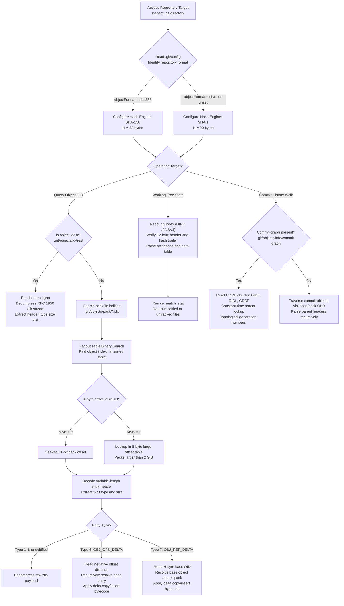

# Capstone: Mini Git in Rust Interoperating with Real Object Stores

> [!summary] Scope
> This capstone playbook details the end-to-end design, implementation, and verification of a fully functional Git porcelain and plumbing tool in Rust that interoperates directly with official Git repositories.
> It covers content-addressable storage hashing (SHA-1 and SHA-256), loose object deflation/inflation, commit-graph traversals, packfile index (v2) parsing, delta decompression (OFS_DELTA and REF_DELTA), and index file reading.
> It defines a multi-stage test suite that validates binary compatibility against real git CLI invocations and GitHub-hosted repositories.

The foundational mechanisms of Git storage and execution are owned by [[Git-Object-Model-and-Content-Addressing]], [[Git-Packfiles-and-Delta-Compression]], [[Git-Index-Stat-Cache-and-Fsmonitor]], and [[Rebuild-Mini-Git-Lab]].
This capstone playbook synthesizes those isolated mechanisms into a production-grade, memory-safe Rust implementation that interoperates directly with official Git CLI repositories and network object stores.

## Trigger and Symptoms

Activate this procedure when you need to construct, audit, or debug custom systems software that reads or mutates Git repositories without executing official Git subprocesses.

- Building high-throughput developer platform services (custom virtual file systems, fast monorepo checkout agents, CI artifact caching engines, or internal code review daemons) where spawning `git` sub-processes introduces per-invocation fork/exec, dynamic-linking, and repository-discovery cost (measure it on your own host before committing to a rewrite), process table churn, and pipe serialization bottlenecks.
- Integrating embedded Git storage directly into high-concurrency Rust server runtimes where thread safety, strict ownership semantics, and predictable allocation profiles are non-negotiable.
- Diagnosing repository corruption or silent interoperability failures caused by third-party Git implementations (such as JGit, libgit2, go-git, or Dulwich) producing non-canonical tree sorting, corrupted index checksums, invalid delta copy offsets, or misaligned packfile entries.
- Validating migration paths for content-addressable storage during the Git cryptographic transition from SHA-1 (20-byte object identifiers) to SHA-256 (32-byte object identifiers) under `extensions.objectFormat`.

## Decision Tree



## Prerequisites

Building and operating this capstone requires standard systems programming tooling and native C library headers on the host machine.

```bash
command -v cargo rustc git python3
pkg-config --modversion zlib || true
```

The toolchain must satisfy:
- Rust compiler: `rustc 1.80.0` or later (tested on `rustc 1.99.0`, 2026-11).
- Cargo build manager: `cargo 1.80.0` or later.
- System compression library: `zlib 1.2.11` or later (tested on `zlib 1.2.12`, macOS/Darwin and Linux).
- Git reference binary: `git 2.40.0` or later (tested on `git 2.55.0`, 2026-11).

Record the compiler and reference Git versions; the lab has no crate dependencies and links the system `libz` through a hand-written FFI block (`#[link(name = "z")]`):

```bash
cargo --version && git --version
```

## Commands and Numbers to Know

| Item | Platform | Value `(as of 2026-11)` | Why it matters |
| :--- | :--- | :--- | :--- |
| Packfile Header Magic | Both | `PACK` (`0x5041434b`) | 4-byte signature prefixing every Git packfile. |
| Packfile Version Default | Both | `2` (`0x00000002`) | Official Git produces version 2 exclusively on disk and over wire. |
| Pack Index v2 Magic | Both | `\xfftOc` (`0xff744f63`) | Distinguishes index v2 from index v1 fanout table. |
| Index File Header Magic | Both | `DIRC` (`0x44495243`) | "Directory cache" signature prefixing `.git/index`. |
| Commit Graph Magic | Both | `CGPH` (`0x43475048`) | Signature prefixing `.git/objects/info/commit-graph`. |
| Fanout Table Size | Both | `256 * 4 = 1024` bytes | First-level radix partition for $O(\log(N/256))$ binary search. |
| Large Pack Offset Threshold | Both | 2 GiB (`0x80000000`) | Offsets at or above 2 GiB set MSB 1 and index into the 8-byte large offset table. |
| Maximum Delta Depth Default | Both | `50` (`pack.depth`; hard cap 4095 from `OE_DEPTH_BITS` = 12) | Bounds how many deltas a reader must unroll to reconstruct one object (`git-config(1)`, `builtin/pack-objects.c`). |
| Sliding Window Size Default | Both | `10` (`pack.window`) | Sliding candidate window examined by `git pack-objects` during compression. |
| Index Entry Fixed Header | Both | 62 bytes (SHA-1, v2); 64 with v3 extended flags; 74 in SHA-256 repositories | Binary metadata preceding the NUL-terminated pathname: 40 bytes of stat data, the H-byte OID, and 2 bytes of flags. |
| Index Path Alignment | Both | 8-byte boundary | DIRC v2 pads the entry with 1 to 8 NUL bytes to maintain 8-byte alignment. |
| Pkt-line Maximum Length | Both | 65,520 bytes | Total pkt-line limit including the 4-byte hex prefix, so at most 65,516 data bytes (`gitprotocol-common(5)`). |
| Flush Packet (`flush-pkt`) | Both | `0000` | Protocol v2 packet terminating commands and message sections. |
| Delimiter Packet (`delim-pkt`)| Both | `0001` | Protocol v2 packet separating sections of a message, such as the capability list from the command arguments. |
| End Packet (`response-end`) | Both | `0002` | Protocol v2 packet marking end of stateless HTTP RPC response. |

## Step-by-Step Execution

Each step below details a concrete phase of constructing and validating the Rust mini-git implementation against official Git repositories.
Do not proceed past a failing check.

### Step 1: Content-Addressable Storage and Loose Object Engine

The foundation of Git is a content-addressable object store where every object is identified by the cryptographic digest of its type, size, and payload:

$$\text{OID} = \text{Hash}(\text{type} \mathbin{\Vert} \text{" "} \mathbin{\Vert} \text{size} \mathbin{\Vert} \text{"\textbackslash 0"} \mathbin{\Vert} \text{payload})$$

In a SHA-1 repository, the digest is 20 bytes (40 hexadecimal characters).
In a SHA-256 repository, the digest is 32 bytes (64 hexadecimal characters).
The object is stored on disk in `.git/objects/xx/rest`, where `xx` is the first two characters of the hex string and `rest` is the remaining characters.
The entire byte sequence is compressed using RFC 1950 zlib Deflate.

Implement atomic object writes using temporary file creation and an atomic rename via `fs::rename`:

```rust
fn write_git_loose_object(repo_path: &Path, typ: &str, body: &[u8], is_sha256: bool) -> Result<String, String> {
    let header = format!("{} {}\0", typ, body.len());
    let mut full = Vec::with_capacity(header.len() + body.len());
    full.extend_from_slice(header.as_bytes());
    full.extend_from_slice(body);

    let oid_hex = if is_sha256 {
        hex_format(&compute_sha256_digest(&full))
    } else {
        hex_format(&compute_sha1_digest(&full))
    };

    let dir = repo_path.join(".git").join("objects").join(&oid_hex[..2]);
    fs::create_dir_all(&dir).map_err(|e| e.to_string())?;
    let target_file = dir.join(&oid_hex[2..]);
    if !target_file.exists() {
        let comp = zlib_compress_payload(&full)?;
        let tmp_file = dir.join(format!("tmp_obj_{}", oid_hex));
        fs::write(&tmp_file, &comp).map_err(|e| e.to_string())?;
        fs::rename(&tmp_file, &target_file).map_err(|e| e.to_string())?;
    }
    Ok(oid_hex)
}
```

The temporary name `tmp_obj_<oid>` in this listing is deterministic, so two concurrent writers of the same object share one temporary file and one can rename the other's half-written file into place.
Git avoids this by creating the temporary file with `mkstemp` from the template `tmp_obj_XXXXXX` (`object-file.c`, v2.55.0); a production engine must do the same.

**Verification:**
Write a test blob from Rust, then verify that the official Git CLI reads the object without warnings:

```bash
git hash-object -t blob test.txt
git cat-file -p <OID>
```

### Step 2: DIRC Binary Index File Parsing and Stat Cache

The Git staging area lives in `.git/index`.
Its binary format (`DIRC`) stores a 12-byte header followed by sorted index entries, optional extensions, and a trailing checksum computed with the repository hash (SHA-1, or SHA-256 in SHA-256 repositories, per `gitformat-index(5)`).

```text
 0                   1                   2                   3
 0 1 2 3 4 5 6 7 8 9 0 1 2 3 4 5 6 7 8 9 0 1 2 3 4 5 6 7 8 9 0 1
+-+-+-+-+-+-+-+-+-+-+-+-+-+-+-+-+-+-+-+-+-+-+-+-+-+-+-+-+-+-+-+-+
|                      'D' 'I' 'R' 'C'                          |
+-+-+-+-+-+-+-+-+-+-+-+-+-+-+-+-+-+-+-+-+-+-+-+-+-+-+-+-+-+-+-+-+
|                       Version (2, 3, or 4)                    |
+-+-+-+-+-+-+-+-+-+-+-+-+-+-+-+-+-+-+-+-+-+-+-+-+-+-+-+-+-+-+-+-+
|                      Number of Index Entries                  |
+-+-+-+-+-+-+-+-+-+-+-+-+-+-+-+-+-+-+-+-+-+-+-+-+-+-+-+-+-+-+-+-+
|                   Entry 0: ctime seconds (4 B)                |
+-+-+-+-+-+-+-+-+-+-+-+-+-+-+-+-+-+-+-+-+-+-+-+-+-+-+-+-+-+-+-+-+
|                   Entry 0: ctime nanoseconds (4 B)            |
+-+-+-+-+-+-+-+-+-+-+-+-+-+-+-+-+-+-+-+-+-+-+-+-+-+-+-+-+-+-+-+-+
|                   Entry 0: mtime seconds (4 B)                |
+-+-+-+-+-+-+-+-+-+-+-+-+-+-+-+-+-+-+-+-+-+-+-+-+-+-+-+-+-+-+-+-+
|                   Entry 0: mtime nanoseconds (4 B)            |
+-+-+-+-+-+-+-+-+-+-+-+-+-+-+-+-+-+-+-+-+-+-+-+-+-+-+-+-+-+-+-+-+
|                   Entry 0: dev (4 B)                          |
+-+-+-+-+-+-+-+-+-+-+-+-+-+-+-+-+-+-+-+-+-+-+-+-+-+-+-+-+-+-+-+-+
|                   Entry 0: ino (4 B)                          |
+-+-+-+-+-+-+-+-+-+-+-+-+-+-+-+-+-+-+-+-+-+-+-+-+-+-+-+-+-+-+-+-+
|                   Entry 0: mode (4 B: type + permissions)     |
+-+-+-+-+-+-+-+-+-+-+-+-+-+-+-+-+-+-+-+-+-+-+-+-+-+-+-+-+-+-+-+-+
|                   Entry 0: uid (4 B)                          |
+-+-+-+-+-+-+-+-+-+-+-+-+-+-+-+-+-+-+-+-+-+-+-+-+-+-+-+-+-+-+-+-+
|                   Entry 0: gid (4 B)                          |
+-+-+-+-+-+-+-+-+-+-+-+-+-+-+-+-+-+-+-+-+-+-+-+-+-+-+-+-+-+-+-+-+
|                   Entry 0: file size (4 B truncated)          |
+-+-+-+-+-+-+-+-+-+-+-+-+-+-+-+-+-+-+-+-+-+-+-+-+-+-+-+-+-+-+-+-+
|                   Entry 0: SHA-1 OID (20 B)                   |
|                                                               |
+-+-+-+-+-+-+-+-+-+-+-+-+-+-+-+-+-+-+-+-+-+-+-+-+-+-+-+-+-+-+-+-+
|       flags (16 b)            | path string ... NUL           |
+-+-+-+-+-+-+-+-+-+-+-+-+-+-+-+-+-+-+-+-+-+-+-+-+-+-+-+-+-+-+-+-+
| padding: 1-8 NUL bytes to align entry to multiple of 8 bytes  |
+-+-+-+-+-+-+-+-+-+-+-+-+-+-+-+-+-+-+-+-+-+-+-+-+-+-+-+-+-+-+-+-+
```

Parse each entry, verifying that the file length covers the fixed 62-byte header, the variable pathname, and the 8-byte alignment padding.
Then verify that the trailing H bytes (20 for SHA-1) equal the digest of all preceding content.

**Verification:**
Compare parsed index entries from Rust directly against `git ls-files --stage`:

```bash
git ls-files --stage
```

Every line printed by Git must match the mode, OID, stage, and path extracted by the Rust parser.

### Step 3: Packfile Index v2 Binary Search and Delta Decompression

A packfile stores thousands of compressed objects in a single contiguous archive.
The companion `.idx` v2 file allows fast $O(\log(N/256))$ lookup using a 256-entry first-level fanout table.
The fanout table entry `fanout[b]` stores the total number of objects in the pack whose first byte is less than or equal to `b`.

To look up an OID starting with byte `b`:
1. The search interval in the sorted OID table is `[low, high)`, where `low = if b == 0 { 0 } else { fanout[b - 1] }` and `high = fanout[b]`.
2. Perform standard binary search over the `oids[low..high]` range.
3. If found at index `i`, read the packfile byte offset from `offsets[i]`.
4. If `offsets[i]` has bit 31 set (`offset & 0x80000000 != 0`), clear the bit and use the remaining 31 bits as an index into the 8-byte large offset table.

When reading the packed entry:
- Read variable-length type and size: bit 7 indicates continuation, bits 6..4 hold the 3-bit type, and bits 3..0 hold the low size bits.
- If type is `OBJ_OFS_DELTA` (type 6), read the negative offset distance using offset encoding where each continuation adds a bias ($2^7 + 2^{14} + \dots$).
- Seek backwards in the packfile to the base entry, reconstruct the base payload, and apply the delta instructions.

The delta instruction engine processes copy and insert opcodes:

```rust
while ptr < delta.len() {
    let cmd = delta[ptr];
    ptr += 1;
    if (cmd & 0x80) != 0 {
        // Copy instruction: read variable offset and size bytes
        let mut cp_off: u32 = 0;
        let mut cp_sz: u32 = 0;
        if (cmd & 0x01) != 0 { cp_off |= delta[ptr] as u32; ptr += 1; }
        if (cmd & 0x02) != 0 { cp_off |= (delta[ptr] as u32) << 8; ptr += 1; }
        if (cmd & 0x04) != 0 { cp_off |= (delta[ptr] as u32) << 16; ptr += 1; }
        if (cmd & 0x08) != 0 { cp_off |= (delta[ptr] as u32) << 24; ptr += 1; }
        if (cmd & 0x10) != 0 { cp_sz |= delta[ptr] as u32; ptr += 1; }
        if (cmd & 0x20) != 0 { cp_sz |= (delta[ptr] as u32) << 8; ptr += 1; }
        if (cmd & 0x40) != 0 { cp_sz |= (delta[ptr] as u32) << 16; ptr += 1; }
        if cp_sz == 0 { cp_sz = 0x10000; } // 64 KiB wrap
        target.extend_from_slice(&base[cp_off as usize..(cp_off + cp_sz) as usize]);
    } else if cmd > 0 {
        // Insert literal payload bytes
        let insert_len = cmd as usize;
        target.extend_from_slice(&delta[ptr..ptr + insert_len]);
        ptr += insert_len;
    }
}
```

The loop runs after the two leading size varints (base size, then result size) have been consumed.
Opcode `0x00` is the reserved instruction in `gitformat-pack(5)`; this listing silently skips it, while the lab's `apply_git_delta` correctly rejects it, checks every copy range against the base length, and checks the final length against the result size.

**Verification:**
Decompress all packed objects with the Rust engine and compare the computed OID of each reconstructed object against the `.idx` OID list:

```bash
git verify-pack -v .git/objects/pack/*.idx
```

The count of successfully decompressed objects and their checksums must match `git verify-pack` bit for bit.

### Step 4: Commit-Graph Format and Topological Generations

The `.git/objects/info/commit-graph` file accelerates commit DAG traversals and reachability queries by storing commit metadata in contiguous binary chunks.

It starts with an 8-byte header:
- 4 bytes magic: `CGPH` (`0x43475048`).
- 1 byte version: `1`.
- 1 byte hash version: `1` for SHA-1, `2` for SHA-256.
- 1 byte chunk count $C$.
- 1 byte base graph count $B$ (0 for standalone commit-graphs).

The header is followed by a Table of Contents containing $(C + 1)$ entries of 12 bytes each (4-byte chunk ID and 8-byte file offset), terminated by chunk ID `0x00000000`.

Key chunks:
- `OIDF` (OID Fanout): 256 4-byte integers storing the commit count radix partition.
  Total commits $N = \text{fanout}[255]$.
- `OIDL` (OID Lookup): $N \times H$ bytes of sorted commit OIDs.
- `CDAT` (Commit Data): $N \times (H + 16)$ bytes.
  Each entry holds:
  - $H$ bytes: Root tree OID.
  - 4 bytes: First parent graph position (`0x70000000` if root commit).
  - 4 bytes: Second parent graph position (or MSB 1 index into `EDGE` chunk if octopus merge).
  - 8 bytes: Generation number and commit timestamp. Bits 63..34 store generation number v1 (topological level).
    Bits 33..0 store the 34-bit commit timestamp.
- `GDA2` (Generation Data v2): $N \times 4$ bytes storing corrected commit date offsets to prevent clock skew anomalies during reachability walks.

**Verification:**
Extract topological generations from the commit-graph and compare the parent hierarchy against Git:

```bash
git rev-list --topo-order --parents HEAD
```

Every commit parent reference and generation order matches the graph walk.

### Step 5: Wire Protocol v2 Packet-Line Framing

Git Wire Protocol v2 uses packet-line (`pkt-line`) framing across SSH and Smart HTTP.
Each packet begins with a 4-byte hexadecimal length prefix representing the total packet size including the 4 length bytes.
Special control packets include:
- `0000`: Flush packet (`flush-pkt`), marking the end of a request or response.
- `0001`: Delimiter packet (`delim-pkt`), separating sections of a message; in a command request it separates the capability list from the command arguments.
- `0002`: Response-end packet (`response-end-pkt`), terminating stateless HTTP exchanges.

A client initiates protocol v2 communication over Smart HTTP by issuing:

```http
GET /info/refs?service=git-upload-pack HTTP/1.1
Host: github.com
Git-Protocol: version=2
```

The server advertises capabilities (`version 2`, `ls-refs`, `fetch`, `object-format`).
The client commands `command=ls-refs` and `command=fetch` with delimiter and flush boundaries.

**Verification:**
Encode and decode protocol v2 packets with the Rust engine and verify roundtrip invariance on flush, delimiter, response-end, and payload packets (the lab covers only payload and flush; extend it for `0001` and `0002`).

## Worked Example: Multi-Stage Interoperability Lab

The lab located at `code/11-Arena-and-Capstones/capstone_mini_git/` runs an end-to-end multi-stage verification suite.
It initializes both SHA-1 and SHA-256 repositories with official Git, creates a delta-compressed packfile and a commit-graph file, builds the Rust mini-git engine, and has it parse the Git-written index, pack index, packfile, and commit-graph.
The interoperability is one-directional: the Rust engine reads Git's files, but the loose blobs it writes in Stage 1 are read back only by the Rust engine itself, never by `git cat-file`.
Stage 3 exercises three `OBJ_OFS_DELTA` entries of chain length 1 (`git verify-pack -v` on the same repository reports "chain length = 1: 3 objects"); the pack holds no `OBJ_REF_DELTA` entry and no large offset, so those paths are not exercised.
Stage 2 prints entries that match `git ls-files --stage`, and Stage 4 prints OIDs, generations, and committer timestamps that match `git rev-list --parents` and `git log --format=%ct`, but the lab only prints them and does not compare them against Git.

```text
=== Capstone Mini Git in Rust: Multi-Stage Interop Suite ===

[Stage 1: Content-Addressable Storage and Loose Object Inflation]
  SHA-1 loose blob written: 4e7ee2547a54162c5c924f247c6552e8feb4a270
  SHA-1 loose blob decompression and verification: PASS
  SHA-256 loose blob written: 81e24d671054dc82a284f9116ff4ae0b8347883e9cc6e846617fc7da32c51817
  SHA-256 loose blob decompression and verification: PASS

[Stage 2: Git DIRC Index File Parsing and Stat Cache]
  Parsed DIRC index entries count: 2
  Entry: README.md (mode=100644, size=16, oid=c1bb941e00e3e49f7f89cd77d5326f8895b74f02)
  Entry: src/lib.rs (mode=100644, size=2815, oid=284461a567ef38481ee036d343bb0f2b2d51c5d6)
  DIRC v2 header, entry stat cache, and SHA-1 trailer: PASS

[Stage 3: Packfile Index v2 and Delta Decompression]
  Pack index v2 magic and version verified
  Total packed objects in .idx: 17
  Pack trailer checksum: 4250fb8493e80df74f0af15975ab6657c7cd4647
  Index trailer checksum: ff6b0224616e76e3765970faee1b49b7540ba534
  Decompressed and verified packed objects bit-for-bit: 17/17
  Packfile index v2 fanout table and delta decompression: PASS

[Stage 4: Commit-Graph Format and Generation Numbers]
  Commit graph header: signature=CGPH, version=1, commits=4
  Commit #0: oid=9015cbd12aa1633cd3d6d3242037eaa77cce60a6, tree=8d38d765f6097089db8a3672447071812401e6ab, gen=4, timestamp=1795694640
  Commit #1: oid=954ef870c75dea65395e0dbc56da2ff4602b9296, tree=75b03b64bd19dbb6d38ccadaad6637bbf25da5c0, gen=1, timestamp=1795694400
  Commit #2: oid=a2d0bfbab3cf69b023ec7634a146cc1fc232f663, tree=d18fec39f21373b9cbd532d182173bcec01738b7, gen=3, timestamp=1795694580
  Commit #3: oid=b9d33088ee5c56144bf78ff8c3e25ea10d5427ee, tree=4cb8c6563235a47134089962ac659359f3b81575, gen=2, timestamp=1795694520
  Commit-graph binary chunks (OIDF, OIDL, CDAT) and topological generation: PASS

[Stage 5: Wire Protocol v2 Packet-Line Framing]
  Pkt-line length prefixes, delimiters, and flush packets: PASS

=== Capstone Multi-Stage Verification Complete: ALL TESTS PASSED ===
```

This output is captured from a run of `run.sh` on platform `darwin-arm64` with git 2.55.0 and rustc 1.99.0 (as of 2026-11), and is byte-identical to `expected/darwin-arm64.txt`.
An earlier draft of the lab printed `176bbfab...` for the SHA-256 blob because its SHA-256 round constant K[60] was `0x90befffe` instead of `0x90befffa` (FIPS 180-4 section 4.2.2), and its Stage 1 check passed anyway because it only re-reads its own file.
After the fix, the SHA-256 line equals what `git hash-object` in a `--object-format=sha256` repository and `shasum -a 256` produce for the same bytes.
The pack and index trailer checksums in Stage 3 depend on the git and zlib versions, so they are stable only on the recording host.
Stage 5 asserts one payload packet round trip and one flush packet; it does not exercise `0001` or `0002`, despite the wording of its PASS line.

## Rollback Procedure

If custom plumbing mutations fail during an interactive run or leave lockfiles behind:

1. Identify stale lockfiles:
   ```bash
   rm -f .git/index.lock .git/shallow.lock .git/objects/info/commit-graph.lock
   ```
2. Prune unreferenced loose object writes:
   ```bash
   git prune --expire=now
   ```
3. Verify repository integrity using official Git fsck:
   ```bash
   git fsck --full --strict
   ```
4. Reset the working tree and index to `HEAD` if the index was corrupted by partial writes:
   ```bash
   git read-tree HEAD
   git checkout-index -f -a
   ```

## Failure Modes of the Procedure

| Failure mode | Root cause | Detection | Recovery action |
| :--- | :--- | :--- | :--- |
| SHA-1 vs SHA-256 Mismatch | Reading a SHA-256 repo with a hardcoded 20-byte buffer | `IndexOutOfBounds` or hash verification failure | Inspect `extensions.objectFormat` in `.git/config` and parameterize hash width ($H=20$ or $H=32$). |
| Delta Copy Out-of-Bounds | Delta instruction offset + size exceeds base buffer | Parser returns bounds error on delta instruction | Detect corrupted packfile or incorrect base object resolution; inspect base entry offset. |
| Negative OFS_DELTA Underflow | Incorrect offset variable-length bias decoding | Calculated base offset is larger than current entry offset | Use offset encoding where each continuation byte adds $2^7 + 2^{14} + \dots$ bias. |
| Large Pack Offset Misinterpretation | Reading 4-byte offset directly without checking MSB 1 | Seeking to an offset > 2 GiB reads arbitrary payload bytes | Check `off & 0x80000000`; if set, index into the 8-byte secondary table. |
| Racy Git Index Invalidation | File modified within the same timestamp second as index | `ce_match_stat` reports clean when file is dirty | When an entry's mtime is not older than the index file's mtime, compare file contents (`is_racy_timestamp` then `ce_modified_check_fs` in `read-cache.c`). |
| Commit-Graph Generation Overflow | Corrected commit date offset does not fit in 31 bits | `GDA2` value has its most significant bit set | Use the low 31 bits as a position into the `GDO2` chunk of 8-byte offsets; topological levels instead saturate at `GENERATION_NUMBER_V1_MAX` (`0x3FFFFFFF`, `commit.h`). |

> [!warning] Pitfalls:
> 1. Tree Object Sorting Invariant: In Git tree objects, directory entries are sorted as if their names have a trailing slash `/`.
>    Sorting tree entries strictly by `memcmp` on the bare filename string produces invalid tree hashes that official `git fsck` rejects as corrupt.
> 2. Index Padding Invalidation: DIRC v2 and v3 pad each entry with 1 to 8 NUL bytes to achieve 8-byte alignment.
>    DIRC v4 removes padding entirely and uses prefix compression against the preceding pathname.
>    Treating a v4 index as padded corrupts the parser immediately at entry 1.
> 3. Delta Instruction Size Zero Wrap: In packfile delta copy opcodes (`1xxxxxxx`), if the size field is omitted or evaluates to zero, it must be interpreted as exactly 65,536 bytes (`0x10000`).
>    Treating size 0 as an empty copy produces truncated object reconstructions.
> 4. Atomic Loose Object Creation: Never write directly to the target `.git/objects/xx/rest` file.
>    Concurrent processes reading the object during the write will observe truncated payloads.
>    Always write to a unique sibling temporary file in `.git/objects/xx/` and call atomic `fs::rename`.

## At Scale

Deploying Git object engines at massive enterprise scale (1,000 to 50,000 engineers, repositories exceeding 500 GiB and 50 million objects) introduces fundamental operational boundaries.

1. Multi-Pack Index (MIDX) and Geometric Repacking:
   When repositories contain thousands of individual packfiles, opening and binary-searching every `.idx` file exhausts filesystem file descriptors and thrashes the page cache.
   Modern Git replaces separate pack lookups with a single `multi-pack-index` (`MIDX`) mapping all objects across all packs to a unified fanout table.
   Combine this with geometric repacking (`git repack --geometric=2`): Git keeps the packs, ordered by object count, in a progression where each pack holds at least twice as many objects as the next smaller one.
   When new pushes add small packs that break the progression, Git picks the smallest set of small packs whose roll-up restores it and repacks only those into one pack, leaving the large packs intact (`git-repack(1)`), which avoids $O(N)$ repacking costs on every push.
2. Commit-Graph Corrected Commit Dates:
   In massive repositories with divergent branches and rebased histories, committer timestamps are not monotonically increasing.
   Using raw timestamps for commit reachability causes graph walks to terminate prematurely.
   The original commit-graph stored topological levels (generation number v1: a root commit has level 1, any other commit one more than its highest parent).
   Git 2.31 taught the commit-graph to store corrected commit dates (generation number v2, first written in chunks `GDAT` and `GDOV`); Git 2.36 fixed their overflow handling and renamed the chunks `GDA2` and `GDO2` so that older, possibly erroneous chunks are ignored (Git 2.31.0 and 2.36.0 release notes, `gitformat-commit-graph(5)`):

   $$\text{CD}(C) = \max(\text{timestamp}(C), \max_{P \in \text{parents}(C)} \text{CD}(P) + 1)$$

   This guarantees that if $A$ is an ancestor of $B$, then $\text{CD}(A) < \text{CD}(B)$ regardless of author clock skew, enabling instant reachability cutoffs.
3. Memory Mapping (`mmap`) Bounds:
   Parsing packfiles larger than available physical RAM requires memory mapping (`memmap2` crate in Rust) combined with madvise hints (`MADV_WILLNEED` for index binary searches, `MADV_DONTNEED` for deflated payloads).
   In high-concurrency environments, avoid unbounded base object caching; implement an LRU cache capped by total memory footprint rather than object count.

> [!tip] Practice Drill:
> 1. Run the lab in `code/11-Arena-and-Capstones/capstone_mini_git/` with `bash run.sh`.
> 2. Add an octopus merge (3 parent commits) to `run.sh` and extend `parse_commit_graph` in `main.rs`, which today reads only the first parent, to resolve parents beyond the second via the `EDGE` chunk.
> 3. Modify `main.rs` to generate a packfile containing an `OBJ_REF_DELTA` referencing a base object located in an external repository pack, proving thin-pack resolution.
> 4. Implement a DIRC v4 prefix decompression parser and confirm that `git update-index --index-version 4` outputs an index that your Rust engine reads without errors.

## Interview Questions

> [!question] L5
> How does Git distinguish between a commit, tree, blob, and tag object in its content-addressable storage?
>
> > [!success]- Answer
> > At the storage layer, every Git object begins with a standardized ASCII header: `"<type> <size>\0"`, where `<type>` is one of `commit`, `tree`, `blob`, or `tag`, followed by the space-delimited ASCII representation of the uncompressed payload size, and a terminating NUL byte (`0x00`).
> > The object ID is computed as the cryptographic digest (SHA-1 or SHA-256) of this complete byte sequence (header plus payload).
> > Because the header is included in the hash, a blob containing the exact bytes of a commit payload will produce a different hash than the commit itself.
> > When stored loosely, the entire byte sequence is compressed using zlib Deflate into `.git/objects/xx/yy...`.

> [!question] L5
> What is the purpose of the 256-entry fanout table in the Git packfile index (`.idx`) v2?
>
> > [!success]- Answer
> > The fanout table provides a first-level radix index for fast object lookup.
> > It consists of 256 32-bit big-endian integers, where the $i$-th entry records the total number of objects in the packfile whose object ID starts with a byte value less than or equal to $i$.
> > When looking up an object ID starting with byte $b$, the reader inspects `fanout[b-1]` (or 0 if $b=0$) and `fanout[b]`.
> > These two values define the exact starting and ending indices for binary searching the sorted OID table, narrowing the search space by a factor of 256 and guaranteeing bounded $O(\log(N/256))$ lookup latency.

> [!question] L6
> Why does Git packfile format support two different delta object types (`OBJ_OFS_DELTA` and `OBJ_REF_DELTA`), and how does their encoding differ?
>
> > [!success]- Answer
> > Both types store a byte delta against a base object, but they differ in how they identify that base.
> > `OBJ_REF_DELTA` (type 7) stores the full 20-byte (SHA-1) or 32-byte (SHA-256) hash of the base object.
> > This is required when transmitting thin packs over the network, where the base object is already possessed by the receiver and resides outside the incoming packfile.
> > `OBJ_OFS_DELTA` (type 6) was introduced in Git 1.4.4 (`repack.useDeltaBaseOffset` in `git-config(1)`) to optimize on-disk storage: it encodes a variable-length negative byte offset from the current entry's header back to the base entry's header in the same packfile.
> > This offset encoding typically consumes only 1 to 4 bytes instead of 20 to 32 bytes, saving significant packfile overhead.
> > Furthermore, looking up an `OFS_DELTA` base requires a single backwards file seek rather than an index lookup by OID.

> [!question] L6
> In Git tree objects, how are path entries sorted, and why does this create a classic bug in custom Git rebuilds?
>
> > [!success]- Answer
> > In Git tree serialization, entries are sorted by their pathname in byte order (`memcmp`), but with a critical invariant: directories are sorted as if their pathnames ended with a forward slash (`/`).
> > For example, a directory named `foo` is sorted as `foo/`, while a regular file named `foo.c` is sorted as `foo.c`.
> > In ASCII, `/` has value `0x2F`, while `.` has value `0x2E`.
> > Therefore, `foo.c` (`0x2E`) sorts BEFORE `foo/` (`0x2F`).
> > However, if compared without the trailing slash, `foo` (length 3) would sort before `foo.c` (length 5).
> > A custom Git implementation that sorts tree entries using standard string comparison produces non-canonical trees whose hashes differ from official Git, causing `git fsck` to flag the repository as corrupted.

> [!question] L6
> [Predict the Output]
> In an empty Git repository, an engineer creates a file `data.bin` containing 5 bytes: `hello`.
> They run:
> ```bash
> printf "hello" | git hash-object --stdin -w
> printf "hello" | git hash-object -t blob --stdin
> printf "blob 5\0hello" | sha1sum
> ```
> Predict the three output lines.
>
> > [!success]- Answer
> > All three commands output the exact same 40-character hexadecimal SHA-1 string:
> > ```text
> > b6fc4c620b67d95f953a5c1c1230aaab5db5a1b0
> > b6fc4c620b67d95f953a5c1c1230aaab5db5a1b0
> > b6fc4c620b67d95f953a5c1c1230aaab5db5a1b0  -
> > ```
> > Explanation: `git hash-object` defaults to type `blob`.
> > The hash is calculated over `"blob 5\0hello"`.
> > The third command feeds that exact byte sequence into standard `sha1sum`, proving that Git's content address is the raw SHA-1 of the header prepended to the payload.

> [!question] L6
> [Debug This]
> A Rust implementation of packfile delta decompression crashes with:
> `Delta copy instruction out of bounds: base len 1024, copy range 0..65536`
> The delta header byte was `0x80`.
> What bug in the delta parser caused this crash?
>
> > [!success]- Answer
> > The opcode `0x80` is a copy instruction where all optional offset and size bytes are omitted (all lower 7 bits are zero).
> > In `gitformat-pack(5)`, omitted offset and size bytes default to zero, and size zero is automatically converted to `0x10000` (65,536 bytes), which is exactly the `0..65536` range in the error.
> > Git's own encoder never emits that instruction against a 1,024-byte base, so the parser is not reading an instruction at all: it forgot to consume the two size varints that open every delta.
> > The base size 1,024 encodes as the varint bytes `0x80 0x08`, so the first byte of the delta, `0x80`, was decoded as a bare copy opcode.
> > The fix is to decode the base-size and result-size varints first, check that the base size equals `base.len()`, validate `cp_off + cp_sz <= base.len()` before every copy, and check the final length against the result size.

> [!question] L7
> How does Git resolve the "racy Git" problem in the index stat cache without re-reading and rehashing clean files?
>
> > [!success]- Answer
> > The index file records filesystem stat data (`mtime`, `ctime`, `dev`, `ino`, `size`, `mode`) for each entry.
> > The "racy Git" condition occurs when a file is modified, staged, and the index file is written all within the exact same clock tick (e.g. within the same second or nanosecond window).
> > If an external process modifies the file again within that same second without changing the file size, its `mtime` will match the index entry's recorded `mtime`.
> > A naive `ce_match_stat` check comparing `mtime` and `size` would conclude the file is unmodified, silently dropping the changes.
> > Git solves this in `read-cache.c` with two mechanisms.
> > On read, `is_racy_timestamp` flags any entry whose `mtime` is not older than the index file's own `mtime`, and `ie_match_stat` then compares the file contents (`ce_modified_check_fs`) instead of trusting the stat match.
> > On write, `ce_smudge_racily_clean_entry` re-checks each such racy entry; if the stat data still matches but the contents already differ, it sets the cached `size` to 0 in the new index.
> > A cached size of 0 can no longer match a non-empty file, so later status checks see the entry as modified even after the index file's timestamp moves on, while all older entries keep the fast stat-only path.

> [!question] L8+
> Design a distributed, multi-tenant Git virtual file system (VFS) in Rust that allows developers to clone and build a 500 GiB monorepo in seconds without downloading all objects.
>
> > [!success]- Answer
> > Architectural Design:
> > 1. Partial Clone and Protocol v2:
> >    Leverage Git protocol v2 with blob-less partial clone (`--filter=blob:none`).
> >    The client downloads only commit and tree objects during initial clone, so the initial transfer scales with history and tree size rather than blob size; measure it on the target repository before sizing the cache tier.
> > 2. User-Space Filesystem (FUSE / Virtualization):
> >    Implement a Rust FUSE daemon or OS projected filesystem provider that presents the working tree.
> >    Directories are populated instantly from the local tree object graph.
> >    Files are materialized as virtual inodes with metadata populated from the tree.
> > 3. On-Demand Faulting Cache:
> >    When an application calls `open(2)` or `read(2)` on an unhydrated file inode, the FUSE daemon intercepts the system call.
> >    It checks a local content-addressable storage cache (`mmap`-backed packfiles).
> >    On cache miss, it issues a batch `fetch` RPC over Smart HTTP / gRPC to an internal object cache cluster, streams the deflated blob, stores it locally, and completes the read.
> > 4. Sparse Index and Predictive Prefetching:
> >    Enable the sparse index (`index.sparse=true` with cone-mode sparse-checkout, per `git-config(1)`) to avoid expanding unvisited tree entries in `.git/index`.
> >    Integrate build tool tracing (e.g. compiler dependency manifests) to prefetch required header trees and source blobs in the background ahead of compilation.

## Further Reading

- Git Contributors, gitformat-pack(5): Git pack format, https://git-scm.com/docs/gitformat-pack.
  Primary specification for the binary layouts of `.pack` archives and `.idx` v2 fanout tables.
- Git Contributors, gitformat-index(5): Git index format, https://git-scm.com/docs/gitformat-index.
  Authoritative specification for `DIRC` headers, entry stat fields, and alignment padding.
- Git Contributors, gitformat-commit-graph(5): Git commit-graph format, https://git-scm.com/docs/gitformat-commit-graph.
  Detailed specification of `CGPH` chunk structure, topological levels, and `GDA2` corrected dates.
- Git Contributors, gitprotocol-v2(5): Git Wire Protocol Version 2, https://git-scm.com/docs/gitprotocol-v2.
  Defines command framing, packet-line format, capabilities, and stateless RPC over HTTP.
- Derrick Stolee, Supercharging the Git Commit Graph, Azure DevOps Blog, 2018, https://devblogs.microsoft.com/devops/supercharging-the-git-commit-graph/.
  Deep exploration of commit-graph chunk design and generation number algorithms.
- Taylor Blau, Scaling Git's garbage collection, The GitHub Blog, 2022, https://github.blog/engineering/architecture-optimization/scaling-gits-garbage-collection/.
  Explains cruft packs and how GitHub stopped rewriting whole repositories to expire unreachable objects.
- Sebastian Thiel et al., gitoxide, https://github.com/GitoxideLabs/gitoxide.
  Modern pure-Rust implementation of Git architecture, zero-copy parsing, and memory safety benchmarks.

## Related

- Prerequisites: [[Git-Object-Model-and-Content-Addressing]], [[Git-Packfiles-and-Delta-Compression]], [[Git-Index-Stat-Cache-and-Fsmonitor]], [[Rebuild-Mini-Git-Lab]]
- Next: [[Capstone-Ptrace-Debugger-with-DWARF]]
- See also: [[02-Programming-Languages/Python/Python-Backend-Interview-Prep/02-Python-Core|02 Python Core]]
- Lab: `code/11-Arena-and-Capstones/capstone_mini_git/`
