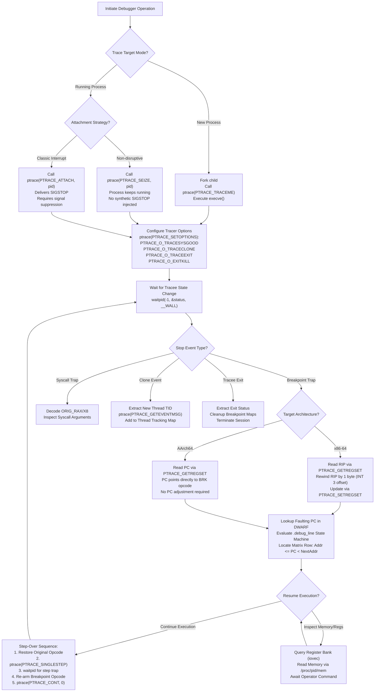

# Capstone: Linux ptrace Debugger with DWARF Line Lookup

> [!summary] Scope
> This capstone playbook guides the implementation of a native Linux x86-64 and AArch64 process debugger using the ptrace system call and a self-contained ELF and DWARF reader (libdw or gimli are the production-grade alternatives).
> It implements process attachment, software breakpoints via int3 (x86-64) or BRK (AArch64) opcode patching, register inspection via PTRACE_GETREGSET, single-stepping, and memory peeking/poking.
> It details DWARF .debug_line state machine evaluation, and sketches the .debug_info subprogram lookup that maps an instruction pointer to a function name.

Prerequisite debugger architecture and tracing primitives are owned by [[How-Debuggers-Work-ptrace-Mach-and-Breakpoints]].
DWARF format representations and debugging sections are owned by [[DWARF-Debug-Information-and-Symbol-Bundles]].
Processor register conventions and stack frame invariants are owned by [[Calling-Conventions-System-V-AMD64-and-AAPCS64]].
Postmortem core dump extraction and triage are owned by [[Debug-a-Production-Crash-From-a-Core-Dump]].
Downstream statistical stack sampling and profiling engines are handed to [[Capstone-Sampling-Profiler-Folded-Stacks]].
This playbook owns the end-to-end design, implementation, and verification of a native Linux debugger capable of runtime process control, cross-architecture register manipulation, dynamic opcode injection, and bytecode evaluation of the DWARF line number program.

## Trigger and Symptoms

Activate this playbook when building, verifying, or operating native process tracing engines, dynamic analysis tools, or embedded debugging harnesses on Linux.

- Standard debugger suites like GDB or LLDB are unavailable, prohibited by container security baselines, or too bloated for minimal production or rescue environments.
- An air-gapped system or hardened microVM lacks dynamic symbol resolution libraries, requiring a standalone debugger with zero external runtime dependencies.
- A low-latency service exhibits an execution hang or state divergence that requires sub-millisecond inspection of CPU register sets and memory words without launching an interactive debugging session.
- You are implementing custom instrumentation engines, such as record-and-replay runners, fault-injection testbeds, or dynamic security fuzzers that must trap on specific program counter locations.
- Tracee processes stop unexpectedly with unhandled signals or hang inside ptrace-stops, and you must diagnose why signal injection, group-stops, or thread tracing failed.
- You need to verify that compiler toolchains (such as GCC, Clang, or rustc) are correctly emitting `.debug_line` state machine opcodes and that source positions resolve accurately under Address Space Layout Randomization (ASLR).

## Decision Tree

The following decision logic guides tracing initialization, architecture-specific trap management, stepping strategies, and DWARF symbol lookup:



## Prerequisites

Building and operating a native Linux debugger requires specific kernel interfaces, compilation toolchains, and security permissions.

### Linux Kernel Capabilities and Version Requirements

- Linux kernel 3.4 or higher is required for modern non-disruptive process attachment via `PTRACE_SEIZE`, `PTRACE_INTERRUPT`, and `PTRACE_LISTEN`.
- Linux kernel 3.8 or higher is required for `PTRACE_O_EXITKILL`, which guarantees that traced child processes are immediately terminated via `SIGKILL` if the debugger crashes, preventing orphaned runaway tasks.
- Linux kernel 3.2 or higher is required for vectorized inter-process memory transfers via `process_vm_readv(2)` and `process_vm_writev(2)`.
- Linux kernel 2.6.34 or higher is required for architecture-independent register manipulation via `PTRACE_GETREGSET` and `PTRACE_SETREGSET` using `NT_PRSTATUS`.

### Security Modules and Permission Checks

On modern Linux distributions, the Yama Linux Security Module restricts `ptrace` usage between unprivileged processes to mitigate credential extraction and memory scraping attacks.

Inspect and configure the Yama ptrace scope:

```bash
cat /proc/sys/kernel/yama/ptrace_scope
```

The integer value dictates tracing permissions:
- `0` (Classic permissions): A process can `PTRACE_ATTACH` to any other process running under the same UID, as long as the target is dumpable (it did not transition UIDs, start privileged, or call `prctl(PR_SET_DUMPABLE, 0)`).
- `1` (Restricted ptrace): `PTRACE_ATTACH` additionally requires a predefined relationship, by default that the target is a descendant of the tracer, or that the target declared the debugger as an authorized tracer via `prctl(PR_SET_PTRACER, pid, 0, 0, 0)`; `PTRACE_TRACEME` is unchanged.
- `2` (Admin-only attach): Only processes with the `CAP_SYS_PTRACE` capability may use ptrace, either with `PTRACE_ATTACH` or through children calling `PTRACE_TRACEME`.
- `3` (No attach): No process may use ptrace with `PTRACE_ATTACH` nor via `PTRACE_TRACEME`.
Once level `3` is set, the sysctl cannot be changed until reboot (Yama.rst).

To permit arbitrary cross-process debugging in development environments:

```bash
sudo sysctl -w kernel.yama.ptrace_scope=0
```

Inside Docker, tracing your own child (`PTRACE_TRACEME`, as the lab does) needs no extra grant: Docker's default seccomp profile allows `ptrace` on kernels 4.8 and later, and the lab runs with `--cap-drop ALL` (as of 2026-11, Linux).
Attaching to an arbitrary process in the container is what the dropped `CAP_SYS_PTRACE` blocks, so add it back only for that case; `seccomp=unconfined` is needed only on pre-4.8 kernels:

```bash
docker run --cap-add=SYS_PTRACE ...
```

### Toolchain Verification

Ensure that the compilation host possesses standard C build utilities and ELF inspection tools:

```bash
command -v gcc clang make eu-readelf objdump dwarfdump
```

Verify that the target compiler supports DWARF version selection and debugging format flags:

```bash
gcc -v
readelf -v
```

## Commands and Numbers to Know

The following reference metrics, system call request numbers, and architecture-specific constants govern Linux ptrace debugging and DWARF line lookup.

| Item | Platform | Value `(as of 2026-11)` | Why it matters |
| :--- | :--- | :--- | :--- |
| `PTRACE_TRACEME` | Linux | `0` | Invoked by child before `execve()` to hand tracing control to parent. |
| `PTRACE_PEEKTEXT` / `PEEKDATA` | Linux | `1` / `2` | Reads one machine word from tracee virtual address space. |
| `PTRACE_POKETEXT` / `POKEDATA` | Linux | `4` / `5` | Writes one machine word to tracee virtual memory; `FOLL_FORCE` lets it write read-only `.text` through a private COW copy. |
| `PTRACE_CONT` | Linux | `7` | Resumes stopped tracee; argument `data` delivers or suppresses signal. |
| `PTRACE_SINGLESTEP` | Linux | `9` | Executes exactly one machine instruction and delivers `SIGTRAP`. |
| `PTRACE_ATTACH` | Linux | `16` | Attaches to running process and injects an asynchronous `SIGSTOP`. |
| `PTRACE_DETACH` | Linux | `17` | Releases tracee from debugger control and resumes execution. |
| `PTRACE_GETREGSET` | Linux | `0x4204` | Architecture-neutral register query using `struct iovec` and ELF note types. |
| `PTRACE_SETREGSET` | Linux | `0x4205` | Architecture-neutral register modification using `struct iovec`. |
| `PTRACE_SEIZE` | Linux | `0x4206` | Attaches to target without stopping it or injecting synthetic signals. |
| `PTRACE_INTERRUPT` | Linux | `0x4207` | Stops a seized tracee asynchronously without signal queue interference. |
| `PTRACE_LISTEN` | Linux | `0x4208` | Restarts stopped tracee in a listening state for group stops without resuming execution. |
| `PTRACE_SETOPTIONS` | Linux | `0x4200` | Configures tracing event flags on the tracee task struct. |
| `PTRACE_GETEVENTMSG` | Linux | `0x4201` | Retrieves message payload (such as cloned child TID) from ptrace events. |
| `PTRACE_O_TRACESYSGOOD` | Linux | `0x00000001` | Sets bit 7 on syscall stop signals, delivering `SIGTRAP \| 0x80`. |
| `PTRACE_O_TRACEFORK` | Linux | `0x00000002` | Traps on `fork()` with `SIGTRAP \| (PTRACE_EVENT_FORK << 8)`. |
| `PTRACE_O_TRACECLONE` | Linux | `0x00000008` | Traps on `clone()` with `SIGTRAP \| (PTRACE_EVENT_CLONE << 8)`. |
| `PTRACE_O_TRACEEXEC` | Linux | `0x00000010` | Traps on `execve()` completion before first user instruction runs. |
| `PTRACE_O_TRACEEXIT` | Linux | `0x00000040` | Traps process at exit, allowing register and memory inspection before destruction. |
| `PTRACE_O_EXITKILL` | Linux | `0x00100000` | Kernel sends `SIGKILL` to each tracee carrying this option when the tracer exits (since Linux 3.8). |
| `NT_PRSTATUS` | Linux | `1` | ELF core note identifier used with `GETREGSET` to access general-purpose registers. |
| `__WALL` | Linux | `0x40000000` | Flag for `waitpid(2)` to wait for all children regardless of clone or non-clone type; implied for ptraced children since Linux 4.7. |
| x86-64 Breakpoint Opcode | x86-64 | `0xCC` (`INT 3`) | 1-byte opcode; CPU traps, pushes RIP pointing to `trap_addr + 1`. |
| x86-64 RIP Adjustment | x86-64 | `-1` byte | Tracer must decrement RIP by 1 to re-execute original instruction. |
| AArch64 Breakpoint Opcode | AArch64 | `0xd4200000` (`BRK #0`) | 4-byte little-endian opcode; CPU traps with PC pointing directly at `trap_addr`. |
| AArch64 PC Adjustment | AArch64 | `0` bytes | Tracer leaves PC unmodified; PC already points to the original instruction. |
| DWARF 4 `.debug_line` version field | Both | Version `4` | Null-terminated string directory/file tables; 1-indexed file entries. |
| DWARF 5 `.debug_line` version field | Both | Version `5` | Form-encoded directory/file tables; entry 0 is the primary source file; GCC 13 emits version 5 by default (lab container, `readelf --debug-dump=rawline`). |
| `minimum_instruction_length` | AArch64 | `4` | Set by GNU as (`DWARF2_LINE_MIN_INSN_LENGTH 4` in `gas/config/tc-aarch64.h`); x86-64 uses `1`. |
| `DW_LNE_end_sequence` | Both | `0x01` | Line machine extended opcode: appends row, resets registers to default. |
| `DW_LNE_set_address` | Both | `0x02` | Line machine extended opcode: sets target machine address register directly. |
| `DW_LNS_copy` | Both | `0x01` | Line machine standard opcode: appends row, clears basic block and prologue flags. |
| `DW_LNS_advance_pc` | Both | `0x02` | Line machine standard opcode: advances address by ULEB128 * min instruction length. |
| `DW_LNS_advance_line` | Both | `0x03` | Line machine standard opcode: advances line register by signed SLEB128 delta. |

## Step-by-Step Implementation and Execution

Implementing a native Linux debugger requires writing modular components that orchestrate process execution, trap handling, virtual memory patching, and DWARF bytecode evaluation.

### Step 1: Process Initialization and Tracing Handshake

A debugger manages its tracee either by launching it as a child process or by attaching to an existing process ID.

When launching a new target, the debugger calls `fork()`.
The child invokes `ptrace(PTRACE_TRACEME, 0, NULL, NULL)` to mark itself as traceable, raises a stop or executes the program image via `execve()`.
The Linux kernel intercepts `execve()` in a traced process, halts execution before the first user-space instruction runs, and delivers a `SIGTRAP` to the parent tracer.

In the parent process, configure the tracing environment immediately upon catching the initial stop:

```c
int status;
waitpid(child_pid, &status, 0);

if (!WIFSTOPPED(status)) {
    perror("Tracee failed to initialize under ptrace");
    exit(EXIT_FAILURE);
}

/* Configure robust ptrace options */
unsigned long options = PTRACE_O_TRACESYSGOOD |
                        PTRACE_O_TRACECLONE   |
                        PTRACE_O_TRACEFORK    |
                        PTRACE_O_TRACEEXEC    |
                        PTRACE_O_TRACEEXIT    |
                        PTRACE_O_EXITKILL;

if (ptrace(PTRACE_SETOPTIONS, child_pid, NULL, (void *)options) < 0) {
    perror("PTRACE_SETOPTIONS failed");
    exit(EXIT_FAILURE);
}
```

Setting `PTRACE_O_EXITKILL` is mandatory in production-grade tooling to ensure that if the debugger process terminates abnormally (for example, via `SIGKILL` or an unhandled segmentation fault), the kernel sends `SIGKILL` to every tracee that has the option set rather than leaving them running with breakpoints still patched into their code.
Setting `PTRACE_O_TRACESYSGOOD` sets bit 7 of the signal number during system call stops (`SIGTRAP | 0x80`), allowing the debugger to distinguish between software breakpoint traps (`SIGTRAP`) and kernel system call entries or exits.

**Verification:** The parent catches the initial `SIGTRAP`, and `WIFSTOPPED(status)` evaluates to true.

### Step 2: Architecture-Neutral Register Inspection via PTRACE_GETREGSET

Older Linux debugging code relied on `PTRACE_GETREGS` and `PTRACE_SETREGS`.
Those legacy operations are architecture-specific, missing on modern architectures like AArch64, and incapable of retrieving modern vector register extensions.

The modern, portable primitive is `PTRACE_GETREGSET` using `NT_PRSTATUS`.
This call uses a `struct iovec` descriptor pointing to an architecture-specific register structure:

```c
#include <sys/ptrace.h>
#include <sys/uio.h>
#include <elf.h>

#if defined(__x86_64__)
#include <sys/user.h>
typedef struct user_regs_struct arch_regs_t;
#define GET_IP(regs) ((regs).rip)
#define SET_IP(regs, val) do { (regs).rip = (val); } while (0)
#define GET_SP(regs) ((regs).rsp)
#elif defined(__aarch64__)
#include <asm/ptrace.h>
typedef struct user_pt_regs arch_regs_t;
#define GET_IP(regs) ((regs).pc)
#define SET_IP(regs, val) do { (regs).pc = (val); } while (0)
#define GET_SP(regs) ((regs).sp)
#endif

int read_registers(pid_t pid, arch_regs_t *regs) {
    struct iovec iov;
    iov.iov_base = regs;
    iov.iov_len = sizeof(arch_regs_t);
    return ptrace(PTRACE_GETREGSET, pid, (void *)NT_PRSTATUS, &iov);
}

int write_registers(pid_t pid, const arch_regs_t *regs) {
    struct iovec iov;
    iov.iov_base = (void *)regs;
    iov.iov_len = sizeof(arch_regs_t);
    return ptrace(PTRACE_SETREGSET, pid, (void *)NT_PRSTATUS, &iov);
}
```

On return from `PTRACE_GETREGSET`, the kernel modifies `iov.iov_len` to indicate the actual number of bytes transferred.
To read floating-point or vector registers, pass `NT_FPREGSET` or `NT_ARM_SVE` in the address argument with appropriate structure bindings.

**Verification:** Calling `read_registers()` populates the structure without error, and `GET_IP(*regs)` matches the stop address.
At the initial post-`execve` stop of a dynamically linked target that address is the program interpreter's (`ld.so`) entry point, not the executable's `e_entry`; only a static executable stops at its own `e_entry`.

### Step 3: Virtual Memory Inspection and Opcode Patching

A debugger must read and modify memory inside the tracee's virtual address space to inspect data structures and inject software breakpoints.

Linux provides three interfaces for cross-process memory access:
1. `PTRACE_PEEKTEXT` / `PTRACE_POKETEXT`: Operates on individual machine words (`unsigned long`).
   Because the return value of `PEEKTEXT` is the word read, and a valid memory word can equal `-1`, `errno` must be cleared to zero before invocation to differentiate valid data from errors.
2. `/proc/[pid]/mem`: An open file descriptor to the tracee's virtual memory map.
   The tracer calls `pread(2)` and `pwrite(2)` at arbitrary 64-bit offsets.
   The Linux kernel implements `mem_write()` through `mem_rw()`, which calls `access_remote_vm()` with `FOLL_WRITE`, plus `FOLL_FORCE` when `proc_mem_foll_force()` allows it (`fs/proc/base.c`).
   `FOLL_FORCE` deliberately overrides the mapping's missing write permission: writing to a read-only `.text` mapping triggers a Copy-on-Write (COW) allocation, creating a private dirty page containing the patched byte without requiring `mprotect(2)`.
   Recent kernels make the force policy configurable with the `proc_mem.force_override=always|ptrace|never` boot parameter (default from `CONFIG_PROC_MEM_*`, `always` if unset); under `ptrace` only the current tracer of the target gets `FOLL_FORCE`, and under `never` a `/proc/[pid]/mem` write to `.text` fails, so `PTRACE_POKETEXT` is the portable patching path (as of 2026-11, Linux).
3. `process_vm_readv(2)` / `process_vm_writev(2)`: Vectorized system calls (since Linux 3.2) allowing batched transfer of multiple buffers in a single system call.
   Crucially, `process_vm_writev` pins the remote pages with `FOLL_WRITE` but without `FOLL_FORCE` (`mm/process_vm_access.c`), so it honors the target mapping's permissions.
   Attempting to write to a page mapped without `PROT_WRITE` (such as executable code) fails the pin and returns `-1` with `errno = EFAULT` when no byte was transferred.
   Therefore, `process_vm_writev` cannot be used to patch breakpoints into `.text` unless the target segment has been explicitly marked writable via `mprotect`.

For breakpoint injection, word-aligned `PTRACE_POKETEXT` or byte-accurate `/proc/[pid]/mem` writes are required:

```c
/* Inject an opcode byte via /proc/[pid]/mem */
int patch_memory_byte(pid_t pid, uint64_t addr, uint8_t byte, uint8_t *orig_byte) {
    char mem_path[64];
    snprintf(mem_path, sizeof(mem_path), "/proc/%d/mem", pid);
    int fd = open(mem_path, O_RDWR);
    if (fd < 0) return -1;

    if (orig_byte) {
        if (pread(fd, orig_byte, 1, addr) != 1) {
            close(fd);
            return -1;
        }
    }

    if (pwrite(fd, &byte, 1, addr) != 1) {
        close(fd);
        return -1;
    }

    close(fd);
    return 0;
}
```

**Verification:** Reading back the patched address via `/proc/[pid]/mem` returns the newly injected byte, while verifying that the original byte was captured in `orig_byte`.

### Step 4: Software Breakpoint Injection and Architectural Trap Handling

Software breakpoints operate by overwriting the first byte of a target machine instruction with a special trap opcode.
When the CPU executes this opcode, it raises an exception, which the Linux kernel translates into a `SIGTRAP` signal delivered to the process.
Because the process is traced, the kernel intercepts the signal and halts the process in a ptrace-stop.

However, the hardware trap semantics differ fundamentally between x86-64 and AArch64:

#### The x86-64 Mechanism (`INT 3`)
- Opcode: `0xCC` (a 1-byte opcode representing `INT 3`, vector 3 breakpoint exception).
- Hardware behavior: When the x86 processor executes `0xCC`, it completes the instruction and pushes the address of the *next* instruction onto the exception stack frame.
- Register state: When the debugger wakes from `waitpid()`, `regs.rip` equals `breakpoint_address + 1`.
- Adjustment requirement: The debugger **must decrement RIP by 1** (`regs.rip -= 1`) and commit the change via `PTRACE_SETREGSET`.
  If the debugger fails to rewind RIP, continuing or single-stepping will execute the middle of the original multi-byte instruction, corrupting execution and triggering `SIGILL` or `SIGSEGV`.

#### The AArch64 Mechanism (`BRK #0`)
- Opcode: `0xd4200000` (a 32-bit fixed-length instruction representing `BRK #0`).
- Hardware behavior: When an Armv8-A core executes `BRK`, it enters an exception handler in EL1, preserving the address of the `BRK` instruction itself into the Exception Link Register (`ELR_EL1`).
- Register state: When the debugger inspects the tracee via `PTRACE_GETREGSET`, `regs.pc` points **directly at the breakpoint address**.
- Adjustment requirement: The debugger **does not decrement PC**.
  PC already points to the instruction that was patched.
  To resume, the debugger simply restores the original 32-bit instruction word and leaves PC untouched.

```c
void handle_breakpoint_trap(pid_t pid, uint64_t *hit_address) {
    arch_regs_t regs;
    read_registers(pid, &regs);

#if defined(__x86_64__)
    /* x86-64: RIP is 1 byte past the INT 3 instruction */
    regs.rip -= 1;
    write_registers(pid, &regs);
    *hit_address = regs.rip;
#elif defined(__aarch64__)
    /* AArch64: PC points directly at the BRK instruction */
    *hit_address = regs.pc;
#endif
}
```

**Verification:** Injecting a breakpoint into a known function causes `waitpid()` to return with `WIFSTOPPED(status)` and `WSTOPSIG(status) == SIGTRAP`.
On x86-64, rewinding RIP leaves `regs.rip` equal to the breakpoint injection address.
On AArch64, `regs.pc` matches the injection address without alteration.

### Step 5: DWARF .debug_line State Machine Compilation and Matrix Parsing

To correlate a trapped instruction pointer with source code, the debugger must decode the `.debug_line` section from the target executable's ELF container.
DWARF does not store a naive array of `(address, file, line, column, flags)` rows; the specification calls such a matrix "impractically large" and shrinks it by dropping rows that repeat their predecessor and by encoding the rest as a byte-coded state machine program (DWARF 5 section 6.2).
Instead, DWARF encodes a specialized byte-code program that drives a virtual state machine.

#### State Machine Registers
The DWARF state machine maintains an internal matrix row across several virtual registers:
- `address`: The target machine program counter.
- `file`: Index into the line program's file table; 1-based in DWARF 4, while DWARF 5 makes entry 0 the primary source file.
- `op_index`, `isa`, `discriminator`, and `epilogue_begin` are also state registers; `op_index` matters only for VLIW targets (`maximum_operations_per_instruction > 1`), and the lab ignores all four.
- `line`: Source code line number (1-based unsigned integer).
- `column`: Source code column number (1-based unsigned integer).
- `is_stmt`: Boolean flag indicating whether the address represents a recommended breakpoint target (statement boundary).
- `basic_block`: Boolean indicating the start of a basic block.
- `end_sequence`: Boolean indicating the address immediately follows the end of a contiguous machine code sequence.
- `prologue_end`: Boolean indicating the instruction immediately following a function prologue.

#### Header Decoding (DWARF 4 vs DWARF 5)
The header of each compilation unit's line table describes opcode decoding rules:
1. `unit_length`: 4 bytes (in 32-bit DWARF format).
2. `version`: 2 bytes (`0x0004` or `0x0005`).
3. DWARF 5 fields: `address_size` (1 byte) and `segment_selector_size` (1 byte).
4. `header_length`: 4 bytes (offset from the end of this field to the first opcode).
5. `minimum_instruction_length`: 1 byte (1 on x86-64, 4 on AArch64; the lab's GCC 13 AArch64 build shows `4`).
6. `maximum_operations_per_instruction`: 1 byte, present from DWARF 4 on (1 for standard non-VLIW architectures).
7. `default_is_stmt`: 1 byte initial value for the `is_stmt` register.
8. `line_base`: 1 byte signed integer (`int8_t`) defining minimum line advance for special opcodes.
9. `line_range`: 1 byte unsigned integer defining the line advance range for special opcodes.
10. `opcode_base`: 1 byte unsigned integer defining the index of the first special opcode.
11. `standard_opcode_lengths`: Array of `(opcode_base - 1)` bytes defining operand counts.

In DWARF 4, include directories and file names are stored as null-terminated strings terminated by a single zero byte.
In DWARF 5, directories and file names are stored as self-describing tables defined by format descriptor arrays (`directory_entry_format` and `file_name_entry_format`) utilizing content types like `DW_LNCT_path` and form codes like `DW_FORM_string` or `DW_FORM_line_strp`.

#### Bytecode Execution Loop
The bytecode engine processes three classes of opcodes:

```c
while (p < cu_end) {
    uint8_t opcode = *p++;

    if (opcode == 0) {
        /* Extended Opcodes */
        uint64_t len = read_uleb128(&p);
        const uint8_t *next_op = p + len;
        uint8_t ext_op = *p++;

        if (ext_op == 1) { /* DW_LNE_end_sequence */
            regs.end_sequence = 1;
            append_row_to_matrix(&matrix, &regs);
            reset_registers_to_defaults(&regs, header.default_is_stmt);
        } else if (ext_op == 2) { /* DW_LNE_set_address */
            regs.address = *(const uint64_t *)p;
        }
        p = next_op;
    } else if (opcode < header.opcode_base) {
        /* Standard Opcodes */
        switch (opcode) {
            case 1: /* DW_LNS_copy */
                append_row_to_matrix(&matrix, &regs);
                regs.basic_block = 0;
                regs.prologue_end = 0;
                break;
            case 2: /* DW_LNS_advance_pc */
                regs.address += read_uleb128(&p) * header.minimum_instruction_length;
                break;
            case 3: /* DW_LNS_advance_line */
                regs.line += read_sleb128(&p);
                break;
            case 4: /* DW_LNS_set_file */
                regs.file = (uint32_t)read_uleb128(&p);
                break;
            case 5: /* DW_LNS_set_column */
                regs.column = (uint32_t)read_uleb128(&p);
                break;
            case 6: /* DW_LNS_negate_stmt */
                regs.is_stmt = !regs.is_stmt;
                break;
            case 8: { /* DW_LNS_const_add_pc */
                uint8_t adjusted = 255 - header.opcode_base;
                regs.address += (adjusted / header.line_range) * header.minimum_instruction_length;
                break;
            }
            case 9: { /* DW_LNS_fixed_advance_pc */
                uint16_t adv = *(const uint16_t *)p;
                p += 2;
                regs.address += adv;
                break;
            }
            case 10: /* DW_LNS_set_prologue_end */
                regs.prologue_end = 1;
                break;
        }
    } else {
        /* Special Opcodes: simultaneous address and line advancement */
        uint8_t adjusted = opcode - header.opcode_base;
        int8_t line_inc = header.line_base + (adjusted % header.line_range);
        uint64_t addr_inc = (adjusted / header.line_range) * header.minimum_instruction_length;

        regs.line += line_inc;
        regs.address += addr_inc;
        append_row_to_matrix(&matrix, &regs);
        regs.basic_block = 0;
        regs.prologue_end = 0;
    }
}
```

**Verification:** Decoding `.debug_line` produces a sorted matrix of addresses matching the output of `eu-readelf --debug-dump=line <binary>`.

### Step 6: Address-to-Source Line Lookup and Function Symbolication

Once the matrix of `LineEntry` records is populated, the debugger performs bidirectional lookups.

#### Address Space Layout Randomization (ASLR) Translation
Position Independent Executables (PIE, ELF type `ET_DYN`) are loaded at randomized virtual base addresses at runtime.
DWARF line tables record addresses relative to the ELF virtual load base (typically `0x0` for PIE).
To translate between DWARF addresses and live runtime addresses, parse the tracee's mapping from `/proc/[pid]/maps`:

```c
uint64_t get_elf_load_base(pid_t pid) {
    char path[64];
    snprintf(path, sizeof(path), "/proc/%d/maps", pid);
    FILE *f = fopen(path, "r");
    if (!f) return 0;
    uint64_t load_base = 0;
    if (fscanf(f, "%lx-", &load_base) != 1) {
        load_base = 0;
    }
    fclose(f);
    return load_base;
}
```

This shortcut takes the first line of `/proc/[pid]/maps` as the base, which holds only when the executable is the lowest mapping and its first `PT_LOAD` has `p_vaddr == 0`, as for the lab's GCC PIE build; a robust debugger matches the mapping whose path is the executable, or reads `AT_PHDR` from `/proc/[pid]/auxv`, and subtracts the first `PT_LOAD` `p_vaddr`.
The runtime address is calculated as:
$$\text{runtime\_address} = \text{load\_base} + \text{dwarf\_address}$$

#### Address to Source Line Resolution
When the tracee stops at runtime PC `current_pc`, calculate the relative DWARF offset `rel_pc = current_pc - load_base`.
Search the sorted line matrix for the entry satisfying:
$$\text{matrix}[i].\text{address} \le \text{rel\_pc} < \text{matrix}[i+1].\text{address}$$

```c
int resolve_address_to_line(const LineMatrix *lm, uint64_t rel_pc,
                            const char **file_name, uint32_t *line_num) {
    for (size_t i = 0; i < lm->count; i++) {
        if (lm->entries[i].end_sequence) continue;

        if (i + 1 < lm->count && !lm->entries[i + 1].end_sequence) {
            if (rel_pc >= lm->entries[i].address && rel_pc < lm->entries[i + 1].address) {
                *file_name = lm->files[lm->entries[i].file - 1].name;
                *line_num = lm->entries[i].line;
                return 0;
            }
        } else if (rel_pc == lm->entries[i].address) {
            *file_name = lm->files[lm->entries[i].file - 1].name;
            *line_num = lm->entries[i].line;
            return 0;
        }
    }
    return -1;
}
```

The `file - 1` index is the DWARF 4 convention; a DWARF 5 table indexes `files[file]` directly, because entry 0 is the primary source file.
A linear scan is fine for a toy; a production debugger sorts each sequence by address and binary-searches it.

To name the enclosing function, walk `.debug_info` (decoding each DIE through its abbreviation in `.debug_abbrev`) for a `DW_TAG_subprogram` whose `[DW_AT_low_pc, DW_AT_high_pc)` range, or `DW_AT_ranges` list, contains `rel_pc`, and print its `DW_AT_name`.
When `DW_AT_high_pc` is of class constant it is an offset added to `DW_AT_low_pc`, not an address (DWARF 5 section 2.17.2); GCC 13 and the Ubuntu 24.04 Clang in the lab container both emit it that way (`readelf --debug-dump=info` shows `DW_AT_high_pc : 0x48` for GCC's `target_function`), so reading it as an address is a classic bug.
A binary without `.debug_info` can still be symbolized from the ELF `.symtab` `STT_FUNC` entries by finding the symbol with `st_value <= rel_pc < st_value + st_size`.

#### Source Line to Breakpoint Address Resolution
When a developer requests a breakpoint at `main.c:42`, iterate over the matrix rows matching that source file and line.
Multiple addresses may map to the same line (for example, prologue setup and multiple statement expressions).
Select the entry where `is_stmt == true`.
If setting a breakpoint at a function boundary, select the entry where `prologue_end == true` to ensure the breakpoint trips after the stack frame is fully established.

**Verification:** Resolving a known function's address accurately outputs the file name and line number defined in the original source code.

### Step 7: Resuming Execution Past a Breakpoint (The Step-Over Dance)

When a tracee stops at a software breakpoint, resuming normal execution presents a concurrency dilemma:
If the debugger simply calls `ptrace(PTRACE_CONT, pid, 0, 0)`, the CPU will immediately execute the breakpoint opcode (`0xCC` or `0xd4200000`) again, trapping in an infinite loop.
If the debugger replaces the breakpoint with the original opcode and calls `PTRACE_CONT`, the original instruction executes, but the breakpoint is lost for future iterations.

The standard solution is the **In-Place Step-Over Dance**:

1. **Restore Original Opcode:** Write the original instruction bytes back to the tracee's memory address via `PTRACE_POKETEXT` or `/proc/[pid]/mem`.
2. **Single-Step Instruction:** Instruct the kernel to execute exactly one instruction:
   ```c
   ptrace(PTRACE_SINGLESTEP, pid, NULL, NULL);
   ```
   On x86-64, the kernel sets the Trap Flag (TF, bit 8) in the `EFLAGS` register; after one instruction executes, the hardware raises vector 1 debug exception (`#DB`), delivering `SIGTRAP`.
   On AArch64, the kernel arms the architectural Software Step state machine: it sets the SS bit in the tracee's saved PSTATE (`DBG_SPSR_SS` in `regs->pstate`, restored through `SPSR_EL1` on exception return) and enables `MDSCR_EL1.SS` for the task (`arch/arm64/kernel/debug-monitors.c`), so one instruction executes and a Software Step exception is taken.
3. **Wait for Single-Step Trap:** Call `waitpid(pid, &status, 0)` and confirm that `WIFSTOPPED(status)` and `WSTOPSIG(status) == SIGTRAP`.
4. **Re-arm Breakpoint:** Write the breakpoint opcode (`0xCC` or `0xd4200000`) back to the target address in memory.
5. **Resume Tracee:** Resumes execution normally with `ptrace(PTRACE_CONT, pid, NULL, NULL)`.

```c
int step_over_breakpoint(pid_t pid, uint64_t bp_addr, long orig_word, long bp_word) {
    int status;

    /* 1. Temporarily restore original instruction */
    if (ptrace(PTRACE_POKETEXT, pid, (void *)bp_addr, (void *)orig_word) < 0) return -1;

    /* 2. Execute single instruction */
    if (ptrace(PTRACE_SINGLESTEP, pid, NULL, NULL) < 0) return -1;

    /* 3. Wait for single step completion */
    if (waitpid(pid, &status, 0) < 0) return -1;
    if (!WIFSTOPPED(status) || WSTOPSIG(status) != SIGTRAP) {
        fprintf(stderr, "Single step encountered unexpected status: 0x%x\n", status);
        return -1;
    }

    /* 4. Re-arm the breakpoint */
    if (ptrace(PTRACE_POKETEXT, pid, (void *)bp_addr, (void *)bp_word) < 0) return -1;

    return 0;
}
```

#### The Multi-Thread Race Condition and Displaced Stepping
In multi-threaded processes, in-place step-overs introduce a serious race condition:
During the window between Step 1 (restoring original opcode) and Step 4 (re-arming breakpoint), all other threads running in the same shared address space execute freely.
If Thread B reaches `bp_addr` while Thread A is single-stepping the restored opcode, Thread B will blow past the breakpoint without trapping.

To prevent this in high-performance engines, debuggers implement two strategies:
1. **All-Stop Mode:** Stop every thread in the thread group before restoring the opcode, execute the single step on Thread A, re-arm the breakpoint, and then resume all threads.
   This incurs massive context switch latency.
2. **Displaced Stepping (Out-of-Line Execution):** Copy the original instruction into a private, scratch execution buffer in the tracee's address space.
   Fix up any PC-relative addressing offsets (such as x86 RIP-relative memory operands or AArch64 `ADRP` / `B` instructions).
   Point the thread's instruction pointer to the scratch buffer, single-step the thread there, adjust the instruction pointer back to `bp_addr + insn_len`, and leave the `0xCC` / `BRK` opcode continuously armed in the main `.text` mapping.

**Verification:** The tracee steps past the breakpoint, re-arms the trap, and continues executing without corruption.

### Step 8: Multi-Threaded Process Supervision

Modern Linux applications spawn multiple execution threads via `clone(2)`.
Threads share virtual memory and file descriptor tables but maintain distinct thread IDs (TIDs) and register contexts.

To supervise multi-threaded applications:
1. Enable clone tracking during initialization:
   ```c
   ptrace(PTRACE_SETOPTIONS, pid, NULL, (void *)(PTRACE_O_TRACECLONE | PTRACE_O_TRACEFORK));
   ```
2. When a thread calls `clone()`, the kernel intercepts the creation and suspends the calling thread with `SIGTRAP | (PTRACE_EVENT_CLONE << 8)`.
3. The debugger extracts the newly created thread's TID using `PTRACE_GETEVENTMSG`:
   ```c
   unsigned long new_tid = 0;
   ptrace(PTRACE_GETEVENTMSG, stopping_pid, NULL, &new_tid);
   ```
4. The newly created thread starts in a ptrace-stopped state.
   The debugger adds `new_tid` to its tracked thread table.
5. In the main event loop, invoke `waitpid` with the `__WALL` flag:
   ```c
   pid_t event_pid = waitpid(-1, &status, __WALL);
   ```
   Passing `-1` waits for any child task, and `__WALL` instructs the kernel to wait for all children regardless of type ("clone" or "non-clone"), which covers threads created by `clone(2)`.
   Since Linux 4.7 the kernel implies `__WALL` for ptraced children (wait(2)), but passing it keeps the tracer correct on older kernels.

**Verification:** Newly spawned threads trigger `PTRACE_EVENT_CLONE`, their TIDs are successfully queried via `PTRACE_GETEVENTMSG`, and breakpoints hit on non-leader threads are trapped.

## Verification

Validate the debugger's functionality using concrete inspection commands and verified lab output.

### 1. DWARF Extraction Verification
Verify that the custom DWARF parser's line mappings match authoritative GNU and LLVM binary utilities:

```bash
readelf --debug-dump=decodedline target
eu-readelf --debug-dump=decodedline target
llvm-dwarfdump --debug-line target
```

Confirm that the target function's first statement line matches the breakpoint line selected by the debugger.

### 2. Live Debugger Execution and Output Comparison
Execute the capstone debugger against the target executable:

```bash
./debugger ./target 7
```

**Verification:**
- The debugger detects the host architecture (`aarch64` or `x86_64`).
- It extracts the exact line table count from `.debug_line`.
- It arms the breakpoint at the DWARF offset.
- It catches `SIGTRAP`.
- It symbolises the instruction pointer back to `target.c:7`.
- It steps over the first hit and re-arms the breakpoint.
- The tracee does not run to completion: `main()` calls `target_function()` twice, so the re-armed breakpoint traps again on the second call, the lab's final `waitpid()` sees a stop rather than an exit, and the `Tracee exited normally` line is never printed (the expected output omits it).
  The debugger then exits without detaching or restoring the opcode; in the lab container no `target` process remains afterwards.
  The lab does not record how the tracee died; the mechanism that explains it is that ptrace(2) detaches and restarts all tracees when the tracer dies, after which the still-armed `BRK` re-executes and raises `SIGTRAP`, whose default action in signal(7) is `Core` (terminate with a core dump), so a `SIGTRAP` death is the expected outcome, not a captured one.

## Rollback Procedure

When detaching from a tracee or terminating a debugging session, the debugger must restore original execution state to avoid corrupting the running process:

1. **Remove All Active Breakpoints:** Iterate across the internal breakpoint table.
   For each armed breakpoint, write the original instruction word back to the tracee's virtual memory via `/proc/[pid]/mem` or `PTRACE_POKETEXT`.
   Leaving a `0xCC` or `0xd4200000` instruction in memory after detaching causes the process to crash with `SIGTRAP` once execution resumes.
2. **Handle In-Flight Traps:** If the tracee is currently stopped at a breakpoint address, ensure that the instruction pointer has been rewound (on x86-64) before detaching.
3. **Detach Traced Tasks:** Detach each traced thread using `PTRACE_DETACH`:
   ```c
   ptrace(PTRACE_DETACH, target_pid, NULL, NULL);
   ```
   If a non-zero signal is passed in the `data` parameter of `PTRACE_DETACH`, the kernel delivers that signal to the tracee upon resumption; passing `NULL` suppresses pending traps.
4. **Close Procfs Handles:** Close all open file descriptors to `/proc/[pid]/mem` and `/proc/[pid]/maps`.

## Failure Modes

The following table details common operational failures encountered when implementing and running Linux ptrace debuggers, their root causes, and verified recovery procedures.

| Failure Symptom | Error Code | Root Cause | Remediation Procedure |
| :--- | :--- | :--- | :--- |
| `PTRACE_ATTACH` fails on running process | `EPERM` | Yama LSM `ptrace_scope` is `1` (target not a descendant), `2` (no `CAP_SYS_PTRACE`), or `3` (ptrace disabled), or the target is not dumpable or runs under another UID. | Lower `kernel.yama.ptrace_scope` via sysctl (impossible once it is `3`), have the target call `prctl(PR_SET_PTRACER, ...)`, or grant `CAP_SYS_PTRACE` to the debugger. |
| `PTRACE_POKETEXT` or `PEEKTEXT` fails | `ESRCH` | Tracee is not in a ptrace-stop (the most common cause), is not traced by the caller, or died (ptrace(2) returns the same error for all three). | Track each TID's stopped or running state and issue data requests only after `waitpid()` reported a stop; treat `ESRCH` as death only for a TID known to be stopped, then prune it. |
| `process_vm_writev` returns -1 | `EFAULT` | Destination address is in read-only `.text` mapping; page table lacks write bit. | Do not use `process_vm_writev` for opcode patching; use `PTRACE_POKETEXT` or `/proc/[pid]/mem`, which force COW writes. |
| Tracee re-traps on the same breakpoint forever | None (`SIGTRAP` loop) | Debugger resumed with the trap opcode still in memory at the instruction pointer: on x86-64 after rewinding `RIP`, and on AArch64 always, because `PC` stays on the `BRK`. | Run the step-over sequence: restore the original opcode, single-step, re-arm, then continue. |
| Tracee crashes with `SIGILL` or `SIGSEGV` after breakpoint | Shell status 132 / 139 (`WTERMSIG` 4 / 11) | On x86-64, the original byte was restored but `RIP` was not rewound, so execution resumed inside the original instruction. | Ensure the sequence: rewind IP -> write original opcode -> single-step -> re-arm breakpoint -> continue. |
| Secondary threads miss breakpoints | None | Race condition during in-place step-over dance in multi-threaded tracee. | Implement All-Stop mode (stop all threads before unpatching) or Displaced Stepping (execute copied instruction out-of-line). |
| Address resolves to wrong line | None | Target is a PIE executable, but debugger looked up raw virtual address without subtracting load base. | Read base load address from `/proc/[pid]/maps` and calculate `rel_addr = runtime_addr - load_base` before DWARF lookup. |
| Tracee terminates with `SIGTRAP` | Shell status 133 (`WTERMSIG` 5) | Debugger passed raw `SIGTRAP` signal to `PTRACE_CONT` instead of suppressing it with signal `0`. | Always pass `0` in the `data` argument of `PTRACE_CONT` or `PTRACE_SINGLESTEP` when handling internal breakpoint traps. |

## At Scale: Production Debugging and Performance Economics

Operating debugging machinery at production scale across tens of thousands of hosts requires strict trade-off evaluations between observational fidelity and system perturbation.

### Context Switch Overhead of ptrace
ptrace costs come in two kinds that are easy to conflate:
1. Data requests (`PEEKDATA`, `GETREGSET`) on an already stopped tracee are one system call each in the tracer's context: a user-to-kernel mode switch plus a remote page lookup, with no scheduler context switch.
2. Every stop and resume (a breakpoint hit, a single-step, a syscall-stop) costs real context switches: the tracee traps into the kernel and blocks, the tracer is woken from `waitpid()`, and the tracee runs again only after the tracer's `PTRACE_CONT`.

Each stop-and-resume round trip involves at least two scheduler wakeups plus the cache and TLB pollution of running the tracer on the same cores; this note's lab does not measure it, so benchmark on the target host before quoting a number.
If a debugger reads a 1 MB heap buffer using `PTRACE_PEEKDATA` (8 bytes per call), it needs 1,048,576 / 8 = 131,072 system calls, keeping the tracee halted for the whole loop.
Reading the same buffer with `process_vm_readv(2)` takes a single system call (bounded by `IOV_MAX` iovec entries per call, and a short count is returned if part of the range is unmapped), so the system call count drops by about five orders of magnitude; the wall-clock gap depends on the host and is not measured here.

### Observability Without Perturbation: ptrace vs eBPF vs User-Space Probes
When diagnosing high-throughput or ultra-low-latency production systems (such as financial matching engines or distributed storage nodes), `ptrace` is often too invasive.
The table below contrasts modern tracing mechanisms:

| Dimension | `ptrace(2)` | `eBPF` / `uprobes` | User-Space Ring Buffers |
| :--- | :--- | :--- | :--- |
| **Execution Latency** | Microseconds per stop at best (two context switches plus tracer work), unbounded while a human holds the stop | Microseconds per hit (uprobe trap plus in-kernel handler) | Sub-microsecond (atomic write to shm) |
| **Failure Safety** | Risky: tracer crash leaves tracees stopped or with breakpoints armed unless `PTRACE_O_EXITKILL` kills them | Safe: kernel verifier prevents crashes | Safe: lock-free memory ring buffer |
| **Memory Inspection** | Full arbitrary read/write | Restricted: bounded memory reads | Application-controlled instrumentation |
| **Execution Control** | Interactive: pause, step, inject registers | Mostly observational: cannot pause or single-step; helpers such as `bpf_send_signal` and `bpf_probe_write_user` exist but are tightly restricted | Passive telemetry only |
| **Permissions Required** | Same UID and dumpable target, subject to Yama; otherwise `CAP_SYS_PTRACE` | `CAP_BPF` + `CAP_PERFMON` (or root) | Unprivileged user memory access |

In production Kubernetes clusters, adding `CAP_SYS_PTRACE` to a container violates the Pod Security Standards Baseline policy, whose allowed added capabilities stop at `AUDIT_WRITE`, `CHOWN`, `DAC_OVERRIDE`, `FOWNER`, `FSETID`, `KILL`, `MKNOD`, `NET_BIND_SERVICE`, `SETFCAP`, `SETGID`, `SETPCAP`, `SETUID`, and `SYS_CHROOT` (as of 2026-11).
Organizations therefore confine ptrace to short-lived ephemeral debug containers (`kubectl debug --target=<container>`, sharing the target's process namespace), whose `general` profile adds `SYS_PTRACE` to that one container and whose `baseline` profile drops it (kubectl `pkg/cmd/debug/profiles.go`), or they use continuous kernel profiling engines (see [[Capstone-Sampling-Profiler-Folded-Stacks]]) rather than attaching interactive ptrace engines to production traffic.

## Worked Example: Ptrace Debugger Lab

The lab in `code/11-Arena-and-Capstones/capstone_ptrace_debugger/` implements this complete architecture end to end in self-contained C without requiring external dependencies like `libdw` or `libelf`.

### Structure of the Lab

- `target.c`: The tracee program.
  Defines `target_function(int a, int b)` at lines 5-8, which increments a global counter.
  `main()` calls `target_function()` twice with distinct parameters.
- `debugger.c`: The standalone debugger implementation.
  - Implements an ELF64 parser to read section headers and locate `.debug_line`.
  - Implements a 32-bit-DWARF line number program bytecode interpreter with ULEB128/SLEB128 decoders, standard opcodes 1-10, `DW_LNE_end_sequence` and `DW_LNE_set_address`, and special opcode line/address mathematics.
    It reads the DWARF 4 directory and file tables but skips the DWARF 5 format-encoded tables (it jumps to `header_length`), ignores `op_index`, assumes 8-byte addresses, and does not use `standard_opcode_lengths` to skip operands of opcodes 11 and 12; that suffices for the lab's single GCC 13 DWARF 5 unit, where it decodes the same 10 rows as `readelf --debug-dump=decodedline`.
  - Spawns the target process under `PTRACE_TRACEME`.
  - Configures `PTRACE_SETOPTIONS` with `PTRACE_O_TRACESYSGOOD | PTRACE_O_TRACEEXIT`.
  - Determines the target process base load address via `/proc/[pid]/maps` to correctly handle PIE binaries under ASLR.
  - Injects architecture-specific breakpoints: `0xCC` on x86-64 or `0xd4200000` (`BRK #0`) on AArch64.
  - Catches the breakpoint `SIGTRAP`.
  - Reads registers using `PTRACE_GETREGSET` with `NT_PRSTATUS`.
  - Executes architectural program counter adjustments (rewinding RIP by 1 on x86-64; keeping PC unchanged on AArch64).
  - Evaluates the DWARF line matrix to look up the source file and line number corresponding to the trapped instruction pointer.
  - Executes the step-over dance: restores the original opcode, single-steps with `PTRACE_SINGLESTEP`, re-arms the breakpoint, and continues.
    Because `target_function()` runs twice, the continue traps on the re-armed breakpoint again; the lab stops there, so it proves one hit plus a step-over, not a run to clean termination.
- `Makefile`: Compiles both the target and debugger (`$(CC) -g -O0 -o target target.c` and `$(CC) $(CFLAGS) -o debugger debugger.c`, with `CC ?= cc` and `CFLAGS ?= -Wall -Wextra -O2`).
- `run.sh`: Automated harness execution script declaring `# requires: linux`.

### Verified Output

Recorded by `make record` on `linux-aarch64` inside the pinned toolchain container (`toolchain-labs:1192e7ee37dc`, Ubuntu 24.04 with GCC 13.3.0, run unprivileged with `--cap-drop ALL`); the kernel is the Docker host VM's, `7.2.12-orbstack` when the output was reproduced byte for byte on 2026-11-27.
The breakpoint lands at offset `0x734`, the `is_stmt` row for line 7 in `readelf --debug-dump=decodedline`; the runtime address is printed as `0xADDR` so the recording does not depend on ASLR:

```text
=== Tracer Target Setup ===
Target executable: ./target
Architecture: aarch64
DWARF lines parsed: 10
Target breakpoint line: 7
Breakpoint armed at 0xADDR (offset +0x734)
Breakpoint trap caught: SIGTRAP
Resolved source line: 7 (expected 7)
=== Trace Completed Successfully ===
```

## Practice Drill

Solidify mastery of ptrace mechanics and DWARF bytecode evaluation by executing the following targeted fault-injection exercises.

> [!tip] Practice Drill: Break the Breakpoint Loop
> Copy `code/11-Arena-and-Capstones/capstone_ptrace_debugger/` to a scratch directory on a Linux machine or Docker container.
> Run `bash run.sh` to confirm baseline operation.
> Then perform the following four experiments, predict the failure mode before executing, and verify the resulting crash:
>
> 1. **Omit the RIP Rewind (x86-64):** In `debugger.c`, comment out `regs.rip -= 1;` before the `PTRACE_SETREGSET` call.
>    Predict: What happens when the debugger calls `ptrace(PTRACE_SINGLESTEP)`?
>    Observation: The CPU attempts to execute the byte immediately following the `0xCC` opcode.
>    If the original instruction was multi-byte, the CPU interprets subsequent operand bytes as an opcode, which typically ends in `SIGILL` (Illegal Instruction) or `SIGSEGV`, though a byte stream that happens to decode cleanly can instead corrupt state silently.
>    The lab still prints `Resolved source line: 7`, because `bp + 1` lies inside line 7's address range, so this drill needs an x86-64 Linux host and is not caught by the recorded output.
>
> 2. **Inject Breakpoint via `process_vm_writev`:** In `debugger.c`, replace `ptrace(PTRACE_POKETEXT)` with a call to `process_vm_writev()`.
>    Predict: Why does the write fail?
>    Observation: `process_vm_writev` returns `-1` with `errno = EFAULT`.
>    Confirm that unlike `PTRACE_POKETEXT` (which bypasses page write restrictions via kernel COW), `process_vm_writev` strictly enforces user-space page table permissions.
>
> 3. **Pass SIGTRAP to PTRACE_CONT:** In the breakpoint step-over sequence, replace the final `ptrace(PTRACE_CONT, child, NULL, NULL)` with `ptrace(PTRACE_CONT, child, NULL, (void *)(uintptr_t)SIGTRAP)`.
>    Predict: How does the tracee terminate?
>    Observation: The tracee is killed by the unhandled `SIGTRAP`: `waitpid()` reports `WIFSIGNALED` with `WTERMSIG == SIGTRAP`, which a shell would show as status 133.
>    Passing a non-zero signal injects that signal directly into the tracee's signal handler queue rather than swallowing it.
>
> 4. **Strip DWARF Line Information:** Recompile `target` and strip debug sections using `strip --strip-debug target`.
>    Re-run the debugger:
>    Predict: At what point does `debugger.c` abort?
>    Observation: `load_elf_dwarf` fails to locate `.debug_line` in the section header table and aborts with `failed to parse DWARF from ./target`.

## Interview Questions

The following graded technical questions evaluate systems competence across junior, senior, staff, and principal engineering levels.

### L5: Software Breakpoint Mechanics

> [!question] L5
> Explain the exact sequence of events that occurs when an x86-64 CPU executes a software breakpoint instruction (`INT 3`), and describe how the Linux kernel notifies the tracing debugger.
>
> > [!success]- Answer
> > When the CPU fetches and decodes opcode `0xCC` (`INT 3`), it generates a vector 3 Breakpoint Exception (`#BP`).
> > Because `#BP` is a trap-class exception, the processor pushes `SS`, `RSP`, `RFLAGS`, `CS`, and `RIP` onto the kernel exception stack, where `RIP` points to the byte *immediately following* the 1-byte `INT 3` opcode (`breakpoint_address + 1`).
> > The Linux kernel's `#BP` entry (`exc_int3` in `arch/x86/kernel/traps.c`) runs; for a user-mode trap it calls `do_int3_user()`, which first offers the trap to kgdb and kprobes via `do_int3()` and otherwise calls `do_trap(X86_TRAP_BP, SIGTRAP, "int3", ...)`.
> > That queues `SIGTRAP` with `si_code = SI_KERNEL`, not `TRAP_BRKPT`; GDB's `gdb/nat/linux-ptrace.h` documents this x86 quirk and defines `GDB_ARCH_IS_TRAP_BRKPT(X)` as `X == SI_KERNEL` on x86 (AArch64 reports `TRAP_BRKPT`).
> > On the way back to user mode the tracee dequeues the signal; because it is ptraced, the signal-delivery path stops it in `TASK_TRACED` (a signal-delivery-stop) instead of acting on the signal.
> > The kernel notifies the tracer with `SIGCHLD` and wakes it from `waitpid()`.
> > `waitpid()` returns the child's PID and a status integer where `WIFSTOPPED(status)` is true and `WSTOPSIG(status) == SIGTRAP`.

### L5: Predict the Output (Signal Injection)

> [!question] L5 (Predict-the-Output)
> A debugger traps a child process on `SIGTRAP` caused by hitting a software breakpoint.
> After inspecting registers, the debugger executes:
> ```c
> ptrace(PTRACE_CONT, child_pid, 0, SIGTRAP);
> ```
> Assuming the tracee did not register a custom signal handler for `SIGTRAP`, predict what happens to the child process and what status code its parent will observe upon exit.
>
> > [!success]- Answer
> > The child process immediately terminates with signal `SIGTRAP`: the tracer's next `waitpid()` reports `WIFSIGNALED(status)` with `WTERMSIG(status) == SIGTRAP` (and `WCOREDUMP` if a core was written), which a shell reports as status 133 (`128 + 5`).
> > In `ptrace(PTRACE_CONT, pid, addr, data)`, the `data` parameter represents the signal number to be delivered to the tracee upon resumption.
> > Passing `0` suppresses the trapped signal, allowing the tracee to resume without signal delivery.
> > Passing `SIGTRAP` injects `SIGTRAP` into the tracee.
> > Because the default action (`SIG_DFL`) for `SIGTRAP` on Linux is Core, abnormal termination with a core dump, the tracee dies instantly.
> > The `133` is the shell's `128 + SIGTRAP (5)` convention; a C parent sees the signal number through `WTERMSIG`, not an exit code.

### L6: Debug-This (x86-64 Instruction Corruption)

> [!question] L6 (Debug-This)
> A junior engineer implements an x86-64 debugger.
> The debugger successfully traps a function entry breakpoint, replaces the `0xCC` opcode with the original byte, single-steps with `PTRACE_SINGLESTEP`, re-arms the breakpoint, and continues execution.
> However, immediately after stepping, the tracee crashes with `SIGILL` (Illegal Instruction) or executes corrupted logic.
> GDB runs the same binary without issues.
> Identify the missing step in the engineer's implementation and explain why the crash occurred.
>
> > [!success]- Answer
> > The engineer forgot to rewind the instruction pointer (`RIP`) by 1 byte before executing the single-step.
> > On x86-64, the hardware trap semantics for `INT 3` leave `RIP` pointing to `breakpoint_address + 1`.
> > Most x86-64 instructions are multi-byte (for example, `push %rbp` is 1 byte `0x55`, but `sub $0x20, %rsp` is 4 bytes `0x48 0x83 0xec 0x20`).
> > If the breakpoint was placed on a multi-byte instruction (e.g., at address `0x401000` whose original bytes were `0x48 0x83...`), executing `0xCC` advances `RIP` to `0x401001`.
> > If the debugger restores the original byte at `0x401000` but fails to decrement `RIP`, calling `PTRACE_SINGLESTEP` instructs the CPU to execute starting at `0x401001`.
> > The CPU decodes `0x83` as a brand new opcode instead of `0x48 0x83`, either triggering `SIGILL` due to an invalid opcode or executing mangled instruction streams that corrupt registers and cause segmentation faults.
> > The fix is to decrement `regs.rip` by 1 and call `ptrace(PTRACE_SETREGSET, pid, NT_PRSTATUS, &iov)` before single-stepping.

### L6: Architectural Trap Comparison (x86-64 vs AArch64)

> [!question] L6
> Compare software breakpoint execution between x86-64 (`INT 3`) and AArch64 (`BRK #0`) across instruction length, hardware trap semantics, register pointer adjustments, and cache coherency.
>
> > [!success]- Answer
> > 1. **Instruction Length:** x86-64 `INT 3` is a 1-byte opcode (`0xCC`) in a variable-length instruction set, so it fits over any instruction.
> > AArch64 `BRK #0` is a fixed-width 4-byte opcode (`0xd4200000`).
> > 2. **Hardware Exception Address:** On x86-64, `#BP` is a trap exception; the processor pushes `RIP = trap_addr + 1`.
> > On AArch64, `BRK` generates a synchronous exception routed to EL1, saving the address of the `BRK` instruction itself into `ELR_EL1`; the user-space `PC` register reported via `PTRACE_GETREGSET` equals `trap_addr`.
> > 3. **Register Rewind:** On x86-64, the tracer must explicitly decrement `regs.rip` by 1 before resuming or stepping over the original instruction.
> > On AArch64, the tracer does not alter `regs.pc`; PC already points to the original instruction address.
> > 4. **Cache Coherency:** x86-64 has hardware-enforced instruction cache snooping; writing opcodes via `PTRACE_POKETEXT` is immediately coherent with instruction fetch pipelines.
> > AArch64 has a split Harvard architecture where instruction caches (I-cache) do not automatically snoop data writes.
> > However, inside the Linux kernel, `PTRACE_POKETEXT` (`generic_ptrace_pokedata()` -> `ptrace_access_vm()`) and `/proc/[pid]/mem` (`mem_rw()` -> `access_remote_vm()`) both reach `__access_remote_vm()` in `mm/memory.c`, which writes through `copy_to_user_page()`.
> > On arm64 that function (`arch/arm64/mm/flush.c`) calls `flush_ptrace_access()`, which for a `VM_EXEC` mapping runs `sync_icache_aliases()` to clean the data cache to the Point of Unification (PoU) and invalidate the instruction cache, ensuring the new instruction is fetched correctly.

### L6: Memory Patching Semantics (PTRACE_POKETEXT vs process_vm_writev)

> [!question] L6
> Why does `process_vm_writev(2)` fail with `EFAULT` when attempting to patch a breakpoint into an executable `.text` segment, while `PTRACE_POKETEXT` and `/proc/[pid]/mem` succeed?
>
> > [!success]- Answer
> > `process_vm_writev(2)` was designed for fast inter-process memory data transfers and strictly respects target user-space page table permissions.
> > Executable code sections (`.text`) are mapped as read-only (`PROT_READ | PROT_EXEC`).
> > When `process_vm_writev` attempts to write to a page without write permissions, the kernel memory manager rejects the write and returns `EFAULT`.
> > Internally it pins the remote pages with `pin_user_pages_remote()` using `FOLL_WRITE` but not `FOLL_FORCE`, and a failed pin returns `-EFAULT` (`mm/process_vm_access.c`).
> > By contrast, `PTRACE_POKETEXT` and `/proc/[pid]/mem` use kernel internal memory access routines (`ptrace_access_vm()` / `access_remote_vm()`, both ending in `__access_remote_vm()`) with `FOLL_FORCE | FOLL_WRITE` (for `/proc/[pid]/mem`, `FOLL_FORCE` only when the `proc_mem.force_override` policy allows it).
> > `FOLL_FORCE` explicitly instructs the kernel's virtual memory subsystem to bypass page write protections.
> > The kernel allocates a physical page frame, copies the read-only page contents, applies the single-byte modification, and maps the new private dirty page into the tracee's page table via Copy-on-Write (COW).

### L7: DWARF 5 Line Table Encoding Innovations

> [!question] L7
> How does the DWARF 5 `.debug_line` format differ from DWARF 4, and how does the DWARF state machine special opcode decoding algorithm minimize binary size?
>
> > [!success]- Answer
> > In DWARF 4, directory and file name tables in `.debug_line` were rigidly structured: directories were a flat sequence of null-terminated strings, and file names were fixed tuples of `(name, dir_index, mod_time, length)`.
> > In DWARF 5, directories and file names are completely extensible, described by format descriptor tables (`directory_entry_format` and `file_name_entry_format`).
> > These format tables use ULEB128 pairs of `(content_type, form_code)`, enabling compilers to point directly into shared string tables like `.debug_line_str` via `DW_FORM_line_strp` (drastically reducing duplicate path strings) and embed cryptographic source hashes (e.g., `DW_LNCT_MD5`).
> > Furthermore, DWARF 5 index 0 represents the compilation directory and primary compilation unit source file.
> >
> > Special opcodes minimize binary size by encoding simultaneous line and address advancements in a single byte.
> > Advancing both registers and emitting a row with standard opcodes takes at least 5 bytes (`DW_LNS_advance_pc` and `DW_LNS_advance_line`, each with a LEB128 operand, plus `DW_LNS_copy`).
> > In typical compiled code, instructions advance by small address deltas (e.g., 1 to 16 bytes) and lines advance by small deltas (e.g., -1 to +4 lines).
> > The header defines `opcode_base`, `line_base`, and `line_range`.
> > Any opcode byte `op >= opcode_base` is special:
> > $$\text{adjusted} = op - \text{opcode\_base}$$
> > $$\text{line\_increment} = \text{line\_base} + (\text{adjusted} \pmod{\text{line\_range}})$$
> > $$\text{address\_increment} = \left( \frac{\text{adjusted}}{\text{line\_range}} \right) \times \text{minimum\_instruction\_length}$$
> > Decoding a single byte simultaneously advances both registers and emits a new matrix row, so the common small-delta row costs 1 byte instead of the several bytes of separate advance-address, advance-line, and copy opcodes.
> > The lab's GCC 13 AArch64 header uses `line_base = -5`, `line_range = 14`, `opcode_base = 13`, so special opcodes cover line deltas -5 to +8 with address advances of `(adjusted / 14) * 4` bytes.

### L7: Thread Race Conditions and Displaced Stepping

> [!question] L7
> In a multi-threaded application with 64 threads executing code through the same function, explain the race condition that occurs when using an in-place step-over to resume from a breakpoint.
> Describe how Displaced Stepping solves this without stopping all threads.
>
> > [!success]- Answer
> > The race condition occurs because software breakpoints modify shared process memory.
> > When Thread 1 hits a breakpoint at address `A`, the debugger handles the trap.
> > To resume Thread 1, an in-place step-over must restore the original instruction at `A`, single-step Thread 1, and re-insert the `0xCC` opcode.
> > During the window where the original instruction is restored, Thread 2, Thread 3, ..., Thread 64 are running concurrently.
> > If any of those threads execute address `A` during that microsecond window, they execute the original instruction and completely miss the breakpoint.
> >
> > Displaced Stepping (out-of-line execution) eliminates this race condition:
> > 1. The debugger allocates or uses a small scratch buffer in the tracee's address space.
> > 2. The debugger copies the original instruction from address `A` into the scratch buffer.
> > 3. If the instruction uses PC-relative addressing (e.g., x86 RIP-relative addressing or AArch64 `ADRP`/branch instructions), the debugger rewrites the instruction displacement so that its effective address matches the original context.
> > 4. The debugger updates Thread 1's instruction pointer to point to the scratch buffer and issues `PTRACE_SINGLESTEP`.
> > 5. The breakpoint opcode (`0xCC` / `BRK`) at address `A` is **never removed** from memory.
> > 6. When Thread 1 completes the single step in the scratch buffer, the debugger runs the architecture's fixup: for an ordinary instruction it sets Thread 1's instruction pointer to `A + instruction_length`, while branches, calls, and returns need their targets and pushed return addresses translated back from the scratch location.
> > Other threads hitting address `A` trap reliably, eliminating the stepping race condition without requiring expensive all-thread stop barriers.

### L8+: Production Dynamic Probing Architecture

> [!question] L8+
> Design a dynamic instrumentation system for an ultra-low-latency financial trading service processing millions of orders per second.
> The trading firm needs to dynamically inspect internal state and local variables of specific functions in production on Linux.
> Why is `ptrace` unacceptable in this environment, and how would you architect a solution that minimizes latency perturbation?
>
> > [!success]- Answer
> > `ptrace` is entirely unacceptable in this environment due to catastrophic latency perturbation:
> > 1. Trapping via `ptrace` halts the thread, requiring multiple scheduler context switches between the trading thread and the tracer process (each trap costs at least two scheduler wakeups; the magnitude is host-dependent and not measured here).
> > 2. Context switching drains the pipeline, pollutes instruction and data caches and the TLB, and can migrate work off its pinned core, resulting in tail-latency spikes that can breach latency SLOs and cause missed market orders.
> > 3. If the debugger process crashes or encounters an unhandled signal, the trading engine is left suspended in a ptrace-stop, causing an immediate production outage.
> >
> > A distinguished-engineer architecture combines **Static USDT Probes (User-Space Statically Defined Tracing)** with **eBPF ring buffers**:
> > 1. **DTrace/USDT Probes:** Compile critical hot paths with USDT macros (`DTRACE_PROBE` from SystemTap's `<sys/sdt.h>`, or folly's `FOLLY_SDT` from `folly/tracing/StaticTracepoint.h`).
> >    In disabled state, each probe site is a single `nop` instruction (`_SDT_NOP` is `nop`: 1 byte on x86-64, 4 bytes on AArch64) plus an ELF `.note.stapsdt` entry describing where its arguments live, so the cost is one NOP and whatever argument materialization the compiler cannot elide.
> > 2. **Dynamic Patching via eBPF:** To enable inspection, an eBPF loader attaches a program of type `BPF_PROG_TYPE_KPROBE` to a uprobe at the USDT probe address (via `perf_event_open` or a BPF link).
> >    The kernel's uprobes code replaces the `NOP` with a breakpoint instruction (`INT 3` on x86-64, `BRK` on AArch64).
> > 3. **In-Kernel BPF Execution:** When the CPU hits the breakpoint, execution traps into the kernel, which runs the JIT-compiled BPF program and returns to the thread without waking any user-space tracer.
> > 4. **Lock-Free Asynchronous Telemetry:** The BPF program reads function arguments directly from CPU register state, writes compact binary records into a lock-free `BPF_MAP_TYPE_RINGBUF` allocated in shared memory, and immediately resumes the trading process.
> > 5. **Out-of-Band Consumption:** A separate, non-real-time user-space consumer thread pinned to an isolated housekeeping core reads events from the ring buffer, symbolises DWARF offsets, and streams metrics to monitoring platforms.
> >    An enabled probe still costs a kernel trap per hit, far more than the disabled NOP (not measured here, so benchmark on the target host), so enable probes only briefly, on sampled or off-critical paths, and keep the disabled NOP on the hot path.

## Further Reading

- ptrace(2), Linux man-pages project, https://man7.org/linux/man-pages/man2/ptrace.2.html.
  Authoritative specification for Linux ptrace requests, options, event stops, and signal delivery semantics.
- waitpid(2), Linux man-pages project, https://man7.org/linux/man-pages/man2/waitpid.2.html.
  Details on process status evaluation macros (`WIFSTOPPED`, `WSTOPSIG`, `WIFEXITED`) and the `__WALL` clone wait flag.
- process_vm_readv(2), Linux man-pages project, https://man7.org/linux/man-pages/man2/process_vm_readv.2.html.
  Fast inter-process vector memory transfers and page table permission enforcement rules.
- proc_pid_mem(5), Linux man-pages project, https://man7.org/linux/man-pages/man5/proc_pid_mem.5.html.
  Kernel documentation on accessing process memory maps via procfs and `FOLL_FORCE` write semantics.
- DWARF Debugging Information Format Version 4, Section 6.2, https://dwarfstd.org/doc/DWARF4.pdf.
  The formal line number program state machine registers, standard opcode definitions, and special opcode formulas.
- DWARF Debugging Information Format Version 5, Section 6.2, https://dwarfstd.org/doc/DWARF5.pdf.
  Format-encoded directory and file name tables, content type codes (`DW_LNCT_path`), and `.debug_line_str` string sharing.
- Linux Kernel Source Tree, arch/x86/kernel/ptrace.c and arch/arm64/kernel/ptrace.c, https://git.kernel.org/.
  Kernel implementation of `PTRACE_GETREGSET`, hardware single-stepping, and breakpoint exception handling.
- Documentation/admin-guide/LSM/Yama.rst, Linux Kernel Documentation, https://docs.kernel.org/admin-guide/LSM/Yama.html.
  Security controls governing `ptrace_scope` and cross-process attachment constraints.
- System V Application Binary Interface AMD64 Architecture Processor Supplement, https://gitlab.com/x86-psABIs/x86-64-ABI.
  Register calling conventions, stack frame layout, and instruction pointer invariants.
- Arm Architecture Reference Manual Armv8, for A-profile architecture, https://developer.arm.com/.
  Exception generation, `BRK` instruction semantics, and program counter preservation in `ELR_EL1`.
- Debugging with GDB: Architecture-Specific Information, https://sourceware.org/gdb/current/onlinedocs/gdb.html.
  Internal implementation of displaced stepping, multi-threaded step-over handling, and non-stop mode.

## Related

- Prerequisites: [[How-Debuggers-Work-ptrace-Mach-and-Breakpoints]], [[DWARF-Debug-Information-and-Symbol-Bundles]], [[Calling-Conventions-System-V-AMD64-and-AAPCS64]], [[Rebuild-Lab-ptrace-Debugger-with-DWARF-Backtrace]]
- Next: [[Capstone-Sampling-Profiler-Folded-Stacks]]
- See also: [[01-CS-Foundations/Operating-Systems/GIOS/Part-2-Process-Thread-Management/P2L1-Processes-and-Process-Management|P2L1 Processes and Process Management]]
- Lab: `code/11-Arena-and-Capstones/capstone_ptrace_debugger/` (requires: linux)
