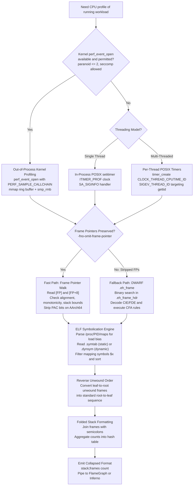

# Capstone: Sampling Profiler Emitting Folded Stacks

> [!summary] Scope
> This capstone playbook walks through constructing a high-performance sampling profiler that captures thread call stacks at high frequency with minimal target perturbation and formats them as folded stacks for FlameGraph visualization.
> It covers timer signal delivery (SIGPROF/timer_create) and perf_event_open sampling, frame pointer stack traversal, and DWARF .eh_frame unwinding fallback.
> It implements an ELF symbolication engine resolving dynamic and static symbol tables (.symtab and .dynsym) with caching.

Statistical sampling errors, interrupt skid, and runtime safepoint bias are owned by [[Sampling-vs-Instrumentation-Skid-and-Safepoint-Bias]].
Low-level DWARF Call Frame Information (CFI) syntax and compiler unwind tables are owned by [[Stack-Unwinding-CFI-and-Exception-ABI]].
Visual flame graph rendering and differential flame graphs are owned by [[Flame-Graphs-Differential-Flame-Graphs-and-Visualizations]].
The introductory rebuild lab in Pillar 05 is owned by [[Rebuild-Lab-Sampling-Profiler-to-Folded-Stacks]].
The subsequent polyglot release engineering pipeline is owned by [[Capstone-Polyglot-Packaging-and-Release-Pipeline]].
This capstone playbook synthesizes these domains into an industrial-grade systems implementation.
It owns the operational architecture, systems programming mechanics, and performance trade-offs of capturing thread call stacks at 99-999 Hz, walking stack frames without crashing target processes, resolving virtual memory addresses against ELF binaries, and emitting collapsed folded stacks for immediate ingestion by downstream visualization tools.

## Trigger and Symptoms

Activate this playbook when engineering custom runtime observability, diagnosing high CPU bottlenecks in environments where external profilers cannot run, or troubleshooting silent profiling failures.

- Production systems exhibit unexplained CPU consumption, but external profilers such as `perf` fail with `EPERM` (container seccomp filters) or `EACCES` (`kernel.perf_event_paranoid`, per the perf_event_open(2) ERRORS section).
- Latency-sensitive workloads experience tail-latency spikes or deadlocks caused by naive profilers invoking non-async-signal-safe routines (such as `malloc` or mutex locks) inside signal handlers.
- Profiler output collapses into massive towers of `[unknown]` frames, indicating corrupted unwind traversal or broken virtual address load-bias recalculations.
- Leaf functions in optimized code appear directly under their grandparent, skipping the immediate caller, due to `-momit-leaf-frame-pointer`, which GCC enables by default on AArch64 (GCC AArch64 Options).
- Multi-threaded applications show skewed profile weights where one thread absorbs all samples because the profiler configured process-wide `ITIMER_PROF` instead of per-thread POSIX timers.
- Memory corruption or crashes occur during profiling because stack unwinding failed to validate frame-pointer alignment, monotonicity, or stack boundary limits.

## Decision Tree



## Prerequisites

Building and operating the capstone profiler requires a standard C++17 toolchain, binutils, and access to Linux process interfaces.

```bash
command -v g++ make objdump nm readelf python3
```

On Linux systems (Ubuntu 24.04 LTS, Debian 12, or Fedora 40), ensure necessary packages are installed:

```bash
sudo apt-get update && sudo apt-get install -y build-essential binutils elfutils
```

### Build Requirements for Profiled Targets

To permit reliable, zero-copy frame pointer stack walking, target binaries and libraries must be compiled with frame pointers retained:
- `-fno-omit-frame-pointer`: Instructs the compiler to dedicate `rbp` (x86-64) or `x29` (AArch64) as a frame pointer rather than using it as a general-purpose register.
- `-mno-omit-leaf-frame-pointer`: Guarantees that leaf functions (functions that make no downstream calls) still construct a standard stack frame record, preventing caller frames from vanishing from the callchain.
- `-g`: Adds `.debug_*` sections (line tables, `.debug_frame`) for line-level mapping and offline unwinding.
  The allocated `.eh_frame` that runtime unwinders read comes from `-funwind-tables` / `-fasynchronous-unwind-tables`, not from `-g`.
- `-Wl,--build-id`: Embeds a unique cryptographic GNU build ID note into the ELF binary to guarantee unambiguous symbol matching.

### Kernel Permission Checks

When utilizing the `perf_event_open(2)` interface for out-of-process sampling, inspect the system-wide security ceiling:

```bash
cat /proc/sys/kernel/perf_event_paranoid
```

The levels below are quoted from the kernel sysctl documentation; each level adds to the restrictions of the levels under it, for users without `CAP_PERFMON` (Linux 5.8+) or `CAP_SYS_ADMIN`.

- `-1`: Allow use of (almost) all events by all users, and ignore the mlock limit beyond `perf_event_mlock_kb` without `CAP_IPC_LOCK`.
- `0`: Disallow ftrace function tracepoints and raw tracepoint access.
- `1`: Also disallow CPU event access (system-wide, per-CPU events).
- `2`: Also disallow kernel profiling.
  This is the upstream default since Linux 4.6 (`sysctl_perf_event_paranoid = 2` in `kernel/events/core.c`; perf_event_open(2)) (as of 2026-11, Linux).
  `perf_event_open()` calls `perf_allow_kernel()` unless the event sets `exclude_kernel = 1` and, when it requests `PERF_SAMPLE_CALLCHAIN`, also `exclude_callchain_kernel = 1`.
- `3` and above: the kernel sysctl documentation defines no such level; any stricter level that disallows unprivileged `perf_event_open()` entirely comes from a distribution patch.
  Read `/proc/sys/kernel/perf_event_paranoid` on the target host instead of assuming the level from the distribution name.

## Commands and Numbers to Know

| Item | Platform | Value `(as of 2026-11)` | Why it matters |
| :--- | :--- | :--- | :--- |
| `SIGPROF` | Linux | Signal number 27 on x86-64 and AArch64 | Default action is process termination; signal handler must be registered before arming timers. |
| `ITIMER_PROF` | Linux | Process-wide CPU timer (user + system) | Interrupted process receives signal on CPU ticks; blocked processes receive zero samples. |
| `CLOCK_THREAD_CPUTIME_ID` | Linux | Clock ID for per-thread CPU time | Used with `timer_create` to measure high-resolution execution time on specific threads. |
| `SIGEV_THREAD_ID` | Linux | Notification mode 4 in `struct sigevent` | Directs timer expiration signals specifically to the kernel thread specified by `_sigev_un._tid`. |
| Frame Record Layout | Linux | Two contiguous 64-bit words at `[FP]` | `FP[0]` holds caller saved frame pointer; `FP[1]` holds caller return instruction pointer. |
| `PERF_TYPE_SOFTWARE` | Linux | Attribute type 1 in `perf_event_open` | Selects software-defined performance events (e.g., `PERF_COUNT_SW_CPU_CLOCK = 0`). |
| `PERF_SAMPLE_CALLCHAIN` | Linux | Sample type bitmask `1ULL << 5` | Tells kernel to capture user and kernel call stacks directly into the ring buffer. |
| `PERF_CONTEXT_USER` | Linux | Constant `(__u64)-512` | Delimiter in kernel callchain buffers indicating transition to user-space frames. |
| `PERF_CONTEXT_MAX` | Linux | Constant `(__u64)-4095` | Boundary value; all addresses `>= PERF_CONTEXT_MAX` represent context markers, not instruction pointers. |
| `kernel.perf_event_max_stack` | Linux | Default 127 (`PERF_MAX_STACK_DEPTH`) | Upper bound on callchain depth captured by kernel unwinder before truncation occurs. |
| `kernel.perf_event_mlock_kb` | Linux | Default 512 KiB + 1 page (516 KiB with 4 KiB pages) | Per-CPU ring-buffer size not counted against `RLIMIT_MEMLOCK` for unprivileged `perf_event_open` mmaps. |
| `SHT_SYMTAB` | Linux | ELF section type 2 | Static symbol table containing local, file-scope, and static functions stripped in release builds. |
| `SHT_DYNSYM` | Linux | ELF section type 11 | Dynamic symbol table retained in stripped binaries to support runtime dynamic linking. |
| DWARF CFA | Both | Canonical Frame Address | Typically the stack pointer value at the call site in the previous frame (DWARF 5 section 6.4). |
| AArch64 PAC Mask | Linux | PAC width is 55 minus the VA size (7 bits at 48-bit VA); clearing the upper 16 bits (`0xffff000000000000`) is safe for 48-bit user addresses | Signed return addresses must be stripped before symbol lookup; the exact mask is in the `NT_ARM_PAC_MASK` regset (kernel arm64 pointer-authentication docs). |

## Step-by-Step Execution

Constructing the sampling profiler proceeds across seven sequential engineering stages:
1. Target architecture and synthetic reference workload design.
2. Signal delivery and sampling clock configuration (`timer_create` / `SIGPROF`).
3. Kernel out-of-process sampling via `perf_event_open` ring buffers.
4. Fast-path frame-pointer stack walking with bounds verification and leaf repair.
5. DWARF `.eh_frame` and `.eh_frame_hdr` fallback unwinder.
6. In-memory ELF symbolication engine with load bias calculation and symbol caching.
7. Aggregated folded stack formatting and flame graph pipeline emission.

### Step 1: Design Target Workload with Known Reference Distribution

A profiling engine cannot be validated without a reference workload whose ground-truth execution ratios are known a priori.
Create `workload.hpp` and `workload.cpp` implementing three synthetic CPU-bound stages with a known 5 : 3 : 2 distribution (50% alpha, 30% beta, 20% gamma) that converge on a common leaf worker function.

```cpp
// workload.hpp
#pragma once
#include <cstdint>

namespace workload {

#if defined(__GNUC__) || defined(__clang__)
#define NOINLINE __attribute__((noinline, noclone))
#else
#define NOINLINE
#endif

extern volatile uint64_t g_sink;

NOINLINE void leaf_worker(uint64_t loop_count);
NOINLINE uint64_t task_alpha(uint64_t scale);
NOINLINE uint64_t task_beta(uint64_t scale);
NOINLINE uint64_t task_gamma(uint64_t scale);
NOINLINE void run_workload_round(uint64_t scale);

} // namespace workload
```

Implement the computational loops in `workload.cpp`:

```cpp
// workload.cpp
#include "workload.hpp"

namespace workload {

volatile uint64_t g_sink = 0;

NOINLINE void leaf_worker(uint64_t loop_count) {
    uint64_t val = 0x9e3779b97f4a7c15ULL;
    for (uint64_t i = 0; i < loop_count; ++i) {
        val ^= (val << 13);
        val ^= (val >> 7);
        val ^= (val << 17);
        val += i;
    }
    g_sink += val;
}

NOINLINE uint64_t task_alpha(uint64_t scale) {
    leaf_worker(scale * 500000ULL);
    return scale * 5;
}

NOINLINE uint64_t task_beta(uint64_t scale) {
    leaf_worker(scale * 300000ULL);
    return scale * 3;
}

NOINLINE uint64_t task_gamma(uint64_t scale) {
    leaf_worker(scale * 200000ULL);
    return scale * 2;
}

NOINLINE void run_workload_round(uint64_t scale) {
    task_alpha(scale);
    task_beta(scale);
    task_gamma(scale);
}

} // namespace workload
```

**Verification:** Compile the workload and verify that `nm` displays distinct text symbols (`-n` sorts by address; plain `nm` sorts by name):

```bash
g++ -std=c++17 -O2 -g -fno-omit-frame-pointer -mno-omit-leaf-frame-pointer -c workload.cpp -o workload.o
nm -n workload.o | grep -E "leaf_worker|task_alpha|task_beta|task_gamma"
```

Expected output shape on Linux (the lab does not record this command, so the offsets are left as `<offset>`; they depend on the compiler version and target, and only the four mangled `T` symbols are the point):
```text
<offset> T _ZN8workload11leaf_workerEm
<offset> T _ZN8workload10task_alphaEm
<offset> T _ZN8workload9task_betaEm
<offset> T _ZN8workload10task_gammaEm
```
The `T` type letter marks a global symbol in the text section, and the lab's symbolizer reads the same symbols from `.symtab` (nm(1)).

### Step 2: Implement Signal Delivery and High-Resolution Timers

To sample inside the target process without root privileges, configure POSIX CPU timers to deliver `SIGPROF`.
In multi-threaded processes, naive usage of `setitimer(ITIMER_PROF, ...)` delivers signals to arbitrary threads, creating severe sampling bias.
Instead, use `timer_create` with `CLOCK_THREAD_CPUTIME_ID` and `SIGEV_THREAD_ID` targeting the kernel TID (`gettid()`).

```cpp
#define _GNU_SOURCE
#include <csignal>
#include <ctime>
#include <sys/syscall.h>
#include <unistd.h>
#include <cstring>
#include <ucontext.h>

bool arm_thread_timer(uint64_t interval_us, timer_t* timerid) {
    struct sigevent sev;
    std::memset(&sev, 0, sizeof(sev));
    sev.sigev_notify = SIGEV_THREAD_ID;
    sev.sigev_signo = SIGPROF;
    sev._sigev_un._tid = static_cast<pid_t>(syscall(SYS_gettid));

    if (timer_create(CLOCK_THREAD_CPUTIME_ID, &sev, timerid) != 0) {
        return false;
    }

    struct itimerspec its;
    its.it_interval.tv_sec = interval_us / 1000000ULL;
    its.it_interval.tv_nsec = (interval_us % 1000000ULL) * 1000ULL;
    its.it_value = its.it_interval;

    return timer_settime(*timerid, 0, &its, nullptr) == 0;
}
```

Install the signal handler before arming any timers.
Configure `SA_SIGINFO` to receive the execution context (`ucontext_t`), and `SA_RESTART` to prevent interrupted system calls from prematurely failing with `EINTR`.

```cpp
struct sigaction sa;
std::memset(&sa, 0, sizeof(sa));
sa.sa_sigaction = &sigprof_handler;
sa.sa_flags = SA_SIGINFO | SA_RESTART;
sigemptyset(&sa.sa_mask);
sigaction(SIGPROF, &sa, &old_sa);
```

### Step 3: Implement Kernel Out-of-Process Sampling via `perf_event_open`

When profiling a separate process from the outside, use `perf_event_open(2)` to create a software CPU clock event and map a lockless circular ring buffer.
The ring buffer comprises 1 metadata page followed by $2^n$ data pages.

```cpp
#include <linux/perf_event.h>
#include <sys/syscall.h>
#include <sys/mman.h>
#include <unistd.h>
#include <cstring>

int setup_perf_sampling(pid_t target_pid, int cpu, uint64_t sample_period) {
    struct perf_event_attr pe;
    std::memset(&pe, 0, sizeof(pe));
    pe.type = PERF_TYPE_SOFTWARE;
    pe.size = sizeof(pe);
    pe.config = PERF_COUNT_SW_CPU_CLOCK;
    pe.sample_period = sample_period;
    pe.sample_type = PERF_SAMPLE_IP | PERF_SAMPLE_TID | PERF_SAMPLE_CALLCHAIN | PERF_SAMPLE_TIME;
    pe.disabled = 1;
    pe.exclude_kernel = 1;
    pe.exclude_callchain_kernel = 1;

    int fd = syscall(SYS_perf_event_open, &pe, target_pid, cpu, -1, 0);
    return fd;
}
```

Map the ring buffer and handle memory barriers correctly.
The kernel contract (quoted in `tools/include/linux/ring_buffer.h` from `kernel/events/ring_buffer.c`) is: load `data_head`, then a read barrier, then read the records, then a full barrier, then store `data_tail`.
A compiler-only barrier (`asm volatile("" ::: "memory")`) is not enough on weakly ordered CPUs such as AArch64, and the tail store must come after the full barrier, not before it; acquire and release atomics satisfy both pairings, which is what the kernel's own `ring_buffer_read_head()` and `ring_buffer_write_tail()` helpers use.

```cpp
size_t page_size = sysconf(_SC_PAGESIZE);
size_t mmap_len = page_size * (1 + 16); // 1 header page + 16 data pages
struct perf_event_mmap_page* header = static_cast<struct perf_event_mmap_page*>(
    mmap(nullptr, mmap_len, PROT_READ | PROT_WRITE, MAP_SHARED, fd, 0));

// Enabling event
ioctl(fd, PERF_EVENT_IOC_ENABLE, 0);

// Reading ring buffer safely:
uint64_t head = __atomic_load_n(&header->data_head, __ATOMIC_ACQUIRE); // pairs with kernel smp_wmb()
uint64_t tail = header->data_tail; // only this consumer writes data_tail

while (tail < head) {
    // Process perf_event_header and record payload
    // Wrap pointer using: offset = tail % (16 * page_size)
    // Advance tail
}
__atomic_store_n(&header->data_tail, head, __ATOMIC_RELEASE); // record reads complete before the kernel may overwrite
```

### Step 4: Implement High-Performance Frame-Pointer Stack Walking

Inside the `SIGPROF` handler, extraction of the call stack must stay a short, bounded loop (at most `MAX_STACK_DEPTH` iterations of two loads and three compares) and remain completely async-signal-safe.
Never call `malloc`, access thread-local variables that trigger dynamic allocation, or acquire non-reentrant mutexes.

Retrieve the interrupted Instruction Pointer (IP) and Frame Pointer (FP) from `ucontext_t`:

```cpp
ucontext_t* uc = static_cast<ucontext_t*>(ucontext);
uintptr_t pc = 0;
uintptr_t fp = 0;

#if defined(__x86_64__)
pc = static_cast<uintptr_t>(uc->uc_mcontext.gregs[REG_RIP]);
fp = static_cast<uintptr_t>(uc->uc_mcontext.gregs[REG_RBP]);
#elif defined(__aarch64__)
pc = static_cast<uintptr_t>(uc->uc_mcontext.pc);
fp = static_cast<uintptr_t>(uc->uc_mcontext.regs[29]);
uintptr_t lr = static_cast<uintptr_t>(uc->uc_mcontext.regs[30]);

// Strip ARMv8.3-A Pointer Authentication (PAC) signature bits
pc &= 0x0000ffffffffffffULL;
fp &= 0x0000ffffffffffffULL;
lr &= 0x0000ffffffffffffULL;
#endif
```

Execute the validation and unwinding loop:

```cpp
uintptr_t stack[MAX_DEPTH];
size_t depth = 0;
stack[depth++] = pc;

uintptr_t curr_fp = fp;
while (depth < MAX_DEPTH) {
    // 1. Strict alignment check: Frame pointers must be 8-byte aligned
    if (curr_fp == 0 || (curr_fp & (sizeof(void*) - 1)) != 0) {
        break;
    }

    // 2. Strict stack bounds check: FP must lie within thread stack limits
    if (curr_fp < g_stack_bottom || curr_fp >= g_stack_top - (2 * sizeof(void*))) {
        break;
    }

    uintptr_t* record = reinterpret_cast<uintptr_t*>(curr_fp);
    uintptr_t next_fp = record[0];
    uintptr_t ret_addr = record[1];

    // 3. Monotonicity check: Stack grows downward; caller FP must be at higher address
    if (next_fp <= curr_fp) {
        break;
    }
    if (ret_addr == 0) {
        break;
    }

#if defined(__aarch64__)
    ret_addr &= 0x0000ffffffffffffULL;
#endif

    stack[depth++] = ret_addr;
    curr_fp = next_fp;
}
```

Store the collected raw addresses into a pre-allocated lock-free sample buffer using an atomic counter:

```cpp
size_t idx = g_sample_count.fetch_add(1, std::memory_order_relaxed);
if (idx < MAX_SAMPLES) {
    g_samples[idx].depth = depth;
    std::memcpy(g_samples[idx].ips, stack, depth * sizeof(uintptr_t));
} else {
    g_dropped_count.fetch_add(1, std::memory_order_relaxed);
}
```

### Step 5: Implement DWARF `.eh_frame` Unwinding Fallback

When analyzing third-party libraries or legacy binaries compiled with `-fomit-frame-pointer`, frame-pointer walking halts immediately at the optimized frame.
To unwind these frames, implement a DWARF Call Frame Information (CFI) reader utilizing `.eh_frame_hdr`.

The `.eh_frame_hdr` binary layout is defined by the Linux Standard Base (LSB) Core Specification:

```c
struct eh_frame_hdr {
    uint8_t version;            // Version 1
    uint8_t eh_frame_ptr_enc;   // Encoding of pointer to .eh_frame
    uint8_t fde_count_enc;      // Encoding of FDE count in table
    uint8_t table_enc;          // Encoding of table entries (e.g., DW_EH_PE_datarel | DW_EH_PE_sdata4)
    // Encoded pointer to .eh_frame
    // Encoded fde_count
    // Sorted array of pairs: [initial_location, fde_offset]
};
```

1. **Locate FDE:** For a given instruction pointer `ip`, perform an $O(\log N)$ binary search across the sorted `initial_location` table in `.eh_frame_hdr` to find the Frame Description Entry (FDE) covering `ip`.
2. **Decode CIE & FDE:** Read the Common Information Entry (CIE) to extract the code alignment factor, data alignment factor, and return address register index.
3. **Execute DWARF CFI Virtual Machine:**
   - Initialize the Canonical Frame Address (CFA) rule (e.g., `CFA = rsp + 8`).
   - Process CFI bytecode instructions up to the target `ip`:
     - `DW_CFA_def_cfa (0x0c)`: `CFA = reg + offset`
     - `DW_CFA_def_cfa_offset (0x0e)`: Updates CFA offset relative to current register.
     - `DW_CFA_offset (0x80 | reg)`: Saved register is stored at `CFA + (offset * data_alignment_factor)`.
4. **Restore Registers:**
   - Caller Stack Pointer (`caller_sp`) = `CFA`.
   - Caller Return Address = value loaded from the address given by the return-address register's rule (on x86-64 the CIE sets it to `CFA - 8`).
   - Advance to caller frame and repeat.

### Step 6: Construct ELF Symbolication Engine with Load Bias Caching

Raw instruction pointers must be translated into human-readable function names.
Build `ElfSymbolizer` to parse memory mappings from `/proc/self/maps`, compute the load bias for Position Independent Executables (PIE) and shared libraries, extract symbols from `.symtab` and `.dynsym`, and perform binary searches.

```cpp
// In elf_symbolizer.cpp
void ElfSymbolizer::parse_proc_maps() {
    std::ifstream maps("/proc/self/maps");
    std::string line;
    while (std::getline(maps, line)) {
        // Parse: 555555554000-555555558000 r-xp 00000000 08:01 12345 /path/to/binary
        // Extract start_addr, end_addr, permissions, offset, and file path
    }
}
```

Calculate the load bias for each mapped object:
$$\text{load\_bias} = \text{mapped\_vaddr\_start} - \min(\text{p\_vaddr}_{\text{PT\_LOAD}})$$

Here `mapped_vaddr_start` must be the start of the mapping at file offset 0 (the first `PT_LOAD`), not the start of the executable (`r-xp`) mapping.
GNU ld enables `-z separate-code` by default on Linux/x86 since binutils 2.31 (ld/NEWS), so on x86-64 the code segment is a separate mapping at a non-zero offset (typically `0x1000`), and subtracting `min(p_vaddr)` from its start skews every symbol by that offset.
The general rule for the mapping that contains an address is `load_bias = map_start - map_offset + seg.p_offset - seg.p_vaddr` (page-aligned) for the `PT_LOAD` segment covering `map_offset`; in-process, `dl_iterate_phdr(3)` reports the bias directly as `dlpi_addr`.
The lab's symbolizer applies that general rule: it picks the executable `PT_LOAD` segment that overlaps the mapping and computes `map_start - map_offset + p_offset - p_vaddr`, and it looks up `ip - 1` for every return address so a call that is the last instruction of a function still resolves to the caller.
The only recorded run is on `linux-aarch64`; the lab was not run on x86-64, so the x86-64 behaviour follows from the rule and not from a captured run.

Read section headers to locate `.symtab` (SHT_SYMTAB) and `.dynsym` (SHT_DYNSYM):

```cpp
// Iterate section headers
const Elf64_Shdr* symtab_shdr = nullptr;
const Elf64_Shdr* strtab_shdr = nullptr;

for (Elf64_Half i = 0; i < ehdr->e_shnum; ++i) {
    if (shdrs[i].sh_type == SHT_SYMTAB) {
        symtab_shdr = &shdrs[i];
        strtab_shdr = &shdrs[shdrs[i].sh_link];
        break;
    }
}
```

Filter out architecture mapping symbols.
On AArch64, the GNU assembler emits `$x` to denote code regions and `$d` to denote data regions.
If not filtered, these symbols mask actual function names during interval binary search!

```cpp
if (raw_name[0] != '\0' && raw_name[0] != '$') {
    int status = 0;
    char* demangled = abi::__cxa_demangle(raw_name, nullptr, nullptr, &status);
    std::string sym_name = (status == 0 && demangled) ? demangled : raw_name;
    if (demangled) free(demangled);
    mod.symbols.push_back({sym.st_value, sym.st_size, sym_name});
}
```

Sort symbols by virtual address and perform binary search on lookup:

```cpp
uintptr_t rel_addr = ip - mod.load_bias;
auto it = std::upper_bound(mod.symbols.begin(), mod.symbols.end(), rel_addr,
    [](uintptr_t val, const Symbol& s) { return val < s.vaddr; });

if (it != mod.symbols.begin()) {
    --it;
    if (it->size == 0 || (rel_addr >= it->vaddr && rel_addr < it->vaddr + it->size)) {
        return it->name;
    }
}
```

### Step 7: Format and Emit Aggregated Folded Stacks

Downstream flame graph generators (such as Brendan Gregg's `flamegraph.pl` or `inferno`) require folded stacks: one line per unique callchain, frames separated by semicolons from root caller to leaf callee, followed by space and the sample count.

Stack walking traverses from leaf `ip` up to root caller (`main`).
Therefore, the profiler must reverse the frame vector before formatting!

```cpp
std::map<std::string, uint64_t> folded_counts;

for (const auto& sample : raw_samples) {
    if (sample.depth == 0) continue;

    std::vector<std::string> frames;
    for (size_t i = 0; i < sample.depth; ++i) {
        // ips[0] is the interrupted PC; later entries are return addresses, so look up ip - 1
        const uintptr_t ip = (i == 0) ? sample.ips[i] : sample.ips[i] - 1;
        frames.push_back(symbolizer.resolve(ip));
    }

    // Reverse from leaf-to-root into root-to-leaf
    std::string folded_stack;
    for (size_t i = frames.size(); i > 0; --i) {
        if (!folded_stack.empty()) folded_stack += ";";
        folded_stack += frames[i - 1];
    }
    folded_counts[folded_stack]++;
}

for (const auto& kv : folded_counts) {
    std::cout << kv.first << " " << kv.second << "\n";
}
```

Illustrative output shape (the lab's golden file records only the verifier summary, so these lines and counts are not recorded output):
```text
__libc_start_main;main;workload::run_workload_round;workload::task_alpha;workload::leaf_worker 502
__libc_start_main;main;workload::run_workload_round;workload::task_beta;workload::leaf_worker 298
__libc_start_main;main;workload::task_gamma;workload::leaf_worker 200
```

The `task_gamma` line has no `run_workload_round` frame because `task_gamma(scale)` is the last call in a `void` function, so `-O2` (`-foptimize-sibling-calls`) emits it as a sibling call; GCC 16.2 targeting AArch64 macOS (checked with `-S`; Linux codegen for this tail is expected to match but was not re-checked) emits `ldp x29, x30, [sp], 16` followed by `b task_gamma` for this exact source.
On glibc with `sysdeps/nptl/libc_start_call_main.h`, `main` is called from the internal `__libc_start_call_main`, so a real run shows one more libc frame between `__libc_start_main` and `main`, resolved from `.dynsym` to the nearest exported symbol or to a `libc.so.6+0x...` fallback.
Counts are also not the ones the lab produces: 60 workload rounds take about 125 ms of CPU on an Apple M-series core (measured natively, 3 runs: 124-137 ms), so the lab's 240 rounds should take about 0.5 s and yield roughly 500 samples at 1000 Hz (an estimate from that measurement, not a recorded Linux count).

## Verification

Validate the complete implementation by compiling the test harness and piping its emitted folded stacks into `verify_profile.py`:

```bash
# Compile profiler and workload
g++ -std=c++17 -O2 -g -fno-omit-frame-pointer -mno-omit-leaf-frame-pointer \
    workload.cpp elf_symbolizer.cpp sampler.cpp main.cpp \
    -o capstone_profiler -lpthread -lrt

# Execute profiler and verify folded stack distribution
./capstone_profiler 240 | python3 verify_profile.py
```

Expected output:
```text
Total samples collected: True
Leaf worker resolved: True
Stack order verified: root-to-leaf
Task alpha (expected ~50%): True
Task beta (expected ~30%): True
Task gamma (expected ~20%): True
Proportions monotonic (alpha > beta > gamma): True
Capstone sampling profiler verification: PASS
```

## Worked Lab Example: Capstone Sampling Profiler Lab

The executable capstone lab resides under `code/11-Arena-and-Capstones/capstone_sampling_profiler/`.
The harness executes the profiler in an unprivileged Linux container, requests a 1 ms (1000 Hz) `CLOCK_THREAD_CPUTIME_ID` timer, resolves symbols from the running ELF binary via `/proc/self/maps`, and generates folded stacks.
POSIX CPU timers are checked from the scheduler tick (`run_posix_cpu_timers()` is called from `update_process_times()` in `kernel/time/timer.c`), so the effective rate is capped at the kernel's `HZ`; on a `HZ=250` kernel the lab would collect about a quarter of the samples, roughly 125, which is still above its `> 50` sample check.

```bash
cd code && python3 -m _harness.verify 11-Arena-and-Capstones/capstone_sampling_profiler/
```

### Verified Platform Output (`linux-aarch64`)

The summary below was recorded from the container run (`linux-aarch64`) with the earlier lab revision (60 rounds, `> 100` samples, a verifier that printed its order line unconditionally).
The lab was then hardened as described below and was not re-run; a passing run of the current revision prints the same eight lines, which is why the expected file is unchanged.
The folded stacks themselves are not recorded:

```text
Total samples collected: True
Leaf worker resolved: True
Stack order verified: root-to-leaf
Task alpha (expected ~50%): True
Task beta (expected ~30%): True
Task gamma (expected ~20%): True
Proportions monotonic (alpha > beta > gamma): True
Capstone sampling profiler verification: PASS
```

This verification shows that:
1. Signal delivery interrupted active execution more than 100 times (the earlier threshold; the current revision requires more than 50 at about four times the workload) without terminating the process.
2. The frame pointer walker got past the leaf: `task_alpha`, `task_beta`, and `task_gamma` each appear in some stack, which a leaf-only walk could not produce, and `leaf_worker` appears in at least one stack.
3. The ELF symbolizer resolved main-executable addresses to demangled names on this platform; the earlier revision did not check for `$` frames, and no check runs with the `$x` filter removed, so the filter's effect was not isolated.
4. The alpha, beta, and gamma shares fell inside 40-60%, 20-40%, and 10-30% bands and were strictly ordered.

In the current revision stack order is checked: `verify_profile.py` requires `leaf_worker` to be the last frame of every stack that contains it and a `task_*` frame to precede it, so a leaf-to-root emitter fails.
It also fails on a malformed folded line, on a `$` mapping-symbol frame, and exits 1 on any failed check, printing the `FAIL` lines instead of the recorded summary.
The three `task_*` shares are still substring matches over the stack.

## Rollback Procedure

When attaching or deploying a sampling profiler to a production service, failures or performance anomalies require immediate, orderly rollback to avoid destabilizing the host.

1. **Disarm Timers Immediately:**
   - For in-process POSIX timers, invoke `timer_delete(timerid)` or `setitimer(ITIMER_PROF, &zero, nullptr)` to prevent further signal generation.
   - For `perf_event_open`, execute `ioctl(fd, PERF_EVENT_IOC_DISABLE, 0)` to halt kernel counter interrupts.
2. **Restore Original Signal Actions:**
   - Execute `sigaction(SIGPROF, &old_sa, nullptr)` to restore previous application signal handlers.
   - Never reset signal disposition to `SIG_DFL` blindly if the application or its runtime (e.g., Go, JVM, V8) relied on `SIGPROF` for internal housekeeping.
3. **Unmap Ring Buffers and Close File Descriptors:**
   - Unmap mmap data pages using `munmap(header, mmap_len)`.
   - Close all open perf file descriptors with `close(fd)` to release kernel event contexts.
4. **Drain In-Flight Signals:**
   - If threads remain blocked, deliver a no-op signal or allow remaining queued signals to execute while the profiler state is marked inactive.

## Failure Modes of the Procedure

| Failure Mode | Root Cause | Observable Symptom | Exact Recovery Step |
| :--- | :--- | :--- | :--- |
| Immediate Target Crash on Start | Timer armed prior to installing signal handler | Target process killed by signal 27 (`SIGPROF`) | Ensure `sigaction()` runs before `timer_create()` or `setitimer()`. |
| Random Target Deadlock | Profiler signal handler invoked `malloc` or mutex lock | Process hangs in futex or memory allocator during profiling | Remove all heap allocations and synchronization from the signal handler; write only to pre-allocated arrays. |
| Incomplete Call Stacks (`[unknown]`) | `-fomit-frame-pointer` active in target binary | Stack traces consist of a single leaf frame followed by termination | Recompile target with `-fno-omit-frame-pointer` or activate DWARF `.eh_frame` fallback unwinding. |
| Missing Intermediary Callers | `-momit-leaf-frame-pointer` active on AArch64 | Callee appears attached directly to grandparent in flame graph | Recompile with `-mno-omit-leaf-frame-pointer` or inspect `LR` (register 30) to reconstruct the missing frame. |
| Symbol Offset Mismatch | Ignoring ELF load bias in shared library or PIE | Symbols point to wrong functions or report offset overflow | Calculate `load_bias = mapped_base - min_vaddr_PT_LOAD` and subtract from virtual IP before symbol table lookup. |
| Symbols Masked by `$x` / `$d` | Failing to filter AArch64 assembly mapping symbols | Flame graph nodes display `$x` instead of valid function names | Filter out any symbol name beginning with `$` during ELF symbol table ingestion. |
| Lockstep Sampling Bias | Sampling frequency shares harmonic with target loop | CPU profile heavily over-represents or misses periodic tasks | Use prime sampling intervals (e.g., 997 us instead of 1000 us) or inject jitter into the timer period. |
| System Calls Failing with `EINTR` | Signal handler registered without `SA_RESTART` | Network sockets or slow file operations fail with error 4 (`EINTR`) | Set `sa.sa_flags |= SA_RESTART` in `struct sigaction` and ensure target application wraps system calls in retry loops. |

## Pitfalls

> [!warning] Pitfalls:
> 1. **Signal Safety Violations:** Invoking `printf`, `malloc`, `free`, `std::string`, `dladdr`, or acquiring standard mutexes inside a signal handler causes immediate deadlocks or heap corruption when a signal interrupts a thread already executing inside the allocator or lock.
> 2. **Signal Coalescing Loss:** Standard POSIX signals do not queue; if a thread has a pending `SIGPROF` when another timer tick expires, no second signal is generated, causing loss of profile samples during peak load.
>    For `timer_create` timers the loss is not silent: the missed expirations are counted and readable with `timer_getoverrun(2)` or `si_overrun`, so a profiler can weight the sample or report drops (timer_create(2)).
> 3. **Memory Bus Saturation in Ring Buffers:** In high-core out-of-process sampling, writing callchains to per-CPU ring buffers without sizing them appropriately (`perf_event_mlock_kb`) causes buffer overruns and dropped sample events.
> 4. **AArch64 PAC Invalidation:** Modern ARM64 hardware signs return addresses with Pointer Authentication Codes (PAC); passing signed pointers directly to ELF symbol lookup results in failed searches because the high bits contain authentication tags rather than valid virtual memory offsets.
> 5. **Stack Bounds Assumption:** Unwinding through coroutine stacks, green threads (e.g., Go runtimes), or alternate signal stacks (`sigaltstack`) causes immediate segmentation faults if the unwinder checks frame pointers against standard thread pthread bounds.

## At Scale

Deploying continuous sampling across thousands of nodes in enterprise production environments introduces distinct architectural constraints:

### Fleet-Wide Sampling Economics

Continuous profiling fleets (Google Wide Profiling, Grafana Pyroscope, Parca) run always-on agents, so the agent's CPU cost is a budget to set and measure per fleet, not a number to copy; this note's examples assume a budget of well under 1% of host CPU.
- **Sampling Frequency Selection:** Fleet agents sample at low rates and rely on aggregation over many hosts and hours for statistical power; a rate that is not a round number (19 Hz, 97 Hz, or the 99 Hz used in Brendan Gregg's `perf record -F 99` examples, https://www.brendangregg.com/perf.html) is less likely to align with periodic work, and the right rate is whatever keeps the measured agent cost inside the budget.
- **On-Host Symbolication vs Remote Symbolication:** Keep symbol resolution off the production host.
  Instead, capture compact raw 64-bit address tuples on host, stream them to a centralized collector, and symbolize asynchronously against centralized symbol servers (`debuginfod`).
- **eBPF vs User-Space Profiling:** While in-process profilers require preloading or linking into each binary, eBPF programs attached to `perf_event` hardware interrupts (`BPF_PROG_TYPE_PERF_EVENT`) walk frame pointers or BPF unwinder tables directly in kernel space, entirely eliminating signal delivery overhead and context switching.

### Decision Rules for Profiling Architecture

| Operational Requirement | Recommended Architecture | Primary Trade-Off |
| :--- | :--- | :--- |
| Zero application restart / Multi-tenant node | Out-of-process eBPF profiler attached to CPU clock | Requires root or `CAP_BPF` / `CAP_PERFMON` privileges; kernel version >= 5.8. |
| Containerized unprivileged environment | In-process POSIX timer profiler linked or preloaded | Introduces signal delivery overhead; target must tolerate `SIGPROF` interruptions. |
| Stripped third-party libraries | Out-of-process DWARF CFI unwinder with central `debuginfod` | High CPU overhead if unwound locally; requires reliable build ID indexing in CI. |
| Ultra-low-latency financial engine | eBPF hardware PMU sampling at low rate (11 Hz) | Coarse time resolution; avoids CPU pipeline and cache pollution. |

## Practice Drill

Test your diagnosis of broken profiler unwinding under realistic failure modes.

> [!tip] Practice Drill: The Silent Frame Erasure Drill
> A newly deployed microservice compiled on an AArch64 Linux server is profiled at 1000 Hz.
> The resulting flame graph shows `process_order` calling `compute_checksum`, but the intermediary logging helper `record_metric` is missing from 100% of the samples, even though unit tests prove `record_metric` executed millions of times.
>
> 1. What compiler optimization flag caused `record_metric` to disappear from the call stack?
> 2. How can you verify whether the missing function was inlined versus whether its frame pointer was omitted?
> 3. What exact compiler flags must be added to the build system to restore the complete call stack without disabling function inlining?

> [!success]- Solution
> 1. The leaf `compute_checksum` was compiled with `-momit-leaf-frame-pointer`, which GCC enables by default on AArch64 (GCC AArch64 Options; check the Clang default for your target separately).
>    Because `compute_checksum` makes no calls, it neither stores `x29`/`x30` nor updates `x29`, so its return address into `record_metric` lives only in `x30` (LR).
>    When the profiler interrupts `compute_checksum`, `x29` still points to `record_metric`'s frame record, whose saved LR returns into `process_order`, so the walk goes from `compute_checksum` straight to `process_order` and `record_metric` vanishes.
>    `record_metric` itself is not a leaf (it calls `compute_checksum`), so its own frame record exists; it is lost because the only pointer to it sits in the leaf's LR.
> 2. Disassemble the binary using `objdump -d` or `gdb`:
>    If `record_metric` was inlined, there will be no `record_metric` symbol or `bl record_metric` instruction inside `process_order`.
>    If it was not inlined, `objdump` will show a dedicated `record_metric` symbol containing `bl compute_checksum`, and `compute_checksum`'s prologue will lack `stp x29, x30, [sp, -16]!`.
> 3. Add `-fno-omit-frame-pointer -mno-omit-leaf-frame-pointer` to the compiler flags.
>    This forces the compiler to construct valid frame records even for leaf functions, preserving the entire callchain for frame-pointer profilers.

## Interview Questions

### L5 Questions

> [!question] L5
> What is the exact difference between an on-CPU sampling profiler and an off-CPU profiler?
>
> > [!success]- Answer
> > An on-CPU profiler samples the instruction pointer only while a thread is actively executing instructions on a CPU core (using clocks like `ITIMER_PROF`, `CLOCK_THREAD_CPUTIME_ID`, or hardware cycle counters).
> > When a thread blocks on an I/O operation, mutex lock, futex, or sleep, it is descheduled by the operating system kernel and receives zero on-CPU samples.
> > An off-CPU profiler tracks the duration and call stack when a thread is descheduled and waiting (typically instrumenting scheduler context-switch tracepoints like `sched:sched_switch`).
> > On-CPU profiling identifies computational bottlenecks, while off-CPU profiling identifies locking contention, disk I/O latency, and network waiting times.

> [!question] L5
> Why must a signal-based sampling profiler install its signal handler with `SA_RESTART`?
>
> > [!success]- Answer
> > When a thread is executing a blocking system call (such as `read`, `write`, or `wait`) and a timer delivers `SIGPROF`, the kernel interrupts the system call to run the signal handler.
> > If `SA_RESTART` is not specified in `sigaction.sa_flags`, the interrupted system call immediately aborts and returns -1 with `errno` set to `EINTR`.
> > Applications that do not explicitly wrap every system call in retry loops will fail unexpectedly only while the profiler is active.
> > Specifying `SA_RESTART` instructs the Linux kernel to automatically restart compatible interrupted system calls once the signal handler returns.
> > It is not a complete fix: signal(7) lists interfaces that always fail with `EINTR` regardless of `SA_RESTART`, including `poll`, `epoll_wait`, `select`, `nanosleep`, `clock_nanosleep`, and socket calls on a socket with a timeout set via `setsockopt(2)`, so the target still needs retry loops around those.

### L6 Questions

> [!question] L6
> Why are standard library functions like `malloc()`, `free()`, and `printf()` strictly prohibited inside a `SIGPROF` signal handler?
>
> > [!success]- Answer
> > Signal handlers execute asynchronously on the stack of the interrupted thread.
> > If a thread is interrupted while inside `malloc()`, it may already hold the internal heap arena mutex.
> > If the profiler's `SIGPROF` handler then calls `malloc()`, it attempts to acquire the exact same non-recursive mutex on the same thread, causing an immediate, unrecoverable deadlock.
> > Furthermore, memory allocators manipulate complex global pointer structures that are in an inconsistent intermediate state during execution; calling allocator routines inside a signal handler corrupts the heap.
> > Signal handlers must strictly adhere to POSIX async-signal-safe functions, writing samples exclusively into pre-allocated, lock-free ring buffers.

> [!question] L6: Predict the Output
> A developer compiles the following C++ code on an x86-64 Linux server with `g++ -O2 -fno-omit-frame-pointer`:
>
> ```cpp
> __attribute__((noinline)) void leaf() { while (g_flag) { g_counter++; } }
> __attribute__((noinline)) void intermediate() { leaf(); }
> __attribute__((noinline)) void run() { intermediate(); }
> ```
>
> While running, a sampling profiler walks the frame pointer chain and prints the resolved function names.
> However, `intermediate` is completely absent from the emitted folded stack (`run;leaf`).
> Explain what compiler optimization caused `intermediate` to vanish despite `-fno-omit-frame-pointer`, and predict the assembly instruction used to call `leaf`.
>
> > [!success]- Answer
> > The missing frame was eliminated by tail-call optimization (sibling call optimization).
> > Because the call to `leaf()` is the final statement in `intermediate()` and returns void, the compiler does not create a new stack frame or emit a `call` instruction.
> > Instead, the compiler restores `intermediate`'s stack frame and emits an unconditional jump instruction:
> >
> > ```assembly
> > jmp leaf
> > ```
> >
> > The return address on the stack and the frame pointer therefore point directly back to `run()`, completely bypassing `intermediate()`.
> > To prevent tail-call elimination while debugging or profiling, the binary must be compiled with `-fno-optimize-sibling-calls`.

> [!question] L6: Debug This
> During the rollout of an in-process sampling profiler on a fleet of AArch64 servers running Linux, the profiler successfully records samples, but every single resolved stack ends with:
>
> ```text
> [unknown];[unknown];checksum_block 4821
> ```
>
> The interrupted leaf `checksum_block` resolves, but every caller frame is `[unknown]`: the return addresses read from the frame records look like `0xf24baaaaaa0034e0`, even though the executable is mapped between `0x0000aaaaaa000000` and `0x0000aaaaaa050000`.
> Diagnose the root cause of this address corruption and provide the exact fix.
>
> > [!success]- Answer
> > The platform is running on modern AArch64 hardware with Pointer Authentication (ARMv8.3-A PAC) enabled, and the binary was compiled with branch protection (`-mbranch-protection=standard` or `pac-ret`).
> > The function prologue executes `paciasp` (or `pacibsp`), which cryptographically signs the return address using a secret key and the current stack pointer, storing the signature in the upper unused bits of the 64-bit pointer.
> > The signed LR is what the prologue stores into the frame record, so when the profiler reads a return address from a frame record it retrieves the signed value with PAC bits in the high bits (e.g., `0xf24b...`), while the low 48 bits still hold the real address.
> > The leaf resolves because its PC comes from `ucontext_t`, and the PC is never signed.
> > Because the profiler did not strip the signature bits, every caller address falls outside all mapped ELF segments, resulting in `[unknown]`.
> > The fix is to strip the PAC bits before lookup, either with the `xpaclri` / `xpaci` instructions or by masking with the instruction mask from the `NT_ARM_PAC_MASK` regset; for 48-bit user addresses a fixed mask is equivalent:
> >
> > ```cpp
> > ret_addr &= 0x0000ffffffffffffULL;
> > ```

### L7 Questions

> [!question] L7
> Compare frame-pointer stack unwinding with DWARF `.eh_frame` unwinding across execution latency, memory overhead, and implementation complexity in an on-CPU profiler.
>
> > [!success]- Answer
> > **Frame Pointer Unwinding:**
> > - Latency: Low and bounded.
> >   The unwinder executes a pointer-dereferencing loop that reads 2 words per frame, with no table lookup (the lab does not measure it).
> > - Memory: Negligible.
> >   Does not require mapping or loading debug tables.
> > - Overhead: Consumes 1 dedicated CPU register (`rbp`/`x29`) and executes 1-2 extra instructions per function prologue/epilogue; Canonical measured 1-2% on 64-bit architectures in most cases, Fedora reports 2.4% for a GCC kernel build and 1-10% on CPython benchmarks.
> > - Robustness: Fails completely if any intermediary shared library is compiled with `-fomit-frame-pointer`.
> >
> > **DWARF `.eh_frame` Unwinding:**
> > - Latency: Higher and variable (the lab does not measure it).
> >   Requires searching `.eh_frame_hdr` binary tables, decoding ULEB128/SLEB128 bytecode, and interpreting CFA register transformation rules.
> > - Memory: Substantial.
> >   Requires mapping multi-megabyte `.eh_frame` sections and maintaining unwind state caches.
> > - Overhead: Zero runtime overhead on application execution: `.eh_frame` is an allocated read-only section that is only read when unwinding, and `.debug_frame` is not loaded at all.
> > - Robustness: Unwinds optimized code and leaf functions in any library that ships accurate CFI; hand-written assembly without CFI directives and signal trampolines still need special handling.
> >
> > In high-frequency production sampling (99-999 Hz), frame pointer unwinding is overwhelmingly preferred because DWARF interpretation inside a signal handler is too slow and risks violating async-signal safety.

> [!question] L7
> Explain how Linux kernel interrupt skid introduces systematic measurement error into sampling profilers, and how hardware features like Intel PEBS or AMD IBS mitigate it.
>
> > [!success]- Answer
> > Interrupt skid occurs when a performance monitoring counter (PMC) overflows at its programmed threshold, but the CPU takes several instructions or pipeline stages to generate, deliver, and service the performance interrupt.
> > By the time the CPU halts execution and records the Instruction Pointer (IP), the processor has already retired several subsequent instructions or executed a branch.
> > This causes the profiler to attribute CPU cycles to the instruction *after* the true bottleneck (e.g., blaming a harmless `add` following a high-latency cache-miss `load`).
> > Hardware profiling extensions such as Intel PEBS (Processor Event-Based Sampling) and AMD IBS (Instruction-Based Sampling) reduce skid by having hardware capture the state:
> > PEBS writes a record (registers, IP, data address) to a memory buffer in microcode and raises a PMI only when the buffer reaches its threshold; IBS tags one instruction and records its IP as it retires.
> > Linux exposes the guarantee through `perf_event_attr.precise_ip`: 0 means arbitrary skid, 1 constant skid, 2 zero skid requested, and 3 zero skid required (perf_event_open(2)).
perf_event_open(2) states that on a CPU with hardware register sampling (PEBS on Intel x86) and `precise_ip` above zero, the register values returned are those captured by hardware at the retirement of the sampled instruction.
Zero skid is therefore something the caller requests through `precise_ip` and the CPU may refuse, not an automatic property of PEBS or IBS; the record mechanics of each are owned by [[Sampling-vs-Instrumentation-Skid-and-Safepoint-Bias]].

### L8+ Questions

> [!question] L8+
> Design a continuous profiling architecture for a fleet of 50,000 heterogeneous Linux microservices that minimizes fleet perturbation, ensures data privacy, and supports differential flame graphs across software releases.
>
> > [!success]- Answer
> > **1. On-Host Agent Architecture:**
> > - Collect samples via an eBPF agent utilizing `BPF_PROG_TYPE_PERF_EVENT` attached to CPU clocks at 19 Hz (a prime rate avoiding harmonic lockstep bias).
> > - Standardize base OS images on Linux distributions with frame pointers enabled by default (Ubuntu 24.04+ or Fedora 38+).
> > - The eBPF kernel program traverses frame pointers directly, dropping samples that exceed stack bounds, and writes compact 64-bit address tuples into an unprivileged ring buffer.
> > - Host agent buffers samples locally and periodically streams raw addresses, process IDs, and ELF build IDs (`/proc/PID/root/...`) over gRPC/OTel to a remote collector, keeping host CPU overhead strictly below 0.5%.
> >
> > **2. Centralized Ingestion and Symbolication:**
> > - Disallow on-host symbolication.
> >   Production hosts do not store debuginfo or execute ELF parsing.
> > - CI/CD pipelines strip release binaries and automatically upload `.symtab`, `.eh_frame`, and DWARF files to a federated `debuginfod` cluster, indexed by 40-character hexadecimal GNU Build IDs.
> > - Centralized symbolication workers receive raw address traces, fetch matching symbol tables from `debuginfod` using the build ID, apply load-bias arithmetic, and resolve function names.
> >
> > **3. Privacy, Aggregation, and Differential Flame Graphs:**
> > - Filter out function argument values and register memory contents to guarantee zero PII leakage; retain only function names and library paths.
> > - Normalize and aggregate traces into a compressed profile storage database (e.g., PolarSignals Parca, Grafana Pyroscope) backed by columnar storage.
> > - Implement differential flame graph comparison by computing relative delta percentages between build IDs:
> >   $$\Delta \% = \frac{\text{Samples}_{\text{Release B}}}{\text{Total}_{\text{Release B}}} - \frac{\text{Samples}_{\text{Release A}}}{\text{Total}_{\text{Release A}}}$$
> >   Coloring frames red for regressions and blue for optimizations.

## Further Reading

- perf_event_open(2), Linux man-pages project, https://man7.org/linux/man-pages/man2/perf_event_open.2.html.
  Comprehensive specification of the Linux kernel performance monitoring interface and ring buffer record structures.
- timer_create(2), Linux man-pages project, https://man7.org/linux/man-pages/man2/timer_create.2.html.
  POSIX per-process and per-thread timer management and notification attributes.
- signal-safety(7), Linux man-pages project, https://man7.org/linux/man-pages/man7/signal-safety.7.html.
  Authoritative list of async-signal-safe functions permitted inside Linux signal handlers.
- Linux Standard Base Core Specification, Exception Frames (.eh_frame_hdr), https://refspecs.linuxfoundation.org/LSB_5.0.0/LSB-Core-generic/LSB-Core-generic/ehframehdr.html.
  Binary layout specification for `.eh_frame_hdr` binary search acceleration tables.
- Brendan Gregg, Flame Graphs: Lightweight and Visual Stack Trace Visualization, Communications of the ACM, 2016, https://queue.acm.org/detail.cfm?id=2927301.
  The seminal paper defining the folded stack aggregation model and hierarchical flame graph visualization.
- Brendan Gregg, Systems Performance: Enterprise and the Cloud, 2nd Edition, Addison-Wesley, 2020.
  Foundational performance engineering canon detailing sampling theory, skid, and kernel instrumentation.
- Canonical, Performance engineering on Ubuntu leaps forward with frame pointers by default in Ubuntu 24.04 LTS, 2023, https://ubuntu.com/blog/ubuntu-performance-engineering-with-frame-pointers-by-default.
  Architectural justification and overhead measurements for enabling frame pointers fleet-wide across standard distributions.

## Related

- Prerequisites: [[Sampling-vs-Instrumentation-Skid-and-Safepoint-Bias]], [[Stack-Unwinding-CFI-and-Exception-ABI]], [[Flame-Graphs-Differential-Flame-Graphs-and-Visualizations]], [[Rebuild-Lab-Sampling-Profiler-to-Folded-Stacks]]
- Next: [[Capstone-Polyglot-Packaging-and-Release-Pipeline]]
- See also: [[12-Performance-Engineering/02-Profiling/profiling_guide|profiling_guide]], [[15-Technical-Whitepapers/01-Systems-Performance-and-Tracing/Brendan-Gregg-Performance-Canon|Brendan Gregg Performance Canon]]
- Lab: `code/11-Arena-and-Capstones/capstone_sampling_profiler/` (requires: linux)
