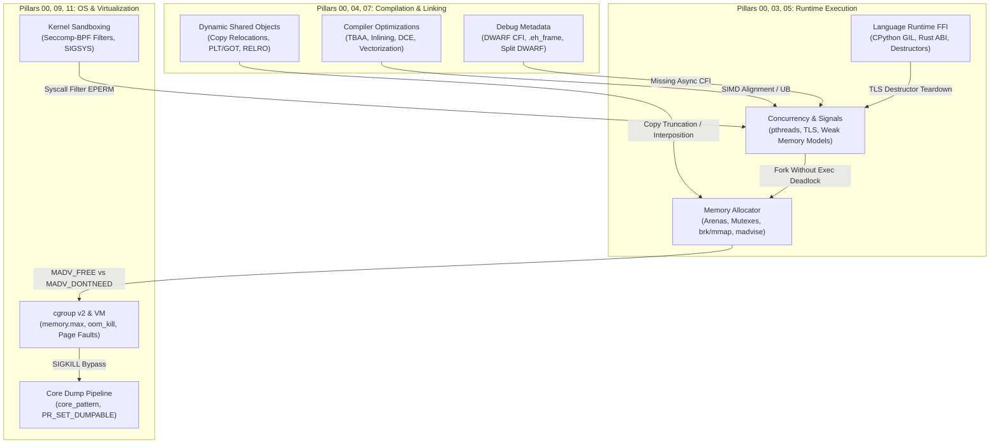

# Cross-Pillar Debugging Scenario Bank

> [!summary] Scope
> This scenario bank contains ten multi-system failure scenarios that cross process execution, dynamic linking, compiler optimization, concurrency, memory corruption, and container virtualization boundaries.
> Each scenario presents production symptoms, diagnostic command sequences, folded hint ladders, and complete root-cause analyses evaluated at L6, L7, and L8+ depth.
> It bridges debugging tools (GDB, LLDB, ptrace, sanitizers, core dumps) with runtime environments (Linux, macOS, container runtimes).

## Related

- Prerequisites: [[Debug-a-Production-Crash-From-a-Core-Dump]], [[Scientific-Debugging-Delta-Debugging-and-Heisenbugs]], [[Linux-perf-in-Depth-and-perf-c2c]]
- Next: [[Cross-Pillar-Design-Scenario-Bank]]
- See also: [[02-Programming-Languages/Python/Python-Backend-Interview-Prep/10-Testing-Debugging-Production|10 Testing Debugging Production]], [[14-Low-Latency-Systems/13 - Reliability, Ops & Testing/Observability Without Perturbation|Observability Without Perturbation]]
- Lab: `code/11-Arena-and-Capstones/cross_pillar_debug_scenarios/`

Production systems rarely fail within the clean boundaries of a single subsystem.
Catastrophic outages emerge at the seam lines where the compiler optimization pipeline meets runtime memory layout, where dynamic linkers resolve symbols across heterogeneous shared objects, where process virtualization controllers throttle physical resources, or where asynchronous kernel signals collide with user-space allocator locks.
Debugging at the distinguished level requires treating the operating system kernel, CPU hardware execution model, dynamic loader, compiler optimizer, and runtime memory allocator as a unified, interacting state machine.



---

## Scenario 1: Multi-DSO Symbol Interposition and Global Variable Copy Relocation Corruption

### Production Context and Boundary Crossing
This failure crosses Pillar 00 ([[Dynamic-Linking-PLT-GOT-and-Loaders]]), Pillar 04 (Build Systems), and Pillar 07 (Packaging and Release).
An enterprise trading engine binary links against two shared libraries: `libtelemetry.so` and `libmatching.so`.
Both libraries define a global configuration object named `engine_config`.
In `libtelemetry.so` (version 1.2), `engine_config` is declared as a 64-byte struct.
In `libmatching.so` (upgraded to version 2.0), `engine_config` was expanded to 128 bytes with additional risk threshold fields.
The main executable was built as a traditional position-dependent executable without `-fPIC` or with default visibility.

### Mechanism Root Cause
When the static linker creates a non-PIE executable referencing an external global variable defined in a shared library, it cannot generate PC-relative or GOT-indirect data accesses without rewriting machine instructions.
Instead, the linker allocates space for the symbol in the main executable's uninitialized data area (`.bss` / `.dynbss`), sized from the `st_size` of the shared-library definition it linked against (64 bytes, from v1.2); that size becomes the executable's `refsym->st_size`.
The same happens in a PIE on x86-64: GCC defaults to `-mdirect-extern-access`, and GCC 13.2 at `-O2 -fPIE` emits `mov eax, DWORD PTR engine_config[rip]` for an `extern int`, which the linker can only satisfy with a copy relocation (checked on Compiler Explorer, x86-64 GCC 13.2, as of 2026-11).
The linker emits a dynamic relocation of type `R_X86_64_COPY` (or `R_AARCH64_COPY` on ARM64) targeting that `.bss` address.
At runtime, the dynamic linker (`ld.so`) executes:

```c
// glibc sysdeps/x86_64/dl-machine.h
case R_X86_64_COPY:
  if (sym == NULL)
    break;
  memcpy (reloc_addr_arg, (void *) value,
          MIN (sym->st_size, refsym->st_size));
  if (__glibc_unlikely (sym->st_size > refsym->st_size)
      || (__glibc_unlikely (sym->st_size < refsym->st_size)
          && GLRO(dl_verbose)))
    {
      fmt = "\
%s: Symbol `%s' has different size in shared object, consider re-linking\n";
      goto print_err;
    }
```

The dynamic linker copies only 64 bytes into the executable's `.bss` buffer.
Because `sym->st_size` (128) exceeds `refsym->st_size` (64), `ld.so` also prints `Symbol `engine_config' has different size in shared object, consider re-linking` to stderr at startup, which is the cheapest early signal of this bug (glibc master `sysdeps/x86_64/dl-machine.h`, as of 2026-11).
Because ELF symbol interposition rules dictate that the main executable's definition preempts all DSO definitions, both `libtelemetry.so` and `libmatching.so` have their GOT entries redirected to the executable's `.bss` copy.
When `libmatching.so` initializes or modifies fields past byte offset 64, it writes directly into adjacent global variables in the main executable's `.bss` section.
This triggers silent memory corruption, intermittent arithmetic errors, or segmentation faults far removed from the actual write site.

### Reproduction
The reproduction harness is located at `code/11-Arena-and-Capstones/cross_pillar_debug_scenarios/`.
The lab prints a labelled walkthrough for this scenario; it does not trigger the failure, so it proves nothing about the mechanism, and the diagnosis above rests on the cited sources and the Compiler Explorer and Clang runs named in the text.
To print the walkthrough (the lab runs on Linux and macOS):

```bash
python3 code/11-Arena-and-Capstones/cross_pillar_debug_scenarios/runner.py
```

### Observed Symptom
The process crashes inside a critical risk check loop with an invalid memory access or executes with corrupted trading limits.
Inspecting the global variable in GDB reveals that bytes 0 through 63 match expected values, while bytes 64 through 127 overwrite an adjacent pointer `active_order_book`:

```text
(gdb) print &engine_config
$1 = (struct engine_config_t *) 0x404040 <engine_config>
(gdb) print sizeof(engine_config)
$2 = 64
(gdb) print &active_order_book
$3 = (struct order_book_t **) 0x404080 <active_order_book>
(gdb) print active_order_book
$4 = (struct order_book_t *) 0x0000000100000005  <-- Corrupted with risk threshold integers
```

### Progressive Hint Ladder

> [!tip]- Hint 1: Inspecting Dynamic Relocations in the Executable
> Run `readelf -rW main_app` or `objdump -R main_app` to inspect the relocation table `.rela.dyn`.
> Search for relocations of type `R_X86_64_COPY`.
> Notice which symbols reside in `.bss` and their assigned allocation sizes in `readelf -sW main_app`.

> [!tip]- Hint 2: Comparing Symbol Sizes Across Shared Libraries
> Inspect the symbol definitions in the upstream shared libraries using `readelf -sW libtelemetry.so | grep engine_config` and `readelf -sW libmatching.so | grep engine_config`.
> Compare the `Size` column in each output.
> If the size of `engine_config` in `libmatching.so` exceeds the size in `main_app`, copy relocation truncation has occurred.

> [!tip]- Hint 3: Analyzing Dynamic Linker Binding Logs
> Execute the binary with `LD_DEBUG=symbols,bindings ./main_app 2>&1 | grep engine_config`.
> Observe that `ld.so` resolves `engine_config` in `libmatching.so` to the address in `main_app`.
> Any write executed by `libmatching.so` past the truncated boundary will clobber neighboring symbols in the main binary's data segment.

### Model Solution

> [!success]- Solution
> Complete resolution requires addressing the ABI mismatch and eliminating copy relocations across the build toolchain.
>
> #### Level 6: Rebuilding the Executable Against Pinned Headers
> In the immediate term, recompile `main_app` against the `libmatching.so` v2.0 headers and relink it against the v2.0 library.
> The relink is the step that matters: the static linker sizes the copy from the shared library's `st_size`, so the executable's `refsym->st_size` becomes 128 bytes, reserving the full object in `.bss` and preventing adjacent memory corruption.
>
> #### Level 7: Enforcing Position-Independent Executables and Visibility Boundaries
> Long-term prevention requires eliminating copy relocations entirely:
> 1. Compile shared libraries with `-fPIC` and executables with `-fPIE` / `-pie`, but do not stop there: on x86-64, GCC's default `-mdirect-extern-access` still makes a PIE reference external data directly, so PIE alone keeps copy relocations.
> 2. Force Global Offset Table indirection for external data with `-mno-direct-extern-access` (GCC x86, verified to emit `engine_config@GOTPCREL[rip]` on GCC 13.2) or Clang's `-fno-direct-access-external-data` (accepted by Apple clang 21 targeting `x86_64-linux-gnu`; that Clang already emitted `x@GOTPCREL(%rip)` for an external `int` under plain `-fPIE`, and `-fdirect-access-external-data` switched it to the direct `x(%rip)` form, checked 2026-11), or build the executable's objects with `-fPIC`.
> 3. Enforce default hidden visibility (`-fvisibility=hidden`) in compiler configurations.
> 4. Export symbols explicitly using API macros (`__attribute__((visibility("default")))`).
> 5. Never export mutable global variables across shared object boundaries; expose accessor functions (`get_engine_config()`) instead.
>
> #### Level 8+: Linker-Enforced Copy Relocation Bans and Symbol Versioning
> Configure build systems with `-Wl,-z,nocopyreloc`.
> With `lld`, `-z nocopyreloc` disables copy relocations and turns a direct reference to shared-library data into a link-time error ("recompile with -fPIC or remove '-z nocopyreloc'", `lld/ELF/Relocations.cpp`).
> GNU `ld` behaves differently: it documents `nocopyreloc` as disabling the `.dynbss` copies and warns that this "may result in dynamic text relocations", so pair it with `-z text` (or check for `TEXTREL` in `readelf -d`) to make the ban fail loudly.
> Furthermore, bind all exported shared library data to versioned symbols using linker scripts (`VERSION { LIBMATCHING_2.0 { global: ...; }; }`), preventing outdated binaries from binding to modified data layouts.

### Core Takeaway
Copy relocations are an archaic ELF mechanism designed to support position-dependent executables referencing shared library data.
They break object encapsulation, cause silent buffer overflows during partial upgrades, and violate C++ One Definition Rule semantics.
Modern toolchains must ban copy relocations via GOT-indirect extern data access (`-fPIC` or `-mno-direct-extern-access`; `-fPIE` alone is not enough on x86-64 GCC), `-Wl,-z,nocopyreloc` with `-z text`, and hidden visibility, owned by [[Dynamic-Linking-PLT-GOT-and-Loaders]].

---

## Scenario 2: Container cgroup v2 Memory Pressure, OOM Killer, and Disappearing Core Dumps

### Production Context and Boundary Crossing
This failure crosses Pillar 00 ([[Virtual-Memory-Mmap-and-Process-Address-Space]]), Pillar 03 ([[Core-Dumps-Minidumps-and-Crash-Reporting]]), and Pillar 09 (Security and Sandboxing).
A high-throughput distributed cache service runs inside a Kubernetes container with a memory limit of 2 GiB (`resources.limits.memory: 2Gi`).
Under sudden traffic bursts, the process vanishes instantly.
Kubernetes records `lastState.terminated.exitCode: 137` and reason `OOMKilled`.
No application crash logs, stack traces, or core dump files appear in `/var/log` or the configured core dump directory.
Application operators assume the process suffered a segmentation fault that failed to dump core.

### Mechanism Root Cause
Exit code 137 is calculated by the shell and container runtime as `128 + signal_number`.
Signal 9 is `SIGKILL` (`128 + 9 = 137`).
Under Linux cgroups v2, memory limits are enforced hierarchically via the `memory.max` controller.
When the cgroup's charged memory (`memory.current`: anonymous memory, page cache, and kernel memory; swap is limited separately by `memory.swap.max`) is about to exceed `memory.max`, the kernel enters direct reclaim.
If reclaim cannot bring usage down, the cgroup goes to OOM state and the Out-Of-Memory (OOM) killer is invoked in the cgroup (cgroup-v2.rst, `memory.max` and `memory.events`).

The Linux kernel OOM killer selects a victim with `oom_badness()`, which scores resident memory (anon, file, and shmem RSS), swap entries, and page tables, adjusted by `oom_score_adj`.
Crucially, the OOM killer terminates the victim by sending an uncatchable, unignorable `SIGKILL` from kernel context (`do_send_sig_info(SIGKILL, ...)` in `__oom_kill_process`, `mm/oom_kill.c`); the separate `oom_reaper` kernel thread then tears down the victim's address space asynchronously so memory is freed even if the victim is stuck.
`SIGKILL` cannot be intercepted by user-space signal handlers (`sigaction`), cannot be caught by debuggers, and **never generates a core dump**.
The Linux kernel core dump generation path (`vfs_coredump` in `fs/coredump.c`, named `do_coredump` until a June 2025 rename) is only invoked from `get_signal()` for signals where `sig_kernel_coredump()` is true, that is, signals whose default action is Core (`SIGSEGV`, `SIGABRT`, `SIGBUS`, `SIGFPE`, `SIGILL`, `SIGQUIT`, `SIGSYS`, `SIGTRAP`, `SIGXCPU`, `SIGXFSZ`; signal(7)).
Because `SIGKILL` bypasses the core dump path entirely, `core_pattern`, `systemd-coredump`, and user-space crash reporters receive zero notifications.

### Reproduction
The reproduction harness is located at `code/11-Arena-and-Capstones/cross_pillar_debug_scenarios/`.
The lab runs a real check for this scenario: a child that sends itself `SIGKILL` is reaped with `waitpid` as signal 9 with the core-dump flag clear, and `sh` reports status 137 for it.
The check fails the lab if either observation changes; it does not exercise a cgroup or the kernel OOM killer, which need a Linux host with cgroup v2.
The recorded output in `expected/darwin-arm64.txt` was produced on macOS arm64 (Darwin); the integrator records the Linux file.
To run it (the lab runs on Linux and macOS):

```bash
python3 code/11-Arena-and-Capstones/cross_pillar_debug_scenarios/runner.py
```

### Observed Symptom
Application log output ends abruptly without stack traces.
Executing `dmesg -T` on the host node reveals:

```text
[Thu Nov 26 14:15:22 2026] Memory cgroup out of memory: Killed process 41820 (cache_worker) total-vm:2840112kB, anon-rss:2097152kB, file-rss:1400kB, shmem-rss:0kB, UID:1000 pgtables:5620kB oom_score_adj:998
[Thu Nov 26 14:15:22 2026] oom_reaper: reaped process 41820 (cache_worker), now anon-rss:0kB, file-rss:0kB, shmem-rss:0kB
```

Inspecting the cgroup v2 controller interface directly:

```bash
cat /sys/fs/cgroup/kubepods.slice/.../memory.events
```

Yields:

```text
low 0
high 0
max 42
oom 1
oom_kill 1
```

### Progressive Hint Ladder

> [!tip]- Hint 1: Decoupling Application Crashes from Kernel Kills
> Check the exit status reported by the orchestrator.
> Exit code 139 is `SIGSEGV` (128 + 11).
> Exit code 134 is `SIGABRT` (128 + 6).
> Exit code 137 is `SIGKILL` (128 + 9).
> A process exiting with 137 was killed from the outside or by the kernel; do not search for null pointer dereferences.

> [!tip]- Hint 2: Distinguishing Process OOM from cgroup OOM
> Inspect `/sys/fs/cgroup/.../memory.events`.
> Check the `oom`, `oom_kill`, and `max` counters.
> `oom_kill` alone does not prove a cgroup limit: the kernel documents it as the number of processes in the cgroup "killed by any kind of OOM killer", so a global host OOM also increments it.
> An incrementing `oom` counter (the cgroup reached its limit and an allocation was about to fail), together with a `Memory cgroup out of memory:` line rather than `Out of memory:` in `dmesg`, shows the cgroup limit was the trigger.

> [!tip]- Hint 3: Monitoring Allocator Page Reclamation Latency
> Check whether the process was killed due to dirty page cache retention or anonymous memory bloat.
> Read `/sys/fs/cgroup/.../memory.stat` to inspect `anon` versus `file_dirty` and `inactive_file`.
> If `anon` approaches `memory.max`, the application's heap allocator failed to return physical pages to the kernel before hitting the hard limit.

### Model Solution

> [!success]- Solution
> Complete diagnosis and mitigation require distinguishing cgroup limits from process heaps and configuring active telemetry.
>
> #### Level 6: Kernel Event Telemetry and Exit Code Triage
> Instruct on-call engineers to recognize exit code 137 immediately as an external `SIGKILL`.
> Configure Prometheus alerts on the cAdvisor (kubelet) metric `container_oom_events_total` and the node-exporter vmstat metric for the `oom_kill` field of `/proc/vmstat` (node_exporter's `collector/vmstat_linux.go` includes `oom_kill` in its default field filter and names each metric from the `vmstat` subsystem and the field name; cAdvisor's `docs/storage/prometheus.md` lists `container_oom_events_total` as "Count of out of memory events observed for the container").
> Validate that the kernel's `dmesg` buffer is captured into central logging so that `oom_reaper` lines are correlated with container restarts.
>
> #### Level 7: Application Memory Bounds and Pre-OOM Headroom
> The application must be made cgroup-aware:
> 1. Configure the runtime memory allocator (e.g., `jemalloc` or `tcmalloc`) with active purging thresholds (`MALLOC_CONF="dirty_decay_ms:1000,muzzy_decay_ms:2000"`).
> 2. Ensure the application queries `/sys/fs/cgroup/memory.max` on startup rather than reading host physical memory via `sysconf(_SC_PHYS_PAGES)`.
> 3. Implement high-watermark throttling: when resident set size reaches 85% of `memory.max`, reject incoming requests with HTTP 429 / backpressure, shed caches, and invoke allocator trimming (`malloc_trim(0)`).
>
> #### Level 8+: Early OOM Prevention via eBPF and User-Space Memory Pressure Notifications
> Deploy a user-space memory supervisor leveraging Linux cgroup v2 Pressure Stall Information (PSI).
> Write the trigger `some 50000 1000000` (50 ms stall within a 1 s window; both fields are in microseconds) into `/sys/fs/cgroup/.../memory.pressure` and wait for `POLLPRI` with `poll()` or `EPOLLPRI` with `epoll` (Documentation/accounting/psi.rst).
> When memory pressure spikes, the supervisor triggers an orderly graceful shutdown, dumps diagnostic memory profile snapshots (heap profiling via `jeprof`), and redirects traffic before the kernel OOM killer fires.

### Core Takeaway
`SIGKILL` from the cgroup v2 OOM killer operates outside user-space signal handling and completely bypasses the kernel core dump generation engine.
Relying on core dumps to triage exit code 137 is fundamentally flawed; engineering teams must monitor cgroup PSI metrics and kernel `memory.events`, owned by [[Core-Dumps-Minidumps-and-Crash-Reporting]] and [[Virtual-Memory-Mmap-and-Process-Address-Space]].

---

## Scenario 3: Fork Without Exec in Multi-Threaded Process and Allocator Mutex Futex Deadlocks

### Production Context and Boundary Crossing
This failure crosses Pillar 00 ([[Processes-Fork-Exec-and-File-Descriptors]]), Pillar 03 ([[Debugging-Without-a-Debugger-and-Concurrency-Bugs]]), and Pillar 06 (Memory Allocators).
A Python data processing service with native C++ extensions operates an asynchronous worker pool.
The process spawns background threads for OpenTelemetry metrics export, heartbeating, and log flushing.
To execute untrusted user code tasks, the service calls `os.fork()` without calling `execve()`, attempting to run task logic inside the forked child process to leverage Copy-on-Write memory sharing.
Intermittently, child processes freeze completely, consuming 0% CPU and hanging forever until killed.

### Mechanism Root Cause
Under POSIX standards (POSIX.1-2008 and POSIX.1-2017) and Linux kernel mechanics, when a multi-threaded process calls `fork()`, **only the thread executing the fork system call is duplicated in the child process**.
The peer threads keep running in the parent; they simply have no counterpart in the child, so nothing in the child will ever run their cleanups, release their locks, or unwind their stacks (fork(2)).

The glibc memory allocator (derived from ptmalloc2) is not the usual culprit.
Its arenas are protected by internal `__libc_lock_t` low-level locks (`mstate->mutex`), and glibc's own `fork()` takes every arena lock before the system call (`__malloc_fork_lock_parent`) and reinitializes all of them in the child (`__malloc_fork_unlock_child`), so `malloc` keeps working in practice after a glibc `fork()` (`posix/fork.c`, `malloc/arena.c`, glibc master as of 2026-11).
The orphaned lock is one glibc knows nothing about: a `pthread_mutex_t` or `std::mutex` inside the native extension (here, the OpenTelemetry exporter's queue lock), or an internal lock in OpenSSL, gRPC, or a logging library that registers no `pthread_atfork` handler.
If Thread B in the parent process holds such a mutex at the instant Thread A invokes `fork()`, the child receives a copy of the mutex in the `LOCKED` state (with `__data.__owner` equal to Thread B's TID).
However, Thread B does not exist in the child.
When the child process next touches that subsystem (here, the first metric or span the task records), it attempts to acquire the mutex.
It executes `futex(..., FUTEX_WAIT_PRIVATE, ...)` and sleeps indefinitely, waiting for a non-existent thread to unlock the mutex.

### Reproduction
The reproduction harness is located at `code/11-Arena-and-Capstones/cross_pillar_debug_scenarios/`.
The lab runs a real check for this scenario: a thread holds a Python `threading.Lock`, the process calls `os.fork()`, and the child's `lock.acquire(timeout=0.5)` times out because no thread in the child can release it.
This shows the inherited-lock hazard for a lock the runtime does not reset; glibc's own malloc locks are reset by `fork()`, so the lab does not reproduce a malloc deadlock.
The recorded output in `expected/darwin-arm64.txt` was produced on macOS arm64 (Darwin).
To run it (the lab runs on Linux and macOS):

```bash
python3 code/11-Arena-and-Capstones/cross_pillar_debug_scenarios/runner.py
```

### Observed Symptom
Attaching to the hung child process with GDB or LLDB:

```bash
gdb -p <CHILD_PID>
```

Executing `thread apply all bt` reveals a single thread stuck in a kernel futex wait inside the extension's queue lock (illustrative trace; addresses and line numbers are not from a real run):

```text
#0  __futex_abstimed_wait_common64 (futex_word=0x7ffff6a1c0e0 <g_export_queue_mutex>, expected=2, ...) at futex-internal.c:57
#1  __lll_lock_wait (futex=0x7ffff6a1c0e0 <g_export_queue_mutex>, private=0) at lowlevellock.c:49
#2  0x00007ffff7e7e234 in ___pthread_mutex_lock (mutex=0x7ffff6a1c0e0 <g_export_queue_mutex>) at pthread_mutex_lock.c:80
#3  0x00007ffff6a03b18 in ExportQueue::push (this=0x7ffff6a1c0c0, ...) at export_queue.cpp:41
#4  0x00007ffff6a01f40 in record_metric (...) at native_ext.cpp:212
#5  0x00007ffff7b40120 in cfunction_call (...) at Objects/methodobject.c
```

### Progressive Hint Ladder

> [!tip]- Hint 1: Inspecting Thread Counts in the Frozen Child
> Check `/proc/<CHILD_PID>/status`.
> Look at the `Threads:` entry.
> Notice that `Threads: 1`, whereas the parent process reports `Threads: 8`.
> Only the calling thread survived the fork.

> [!tip]- Hint 2: Examining the Mutex Owner in Memory
> In GDB, inspect the lock structure at `0x7ffff6a1c0e0`.
> In glibc, `pthread_mutex_t` encodes the owner's TID in its `__data.__owner` field (glibc's internal `__libc_lock_t` locks, such as the malloc arena locks, are bare integers with no owner field).
> Print `((pthread_mutex_t*)0x7ffff6a1c0e0)->__data.__owner`.
> Observe that the owner TID matches a thread from the parent process that does not exist in the child.

> [!tip]- Hint 3: Analyzing Async-Signal Safety Invariants
> Review the POSIX specification for `fork(2)`.
> Following a `fork()` in a multi-threaded process, the child may only safely call async-signal-safe functions until it calls `execve()`.
> `malloc()`, `free()`, `dlopen()`, and standard I/O functions are strictly **not** async-signal-safe; glibc's fork handlers make `malloc` work in practice, but that is a glibc extension, not a POSIX guarantee, and it covers no other library's locks.

### Model Solution

> [!success]- Solution
> Complete remediation requires replacing fork-without-exec architectures with spawn or multiprocessing contexts.
>
> #### Level 6: Migrating to `forkserver` or `spawn` Start Methods
> In Python environments, immediately eliminate `multiprocessing.set_start_method("fork")`.
> Replace it with `"spawn"` or `"forkserver"`:
>
> ```python
> import multiprocessing as mp
> mp.set_start_method("spawn", force=True)
> ```
>
> Under `spawn`, a fresh Python interpreter process is started via `execve()`, initializing a clean runtime, empty lock tables, and a single primary thread without inheriting parent thread states.
> CPython itself has moved this way: since 3.12, `os.fork()` raises a `DeprecationWarning` when it detects multiple threads, and since 3.14 the default `multiprocessing` start method on POSIX is `forkserver` rather than `fork` (Python `multiprocessing` docs, as of 2026-11).
>
> #### Level 7: Proper `pthread_atfork` Handlers and Worker Daemon Architecture
> If a native C/C++ service must fork:
> 1. Register fork handlers using `pthread_atfork(prepare, parent, child)`:
>    - `prepare`: Acquire all subsystem mutexes (allocators, logging queues, configuration locks) before `fork()`.
>    - `parent`: Release all mutexes in the parent process.
>    - `child`: Reset and release all mutexes in the child process.
> 2. Recognize that `pthread_atfork` is notoriously fragile in complex codebases because third-party libraries and dynamic modules rarely register comprehensive handlers, and lock acquisition order inversions can cause `fork()` itself to deadlock in the parent.
> 3. Architect workers as dedicated standalone daemons that communicate over Unix Domain Sockets (`AF_UNIX`) instead of forking from multi-threaded coordinator parents.
>
> #### Level 8+: Enterprise Runtime Sandboxing and `clone3` Namespace Isolation
> At principal scale, eliminate process duplication entirely in favor of lightweight container sandboxes.
> Use `clone3()` with flags `CLONE_NEWPID | CLONE_NEWNET | CLONE_NEWNS` followed immediately by `execveat()` into a hermetic worker binary; these flags need `CAP_SYS_ADMIN` unless `CLONE_NEWUSER` is added (clone(2)).
> Combine with `landlock` or `seccomp-bpf` to constrain worker capabilities without ever permitting an inherited multi-threaded address space to execute user workloads.

### Core Takeaway
Calling `fork()` without `execve()` in a multi-threaded application is an architectural anti-pattern that creates orphaned locks and latent, timing-dependent deadlocks.
Multi-threaded runtimes must use `execve()`, `spawn`, or isolated daemon processes, owned by [[Processes-Fork-Exec-and-File-Descriptors]] and [[Debugging-Without-a-Debugger-and-Concurrency-Bugs]].

---

## Scenario 4: Undefined Behavior Strict-Aliasing Vectorization Eliminating Defensive Bounds and Null Checks

### Production Context and Boundary Crossing
This failure crosses Pillar 00 ([[Compiler-Pipeline-and-Debuggability]]), Pillar 00 ([[Reading-Assembly-and-Optimization-Remarks]]), and Pillar 06 ([[Cpp-UndefinedBehaviorSanitizer-and-UB-Field-Guide]]).
A high-frequency network parsing library deserializes binary order packets.
In debug builds (`-O0 -g`), the parser runs flawlessly through millions of test vectors.
When compiled with production release flags (`-O3 -mavx2` or `-march=native`), the binary crashes intermittently with `SIGSEGV` or `SIGBUS`.
More alarmingly, the defensive null check that code review relied on is absent from the release binary, so a null buffer that reaches the parser in production crashes instead of returning an error code (with the dereference placed before the check, as below, it crashes at `-O0` too; the optimizer merely makes the dead check invisible in the source-to-binary mapping).

### Mechanism Root Cause
The parser implementation contains a subtle violation of the C/C++ Strict Aliasing Rule (C99 Section 6.5, paragraph 7; ISO C++ `[basic.lval]`):

```c
int parse_header(uint8_t *raw_buf, size_t len) {
    uint32_t magic = *(uint32_t *)raw_buf; // Strict aliasing violation & unaligned dereference
    if (raw_buf == NULL || len < 4) {      // Defensive check placed after or near dereference
        return -1;
    }
    return (magic == 0x504B0304) ? 0 : 1;
}
```

Under `-O3`, GCC and LLVM execute aggressive optimization pipelines:
1. **Type-Based Alias Analysis (TBAA):** The compiler assumes that lvalues of incompatible types cannot refer to the same object; this licenses reordering the `uint32_t` load against other stores, but it plays no part in deleting the null check (`-fno-strict-aliasing` leaves the check deleted on GCC 13.2).
2. **Undefined Behavior Reasoning:** Under standard specifications, dereferencing a null pointer is undefined behavior (UB).
Compilers assume undefined behavior cannot occur in valid code.
3. **Null-Check Elimination:** Because `raw_buf` was dereferenced in `*(uint32_t *)raw_buf`, the compiler deduces that `raw_buf` is guaranteed to be non-null.
The defensive branch `if (raw_buf == NULL)` is proven redundant and is completely removed from the emitted binary.
In GCC this deduction is controlled by `-fdelete-null-pointer-checks`; GCC 13.2 at `-O3 -mavx2` drops the check, and adding `-fno-delete-null-pointer-checks` restores `test rdi, rdi` (both checked on Compiler Explorer, as of 2026-11).
4. **Auto-Vectorization and Alignment:** This function has nothing to vectorize: GCC 13.2 and Clang 21 at `-O3 -mavx2` emit one scalar `cmp DWORD PTR [rdi], 0x504B0304` (checked), and an unaligned scalar load does not fault on x86-64.
The alignment trap belongs to loops over the same misaligned pointer: the vectorizer may assume a `uint32_t*` is 4-byte aligned and emit aligned SSE loads (`movdqa`, `movaps`) after peeling iterations to reach a 16-byte boundary, a boundary that a pointer misaligned by 1 to 3 bytes never reaches (TrustInSoft, "GCC always assumes aligned pointer accesses", 2020).
VEX-encoded AVX memory operands such as `vpaddd ymm1, ymm1, [rax]` do not require alignment; only explicit aligned moves (`vmovaps`, `vmovdqa`, `movdqa`) do.
An aligned move on a misaligned address raises a General Protection Fault (`#GP`), which the Linux kernel delivers as `SIGSEGV` with `si_code = SI_KERNEL` and `si_addr = 0`, not as a page fault.

### Reproduction
The reproduction harness is located at `code/11-Arena-and-Capstones/cross_pillar_debug_scenarios/`.
The lab prints a labelled walkthrough for this scenario; it does not trigger the failure, so it proves nothing about the mechanism, and the diagnosis above rests on the cited sources and the Compiler Explorer and Clang runs named in the text.
To print the walkthrough (the lab runs on Linux and macOS):

```bash
python3 code/11-Arena-and-Capstones/cross_pillar_debug_scenarios/runner.py
```

### Observed Symptom
Disassembling the optimized function (real GCC 13.2 `-O3 -mavx2` output for the code above, Intel syntax, from Compiler Explorer):

```asm
parse_header:
        mov     eax, -1
        cmp     rsi, 3
        jbe     .L1
        xor     eax, eax
        cmp     DWORD PTR [rdi], 1347093252
        setne   al
.L1:
        ret
; No 'test rdi, rdi': the null check has been eliminated, and the load was sunk below the len check.
```

When called with a null buffer and `len >= 4` (illustrative GDB session; addresses are not from a real run):

```text
Program received signal SIGSEGV, Segmentation fault.
0x000055555555514d in parse_header (raw_buf=0x0, len=64) at parser.c:2
2           uint32_t magic = *(uint32_t *)raw_buf;
(gdb) x/i $rip
=> 0x55555555514d <parse_header+13>:  cmp    DWORD PTR [rdi],0x504b0304
```

Notice that `rdi` is `0x0`: the branch that should have returned `-1` no longer exists, so the null pointer reaches the load.

### Progressive Hint Ladder

> [!tip]- Hint 1: Comparing Disassembly Between Optimization Levels
> Compile the source with `-O0` and compare the assembly output against `-O3`.
> Search for where the comparison against zero (`test rdi, rdi`) went.
> If the comparison exists in `-O0` but is absent in `-O3`, the optimizer performed dead code elimination based on UB reachability.

> [!tip]- Hint 2: Auditing Alignment Faults vs Page Faults
> Inspect `si_code` and `si_addr` in `siginfo_t` from the core dump.
> A page fault reports `si_code = SEGV_MAPERR` or `SEGV_ACCERR` with the faulting address in `si_addr` (0x0 for this null case).
> A `#GP` from an aligned vector move reports `si_code = SI_KERNEL` with `si_addr = 0` even though the operand address is mapped.
> Check the faulting instruction opcode: `vmovaps` requires aligned memory, whereas `vmovups` permits unaligned memory.

> [!tip]- Hint 3: Running Under Sanitizers
> Compile the code under Clang or GCC using UndefinedBehaviorSanitizer:
> `-fsanitize=undefined,alignment -fno-sanitize-recover=all`.
> Run the reproduction test.
> UBSan flags the null and misaligned pointer reads (`-fsanitize=null`, `-fsanitize=alignment`, both in `undefined`) at runtime with exact source line numbers.
> UBSan has no strict-aliasing check; Clang's separate TypeSanitizer (`-fsanitize=type`, documented at clang.llvm.org/docs/TypeSanitizer.html) is the tool built to catch strict-aliasing violations.

### Model Solution

> [!success]- Solution
> Complete resolution requires rewriting memory access idioms to conform to C/C++ memory models and configuring defensive compiler gates.
>
> #### Level 6: Using `memcpy` or Safe Byte Decoding
> In C and C++, the standard-compliant, zero-cost idiom for parsing unaligned integers without violating strict aliasing is `memcpy`:
>
> ```c
> int parse_header(const uint8_t *raw_buf, size_t len) {
>     if (raw_buf == NULL || len < 4) {
>         return -1;
>     }
>     uint32_t magic;
>     memcpy(&magic, raw_buf, sizeof(magic)); // Compiler optimizes to a single unaligned load
>     return (magic == 0x504B0304) ? 0 : 1;
> }
> ```
>
> Modern optimizing compilers (GCC, Clang) treat `memcpy` of small, fixed sizes as an intrinsic, emitting a single unaligned machine instruction (`mov` or `vmovups`) with zero function call overhead while preserving strict-aliasing invariants.
>
> #### Level 7: Static Compiler Gating and Sanitizer CI Gates
> Enforce strict compiler warnings and sanitize builds across continuous integration:
> 1. Pass `-Wall -Wextra -Wstrict-aliasing=2` to ensure alias violations generate build-time warnings.
> 2. Pass `-fno-strict-aliasing` as an emergency tactical flag if legacy codebases cannot be audited immediately, and `-fno-delete-null-pointer-checks` if dereference-before-check patterns must keep their checks; the aliasing flag alone does not restore deleted null checks.
> 3. Gate all pull requests with AddressSanitizer and UndefinedBehaviorSanitizer builds (`-fsanitize=address,undefined`).
>
> #### Level 8+: Formal Memory Modeling and Compiler Optimization Remark Verification
> In low-latency trading or kernel-bypass systems, verify optimization transforms via compiler remarks:
> Enable `-Rpass=loop-vectorize -Rpass-missed=loop-vectorize -Rpass=inline` (Clang) or `-fopt-info-vec-all` (GCC).
> In Rust, leverage type-safe zero-copy deserialization crates (`bytemuck`, `zerocopy`) that enforce compile-time alignment and data validity constraints through marker traits (`FromBytes`, `Immutable`).

### Core Takeaway
Compilers assume undefined behavior is impossible and will silently purge defensive bounds checks and null validations during optimization passes.
Systems engineers must use `memcpy` or `std::bit_cast` for type punning and validate code under UBSan, owned by [[Compiler-Pipeline-and-Debuggability]] and [[Cpp-UndefinedBehaviorSanitizer-and-UB-Field-Guide]].

---

## Scenario 5: Cross-Language FFI Destruction Ordering, Thread-Local Storage, and GIL Re-Entry

### Production Context and Boundary Crossing
This failure crosses Pillar 00 ([[Thread-Local-Storage-Models-and-ELF-Relocations]]), Pillar 03 ([[Rust-FFI-Boundary-Debugging-Across-Cpp-and-Python]]), and Pillar 00 ([[Cpp-Itanium-ABI-Object-Model-Vtables-and-RTTI]]).
A production Python microservice embeds a high-performance Rust or C++ extension module compiled as a CPython C-extension (`.so`).
The extension module utilizes thread-local storage (`thread_local` in C++11, `thread_local!` in Rust) to maintain per-thread scratch buffers and telemetry handles.
When processing tasks complete and worker threads exit (or when the process initiates shutdown via `sys.exit()`), the application crashes violently with `Fatal Python error: ...: the function must be called with the GIL held, ... (the current Python thread state is NULL)` or `SIGSEGV` inside `_dl_fini` / `pthread_exit`.

### Mechanism Root Cause
This crash is caused by an inversion between POSIX thread-local storage destruction order, glibc's dynamic loader teardown, and CPython's Global Interpreter Lock (GIL) runtime lifecycle.

In C++11, non-trivial thread-local objects register their destructors with the C runtime using `__cxa_thread_atexit_impl(dtor, obj, dso_symbol)` (introduced in glibc 2.18, per glibc `NEWS`).
When a thread terminates, glibc executes `__call_tls_dtors()`, walking the thread's `tls_dtor_list` and invoking destructors in reverse order of initialization.
Concurrently, the CPython interpreter manages its own per-thread cleanup via `PyThreadState_Clear()` and `PyThreadState_DeleteCurrent()`.

The catastrophic failure mode unfolds in four steps:
1. The worker thread finishes its Python function and begins thread exit.
2. CPython's thread wrapper tears down the `PyThreadState`, releasing the GIL and destroying the thread's association with the active interpreter.
3. The underlying OS thread proceeds to terminate, triggering glibc's `__call_tls_dtors()`.
4. The C++ or Rust thread-local destructor executes.
Inside this destructor, code attempts to log an event, release a Python callback reference (`Py_DECREF`), or access Python runtime state.
Because the `PyThreadState` has already been destroyed, the destructor runs with no current thread state and without the GIL.
`Py_DECREF` itself does not check the thread state, so a decrement without the GIL is a silent data race on the reference count; the crash comes when the deallocation path or any C-API call that requires a thread state runs, and CPython aborts with `Fatal Python error: ...: the function must be called with the GIL held, ... (the current Python thread state is NULL)` (`_Py_EnsureFuncTstateNotNULL`, `Include/internal/pycore_pystate.h`, CPython main as of 2026-11).
`PyGILState_Ensure()` does not dereference a null pointer: on a live interpreter it creates a fresh thread state for the thread.
The behavior of GIL acquisition during interpreter finalization differs across CPython versions and is out of scope here.
A `dlclose()` race is not the usual cause on glibc: `__cxa_thread_atexit_impl` increments the owning DSO's `l_tls_dtor_count`, and `_dl_close_worker` refuses to unload a DSO whose count is nonzero (`stdlib/cxa_thread_atexit_impl.c`, glibc master).

### Reproduction
The reproduction harness is located at `code/11-Arena-and-Capstones/cross_pillar_debug_scenarios/`.
The lab prints a labelled walkthrough for this scenario; it does not trigger the failure, so it proves nothing about the mechanism, and the diagnosis above rests on the cited sources and the Compiler Explorer and Clang runs named in the text.
To print the walkthrough (the lab runs on Linux and macOS):

```bash
python3 code/11-Arena-and-Capstones/cross_pillar_debug_scenarios/runner.py
```

### Observed Symptom
A core dump or terminal stderr output from the crashing Python process (illustrative: the message text follows CPython 3.12+ source, but the function name, addresses, and line numbers are not from a real run):

```text
Fatal Python error: PyThreadState_Get: the function must be called with the GIL held, after Python initialization and before Python finalization, but the GIL is released (the current Python thread state is NULL)
Python runtime state: initialized

Current thread 0x00007ffff7980700 (most recent call first):
<no Python frame>

Thread 1 (Thread 0x7ffff7980700 (LWP 41902)):
#0  __pthread_kill_implementation (threadid=140737347340032, signo=6, ...) at pthread_kill.c:44
#1  0x00007ffff7e428e2 in __GI_raise (sig=sig@entry=6) at ../sysdeps/posix/raise.c:26
#2  0x00007ffff7e28400 in __GI_abort () at abort.c:79
#3  0x00007ffff7a12150 in fatal_error () at Python/pylifecycle.c:2840
#4  0x00007ffff79fa230 in _Py_FatalErrorFunc () at Python/pylifecycle.c:2890
#5  0x00007ffff79fb420 in PyThreadState_Get () at Python/pystate.c
#6  0x00007ffff6401280 in TelemetryBuffer::~TelemetryBuffer (this=0x7ffff7980820) at telemetry.cpp:45
#7  0x00007ffff7e34120 in __call_tls_dtors () at cxa_thread_atexit_impl.c:88
#8  0x00007ffff7e7d9b0 in start_thread (arg=0x7ffff7980700) at pthread_create.c:487
#9  0x00007ffff7f05210 in clone3 () at ../sysdeps/unix/sysv/linux/x86_64/clone3.S:81
```

### Progressive Hint Ladder

> [!tip]- Hint 1: Examining the Call Stack Below `__call_tls_dtors`
> Notice frame #7: `__call_tls_dtors`.
> The crash occurred after the thread's main user function returned.
> The code is executing implicit destructor cleanup driven by the C runtime library.

> [!tip]- Hint 2: Checking the Python Thread State
> Frames #3 to #5 show CPython's fatal-error path reporting that the current thread state is NULL.
> In GDB, execute `p _Py_tss_tstate` (the C thread-local holding the current thread state in CPython 3.12+; older releases keep it elsewhere, so look up the field in that release's `pycore_pystate.h`).
> The current thread state pointer is null.
> Any call into Python C-API functions requiring an active thread state will abort or segfault.

> [!tip]- Hint 3: Tracing Object Lifetime Across FFI Boundaries
> Inspect the fields of `TelemetryBuffer`.
> Identify any `PyObject*` or FFI callback handles held inside thread-local variables.
> If a thread-local object holds a Python reference, its destruction order must be explicitly synchronized with the Python runtime before thread termination.

### Model Solution

> [!success]- Solution
> Complete resolution requires isolating FFI lifetimes and decoupling thread-local storage from foreign language runtimes.
>
> #### Level 6: Removing Python References from Thread-Local Storage
> Never store raw `PyObject*` pointers inside C++ `thread_local` or Rust `thread_local!` containers.
> Instead, store pure native data structures (e.g., raw byte arrays, ring buffers of primitive integers).
> Transfer ownership of telemetry data back to the Python thread context before the Python worker thread exits.
>
> #### Level 7: Explicit Lifecycle Hooks and pthread TLS Keys
> Replace language-level `thread_local` with explicit POSIX thread keys (`pthread_key_create`) with custom destructors, or manage lifecycles using Python context managers:
> 1. In the extension module, register a thread cleanup function invoked explicitly at the end of the Python worker function:
>
> ```python
> try:
>     run_worker_task()
> finally:
>     native_extension.cleanup_thread_context()
> ```
>
> 2. Inside `cleanup_thread_context()`, while the GIL is still held and `PyThreadState` is fully valid, flush all thread-local state and decrement Python references.
>
> #### Level 8+: Sub-Interpreter Isolation and Shared Library Nodelete Flags
> For complex polyglot environments (e.g., PyO3 with embedded runtimes):
> 1. Build the shared extension library with `-Wl,-z,nodelete`.
> This sets `DF_1_NODELETE` in the DSO's dynamic section, so the dynamic loader never unmaps the library on `dlclose()`; glibc already defers unloading while TLS destructors are pending (`l_tls_dtor_count`), so the flag mainly protects other dangling callbacks (atexit handlers, registered function pointers) that point into the library.
> 2. Audit Python 3.12+ sub-interpreter isolation rules (PEP 684), guaranteeing that TLS destructors do not attempt cross-interpreter reference mutations.

### Core Takeaway
Language-level thread-local destructors execute during low-level OS thread teardown after foreign language runtimes have destroyed their thread state.
FFI layers must never invoke foreign runtime APIs from TLS destructors, owned by [[Rust-FFI-Boundary-Debugging-Across-Cpp-and-Python]] and [[Thread-Local-Storage-Models-and-ELF-Relocations]].

---

## Scenario 6: Asynchronous Signal Unwinding Failure and Missing Asynchronous Unwind Tables

### Production Context and Boundary Crossing
This failure crosses Pillar 00 ([[Stack-Unwinding-CFI-and-Exception-ABI]]), Pillar 05 ([[Linux-perf-in-Depth-and-perf-c2c]]), and Pillar 03 ([[How-Debuggers-Work-ptrace-Mach-and-Breakpoints]]).
An engineering team deploys an in-process sampling profiler or crash-reporting agent across a fleet of optimized C++ trading engines.
The profiler works by configuring a timer signal (`SIGPROF` or `perf_event_open` with signal delivery) to interrupt threads at 100 Hz and capture backtraces using `libunwind` or `backtrace()`.
Under production load, the application begins crashing intermittently inside the profiler signal handler itself, or generates truncated flame graphs where 40% of stacks terminate prematurely with `0xADDR ???` in the middle of worker functions.

### Mechanism Root Cause
Standard C and C++ compilation flags on many architectures omit full asynchronous Call Frame Information (CFI) to reduce binary size:
- On x86-64 Linux, GCC enables `-fasynchronous-unwind-tables` by default, so the failure appears when a build passes `-fno-asynchronous-unwind-tables`: for C code without `-funwind-tables` or `-fexceptions`, GCC 13.2 then moves the CFI into `.debug_frame` (`.cfi_sections .debug_frame`), so there is no `.eh_frame` entry at all once the binary is stripped (checked on Compiler Explorer, as of 2026-11).
- Synchronous unwind tables (`-funwind-tables` or `-fexceptions` with `-fno-asynchronous-unwind-tables`) only **guarantee** accurate CFI at **call sites** (instructions that can throw C++ exceptions or call other functions); in a small GCC 13.2 test the emitted prologue and epilogue CFI was identical to the asynchronous build, so the imprecision is permitted rather than guaranteed, and hand-written assembly or JIT code without `.cfi_*` directives is the most common source of truly missing rules.
- When a thread is interrupted by an asynchronous hardware interrupt or kernel signal (`SIGPROF`, `SIGSEGV`, `SIGBUS`), the CPU instruction pointer (`rip` / `pc`) can be interrupted at **any arbitrary machine instruction**, including function prologues and epilogues.

Consider a standard x86-64 function prologue:

```asm
worker_function:
    sub    rsp, 0x40           ; Instruction 1: Stack pointer decremented by 64 bytes
    mov    QWORD PTR [rsp+0x38], rbx ; Instruction 2: Callee-saved register spilled
    ...
```

Between Instruction 1 and Instruction 2, `rsp` has moved by 64 bytes; a table that is precise only at call sites (or hand-written code with no `.cfi_def_cfa_offset` after the `sub`) has not yet updated the Canonical Frame Address (CFA) definition.
If `SIGPROF` arrives between Instruction 1 and Instruction 2:
1. The kernel pushes a signal frame onto the stack (`struct ucontext_t` and `siginfo_t`).
2. The profiler signal handler executes and calls `unw_step()`.
3. The unwinder reads the CFI for `worker_function`.
Because the table is only synchronous, the CFA rule states `CFA = rsp + 8`.
4. However, `rsp` was already decremented by 64!
The true CFA is `rsp + 72`, so the unwinder calculates a CFA 64 bytes lower than reality, reads garbage memory as the saved return address, and either halts unwinding or dereferences an unmapped address, triggering a nested `SIGSEGV` inside the signal handler.

### Reproduction
The reproduction harness is located at `code/11-Arena-and-Capstones/cross_pillar_debug_scenarios/`.
The lab prints a labelled walkthrough for this scenario; it does not trigger the failure, so it proves nothing about the mechanism, and the diagnosis above rests on the cited sources and the Compiler Explorer and Clang runs named in the text.
To print the walkthrough (the lab runs on Linux and macOS):

```bash
python3 code/11-Arena-and-Capstones/cross_pillar_debug_scenarios/runner.py
```

### Observed Symptom
The profiler fails with a corrupted stack trace or crashes recursively:

```text
Program received signal SIGSEGV, Segmentation fault.
0x00007ffff7f48120 in access_mem (as=0x7ffff7fc2040, addr=0x7fffc000, valp=0x7ffff7980120, ...) at x86_64/Ginit.c:180
#0  0x00007ffff7f48120 in access_mem (...) at x86_64/Ginit.c:180
#1  0x00007ffff7f49510 in unw_step (...) at x86_64/Gstep.c:112
#2  0x0000555555555410 in sigprof_handler (signo=27, info=0x7ffff7980400, ucontext=0x7ffff79802c0) at profiler.cpp:32
#3  <signal handler called>
#4  0x0000555555555204 in heavy_math_worker () at math.c:12
#5  0x0000555555555310 in main () at main.cpp:80
```

Notice that `unw_step` crashed while trying to read `addr=0x7fffc000`, which was calculated from a corrupted CFA.

### Progressive Hint Ladder

> [!tip]- Hint 1: Inspecting the Assembly Around the Interrupted Instruction
> In GDB, examine `ucontext` passed to the signal handler:
> `p ((ucontext_t*)$rdx)->uc_mcontext.gregs[REG_RIP]` (at handler entry the `SA_SIGINFO` handler's third argument, the ucontext, is in `rdx`; `rsi` holds the `siginfo_t *`).
> Disassemble the 10 instructions surrounding that instruction pointer.
> Is the interrupted instruction inside a function prologue (`sub rsp`, `push rbp`) or epilogue (`pop`, `ret`)?

> [!tip]- Hint 2: Dumping CFI Directives with `readelf`
> FDEs are keyed by address range, not by name, so first take the function's address from `nm binary | grep heavy_math_worker`, then run `readelf --debug-dump=frames-interp binary` (or `llvm-dwarfdump --eh-frame binary`) and find the FDE whose `pc=` range covers it.
> Also check `readelf -S binary` for whether `.eh_frame` or only `.debug_frame` carries the CFI.
> Check the instruction address advances (`DW_CFA_advance_loc`).
> Does the FDE contain CFI bytecode for every single machine instruction in the prologue, or does it only advance at the end of the prologue?

> [!tip]- Hint 3: Evaluating Compilation Flags
> Check build logs for `-fno-asynchronous-unwind-tables` or `-fomit-frame-pointer`.
> On x86-64, GCC defaults to `-fasynchronous-unwind-tables`, but some build systems pass `-fno-asynchronous-unwind-tables` to drop the unwind tables.
> In C code or when using custom assembly routines, CFI directives are frequently omitted entirely.

### Model Solution

> [!success]- Solution
> Complete resolution requires guaranteeing instruction-boundary DWARF CFI coverage or transitioning to kernel-level eBPF frame walking.
>
> #### Level 6: Forcing Asynchronous Unwind Tables in Build Flags
> Recompile the entire application and all static dependencies with `-fasynchronous-unwind-tables`:
>
> ```bash
> CFLAGS="-O3 -fasynchronous-unwind-tables -fno-omit-frame-pointer"
> CXXFLAGS="-O3 -fasynchronous-unwind-tables -fno-omit-frame-pointer"
> ```
>
> `-fasynchronous-unwind-tables` instructs the compiler to emit `.cfi_*` assembler directives at every single instruction boundary that modifies `rsp`, `rbp`, or spills callee-saved registers.
> This guarantees that an asynchronous interrupt arriving at any instruction has mathematically exact unwinding metadata.
>
> #### Level 7: Preserving Frame Pointers for Unwind Fallbacks
> Preserve physical frame pointers by adding `-fno-omit-frame-pointer`.
> In production signal handlers and profilers, implement a two-stage unwinder:
> 1. Attempt DWARF unwinding via `libunwind`.
> 2. Validate every dereferenced stack pointer using `mincore()` or `process_vm_readv()` before accessing memory.
> 3. If DWARF CFI fails or references unmapped memory, gracefully fall back to physical frame-pointer walking (`rbp`/`fp` linked lists).
>
> #### Level 8+: Off-CPU Tracing via eBPF and Hardware PMU Profiling
> Eliminate in-process signal handlers entirely.
> In-process signal handlers perturb cache locality, serialize thread execution, and risk deadlocks if the signal interrupts an allocator lock.
> Replace in-process profilers with out-of-process kernel-assisted profilers: `perf record --call-graph dwarf` (not eBPF; it copies a slice of the user stack per sample and unwinds offline) or eBPF profilers attached to `perf_event_open` sampling events (for example `bpftrace` `profile:hz:99` probes).
> Modern eBPF profilers read process memory safely from kernel space via `bpf_probe_read_user()` and leverage compact kernel unwinding tables (Frame Pointers or ORC unwinder in the kernel, and `eh_frame` via user-space indexers).

### Core Takeaway
Synchronous unwind tables are guaranteed valid only at function call sites, and `-fno-asynchronous-unwind-tables` without `-funwind-tables` leaves C code with no `.eh_frame` at all; asynchronous signal profilers require instruction-granular CFI emitted via `-fasynchronous-unwind-tables`, owned by [[Stack-Unwinding-CFI-and-Exception-ABI]] and [[Linux-perf-in-Depth-and-perf-c2c]].

---

## Scenario 7: Dynamic Linker Lazy Binding Concurrency Race and RELRO Relocation Truncation

### Production Context and Boundary Crossing
This failure crosses Pillar 00 ([[Dynamic-Linking-PLT-GOT-and-Loaders]]), Pillar 00 ([[Hardware-Security-ABIs-PAC-BTI-CET-and-RELRO]]), and Pillar 03 ([[Debugging-Without-a-Debugger-and-Concurrency-Bugs]]).
A multi-threaded server application initializes a cryptographic verification module loaded via a shared library.
Under heavy load testing with 64 concurrent client threads hitting previously uncalled API endpoints, the application crashes intermittently inside `_dl_runtime_resolve_xsavec` with a segmentation fault or enters a livelock condition.
The crash never reproduces in single-threaded tests or under GDB.

### Mechanism Root Cause
By default, traditional ELF dynamic linkers utilize **lazy binding** (`-Wl,-z,lazy`), unless the link passes `-z now` or the environment sets `LD_BIND_NOW`; some distribution toolchains pass `-z now` by default, so read `readelf -d` for `BIND_NOW` rather than assuming.
Under lazy binding:
1. When the executable is loaded, functions in shared libraries are not resolved immediately.
2. The Procedure Linkage Table (PLT) stub jumps to an entry in the Global Offset Table (`.got.plt`).
3. Initially, the `.got.plt` entry points back to the second instruction in the PLT stub, which pushes the relocation offset and jumps to `PLT0`.
4. `PLT0` invokes the dynamic linker's symbol resolver: on x86-64 glibc selects `_dl_runtime_resolve_fxsave`, `_dl_runtime_resolve_xsave`, or `_dl_runtime_resolve_xsavec` by CPU features (`sysdeps/x86/cpu-features.c`, glibc master), each of which saves the full vector register state on the current stack before calling `_dl_fixup`.
5. The resolver looks up the symbol in the global symbol table, updates the `.got.plt` entry with the real function address, and branches to the function.

In a heavily concurrent multi-threaded process:
- Multiple threads can hit the same uncalled PLT stub simultaneously; in current glibc they each resolve the symbol and store the same address, and `_dl_fixup` protects the global scope with `THREAD_GSCOPE_SET_FLAG` rather than holding the loader lock (`elf/dl-runtime.c`, glibc master), so a plain race between resolvers is benign there.
- The documented hazard is re-entrancy: if a signal (such as `SIGUSR1` or a telemetry timer) arrives during resolution and the handler calls a not-yet-bound function, `ld.so` re-enters itself; lazy binding from signal handlers is not async-signal-safe, and the exact failure path depends on the glibc version.
- A more common crash signature inside `_dl_runtime_resolve_xsavec` is stack exhaustion: the resolver saves the XSAVE area (large with AVX-512, larger again with AMX) on the current stack, which can overflow a small thread stack or a `sigaltstack` sized with the old constant `SIGSTKSZ` (glibc 2.34 `NEWS` confirms that with `_GNU_SOURCE` or `_DYNAMIC_STACK_SIZE_SOURCE`, `SIGSTKSZ` and `MINSIGSTKSZ` are no longer constant on Linux, to support "dynamic sized register sets").
- A half-written `.got.plt` pointer is implausible on x86-64, where an aligned 8-byte store is atomic.

### Reproduction
The reproduction harness is located at `code/11-Arena-and-Capstones/cross_pillar_debug_scenarios/`.
The lab prints a labelled walkthrough for this scenario; it does not trigger the failure, so it proves nothing about the mechanism, and the diagnosis above rests on the cited sources and the Compiler Explorer and Clang runs named in the text.
To print the walkthrough (the lab runs on Linux and macOS):

```bash
python3 code/11-Arena-and-Capstones/cross_pillar_debug_scenarios/runner.py
```

### Observed Symptom
GDB backtrace shows a crash inside the glibc dynamic linker's assembly resolver:

```text
Program received signal SIGSEGV, Segmentation fault.
0x00007ffff7fe13d0 in _dl_runtime_resolve_xsavec () from /lib64/ld-linux-x86-64.so.2
#0  0x00007ffff7fe13d0 in _dl_runtime_resolve_xsavec () from /lib64/ld-linux-x86-64.so.2
#1  0x00007ffff7c01450 in crypto_verify_signature () at crypto.c:89
#2  0x0000555555555230 in worker_thread (arg=0x0) at server.cpp:140
#3  0x00007ffff7e7d9b0 in start_thread (arg=0x7ffff7980700) at pthread_create.c:487
```

Inspecting registers reveals `%r11` or `%rdi` pointing to corrupted dynamic symbol structures.

### Progressive Hint Ladder

> [!tip]- Hint 1: Checking Linker Relocation Flags
> Run `readelf -lW binary` and `readelf -dW binary`.
> Check the dynamic section tags:
> Is there a `(BIND_NOW)` entry, a `(FLAGS) BIND_NOW` entry, or `NOW` in `(FLAGS_1)`?
> Is `GNU_RELRO` present in Program Headers?
> If any of those `NOW` markers is present, lazy binding is disabled; if all are absent, lazy binding is active.

> [!tip]- Hint 2: Testing with Forced Eager Binding
> Run the production workload with environment variable `LD_BIND_NOW=1 ./server`.
> Does the crash completely vanish under 64 concurrent threads?
> If `LD_BIND_NOW=1` resolves the issue, the failure is tied to lazy binding (a resolver race, re-entrancy, or resolver stack usage), not to the callee itself.

> [!tip]- Hint 3: Analyzing RELRO Security States
> Check whether the binary uses Partial RELRO or Full RELRO.
> Partial RELRO (`-Wl,-z,relro`): `.got` is read-only, but `.got.plt` remains writable to support lazy binding.
> Full RELRO (`-Wl,-z,relro,-z,now`): Both `.got` and `.got.plt` are populated at startup and marked read-only via `mprotect()` before `main()` begins.

### Model Solution

> [!success]- Solution
> Complete resolution requires eliminating lazy binding across enterprise production toolchains in favor of Full RELRO.
>
> #### Level 6: Immediate Mitigation via Environment Configuration
> Set `LD_BIND_NOW=1` in production container deployment manifests:
>
> ```yaml
> env:
>   - name: LD_BIND_NOW
>     value: "1"
> ```
>
> This forces `ld.so` to resolve all PLT relocations during process startup before any worker threads are spawned, eliminating runtime resolver concurrency.
>
> #### Level 7: Enforcing Full RELRO in Linker Build Rules
> Update compiler and linker flags across the build system to enforce Full RELRO:
>
> ```bash
> LDFLAGS="-Wl,-z,relro,-z,now"
> ```
>
> Benefits of Full RELRO:
> 1. **Concurrency Safety:** Zero dynamic symbol resolution occurs while worker threads are running.
> 2. **Security Hardening:** The Global Offset Table is fully resolved and sealed as read-only (`PROT_READ`) via `mprotect` before control passes to `main()`.
> This eliminates GOT-overwrite exploitation vectors (CWE-787).
> 3. **Latency Predictability:** Eliminates tail-latency spikes caused by threads pausing to resolve dynamic symbols during critical request paths.
>
> #### Level 8+: Startup Latency Economics and Prelinking Evaluation
> In massive applications linking against hundreds of shared libraries, Full RELRO shifts symbol resolution cost to process startup.
> At staff scale, analyze startup overhead using `LD_DEBUG=statistics`:
> - If startup time increases beyond SLA, optimize library dependencies by removing unused DSOs (`-Wl,--as-needed`).
> - Combine with modern linker hash tables (`--hash-style=gnu`), which use a Bloom filter to reject most failed lookups without walking hash chains, so lookups are faster than with legacy SysV hash tables (no figure is claimed here; measure with `LD_DEBUG=statistics`).
> - Utilize static linking or hermetic monolith bundling for latency-critical paths to eliminate dynamic loader overhead entirely.

### Core Takeaway
Lazy dynamic symbol binding introduces thread contention, signal re-entrancy hazards, and security vulnerabilities; production systems must mandate Full RELRO (`-Wl,-z,relro,-z,now`), owned by [[Dynamic-Linking-PLT-GOT-and-Loaders]] and [[Hardware-Security-ABIs-PAC-BTI-CET-and-RELRO]].

---

## Scenario 8: Asymmetric Hardware Architecture and Memory Ordering Store Buffering

### Production Context and Boundary Crossing
This failure crosses Pillar 00 ([[Calling-Conventions-System-V-AMD64-and-AAPCS64]]), Pillar 03 ([[Debugging-Without-a-Debugger-and-Concurrency-Bugs]]), and Pillar 06 (Concurrency and Lock-Free Data Structures).
A low-latency trading team develops a high-throughput, lock-free Single-Producer Single-Consumer (SPSC) ring buffer in C++.
The code is tested thoroughly on developer laptops and CI servers running Intel/AMD x86-64 hardware, passing billions of messages without dropping or corrupting a single packet.
When compiled and deployed onto AWS Graviton (AArch64) or Apple Silicon production instances, the application suffers catastrophic data corruption: consumer threads read partial, garbage, or zero-filled messages several times per hour.

### Mechanism Root Cause
This bug stems from fundamental differences between the x86 Total Store Order (TSO) hardware memory model and the ARM weakly-ordered memory model.

The ring buffer producer writes data into a slot and then publishes the slot index:

```cpp
// Buggy lock-free SPSC queue
void push(uint64_t msg) {
    buffer[tail] = msg;               // Store 1: payload write
    tail_index.store(tail + 1, std::memory_order_relaxed); // Store 2: publish index
}
uint64_t pop() {
    if (tail_index.load(std::memory_order_relaxed) > head) { // Load 1: observe index
        return buffer[head++];        // Load 2: read payload
    }
    return 0;
}
```

1. **Hardware Execution on x86-64 (TSO):**
   x86 hardware guarantees that:
   - Store-Store operations are strictly ordered (stores commit to cache in program order).
   - Load-Load operations are strictly ordered.
   - Load-Store operations are strictly ordered.
   Because Store 1 cannot be reordered after Store 2, and Load 1 cannot be reordered after Load 2, `std::memory_order_relaxed` accidentally functions correctly on x86 hardware!
   It is still a data race on `buffer` and therefore undefined behavior in C++, and the compiler is free to reorder the non-atomic payload store past the relaxed store even on x86, so "works on x86" is luck in code generation as well as in hardware.
The hardware store buffer maintains FIFO ordering.
2. **Hardware Execution on AArch64 (Weakly Ordered):**
   ARM64 processors utilize aggressive out-of-order execution pipelines and independent memory interface units.
   Under ARM64 rules:
   - The CPU can reorder Store 1 and Store 2 in the store buffer.
The store to `tail_index` can become visible in L3 cache before the store to `buffer[tail]`.
   - The consumer CPU core can speculatively execute Load 2 before Load 1 has completed.
   Consequently, the consumer thread observes the updated `tail_index`, reads from `buffer[head]`, and retrieves stale or unwritten data before Store 1 has committed to coherent cache.

### Reproduction
The reproduction harness is located at `code/11-Arena-and-Capstones/cross_pillar_debug_scenarios/`.
The lab prints a labelled walkthrough for this scenario; it does not trigger the failure, so it proves nothing about the mechanism, and the diagnosis above rests on the cited sources and the Compiler Explorer and Clang runs named in the text.
To print the walkthrough (the lab runs on Linux and macOS):

```bash
python3 code/11-Arena-and-Capstones/cross_pillar_debug_scenarios/runner.py
```

### Observed Symptom
On ARM64, the consumer thread asserts or logs corrupted message headers:

```text
[AArch64 Node 4] FATAL: Invalid message header: expected magic 0x54524144, got 0x00000000
Stack trace:
#0  0x0000aaaaaa041280 in spsc_queue::pop () at queue.hpp:54
#1  0x0000aaaaaa041550 in order_consumer () at consumer.cpp:32
```

Inspecting the disassembly across architectures:

```asm
; x86-64 disassembly (gcc -O3):
mov    QWORD PTR [rdi+rax*8], rsi    ; buffer[tail] = msg
mov    QWORD PTR [rdx], rcx          ; tail_index = tail + 1 (Plain MOV enforced by TSO)

; AArch64 disassembly (gcc -O3 -std=c++17):
str    x1, [x0, x2, lsl #3]          ; Store 1 (Plain STR - weak ordering!)
str    x3, [x4]                      ; Store 2 (Plain STR - weak ordering!)
; Notice: ZERO barrier instructions emitted!
```

### Progressive Hint Ladder

> [!tip]- Hint 1: Comparing Architecture Memory Consistency Models
> Review the C++11 memory model specification.
> `memory_order_relaxed` guarantees only atomicity of the single variable; it enforces zero synchronization or memory ordering constraints across other variables.
> The fact that it worked on x86 was an artifact of x86 TSO hardware, not standard compliance.

> [!tip]- Hint 2: Inspecting Emitted ARM64 Synchronization Opcodes
> Look for `stlr` (Store-Release) and `ldar` (Load-Acquire) instructions in the compiled AArch64 disassembly.
> If the compiler emits plain `str` and `ldr` for atomic operations, relaxed ordering was requested and hardware reordering is actively permitted.

> [!tip]- Hint 3: Running Under ThreadSanitizer on ARM64
> Recompile the test suite with `-fsanitize=thread`; this works on the x86 CI hosts too, because ThreadSanitizer checks the C++ memory model, not the hardware one.
> ThreadSanitizer tracks vector clocks across threads, treats a relaxed atomic as creating no happens-before edge, and flags the data race on `buffer` between the producer store and consumer load when both accesses occur in a test run.

### Model Solution

> [!success]- Solution
> Complete resolution requires upgrading the synchronization semantics to standard Acquire-Release ordering.
>
> #### Level 6: Implementing Acquire-Release Semantics
> Correct the C++ memory ordering flags:
>
> ```cpp
> void push(uint64_t msg) {
>     buffer[tail] = msg;
>     // Enforce that all prior stores commit before tail_index is updated
>     tail_index.store(tail + 1, std::memory_order_release);
> }
> uint64_t pop() {
>     // Enforce that subsequent loads cannot be reordered before tail_index is read
>     if (tail_index.load(std::memory_order_acquire) > head) {
>         return buffer[head++];
>     }
>     return 0;
> }
> ```
>
> #### Level 7: Machine Instruction Mapping and Performance Impact
> Examine the compiled assembly on AArch64 post-fix:
>
> ```asm
> str    x1, [x0, x2, lsl #3]          ; buffer[tail] = msg
> stlr   x3, [x4]                      ; tail_index.store(..., release) -> STLR opcode!
> ...
> ldar   x2, [x4]                      ; tail_index.load(acquire) -> LDAR opcode!
> ldr    x0, [x0, x1, lsl #3]          ; return buffer[head]
> ```
>
> Notice that ARM64 provides hardware-accelerated one-way barriers:
> - `STLR` (Store-Release) ensures no prior memory accesses can be reordered after the store.
> - `LDAR` (Load-Acquire) ensures no subsequent memory accesses can be reordered before the load.
> Unlike full memory barriers (`dmb ish`), `stlr` and `ldar` order only relative to their own access, so they constrain the core less than a full barrier (no cost figure is claimed here; measure on the target core).
> On x86-64, because TSO already guarantees acquire-release semantics for normal loads and stores, compiling `memory_order_release` and `memory_order_acquire` emits identical standard `mov` instructions with zero added cost.
>
> #### Level 8+: Architecture-Agnostic CI Matrix and Concurrency Testing
> Enterprise engineering teams must enforce cross-architecture verification:
> 1. Mandate that all lock-free and low-latency infrastructure runs continuous integration on native ARM64 runners (e.g., AWS Graviton instances), never relying solely on x86 CI.
> 2. Run stress tests under `relacy` race detector or Loom to exhaustively explore thread interleavings.
> 3. Enforce strict code review guidelines forbidding `std::memory_order_relaxed` unless mathematically proven safe by a formal invariant model.

### Core Takeaway
Code relying on `memory_order_relaxed` hides severe concurrency bugs behind x86's strong TSO memory model that explode on weakly-ordered ARM64 hardware; engineers must use explicit acquire-release semantics (`stlr`/`ldar`), owned by [[Calling-Conventions-System-V-AMD64-and-AAPCS64]] and [[Debugging-Without-a-Debugger-and-Concurrency-Bugs]].

---

## Scenario 9: Multi-Arena Allocator Fragmentation, Virtual Memory Bloat, and `MADV_FREE` vs `MADV_DONTNEED`

### Production Context and Boundary Crossing
This failure crosses Pillar 00 ([[Virtual-Memory-Mmap-and-Process-Address-Space]]), Pillar 05 ([[Playbook-Diagnose-a-Production-Tail-Latency-Spike-with-eBPF-and-perf]]), and Pillar 06 (Memory Allocators).
A containerized C++ microservice (or Go / Rust application utilizing `jemalloc`) exhibits runaway memory usage.
Over a 48-hour period, metrics collected from `/proc/<PID>/status` (`VmRSS`) and container cgroup telemetry (`memory.current`) show memory climbing steadily from 400 MiB to 1.8 GiB, approaching the container's 2.0 GiB eviction threshold.
However, internal application heap profiling (via `jemalloc` mallctl or `ptmalloc` `mallinfo2`) reports that total active in-use objects account for only 380 MiB.
Engineers suspect a memory leak, yet memory leak sanitizers (Valgrind, LSan) find zero leaked allocations.

### Mechanism Root Cause
This divergence between application-visible heap usage and kernel-visible Resident Set Size (RSS) is driven by two intersecting mechanisms: allocator multi-arena external fragmentation and kernel page purging semantics.

1. **Multi-Arena Allocator Architecture:**
   To eliminate thread contention on a single global lock, modern allocators (glibc's ptmalloc2-derived malloc, `jemalloc`) instantiate multiple independent memory arenas.
   In glibc, the arena limit defaults to:
   `narenas = 8 * nproc` on 64-bit systems (`NARENAS_FROM_NCORES`, `malloc/malloc.c`; `2 * nproc` on 32-bit).
   On an 8-core server, glibc allows up to 64 arenas, created on demand when threads contend, so a process never has more arenas than it has had concurrently allocating threads.
   When threads allocate and free memory unevenly, memory becomes heavily fragmented across arenas.
   Because an operating system can only allocate and free memory in page-sized blocks (typically 4096 bytes), if an arena page holds even one live 32-byte object, the remaining 4064 bytes on that physical page cannot be reclaimed by the OS.
2. **`MADV_FREE` vs `MADV_DONTNEED` Semantics:**
   When an allocator attempts to return unused pages to the Linux kernel, it calls `madvise(addr, len, advice)`:
   - `MADV_DONTNEED`: The kernel **immediately** frees the underlying physical pages and clears their page table entries.
The process RSS drops instantly.
Subsequent access triggers a zero-fill page fault.
   - `MADV_FREE` (Introduced in Linux 4.5): The kernel marks the pages as lazily freeable; "the freeing could be delayed until memory pressure occurs", and a write before reclaim cancels the free (madvise(2)).
**Process RSS does NOT drop immediately**.
The pages remain physically mapped in RAM until reclaim takes them.
   glibc malloc never issues `MADV_FREE`: its only `madvise` advice besides `MADV_HUGEPAGE` is `MADV_DONTNEED` (`malloc/malloc.c`, `malloc/arena.c`, glibc master); `MADV_FREE` comes from jemalloc's muzzy purging and from the Go runtime in Go 1.12 through 1.15.
   In containerized environments governed by cgroups, `MADV_FREE` pages still count toward the cgroup's `memory.current` metric and the process RSS until reclaimed.
   Reclaim at the cgroup's own `memory.max` can also discard them, so their main effect is to make RSS-based and `memory.current`-based monitoring look like a leak, and to trigger alerts or orchestrator eviction decisions driven by those numbers (the Go 1.16 release notes describe the problem as RSS accuracy, not OOM kills).

### Reproduction
The reproduction harness is located at `code/11-Arena-and-Capstones/cross_pillar_debug_scenarios/`.
The lab prints a labelled walkthrough for this scenario; it does not trigger the failure, so it proves nothing about the mechanism, and the diagnosis above rests on the cited sources and the Compiler Explorer and Clang runs named in the text.
To print the walkthrough (the lab runs on Linux and macOS):

```bash
python3 code/11-Arena-and-Capstones/cross_pillar_debug_scenarios/runner.py
```

### Observed Symptom
Inspecting `/proc/<PID>/smaps_rollup`:

```text
Rss:             1843200 kB
Pss:             1843200 kB
Pss_Dirty:        389120 kB
LazyFree:        1454080 kB
```

Notice that `LazyFree` accounts for 1.45 GiB of the 1.84 GiB RSS!
The allocator has already marked this memory as reusable, but the kernel has not reclaimed it.
Under Go 1.12 through 1.15 (Go 1.16 switched the Linux default back to `MADV_DONTNEED`) or `jemalloc` with muzzy purging enabled, container memory monitors observe a massive false-positive memory leak.

### Progressive Hint Ladder

> [!tip]- Hint 1: Auditing Memory Distribution via `/proc/<PID>/smaps`
> Read `/proc/<PID>/smaps_rollup` or execute `pmap -XX <PID>`.
> Compare the `Rss` line with the `LazyFree` and `Shared_Clean` lines.
> If `LazyFree` constitutes the bulk of the difference between application heap metrics and RSS, the allocator is issuing `MADV_FREE`.

> [!tip]- Hint 2: Checking Arena Multiplicity
> Inspect the number of mapped heap regions in `/proc/<PID>/maps`.
> Count the 64 MiB-aligned anonymous heap reservations (each non-main glibc arena reserves `HEAP_MAX_SIZE`, 64 MiB on 64-bit, shown as an `rw-p` part plus a `---p` remainder).
> If a 64-thread service on an 8-core host shows dozens of arena heaps, each holding a few live objects, excessive arena count is amplifying external fragmentation (an 8-thread process cannot have more than 8 arenas plus `main_arena`).

> [!tip]- Hint 3: Evaluating Allocator Purging Settings
> Check allocator configuration flags:
> - For glibc: Check `MALLOC_ARENA_MAX`.
> - For Go: Check `GODEBUG=madvdontneed=1`.
> - For jemalloc: Check `dirty_decay_ms` and `muzzy_decay_ms`.

### Model Solution

> [!success]- Solution
> Complete resolution requires tuning arena counts and forcing immediate page return semantics.
>
> #### Level 6: Reverting to `MADV_DONTNEED` and Constraining Arenas
> Configure runtime environment variables to tune the allocator:
> 1. In glibc ptmalloc environments:
>
> ```bash
> export MALLOC_ARENA_MAX=4
> ```
>
> Reducing `MALLOC_ARENA_MAX` from 64 to 2 or 4 usually cuts RSS sharply at the cost of more contention on the remaining arena locks; measure both; no percentage is claimed here.
> 2. In Go applications running in Kubernetes:
> Set `GODEBUG=madvdontneed=1` (or upgrade to Go 1.16+, which defaulted back to `MADV_DONTNEED` on Linux, per the Go 1.16 release notes).
> 3. In `jemalloc` applications:
> Configure `MALLOC_CONF="muzzy_decay_ms:0,dirty_decay_ms:1000"`.
> Setting `muzzy_decay_ms:0` completely disables `MADV_FREE`, forcing `jemalloc` to use `MADV_DONTNEED`.
>
> #### Level 7: Programmatic Heap Trimming and Smaps Accounting
> Incorporate periodic memory trimming into long-running services:
> - In C/C++, periodically call `malloc_trim(0)` during quiescent traffic windows to coalesce free chunks and release unused pages via `sbrk` and `madvise`.
> - In Kubernetes monitoring, update Prometheus alert queries to evaluate the working set (`container_memory_working_set_bytes`, cgroup usage minus inactive file pages, the figure the kubelet uses for eviction) rather than raw RSS (`container_memory_rss`), preventing false-positive alert pages (cAdvisor lists both `container_memory_working_set_bytes`, "Current working set", and `container_memory_rss`, "Size of RSS", in `docs/storage/prometheus.md`).
>
> #### Level 8+: Alternative High-Performance Allocators (TCMalloc / Mimalloc)
> Replace glibc's default allocator with modern, fragmentation-resistant allocators:
> Link against Google TCMalloc or Microsoft Mimalloc:
>
> ```bash
> LDFLAGS="-ltcmalloc_minimal"
> ```
>
> TCMalloc uses centralized thread-cache sizing, explicit page-heap spans, and aggressive background scavengers that release unmapped virtual memory back to the kernel predictably without suffering from the multi-arena bloat inherent in ptmalloc.

### Core Takeaway
`MADV_FREE` pages remain in process RSS until reclaim takes them, causing container monitors to trigger false-positive alerts and RSS-driven evictions; high-density deployments must mandate `MADV_DONTNEED` and bounded arena counts, owned by [[Virtual-Memory-Mmap-and-Process-Address-Space]] and [[Playbook-Diagnose-a-Production-Tail-Latency-Spike-with-eBPF-and-perf]].

---

## Scenario 10: Seccomp-BPF Syscall Filtering Blocking Runtime Operations with `SIGSYS`

### Production Context and Boundary Crossing
This failure crosses Pillar 00 ([[Proc-Filesystem-and-Process-Credentials]]), Pillar 09 (Security and Sandboxing), and Pillar 00 ([[Program-Startup-C-Runtime-Init-and-Auxiliary-Vectors]]).
An enterprise base container image upgrades from Ubuntu 20.04 (glibc 2.31) to Ubuntu 22.04 (glibc 2.35).
When deployed onto existing production Kubernetes clusters running an older container engine version, services crash immediately during container startup with exit status 159 or log cryptic errors: `pthread_create failed: Operation not permitted` or `Bad system call (core dumped)`.
Developers report that the exact same container image runs without error on their local Docker Desktop installations.

### Mechanism Root Cause
This cross-pillar failure emerges at the intersection of GNU C Library internals, the Linux kernel system call interface, and container Seccomp-BPF security filters.

1. **The glibc 2.34+ System Call Evolution:**
   Starting in version 2.34 (the internal `__clone_internal` wrapper landed in February 2021), glibc refactored thread creation (`pthread_create`) and process spawning (`posix_spawn`) to try the newer Linux **`clone3(2)`** system call (introduced in Linux kernel 5.3) before the legacy `clone(2)` system call; `fork()` still issues `clone` directly (`sysdeps/unix/sysv/linux/arch-fork.h`, glibc master).
   `clone3` passes arguments via an extensible struct (`struct clone_args`) rather than individual register arguments, supporting new namespace flags.
2. **Glibc Fallback Logic:**
   The glibc developers anticipated running on older kernels that lack `clone3`.
   Glibc's wrapper (`__clone_internal` in `sysdeps/unix/sysv/linux/clone-internal.c`) checks the return value of `clone3`:
   - If `clone3` returns **`ENOSYS`** (Function Not Implemented), glibc falls back to legacy `clone()` and caches that `clone3` is unsupported.
   - Any other error, including **`EPERM`** (Operation Not Permitted), is returned to the caller unchanged with no fallback (`if (ret != -1 || errno != ENOSYS) return ret;`).
   - A filter that kills with **`SIGSYS`** ends the thread or process before glibc can react at all.
3. **The Container Seccomp Filter Conflict:**
   Older container runtimes (Docker versions prior to 20.10.10, per the moby#42836 backport milestone; containerd before the September 2021 backports in containerd#6013 and #6014, so check the release notes of the containerd line you run; and legacy Kubernetes PodSecurityPolicies) utilized static default seccomp profiles written before `clone3` was introduced.
   The fix in both projects does not simply allow `clone3`: because seccomp cannot inspect the flags inside `struct clone_args`, the default profile returns `ENOSYS` for `clone3` unless the container has `CAP_SYS_ADMIN`, which pushes glibc onto its `clone` fallback, where the flags can be filtered (moby#42681).
   When an unknown system call was intercepted:
   - Some profiles were configured with `defaultAction: SCMP_ACT_ERRNO` returning `EPERM` (errno 1).
   - Stricter profiles were configured with `defaultAction: SCMP_ACT_KILL` (emitting `SIGSYS`, signal 31; `128 + 31 = 159`).
   Because the seccomp filter returned `EPERM` instead of `ENOSYS`, glibc refused to fall back, causing `pthread_create` to fail with `EPERM` ("Operation not permitted").

### Reproduction
The reproduction harness is located at `code/11-Arena-and-Capstones/cross_pillar_debug_scenarios/`.
The lab encodes the glibc rule that only `ENOSYS` from `clone3` selects the `clone` fallback as a small model with assertions; it installs no seccomp filter and issues no `clone3`, so it checks the model, not a kernel.
To run it (the lab runs on Linux and macOS):

```bash
python3 code/11-Arena-and-Capstones/cross_pillar_debug_scenarios/runner.py
```

### Observed Symptom
In audit logs on the container host (`/var/log/audit/audit.log`):

```text
type=SECCOMP msg=audit(1700000000.123:410): auid=4294967295 uid=1000 gid=1000 ses=4294967295 subj=kernel pid=41950 comm="node_worker" exe="/usr/bin/node" sig=0 arch=c000003e syscall=435 compat=0 ip=0x7ffff7f05210 code=0x00050001
```

Decoding the audit fields:
- `arch=c000003e`: `AUDIT_ARCH_X86_64`
- `syscall=435`: System call number 435 corresponds to `clone3` on x86-64 (`__NR_clone3 = 435` in `<asm/unistd_64.h>`).
- `code=0x00050001`: `SECCOMP_RET_ERRNO` (`0x00050000`) with `errno = 1` (`EPERM`).

Such a record exists only if the action is logged: the kernel logs `SECCOMP_RET_ERRNO` only when the filter was installed with `SECCOMP_FILTER_FLAG_LOG` and `errno` appears in `/proc/sys/kernel/seccomp/actions_logged`, or when kernel auditing is enabled and the process is being audited; only the kill actions are logged without the flag (seccomp(2), "Since Linux 4.14").
With a default profile that sets no log flag, expect no audit line for the `EPERM`, and reproduce under `strace -f -e trace=clone,clone3` instead, which shows `clone3(...) = -1 EPERM`.

### Progressive Hint Ladder

> [!tip]- Hint 1: Decoding Kernel Audit Logs
> When a process fails with "Operation not permitted" on basic runtime functions (`pthread_create`, `getaddrinfo`), check the host's `/var/log/audit/audit.log` or run `dmesg -T | grep -i seccomp`.
> Search for `type=SECCOMP` events matching the crashing process name; their absence does not clear seccomp, because `ERRNO` actions are logged only when the filter requests logging (seccomp(2)).

> [!tip]- Hint 2: Mapping System Call Numbers to Names
> Inspect the `syscall=` field in the audit record.
> On Linux x86-64, look up the syscall number using `ausyscall x86_64 435` or check `/usr/include/asm/unistd_64.h`.
> Verify whether that system call is whitelisted in your container runtime's seccomp profile.

> [!tip]- Hint 3: Testing with Seccomp Unconfined
> In a non-production test environment, run the container with `--security-opt seccomp=unconfined`.
> If the application boots and runs successfully under `unconfined`, the failure is 100% confirmed to be seccomp profile interception.

### Model Solution

> [!success]- Solution
> Complete resolution requires modernizing container seccomp profiles and ensuring fallback compatibility.
>
> #### Level 6: Tactical Seccomp Profile Updates or Unconfined Exceptions
> In the immediate term, pin the container to a profile you control in Kubernetes; `RuntimeDefault` selects the container runtime's built-in profile, which on an unpatched runtime is the faulty profile itself:
>
> ```yaml
> securityContext:
>   seccompProfile:
>     type: Localhost
>     localhostProfile: profiles/clone3-enosys.json
> ```
>
> On the host nodes, upgrade Docker to 20.10.10 or later, or containerd to a release carrying the September 2021 `clone3` backport (containerd#6013 and #6014), whose default profile returns `ENOSYS` for `clone3` unless `CAP_SYS_ADMIN` is granted.
> Once nodes are upgraded, `type: RuntimeDefault` is again a sound choice.
> If running on legacy container hosts that cannot be immediately upgraded, the custom profile should make `clone3` return `errno: 38` (`ENOSYS`), matching the upstream fix, rather than `SCMP_ACT_ALLOW`, which would bypass the namespace-flag filtering applied to `clone`.
>
> #### Level 7: Designing Resilient Seccomp Filters
> When authoring custom enterprise seccomp profiles:
> 1. Never set the default action to `SCMP_ACT_ERRNO` with `EPERM`.
> 2. Set default actions for unknown or unpermitted system calls to `SCMP_ACT_ERRNO` with `errno: 38` (`ENOSYS`):
>
> ```json
> {
>   "defaultAction": "SCMP_ACT_ERRNO",
>   "defaultErrnoRet": 38,
>   "syscalls": [ ... ]
> }
> ```
>
> Returning `ENOSYS` allows standard C libraries to detect that the system call is unavailable and cleanly execute their internal backward-compatible fallback paths (glibc falls back to `clone` only on `ENOSYS`, verified in `clone-internal.c`).
> The trade-off: a blanket `ENOSYS` default also hides deliberate denials from applications that would otherwise report `EPERM` clearly; Docker's own default profile special-cases `clone3` rather than changing its default action (moby#42681).
>
> #### Level 8+: Automated System Call Profiling and BPF Inspection
> Implement automated seccomp profile generation during build and integration testing:
> 1. Trace exact system call requirements using `strace -c` or eBPF tools (`bpftrace -e 'tracepoint:raw_syscalls:sys_enter { @[comm, args->id] = count(); }'`).
> 2. Dump and disassemble active container seccomp BPF bytecode using `seccomp-tools dump ./app`.
> 3. Formulate least-privilege, architecture-specific seccomp profiles as part of the software release pipeline (owned by [[Capstone-Polyglot-Packaging-and-Release-Pipeline]]), ensuring zero unexpected `SIGSYS` or `EPERM` interruptions in production.

### Core Takeaway
Seccomp filters that return `EPERM` break standard library runtime fallbacks that rely strictly on `ENOSYS`; enterprise seccomp profiles must return `ENOSYS` for unhandled modern system calls, owned by [[Proc-Filesystem-and-Process-Credentials]] and [[Program-Startup-C-Runtime-Init-and-Auxiliary-Vectors]].

---

## Commands and Reference Numbers to Know

Every systems engineer must memorize the following operating parameters, flag defaults, and environment variables when triaging multi-system failures across Linux and macOS (as of 2026-11).

| Parameter / Variable / Flag | Default Value | Target Platform | Diagnostic Meaning & Failure Mode |
| :--- | :--- | :--- | :--- |
| `MALLOC_ARENA_MAX` | `8 * nproc` (64-bit), `2 * nproc` (32-bit) | Linux (glibc) | Maximum number of allocation arenas, created on demand under contention; excessive values cause severe RSS external fragmentation. |
| `LD_BIND_NOW` | Unset (lazy binding) | Linux (`ld.so`) | Any nonempty value, even `0`, forces eager symbol resolution at startup (ld.so(8)); removes runtime resolver races and re-entrancy. |
| `-Wl,-z,relro,-z,now` | Off in legacy ld | Linux (`ld`) | Enforces Full RELRO; populates and seals `.got` / `.got.plt` as read-only before `main()`. |
| `memory.max` | `max` (Unlimited) | Linux (cgroup v2) | Hard memory limit; exceeding invokes the kernel OOM killer (`SIGKILL`, exit 137). |
| `memory.events` | Read-only counters | Linux (cgroup v2) | Tracks `low`, `high`, `max`, `oom`, `oom_kill`; increments on cgroup eviction events. |
| `GODEBUG=madvdontneed=1` | `0` in Go 1.12-1.15; `1` since Go 1.16 | Linux (Go runtime) | Forces Go runtime to use `MADV_DONTNEED` instead of `MADV_FREE`, dropping RSS immediately. |
| `-fasynchronous-unwind-tables` | Enabled on x86-64 | Both (GCC/Clang) | Generates instruction-exact DWARF CFI; required for signal handler and profiler unwinding. |
| `-fno-strict-aliasing` | Off (Strict on at `-O2`+) | Both (GCC/Clang) | Disables type-based alias analysis; does not stop null-check deletion after a dereference, which needs `-fno-delete-null-pointer-checks` (GCC 13.2 checked). |
| `DF_1_NODELETE` | `0x00000008` | Linux (`ld.so`) | Dynamic flag preventing `dlclose()` eviction; glibc already defers unloading while TLS destructors are pending (`l_tls_dtor_count`). |
| `PR_SET_DUMPABLE` | `1` (or `suid_dumpable`)| Linux kernel | Process dumpability flag; reset on UID/GID transitions and set-user-ID execs to the value of `/proc/sys/fs/suid_dumpable` (default `0`, per prctl(2) `PR_SET_DUMPABLE` and proc_sys_fs(5)), suppressing core dumps. |
| `ENOSYS` | `38` (x86-64) | Linux kernel | Function not implemented; standard libraries only fall back to legacy syscalls on `ENOSYS`. |
| `EPERM` | `1` | Linux kernel | Operation not permitted; returned by misconfigured seccomp filters, breaking runtime fallbacks. |

---

## Interview Questions and Evaluation Rubrics

The following questions evaluate systems engineering candidates across L5, L6, and L7+ depth, covering root-cause analysis, system call mechanics, and architecture trade-offs.

### Question 1 (L5): Core Dump Absence on Exit Code 137
A production background worker running inside a container suddenly dies.
The orchestrator reports exit status 137.
The developer verifies that `ulimit -c unlimited` was set and `/proc/sys/kernel/core_pattern` was configured, but no core dump was emitted.
Explain why no core dump was generated and identify the commands to prove the root cause.

<details>
<summary>Answer</summary>

Exit code 137 represents `128 + 9`, indicating the process was terminated by signal 9 (`SIGKILL`).
Under Linux kernel architecture, the core dump engine (`vfs_coredump`, formerly `do_coredump`, in `fs/coredump.c`) is only invoked for signals whose default action is to dump core (`SIGSEGV`, `SIGABRT`, `SIGBUS`, `SIGFPE`, `SIGILL`, `SIGQUIT`, `SIGSYS`, `SIGTRAP`, `SIGXCPU`, `SIGXFSZ`).
`SIGKILL` is uncatchable, unignorable, and by design does not produce a core dump.

The termination was enacted by an external actor: either an administrative kill or the Linux kernel Out-Of-Memory (OOM) killer.
To prove the root cause:
1. Inspect the cgroup v2 memory controller event file:
   `cat /sys/fs/cgroup/.../memory.events`
   If `oom` and `oom_kill` are greater than zero, the cgroup memory limit (`memory.max`) was hit; `oom_kill` alone also counts kills by a global OOM.
2. Check the host kernel ring buffer:
   `dmesg -T | grep -E -i "killed process|oom_reaper"`
   The kernel logs the exact process name, PID, total virtual memory, anonymous RSS, and the triggering cgroup.

</details>

---

### Question 2 (L6): Predict the Output (Compiler Optimization & Strict Aliasing)
Consider the following C code compiled with GCC 13 on Linux x86-64:

```c
#include <stdio.h>
#include <stdint.h>

void test(uint8_t *ptr) {
    uint32_t val = *(uint32_t *)ptr;
    if (ptr == NULL) {
        printf("Pointer is null!\n");
        return;
    }
    printf("Value: %u\n", val);
}

int main(void) {
    test(NULL);
    return 0;
}
```

Predict the behavior and output when compiled with:
1. `gcc -O0 test.c -o test && ./test`
2. `gcc -O3 test.c -o test && ./test`
Explain the exact compiler mechanism responsible for the difference.

<details>
<summary>Answer</summary>

**Under `-O0`:**
The output is:
`Segmentation fault (core dumped)`
At `-O0`, the compiler emits instructions in strict sequential order without optimizing across statements.
The program attempts to execute `mov eax, DWORD PTR [rdi]` with `rdi = 0`, triggering a null pointer page fault on the very first line of `test()`.

**Under `-O3`:**
The output is also a Segmentation fault (GCC 13.2 on Compiler Explorer: exit 139, `SIGSEGV`, at both `-O0` and `-O3`, as of 2026-11), but the branch `if (ptr == NULL)` has been **completely eliminated from the binary**.
If the dereference was conditional or deferred, a programmer might expect `"Pointer is null!"` to execute, but under `-O3`:
1. The compiler's null-pointer reasoning (`-fdelete-null-pointer-checks`) and Value Range Propagation (VRP) do the work; Type-Based Alias Analysis is not involved.
2. Under C99 Section 6.5.3.2 (unary `*`), dereferencing a null pointer is Undefined Behavior, so a completed dereference lets the compiler treat the pointer as non-null afterwards; Section 6.5/7, the aliasing rule, is a separate violation in this code.
3. The optimizer deduces that `ptr == NULL` is impossible at the branch site because `ptr` was already dereferenced.
4. The check and the `printf("Pointer is null!\n")` call are removed: GCC 13.2 compiles `test` to an unconditional `mov esi, DWORD PTR [rdi]` followed by a tail call to `printf("Value: %u\n")`.
After inlining `test(NULL)` into `main`, GCC 13.2 also isolates the erroneous path (`-fisolate-erroneous-paths-dereference`, on at `-O2` and above) and emits `mov eax, DWORD PTR ds:0` followed by `ud2`; the load faults first, so the process still dies with `SIGSEGV` rather than `SIGILL`.
Vectorization plays no role here: there is no loop, and GCC emits a plain scalar load.

</details>

---

### Question 3 (L6): Debug This (Deadlock After Fork in Logging Framework)
A junior engineer presents the following bug report:
"Our Python server uses a background thread to aggregate metrics and write them to a log file using Python's standard `logging` module.
We added an endpoint that uses `os.fork()` to execute batch report jobs in the background.
In production, the child process hangs indefinitely as soon as it attempts to log its first message.
Here is the backtrace from the child process under GDB:

```text
#0  __futex_abstimed_wait_common64 (...) at futex-internal.c:57
#1  __lll_lock_wait_private (...) at lowlevellock.c:35
#2  0x00007ffff7e7e234 in ___pthread_mutex_lock (...) at pthread_mutex_lock.c:80
#3  0x00007ffff7b50110 in PyThread_acquire_lock (...) at Python/thread_pthread.h:480
#4  0x00007ffff7b89240 in lock_acquire () at Modules/_threadmodule.c:70
#5  ...
#6  logging.Handler.emit() -> acquires handler.lock
```

Explain why the child deadlocks and provide the production-grade fix."

<details>
<summary>Answer</summary>

**Root Cause:**
Python's `logging.Handler` instances protect their destination stream (e.g., file descriptors) with a threading lock (`threading.RLock`).
Since Python 3.7.1, `logging` registers `os.register_at_fork` hooks that reinitialize every handler's lock in the child (`_register_at_fork_reinit_lock`, `Lib/logging/__init__.py`; absent in 3.7.0, present in 3.7.1), so this exact trace points at an older Python, a handler whose lock was replaced outside `createLock()`, or another lock on the same path (for example a lock inside a native extension or the buffered stream).
When `os.fork()` is called in a multi-threaded process:
1. Only the calling thread is duplicated in the child process.
2. If the background metrics thread in the parent process happened to be executing a log write when `os.fork()` occurred, it held `handler.lock`.
3. In the child process, `handler.lock` is inherited in the locked state.
4. However, the thread that owned `handler.lock` does not exist in the child process and will never release it.
5. When the child attempts to call `logging.info()`, it tries to acquire `handler.lock`, invokes `PyThread_acquire_lock()`, and sleeps forever in a kernel futex wait.

**Production Fix:**
1. **Never use `fork` without `exec` in multi-threaded runtimes.** Change Python's multiprocessing start method to `"spawn"` or `"forkserver"` via `mp.set_start_method("spawn")`.
2. If raw `fork()` must be used, the child process must reinitialize or reset all logging handlers immediately following `fork()` before calling any logging functions:
   ```python
   pid = os.fork()
   if pid == 0:
       # Child process
       for handler in logging.root.handlers[:]:
           handler.lock = threading.RLock()
   ```
3. Alternatively, register handlers using `os.register_at_fork()` (introduced in Python 3.7) to release or recreate locks in the child.

</details>

---

### Question 4 (L6): Dynamic Linker Copy Relocation Mechanics
Explain the mechanism of an `R_X86_64_COPY` relocation.
Under what conditions does the GNU dynamic linker emit a copy relocation, what memory section does it target in the executable, and how does it lead to memory corruption during a partial library upgrade?

<details>
<summary>Answer</summary>

**Mechanism:**
An `R_X86_64_COPY` relocation is emitted by the static linker when an executable references a global data variable defined inside a shared library (`.so`) with direct addressing: always for non-PIE code, and also for PIE code on x86-64 because GCC defaults to `-mdirect-extern-access` (GCC 13.2 `-fPIE` emits `engine_config[rip]`, checked on Compiler Explorer).
Because the executable's code addresses the symbol directly (absolute or PC-relative) rather than through the GOT, the linker must place the object inside the executable.
To make this work without modifying the executable's read-only code segment at runtime:
1. The static linker allocates space for the external variable inside the executable's uninitialized data section (`.bss` / `.dynbss`), sizing it from the shared library's `st_size` at link time; that size becomes the executable's `refsym->st_size`.
2. The linker creates an `R_X86_64_COPY` relocation in `.rela.dyn` pointing to that `.bss` address.
3. At startup, `ld.so` finds the symbol in the shared library and copies `MIN(sym->st_size, refsym->st_size)` bytes from the DSO's `.data` section into the executable's `.bss` section.
4. Symbol interposition forces all shared libraries to redirect their accesses to the executable's `.bss` copy.

**Failure Mode During Partial Upgrade:**
If the shared library is upgraded such that the struct size increases (e.g., from 64 to 128 bytes), but the main executable is not recompiled:
- The executable's `.bss` allocation remains 64 bytes.
- `ld.so` copies only 64 bytes, so the initial values of the remaining 64 bytes never reach the executable's copy, and glibc prints `Symbol `...' has different size in shared object, consider re-linking` at startup.
- When the shared library writes to fields past byte 64, it writes past the buffer in the executable's `.bss`, overwriting whatever global variables happen to be placed adjacent to it in memory.

</details>

---

### Question 5 (L7): Asynchronous Signal Safety and `.eh_frame` CFI
Why does an in-process sampling profiler that captures stack traces via `SIGPROF` fail when code is compiled with `-fno-asynchronous-unwind-tables`, even if `-fexceptions` and full DWARF debug information (`-g3`) are present?
Contrast synchronous vs. asynchronous unwind tables.

<details>
<summary>Answer</summary>

**Synchronous vs. Asynchronous Unwind Tables:**
- **Synchronous Unwind Tables (`-fexceptions`):** Designed strictly for language-level exception handling (`try`/`catch`).
C++ exceptions can only be thrown at specific call sites (function call instructions) or explicit `throw` statements.
Therefore, synchronous `.eh_frame` tables only guarantee correct Call Frame Information (CFI) at these specific call-site boundaries.
The compiler is permitted to omit or coarsen CFI for intermediate prologue and epilogue instructions (GCC 13.2 did not in a small test, so the risk is permission, not certainty).
Separately, for C code `-fno-asynchronous-unwind-tables` without `-funwind-tables` puts the CFI in `.debug_frame` only, and `-g3` debug info is stripped from production binaries, leaving the runtime unwinder nothing to read.
- **Asynchronous Unwind Tables (`-fasynchronous-unwind-tables`):** Designed for asynchronous interruptions (signals, hardware traps, external profilers).
They emit DWARF `.cfi_*` bytecode that is valid at **every single machine instruction boundary**.

**Failure Mode:**
When an asynchronous timer signal (`SIGPROF`) interrupts a thread, the program counter can be located inside a function prologue (e.g., immediately after `sub rsp, 0x80`, before the frame pointer or return address is recorded).
With synchronous unwind tables, `libunwind` evaluates the CFI rule for the enclosing scope, which does not account for the recent stack pointer adjustment.
The unwinder calculates the Canonical Frame Address (CFA) using an invalid stack offset, attempts to read caller return addresses from garbage stack memory, and either returns a truncated, bogus call stack or crashes with `SIGSEGV` when dereferencing an unmapped address.

</details>

---

### Question 6 (L7): Seccomp Syscall Filtering: `EPERM` vs `ENOSYS`
During a glibc upgrade from 2.31 to 2.35 inside Docker containers, why did thousands of production microservices fail with `pthread_create: Operation not permitted` on legacy container hosts, and what architectural rule must seccomp filter authors follow to prevent this?

<details>
<summary>Answer</summary>

**Root Cause:**
1. In glibc 2.34, `pthread_create` was updated to utilize the newer Linux `clone3(2)` system call instead of legacy `clone(2)`.
2. Older container runtime default seccomp profiles (Docker < 20.10.10) did not list `clone3`.
3. When the container's seccomp BPF filter intercepted the unknown `clone3` syscall, the filter returned `SECCOMP_RET_ERRNO` with `errno = EPERM` (Operation not permitted).
4. Glibc's internal implementation (`__clone_internal`) only falls back to legacy `clone(2)` if `clone3` returns **`ENOSYS`** (Function not implemented).
5. Any other error is passed straight back to the caller, so `pthread_create` returned `EPERM` and thread creation failed.
6. Upstream fixed this by making the default profile return `ENOSYS` for `clone3` unless `CAP_SYS_ADMIN` is granted (moby#42681, backported to 20.10.10 as moby#42836).

**Architectural Rule for Seccomp Authors:**
Seccomp profiles must never return `EPERM` as their default action for unwhitelisted system calls.
The default action for unhandled or unknown system calls must be `SECCOMP_RET_ERRNO` with `errno = 38` (`ENOSYS`).
Returning `ENOSYS` allows userspace standard libraries (glibc, musl, bionic) to detect that the system call is unsupported by the platform and seamlessly execute their backward-compatible fallback implementations.

</details>

---

### Question 7 (L7+): Memory Allocator Semantics: `MADV_FREE` vs `MADV_DONTNEED`
Explain the operational difference between `madvise(MADV_DONTNEED)` and `madvise(MADV_FREE)` on Linux.
Why did the introduction of `MADV_FREE` in Go 1.12 cause operational issues in Kubernetes clusters, and how did Go 1.16 resolve it?

<details>
<summary>Answer</summary>

**Operational Difference:**
- `MADV_DONTNEED`: Instructs the Linux kernel to discard the specified address range immediately.
The kernel unmaps the physical pages and clears the corresponding page table entries synchronously.
The process Resident Set Size (RSS) drops immediately.
If the process reads from or writes to that address again, the CPU triggers a page fault, and the kernel allocates a new zero-filled physical page.
- `MADV_FREE` (Linux 4.5+): Informs the kernel that the memory contents are no longer needed and can be freed lazily.
The kernel marks the pages as lazily freeable, but **does NOT immediately unmap the physical pages**.
The process RSS remains unchanged.
The physical pages are reclaimed only when reclaim runs, under host memory pressure or the cgroup's own limit (madvise(2): "the freeing could be delayed until memory pressure occurs").
If the process writes to the page before reclaim occurs, the kernel cancels the lazy free, avoiding the cost of a zero-fill page fault.

**The Kubernetes Failure Mode:**
In containerized environments, Kubernetes enforces memory boundaries using Linux cgroup controllers (`memory.max` in cgroup v2).
Containers monitor memory consumption using `container_memory_rss` or `container_memory_working_set_bytes`.
When Go 1.12 adopted `MADV_FREE`, freed heap pages remained resident in RAM because nothing forced reclaim, so RSS and `memory.current` stayed high after the Go heap shrank.
The Go 1.12 release notes warned that this "may result in higher reported RSS" and that "the kernel will reclaim the unused data when it is needed".
The operational damage was misleading memory metrics: RSS-based dashboards, alerts, autoscalers, and eviction logic treated lazily freed pages as live, paging teams for leaks that did not exist.
The Go 1.16 release notes report misleading RSS, not OOM kills, so treat an OOM kill blamed on `MADV_FREE` alone as unproven until `memory.events` and `memory.stat` show it.

**Resolution:**
Go 1.12 shipped `GODEBUG=madvdontneed=1` together with the `MADV_FREE` change as the way to restore the Go 1.11 behavior, and Go 1.16 reverted the Linux default to `MADV_DONTNEED` so that "process-level memory statistics like RSS will more accurately reflect the amount of physical memory being used" (Go 1.12 and 1.16 release notes).
`MADV_DONTNEED` incurs slightly higher CPU overhead due to zero-fill page faults upon reuse, but provides deterministic, accurate RSS reporting that respects container boundaries.

</details>

---

### Question 8 (L8+): Weak Memory Architecture Ordering (x86 TSO vs ARM64)
You are the Principal Architect reviewing a mission-critical lock-free queue designed for ultra-low-latency inter-thread messaging.
The author presents benchmarks on Intel Xeon processors proving zero data races with `memory_order_relaxed`.
Explain from first principles (store buffers, cache coherency protocols, instruction pipelines) why this code is fundamentally broken when compiled for AWS Graviton (ARM64) or Apple Silicon.
Detail the hardware instructions required to make it correct and explain their microarchitectural latency implications.

<details>
<summary>Answer</summary>

**First Principles Analysis:**
1. **x86 Total Store Order (TSO):**
   x86 hardware enforces strong memory ordering through hardware FIFO store buffers.
   - All stores from a CPU core enter the store buffer in program order and drain to the L1 cache in FIFO order.
Store-Store reordering is physically prohibited by hardware.
   - All loads from cache are performed in-order with respect to other loads (Load-Load ordering).
   - Therefore, on x86, writing payload data and subsequently updating a tail index with `memory_order_relaxed` will never be reordered by hardware.
The consumer will never observe the updated index before the payload data is visible in cache.
2. **ARM64 Weakly Ordered Memory Model:**
   ARMv8-A and ARMv9-A implement a weakly ordered memory model optimized for high power efficiency and aggressive out-of-order execution.
   - The CPU core features non-FIFO store buffers and speculative memory pipelines.
   - The CPU hardware is permitted to commit Store 2 (the index update) to the coherent cache interconnect before Store 1 (the message payload), because the hardware sees no data dependency between the two distinct memory addresses.
   - Concurrently, the consumer core is permitted to execute speculative out-of-order loads: it may load the payload memory before Load 1 (reading the index) has committed.
   - Consequently, the consumer reads stale, uninitialized, or partially written cache lines, resulting in silent data corruption.

**Hardware Instruction Solution:**
To make the code correct, the author must replace `memory_order_relaxed` with Acquire-Release synchronization:
- Producer publishes with `tail.store(..., std::memory_order_release)`.
- Consumer reads with `tail.load(std::memory_order_acquire)`.

On ARM64, the compiler maps these directly to dedicated single-instruction barriers:
- `stlr` (Store-Release Register): Acts as a one-way barrier.
All memory accesses appearing before `stlr` in program order are guaranteed to be observable by other cores before the `stlr` becomes visible.
- `ldar` (Load-Acquire Register): Acts as a one-way barrier.
No memory accesses appearing after `ldar` in program order can become observable before the `ldar` completes.

**Microarchitectural Latency Implications:**
Earlier architectures relied on full memory barriers, such as `dmb ish` (Data Memory Barrier, Inner Shareable).
A full `dmb ish` orders all earlier memory accesses before all later ones, which in practice can stall until outstanding stores drain; the cost varies by core and no cycle figure is claimed here.
In contrast, `stlr` and `ldar` are one-way barriers bound directly to the memory access instruction.
The CPU pipeline does not stall completely; instructions outside the barrier cone continue out-of-order execution.
On modern server cores, `stlr` and `ldar` are typically cheap relative to `dmb ish`, achieving standard-compliant synchronization at lower cost; benchmark on the target core before claiming a number.

</details>
