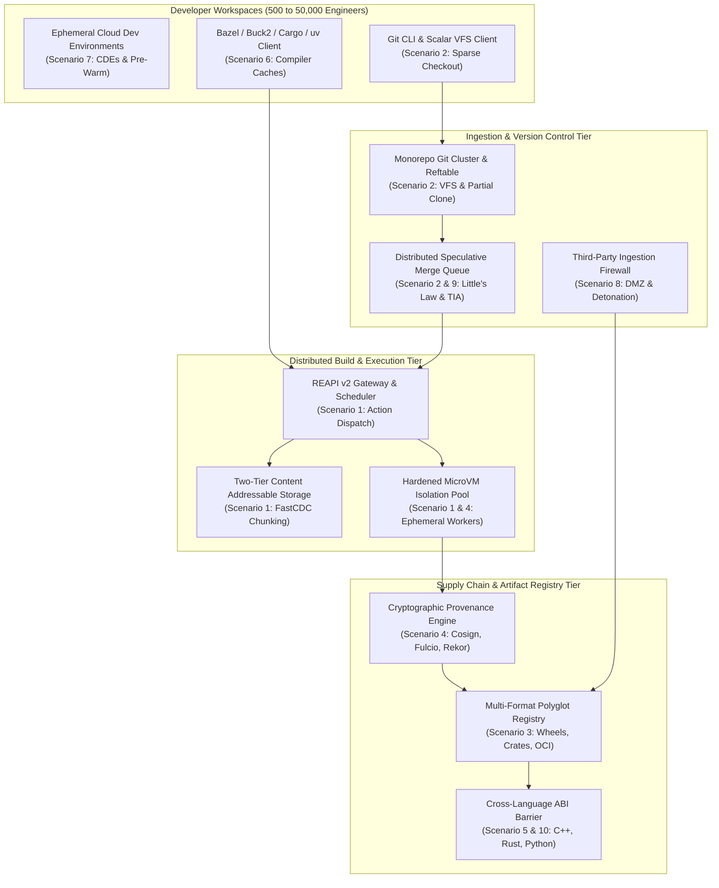
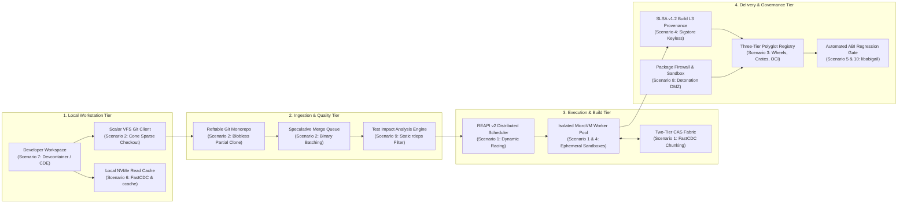

# Cross-Pillar Design Scenario Bank

> [!summary] Scope
> This problem bank presents ten complex developer infrastructure design scenarios for organizations scaling from 500 to 50,000 engineers across polyglot C++, Python, and Rust codebases.
> Scenarios include architecting hermetic remote execution builds, multi-tier artifact registries, repository branching and merge queue systems, and automated supply-chain attestation pipelines.
> Each design is paired with trade-off matrices, failure modes, cost economics, and model solutions tiered at L6, L7, and L8+ levels.

The foundational economics of build performance and investment justification are owned by [[Build-Performance-Economics-and-Decision-Record]].
The virtualized filesystem mechanics, commit graphs, and sparse checkout invariants for monorepos are owned by [[Git-At-Scale-VFS-Scalar-and-Monorepos]].
The cryptographic provenance requirements across build and source tracks are owned by [[SLSA-Framework-Build-and-Source-Tracks]].
The evaluation standards and competencies governing these designs are owned by [[Staff-and-Principal-Toolchain-Interview-Bar]].
The multi-system failure modes and crash diagnostics are owned by [[Cross-Pillar-Debugging-Scenario-Bank]].
This problem bank owns the ten high-leverage architectural scenarios that integrate these domains across polyglot enterprise fleets.



## Reproduction

As specified in the curriculum brief, this scenario bank owns no runnable unit lab under `code/`.
Evaluating cross-pillar developer platform architectures for fleets of 500 to 50,000 engineers requires modeling systems that span distributed compute clusters, terabyte-scale content-addressable storage networks, and multi-datacenter network fabrics.
Instead of an artificial single-host script, each scenario in this bank provides:
- A concrete system boundary defining active users, repository scale, and code generation throughput.
- An observed production symptom or throughput collapse measured under real fleet load.
- Quantitative capacity equations grounded in queueing theory and hardware physical limits.
- Step-by-step diagnostic verification commands to inspect live cluster state and system logs.
- Progressive hint ladders revealing root design tensions.
- Model architectural specifications tiered across senior (L6), staff (L7), and principal or distinguished (L8+) expectations.

## Observed Symptom

When an engineering organization scales from 500 to 5,000 and ultimately 50,000 engineers without a unified cross-pillar toolchain strategy, the developer infrastructure undergoes a non-linear throughput collapse across all operational axes:

```text
[FLEET METRIC COLLAPSE: 500 -> 5,000 -> 50,000 ENGINEERS]
1. Version Control:
   - git status latency: 120ms (500 eng) -> 4.8s (5k eng) -> 42.6s (50k eng, 1.2M files in index).
   - git clone (full packfile): 45s (1.2 GB) -> 14m (18 GB) -> FAILED: RPC out of memory at 140 GB.
   - PR merge latency: 8m -> 1h 45m -> 14h 20m (merge queue queueing delay dominates).
2. Compilation and Build:
   - Clean C++ / Rust service build: 4m 12s -> 38m 40s -> 2h 15m.
   - Remote cache hit rate: 84% (single team) -> 41% (cross-team) -> 12% (path leakage & non-determinism).
   - CAS network ingress at peak: 120 MB/s -> 1.8 GB/s -> 28.4 GB/s (swamping core switch uplinks).
3. Dependency and Supply Chain:
   - Polyglot resolve time (pip/uv/cargo): 2s -> 45s -> 12m (lockfile conflict explosion).
   - Production outages from unannounced ABI breaks: 0/yr -> 4/yr -> 28/yr (ODR / dual ABI collisions).
   - Third-party registry egress bill: $1,200/mo -> $42,000/mo -> $680,000/mo (redundant uncached pulls).
4. Engineering Economics:
   - Active daily wait time per engineer: 22m -> 84m -> 142m.
   - Gross productivity loss at $150/hour and 250 days (the At Scale model): $6.9M/yr (500 eng) -> $262.5M/yr (5k eng) -> $4.44B/yr (50k eng).
```

The sections below present ten self-contained, battle-tested architectural scenarios resolving this failure envelope.

---

## Ten Cross-Pillar Infrastructure Design Scenarios

### Scenario 1: Hermetic Remote Execution and Distributed Action Caching at 20,000 Engineers

The low-level protocol mechanics of action digests, CAS streaming, and execution workers are owned by [[Remote-Execution-API-and-Remote-Caching]].
This scenario owns the multi-datacenter remote execution topology and caching architecture at scale.

#### 1. System Boundary and Scaling Context
An enterprise of 20,000 software engineers maintains an 80-million-line polyglot monorepo containing C++20 services, Rust microservices, and Python machine learning pipelines.
The fleet generates 1,000,000 build actions per hour during peak business hours.
Local developer laptops (macOS Apple Silicon) cannot compile the entire C++ graph locally without thermal throttling and running out of memory.
The organization is standardizing on the Remote Execution API v2 (REAPI; latest tagged release v2.12.0, with `main` documenting v2.13, as of 2026-11) with Bazel and Buck2.

#### 2. Observed Symptom and Bottleneck
The initial deployment of remote execution fails catastrophically under fleet concurrency:
- Action Cache (AC) hit rates plateau at a dismal 18%, despite 80% identical commit trees.
- The distributed Content-Addressable Storage (CAS) cluster experiences read-timeout storms, dropping gRPC connections with `DEADLINE_EXCEEDED` on `BatchReadBlobs` calls.
- Intermediate C++ unstripped debug object files (`.o` files containing 180 MB of uncompressed DWARFv5 symbols per compilation unit due to heavy template monomorphization) saturate the 100 Gbps top-of-rack datacenter switch uplinks.
- An action result compiled on an Ubuntu 24.04 runner (glibc 2.39) is cached and returned to an Ubuntu 20.04 runner (glibc 2.31), causing dynamic loader failures with `GLIBC_2.38 not found`, because glibc symbol versions are backward compatible but never forward compatible.

#### 3. Progressive Hint Ladder
> [!tip]- Hint 1: Action digest inputs are volatile unless explicitly stripped
> Check how the Action key is computed in REAPI v2.
> The `Action` proto carries `command_digest` (the digest of the `Command` proto, which holds the arguments, environment variables, and output paths), `input_root_digest` (the Merkle root of the input `Directory` tree), and `platform`, so the Action digest changes whenever any of them changes (`remote_execution.proto`).
> If developers have different usernames, different home directories, or different local absolute paths embedded in `-I` flags or `PATH` variables, their Action hashes will never match.
> Investigate compiler path-remapping flags.

> [!tip]- Hint 2: Distinguish intermediate compilation artifacts from linker inputs
> Why are intermediate object files transferring 180 MB of DWARF data across the network if the linker only needs the machine code and relocation tables?
> Investigate Split DWARF (`-gsplit-dwarf`), DWARF package files (`.dwp`), and Clang's type-information deduplication (`-fno-standalone-debug`, already the default except on Darwin and a few other targets where `-fstandalone-debug` is on).
> Furthermore, examine Content-Defined Chunking (CDC) algorithms like FastCDC to avoid re-transmitting entire 200 MB archive files when a single function changes.

> [!tip]- Hint 3: Execution environment invariants must be verified in the platform properties
> In REAPI, the `Action.platform` field carries execution requirements (`Command.platform` is deprecated in `remote_execution.proto`).
> If `OSFamily=Linux` is the only property, the scheduler will treat an Amazon Linux 2 container, an Ubuntu 20.04 worker, and an Arch Linux node as interchangeable.
> Every container image digest, toolchain sysroot hash, and glibc ABI level must be pinned into the platform key.

#### 4. Model Solution
> [!success]- Solution: Hermetic Remote Execution Architecture (L6 / L7 / L8+)
> **Senior Engineer (L6) Implementation:**
> 1. Normalize all compiler invocations by injecting hermetic flags: `-ffile-compilation-dir=.` (Clang 13 and later only; GCC has no such option, so GCC builds use `-ffile-prefix-map=${WORKSPACE}=.`), `-fdebug-prefix-map=${WORKSPACE}=.`, and `-no-canonical-prefixes`.
> 2. Sanitize build action environments inside Bazel/Buck2: set `PATH=/bin:/usr/bin`, `LC_ALL=C.UTF-8`, `TZ=UTC`, and strip all developer-specific environment variables (`USER`, `HOME`, `SSH_AUTH_SOCK`).
> 3. Separate debug info using Split DWARF (`-gsplit-dwarf`): workers emit `.o` files that keep the code, relocations, line tables, and a small skeleton compilation unit, writing the bulk of the DWARF to `.dwo` files directly to CAS without linking them into the binary.
>
> **Staff Engineer (L7) Architecture:**
> 1. Deploy a two-tier Content-Addressable Storage (CAS) topology:
>    - Tier 0: Worker-local high-speed NVMe daemon caches running an in-memory index over an ext4 append-only store with FastCDC chunking (target average chunk size: 64 KB, min: 16 KB, max: 256 KB).
>    - Tier 1: Distributed multi-node CAS cluster backed by NVMe-oF (NVMe over Fabrics) and S3/GCS blob storage with single-flight request coalescing on `FindMissingBlobs`.
> 2. Introduce Dynamic Racing Execution (`--strategy=dynamic`): race low-overhead local leaf actions against remote worker queues, eliminating tail-latency scheduling delays on fast compilation units.
> 3. Implement an Automated Cache-Poisoning Quarantine Daemon: shadow workers re-execute 1% of randomly sampled cached actions in clean sandboxes; if bit-for-bit output digests differ, the action key is blacklisted, quarantined, and an alert with an automated `diffoscope` breakdown is paged to the toolchain team.
>
> **Principal / Distinguished (L8+) Strategy:**
> 1. Architect an enterprise sandbox isolation pool: Firecracker microVMs give KVM hardware-virtualized multi-tenant isolation and boot to guest init in at most 125 ms per Firecracker's `SPECIFICATION.md`, with snapshot restore avoiding a full boot by mapping the guest memory file `MAP_PRIVATE` and loading pages on demand (Firecracker's `snapshot-support.md` calls this "very fast snapshot loading" and publishes no millisecond figure, so size restore latency by measuring it on your own hosts); gVisor is a user-space application kernel that intercepts system calls, not a hardware-virtualized VM.
> 2. Implement global cross-region cache federation with read-through edge replicas in regional developer centers (North America, Europe, Asia-Pacific), bounded by an active bandwidth governor that dynamically switches between remote execution and local compilation based on transit link cost and network congestion metrics.
> 3. Establish organizational compute economics: trade compute cluster capital expenditure ($12M/year) against developer wait time reduction, generating an audited annual productivity return of $84M.

#### 5. Trade-Off Matrix

| Strategy | Remote Cache Only | Full Remote Execution | Dynamic Racing (Local + Remote) |
| :--- | :--- | :--- | :--- |
| **Worker Compute Infrastructure** | Zero execution cluster costs; storage only | Massive cluster (50k-100k vCPUs) | Medium cluster + Developer hardware |
| **Network Egress Bandwidth** | Very High (all binaries download to client) | Low (only final target binaries download) | Variable depending on race outcome |
| **Build Reproducibility Enforcement** | Weak (local host environment can leak) | Strict (enforced via container sandbox) | Strict (requires bit-identical outputs) |
| **P95 Build Time (Incremental)** | 12 seconds | 18 seconds (scheduler queue overhead) | 6 seconds (local wins small actions) |
| **P95 Build Time (Clean)** | 32 minutes (laptop thermal bottleneck) | 2 minutes 15 seconds | 2 minutes 15 seconds (remote wins graph) |

#### 6. Failure Modes and Blast Radius Mitigation
- **Failure Mode 1: Action Cache Poisoning via Non-Deterministic Timestamps:**
  A developer commits code containing `__DATE__` or `__TIME__`, or a code generator iterates over an unordered hash table (`std::unordered_map`).
  *Blast Radius:* Thousands of engineers download broken or non-reproducible artifacts, breaking debugging symbols and incremental tests.
  *Mitigation:* Inject `-Werror=date-time` in compilation rules and export `SOURCE_DATE_EPOCH` to code generators; where a frozen wall clock is still needed, pin `CLOCK_REALTIME` with `libfaketime`, because Linux time namespaces virtualize only `CLOCK_MONOTONIC` and `CLOCK_BOOTTIME`, never `CLOCK_REALTIME` (time_namespaces(7)).
- **Failure Mode 2: Worker Node File Descriptor / Disk Exhaustion:**
  A build burst floods remote worker nodes with temporary intermediate artifacts, consuming local ext4 inode capacity.
  *Mitigation:* Implement proactive disk watermarking: workers begin aggressive LRU CAS eviction when local disk capacity reaches 80%, hard-draining and cordoning nodes at 90%.

---

### Scenario 2: Monorepo Version Control, VFS, and Merge Queue for 15,000 Engineers

The trade-off frameworks governing repository topography and merge automation are owned by [[Decision-Record-Monorepo-vs-Polyrepo]] and [[Decision-Record-Merge-vs-Rebase-and-Branching]].
This scenario owns the virtualized filesystem architecture, speculative merge queue sizing, and monorepo scaling limits.

#### 1. System Boundary and Scaling Context
An organization of 15,000 developers merges 2,400 pull requests per day into a single Git monorepo containing 120 million lines of code and 1.8 million files in the default branch.
The `.git` directory exceeds 180 GB, and a full checkout consumes 65 GB on disk.
Developers execute `git status` dozens of times per hour, and release branches must cut cleanly every evening without broken master states.

#### 2. Observed Symptom and Bottleneck
The version control infrastructure enters gridlock:
- A standard `git status` invocation takes 28 seconds on macOS APFS and 14 seconds on Linux ext4 because Git must `lstat()` all 1.8 million index entries.
- Engineers running `git clone` routinely fail due to HTTP timeout limits and multi-gigabyte packfile negotiation exhaustion.
- A sequential merge queue collapses under Little's Law: with 2,400 PRs/day (1,000 of them landing in the 10-hour peak window, 100 PRs/hour) and a 15-minute CI validation cycle, a single-threaded queue can process at most 4 PRs/hour.
- Merging PRs speculatively in batches creates a cascading failure storm: when a batch of 8 PRs fails CI, all 8 PRs are rejected, forcing manual triage and re-queueing.

#### 3. Progressive Hint Ladder
> [!tip]- Hint 1: The filesystem should only see what the engineer edits
> An engineer working on the frontend Python API never touches the C++ trading engine or Rust storage driver.
> How can Git hide 95% of the repository without breaking tools that expect the full path tree?
> Look into `git sparse-checkout` with cone mode and partial clone (`--filter=blob:none`).

> [!tip]- Hint 2: Stat calls can be replaced by OS kernel event notification streams
> Why must Git execute 1.8 million `lstat()` system calls if only two files were modified in the text editor?
> Investigate the built-in `git fsmonitor--daemon` (macOS FSEvents and Windows since Git 2.37, Linux inotify since Git 2.55), and `core.untrackedCache`.

> [!tip]- Hint 3: Model the merge queue as a speculative dependency tree
> To merge 100 PRs/hour with a 15-minute CI duration, Little's Law ($L = \lambda W$) dictates that at least $L = 100 \times 0.25 = 25$ builds must be active simultaneously.
> How can speculative batching isolate which PR broke the build without aborting all 25 PRs?
> Look into binary search speculative batch trees and Test Impact Analysis (TIA).

#### 4. Model Solution
> [!success]- Solution: Monorepo Virtualization and Speculative Merge Pipeline (L6 / L7 / L8+)
> **Senior Engineer (L6) Implementation:**
> 1. Roll out `scalar register` across all developer workstations: it sets `index.version=4`, `status.aheadBehind=false`, `core.untrackedCache=true` (false on Windows), and `core.fsmonitor=true` where the built-in daemon is supported, plus background maintenance (`scalar.c`); `fetch.prune=true` is not a Scalar default and must be set separately if wanted.
> 2. Enforce cone-mode sparse-checkout (`git sparse-checkout set --cone <subsystem>`), restricting local worktrees to only the files necessary for current active feature development.
> 3. Configure blobless partial clone (`git clone --filter=blob:none <url>`), downloading commit and tree objects upfront while lazily fetching file contents on-demand across local developer operations.
>
> **Staff Engineer (L7) Architecture:**
> 1. Deploy an Optimistic Speculative Merge Queue using Binary Speculative Branch Trees:
>    - Group incoming PRs into speculative pipelines: Build $B_1$ tests $P_1$, Build $B_2$ tests $P_1 + P_2$, Build $B_3$ tests $P_1 + P_2 + P_3 + P_4$.
>    - If $B_3$ passes, all 4 PRs merge instantly in a single atomic git reference update.
>    - If $B_3$ fails while $B_2$ succeeds, the queue automatically isolates the defect to $P_3$ or $P_4$, splitting the branch and re-testing $P_3$ independently without restarting $P_1$ and $P_2$.
> 2. Integrate Test Impact Analysis (TIA) into the merge queue: run `bazel query "rdeps(//..., set(${CHANGED_TARGETS}))"` to compute affected test targets; PRs with non-intersecting reverse dependency sets are executed concurrently on parallel merge tracks without mutual serialization.
> 3. Transition the server-side repository to the Reftable backend (`git init --ref-format=reftable`, introduced in Git 2.45), which replaces loose ref files plus `packed-refs` with append-only tables, making multi-ref updates atomic and cheap; writers still serialize on a single `tables.list` lock, so the merge-queue coordinator below remains necessary.
>
> **Principal / Distinguished (L8+) Strategy:**
> 1. Architect an enterprise Virtual File System (VFS / ProjFS / FUSE) layer that intercepts kernel `read()` and `open()` calls, projecting the entire 120-million-line monorepo as a local virtual drive where files are materialized over the local NVMe cache in <2ms upon first file access.
> 2. Implement a distributed server-side Git storage fabric using raft-replicated commit-graph and multi-pack-index (MIDX) with bitmapped reachability tables, offloading cold packfile object storage to geo-replicated object stores fronted by edge proxy caches.
> 3. Define the corporate trunk-based engineering contract: ban long-lived feature branches, establish a hard PR merge SLO (<30 minutes from approval to main), and formulate developer velocity KPIs tracked at executive levels.

#### 5. Trade-Off Matrix

| Dimension | Standard Git Clone | Sparse Checkout + Partial Clone | Full VFS / Virtualized Git |
| :--- | :--- | :--- | :--- |
| **Initial Setup Time** | 25-45 minutes (180 GB download) | 45 seconds (500 MB metadata download) | 5 seconds (zero payload download) |
| **Local Disk Consumption** | 65 GB - 180 GB | 1.2 GB - 4 GB | 500 MB (only opened files on disk) |
| **Offline Work Capability** | 100% offline functionality | Partial (only checked-out cone cached) | Poor (opening new files requires LAN) |
| **System Complexity** | Standard Git CLI | Standard Git CLI with scalar daemon | Custom kernel/FUSE driver maintenance |
| **Server Infrastructure Load** | High initial spike, zero read load | On-demand blob fetch storms | Continuous micro-RPC streaming |

#### 6. Failure Modes and Blast Radius Mitigation
- **Failure Mode 1: Blob-Fetch Storm on Mass Refactoring:**
  A developer runs a broad search-and-replace across the codebase (e.g., `sed -i` across all files), triggering parallel fetch requests for 500,000 blobs against the Git server.
  *Mitigation:* Implement rate-limiting on lazy blob fetches; detect mass read patterns and prompt the developer to run an explicit bulk-pack fetch command before initiating monorepo refactoring.
- **Failure Mode 2: Reftable / Reflock Deadlock in Merge Queue:**
  Fifty concurrent workers attempt to advance `refs/heads/main` at the exact same sub-second interval.
  *Mitigation:* Merge operations must be owned exclusively by a single active merge queue coordinator holding a distributed lease in etcd, executing atomic CAS updates on Git references.

---

### Scenario 3: Enterprise Polyglot Artifact Registry and Pull-Through Cache Topology

The mechanics of lockfiles, vendored dependencies, and offline mirrors are owned by [[Lockfiles-Vendoring-and-Offline-Mirrors]].
This scenario owns the geo-distributed multi-tier caching topology and dependency confusion isolation across polyglot ecosystems.

#### 1. System Boundary and Scaling Context
An organization operating across three continental datacenters (US-East, EU-West, AP-East) runs 150,000 CI pipelines and thousands of Kubernetes nodes.
Pipelines continuously ingest and publish artifacts across four major packaging ecosystems:
- Python Wheels (compliant with PEP 503 and PEP 691 JSON APIs).
- Rust Crates (Cargo sparse HTTP index via RFC 2789).
- C++ Conan 2 binary packages.
- OCI container images pulled by Docker, Podman, and Kubernetes nodes (OCI Distribution Spec v1.1).

#### 2. Observed Symptom and Bottleneck
The artifact delivery topology experiences cascading failures:
- During morning CI load peaks, 10,000 concurrent Kubernetes pods attempt to pull identical base container images (a 2.4 GB CUDA development image) and core wheels (NumPy, PyTorch, internal core libraries).
- Upstream PyPI and crates.io rate-limit the corporate IP pool with HTTP 429 (`Too Many Requests`), halting all pipeline builds worldwide.
- External bandwidth egress costs exceed $400,000 per month due to redundant public registry downloads.
- A public package with identical naming to an internal package is published on PyPI, triggering a critical Dependency Confusion vulnerability where CI runners pull malicious public code instead of internal proprietary modules.

#### 3. Progressive Hint Ladder
> [!tip]- Hint 1: Centralize public package resolution behind an authoritative gateway
> Why are internal CI runners making direct outbound network connections to public package registries like `pypi.org` or `crates.io`?
> Internal networks should block direct egress to public repositories, forcing all client tools (`pip`, `uv`, `cargo`, `conan`) to query an internal pull-through caching proxy.

> [!tip]- Hint 2: Eliminate cache stampedes using request coalescing
> When 2,000 runners simultaneously request `torch-2.4.0-cp311-cp311-manylinux1_x86_64.whl` (the actual PyPI filename) on a cache miss, how does the proxy handle the requests?
> If the proxy sends 2,000 requests upstream, it will be immediately banned.
> Investigate single-flight request coalescing (e.g., Go `singleflight` or NGINX `proxy_cache_lock on`, which lets only one request populate a new cache element; `proxy_cache_use_stale updating` only helps once a stale copy exists).

> [!tip]- Hint 3: Separate private namespaces from public mirrors structurally
> Look at PEP 708 (repository metadata to mitigate dependency confusion), PEP 691, and Cargo registry configuration.
> How can the registry guarantee that an internal package named `company-auth` is never shadowed by an attacker on the public registry?
> Investigate namespace reservation, explicit scoped prefixes, and upstream fallback blocking.

#### 4. Model Solution
> [!success]- Solution: Three-Tier Multi-Format Artifact Mesh (L6 / L7 / L8+)
> **Senior Engineer (L6) Implementation:**
> 1. Configure all developer machines and CI runner environments to point strictly to internal registry URLs:
>    - Python: Set `PIP_INDEX_URL` and `UV_DEFAULT_INDEX` (uv deprecates `UV_INDEX_URL` in its favor, as of 2026-11) to `https://registry.internal/simple/` (disabling `extra-index-url`).
>    - Rust: Configure `.cargo/config.toml` with `[source.crates-io] replace-with = "internal-mirror"`.
>    - OCI: Configure `/etc/containers/registries.conf` or Docker daemon mirror blocks to route `docker.io` requests to `registry-mirror.internal`.
> 2. Enforce strict artifact immutability: configure the registry to reject any HTTP `PUT` or `POST` attempting to overwrite an existing package version or OCI digest tag.
>
> **Staff Engineer (L7) Architecture:**
> 1. Deploy a Geo-Distributed Three-Tier Caching Topology:
>    - Tier 0 (Host-Local): Persistent read-only bind-mount caches on CI runner bare-metal nodes (`~/.cache/uv`, `~/.cargo/registry`, OCI local containerd store).
>    - Tier 1 (Regional Datacenter): High-availability pull-through caching proxies deployed in US-East, EU-West, and AP-East, equipped with local NVMe SSD storage and NGINX single-flight request coalescing (`proxy_cache_lock on`).
>    - Tier 2 (Central Authoritative): Multi-format registry backed by S3/GCS object storage with multi-region cross-bucket replication.
> 2. Implement Automated Dependency Confusion Defenses:
>    - The registry implements an Authoritative Namespace Guard: any package matching proprietary internal prefixes (e.g., `@internal/*`, `corp-*`) is marked internal-only; the proxy permanently blocks upstream network lookups for these identifiers.
>    - Automatically claim internal package names on public registries (PyPI, crates.io, npm) via corporate publishing bots, publishing a minimal functional placeholder, because PyPI's PEP 541 lets empty or no-functionality name-squatting projects be reclaimed and npm prohibits squatting.
>
> **Principal / Distinguished (L8+) Strategy:**
> 1. Architect a Unified Content-Addressable Blob Fabric: homogenize artifact storage beneath the protocol layer.
>   Python wheels, Rust crates, Conan binaries, and OCI image layers are all normalized into a single content-addressable storage pool indexed by SHA-256 digests with FastCDC deduplication, reducing enterprise storage footprints by 65%.
> 2. Formulate Corporate Artifact Retention and Zero-Downtime Tombstoning Lifecycle Policies: implement cryptographic tombstoning where deprecated dependencies are blocked from new builds while remaining permanently available to historic release reproduction builds.
> 3. Establish enterprise registry economics: negotiate CDN peering and direct cloud interconnect contracts, reducing inter-region data transfer costs from $4.8M to $350k annually.

#### 5. Trade-Off Matrix

| Packaging Dimension | Public Direct Access | Single Monolithic Proxy | Multi-Tier Geo-Distributed Mesh |
| :--- | :--- | :--- | :--- |
| **Network Egress Cost** | Uncontrolled ($400k+/mo) | Low ($20k/mo) | Minimal ($5k/mo inter-region) |
| **Resilience to Upstream Outages** | Zero (PyPI down = Company stops) | High (cached items serve cleanly) | Near Perfect (independent local regional caches) |
| **Latency on Fresh Runner Pull** | 800ms - 5s per package | 200ms - 800ms | 15ms - 45ms (LAN / NVMe edge hit) |
| **Supply Chain Attack Surface** | Severe (Dependency Confusion risk) | Medium (depends on proxy rules) | Low (Strict namespace quarantine & signing) |
| **Operational Overhead** | Zero platform maintenance | Low (single service maintenance) | High (requires SRE team, replication orchestration) |

#### 6. Failure Modes and Blast Radius Mitigation
- **Failure Mode 1: Cache Poisoning via Upstream Checksum Mismatch:**
  An upstream registry republishes a wheel or crate with identical version numbers but altered binary contents (e.g., upstream security release rebuild).
  *Mitigation:* The registry proxy validates SHA-256 digests against previously recorded immutable lockfile signatures; any mismatch triggers a high-priority supply chain security alert and blocks ingestion.
- **Failure Mode 2: Regional Cache Invalidation Desynchronization:**
  An emergency hotfix is published to US-East, but EU-West continues serving the stale cached index for 30 minutes due to aggressive TTLs.
  *Mitigation:* Implement active webhook-driven cache invalidation: publishing an internal artifact broadcasts an invalidation event across an internal Kafka/Redis pub-sub bus to purge regional proxy caches in <500ms.

---

### Scenario 4: End-to-End SLSA Build Level 3 and Source Track Supply Chain Attestation Pipeline

The cryptographic mechanics of keyless signatures, Fulcio OIDC flows, and Rekor transparency proofs are owned by [[Sigstore-Keyless-Signing-Cosign-Fulcio-and-Rekor]].
This scenario owns the enterprise SLSA Build Level 3 runner hardening, Source Track enforcement, and admission control topology.

#### 1. System Boundary and Scaling Context
An enterprise subject to regulatory scrutiny (financial services and healthcare APIs) deploys 8,000 distinct containerized services and native binaries to production every week.
The fleet comprises polyglot builds across GitHub Enterprise, GitLab CI, and dedicated Kubernetes runner fleets.
The organization must comply with the SLSA v1.2 specification, achieving Build Track Level 3 (Build L3) and Source Track requirements, ensuring all production artifacts possess unforgeable cryptographic provenance.

#### 2. Observed Symptom and Bottleneck
The initial supply-chain security rollout paralyzes deployment velocity:
- Build runners sign artifacts using static long-lived GPG/RSA keys stored in CI secrets; a leaked runner token compromises the signing key, forcing an emergency revocation of 60,000 production container signatures.
- Verification gates at the Kubernetes admission controller add 45 seconds of latency per pod deployment because nodes query public Rekor transparency logs synchronously, hitting rate limits and failing deployments during autoscaling spikes.
- Development builds fail SLSA verification because developers build and sign images locally from their laptops using Docker CLI, bypassing tamper-proof hosted build infrastructure.
- Downstream microservices crash because transitive source provenance was not verified: a malicious pull request was merged without two-party review, triggering a compliance audit failure under SLSA v1.2 Source Track standards.

#### 3. Progressive Hint Ladder
> [!tip]- Hint 1: Long-lived cryptographic keys are an operational liability
> How can an automated system sign thousands of artifacts per day without storing long-lived private keys in CI environment variables?
> Research Sigstore, Cosign, Fulcio (ephemeral certificate authority via OIDC), and Rekor (transparency log).

> [!tip]- Hint 2: Build Level 3 requires dedicated, hardened, isolated build platforms
> What prevents a build script from modifying the provenance metadata before it is signed?
> The build platform must generate the provenance, not the user's build script.
> The provenance generator must run in a separate execution security boundary that the build payload cannot tamper with.

> [!tip]- Hint 3: Decouple admission verification from external synchronous transparency lookups
> Why are production Kubernetes nodes reaching out to external Rekor logs on every pod start?
> Look into Verification Summary Attestations (VSAs) and Cosign bundle verification, where transparency log proofs and certificates are packaged directly alongside the container image in the OCI registry.

#### 4. Model Solution
> [!success]- Solution: SLSA v1.2 Build L3 and Source Track Attestation Architecture (L6 / L7 / L8+)
> **Senior Engineer (L6) Implementation:**
> 1. Eliminate static signing keys: integrate Sigstore Cosign with GitHub Actions / GitLab CI OpenID Connect (OIDC) identity federation.
> 2. Build scripts do not sign their own artifacts; instead, a hardened reusable CI workflow or Tekton Chains intercept the build completion event, extract the artifact SHA-256 digest, and obtain a short-lived (10-minute validity) X.509 certificate from Fulcio bound to the specific repository, workflow, and commit SHA.
> 3. Generate standard in-toto provenance attestations (predicate type `https://slsa.dev/provenance/v1`) recording the build configuration, external parameters, entry point, and resolved material dependencies.
>
> **Staff Engineer (L7) Architecture:**
> 1. Enforce SLSA v1.2 Build Level 3 Isolation:
>    - Builds execute inside isolated, single-use, ephemeral virtual machines, which is what Build L3's "Isolated" requirement mandates (an ephemeral environment per build, no cross-build influence, no cache poisoning).
>      Confidential computing (AWS Nitro Enclaves, GCP Confidential VMs) and zero network access during compilation are optional hardening beyond SLSA: v1.2 explicitly does not require hermetic builds.
>    - The build runner infrastructure is architecturally partitioned: the untrusted user payload runs in Sandbox A, while the Trusted Control Plane runs in Sandbox B. Sandbox B hashes the inputs, monitors execution, calculates output digests, signs the in-toto attestation, and uploads the bundle.
> 2. Implement SLSA v1.2 Source Track Compliance:
>    - Enforce two-party code review (Source L4) via branch protection rules that require signed commits, verified identity mapping, and prevent force-pushes or historical rewriting (history preservation is Source L2, continuous technical controls Source L3).
>    - Automatically generate Source Verification Summary Attestations (Source VSAs) cryptographically attesting that the commit history conforms to verified governance before triggering the build track.
> 3. Optimize Admission Control Verification:
>    - Deploy Kyverno or OPA Gatekeeper policies validating Cosign signatures and SLSA provenance locally using offline bundle verification (verifying the embedded Rekor entry response `SET` and Fulcio cert chain without external API calls).
>
> **Principal / Distinguished (L8+) Strategy:**
> 1. Architect an Enterprise Binary Authorization Mesh across all production Kubernetes clusters, serverless platforms, and bare-metal fleets: any binary or container lacking an unbroken cryptographic chain linking an approved Jira/ticket, a two-party reviewed Git commit, and an isolated SLSA Build L3 attestation is blocked at the kernel/containerd execution boundary.
> 2. Formulate a Fleet-Wide Software Bill of Materials (SBOM) Graph: continuously ingest SPDX and CycloneDX documents generated during SLSA attestation into an enterprise graph database, enabling automated sub-minute blast-radius queries across 50,000 services whenever a zero-day vulnerability (e.g., Log4j or XZ Utils) is published.
> 3. Establish corporate security governance: serve as the executive representative to industry security bodies (OpenSSF), defending the organization's supply-chain architecture during external federal regulatory audits.

#### 5. Trade-Off Matrix

| Security Parameter | SLSA Build L1 (Script Generated) | SLSA Build L2 (Hosted Runner) | SLSA Build L3 (Hardened Isolated VM) |
| :--- | :--- | :--- | :--- |
| **Signing Key Lifecycle** | Not required (L1 provenance may be unsigned) | Platform-signed (e.g. ephemeral OIDC via Fulcio) | Platform-signed, key unreachable from build steps |
| **Tamper Resistance** | Low (build script can forge data) | Medium (platform generates metadata) | High (isolated control plane boundary) |
| **Network Hermeticity (design choice, not a SLSA v1.2 requirement)** | None (open internet access) | Partial (monitored network) | Strict (fully isolated compilation sandbox) |
| **Pipeline Latency Overhead** | +2 seconds | +8 seconds | +35 seconds (VM provisioning & cleanup) |
| **Infrastructure Unit Cost** | $0.001 per build | $0.02 per build | $0.15 per build |

#### 6. Failure Modes and Blast Radius Mitigation
- **Failure Mode 1: OIDC Provider Outage Blocks Deployments:**
  The central enterprise identity provider or Fulcio CA experiences a network outage, preventing build runners from obtaining signing certificates.
  *Mitigation:* Implement short-term degraded emergency break-glass procedures: release engineering leads hold hardware tokens (YubiKeys backed by an offline root CA) capable of authoring temporary emergency bypass VSAs with strict 4-hour expiration limits.
- **Failure Mode 2: Secrets and Environmental Leakage into Public Transparency Logs:**
  A poorly configured build script prints internal API keys or proprietary server hostnames into the build invocation parameters recorded inside the public in-toto attestation.
  *Mitigation:* Deploy a private corporate Sigstore instance (private Rekor and Fulcio) within the corporate VPC boundary, preventing proprietary metadata from ever leaking to public transparency logs.

---

### Scenario 5: Cross-Language FFI and ABI Stability Boundary at Scale (C++, Rust, Python)

Binary interface stability, symbol visibility, and SONAME versioning are owned by [[Cpp-ABI-Stability-Symbol-Visibility-and-SONAME]], while cross-language Rust-Python packaging is owned by [[Rust-PyO3-and-Maturin-Internals]].
This scenario owns the cross-language memory ownership architecture, panic boundaries, and dual ABI reconciliation across enterprise runtime fleets.

#### 1. System Boundary and Scaling Context
An algorithmic trading and high-throughput analytics enterprise maintains a high-performance compute core.
The core engine is implemented in C++20 and Rust, packaged as dynamic shared libraries (`.so` / `.dylib`), and exposed to thousands of data scientists and production microservices via Python C-extensions using PyO3, Maturin, and pybind11.
Deployments run across heterogeneous Linux distributions (RHEL 8, Ubuntu 22.04, Debian 12) on both x86-64 and AArch64.

#### 2. Observed Symptom and Bottleneck
The multi-language runtime crashes intermittently in production with catastrophic, non-reproducible failures:
- Services experience immediate `SIGSEGV` during startup due to memory allocator mismatches: memory allocated by a Rust crate that installs jemalloc as its `#[global_allocator]` (Rust's default has been the system allocator since 1.32) is freed across the FFI boundary by C++'s standard library `free()`.
- Moving part of the fleet onto a new compiler image triggers silent memory corruption in Python services due to `_GLIBCXX_USE_CXX11_ABI` mismatches: wheels built in the CentOS 7 based `manylinux2014` devtoolset image may reference libstdc++ symbols only up to `GLIBCXX_3.4.19` (PEP 599), which predates the dual ABI that GCC 5.1 introduced, so they are built against the old `std::string` ABI (`=0`), while libraries built by a distro GCC use the new ABI that has been the default since GCC 5.1 (`=1`), so `std::string` layouts differ between dynamically loaded shared libraries.
- A Rust panic in an FFI callback reaches an `extern "C"` boundary; since Rust 1.81 this aborts the process (`SIGABRT`) after printing the panic message, and older toolchains treated it as undefined behavior.
- Upgrading to Python 3.13 breaks data science wheels due to the removal of legacy C-API internal fields and experimental free-threaded (PEP 703) interpreter differences.

#### 3. Progressive Hint Ladder
> [!tip]- Hint 1: Ownership of allocated heap memory must never cross the DSO boundary
> If library A allocates a struct, which library must free it?
> If Rust uses jemalloc and C++ uses glibc malloc, passing ownership across shared library boundaries will inevitably corrupt the heap metadata arena.
> Look into opaque handle patterns and explicit destructor export functions.

> [!tip]- Hint 2: Unwinding across an extern "C" boundary is undefined behavior
> What does the C ABI specify about stack unwinding and exception frames?
> In standard C, exceptions and panics do not exist.
> If a Rust function called from C++ panics, or a C++ function called from Rust throws an exception, the stack unwinder encounters invalid frame metadata.
> Investigate `std::panic::catch_unwind` in Rust and `cxx` crate boundary bridges.

> [!tip]- Hint 3: Leverage the Python Stable ABI (Limited API)
> Why must data science extensions be recompiled for every minor Python release (3.10, 3.11, 3.12)?
> Investigate the Python Limited API (PEP 384) and `abi3` wheel tags, which guarantee forward ABI compatibility across minor Python versions.

#### 4. Model Solution
> [!success]- Solution: Hermetic Polyglot ABI Architecture (L6 / L7 / L8+)
> **Senior Engineer (L6) Implementation:**
> 1. Standardize on the `cxx` crate for C++ and Rust boundaries: `cxx` generates type-safe C++ headers and Rust bindings, enforcing value and reference semantics at compile time without manual `unsafe` pointer manipulation.
> 2. Catch all Rust panics at the boundary using `std::panic::catch_unwind`, translating panics into explicit C-compatible error codes or structured result enums (`struct FfiResult { int32_t code; char* error_msg; }`).
> 3. Standardize Python extension builds on Maturin and PyO3 with `features = ["abi3-py310"]`, producing single portable wheels that run unmodified across Python 3.10 through 3.13 on the default (GIL) builds; free-threaded `3.13t` builds do not support `abi3` and need version-specific wheels.
>
> **Staff Engineer (L7) Architecture:**
> 1. Architect an Opaque Handle Allocator Boundary:
>    - Enforce a strict rule across all foreign function interfaces: the allocating module owns the memory throughout its entire lifecycle.
>    - Cross-language APIs operate exclusively on opaque handles (`typedef struct EngineContext EngineContext;`).
>    - Destructors are exported explicitly (`void engine_context_free(EngineContext* ctx);`), ensuring that heap deallocations always route to the allocator instance that performed the original allocation.
> 2. Implement Automated ABI Regression Testing in CI:
>    - Integrate `libabigail` (`abidw` and `abidiff`) into pull request verification for core shared libraries.
>    - CI extracts the ABI XML representation from the baseline release and compares it against the proposed build, failing automatically if struct field offsets, virtual method table layouts, symbol visibility, or SONAME properties change.
> 3. Enforce Dual ABI Invariants:
>    - Globally standardize all C++ translation units on `-D_GLIBCXX_USE_CXX11_ABI=1`.
>    - Hide internal symbols by default using `-fvisibility=hidden` and `-fvisibility-inlines-hidden`, explicitly marking public FFI entry points with `__attribute__((visibility("default")))` to prevent dynamic linker symbol collision and interposition between conflicting DSO libraries.
>
> **Principal / Distinguished (L8+) Strategy:**
> 1. Decouple Cross-Language Monoliths via In-Process IPC / Arrow Flight: architect a transition strategy replacing tight in-process dynamic linking with zero-copy shared memory protocols (Apache Arrow format over `/dev/shm`), allowing Python, Rust, and C++ runtimes to share multi-gigabyte data frames with zero serialization overhead and zero ABI surface coupling.
> 2. Define the Enterprise Foreign Function Interface Governance Charter: establish organizational rules for language boundary selection, certifying when to wrap native code vs when to communicate via gRPC/IPC, preventing unbounded multi-language dependency sprawl.
> 3. Guide runtime platform adoption: author the corporate transition plan for Python Free-Threading (PEP 703), coordinating GIL-disabled testing across thousands of microservices without regressing single-threaded CPU benchmarks.

#### 5. Trade-Off Matrix

| Boundary Architecture | Raw C-API / Unsafe FFI | Safe Bridge (cxx / PyO3) | Shared Memory IPC (Arrow / FlatBuffers) |
| :--- | :--- | :--- | :--- |
| **Call Latency** | 1 - 3 nanoseconds | 3 - 8 nanoseconds | 50 - 250 nanoseconds |
| **Type Safety** | Zero (manual void* casts, UB risks) | Compile-time static validation | Schema-validated serialization |
| **Memory Isolation** | Shared heap (allocator collision risk) | Shared heap (guarded by wrappers) | Fully isolated address space / memory arena |
| **Crash Blast Radius** | Fatal process-wide SIGSEGV | Handled error / isolated panic | Completely isolated process crash |
| **Developer Velocity** | Slow (arduous manual C header debug) | Fast (ergonomic language bindings) | Medium (requires schema definition lifecycle) |

#### 6. Failure Modes and Blast Radius Mitigation
- **Failure Mode 1: Silent Struct Padding Drift Across Compilers:**
  Rust compiles a struct with `#[repr(C)]`, but C++ compiles it with `#pragma pack(push, 4)` in an included header, altering memory offsets for all subsequent fields.
  *Mitigation:* Write static assertion tests in both languages verifying byte offsets: C++ `static_assert(offsetof(Header, field) == 16)` and Rust `assert_eq!(std::mem::offset_of!(Header, field), 16)`.
- **Failure Mode 2: Multi-Threading Deadlock with the Python GIL:**
  A C++ background worker thread invokes a Python callback without acquiring the Global Interpreter Lock (GIL), corrupting CPython internal object tables and causing an immediate unrecoverable crash.
  *Mitigation:* Use PyO3 `Python::attach` guards (named `Python::with_gil` before PyO3 0.26); ensure native worker threads explicitly manage `PyGILState_Ensure()` and `PyGILState_Release()`, or transition callback delivery to thread-safe lock-free queues.

---

### Scenario 6: Distributed Compiler Caching Fleet (ccache, sccache) for Hybrid Builds

Local and distributed compiler caching internals are owned by [[Compiler-Caches-ccache-and-sccache]].
This scenario owns the distributed caching topology, preprocessor hashing optimization, and cloud storage egress controls.

#### 1. System Boundary and Scaling Context
An organization operating a hybrid development model (10,000 developer laptops compiling locally, combined with 2,000 CI runner instances) uses CMake and Cargo.
Because full remote execution (Bazel/Buck2) is not yet universally adopted across legacy business units, the enterprise deploys distributed compiler caching using `sccache` and `ccache` backed by S3/GCS and Redis.

#### 2. Observed Symptom and Bottleneck
The distributed compiler caching investment yields poor results:
- Global cache hit rates hover between 15% and 25%, providing almost no perceptible speedup over clean builds.
- The cloud object storage bill surges by $80,000 per month due to massive read/write request volumes on S3 (`PUT` and `GET` API cost outstripping storage cost).
- CI builds occasionally fail with bizarre compiler link errors: binary objects cached from developer laptops contain corrupted debug paths or missing external symbol references that do not resolve in the CI environment.
- Developers complain that their laptops experience high CPU usage and spinning fans even on incremental no-op builds because `sccache` spends seconds hashing large preprocessor header expansions.

#### 3. Progressive Hint Ladder
> [!tip]- Hint 1: Path divergence destroys cache keys
> How does `ccache` or `sccache` compute the cache key for a compilation unit?
> It hashes the compiler identity (by default its mtime and size), the flags, and either the source plus every include file (direct mode) or the preprocessed source text (`-E`, preprocessor mode).
> If developer Alice compiles from `/Users/alice/src/repo` and developer Bob compiles from `/Users/bob/src/repo`, what does `__FILE__` expand to?
> The preprocessed text differs on every single line containing `__FILE__` or source paths.
> Look into `-ffile-prefix-map` and `CCACHE_BASEDIR`.

> [!tip]- Hint 2: Object storage API calls have distinct pricing and latency profiles
> An S3 `PUT` request costs money ($0.005 per 1,000 requests) and adds 50-100ms of latency per object file.
> When compiling a project with 15,000 translation units, checking S3 synchronously adds hundreds of seconds of pure network overhead.
> Investigate local caching proxies and multi-tier read-through topologies.

> [!tip]- Hint 3: Distinguish Direct Mode from Preprocessor Mode
> Preprocessing a large C++ file that includes `<boost/...>` or `<windows.h>` can generate 150,000 lines of text.
> Running the preprocessor on every file negates much of the caching benefit.
> How does ccache's "Direct Mode" bypass the preprocessor step entirely?

#### 4. Model Solution
> [!success]- Solution: Enterprise Distributed Compiler Caching Fleet (L6 / L7 / L8+)
> **Senior Engineer (L6) Implementation:**
> 1. Standardize compiler flags across all CMake and Cargo builds to eliminate path variance:
>    - Inject `-ffile-prefix-map=${CMAKE_SOURCE_DIR}=.` and `-fdebug-prefix-map=${CMAKE_SOURCE_DIR}=.`.
> 2. Configure `ccache` environment variables consistently:
>    - Set `CCACHE_BASEDIR=${CMAKE_SOURCE_DIR}`.
>    - Set `CCACHE_NOHASHDIR=1` (telling ccache not to include the current working directory in the hash, which it otherwise does only for `-g` builds; ccache also skips the CWD automatically when `-fdebug-prefix-map` is used appropriately).
>    - Keep direct mode on: `direct_mode` is already true by default, so `CCACHE_DIRECT=1` only guards against an inherited `CCACHE_NODIRECT`.
> 3. For Rust builds using `sccache`, configure `RUSTFLAGS="--remap-path-prefix=${CARGO_HOME}=/cargo --remap-path-prefix=${PWD}=/repo"`.
>
> **Staff Engineer (L7) Architecture:**
> 1. Deploy a Two-Tier Cache Architecture with Redis and NVMe Edge Proxies:
>    - Tier 0: Local workstation SSD cache (size: 50 GB, LRU eviction).
>    - Tier 1: Datacenter-local caching proxy running an in-memory Redis cluster for metadata (cache key lookups in <1ms) fronting a local NVMe blob store (served via HTTP/gRPC).
>    - Cold Tier: S3/GCS bucket with lifecycle rules deleting objects untouched for 14 days, populated asynchronously by the proxy without blocking compiler threads.
> 2. Implement Cache Hit Rate Observability:
>    - Deploy an automated telemetry exporter scraping `sccache --show-stats` and `ccache -s` at the conclusion of every CI build.
>    - Ingest metrics into Prometheus and Grafana, alerting if team cache hit rates fall below a 70% SLO threshold.
> 3. Secure the Cache against Poisoning:
>    - Restrict write permissions to the distributed cache: developer laptops have read-only access (`SCCACHE_S3_RW_MODE=READ_ONLY`, or the matching `SCCACHE_<BACKEND>_RW_MODE`, plus an IAM policy without `s3:PutObject`); only trusted CI builders running clean, audited commits have write credentials to publish new cache entries.
>
> **Principal / Distinguished (L8+) Strategy:**
> 1. Align Compiler Caching with the Long-Term Hermetic Monorepo Roadmap: author the migration blueprint transitioning teams from ad-hoc compiler wrappers (`ccache`/`sccache`) to deterministic action graph build systems (Bazel/Buck2), using compiler caching as an interim bridge rather than a permanent destination.
> 2. Implement Financial Arbitrage Modeling: calculate the exact trade-off between cloud cache storage/network costs ($18k/month) and developer engineering time saved ($240k/month), defending the infrastructure budget to executive leadership.
> 3. Guide toolchain standards across the enterprise: mandate modern compiler versions that support reproducible path mapping (`-ffile-compilation-dir` in Clang 13 and later; `-ffile-prefix-map` in GCC, which has no `-ffile-compilation-dir`).

#### 5. Trade-Off Matrix

| Configuration Axis | Local Disk Only | Remote S3 Direct | Two-Tier Edge Proxy + Redis |
| :--- | :--- | :--- | :--- |
| **Cache Hit Lookup Latency** | < 1 ms | 45 - 120 ms | 2 - 5 ms |
| **Cross-Developer Sharing** | 0% (Isolated to single machine) | 100% global sharing | 100% regional / datacenter sharing |
| **Cloud API Request Cost** | Zero | Very High ($50k-$100k/mo) | Minimal (coalesced by regional proxies) |
| **Setup Complexity** | Trivial (`brew install ccache`) | Moderate (IAM credentials) | High (Requires dedicated proxy cluster) |
| **Cache Poisoning Risk** | Zero (affects only local user) | High (untrusted user writes to global) | Zero (enforced read-only for developers) |

#### 6. Failure Modes and Blast Radius Mitigation
- **Failure Mode 1: Cache Key Collision Producing Corrupted Binaries:**
  Two distinct translation units produce identical cache keys due to insufficient hashing granularity (e.g., ignoring a custom environment variable or system include header change).
  *Mitigation:* Configure `CCACHE_COMPILERCHECK=content` (hash the compiler binary instead of the default mtime and size; `CCACHE_HASH_COMPILER_BIN` does not exist) and ensure compiler sysroot paths are hashed; maintain automated weekly sanity verification builds that compile 100% clean without cache and compare binary equivalence.
- **Failure Mode 2: Network Latency Slower than Local Compilation:**
  On fast Apple Silicon or 64-core developer workstations, downloading a 50 MB object file over a slow VPN connection takes 800ms, whereas compiling it locally takes 200ms.
  *Mitigation:* Implement adaptive network racing: the local client measures round-trip time to the cache proxy; if ping latency exceeds 25ms, remote caching is automatically bypassed in favor of local multi-core compilation.

---

### Scenario 7: Ephemeral Cloud Development Environments (CDE) for 30,000 Engineers

Cloud development environments, remote workspace daemon orchestration, and container virtualization are owned by [[Ephemeral-Cloud-Development-Environments]].
This scenario owns the copy-on-write snapshotting architecture, pre-warmed workspace pools, and terminal latency mitigation at fleet scale.

#### 1. System Boundary and Scaling Context
An enterprise of 30,000 engineers is migrating away from dedicated high-end developer laptops ($5,000 per engineer hardware refresh cycle every three years) toward Ephemeral Cloud Development Environments (CDEs) running on Kubernetes in corporate clouds.
Workspaces must support polyglot development (C++, Rust, Python), run IDE backends (VS Code Server, JetBrains Gateway), and provide terminal shell access over SSH.

#### 2. Observed Symptom and Bottleneck
The pilot deployment encounters violent developer backlash:
- Workspace provisioning times average 18 minutes: spinning up a container, downloading the 65 GB repository, pulling container layers, and running initial builds consumes nearly a third of an hour before the developer can type a single line of code.
- Language Server Protocol (LSP) indexing (clangd, rust-analyzer, pyright) consumes 100% CPU on shared Kubernetes worker nodes for 25 minutes, freezing developer editor sessions with "Language Server Busy" notices.
- Engineers traveling or working remotely experience debilitating keystroke lag over transcontinental SSH sessions (typing latency >180ms), rendering interactive terminal and debugger usage intolerable.
- The cloud compute bill explodes as developers leave thousands of idle CDE instances running 24/7 over weekends and holidays.

#### 3. Progressive Hint Ladder
> [!tip]- Hint 1: Workspaces should be cloned from warm snapshots, not created from scratch
> Why must an ephemeral workspace clone the git repository and compile dependencies on every boot?
> Investigate copy-on-write (CoW) volume snapshotting (ZFS, btrfs, or AWS EBS fast snapshot restore) and pre-warmed workspace pools.

> [!tip]- Hint 2: Language server indices can be pre-computed centrally
> Clangd persists its background index in `.cache/clangd/index/` next to `compile_commands.json`, while rust-analyzer computes its derived data on demand in a salsa incremental-computation database (its `architecture.md`) and its build-script and proc-macro runs reuse the Cargo `target/` directory, so a warm `target/` is the cache you control.
> If 30,000 engineers re-index identical code from `main`, billions of CPU cycles are wasted.
> How can language server indices be published as build artifacts and mounted read-only into fresh workspaces?

> [!tip]- Hint 3: Separate interactive UI latency from remote compute execution
> How do modern remote development protocols mask transcontinental network latency?
> Research local editor client architecture (VS Code remote UI split, JetBrains thin client), SSH connection multiplexing, and mosh (mobile shell) UDP predictive echoing.

#### 4. Model Solution
> [!success]- Solution: Ephemeral Cloud Development Platform Architecture (L6 / L7 / L8+)
> **Senior Engineer (L6) Implementation:**
> 1. Standardize workspace environments using the Open Development Containers Specification (`devcontainer.json`).
> 2. Structure Dockerfile layers to maximize caching: base OS -> system packages -> compilers and toolchains -> internal tools -> user dotfiles.
> 3. Implement automated lifecycle idle-detection scripts: monitor developer pseudo-terminal (`/dev/pts/*`) activity and VS Code heartbeat websockets; automatically pause the workspace container after 30 minutes of inactivity and snapshot memory state to disk.
>
> **Staff Engineer (L7) Architecture:**
> 1. Architect a Pre-Warmed Workspace Pool with Copy-on-Write Storage:
>    - Continuous Background Factory: automated workers build fresh workspace base snapshots every 15 minutes directly from the latest `main` commit.
>    - The factory pre-clones the Git monorepo (with sparse cone settings), compiles core baseline targets, and generates language server state (the clangd background index in `.cache/clangd/index`, plus a warm Cargo `target/` with build-script and proc-macro outputs for rust-analyzer).
>    - When a developer requests a workspace, the orchestrator executes a sub-second Copy-on-Write (CoW) volume fork from the warm snapshot, binding it to a running warm container pod in <12 seconds.
> 2. Mitigate Interactive Keystroke Latency:
>    - Deploy regional CDE compute clusters in regional VPCs close to engineering hubs.
>    - Route SSH traffic through SSH multiplexing daemons with persistent ControlMaster sockets and adaptive packet compression.
>    - Enforce client-side editor architecture: UI rendering, syntax highlighting, and text buffer edits occur locally; only LSP semantic queries and file execution events transmit over the network.
> 3. Enforce Strict Multi-Tenant Cgroup Isolation:
>    - Enforce Kubernetes CPU and memory limits with strict cgroups v2 resource controllers: configure `memory.high` throttling to trigger proactive page-cache reclamation before hitting `memory.max` OOM-kills.
>    - Allocate dedicated local NVMe scratch disks per pod with strict I/O bandwidth throttling (hard BPS and IOPS caps via cgroup v2 `io.max`, proportional sharing via `io.weight`) to prevent single-developer build bursts from saturating disk queues for neighbor workspaces.
>
> **Principal / Distinguished (L8+) Strategy:**
> 1. Formulate the Enterprise Hardware-to-Cloud Transition Roadmap: replace the 3-year laptop refresh cycle ($150M across 30,000 engineers, $50M/year) with low-cost lightweight client devices ($800 laptops, $8M/year), shifting capital expenditure to flexible cloud compute ($45M/year).
>    At these figures the hardware savings ($42M/year) are offset by cloud spend, a net change of about -$3M/year, so the business case must rest on security posture, onboarding time, and build speed rather than direct cost savings.
> 2. Achieve a Zero-Trust Corporate Perimeter: establish a strict security guarantee where zero proprietary source code, credentials, or customer data ever resides on physical developer endpoints; all intellectual property remains confined within hardened, audited, SOC2-compliant cloud VPC memory boundaries.
> 3. Drive Organizational Developer Satisfaction (SPACE Metrics): establish enterprise developer experience SLOs: workspace startup <15s, IDE responsiveness <50ms, build latency reduction of 40%, tracking adoption and developer sentiment through quarterly engineering surveys.

#### 5. Trade-Off Matrix

| System Dimension | Dedicated Heavy Laptops | Raw Kubernetes Pods | Pre-Warmed CoW CDE Platform |
| :--- | :--- | :--- | :--- |
| **Time to First Code Edit** | 2 - 4 hours (initial setup) | 15 - 25 minutes (cold pull) | 8 - 15 seconds (instant warm fork) |
| **IP Security & Leak Risk** | High (source code on laptops) | Low (code in corporate cloud) | Zero (enforced zero-code endpoint policy) |
| **Hardware Capital Expense** | $50M / year ($5k/laptop/3yr) | Low hardware; High cloud waste | Optimized cloud (dynamic spot/reclaim) |
| **Offline Development** | 100% capable | Impossible | Impossible (Requires reliable network) |
| **Resource Contention** | Dedicated 100% to single user | Severe noisy-neighbor issues | Strict cgroup v2 & eBPF isolation |

#### 6. Failure Modes and Blast Radius Mitigation
- **Failure Mode 1: Central Storage Pool Saturation on Mass Login:**
  At 9:00 AM, 10,000 developers log into their workspaces within a 15-minute window, triggering an I/O read storm against the shared storage array that crashes the storage controllers.
  *Mitigation:* Distribute workspace snapshot storage across local node-attached NVMe arrays; orchestrate login ramp-ups and stagger background warm-container pre-allocations.
- **Failure Mode 2: Network Partition Destroys Uncommitted Developer Work:**
  A cloud zone network partition severs connections, and the orchestrator mistakenly marks containers as dead, terminating pods and deleting ephemeral disks containing uncommitted code.
  *Mitigation:* Decouple the container execution lifecycle from persistent volume storage: workspace volumes are backed by independent persistent block devices with automated snapshotting every 5 minutes; uncommitted changes survive container restarts and zone failovers.

---

### Scenario 8: Automated Quarantine, Ingestion, and Firewall for Open-Source Packages

Software firewalls, package quarantine proxies, and namespace reservation mechanics are owned by [[Enterprise-Third-Party-Code-Ingestion-and-Quarantine-Architecture]].
This scenario owns the automated dynamic detonation DMZ, eBPF behavioral tracing, and real-time CVE graph correlation.

#### 1. System Boundary and Scaling Context
An organization consuming packages across PyPI, crates.io, ConanCenter, and npm downloads 500,000 external open-source packages per month.
The enterprise maintains a private registry firewall (Nexus / Artifactory / Cloudsmith / custom proxy).
Software supply chain attacks (dependency confusion, typosquatting, compromised maintainer accounts, malicious `setup.py` / `build.rs` execution) threaten the corporate network and production runtime integrity.

#### 2. Observed Symptom and Bottleneck
The security posture is severely compromised by opposing operational pressures:
- A developer accidentally installs a typosquatted package (`reqeusts` instead of `requests`) that executes an obfuscated Python script during `pip install`, exfiltrating corporate AWS credentials via DNS tunneling.
- In response, the security team implements a manual review board: every new external open-source dependency requires a written security ticket.
  Approval takes 14 business days, grinding developer velocity to a halt and causing engineers to bypass corporate proxies using personal cellular hotspots.
- A critical zero-day CVE is discovered in an existing transitive dependency; security cannot identify which of the 6,000 production microservices have bundled the vulnerable library because static requirements files do not match resolved container contents.

#### 3. Progressive Hint Ladder
> [!tip]- Hint 1: Build scripts in open-source packages are arbitrary code execution
> Why is `pip install` or `cargo build` dangerous when fetching untrusted code?
> Python packages can run arbitrary code during installation via `setup.py` or build hooks.
> Rust packages run arbitrary native code at compile time via `build.rs`.
> How can an ingestion proxy analyze and detonate packages before permitting them into the internal registry?

> [!tip]- Hint 2: Distinguish known vulnerabilities from malicious behavioral patterns
> Traditional vulnerability scanners check CVE databases (OSV, GitHub Advisory Database).
> But a brand-new supply chain attack has no CVE number.
> What behavioral heuristics signal malice in a newly published package?
> Look for obfuscated strings, network socket creation, reading `~/.ssh` or `~/.aws`, and newly registered maintainer accounts.

> [!tip]- Hint 3: Automate the approval paved road
> 98% of open-source package updates are benign releases from reputable foundations.
> How can the pipeline automatically approve safe updates in <2 minutes while quarantining anomalous packages for human security triage?

#### 4. Model Solution
> [!success]- Solution: Automated Ingestion DMZ and Sandboxed Detonation Firewall (L6 / L7 / L8+)
> **Senior Engineer (L6) Implementation:**
> 1. Block direct developer and CI egress to public package registries; all package manager tools are configured to query the internal firewall proxy.
> 2. Enforce strict lockfile pinning (`poetry.lock`, `uv.lock`, `Cargo.lock`) with cryptographic hash verification: builds reject any package whose downloaded hash does not match the committed lockfile.
> 3. Automate vulnerability scanning in CI using `pip-audit`, `cargo-audit`, and Trivy, failing builds on any reported CVE with an active CVSS score > 7.0.
>
> **Staff Engineer (L7) Architecture:**
> 1. Deploy an Automated Asynchronous Quarantine Ingestion DMZ:
>    - Developer requests an un-cached package -> Proxy returns HTTP 202 (Accepted / Processing) and enqueues the package in the Quarantine Pipeline.
>    - Phase 1: Static Heuristic Analysis (AST parsing).
>      The analyzer parses the package AST, flagging dangerous patterns: dynamic code execution (`eval()`, `exec()`), base64 decoding strings, reading sensitive filesystem paths (`/etc/passwd`, `~/.aws`, `~/.ssh`), and environment variable harvesting.
>    - Phase 2: Dynamic Behavioral Detonation.
>      The package is installed inside a network-isolated, ephemeral sandbox (gVisor or Firecracker). eBPF kernel tracing monitors all system calls: any attempt to open raw sockets, probe local loopback interfaces, or write to system binary directories triggers an immediate quarantine lockdown.
>    - Phase 3: Metadata Reputation Scoring.
>      Evaluate package age (>30 days), download count (>10,000), maintainer MFA status, and typosquatting Levenshtein distance against known internal and popular libraries.
> 2. Automated Fast-Path Paved Road:
>    - Packages passing all three phases with zero anomaly flags are signed with an internal Sigstore key, published to the internal approved registry, and released to the requesting developer in <90 seconds.
>    - Flagged packages are diverted to the Security Operations triage queue with an automated diff and system call trace.
> 3. Deploy Continuous Production SBOM Graph Telemetry:
>    - Every deployed container registers its resolved SBOM (CycloneDX JSON) into an internal graph database upon deployment.
>    - When a new CVE is announced, a single Cypher/SQL query identifies all affected production running workloads in <5 seconds.
>
> **Principal / Distinguished (L8+) Strategy:**
> 1. Architect an Enterprise Open-Source Governance and Upstream Sponsorship Strategy: establish a corporate Open Source Program Office (OSPO) funding critical upstream dependencies; assign dedicated senior platform engineers to co-maintain upstream foundations (Linux, Python, Rust, LLVM), hardening the ecosystem at the source.
> 2. Formulate Enterprise Risk Management Frameworks: establish formal policies defining acceptable open-source licensing (banning viral AGPL in client distributions while permitting permissive MIT/Apache-2.0), automated license attribution generation, and regulatory compliance attestations.
> 3. Direct Security-Productivity Alignment: balance enterprise security controls against developer velocity, establishing a binding corporate SLO: 95% of safe open-source dependency requests must be processed and available within 3 minutes of initial request.

#### 5. Trade-Off Matrix

| Ingestion Architecture | Open Direct Egress | Manual Security Review Board | Automated Detonation DMZ |
| :--- | :--- | :--- | :--- |
| **Ingestion Latency** | Instant (0 seconds) | 10 - 15 business days | 45 - 90 seconds (automated) |
| **Supply Chain Protection** | Zero (vulnerable to all attacks) | High (thorough human analysis) | Very High (detects novel zero-days) |
| **Developer Compliance** | High (zero friction) | Zero (developers bypass controls) | High (fast enough to prevent bypass) |
| **Operational Staffing Cost** | Zero | Severe (army of manual analysts) | Low (SRE / AppSec platform team) |
| **Zero-Day Malware Detection** | None | Low (humans miss subtle obfuscation) | High (eBPF syscall behavioral catch) |

#### 6. Failure Modes and Blast Radius Mitigation
- **Failure Mode 1: False Positive Blocks Emergency Production Hotfix:**
  A legitimate open-source patch introduces an unusual network probe in a test utility, triggering the detonation firewall and blocking an urgent security fix deployment.
  *Mitigation:* Provide an emergency Break-Glass Authorization protocol: two authorized Staff+ engineers or on-call security incident commanders can cryptographically sign an override token that bypasses quarantine for a specific package hash for 24 hours.
- **Failure Mode 2: Time-Delayed Sleeper Malware Payload:**
  A sophisticated malicious package checks `if time.time() < 1780000000: return` or sleeps for 2 hours during installation, evading a 60-second sandbox detonation test.
  *Mitigation:* Combine detonation with static AST analysis that flags artificial time delays and environmental evasion checks; restrict outbound network capabilities at production container runtime using Kubernetes network policies and eBPF egress filters.

---

### Scenario 9: High-Throughput CI Test Selection and Test Impact Analysis (TIA)

#### 1. System Boundary and Scaling Context
An enterprise monorepo contains 600,000 automated unit, integration, and end-to-end tests across C++, Rust, and Python.
The fleet processes 3,000 pull requests per day.
Running the full test suite on every commit requires 1,200 CPU-hours, costing $35,000 per day in cloud compute and imposing a 4.5-hour turnaround time per PR.

#### 2. Observed Symptom and Bottleneck
The testing infrastructure faces economic and operational collapse:
- Developers wait over four hours for PR feedback, leading to context-switching, stale branches, and merge queue starvation.
- The company's compute bill for CI runners reaches $1.1M per month.
- Flaky tests paralyze the pipeline: with 600,000 tests exhibiting a per-test flakiness rate of 0.00032%, a full test run has an 85% statistical probability of failing on at least one unrelated flaky test ($1 - (1 - 0.0000032)^{600000} \approx 1 - e^{-1.92} \approx 0.85$), forcing endless manual re-runs.
- A naive attempt to run only tests in the modified directory results in broken code reaching `main` because downstream services that depended on changed APIs were never executed.

#### 3. Progressive Hint Ladder
> [!tip]- Hint 1: The build dependency graph already knows what can be affected
> In an explicit build system like Bazel or Buck2, target dependencies are declared statically in `BUILD` files.
> If file `//core/math:matrix.cc` changes, which tests could possibly be affected?
> Exactly those tests that contain `//core/math:matrix` in their transitive reverse dependency closure.
> Investigate `bazel query "rdeps(//..., //core/math:matrix)"`.

> [!tip]- Hint 2: Distinguish unit test static impact from dynamic integration dependencies
> What about Python code that imports modules dynamically, or microservices that communicate over HTTP/gRPC contracts?
> Static reverse dependencies alone will miss integration breaks.
> How can contract tests or dynamic runtime tracing (e.g., coverage mapping) bridge this gap?

> [!tip]- Hint 3: Flaky tests must be quarantined automatically, not ignored
> If a test flakes, retrying it three times hides real concurrency defects.
> How can the system differentiate between a newly introduced regression and an existing ambient flake?
> Investigate statistical flake detection and automatic test quarantine databases.

#### 4. Model Solution
> [!success]- Solution: Two-Tier Test Impact Analysis and Flake Isolation Engine (L6 / L7 / L8+)
> **Senior Engineer (L6) Implementation:**
> 1. Enforce fine-grained build target definitions: break monolithic libraries into small, cohesive targets (averaging 5-10 source files per rule), ensuring the reverse dependency graph only flags truly affected targets.
> 2. Implement PR-level Test Impact Analysis using build graph queries:
>    - Compute modified targets: `bazel query 'filter(".*_test$", rdeps(//..., set(${MODIFIED_TARGETS}), 1))'`.
>    - Only execute tests identified in the immediate reverse dependency set during pre-merge PR validation.
> 3. Implement automated retry with flake tracking: if a test fails on a PR, retry it up to two times; if it passes on retry, mark the test execution green for the PR but record a `FLAKE` telemetry event in the platform database.
>
> **Staff Engineer (L7) Architecture:**
> 1. Deploy a Tiered Test Execution Architecture:
>    - Tier 1 (Pre-Merge Fast Gate, <8 minutes): Run changed unit tests and direct reverse-dependency tests identified via static TIA.
>      Run impacted contract tests (OpenAPI / Protobuf schema verification).
>    - Tier 2 (Post-Merge Async Batched Integration, <30 minutes): Run medium-scope integration suites against merged `main` snapshots.
>    - Tier 3 (Nightly Heavyweight Regression, <4 hours): Run full regression suite, performance benchmarks, and chaos injection tests across the entire monorepo.
> 2. Deploy an Automated Statistical Flake Quarantine System:
>    - Calculate historical failure rates per test across clean `main` commits over a rolling 14-day window.
>    - Any test exhibiting non-deterministic failure behavior (>0.5% failure rate on clean commits) is automatically stripped of its merge-blocking status and moved to a quarantine tag (`@quarantine`).
>    - Quarantined tests still execute in shadow mode; an automated Jira defect is filed and routed to the owning team, with failure logs and git blame context.
> 3. Dynamic Test Impact Analysis for Dynamic Languages (Python):
>    - Utilize `pytest-testmon` and coverage trace mappings recorded during CI runs to map individual Python source files directly to test functions, bypassing slow directory-level test runs.
>
> **Principal / Distinguished (L8+) Strategy:**
> 1. Architect a Machine-Learning-Driven Predictive Test Selection Engine: combine static graph reverse-dependencies with historical code churn metrics, developer seniority signals, and semantic embedding diffs to dynamically predict failure probabilities for all test targets, running the optimal subset of tests that catches 99.8% of defects while executing only 12% of the test suite.
> 2. Formulate Corporate Developer Velocity Economics: quantify the financial value of shortening the PR feedback loop from 4.5 hours to 8 minutes; at 3,000 PRs/day across 15,000 engineers, recovering 40 minutes of idle context-switching per engineer per day is worth $375M a year gross under the At Scale model ($150/hour, 250 days), or $150M at its 40% focus factor.
> 3. Establish organizational test quality standards: mandate test flakiness KPIs at the VP/Director level; establish an engineering policy where teams with >2% quarantined tests face automated PR freezes until flakiness debt is resolved.

#### 5. Trade-Off Matrix

| Testing Strategy | Run All Tests Always | Naive Directory Filter | Tiered Graph TIA + Auto-Quarantine |
| :--- | :--- | :--- | :--- |
| **PR Feedback Latency** | 4.5 hours | 5 minutes | 7 - 10 minutes |
| **Compute Cost per PR** | $11.60 | $0.40 | $1.20 |
| **Defect Escape Rate** | Lowest (catches everything) | Unacceptable (>15% escapes) | Extremely Low (<0.1% escapes caught in Tier 2) |
| **Flake Paralysis Risk** | Critical (85% failure probability) | Low | Zero (flaky tests quarantined from blocking) |
| **Infrastructure Overhead** | Zero complexity (just run all) | Low | High (requires graph query & tracking engine) |

#### 6. Failure Modes and Blast Radius Mitigation
- **Failure Mode 1: Dynamic Reflection or Data-Driven Dependency Miss:**
  A developer modifies a runtime JSON configuration file or database migration script that is not tracked in the static build graph, causing TIA to select zero tests and allowing a breaking change to merge.
  *Mitigation:* Define explicit fallback rules: modifications to global configurations, data schemas, or root build configuration files automatically trigger a broader fallback test tier; run Tier 2 async tests immediately post-merge.
- **Failure Mode 2: Flake Quarantine Masking Real Regressions:**
  A poorly designed quarantine algorithm misidentifies a legitimate concurrency bug introduced by a new commit as a "flake", automatically quarantining the test and letting a critical regression enter `main`.
  *Mitigation:* A test can only be marked as a flake and quarantined if it has demonstrated non-deterministic pass/fail outcomes on the exact same immutable git commit SHA across identical environment runners.

---

### Scenario 10: Multi-Year Toolchain Migration: Transitioning 40,000 Engineers to C++20 and Unified Hermetic Builds

Semantic code modification, AST-based refactoring, and automated fleetwide PR campaigns are owned by [[Large-Scale-Changes-and-Codemods-Across-Repos]].
This scenario owns the enterprise dual-build shadow CI architecture, compiler ABI migration bridges, and multi-year organizational transition governance.

#### 1. System Boundary and Scaling Context
An enterprise of 40,000 engineers maintains an aging codebase comprising 150 million lines of C++, Rust, and Python.
The C++ codebase is fragmented across legacy build systems: 40% CMake, 35% Autotools, 15% legacy custom shell/Make scripts, and 10% early Bazel.
Compilers vary across teams from GCC 7 to GCC 11, with C++11 and C++14 language dialects.
Executive engineering leadership mandates an organization-wide migration to a unified hermetic Bazel build platform and the C++20 standard within 24 months to support modern concurrency and eliminate security vulnerabilities.

#### 2. Observed Symptom and Bottleneck
The migration stalls during initial execution:
- Attempting to force teams to manually rewrite their CMake and Autotools files to Bazel `BUILD` files results in massive developer resistance; after six months, less than 4% of the codebase has migrated.
- Turning on `-std=c++20` across shared foundation libraries breaks thousands of downstream targets due to C++20 breaking changes: rewritten and reversed comparison candidates introduced with `<=>` (ambiguous `operator==` overloads), `u8` literals becoming `char8_t`, and aggregates with user-declared constructors no longer being aggregates.
- Dual ABI symbol collisions crash running microservices: services linking both modern C++20 Bazel-built modules and legacy C++14 CMake libraries experience runtime memory corruption due to conflicting definitions of standard library types.
- Cross-repository changes require coordinating PRs across 400 separate git repositories, resulting in perpetual merge conflicts and circular version dependencies.

#### 3. Progressive Hint Ladder
> [!tip]- Hint 1: Large-scale migrations must be automated, not crowd-sourced
> Asking 40,000 developers to manually fix compiler warnings and convert build files will never complete.
> How can syntax transformations and build file generation be automated across millions of lines of code?
> Investigate semantic AST codemods (`ast-grep`, Clang LibTooling, `clang-tidy`) and automated build generators (e.g., `gazelle` or CMake-to-Bazel converters).

> [!tip]- Hint 2: Support dual-build coexistence with shadow verification
> A team cannot stop feature development for six months to rewrite their toolchain.
> Both build systems (legacy CMake and modern Bazel) must co-exist in the repository simultaneously.
> How can CI verify that the new build system produces bit-identical outputs to the old build system before switching developer defaults?

> [!tip]- Hint 3: Partition the migration into irreversible topological phases
> You cannot migrate leaf services before their underlying foundation libraries are compatible.
> What is the mathematical order of migration?
> Leaf-to-root or root-to-leaf?
> How do compiler flags and language dialects propagate across the enterprise dependency graph?

#### 4. Model Solution
> [!success]- Solution: Enterprise Toolchain Modernization and Codemod Fleet (L6 / L7 / L8+)
> **Senior Engineer (L6) Implementation:**
> 1. Modernize C++ source code compatibility incrementally: introduce compiler warning flags in existing CMake builds (`-Wdeprecated`, `-Werror=c++20-compat`), resolving syntax incompatibilities while remaining on C++17.
> 2. Write automated semantic AST rewrites using `ast-grep` or `clang-tidy`:
>    - Automatically rewrite obsolete idioms (e.g., replace `std::aligned_storage`, deprecated in C++23, with `alignas` byte arrays, modernize `std::bind` to lambdas).
>    - Generate large-scale mechanical pull requests split by code ownership boundaries.
> 3. Standardize compilation flags across both build systems: ensure legacy CMake and modern Bazel share identical compiler flags, include paths, and sysroot definitions.
>
> **Staff Engineer (L7) Architecture:**
> 1. Implement Dual-Build Shadow CI Verification:
>    - Keep CMake `CMakeLists.txt` and Bazel `BUILD.bazel` files in the repository simultaneously.
>    - CI runs both builds in parallel on every PR: CMake remains the gate for production release, while Bazel runs in shadow mode.
>    - Automated tooling compares binary artifacts produced by both systems; when bit-for-bit or functional equivalence is sustained for 30 consecutive days, Bazel is flipped to the primary gate and CMake files are locked.
> 2. Automated Build File Generation:
>    - Deploy an automated generator that parses CMake File API replies (requested by creating query files under `<build>/.cmake/api/v1/query/` before configuring; there is no `cmake --file-api` flag) and compiler dependency graphs to synthesize deterministic Bazel `BUILD.bazel` files automatically, eliminating manual build file authoring.
> 3. Architect Topological Migration Phasing:
>    - Map the enterprise monorepo into an explicit directed acyclic graph (DAG) of packages.
>    - Execute the migration strictly Root-to-Leaf for build infrastructure (root dependencies build with Bazel first, exposing C++ headers), but Leaf-to-Root for language dialect upgrades (ensuring libraries support C++20 interfaces before consumers flip their flags).
>
> **Principal / Distinguished (L8+) Strategy:**
> 1. Author the Multi-Year Enterprise Architectural Decision Record (ADR): articulate the technical, financial, and organizational case to the Executive Committee (CTO, VP of Engineering, Chief Risk Officer), securing a dedicated $18M migration budget and establishing binding corporate milestones across all business units.
> 2. Establish Enterprise-Wide Migration Governance and Toolchain Platform Teams:
>    - Form dedicated "Migration Strike Teams" that embed with critical business units to handle complex legacy edge cases.
>    - Implement automated migration dashboards tracking migrated lines of code, build time reductions, and compiler deprecation burndown.
>    - Implement a "Paved Road Policy": new repositories are physically prohibited from using legacy CMake/Autotools; all newly created services must instantiate from certified Bazel C++20 templates.
> 3. Negotiate Vendor and Foundation Ecosystem Upgrades: partner with operating system and cloud vendors to guarantee long-term compiler support (GCC/LLVM), while directing corporate contributions to open-source build tooling to ensure enterprise stability.

#### 5. Trade-Off Matrix

| Migration Vector | Big Bang Organization Cutover | Decentralized Voluntary Adoption | Centrally Orchestrated Paved Road |
| :--- | :--- | :--- | :--- |
| **Duration to 100% Completion** | Instantaneous (planned 1 weekend) | Indefinite (never finishes, 10+ yrs) | 18 - 24 months |
| **Production Outage Risk** | Catastrophic (guaranteed failure) | Low | Low (mitigated by shadow CI) |
| **Developer Productivity Friction** | Paralyzing (company stops working) | Low initial friction; high tech debt | Managed, predictable pacing |
| **Tooling Fragmentation** | Zero | Severe (five build systems forever) | Converges cleanly to single standard |
| **Executive Governance Required** | Dictatorial decree | None | Strategic alignment & KPI tracking |

#### 6. Failure Modes and Blast Radius Mitigation
- **Failure Mode 1: Long-Lived Merge Conflicts in Automated Codemods:**
  A robot PR touches 15,000 files to update a deprecated C++ header; by the time three teams approve it, twenty other teams have pushed conflicting commits, rendering the PR un-mergeable.
  *Mitigation:* Large-scale automated changes must never be submitted as a single monolithic PR.
    Break codemods into small, package-level PRs (50-100 files max) routed strictly to designated directory owners; coordinate automatic merges via the speculative merge queue during off-peak windows.
- **Failure Mode 2: Unintended Performance Regression Under C++20:**
  A subtle change in C++20 move semantics or template instantiation bloats binary sizes by 35% and increases P99 transaction latency by 12% in low-latency trading engines.
  *Mitigation:* Integrate continuous microbenchmarking (Google Benchmark) and binary size profiling (`bloaty`, "Bloaty McBloatface") into the shadow CI pipeline; any target exhibiting >2% instruction count or binary size regression is gated for manual compiler optimization triage.

---

## Progressive Hint Ladder

When architecting cross-pillar developer infrastructure in senior and staff design interviews, evaluate problem statements through this progressive diagnostic ladder:

> [!tip]- Hint 1: Identify the Fundamental Physics and Hardware Bounds
> Before proposing a software architecture, establish the physical numbers bounding the system.
> How many bytes must move across the network switch?
> What is the random read IOPS capacity of the underlying NVMe storage?
> How many system calls (`lstat()`, `execve()`) does an operation execute?
> If an architecture requires sending 20 GB across a 1 Gbps link in 5 seconds, no amount of software optimization will make it succeed.

> [!tip]- Hint 2: Determine Where State and Truth Reside
> Trace the lifecycle of truth across the pipeline.
> Is the action cache an authoritative state or an ephemeral cache?
> What happens if an action result is corrupted?
> Does the system fail closed or fail open?
> In supply-chain architectures, cryptographic provenance must be unforgeably bound to source commits, never trust-on-first-use.

> [!tip]- Hint 3: Model Queueing and Concurrency Under Little's Law
> Never design for average load; design for peak concurrent arrival rates.
> Use Little's Law ($L = \lambda W$) to calculate pipeline queue depths.
> If PR arrival rate $\lambda$ exceeds processing capacity $c/W$ (with $c$ concurrent validation slots), the queue will grow indefinitely.
> You must either decrease processing time $W$ (via Test Impact Analysis and caching) or increase concurrency $L$ (via speculative batch trees).

> [!tip]- Hint 4: Analyze Failure Modes and Cascading Blast Radii
> What happens when a component fails?
> If the remote execution cluster dies, does developer work stop completely, or does the system gracefully fall back to local or cached compilation?
> If a merge queue batch fails, does it reject one PR or twenty?
> Design explicit circuit breakers, quarantine buffers, and kill-switches into every integration tier.

> [!tip]- Hint 5: Anchor the Design in Developer Experience and Financial ROI
> The most theoretically elegant architecture is a failure if developers reject it or if its cloud infrastructure costs exceed the value of engineering time saved.
> Calculate the return on investment (ROI): convert build seconds saved into engineer-hours, multiply by fully burdened engineering compensation, and subtract cloud compute costs.
> Present decisions as balanced engineering trade-offs, not dogmatic preferences.

---

## Model Solution

### Enterprise Reference Architecture Synthesis

A distinguished-level developer platform integrates the ten individual scenarios into a cohesive, self-healing infrastructure fabric:



### Engineering Leadership Rubric

| Level | Primary Focus | Scope & Ownership | Observable Architectural Behaviors |
| :--- | :--- | :--- | :--- |
| **L6 (Senior)** | Subsystem Implementation | Single toolchain subsystem (e.g. CI pipeline or caching wrapper) | Implements hermetic compiler flags, configures local scalar git settings, writes robust error-handling scripts, and optimizes individual build targets. |
| **L7 (Staff)** | Multi-System Platform Design | Cross-pillar platform boundaries (e.g. REAPI cluster + Merge Queue) | Designs speculative merge queues, architects two-tier CAS topologies with FastCDC, enforces SLSA Build L3 isolation, and resolves cross-language ABI boundaries. |
| **L8+ (Principal / Distinguished)** | Enterprise Strategy & Economics | Fleet-wide developer productivity across 50,000 engineers | Formulates multi-year migration roadmaps, negotiates executive budgets, establishes zero-trust binary authorization mesh, models engineering velocity ROI, and guides industry standards. |

---

## Core Takeaway

Developer infrastructure at enterprise scale is not a collection of independent utilities; it is a tightly coupled distributed operating system.
Every system call executed on a developer's terminal propagates constraints through the entire platform:
- A non-deterministic timestamp in a C++ translation unit breaks remote action caching across 20,000 workers.
- An unindexed directory traversal in Git locks the filesystem, cascading into IDE language server freezing.
- A naive sequential merge queue violates Little's Law, collapsing company-wide delivery throughput regardless of how fast individual unit tests run.
- A loose shared library interface leaks allocator domains, manifesting as non-reproducible memory corruption in production services months later.

Distinguished toolchain engineers do not fix symptoms; they design systems where entire classes of failures become structurally impossible.
They bridge deep operating system primitives (system calls, memory layouts, network sockets, cryptographic primitives) with high-level organizational economics, transforming developer feedback loops from a corporate bottleneck into an unassailable competitive advantage.

---

## Commands and Numbers to Know

All reference metrics, default configurations, and performance thresholds are calibrated for enterprise production environments `(as of 2026-11)`.

| Metric / Parameter | Value / Bound | Platform | Architectural Significance |
| :--- | :--- | :--- | :--- |
| `lstat()` call latency (hot cache) | ~3.1 us measured on macOS (Darwin 27.3, arm64, APFS, C loop, 2026-11); not measured on Linux, so measure your own filesystem | macOS APFS / Linux ext4 | Explains why traversing 1.8M files in Git status takes seconds without fsmonitor (1.8M x 3.1 us is about 5.6 s single-threaded). |
| FastCDC chunking throughput | No portable figure: the FastCDC paper reports about 10x the speed of open-source Rabin-based CDC and about 3x Gear- and AE-based CDC, and absolute GB/s depends on the CPU and implementation, so benchmark your chunker | Both | Content-defined chunking speed bounding CAS data deduplication pipelines. |
| REAPI batch size limit | Server-advertised `max_batch_total_size_bytes`; gRPC's common 4 MiB default receive limit applies otherwise | Cross-platform | Blobs larger than the batch limit must stream via the `ByteStream` API rather than `BatchUpdateBlobs` / `BatchReadBlobs`. |
| Git `core.packedGitWindowSize` default | 1 GiB (64-bit), 32 MiB (32-bit), 1 MiB with `NO_MMAP` | Linux / macOS | Pack mmap window size; unrelated to `RPC failed; curl 56`, which is a transport receive failure usually fixed by partial clone or smaller fetches. |
| Little's Law merge capacity | $L = \lambda W$ | Mathematical invariant | Dictates required concurrency for merge queues: arrival rate $\times$ CI run duration. |
| Python Stable ABI (`abi3`) range | Python 3.2 - 3.13+ (GIL builds; free-threaded builds excluded) | POSIX / Windows | Forward-compatible C-extension boundary eliminating re-compilation per Python release. |
| SLSA Build Level 3 requirement | Isolated, ephemeral build environment; signing secrets unreachable from build steps | OpenSSF Standard (SLSA v1.2) | Mandates build platform generates provenance in a separate security perimeter; hermetic builds are not required. |
| Clang `-ffile-compilation-dir` | Supported since Clang 13 | LLVM Toolchain | Normalizes relative paths in debug info to guarantee bit-identical object cache hits. |
| GCC dual ABI flag | `-D_GLIBCXX_USE_CXX11_ABI=1` | GNU libstdc++ | Invariant required across all C++ modules to prevent `std::string` memory layout collisions. |
| NVMe sequential read bandwidth | 6.5 - 14.0 GB/s | PCIe 4.0 / 5.0 | Hardware upper bound on local CAS worker cache retrieval and container snapshotting. |

---

## Pitfalls

> [!warning] Critical Anti-Patterns in Enterprise Developer Platforms
> 1. **The "Infinite Cloud Scale" Fallacy:** Assuming that migrating slow, bloated builds to remote execution automatically fixes build performance.
>    If a build action graph is poorly partitioned or contains massive non-hermetic header dependencies, remote execution simply shifts local CPU bottlenecks into catastrophic network transit and scheduler queue latency.
> 2. **Blind Rollback Assumption:** Believing that rolling back a broken merge queue commit is always safe.
>    In complex distributed deployments, rolling back a commit that executed a database schema migration or published an irreversible public API contract can cause a far more catastrophic outage than forward-fixing with a feature flag.
> 3. **Treating Signatures as Inherent Security:** Believing that signing an artifact with Cosign proves that the code is secure.
>    A cryptographic signature only proves that an artifact was produced by a specific identity; if the build runner was unhardened or the source repository lacked two-party review, the signature merely certifies the provenance of malicious code.
> 4. **Local and CI Toolchain Divergence:** Permitting developers to build with modern compiler flags locally while CI builds with legacy toolchains.
>    This produces perpetual "it works on my machine" failures, destroys distributed cache hit rates, and frustrates engineering velocity.
> 5. **Ignoring the Cost of Queueing Delay:** Focusing exclusively on reducing active compilation time from 5 minutes to 4 minutes while ignoring a 45-minute merge queue delay.
>    According to the Theory of Constraints, optimizing a non-bottleneck resource yields zero overall system throughput improvement, and Little's Law shows the queueing delay still dominates end-to-end latency.

---

## At Scale

### The Economics of Enterprise Developer Velocity

Platform investments must be rigorously justified using financial models that balance compute infrastructure expenses against engineering labor recovery.

#### 1. Fully Burdened Engineering Capacity Equation
The annual value of engineering time recovered through toolchain optimization is modeled as:

$$V = N \times H \times D \times \Delta T$$

Where:
- $N$ = Number of active software engineers (e.g.
  15,000).
- $H$ = Fully burdened cost per engineering hour (salary, equity, benefits, facilities, IT overhead; enterprise standard: $150/hour).
- $D$ = Working days per year (standard: 250 days).
- $\Delta T$ = Daily productive time recovered per engineer in hours.

*Example:* If a platform team reduces daily build and CI wait time by 30 minutes ($\Delta T = 0.5 \text{ hours}$) across 15,000 engineers:

$$V = 15{,}000 \times 150 \times 250 \times 0.5 = \$281{,}250{,}000 \text{ per year}$$

Even applying a conservative focus-recovery factor of 40% (accounting for the fact that not all saved time translates directly into code delivery), the realized economic return exceeds **$112.5 million annually**.

#### 2. Cloud Infrastructure Cost Arbitrage
A high-throughput remote execution and caching cluster requires substantial compute infrastructure.
Platform architects must balance cluster operating expenditures against labor savings:

$$\text{Net Annual Benefit} = (\text{Recovered Engineering Labor} \times \text{Focus Factor}) - (\text{Cluster Compute} + \text{Storage Egress} + \text{Team Headcount})$$

*Financial Ledger for 15,000 Engineers (15,000 x $150 x 250 x 0.75 hours):*
- Gross Labor Value Recovered (45 min/day/eng): $421.8M
- Realized Labor Value (40% focus factor): $168.7M
- REAPI Worker Fleet (2,000 64-core Spot Instances @ $1.20/hr): -$21.0M
- Storage & Network Transit (CAS blob store + regional transit): -$4.2M
- Platform Engineering Team (25 Staff/Senior Platform Engineers): -$6.2M
- **Net Annual Enterprise Return: +$137.3 Million**

---

## Interview Questions

### Question 1 (L5 - Foundational Toolchain Execution)
**Question:** A developer complains that after moving their repository clone to a new directory path on their laptop, `ccache` experiences a 0% cache hit rate on all C++ builds, forcing full recompilations.
  What causes this behavior, and which two configuration settings fix it?
> [!success]- Answer
> By default, `ccache` hashes every absolute path on the command line (for example `-I/Users/alice/repo/include`), and for `-g` builds it also hashes the current working directory (`hash_dir` defaults to true) because debug info embeds the directory where the compiler was invoked.
> Moving the repository changes those paths, causing a total cache key mismatch.
> To resolve this:
> 1. Set `CCACHE_BASEDIR=/path/to/repo` (or the root workspace directory), which instructs `ccache` to rewrite absolute paths under this prefix into paths relative to the current working directory before hashing and passing them to the compiler.
> 2. Set `CCACHE_NOHASHDIR=1`, which tells `ccache` not to include the current working directory in the hash for `-g` builds; ccache also omits it on its own when `-fdebug-prefix-map` is used appropriately.
> Additionally, compilers should be invoked with `-ffile-compilation-dir=.` (Clang 13 and later) or `-ffile-prefix-map=${PWD}=.` (GCC and Clang) to ensure embedded debug symbols remain path-independent.

### Question 2 (L5 - Git Internals & Scaling)
**Question:** Explain why running `git status` in a repository with 2,000,000 files takes tens of seconds even when no files have been modified.
  How does `core.fsmonitor` eliminate this overhead at the operating system system-call level?
> [!success]- Answer
> Traditionally, `git status` must verify whether any tracked file in the index has changed.
> To do this, Git must iterate through all 2,000,000 entries in the `.git/index` file and execute an `lstat()` system call on each path on disk to compare file size, modification time (`mtime`), and inode metadata against the values recorded in the index.
> Executing 2,000,000 individual `lstat()` calls requires traversing filesystem metadata trees, generating heavy I/O operations and context switches that take 15 to 45 seconds.
> When `core.fsmonitor` is enabled (using `git fsmonitor--daemon`), Git starts a background daemon that subscribes to native OS kernel filesystem event notification streams (FSEvents on macOS and ReadDirectoryChangesW on Windows since Git 2.37, inotify on Linux since Git 2.55).
> The daemon continuously tracks which paths have changed since a given token timestamp.
> When `git status` runs, it queries the local daemon over IPC (a Unix domain socket on macOS and Linux, a named pipe on Windows) for the list of modified paths since the last query (typically zero or a handful), bypassing the 2,000,000 `lstat()` calls entirely and returning in <50 milliseconds.

### Question 3 (L6 - Predict the Output)
**Question:** Predict the output of the following verification commands executed inside an isolated REAPI client environment testing Action Cache reproducibility:
```bash
# Action 1: Compile math.cc
g++ -g -O2 -c math.cc -o math1.o
sha256sum math1.o | awk '{print $1}' > hash1.txt

# Action 2: Compile math.cc with an identical command in a different directory
mkdir -p /tmp/other && cp math.cc /tmp/other && cd /tmp/other
g++ -g -O2 -c math.cc -o math2.o
sha256sum math2.o | awk '{print $1}' > hash2.txt

# Compare object hashes
diff -u <(cat /path/to/hash1.txt) <(cat /tmp/other/hash2.txt)
echo "Diff exit code: $?"
```
Assume GCC 13 without custom prefix flags, compiling on Linux x86-64 with `-g` (GCC does not emit debug info without it, and without `-g` these two objects would be identical).
> [!success]- Answer
> **Predicted Output** (hashes and timestamps are placeholders; this prediction was reasoned from GCC's DWARF output, not executed):
> ```text
> --- /dev/fd/63	<timestamp>
> +++ /dev/fd/62	<timestamp>
> @@ -1 +1 @@
> -<sha256 of math1.o>
> +<sha256 of math2.o>
> Diff exit code: 1
> ```
> **Mechanism:**
> Even though the source code `math.cc` and compiler flags are identical, standard GCC with `-g` embeds the current working directory path into the DWARF debug information (specifically the compilation unit's `DW_AT_comp_dir` attribute in `.debug_info` and entry 0 of the DWARF 5 `.debug_line` directory table, which is the compilation directory).
> Because Action 1 was compiled in `/path/to` and Action 2 was compiled in `/tmp/other`, the generated object files contain different byte streams, resulting in completely different SHA-256 hashes.
> In a REAPI distributed build, this results in an immediate Action Cache miss.
> To make the output bit-identical (diff exit code 0), the GCC command must inject `-fdebug-prefix-map=${PWD}=.` (or `-ffile-prefix-map=${PWD}=.`); `-ffile-compilation-dir=.` is the Clang equivalent and GCC does not accept it.

### Question 4 (L6 - Debug This Scenario)
**Question:** A CI pipeline using a speculative merge queue suddenly collapses.
  Developers observe that every single pull request in the queue is being rejected with a test failure in `//services/auth:token_test`.
  When developers run the test locally on their feature branches, it passes 100% of the time.
  The merge queue dashboard shows the following log excerpt:
```text
[MERGE_QUEUE_SPECULATIVE_BATCH_4] Testing batch: [PR_8912, PR_8913, PR_8914, PR_8915]
-> Applied PR_8912 (feat: bump token expiration)
-> Applied PR_8913 (refactor: optimize auth database query)
-> Applied PR_8914 (chore: update python dependencies)
-> Applied PR_8915 (feat: add metrics endpoint)
-> Running CI: FAILED in 4m 12s
   //services/auth:token_test ... FAILED (AssertionError: expected expiration 3600, got 7200)
-> Batch 4 rejected. Splitting batch into sub-queues...
```
Identify the architectural cause of this failure mode and outline the automated mitigation to prevent queue starvation.
> [!success]- Answer
> **Root Cause: Semantic Conflict and Poison Pill Contamination:**
> This failure is caused by a semantic conflict between two independently passing PRs (a "poison pill" interaction).
> PR 8912 modified the token expiration default from 3600 to 7200, updating its own unit tests.
> However, PR 8913 refactored the auth database query, re-introducing a cached query assertion or hardcoded mock in an integration test that expected the old 3600-second expiration.
> Each PR passed CI in isolation on its respective feature branch because neither branch contained the other's changes.
> When the merge queue speculatively combined them into Batch 4, the semantic conflict manifested as a test failure.
> Because the batch failed, the queue rejected all four PRs (including innocent PRs 8914 and 8915), triggering cascading queue starvation.
>
> **Automated Mitigation:**
> 1. Implement Binary Speculative Tree Isolation: when Batch $[P_1, P_2, P_3, P_4]$ fails, do not discard all PRs.
>   Automatically bisect by prefix: queue sub-batches $[P_1]$ and $[P_1, P_2]$ in parallel.
>   When $[P_1]$ succeeds, merge it immediately.
> 2. Automated Defect Isolation: when the queue identifies that $P_1 + P_2$ fails while $P_1$ passes, automatically evict $P_2$ from the queue, comment on PR 8913 with the specific semantic conflict log, and notify the author without human intervention.
> 3. Enforce Pre-Queue Rebase / Merge Testing: require feature branches to be tested against a recent `main` tip (less than 2 hours old) before entering the queue to catch stale assumptions earlier.

### Question 5 (L7 - Merge Queue Capacity Math & Little's Law)
**Question:** An enterprise repository receives an average of 120 pull requests per hour during peak business hours.
  The automated CI test suite takes 20 minutes to validate a commit.
1. Using Little's Law ($L = \lambda W$), calculate the minimum number of concurrent builds ($L$) the merge queue must maintain to prevent the queue length from growing toward infinity.
2. If the infrastructure limits total concurrent CI build slots to 20 due to license and hardware constraints, prove mathematically whether a stable queue is possible, and explain two architectural interventions to restore queue stability.
> [!success]- Answer
> **1.
>   Minimum Concurrent Builds Under Little's Law:**
> Little's Law states:
> $$L = \lambda W$$
> Where:
> - $\lambda$ = Arrival rate = $120 \text{ PRs/hour} = 2.0 \text{ PRs/minute}$.
> - $W$ = Validation duration = $20 \text{ minutes} = 1/3 \text{ hour}$.
> 
> Calculating $L$:
> $$L = 120 \times \frac{1}{3} = 40 \text{ concurrent builds}$$
> To achieve stability without queue growth, the merge queue system must execute at least **40 builds concurrently**.
>
> **2.
>   Analysis Under Capacity Limit of 20 Slots:**
> The maximum sustainable throughput $\mu$ with 20 slots is:
> $$\mu = \frac{\text{Slots}}{W} = \frac{20}{1/3 \text{ hour}} = 60 \text{ PRs/hour}$$
> Since arrival rate $\lambda = 120 \text{ PRs/hour} > \mu = 60 \text{ PRs/hour}$, the system utilization $\rho = \lambda / \mu = 120 / 60 = 2.0 > 1.0$.
> In queueing theory, when utilization $\rho \ge 1.0$, the queue is unstable and queue length $Q(t) \to \infty$.
> A stable queue is mathematically impossible under these constraints.
>
> **Architectural Interventions to Restore Stability:**
> 1. **Reduce Validation Duration $W$ via Test Impact Analysis (TIA):**
>    Reduce average validation time from 20 minutes to 8 minutes ($W = 8/60 = 0.133 \text{ hr}$) by executing only reverse-dependency tests.
>    New required capacity: $L = 120 \times (8/60) = 16 \text{ slots} < 20 \text{ slots}$, restoring stability ($\rho = 16/20 = 0.80$).
> 2. **Batch PR Merges Speculatively:**
>    Instead of validating 1 PR per build, group PRs into speculative batches of size $K = 4$.
>    Each batch represents 4 PRs processed in one 20-minute slot.
>    Effective arrival rate of batches: $\lambda_{batch} = 120 / 4 = 30 \text{ batches/hour}$.
>    Required build slots: $L = 30 \times (1/3) = 10 \text{ slots} < 20 \text{ slots}$, restoring stability ($\rho = 10/20 = 0.50$).

### Question 6 (L7 - Supply Chain & Cryptographic Verification)
**Question:** Describe the architectural differences between SLSA v1.2 Build Level 2 and Build Level 3.
  Explain how an attacker with administrative control over a CI runner machine could forge an attestation under Build Level 2, and what concrete technical mechanism in Build Level 3 prevents this attack.
> [!success]- Answer
> **Architectural Differences:**
> - **SLSA Build Level 2:** Requires that build provenance is hosted and cryptographically signed by the build service itself (e.g., GitHub Actions signing using OIDC tokens), rather than generated by a user script on a developer machine.
>   However, the build execution may occur in a shared or mutable environment where the user's build steps share memory or operating system context with the provenance generator.
> - **SLSA Build Level 3:** Requires that the build platform is hardened against tampering during execution.
>   The platform must enforce strict isolation between the build execution environment and the provenance generation mechanism.
>   Each build must execute in a single-use ephemeral environment, and the secret material used to sign provenance must be inaccessible to user-defined build steps; SLSA v1.2 explicitly does not require hermetic builds.
>
> **The Attack Under Build Level 2:**
> Under Build Level 2, if an attacker has administrative control or code execution on the runner (e.g., via a compromised dependency executing in `build.rs` or a malicious workflow step with root access), the attacker can:
> 1. Inspect runner memory or intercept the environment variables to steal the short-lived OIDC token.
> 2. Hook the process memory of the runner daemon or compromise the local Docker socket.
> 3. Modify the compiled binary file on disk *after* compilation has finished but *before* the provenance generator step hashes the artifact.
> The provenance generator then hashes the trojaned binary and signs it with a legitimate Fulcio certificate, producing an authentic-looking signed provenance for a compromised artifact.
>
> **Prevention in Build Level 3:**
> Build Level 3 prevents this via **Execution Boundary Separation**; SLSA specifies the outcome, not the mechanism, and the following is one common implementation:
> 1. The untrusted user build script runs inside an isolated, unprivileged sandbox (for example a Firecracker microVM) with zero administrative privileges over the host.
> 2. The Provenance Generation and Signing Engine runs completely outside the microVM in an isolated, read-only Trusted Control Plane.
> 3. The control plane provisions the VM, injects inputs, monitors execution, mounts the output filesystem read-only upon completion, computes cryptographic digests directly, and signs the attestation.
>   The user script inside the microVM has zero physical or network access to the signing keys, OIDC tokens, or provenance generator process.

### Question 7 (L8+ - Enterprise Monorepo vs Polyrepo Strategy)
**Question:** You are the Chief Architect advising an engineering organization of 25,000 developers split across 800 separate Git repositories.
  Cross-service breaking changes routinely cause multi-day production outages, and dependency updates take months to propagate.
  The CTO proposes merging all 800 repositories into a single Git monorepo over a single weekend.
  Author the technical and organizational rebuttal, define the three quantitative gating criteria required before a monorepo transition is feasible, and propose an alternative incremental execution strategy.
> [!success]- Answer
> **Rebuttal to the "Single Weekend Cutover":**
> Attempting a single-weekend cutover of 800 repositories containing 25,000 engineers into a standard Git monorepo will cause immediate enterprise failure:
> 1. **Git Scale Limits:** Standard Git server and client software cannot handle 25,000 active concurrent developers pushing to a single repository without kernel virtualization (VFS / ProjFS), reftable backends, commit-graph bitmaps, and blobless partial clone infrastructure.
>   Standard `git clone` and `git status` commands will immediately fail or time out.
> 2. **CI Gridlock:** Without an existing hermetic build graph (Bazel/Buck2) and Test Impact Analysis (TIA), CI systems will attempt to test the entire world on every commit, collapsing runners and starving merge queues.
> 3. **Organizational Chaos:** Branching strategies, release tagging, ownership models (CODEOWNERS), and deployment pipelines across 800 distinct services will break simultaneously, halting all corporate product delivery.
>
> **Three Quantitative Gating Criteria:**
> 1. **Filesystem and Client Performance SLA:** Git client operations must be benchmarked on representative developer hardware: `git status` < 200ms and `git fetch` < 2s on a synthetic 100-million-line repository with scalar and fsmonitor daemon active.
> 2. **Hermetic Build Graph Coverage:** At least 80% of core shared services must have deterministic, hermetically isolated build targets with verified remote caching, guaranteeing that CI validation time $W \le 12 \text{ minutes}$.
> 3. **Speculative Merge Queue Capacity:** The automated merge queue must demonstrate a validated throughput capacity exceeding peak arrival rate $\lambda$ by at least 50% ($L \ge 1.5 \times \lambda W$) under simulated concurrent PR load without human intervention.
>
> **Incremental Strategy: The Virtual Monorepo and Phased Ingestion:**
> 1. **Phase 1 (Federated Ingestion):** Unify core shared foundation libraries (C++ runtime, common Python wheels, base infrastructure) into an initial "Core Monorepo" first.
>   Leave leaf applications in their existing repositories.
> 2. **Phase 2 (Automated Cross-Repo Synchronization):** Deploy automated multi-repo dependency propagation robots (e.g., Renovate or custom AST codemod bots) that propagate library updates to leaf repos within hours, stabilizing API boundaries.
> 3. **Phase 3 (Topological Ingestion):** Migrate business units into the monorepo in topological order (leaf-to-root for services, root-to-leaf for libraries) over an 18-month timeline, migrating teams only after their specific build targets have been validated in the Bazel graph.

### Question 8 (L8+ - Toolchain Economics & Executive Budget Defense)
**Question:** The CFO informs you that the cloud infrastructure bill for developer tooling ($32M/year for remote execution compute, S3 artifact storage, and Kubernetes runners) must be cut by 40% ($12.8M reduction) within six months.
  As the Distinguished Platform Architect, present the financial data model and strategic argument to defend the budget, while outlining a credible 15% efficiency optimization plan that preserves developer velocity.
> [!success]- Answer
> **Executive Defense Strategy: The Productivity Balance Sheet:**
> 1. **Frame Tooling Cost as Labor Leverage:**
>    - Frame the $32M compute expenditure against the total corporate engineering payroll: 25,000 engineers $\times$ $180,000 average fully burdened compensation = **$4.5 Billion annually**.
>    - The developer tooling budget represents just **0.71%** of total engineering spend.
> 2. **Quantify the Impact of a 40% Indiscriminate Cut:**
>    - Cutting compute by 40% forces disabling Remote Execution and scaling down CI merge queues.
>    - This increases developer idle wait time by an average of 42 minutes per engineer per day.
>    - Financial impact: $25{,}000 \text{ eng} \times 250 \text{ days} \times (42/60 \text{ hrs}) \times \$90/\text{hr} \text{ (base cost)} = \$393.7 \text{ Million}$ in lost engineering capacity.
>    - Cutting $12.8M in cloud compute destroys nearly $400M in engineering delivery, a catastrophic 30:1 negative return on investment.
>
> **Credible 15% ($4.8M) Platform Efficiency Optimization Plan:**
> 1. **Spot / Preemptible Instance Migration for REAPI Workers (Saves $2.4M):**
>    Transition remote execution worker pools to 100% Spot Instances across multiple cloud availability zones.
>    Because REAPI actions are stateless and idempotent, instance preemption merely causes the scheduler to re-dispatch the action to an alternate node with zero build failure impact.
> 2. **Two-Tier Storage Lifecycle & FastCDC Deduplication (Saves $1.6M):**
>    Implement Content-Defined Chunking (FastCDC) on the CAS cluster and apply aggressive S3 lifecycle policies: move CAS blobs unreferenced for >7 days to cold storage, reducing active high-performance NVMe/S3 storage footprints by 55%.
> 3. **Aggressive Predictive Test Selection (Saves $800k):**
>    Deploy Test Impact Analysis to eliminate redundant test executions on trivial commits (documentation, non-functional edits), reducing total monthly CI runner CPU-hours by 22% without altering test defect escape rates.

---

## Further Reading

- The Bazel Authors, *Remote Execution API v2 (REAPI)*, `bazelbuild/remote-apis`, 2026 (latest tag v2.12.0, as of 2026-11).
  The definitive gRPC and protobuf protocol defining content-addressable storage, action caching, and distributed execution.
- John D. C. Little, *A Proof for the Queuing Formula $L = \lambda W$*, Operations Research, 1961.
  The foundational mathematical proof governing all merge queue, compilation worker, and request pipeline scaling limits.
- The SLSA Authors, *Supply-chain Levels for Software Artifacts (SLSA) v1.2*, OpenSSF, 2026.
  The authoritative security specification covering Build Track Level 3 isolation and Source Track integrity requirements.
- Titus Winters, Tom Manshreck, and Hyrum Wright, *Software Engineering at Google: Lessons Learned from Programming Over Time*, O'Reilly Media, 2020.
  The seminal industry canon on monorepo management, large-scale automated changes, and build system philosophy.
- Wen Xia et al., *FastCDC: A Fast and Efficient Content-Defined Chunking Approach for Data Deduplication*, USENIX ATC, 2016.
  The algorithmic foundation for high-speed content-defined deduplication in distributed artifact and CAS storage networks.
- David Tolnay, *cxx: Safe interop between Rust and C++*, 2026.
  The gold standard for memory-safe, exception-safe foreign function interface bridges.
- Barry Warsaw, Donald Stufft, and Pradyun Gedam, *PEP 691: JSON-based Simple API for Python Package Indexes*, 2022.
  The modern Python packaging standard for high-performance structured dependency resolution.

---

## Related

- Prerequisites: [[Build-Performance-Economics-and-Decision-Record]], [[Git-At-Scale-VFS-Scalar-and-Monorepos]], [[SLSA-Framework-Build-and-Source-Tracks]]
- Next: [[Production-Incident-Simulation-Drills]]
- See also: [[04-System-Design/00-Concepts/SLOs-and-Observability|SLOs and Observability]], [[17-Cloud-AI-Engineering/Volume_05_Kubernetes_and_Platform_Engineering/Chapter_06_Internal_Developer_Platforms_and_Backstage|Chapter_06_Internal_Developer_Platforms_and_Backstage]]
