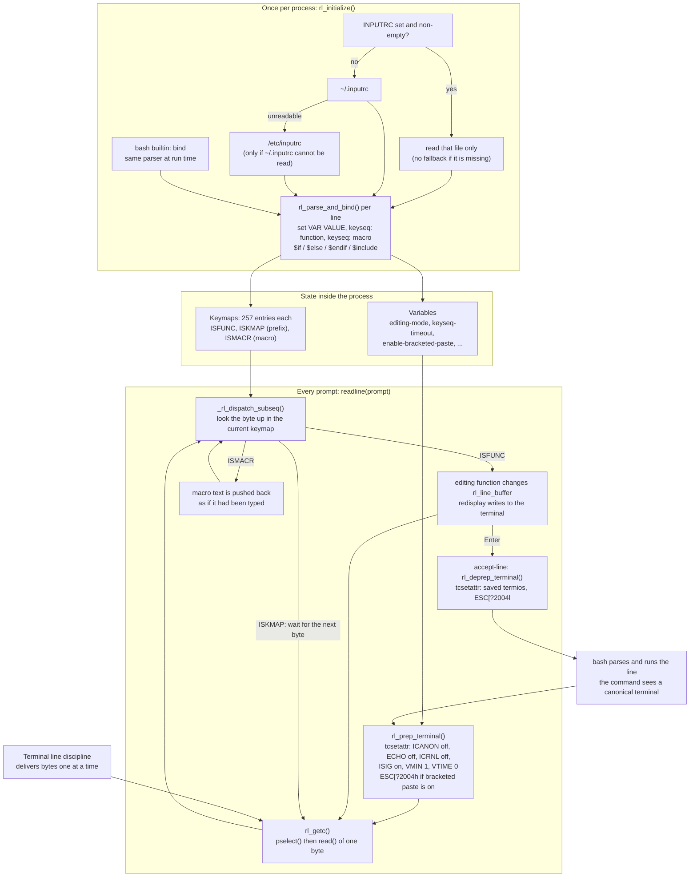

# Readline and inputrc

> [!summary] Claim
> GNU Readline is a user-space line editor linked into bash that takes the terminal out of canonical mode for the length of one prompt, maps every byte through keymaps loaded from exactly one init file (`INPUTRC`, else `~/.inputrc`, else `/etc/inputrc`), and hands the finished line back with the terminal restored, so an inputrc is executable configuration that only Readline programs obey and that no other shell reads.

Part of [Terminals and Job Control](README.md) in [Shell and Unix Engineering](../README.md).

## TL;DR

Mechanism: at each prompt bash calls `readline()`, which clears `ICANON` and `ECHO` on the terminal, reads one byte per `read(2)`, looks each byte up in a 257-entry keymap whose entries are a function, a nested keymap, or a macro, and restores the saved `termios` before the command runs (measured by the lab; `rltty.c`, `input.c`, `readline.c` in Readline 8.3).
Rule: keep one init file, start it with `$include /etc/inputrc`, guard every version-specific line with a `$if` that degrades to a safe `$else`, and treat the file as code, because a macro types commands and a trailing `\n` in it presses Enter.
Trap: Readline reads exactly one file, so creating `~/.inputrc` silently drops every binding in `/etc/inputrc` (`rl_read_init_file()`), an `INPUTRC` that names a missing file loads nothing at all, and a misspelled function name unbinds the key without a message (the replacement rule, the missing file, and the missing message are each asserted by the lab; the unbind itself was measured with `bind -p` in the shell matrix).
Portability fact: POSIX specifies only vi-mode editing behind `set -o vi` (POSIX.1-2024 XCU sh, Command Line Editing (vi-mode)); the init file, `bind`, emacs mode and bracketed paste are Readline features that zsh, ksh93, mksh, yash, dash, posh and BusyBox ash ignore, and bash 3.2 on macOS carries Readline 5.2, which has no `enable-bracketed-paste` and no `$if version`.
When not to use it: never drive Readline from automation or encode workflow logic in macros; a script should run commands directly, a non-interactive bash should not call `bind` at all, and a program that cannot accept GPLv3 should link libedit or another editor instead.

## Mental model



Once per process, `rl_initialize()` picks one init file: the file named by `INPUTRC` if that variable is set and non-empty, otherwise `~/.inputrc`, and `/etc/inputrc` only when `~/.inputrc` cannot be read.
Every line of that file, and every argument of the `bind` builtin, goes through the same parser, `rl_parse_and_bind()`, which either sets a variable or stores a function, a nested keymap, or a macro in a keymap slot.
At each prompt, `readline()` saves the terminal modes and installs its own (no line assembly, no echo, signals still on), then loops: read one byte, look it up, run the function, redraw.
A prefix byte such as `ESC` or `C-x` selects a nested keymap and waits for the next byte; a macro pushes its text back into the input so that it is dispatched exactly like typed keys.
When a function accepts the line, Readline restores the saved modes and returns the text, so the command that bash then runs sees an ordinary canonical terminal, and the cycle starts again at the next prompt.

## How it works

### Who is responsible for a typed line

A terminal in canonical mode edits the line in the kernel, as [[Canonical-and-Raw-Mode]] and [[TTY-Line-Discipline]] describe: the reader sees nothing until Enter.
A line editor takes that job into user space so that it can offer history, completion, and cursor movement.
POSIX specifies only one such editor for the shell: with `set -o vi`, `sh` "shall enable vi-mode editing" and start in insert mode, and the text adds that "Implementations may offer other command line editing modes" (POSIX.1-2024 XCU sh, Command Line Editing).
The `vi` option itself is required only "if the system supports the User Portability Utilities option", and need not work on block-mode terminals (POSIX.1-2024 XCU 2.15, set).
The standard names no init file, no `bind` utility, and no emacs mode, so everything else in this note is implementation behavior.

GNU Readline is the editor bash uses, and bash ships its own copy in `lib/readline/`.
Bash turns it on only for an interactive shell: `shell.c` guards the setup with `interactive && no_line_editing == 0`, the `--noediting` option sets `no_line_editing`, and so does `TERM=emacs`.
`initialize_readline()` in `bashline.c` then tells the library two things that the init file can test: the terminal name (`rl_terminal_name`, from `TERM`) and the application name (`rl_readline_name = "Bash"`).

### One prompt, system call by system call

`readline()` in `readline.c` is the whole per-prompt cycle (Readline 8.3):

1. It calls `rl_prep_terminal()` through `rl_prep_term_function`, then `rl_set_signals()`.
2. `rl_prep_terminal()` in `rltty.c` reads the modes with `tcgetattr()`, keeps a copy in `otio`, and writes new ones with `tcsetattr(tty, TCSADRAIN, &tio)`.
3. `prepare_terminal_settings()` builds the new modes: `c_lflag &= ~(ICANON | ECHO)`, `c_iflag &= ~(ICRNL | INLCR)` so that Enter arrives as CR and can be told from `C-j`, `c_lflag |= ISIG`, `c_cc[VMIN] = 1`, `c_cc[VTIME] = 0`, and `c_cc[VLNEXT]` disabled so that `C-v` reaches Readline.
4. With `bind-tty-special-chars` on (the default), `_rl_bind_tty_special_chars()` copies the kernel's own editing characters into the keymap: `VERASE` runs `rl_rubout`, `VKILL` runs `rl_unix_line_discard`, `VWERASE` runs `rl_unix_word_rubout`, so `stty erase` still decides what Backspace does.
5. If `enable-bracketed-paste` is on, it writes `ESC[?2004h` to the terminal.
6. `rl_getc()` in `input.c` waits in `pselect()` (through `_rl_timeout_select()`) and then calls `read(fd, &c, sizeof (unsigned char))`: one byte per system call, with `EINTR` handled by running the pending signal work and retrying.
7. `_rl_dispatch_subseq()` looks the byte up in the current keymap and acts on the entry type.
8. On accept-line, `readline()` calls `rl_deprep_terminal()`, which writes `ESC[?2004l` followed by CR when bracketed paste was on and restores `otio` with `tcsetattr()`, then `rl_clear_signals()`.

The lab reads the modes from outside while bash sits at its prompt and again while a foreground `/bin/sleep` runs, and sees exactly this: `icanon=0 echo=0 isig=1 icrnl=0 vmin=1 vtime=0` at the prompt and `icanon=1 echo=1 isig=1 icrnl=1` during the command, on bash 3.2 through 5.3.
Because `ISIG` stays set, the kernel still turns `C-c` and `C-z` into signals; Readline installs handlers for `SIGINT`, `SIGTERM`, `SIGHUP`, `SIGQUIT`, `SIGALRM`, `SIGTSTP`, `SIGTTOU`, `SIGTTIN` and `SIGWINCH` only while it is reading (`rl_set_signals()` in `signals.c`) and removes them before returning.
The job-control side of those signals belongs to [[Job-Control-Signals]] and [[fg-bg-jobs-and-the-Foreground-Process-Group]].

### Keymaps, prefixes, and macros

A keymap is an array of `KEYMAP_SIZE` (257) entries, one per byte value plus one slot for "any other key" (`keymaps.h`).
Each entry has a type: `ISFUNC` (call this editing function), `ISKMAP` (this byte is a prefix; continue in that keymap), or `ISMACR` (replay this string).
Multi-byte keys are therefore chains of keymaps: the arrow key that a terminal sends as `ESC [ A` is `ESC` (prefix), `[` (prefix), `A` (function), and [[Escape-Sequences-ECMA-48-and-xterm]] and [[terminfo-and-tput]] explain where those bytes come from.
A prefix that is also a complete binding is ambiguous: in vi insert mode `ESC` alone means "command mode", yet it also starts every arrow key.
Readline resolves the ambiguity by time: it waits `keyseq-timeout` milliseconds (default 500, `_rl_keyseq_timeout` in `readline.c`) for another byte and otherwise takes the shorter binding.
A macro is not a script: `_rl_with_macro_input()` in `macro.c` pushes the macro text onto the input, and each character is then dispatched as if typed, to a nesting depth of `MAX_MACRO_LEVEL` (16).
That is why a macro ending in `\n` executes a command: the newline is dispatched to accept-line.

### The init file

`rl_read_init_file()` in `bind.c` chooses the file, and the order is a replacement chain, not a merge:

- `INPUTRC` set and non-empty: read that file and nothing else, even if it does not exist.
- Otherwise read `~/.inputrc` (`DEFAULT_INPUTRC`); only if that read fails, read `/etc/inputrc` (`SYS_INPUTRC`).

Bash passes its shell variable `INPUTRC` to the library, so the variable does not have to be exported to affect the current shell (Readline manual, "Readline Init File").
The file is read during `readline_initialize_everything()`, after `_rl_init_terminal_io()` has looked at `TERM` and after the default bindings are installed, so the file overrides defaults, and settings such as `enable-bracketed-paste on` override the terminal-based default.
`_rl_read_init_file()` reads the whole file into memory, skips lines that start with `#`, and passes every other line to `rl_parse_and_bind()`.

A line is one of four things:

| Form | Example | Effect |
|---|---|---|
| Variable | `set editing-mode vi` | `rl_variable_bind()` sets a boolean or string variable. |
| Key to function | `"\e[1~": beginning-of-line` | `rl_bind_keyseq()` stores the function looked up by `rl_named_function()`. |
| Key to macro | `"\C-xq": "echo hello\n"` | Stores the quoted string as an `ISMACR` entry. |
| Directive | `$if Bash`, `$else`, `$endif`, `$include /etc/inputrc` | Conditional parsing and inclusion. |

Key sequences in double quotes accept `\C-x` (control), `\M-x` (meta), `\e` (escape), `\\`, `\"`, `\'`, the C escapes `\a \b \d \f \n \r \t \v`, octal `\nnn`, and hex `\xHH` (Readline manual, "Readline Init File Syntax").

`parser_if()` in `bind.c` accepts five tests:

- `$if term=NAME` compares against the full terminal name and against the part before the first `-`.
- `$if mode=emacs` or `$if mode=vi` compares against the current `editing-mode`.
- `$if APPLICATION` compares, ignoring case, against `rl_readline_name`: `Bash` for bash, `python` for CPython (`Modules/readline.c`).
- `$if version OP N.M` with `=`, `==`, `!=`, `<`, `<=`, `>`, `>=` compares the Readline version (new in Readline 8.0, CHANGES).
- `$if VARIABLE = VALUE` or `!=` compares a Readline variable (new in Readline 8.0, CHANGES).

Anything else is treated as an application name that does not match, so the test is false and the `$else` branch is taken.
That fallback is what makes version tests safe to write: Readline before 8.0 reads `version` as an application name and takes `$else`.
Readline 8.0 itself parses the comparison but stores the result inverted (`_rl_parsing_conditionalized_out = rlversion >= versionarg` in `parser_if()`, where a non-zero value means "skip"), and the Readline 8.1 release and the copy in the bash 5.1 tarball carry the same code.
The fix, which computes `opresult` and stores `1 - opresult`, arrived as bash 5.1 patch 7 (`bash51-007`, "the sense of the comparisons reversed", 2021-01) and in Readline 8.2 (Readline CHANGES, 8.1 to 8.2, item 1b).
Measured on the official bash 5.0.18 image, `$if version >= 8.0` is false and `$if version >= 9.0` is true; on bash 5.1.16, 5.2.37 and 5.3.20 both are correct (measured in the shell matrix), while bash 5.1.0 to 5.1.6 and an unpatched Readline 8.1 still invert the test.

`$include FILE` calls `_rl_read_init_file()` again with the include level raised by one, and nothing limits that level (`parser_include()` in `bind.c`).

### `bind`: the same parser at run time

The bash builtin `bind` feeds its argument to `rl_parse_and_bind()`, `bind -f FILE` reads a file the same way, `bind -v` and `bind -s` print variables and macros in init-file syntax, and `bind -x` attaches a shell command to a key through `bash_execute_unix_command()` in `bashline.c`, which exposes the line as `READLINE_LINE` and the cursor as `READLINE_POINT`.
`bind` initializes Readline on first use, which reads the init file, so a non-interactive `bash -c 'bind -s'` reports the bindings an interactive shell would get.
Bash 4.0 and later print `bind: warning: line editing not enabled` in a non-interactive shell and carry on (`builtins/bind.def`); bash 3.2 returns failure without a word (`if (no_line_editing) return (EXECUTION_FAILURE);`).

### Bracketed paste

A terminal that supports bracketed paste wraps pasted text in `ESC[200~` and `ESC[201~` after the program has sent `ESC[?2004h` (xterm control sequences, "Bracketed Paste Mode").
Readline binds `ESC[200~` to `rl_bracketed_paste_begin()` in `kill.c`, whose reader `_rl_bracketed_text()` collects bytes up to the closing sequence, turns CR into newline, and inserts the text into the line as data.
A newline inside the paste therefore stays in the buffer instead of running accept-line, and nothing executes until the user presses Enter.
The variable was added in Readline 7.0 (bash 4.4) with a default of off (Readline 7.0 CHANGES, item 2b), and has defaulted to on since Readline 8.1 (bash 5.1; Readline 8.1 CHANGES, item 2h), except that `_rl_init_terminal_io()` in `terminal.c` turns it off for a terminal named `dumb` and for one with no terminal description (Readline 8.1 CHANGES, item 1y), and in Readline 8.3 also for any terminal that `_rl_check_ansi_terminal()` does not recognize as ANSI.
The lab pastes two command lines the way a terminal would and counts what ran before Enter: none with the mode on, both with it off.

## Numbers and limits

| Quantity | Value | Source (as of 2026-11) |
|---|---|---|
| Init files read per process | 1 (plus what it `$include`s) | `rl_read_init_file()` in `bind.c`, Readline 8.3; lab tests on `INPUTRC` precedence |
| Bytes per `read(2)` at the prompt | 1 | `rl_getc()` in `input.c`: `read (fd, &c, sizeof (unsigned char))` (read from source, not traced) |
| `VMIN` and `VTIME` at a bash prompt | 1 and 0 | Lab `termios` test, bash 3.2 through 5.3, macOS and Linux; `prepare_terminal_settings()` in `rltty.c` |
| Keymap size | 257 entries (`KEYMAP_SIZE`) | `keymaps.h`, Readline 8.3 |
| `keyseq-timeout` default | 500 ms | `_rl_keyseq_timeout` in `readline.c`; Readline manual |
| Typeahead poll interval | 100000 microseconds (0.1 s) | `_keyboard_input_timeout` in `input.c` |
| Typeahead buffer | 512 bytes (`ibuffer`) | `input.c` |
| Macro nesting limit | 16 (`MAX_MACRO_LEVEL`) | `macro.c` |
| `$include` nesting limit | none | `parser_include()` in `bind.c`; a self-including file ended bash 5.3.15 with status 139 on macOS (measured by hand, not in the lab) |
| Initial line buffer | 256 bytes (`DEFAULT_BUFFER_SIZE`), grown on demand | `rldefs.h`, `readline.c` |
| `completion-query-items` default | 100 | `rl_completion_query_items` in `complete.c` |
| Bracketed paste sequences | enable `ESC[?2004h`, disable `ESC[?2004l` plus CR, start `ESC[200~`, end `ESC[201~` (6 bytes each) | `rlprivate.h` (`BRACK_PASTE_*`); lab `paste` tests |
| Readline bundled with bash 3.2.57 | 5.2 | `lib/readline/readline.h` in the bash 3.2.57 tarball |
| Readline bundled with bash 5.1.16, 5.2.37, 5.3.20 | 8.1, 8.2, 8.3 | Measured with `$if version == N.M` on the matrix binaries |
| Readline in bash 4.4.23 and 5.0.18 | 7.0 and 8.0 (inferred) | 4.4 has `enable-bracketed-paste` (new in 7.0) and no version test; 5.0 shows the inverted version test of the 8.0 source (measured) |
| First release with `enable-bracketed-paste` | Readline 7.0 (bash 4.4) | Readline CHANGES; lab `paste-on` test (bash 3.2 ignores the setting) |
| First release with it on by default | Readline 8.1 (bash 5.1) | Readline CHANGES; lab `paste-default` test |
| First release with a correct `$if version` | Readline 8.2 (bash 5.2); in bash 5.1 from patch 7 (5.1.7) | `parser_if()` in Readline 8.0, 8.1 and 8.3; Readline CHANGES (8.2, item 1b); `bash51-007`; lab `conditionals` test (bash 5.1.16 and later) |

## Portability

Every cell is asserted by the [lab](../labs/02-readline-and-inputrc/) under that shell, unless it names a source.
"Prompt modes" is what `tcgetattr()` reports while the shell waits at its prompt; `canonical` means `icanon=1 echo=1`, that is, the kernel edits the line.
"Paste default" is whether the shell switches bracketed paste on by itself with `TERM=xterm` and with `TERM=dumb`.

| Shell | Line editor and init file | Reads inputrc | Default editing | `set -o vi` gives a vi editor | Prompt modes | Paste default (xterm / dumb) | Key-binding builtin |
|---|---|---|---|---|---|---|---|
| POSIX sh | vi-mode only, behind `set -o vi`; no init file (XCU sh, Command Line Editing (vi-mode)) | Not specified | Not specified | Required with the User Portability Utilities option (XCU 2.15, set) | Not specified | Not specified | None specified |
| macOS bash 3.2.57 | Readline 5.2, inputrc | Yes | emacs | Yes | `icanon=0 echo=0 isig=1 icrnl=0` | off / off (no such variable) | `bind`; fails silently when non-interactive |
| bash 4.4.23 | Readline 7.0, inputrc | Yes | emacs | Yes | `icanon=0 echo=0 isig=1 icrnl=0` | off / off; `set enable-bracketed-paste on` works | `bind` |
| bash 5.1, 5.2, 5.3 | Readline 8.1, 8.2, 8.3, inputrc | Yes | emacs | Yes | `icanon=0 echo=0 isig=1 icrnl=0` | on / off | `bind` |
| zsh 5.9 (native) | ZLE, configured with `bindkey` in zsh startup files | No | emacs | Yes | `icanon=0 echo=0 isig=1 icrnl=1` | on / on (`zle_bracketed_paste`) | `bindkey` |
| zsh 5.9 (`--emulate sh`) | ZLE | No | emacs | Yes | `icanon=0 echo=0 isig=1 icrnl=1` | on / on | None found by `command -v` in a non-interactive shell |
| dash 0.5.12 | None unless built `--with-libedit`, then libedit and `~/.editrc` (`src/histedit.c`) | No | None: canonical | Only in a libedit build (Homebrew: yes; Debian and Alpine: accepted, edits nothing) | canonical | off / off | None |
| ksh93u+m 1.0.10 | Built-in emacs and vi editors | No | emacs (since the 2022-02-01 NEWS entry) | Yes | `icanon=0 echo=0 isig=0 icrnl=0` | off / off | None |
| ksh93u+ 2012 (macOS) | Built-in editors, off until `set -o` or `VISUAL`/`EDITOR` | No | None: canonical | Yes | canonical | off / off | None |
| mksh R59 | Built-in emacs and vi editors; emacs is the documented default (mksh(1)) | No | emacs | Yes | `icanon=0 echo=0 isig=0 icrnl=0` | off / off | `bind` (its own syntax; "can't bind, not a tty" when non-interactive) |
| yash 2.58.1 | Own editor, needs terminfo; the manual's default is vi, but the default init script run when `~/.yashrc` is absent executes `set --emacs` | No | emacs (with that init script, `TERM=xterm`) | Yes | `icanon=0 echo=0 isig=0 icrnl=0 vmin=0` | off / off | `bindkey` |
| posh 0.14.1 | None | No | None: canonical | No (`set: vi: bad option`) | canonical | off / off | None |
| BusyBox ash 1.37.0 | `libbb/lineedit.c`, emacs-style keys, no init file | No | emacs-style | Only with `FEATURE_EDITING_VI` (Alpine: yes; Debian: no); `set -o emacs` is an illegal option in both | `icanon=0 echo=0 isig=0 icrnl=1` | off / off | None |
| Programs linked against libedit's readline interface (macOS system library) | libedit reads `~/.editrc` in editrc(5) syntax: its `rl_read_init_file()` is `el_source()` (NetBSD `lib/libedit/readline.c`) | No | Not tested | Not tested | Not tested | Not tested | `bind` inside `~/.editrc` (editrc(5)) |

Two rows depend on how the binary was built, and the lab detects the build instead of the platform: a dash with libedit has an `fc` builtin (`#ifndef SMALL` in `src/builtins.def.in`), and a BusyBox with the `bbconfig` applet prints `CONFIG_FEATURE_EDITING_VI=y`.
On this macOS SDK, `libreadline.tbd` is a symbolic link to `libedit.3.tbd`, so a program that links `-lreadline` against the system library gets libedit (measured on the host).
GNU coreutils, BSD, BusyBox and uutils utilities do not take part: none of them reads a line through Readline, and `stty` matters here only because Readline copies its erase, kill and word-erase characters into the keymap.

## Worked example

The [lab](../labs/02-readline-and-inputrc/) starts the shell under test on a pseudo-terminal with a scratch `HOME`, a chosen `TERM`, and a chosen `INPUTRC`, types at it, and reports what the editor did.
Every marker it looks for is the result of an arithmetic expansion, so the echo of typed or bound text can never match: `M42F` appears only if the shell executed `echo M$((6*7))F`.

Simplified excerpt of `rl_probe.sh` (two of its cases):

```sh
# One macro on C-x q: the text is typed for the user, and the trailing \n accepts the line.
write_macro() {
  cat >"$1" <<'EOF'
"\C-xq": "echo M$((6*7))F\n"
EOF
}

case ${mode} in
  macro-env-wins)
    # Both exist: INPUTRC binds C-x q, ~/.inputrc binds C-x w. Only one file is read.
    write_macro "${home}/rc"
    cat >"${home}/.inputrc" <<'EOF'
"\C-xw": "echo H$((6*7))F\n"
EOF
    exec env -i PATH="${PATH}" HOME="${home}" TERM=xterm INPUTRC="${home}/rc" \
      "${PROBE}" keys 'k:\x18q' 'k:\x18w' m:M42F m:H42F -- "$@"
    ;;
  conditionals)
    # Each $if binds its own key in both branches, so the output names the branch taken.
    cat >"${home}/rc" <<'EOF'
$if Bash
"\C-xa": "echo IF$((1+1))bash\n"
$else
"\C-xa": "echo IF$((1+1))other\n"
$endif
$if version >= 8.0
"\C-xd": "echo VER$((1+1))new\n"
$else
"\C-xd": "echo VER$((1+1))old\n"
$endif
EOF
    ;;
esac
```

Simplified excerpt of `rl_pty_probe.c`, the part that emulates a paste:

```c
static const char text[] = "echo P$((1+1))A\recho P$((2+2))B\r";
int bracketed = last_seen("\033[?2004h") > last_seen("\033[?2004l");
if (bracketed && send_str("\033[200~") < 0) {
  return 3;
}
if (send_str(text) < 0) {
  return 3;
}
if (bracketed && send_str("\033[201~") < 0) {
  return 3;
}
pump(2000);
before = count_pasted(mark);
```

Output under bash 5.3 (each line is the exact string the bats test asserts for bash 5.1 and later):

```
$ PROBE=./rl_pty_probe ./rl_probe.sh macro-env bash
ready=1 M42F=1 alive=1
$ PROBE=./rl_pty_probe ./rl_probe.sh macro-home bash
ready=1 M42F=1 alive=1
$ PROBE=./rl_pty_probe ./rl_probe.sh macro-env-wins bash
ready=1 M42F=1 H42F=0 alive=1
$ PROBE=./rl_pty_probe ./rl_probe.sh macro-env-missing bash
ready=1 M42F=0 alive=1
$ PROBE=./rl_pty_probe ./rl_probe.sh macro-include bash
ready=1 M42F=1 alive=1
$ PROBE=./rl_pty_probe ./rl_probe.sh conditionals bash
ready=1 IF2bash=1 IF2other=0 MODE2emacs=1 MODE2vi=0 TERM2xterm=1 TERM2other=0 VER2new=1 VER2old=0 alive=1
$ PROBE=./rl_pty_probe ./rl_probe.sh termios bash
ready=1
prompt: icanon=0 echo=0 isig=1 icrnl=0 vmin=1 vtime=0
command: icanon=1 echo=1 isig=1 icrnl=1 vmin=1 vtime=0
alive=1
$ PROBE=./rl_pty_probe ./rl_probe.sh paste-on bash
ready=1 mode2004=1 before_enter=0 after_enter=2 alive=1
$ PROBE=./rl_pty_probe ./rl_probe.sh paste-off bash
ready=1 mode2004=0 before_enter=2 after_enter=2 alive=1
$ PROBE=./rl_pty_probe ./rl_probe.sh paste-dumb bash
ready=1 mode2004=0 before_enter=2 after_enter=2 alive=1
```

The same cases under other shells (asserted per family by the lab):

```
$ PROBE=./rl_pty_probe ./rl_probe.sh conditionals /bin/bash      # bash 3.2.57, Readline 5.2
ready=1 IF2bash=1 IF2other=0 MODE2emacs=1 MODE2vi=0 TERM2xterm=1 TERM2other=0 VER2new=0 VER2old=1 alive=1
$ PROBE=./rl_pty_probe ./rl_probe.sh paste-on /bin/bash          # the variable does not exist yet
ready=1 mode2004=0 before_enter=2 after_enter=2 alive=1
$ PROBE=./rl_pty_probe ./rl_probe.sh macro-env zsh               # ZLE never reads the file
ready=1 M42F=0 alive=1
$ PROBE=./rl_pty_probe ./rl_probe.sh paste-dumb zsh              # ZLE brackets pastes on its own
ready=1 mode2004=1 before_enter=0 after_enter=2 alive=1
$ PROBE=./rl_pty_probe ./rl_probe.sh termios dash                # no editor: the kernel edits the line
ready=1
prompt: icanon=1 echo=1 isig=1 icrnl=1 vmin=1 vtime=0
command: icanon=1 echo=1 isig=1 icrnl=1 vmin=1 vtime=0
alive=1
```

What the output proves:

1. One key chord ran a command: the macro's text was typed for the user and its `\n` pressed Enter.
2. `INPUTRC` replaces `~/.inputrc` (`H42F=0`), and an `INPUTRC` that names a missing file loads nothing (`M42F=0`) although the same `~/.inputrc` works when `INPUTRC` is unset.
3. `$include` is the only way to combine files.
4. `$if` saw the application (`Bash`), the mode (`emacs`), the terminal (`xterm`), and, from Readline 8.2 or bash 5.1 patch 7, the version; Readline 5.2 took the `$else` branch of the version test.
5. Readline owns the terminal modes only while it reads: the foreground command got a canonical terminal back.
6. With bracketed paste on, two pasted newlines ran nothing until Enter (`before_enter=0`), then both lines ran; with it off, both ran at once.

## Pitfalls

> [!warning] A new ~/.inputrc silently drops /etc/inputrc
> Trigger: a user creates `~/.inputrc` with one line, for example `set editing-mode vi`, on a system whose `/etc/inputrc` carries key bindings (Debian 13's file binds `"\e[1~": beginning-of-line`, `"\e[3~": delete-char`, and `"\e[1;5C": forward-word` inside `$if mode=emacs`; read from the matrix image).
> Symptom: every binding made only in the system file is gone, for example Ctrl-arrow word movement, because `rl_read_init_file()` reads `/etc/inputrc` only when `~/.inputrc` cannot be read; the files are never merged (the lab's `macro-env-wins` case shows the same rule for `INPUTRC` against `~/.inputrc`).
> Fix: make `$include /etc/inputrc` the first line of every personal init file (the lab's `macro-include` case proves the directive).

> [!warning] INPUTRC that points at a missing file disables every init file
> Trigger: a login script exports `INPUTRC=/etc/inputrc.custom` on a host where that file was never deployed.
> Symptom: neither `~/.inputrc` nor `/etc/inputrc` is read and no message is printed; the lab's `macro-env-missing` case reports `M42F=0` for the very `~/.inputrc` that works when `INPUTRC` is unset.
> Fix: export `INPUTRC` only after testing the file (`[ -r "$f" ] && INPUTRC=$f`), or leave it unset and use `$include`.

> [!warning] A misspelled function name unbinds the key without a message
> Trigger: `"\C-xz": no-such-function` or any typo in a function name.
> Symptom: `rl_parse_and_bind()` calls `rl_bind_keyseq(seq, rl_named_function(funname))`, and an unknown name yields a null function, so the key sequence is left bound to nothing; no Readline release reports it (lab, bash 4.0 through 5.3; in the shell matrix, a key first bound to `kill-line` and then to `no-such-function` no longer appears in `bind -p` under bash 4.4.23 and 5.3.20).
> A misspelled variable is reported as `readline: FILE: line N: NAME: unknown variable name` only from Readline 7.0 (bash 4.4); bash 4.0 through 4.3 print nothing (measured on the official 4.0 to 4.3 images).
> Fix: after editing, run `bind -f ~/.inputrc` in a current bash and read the messages, then check the result with `bind -q FUNCTION` or `bind -s`.

> [!warning] The `$if version` test is unusable before Readline 8.2
> Trigger: an init file shared between macOS `/bin/bash` (Readline 5.2), an old server with bash 5.0, and a current bash uses `$if version >= 8.1` to guard a newer setting.
> Symptom: Readline before 8.0 treats `version` as an application name, so the test is false; Readline 8.0 inverts the comparison, so on bash 5.0.18 `$if version >= 8.0` is false and `$if version >= 9.0` is true (measured; `parser_if()` in Readline 8.0 assigns the comparison straight to `_rl_parsing_conditionalized_out`), and the Readline 8.1 release and bash 5.1.0 to 5.1.6 carry the same inverted code until bash 5.1 patch 7 (`bash51-007`) and Readline 8.2.
> Fix: write the test so that "false" is the safe answer and put the conservative settings in `$else`; do not put anything that must run on 8.0 or an unpatched 8.1 behind a version test.

> [!warning] A pasted newline runs a command when bracketed paste is off
> Trigger: pasting multi-line text into bash 5.0 or older (including macOS `/bin/bash` 3.2), into any bash with `TERM=dumb`, or into dash, ksh93, mksh, yash, posh or BusyBox ash.
> Symptom: each newline is dispatched to accept-line, so every complete line executes immediately; the lab counts two executed commands before Enter (`before_enter=2`) in all of those shells.
> Fix: use a shell whose editor brackets pastes (bash 5.1 or later on a real terminal type, zsh), set `enable-bracketed-paste on` explicitly for bash 4.4 and 5.0, and still read what was pasted before pressing Enter, because the protection depends on the terminal emulator filtering the end marker (see Security and robustness).

> [!warning] An init file that includes itself crashes every Readline program at startup
> Trigger: `$include ~/.inputrc` inside `~/.inputrc`, or two files that include each other.
> Symptom: `parser_include()` recurses into `_rl_read_init_file()` with no depth limit; bash 5.3.15 on macOS died with status 139 (`SIGSEGV`) on `bind -f` of a self-including file (measured by hand, not part of the lab).
> Fix: include only system files from personal files, never the reverse, and recover with `INPUTRC=/dev/null bash`.

> [!warning] bind in a startup file run by a non-interactive bash
> Trigger: `bind` lines in a file that a non-interactive bash sources, for example a `~/.bashrc` sourced from a script.
> Symptom: bash 4.0 and later print `bind: warning: line editing not enabled` on stderr for every call; bash 3.2 returns status 1 silently, which aborts a file that runs under `set -e` (lab).
> Fix: guard interactive setup with `case $- in *i*) ... ;; esac`, or move bindings into the init file, which only an editing shell reads.

> [!warning] The binding works in bash and nowhere else
> Trigger: expecting `~/.inputrc` to configure zsh, ksh, a BusyBox shell on an embedded host, or a tool linked against libedit.
> Symptom: the lab's macro runs under every bash and under no other shell family; libedit's `rl_read_init_file()` hands the file to `el_source()`, which expects editrc(5) syntax.
> Fix: configure each editor in its own language (`bindkey` for zsh and yash, `bind` for mksh, `~/.editrc` for libedit), and rely only on `set -o vi` when the same habit must work on several shells.

## Security and robustness

- An init file is code.
  A macro can type any command and end it with `\n`, and `bind -x` runs shell code on a keystroke, so write access to `~/.inputrc`, to a file it includes, or to the value of `INPUTRC` is command execution as that user at the next keystroke.
  Review it with the same care as `~/.bashrc`, and keep it out of world-writable or shared directories.
- `INPUTRC` crosses privilege boundaries as an ordinary environment variable.
  It appears in none of the tables in sudo's `plugins/sudoers/env.c`: not in `initial_badenv_table`, which names `ENV`, `BASH_ENV` and `TERMINFO`, and not in `initial_keepenv_table`.
  Whether sudo removes it therefore depends on `env_reset`: with that flag set, sudo runs the command with only `TERM`, `PATH`, `HOME`, `MAIL`, `SHELL`, `LOGNAME`, `USER` and `SUDO_*` plus whatever matches `env_keep` and `env_check`, so `INPUTRC` is dropped unless a site adds it to `env_keep`; with `env_reset` off it passes through, because it is in no table (sudoers(5), `env_reset`, in sudo's `docs/sudoers.man.in`, where the default is set at build time).
- Bracketed paste is a convention between two parties, not a boundary.
  Readline ends the paste at the first `ESC[201~` it reads (`_rl_bracketed_text()`), so the terminal emulator must remove that sequence from pasted content.
  NVD records failures on the emulator side: CVE-2018-4106 (macOS Terminal before 10.13.4, "allows user-assisted attackers to inject arbitrary commands within pasted content") and CVE-2021-31701 ("Mintty before 3.4.7 mishandles Bracketed Paste Mode").
  [[Terminal-Escape-Injection]] covers the attack class.
- Not every Readline program accepts pastes as text.
  CPython's `Modules/readline.c` calls `rl_variable_bind ("enable-bracketed-paste", "off")` after reading the init file, because its REPL does not implement bracketed paste, so an inputrc cannot turn it on there.
- The one Readline flaw recorded in NVD is a temporary-file race: CVE-2014-2524, "The `_rl_tropen` function in util.c in GNU readline before 6.3 patch 3 allows local users to create or overwrite arbitrary files via a symlink attack on a /var/tmp/rltrace.[PID] file" (CVSS v2 3.3).
- Terminal state survives only an orderly exit.
  Readline restores the saved modes in `rl_deprep_terminal()`, which also runs from its signal cleanup (`rl_cleanup_after_signal()` in `signals.c`), but a process killed with `SIGKILL` runs no cleanup, so a Readline program killed at its prompt leaves the terminal without echo and without line assembly; recover as [[Canonical-and-Raw-Mode]] describes (`stty sane`).
- A shell that edits lines changes what a driver program must send.
  Enter is CR at a Readline prompt (`ICRNL` is off), and typed text is echoed by the editor, with redraw sequences, rather than by the kernel; [[expect-and-Automating-Interactive-Programs]] and [[Pseudo-Terminals]] cover driving such a program.

## The principal's view

The decision is how much of a team's working habit may live in line-editor configuration.
Readline configuration is per user, per host, per Readline version, and invisible to every other shell, so anything that must work during an incident on an unfamiliar machine cannot depend on it.
The portable surface is one command, `set -o vi`, and even that fails on posh and on dash or BusyBox builds without the feature (lab).

A staff-plus engineer therefore splits the problem:

1. Personal ergonomics go in `~/.inputrc`, starting with `$include /etc/inputrc`, with version-specific lines behind tests that fail safe, and with no macro that ends in `\n`.
2. Fleet defaults go in `/etc/inputrc` and stay minimal: key decoding for the terminals in use and `enable-bracketed-paste on` for hosts whose bash predates 5.1.
   The trade-off is that a fleet-wide `INPUTRC` export would be simpler to manage, but it disables every user's own file and loads nothing where the file is missing.
3. Anything that must be repeatable is a script or a function, not a macro, and is tested without a terminal.
4. A product that needs line editing chooses its library by license and platform first: Readline is distributed under GPLv3 (its `COPYING`), which constrains the license of any program that links it, and macOS ships libedit under the Readline name, with a different init file.
   A full-screen or highly customized prompt belongs in a language with a dedicated library rather than in Readline callbacks.
5. Automation never types into Readline: a job that needs a shell's behavior runs `bash -c`, and one that truly must drive an interactive program uses a pseudo-terminal driver and treats the editor as an adversary ([[expect-and-Automating-Interactive-Programs]]).

## Interview questions

> [!question] L5: What happens to the terminal between the moment bash prints a prompt and the moment the command you typed starts running?
>
> > [!success]- Answer
> > Bash calls `readline()`, which saves the current `termios` and installs its own with `tcsetattr()`.
> > The new modes clear `ICANON` and `ECHO`, clear `ICRNL` and `INLCR`, keep `ISIG`, and set `VMIN` to 1 and `VTIME` to 0, so every byte reaches the process at once and the kernel no longer echoes or edits.
> > Readline then reads one byte per `read(2)`, dispatches it through its keymaps, and redraws the line itself.
> > When the line is accepted it restores the saved modes, so the command runs on a canonical terminal.
> > The lab shows `icanon=0 echo=0` at the prompt and `icanon=1 echo=1` while a foreground `sleep` runs.
> >
> > Follow-up: Why does `C-c` still interrupt at the prompt although the terminal is not in canonical mode?

> [!question] L5: Which init file does Readline read, and in what order?
>
> > [!success]- Answer
> > Exactly one: the file named by `INPUTRC` if that variable is set and non-empty, otherwise `~/.inputrc`, and `/etc/inputrc` only if `~/.inputrc` cannot be read.
> > The files are never merged, and a missing `INPUTRC` file does not fall back to the others.
> > The only way to combine files is `$include`.
> > The lab proves all three statements with a macro that exists in only one of the files.
> >
> > Follow-up: A user reports that Ctrl-arrow word movement stopped working after they created `~/.inputrc`; what is the one-line fix?

> [!question] L5: Predict the output: with `INPUTRC` unset and a `~/.inputrc` that contains only `"\C-xq": "echo M$((6*7))F\n"`, what does each shell print when a user presses `C-x q` at a bash prompt and then at a zsh prompt?
>
> > [!success]- Answer
> > Bash echoes the macro text `echo M$((6*7))F`, the trailing `\n` accepts the line, and the command prints `M42F`.
> > Zsh prints nothing new: ZLE does not read `~/.inputrc`, and `C-x q` is not bound there.
> > The lab reports `M42F=1` for every bash from 3.2 to 5.3 and `M42F=0` for zsh, ksh93, mksh, yash, dash, posh and BusyBox ash.
> >
> > Follow-up: What would change if the macro did not end in `\n`?

> [!question] L6: Debug this init file: why do pastes still execute line by line on a server running bash 5.0, although the file is meant to enable bracketed paste wherever it exists?
> ```
> $if version >= 7.0
> set enable-bracketed-paste on
> $endif
> ```
>
> > [!success]- Answer
> > Readline 8.0, which bash 5.0 bundles, parses the version test but inverts its result, so `version >= 7.0` is false there and the `set` line is skipped.
> > Readline before 8.0 does not know the test at all and treats `version` as an application name, so the line is skipped on bash 4.4 too, although 4.4 has the variable.
> > The version test only works from Readline 8.2 (bash 5.2) or bash 5.1 at patch 7 or later (`bash51-007`), and Readline 8.1 already enables bracketed paste by default.
> > The fix is to drop the test: an unknown variable in a `set` line is ignored by old releases (reported as `unknown variable name` from Readline 7.0, silently before), so `set enable-bracketed-paste on` can stand alone.
> >
> > Follow-up: How would you confirm on that server which branch of a conditional was taken?

> [!question] L6: Why does pasting two lines into bash 5.0 run the first line immediately, while bash 5.1 waits for Enter?
>
> > [!success]- Answer
> > In bash 5.0 the variable `enable-bracketed-paste` defaults to off, so Readline never sends `ESC[?2004h`, the terminal sends the paste as plain bytes, and each newline is dispatched to accept-line.
> > Readline 8.1 in bash 5.1 turns the variable on by default, so the terminal wraps the paste in `ESC[200~` and `ESC[201~`.
> > Readline binds the start sequence to `bracketed-paste-begin`, reads to the end sequence, and inserts the text, newlines included, as data.
> > The default is off again when `TERM` is `dumb` or has no terminal description.
> > The lab reports `before_enter=0` with the mode on and `before_enter=2` with it off.
> >
> > Follow-up: What must the terminal emulator do for this to be a security control rather than a convenience?

> [!question] L6: What happens on bash 5.3 and on macOS `/bin/bash` when an engineer adds `bind '"\C-l": clear-screen'` to a deploy script "so the output is tidy"?
>
> > [!success]- Answer
> > The script runs non-interactively, so line editing is not enabled.
> > Bash 5.3 prints `bind: warning: line editing not enabled` on stderr, initializes Readline anyway, which reads the user's init file, and returns 0.
> > Bash 3.2 returns status 1 with no message, and under `set -e` that ends the script.
> > Neither has any effect on the script, because nothing reads a line through Readline.
> > The line should be deleted, or moved to the init file if it was meant for interactive use.
> >
> > Follow-up: Which bash invocation makes the `read` builtin use Readline, and does the init file apply to it?

> [!question] L6: How does Readline decide between `ESC` meaning "enter vi command mode" and `ESC` starting an arrow key?
>
> > [!success]- Answer
> > In the vi insertion keymap `ESC` is both a complete binding and a prefix of longer sequences such as `ESC [ A`.
> > After reading the ambiguous byte, Readline waits up to `keyseq-timeout` milliseconds, 500 by default, for more input.
> > If another byte arrives in time it continues down the prefix keymap; otherwise it runs the shorter binding.
> > The cost is a visible delay after `ESC` in vi mode, and the risk is a slow link that delivers an arrow key's bytes more than the timeout apart, which then acts as `ESC` followed by literal characters.
> > Zsh has the same mechanism with `KEYTIMEOUT`, in hundredths of a second.
> >
> > Follow-up: What breaks if you set `keyseq-timeout` to 0?

> [!question] L7+: You own the base image for a fleet that mixes bash 4.4, 5.0 and 5.2: what line-editor configuration do you ship, and what do you refuse to do?
>
> > [!success]- Answer
> > Ship a small `/etc/inputrc` with terminal key decoding and an unconditional `set enable-bracketed-paste on`, which 4.4 and 5.0 need and 5.2 already has.
> > Do not export `INPUTRC` fleet-wide: it replaces every user's `~/.inputrc`, and a host where the file is missing then loads nothing.
> > Do not use `$if version`, because it is unknown to 4.4 and inverted on 5.0.
> > Document that a personal `~/.inputrc` must start with `$include /etc/inputrc`, since otherwise it replaces the system file.
> > Keep macros and `bind -x` out of the system file, because it is executed, in effect, by every interactive user including root.
> > Verify with a pseudo-terminal test like the lab's rather than by reading the file, because parse errors in function names are silent.
> >
> > Follow-up: How would you detect, fleet-wide, users whose init file contains a macro that ends in a newline?

> [!question] L7+: A security review asks whether `~/.inputrc` belongs in the same threat model as `~/.bashrc`: what is your answer, argued from the mechanism?
>
> > [!success]- Answer
> > Yes, with one difference in trigger.
> > A macro is replayed through the dispatcher as typed input, so a binding on a common key such as Enter or `C-m` can run an arbitrary command and then the user's own, and `bind -x` runs shell code directly.
> > The file is read by every Readline program the user starts, not only by bash (the CPython REPL is one), and `$if APPLICATION` can target a single program.
> > Unlike `~/.bashrc` it does not execute at startup, only on a keystroke, which makes it harder to notice.
> > `INPUTRC` extends the surface to anyone who can set the environment, and it is not on sudo's list of always-removed variables.
> > Controls are the same as for shell startup files: ownership and mode checks, no includes from writable locations, and monitoring for changes.
> >
> > Follow-up: Why does bracketed paste not help against a malicious init file?

> [!question] L7+: Your team is writing an interactive CLI in C and wants history and editing: how does linking GNU Readline compare with the alternatives?
>
> > [!success]- Answer
> > Readline gives users their existing habits and their `~/.inputrc`, with `$if APPLICATION` for per-program bindings, but it is distributed under GPLv3, which constrains the license of the program that links it.
> > Libedit is BSD-licensed and offers a Readline-compatible API, but it reads `~/.editrc` in a different syntax, so users' inputrc files do nothing, and on macOS `-lreadline` silently means libedit.
> > Both take over the terminal modes and signal handlers while reading, so the program must restore the terminal on every exit path and must not assume canonical mode inside callbacks.
> > If the program needs multi-line editing, highlighting or completion menus, a dedicated library in a higher-level language is usually less work than Readline's callback interface.
> > Whatever the choice, test it on a pseudo-terminal, because none of this code runs when stdin is a pipe.
> >
> > Follow-up: What does your program have to do when it receives `SIGWINCH` or `SIGTSTP` in the middle of a line?

## Related

Prerequisites: [[fg-bg-jobs-and-the-Foreground-Process-Group]]

Next: [[Terminal-Multiplexers-tmux-and-screen]]

See also: [[Canonical-and-Raw-Mode]], [[TTY-Line-Discipline]], [[termios-and-stty]], [[Pseudo-Terminals]], [[Escape-Sequences-ECMA-48-and-xterm]], [[terminfo-and-tput]], [[Terminal-Emulators-and-TERM]], [[Job-Control-Signals]], [[Terminal-Escape-Injection]], [[expect-and-Automating-Interactive-Programs]]

## Further reading

- [GNU Readline 8.3 source](https://ftp.gnu.org/gnu/readline/readline-8.3.tar.gz): `bind.c` (init file parser), `rltty.c` (terminal modes), `input.c` (the read loop), `kill.c` (bracketed paste), and `CHANGES` (which release added what).
- [GNU Readline 8.0 source](https://ftp.gnu.org/gnu/readline/readline-8.0.tar.gz): `parser_if()` here shows the inverted version comparison that bash 5.0 ships.
- [GNU Readline user manual](https://tiswww.case.edu/php/chet/readline/rluserman.html): the init file syntax, every variable and its default, and every bindable function.
- [GNU bash 5.3 source](https://ftp.gnu.org/gnu/bash/bash-5.3.tar.gz): `bashline.c` (`initialize_readline`, `bash_execute_unix_command`), `builtins/bind.def`, and `shell.c` (when line editing is enabled).
- [GNU bash 3.2.57 source](https://ftp.gnu.org/gnu/bash/bash-3.2.57.tar.gz): the bash that macOS still ships, with Readline 5.2 and a `bind` that fails silently without a terminal.
- [POSIX.1-2024 sh utility](https://pubs.opengroup.org/onlinepubs/9799919799/utilities/sh.html): Command Line Editing (vi-mode), the only line editor the standard specifies.
- [POSIX.1-2024 XCU chapter 2](https://pubs.opengroup.org/onlinepubs/9799919799/utilities/V3_chap02.html): section 2.15, `set -o vi`, and the condition under which it is required.
- [xterm control sequences](https://invisible-island.net/xterm/ctlseqs/ctlseqs.html): the definition of bracketed paste mode and private mode 2004.
- [NetBSD libedit readline.c](https://raw.githubusercontent.com/NetBSD/src/trunk/lib/libedit/readline.c): the Readline-compatible interface that reads editrc instead of inputrc.
- [NVD record for CVE-2014-2524](https://services.nvd.nist.gov/rest/json/cves/2.0?cveId=CVE-2014-2524): the Readline trace-file symlink flaw.
- [NVD records that mention bracketed paste](https://services.nvd.nist.gov/rest/json/cves/2.0?keywordSearch=bracketed%20paste): CVE-2018-4106 and CVE-2021-31701, both failures in terminal emulators.
- [CPython Modules/readline.c](https://raw.githubusercontent.com/python/cpython/main/Modules/readline.c): a Readline client that sets its own application name and overrides the init file on bracketed paste.
