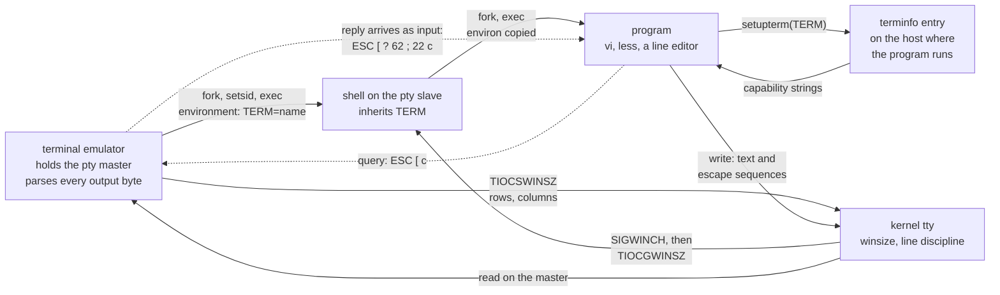

# Terminal Emulators and TERM

> [!summary] Claim
> A terminal emulator is the process that holds the master side of a pseudo-terminal, and `TERM` is nothing more than a name it writes into its child's environment: an unverified promise about which capability description fits, which every hop can copy, drop, or rewrite, while the window size and the terminal's real identity travel by separate channels.

Part of [Terminals and Job Control](README.md) in [Shell and Unix Engineering](../README.md).

## TL;DR

- Mechanism: the emulator opens a pseudo-terminal, stores the window size in the kernel with `TIOCSWINSZ`, builds an environment that contains `TERM=name`, and starts the shell on the slave side; programs look `name` up in terminfo to choose the bytes they write, and the emulator interprets those bytes.
- Rule: let the emulator (or the multiplexer, for its panes) set `TERM`, never assign it in a shell startup file, read the size from the kernel (`stty size`, `tcgetwinsize`) rather than from `TERM` or an exported `COLUMNS`, and decide whether to emit escape sequences with `[ -t 1 ]`.
- Trap: `TERM` crosses machine and privilege boundaries (ssh sends it inside `pty-req`, sudo keeps it) but the terminfo entry does not, so a new emulator's name is unknown on the far side, and "fixing" that with `TERM=xterm-256color` promises capabilities the terminal may not have.
- Portability: POSIX defines `TERM` only as "the terminal type for which output is to be prepared" and leaves its format unspecified (POSIX.1-2024 XBD 8.3); in the lab, bash alone invents `TERM=dumb` (unexported) when it is unset, zsh, mksh and ksh93u+m set `COLUMNS` and `LINES` in a script, bash 5 sets them only after a foreground command, and dash, posh, yash and BusyBox ash never do.
- When not to use it: `TERM` cannot tell you whether output is interactive (a container runtime sets `TERM=xterm` on a captured stream) or whether a feature newer than the terminfo entry exists; for the first use `[ -t 1 ]`, for the second query the terminal with a timeout or use a terminal library in a real language.

## Mental model



The emulator creates the pseudo-terminal, records the window size in the kernel, and starts a shell whose environment carries one string, `TERM=name`.
Every process the shell starts inherits that string by the ordinary rules of `execve`, so `TERM` reaches a program only as far as the environment is copied intact.
The program hands the name to `setupterm`, which searches the terminfo database of the machine the program runs on, not the machine the emulator runs on, and gets back the byte strings for that terminal type.
The program writes text and those strings to the slave; the kernel's line discipline passes them to the master, where the emulator parses them and draws.
Size takes a different road: the emulator calls `TIOCSWINSZ`, the kernel stores the numbers and raises `SIGWINCH`, and programs read them back with `TIOCGWINSZ`.
The dotted arrows are the only way to learn what the terminal really is: the program writes a query, and the emulator's answer comes back on standard input as if it had been typed.

## How it works

**What an emulator is.**
A terminal emulator is an ordinary process that owns the master descriptor of a pseudo-terminal pair (see [[Pseudo-Terminals]]).
It has four duties, and the lab's `miniterm.c` implements exactly these in 300 lines of C with no screen at all: allocate the pair (`posix_openpt`, `grantpt`, `unlockpt`), store a window size with `ioctl(TIOCSWINSZ)`, start a child in a new session with the slave as its controlling terminal and an environment the emulator composed, then read every byte the child writes and act on the control sequences among them.
`TERM` is a line in that composed environment and nothing else.
xterm takes the name from its `-tn name` option or `termName` resource, each documented as the terminal type name "to be set in the TERM environment variable" (xterm manual).
On the Linux console there is no emulator process, and the kernel supplies the name: `envp_init` in `init/main.c` starts the first user process with `"HOME=/", "TERM=linux"` (Linux master, as of 2026-11).
On a serial line `agetty` sets it from its `term` argument, "inherited by login and the shell", defaulting to `vt100`, or `linux` on a virtual terminal (agetty(8)).

**What TERM is.**
POSIX defines it in three sentences (POSIX.1-2024 XBD 8.3):
"This variable shall represent the terminal type for which output is to be prepared."
"This information is used by utilities and application programs wishing to exploit special capabilities specific to a terminal."
"The format and allowable values of this environment variable are unspecified."
In practice the value is a key into the terminfo database, whose format and search path [[terminfo-and-tput]] covers.
The ncurses entry point `TINFO_SETUP_TERM` in `ncurses/tinfo/lib_setup.c` reads `getenv("TERM")` when the caller passes no name, fails with "TERM environment variable not set." when it is missing or empty, rejects names longer than `MAX_NAME_SIZE` with "TERM environment must be 1..%d characters.", and reports "unknown terminal type." when no entry is found (ncurses master, as of 2026-11).
Nothing checks that the name describes the emulator on the other end: the emulator never reads `TERM` back, and a wrong value produces wrong bytes rather than an error.
The lab shows the value is an opaque string: `TERM=two words` reaches the shell and its child unchanged (lab test 1).

**How it travels.**
Inside one machine `TERM` moves by environment inheritance only (see [[Environment-Variables-and-Inheritance]]).
Across ssh it is part of the protocol: the `pty-req` channel request carries a string field described as "TERM environment variable value (e.g., vt100)", followed by the width and height in characters and pixels and the encoded terminal modes (RFC 4254 section 6.2).
The OpenSSH client fills that field in `ssh_session2_setup`, which takes `TERM` from a `SetEnv` line if one is set and otherwise from `getenv("TERM")` (openssh-portable master `ssh.c`); the server stores it in `session_pty_req`, turning an empty string into no value, and `do_setup_env` puts it into the child's environment with `child_set_env(&env, &envsize, "TERM", s->term)` (`session.c`).
So `TERM` needs no `AcceptEnv` on the server, and ssh_config(5) says as much: `SetEnv` variables must be accepted by the server "with the exception of the TERM variable".
Later size changes go in a separate `window-change` request (RFC 4254 section 6.7).
sudo with the default `env_reset` preserves `TERM` when its checks allow: the sudoers manual lists `TERM` among the variables "preserved from the invoking user's environment if permitted by the env_check, or env_keep options", `initial_checkenv_table` in `plugins/sudoers/env.c` names `TERM` and `COLORTERM` among the variables checked for `%` and `/` characters, and `rebuild_env` adds `TERM=unknown` when none survived (sudo main, as of 2026-11).
The same file lists `TERMINFO`, `TERMINFO_DIRS`, `TERMPATH` and `TERMCAP` in `initial_badenv_table`, the variables sudo removes, which is why a private terminfo directory does not follow you through sudo.
tmux is an emulator in its own right and replaces the value: `environ_for_session` in `environ.c` sets `TERM` from the `default-terminal` option (whose compiled default is `TMUX_TERM`, defined as `"screen"` in `tmux.h`), and also sets `TERM_PROGRAM=tmux` and `COLORTERM=truecolor` (tmux master, as of 2026-11); see [[Terminal-Multiplexers-tmux-and-screen]].
A container runtime does the same in its small way: `docker run -t alpine:3.22` gave the process `TERM=xterm`, and the same command without `-t` gave no `TERM` at all (measured here with the Docker CLI on OrbStack, as of 2026-11).

**What the shell does with it.**
A shell running a script has no use for `TERM`, and the lab shows that dash, posh, mksh, ksh93, yash, zsh and BusyBox ash leave it unset when the emulator exports nothing.
bash is the exception: `initialize_shell_variables` calls `set_if_not ("TERM", "dumb")`, which creates a shell variable without the export attribute, so `"${TERM-unset}"` is `dumb` in the script while a child process still has no `TERM` (bash-5.3 `variables.c`; lab test 2, bash 3.2.57 through 5.3.20).
Interactive shells are different, because the line editor is a terminal program.
Readline's `_rl_init_terminal_io` substitutes `"dumb"` for a missing name, treats `dumb`, `vt52` and `adm3a` as dumb terminals, calls `tgetent`, and on failure clears every capability and sets `_rl_enable_bracketed_paste = 0` (bash-5.3 `lib/readline/terminal.c`).
When the terminal is usable, `rl_prep_terminal` writes `BRACK_PASTE_INIT`, defined as `"\033[?2004h"`, before each line is read and `rl_deprep_terminal` writes `"\033[?2004l\r"` after it (bash-5.3 `lib/readline/rltty.c` and `rlprivate.h`).
Bracketed paste became the default in bash 5.1 (bash-5.3 `NEWS`: "Bracketed paste mode is enabled by default."), and the 5.1-rc2 entry in `CHANGES` adds: "Terminals that are named "dumb" or unknown do not enable bracketed paste by default."
The lab reproduces both sentences: bash 5.1.16, 5.2.37 and 5.3.20 write `ESC [ ? 2004 h` under `TERM=xterm` and write no escape byte under `TERM=dumb` or an unknown name, and bash 3.2.57 and 4.4.23 never write it (lab tests 10 and 11).
Assigning `TERM`, `TERMCAP` or `TERMINFO` in an interactive bash re-runs that initialisation through `sv_terminal`, which calls `rl_reset_terminal` (bash-5.3 `variables.c`).
zsh reads the entry in `init_term`, which marks the terminal bad when `tgetent` fails and reports "can't find terminal definition for" the name only if the shell is already interactive at that point (zsh master `Src/init.c`); zsh 5.9 started on an unknown name in the lab printed no diagnostic.
Its bracketed paste does not depend on the entry at all: `setup_` in `Src/Zle/zle_main.c` assigns the two sequences to the `zle_bracketed_paste` array unconditionally, and zsh 5.9 in the lab sends `ESC [ ? 2004 h` even under `TERM=dumb` (lab tests 10 and 11).
yash is the strict one: `le_setupterm` in `lineedit/terminfo.c` calls `setupterm` and returns failure unless the entry has `am`, cursor motion in all four directions and `el`, and `le_readline` in `lineedit/lineedit.c` then returns `INPUT_ERROR` (yash trunk, as of 2026-11).
In the lab yash 2.58.1 writes no escape byte under `TERM=dumb` or an unknown name (lab test 11).
ksh93u+m shells out for its multiline mode: `get_tput` in `src/cmd/ksh93/edit/edit.c` runs `tput` through a command substitution whenever the exported `TERM` changes (ksh93u+m dev, as of 2026-11).
mksh and BusyBox ash hard-code their sequences; `ask_terminal` in BusyBox `libbb/lineedit.c` writes `ESC [ 6 n` after the prompt whatever `TERM` says, which the lab sees under `TERM=dumb` (lab test 11).
dash and posh have no line editor in the builds measured and write no escape byte at all.

**Size is not part of TERM.**
A terminfo entry records the dimensions of a hardware model (`vt100` says 24 by 80), but the live size is kernel state: one `struct winsize` per terminal (see [[termios-and-stty]]).
The emulator writes it with `TIOCSWINSZ`; in Linux `tiocswinsz` in `drivers/tty/tty_io.c` calls the driver's resize operation, which for a pseudo-terminal is `pty_resize` in `drivers/tty/pty.c`: it returns at once if the size is unchanged and otherwise sends `SIGWINCH` with `kill_pgrp` to the foreground process group of each end (Linux master, as of 2026-11).
The lab runs the shell on a 50 by 132 terminal with `TERM=vt100` and `stty size` prints `50 132` (lab test 3).
`COLUMNS` and `LINES` are a user override, not a report: "When COLUMNS is set, the number of columns in the terminal window size and any terminal-width information implied by TERM are overridden", and "Users and conforming applications should not set COLUMNS unless they wish to override the system selection" (POSIX.1-2024 XBD 8.3).
Shells differ in whether they maintain the two variables for a script (lab test 4).
zsh calls `adjustwinsize(0)` from `setupvals` at startup (zsh master `Src/init.c`, `Src/utils.c`).
mksh calls `change_winsz` in `main.c` ("initialise tty size before importing environment"), and its `getspec` in `var.c` carries the reason it keeps them unexported (mksh master, as of 2026-11):
"Do NOT export COLUMNS/LINES."
"Many applications check COLUMNS/LINES before checking ws.ws_col/row, so if the app is started with C/L in the environ and the window is then resized, the app won't see the change cause the environ doesn't change."
ksh93u+m calls `sh_winsize` in `sh_main` and installs a `SIGWINCH` handler for non-interactive shells, under the comment `keep $COLUMNS and $LINES up to date even for scripts that don't trap SIGWINCH` (ksh93u+m dev `src/cmd/ksh93/sh/main.c`).
bash calls `get_new_window_size` after a foreground job when `checkwinsize` is set (bash-5.3 `jobs.c`, `lib/sh/winsize.c`); the option has applied to non-interactive shells since bash 4.3 and has been on by default since bash 5.0 (bash-5.3 `NEWS`).
dash, posh, yash and BusyBox ash do not set them in a script.

**Identity beyond TERM.**
Because the name is a promise, programs that need the truth ask the terminal.
Primary Device Attributes is `CSI c`; a VT220-class terminal answers `CSI ? 6 2 ; Ps c`, where the parameter 22 means ANSI color (xterm control sequences).
`CSI > 0 q` (XTVERSION) asks for the emulator's name and version and is answered with `DCS > | text ST`, and `DCS + q Pt ST` (XTGETTCAP) asks for individual termcap or terminfo strings (xterm control sequences).
The lab's emulator answers Device Attributes with `ESC [ ? 62 ; 22 c` whether the shell was told `TERM=vt100` or `TERM=xterm-256color` (lab test 8), and honors xterm's window operation `CSI 8 ; height ; width t` by resizing the pseudo-terminal (lab test 5).
A reply is input, so the program must read it without echo and without line buffering, and must stop waiting at some point (see [[Canonical-and-Raw-Mode]] and [[Escape-Sequences-ECMA-48-and-xterm]]).
Environment hints fill the gaps cheaply: tmux exports `COLORTERM=truecolor` and `TERM_PROGRAM=tmux` as shown above.
zsh's development branch now combines all three: `query_terminal` in `Src/Zle/termquery.c` reads `TERM_PROGRAM` and `COLORTERM`, then sends one batch of queries that ends with Device Attributes, commented "we get a response from most terminals so by putting this last we can short-circuit the time delay waiting for less well-supported responses that might never come", and its XTVERSION query is described in a comment as `useful with terminals that lie in $TERM so that they work without terminfo entries` (zsh master, as of 2026-11; the zsh 5.9 in the lab sends no query).

## Numbers and limits

| Quantity | Value | Source |
| --- | --- | --- |
| Format of `TERM` | unspecified | POSIX.1-2024 XBD 8.3 |
| Longest name ncurses accepts | 512 bytes (`MAX_NAME_SIZE`) | ncurses master `include/tic.h` and `lib_setup.c` (as of 2026-11) |
| `TERM` given to the first Linux process | `linux` | `envp_init`, Linux master `init/main.c` (as of 2026-11) |
| `agetty` default | `vt100`, or `linux` on a virtual terminal | agetty(8) |
| tmux `default-terminal` compiled default | `screen` | tmux master `tmux.h`, `options-table.c` (as of 2026-11) |
| sudo fallback when no `TERM` survives | `TERM=unknown` | sudo main `plugins/sudoers/env.c`, `rebuild_env` (as of 2026-11) |
| `docker run -t` | `TERM=xterm`; without `-t`, unset | measured here, Docker CLI on OrbStack (as of 2026-11) |
| ssh `pty-req` payload | one `TERM` string, four `uint32` dimensions, one modes string | RFC 4254 section 6.2 |
| bash default when `TERM` is unset | shell variable `dumb`, not exported | bash-5.3 `variables.c`; lab test 2 |
| Bracketed paste on by default | bash 5.1 and later, known non-dumb terminals only | bash-5.3 `NEWS` and `CHANGES`; lab test 10 |
| `checkwinsize` | honoured by non-interactive bash since 4.3, on by default since 5.0 | bash-5.3 `NEWS`; lab test 4 |
| Names readline treats as dumb | `dumb`, `vt52`, `adm3a`, and any name `tgetent` cannot find | bash-5.3 `lib/readline/terminal.c` |
| BusyBox size override | `LINES` and `COLUMNS` win over the kernel; a value of 1 or less, or 30000 or more, becomes 24 or 80 | BusyBox master `libbb/xfuncs.c`, `wh_helper` (as of 2026-11); lab test 7 |
| Compiled terminfo files shipped | 2684 on the macOS host (ncurses 6.0.20150808), 42 in the Debian 13 image, 40 in the Alpine 3.22 image | `find` over the system terminfo directories, measured here (as of 2026-11) |
| Entries for newer emulators | `xterm-ghostty`, `xterm-kitty` and `foot` absent from all three; `alacritty` present only in the Alpine image | `infocmp` and directory listing, measured here (as of 2026-11) |
| ncurses release that added the Ghostty entry | 6.5-20241228 | Ghostty documentation (as of 2026-11) |
| Whole run of the lab's identity query, terminal answers | 0.11 to 0.14 s | `time -p`, 5 runs on the macOS host (2026-11); process startup included |
| Same query, terminal silent | 2.05 to 2.10 s (the client's `VTIME` of 20 tenths) | same host and method; lab test 9 asserts at least 1 s |

The timing rows describe this lab on one laptop, not terminals in general; the point is the ratio between an answered query and a timed-out one.

## Portability

Shells, measured by the lab in the matrix (macOS host, Alpine 3.22 image, Debian 13 image; 30 shell runs, 11 of 11 tests each, 2026-11).
"Stale" in the fourth column means the shell still reports the inherited `COLUMNS=80` after the terminal was resized to 132 columns.

| Shell | `TERM` when the emulator exports none | `COLUMNS` and `LINES` in a script on a 50 by 132 terminal | Inherited `COLUMNS=80` after a resize to 132 | Writes `ESC [ ? 2004 h` under `TERM` = `dumb`, `xterm`, unknown | Writes any ESC under `TERM=dumb` |
| --- | --- | --- | --- | --- | --- |
| POSIX sh | the shell is not required to set it; its format is unspecified (POSIX.1-2024 XBD 8.3) | not required of the shell; when set they override the window size for utilities (XBD 8.3) | not specified | not specified | not specified |
| macOS bash 3.2.57 (`/bin/sh`, `/bin/bash`) | `dumb`, not exported | unset before and after a command | stale | no, no, no | no |
| bash 4.4.23 | `dumb`, not exported | unset before and after | stale | no, no, no | no |
| bash 5.1.16, 5.2.37, 5.3.15, 5.3.20 | `dumb`, not exported | unset at start, 132 and 50 after one foreground command | 132 | no, yes, no | no |
| zsh 5.9 and 5.9.2 native | unset (run with `-f`; a site `zshenv` can change it) | 132 and 50 from the start | 132 | yes, yes, yes | yes |
| zsh `--emulate sh` | unset | 132 and 50 from the start | 132 | yes, yes, yes | yes |
| dash 0.5.12, 0.5.13.5 | unset | unset | stale | no, no, no | no |
| ksh93u+m 1.0.10 | unset | 132 and 50 from the start | 132 | no, no, no | no |
| ksh93u+ 2012-08-01 (macOS `/bin/ksh`) | unset | unset | stale | no, no, no | no |
| mksh R59 2025/04/26 (Debian) | unset | 132 and 50 from the start | 132 | no, no, no | no |
| mksh R59 2020/10/31 (Alpine) | unset | 132 and 50 from the start | stale | no, no, no | no |
| yash 2.58.1 | unset | unset | stale | no, no, no | no |
| posh 0.14.1 | unset | unset | stale | no, no, no | no |
| BusyBox ash 1.37.0 | unset | unset | stale | no, no, no | yes (`ESC [ 6 n`) |

Evidence by column: lab tests 2, 4, 6, 10 and 11.

Utilities, which do not change with the shell:

| Utility | Behavior | Evidence |
| --- | --- | --- |
| GNU coreutils `stty` 9.7 | `stty size` prints the kernel's `24 80` with `LINES=17 COLUMNS=91` in the environment | lab test 7, Debian 13 image |
| macOS `stty` (BSD) | same: `24 80` | lab test 7, macOS host |
| BusyBox `stty` 1.37.0 | prints `17 91`: `LINES` and `COLUMNS` override the kernel | lab test 7, Alpine 3.22 image; `wh_helper` in BusyBox `libbb/xfuncs.c` |
| uutils `stty` | not measured; the lab's `stty_flavor` reports `uutils` and tests 6 and 7 fail rather than guess | lab tests 6 and 7 |
| ncurses `tput` 6.0.20150808 (macOS), 6.5.20250216 (Debian 13) | `TERM=xterm-ghostty tput clear` prints `tput: unknown terminal "xterm-ghostty"` and exits 3; an empty or unset `TERM` prints `tput: No value for $TERM and no -T specified` and exits 2 | measured here on both (as of 2026-11); statuses as in [[terminfo-and-tput]] |

Classification: the bash default is an extension that POSIX neither requires nor forbids; setting `COLUMNS` and `LINES` in the shell is likewise an extension; BusyBox's override is conforming, because XBD 8.3 says the variables override the window size when set.

## Worked example

The lab is [lab](../labs/02-terminal-emulators-and-term/).
`miniterm.c` is the emulator, `term-client.sh` is the program that runs inside it under the shell under test, and `term.bats` holds the 11 tests.

Simplified excerpt of `miniterm.c` (the two control sequences it understands, and the child's start):

```c
static const char da_reply[] = "\033[?62;22c";

/* A complete control sequence ESC [ PARAM FINAL has arrived: act on the two this terminal knows. */
static void dispatch(struct term *t, char final) {
  int rows, cols;
  t->param[t->param_len] = '\0';
  if (final == 'c' && (t->param_len == 0 || strcmp(t->param, "0") == 0)) {
    if (!t->mute && write(t->master, da_reply, sizeof(da_reply) - 1) < 0) {
      perror("miniterm: reply");
    }
  } else if (final == 't' && sscanf(t->param, "8;%d;%d", &rows, &cols) == 2) {
    if (set_size(t->master, rows, cols) < 0) {
      perror("miniterm: TIOCSWINSZ");
    }
  }
}

/* In the child, after fork: a new session, the slave as controlling terminal and as
   descriptors 0 to 2, and an environment made only of the NAME=VALUE words on the command line. */
setsid();
fd = open(name, O_RDWR);
ioctl(fd, TIOCSCTTY, 0);
dup2(fd, 0); dup2(fd, 1); dup2(fd, 2);
environ = argv + first_env;
execvp(argv[cmd_at], argv + cmd_at);
```

Simplified excerpt of `term-client.sh` (the query, and the resize mode that uses it as a barrier):

```sh
# ask_da: send Primary Device Attributes and read the reply into $reply, one byte at a time,
# until the final "c" or 2 seconds of silence (VMIN 0, VTIME 20); an empty $reply means no answer.
ask_da() {
  saved=$(stty -g)
  stty -echo -icanon min 0 time 20
  printf '\033[c'
  reply=
  while :; do
    c=$(
      dd bs=1 count=1 2>/dev/null
      echo x
    )
    c=${c%x}
    [ -n "$c" ] || break
    reply=$reply$c
    if [ "$c" = c ]; then
      break
    fi
  done
  stty "$saved"
}

  resize)
    before=$(kernel_size)
    printf 'before: kernel=%s COLUMNS=%s LINES=%s\n' "$before" "${COLUMNS-unset}" "${LINES-unset}"
    printf '\033[8;%d;%dt' "$2" "$3"
    ask_da
    after=$(kernel_size)
    seen=$(stty size)
    printf 'after: kernel=%s COLUMNS=%s LINES=%s stty=%s\n' "$after" "${COLUMNS-unset}" "${LINES-unset}" "$seen"
    ;;
```

The resize request has no reply, so the client sends Device Attributes right after it and waits for that answer: the emulator handles bytes in order, so when the answer arrives the resize has happened.

Captured on the macOS host (dash 0.5.13.5, `/bin/bash` 3.2.57, bash 5.3.15, zsh 5.9.2); `screen=` is every byte the child wrote, with ESC shown as `<ESC>`.
Each line is asserted by the test named on the right.

```
$ miniterm 24 80 TERM=lab-9000 PATH=$PATH -- dash term-client.sh env
screen=shell=lab-9000 child=lab-9000\r\n                                      (test 1)
$ miniterm 24 80 PATH=$PATH -- dash term-client.sh env
screen=shell=unset child=unset\r\n                                            (test 2, dash)
$ miniterm 24 80 PATH=$PATH -- /bin/bash term-client.sh env
screen=shell=dumb child=unset\r\n                                             (test 2, bash)

$ miniterm 50 132 TERM=vt100 PATH=$PATH -- dash term-client.sh size
screen=start: COLUMNS=unset LINES=unset\r\nkernel: 50 132\r\nafter: COLUMNS=unset LINES=unset\r\n   (tests 3, 4)
$ miniterm 50 132 TERM=vt100 PATH=$PATH -- zsh term-client.sh size
screen=start: COLUMNS=132 LINES=50\r\nkernel: 50 132\r\nafter: COLUMNS=132 LINES=50\r\n            (test 4, zsh)
$ miniterm 50 132 TERM=vt100 PATH=$PATH -- bash term-client.sh size
screen=start: COLUMNS=unset LINES=unset\r\nkernel: 50 132\r\nafter: COLUMNS=132 LINES=50\r\n       (test 4, bash 5)

$ miniterm 24 80 TERM=vt100 COLUMNS=80 LINES=24 PATH=$PATH -- dash term-client.sh resize 40 132
screen=before: kernel=24 80 COLUMNS=80 LINES=24\r\n<ESC>[8;40;132t<ESC>[cafter: kernel=40 132 COLUMNS=80 LINES=24 stty=40 132\r\n    (tests 5, 6)
$ miniterm 24 80 TERM=vt100 COLUMNS=80 LINES=24 PATH=$PATH -- bash term-client.sh resize 40 132
screen=before: kernel=24 80 COLUMNS=80 LINES=24\r\n<ESC>[8;40;132t<ESC>[cafter: kernel=40 132 COLUMNS=132 LINES=40 stty=40 132\r\n   (test 6, bash 5)

$ miniterm 24 80 TERM=xterm-256color PATH=$PATH -- dash term-client.sh identify
screen=<ESC>[cTERM=xterm-256color\r\nreply=ESC[?62;22c\r\n                    (test 8)
$ miniterm -m 24 80 TERM=xterm-256color PATH=$PATH -- dash term-client.sh identify
screen=<ESC>[cTERM=xterm-256color\r\nreply=none\r\n                           (test 9)
```

On the Alpine image, where `stty` is BusyBox, the dash line of test 6 ends `COLUMNS=80 LINES=24 stty=24 80`: the kernel says 40 by 132, the shell still says 80, and the child `stty` believes the stale environment.

The interactive tests start the shell with `-i`, wait until it has been silent for 1.5 seconds, and type `exit`; they assert only whether `<ESC>[?2004h` (test 10) or any `<ESC>` (test 11) occurs in the transcript.
Two captured transcripts from the same host, bash 5.3.15 with `--norc --noprofile -i`:

```
TERM=xterm   screen=<ESC>[?2004hbash-5.3$ exit\r\n<ESC>[?2004l\rexit\r\n
TERM=dumb    screen=bash-5.3$ exit\r\nexit\r\n
```

## Pitfalls

> [!warning] The name crosses the wire, the entry does not
> Trigger: ssh from an emulator with its own terminfo entry (`xterm-ghostty`, `xterm-kitty`) to a host whose database predates it.
> Symptom: "missing or unsuitable terminal: xterm-ghostty", "Error opening terminal: xterm-ghostty." or "WARNING: terminal is not fully functional" (Ghostty documentation); kitty's FAQ names the same root cause, "the kitty terminfo files not being available"; here `TERM=xterm-ghostty tput clear` exits 3 on macOS and on Debian 13.
> Fix: install the entry on the far side (`infocmp -x xterm-ghostty | ssh HOST -- tic -x -`, from the Ghostty documentation), or downgrade at the boundary for that host with `SetEnv TERM=xterm-256color` in `ssh_config` and accept the lost features.

> [!warning] Assigning TERM in a startup file
> Trigger: `export TERM=xterm-256color` in `.bashrc` or `.profile` to "get colors".
> Symptom: the line also runs inside tmux, on the Linux console and over a serial line, where it is false; tmux's FAQ is blunt that "Inside tmux TERM must be "screen", "tmux" or similar", and the ncurses FAQ calls setting `TERM` to `xterm` "usually (except for xterm itself) a bad idea" because the name "refers to a specific terminal emulator".
> Fix: delete the line; configure the name in the emulator (or tmux's `default-terminal`), and if a host lacks the entry fix that host or that ssh connection only.

> [!warning] sudo keeps TERM and drops TERMINFO
> Trigger: an emulator that points `TERMINFO` at a private directory, then `sudo` to run a full-screen program.
> Symptom: the program sees the name but not the directory and reports an unknown terminal; kitty's FAQ says these programs "often filter the TERMINFO environment variable", and sudo's `initial_badenv_table` lists `TERMINFO` and `TERMINFO_DIRS`.
> Fix: install the entry system-wide (a distribution package, or `tic` as root); `Defaults env_keep += "TERM TERMINFO"` works too (kitty FAQ) but hands a user-controlled database path to privileged programs, see Security and robustness.

> [!warning] An exported COLUMNS goes stale
> Trigger: `COLUMNS` and `LINES` in the environment (an `export` in a profile, a wrapper that forwards them), then a window resize.
> Symptom: lab test 6: after a resize to 132 columns dash, posh, yash, BusyBox ash, bash 3.2 and 4.4, ksh93u+ 2012 and Alpine's mksh still expand `COLUMNS` to 80 and pass it on, and BusyBox `stty size` prints `24 80` while the kernel holds `40 132`.
> Fix: never export them; read the size when you need it (`stty size`, `tput cols`), and `unset COLUMNS LINES` before starting a full-screen program from a wrapper.

> [!warning] Escape bytes in captured interactive output
> Trigger: driving an interactive shell on a pseudo-terminal (expect, a CI step that allocates a terminal) with `TERM` naming a real terminal.
> Symptom: bash 5.1 and later prefix every prompt with `ESC [ ? 2004 h` and follow each line with `ESC [ ? 2004 l` and a carriage return (lab transcript above); bash 3.2 instead writes `ESC [ ? 1034 h` once under `TERM=xterm` (measured here on macOS 3.2.57 and the Alpine 3.2 build), because its `_rl_enable_meta_key` sends the entry's `mm` string when the entry has `km` or `MT` (bash-3.2 `lib/readline/terminal.c`).
> Fix: do not allocate a terminal for automation; if you must, set `TERM=dumb` for bash, and for zsh unset `zle_bracketed_paste`, since "Unsetting the parameter has the effect of ensuring that bracketed paste remains disabled" (zsh manual, Parameters) and `TERM=dumb` alone does not stop it (lab test 11).

> [!warning] A query with no timeout
> Trigger: writing Device Attributes or a cursor position request to something that never answers: a log replay, a serial console, a pseudo-terminal wrapper with no emulator behind it.
> Symptom: a blocking read hangs forever; with a timeout the lab's client loses 2 seconds and gets nothing (lab test 9); a late answer lands in the next reader's input, which BusyBox's own source documents: "the response will be delivered later, possibly to an unsuspecting application" (`ask_terminal`, `libbb/lineedit.c`).
> Fix: query only when stdin and stdout are terminals and `TERM` is not `dumb`, read with `stty -icanon -echo min 0 time N`, restore the settings in a trap, and send Device Attributes last so that its answer bounds the wait for everything before it.

> [!warning] A startup file that turns unset into empty
> Trigger: a site-wide zsh startup file that runs `export TERM=$TERM`; the `/etc/zshenv` chain generated by nix-darwin on the macOS host used here does (measured 2026-11).
> Symptom: every native zsh, scripts included, then has `TERM` set to the empty string and exports it, so `"${TERM-dumb}"` expands to nothing while `"${TERM:-dumb}"` works; ncurses treats the empty name like a missing one ("TERM environment variable not set.").
> Fix: test with `"${TERM:-dumb}"`, treat empty, `dumb` and `unknown` alike, and keep `TERM` assignments out of files that non-interactive shells read; lab test 2 runs native zsh with `-f` for this reason.

> [!warning] Using TERM to detect a terminal
> Trigger: `if [ "$TERM" != dumb ]` or `[ -n "$TERM" ]` as the test for "interactive".
> Symptom: `docker run -t` sets `TERM=xterm` even when the output is being recorded, a process writing into a pipe still inherits `TERM` from the terminal the pipeline was started on, and bash scripts see `dumb` where other shells see nothing (lab test 2).
> Fix: `[ -t 1 ]` answers whether standard output is a terminal; `TERM` only says which kind it would be.

## Security and robustness

- `TERM` is remote input: the ssh client chooses the string and sshd places it in the session's environment without consulting `AcceptEnv` (`session_pty_req` and `do_setup_env` in `session.c`), so a server-side script must quote it and must never build a path or a command from it.
- Terminal databases are parsed by privileged programs: CVE-2023-29491 is "ncurses before 6.4 20230408, when used by a setuid application, allows local users to trigger security-relevant memory corruption via malformed data in a terminfo database file that is found in `$HOME/.terminfo` or reached via the TERMINFO or TERM environment variable" (NVD, CVSS 3.1 base score 7.8).
- That is the reason behind sudo's defaults: `TERM` and `COLORTERM` pass only if they contain no `%` or `/`, and `TERMINFO`, `TERMINFO_DIRS`, `TERMPATH` and `TERMCAP` are removed (`initial_checkenv_table` and `initial_badenv_table` in `env.c`); adding `TERMINFO` to `env_keep` trades that protection for convenience.
- A reply to a query is input that the program did not type and the user did not type; anything that can write to the terminal can cause one, which is the subject of [[Terminal-Escape-Injection]].
- Robust output code needs three checks in this order: `[ -t 1 ]`, then `TERM` not empty, `dumb` or `unknown`, then the capability itself with its exit status (see [[terminfo-and-tput]]).
- Any code that changes terminal modes to read a reply must restore them on every exit path; the lab's `ask_da` saves `stty -g` first, and [[termios-and-stty]] has the trap pattern.
- An emulator that leaves the size at 0 by 0 makes every program guess: BusyBox's `wh_helper` substitutes 24 and 80, and [[Pseudo-Terminals]] lists what else goes wrong; set the size before starting the child, as `miniterm.c` does.

## The principal's view

The decision is who owns `TERM` on each side of each boundary, because every hop can change it and only one party at each hop knows the truth.
The emulator knows what it implements, so it owns the name locally; a multiplexer owns it for its panes; the operator of a fleet owns which names resolve on the servers.

For a fleet there are three workable policies, and the choice is fidelity against reach.
Shipping current terminfo entries to every host (a newer ncurses, the distribution's extra terminfo package, or configuration management running `tic`) keeps every feature and costs a deployment per new emulator.
Downgrading at the boundary (`SetEnv TERM=xterm-256color` for a host class) costs nothing on the servers and silently loses whatever the real terminal does beyond xterm's entry, and it is a lie the first time the terminal differs from xterm.
Doing nothing leaves each engineer to patch dotfiles, which is how `export TERM=...` ends up in startup files and breaks tmux and consoles later.
The first policy is the right default for hosts you manage, the second for hosts you do not.

For tools you write, the stronger position is not to depend on `TERM` at all: plain text when `[ -t 1 ]` is false, a handful of SGR colors when it is true and `TERM` is not `dumb`, and nothing that needs cursor addressing.
When a tool does need a full-screen interface, a shell script with `tput` is the wrong layer: it pays a process per capability, reads replies only through the `stty` and `dd` choreography the lab needs, and inherits every pitfall above.
Use a terminal library in a compiled or managed language, which gets terminfo lookups, queries with timeouts, resize handling and mode restoration in one tested place.
For automation, the best terminal is none: do not allocate one, and where a program insists, give it `TERM=dumb` and a fixed size.

## Interview questions

> [!question] L5: What is `TERM`, who sets it, and what breaks when it is wrong?
>
> > [!success]- Answer
> > `TERM` is an environment variable naming the terminal type that output should be prepared for; POSIX leaves its format unspecified (POSIX.1-2024 XBD 8.3).
> > The terminal emulator sets it in the environment of the shell it starts, and every later process inherits it.
> > Programs pass the name to `setupterm`, which loads the terminfo entry of that name on the machine where the program runs.
> > If the name is unknown there, curses programs refuse to start or fall back to a dumb mode; if the name is known but does not describe the real terminal, the program sends sequences the terminal misreads.
> > Nothing verifies the name against the emulator.
> >
> > Follow-up: Where does `TERM=linux` come from on a machine with no terminal emulator running?

> [!question] L5: Predict the output of `env -i bash -c 'echo "${TERM-unset}"; env | grep -c "^TERM="'`, and say how dash differs.
>
> > [!success]- Answer
> > bash prints `dumb` and then `0`.
> > `initialize_shell_variables` runs `set_if_not ("TERM", "dumb")`, which creates a shell variable without the export attribute, so the expansion sees it and the child `env` does not.
> > dash prints `unset` and then `0`, because it does not invent the variable.
> > The lab asserts both as `shell=dumb child=unset` and `shell=unset child=unset` (lab test 2).
> >
> > Follow-up: Why does a script that tests `[ -n "$TERM" ]` behave differently under bash and dash in a cron job?

> [!question] L5: You ssh from a new terminal emulator to an old server and `less` says the terminal is not fully functional; what happened and what are the fixes?
>
> > [!success]- Answer
> > The ssh client sent the local `TERM` in the `pty-req` request and sshd put it in the remote environment (RFC 4254 section 6.2).
> > The remote terminfo database has no entry of that name, so `setupterm` fails.
> > Fix one: copy the entry, for example `infocmp -x NAME | ssh HOST -- tic -x -`, which compiles it into the server's system database or, failing that, the user's own terminfo directory (Ghostty documentation).
> > Fix two: send a name the server knows, with `SetEnv TERM=xterm-256color` for that host in `ssh_config`, accepting that features beyond that entry are lost.
> > Setting `TERM` in the remote shell startup file is the wrong fix, because it also applies to sessions from other terminals.
> >
> > Follow-up: Why does the entry not travel with the name?

> [!question] L6: How does a program learn the window width, and why is `export COLUMNS` a bug?
>
> > [!success]- Answer
> > The authoritative value is the kernel's `struct winsize` for the terminal, read with `TIOCGWINSZ` or `tcgetwinsize`, and updated by the emulator with `TIOCSWINSZ`, which raises `SIGWINCH`.
> > `COLUMNS` and `LINES` are overrides: POSIX says that when they are set they replace the window size and anything implied by `TERM`.
> > An exported value is a snapshot, so after a resize every child still receives the old number.
> > The lab shows dash keeping `COLUMNS=80` after a resize to 132, and BusyBox `stty size` printing `24 80` because it trusts the variables over the kernel (lab tests 6 and 7).
> > mksh's source states the rule: do not export them, because applications check them before the kernel value.
> >
> > Follow-up: Which shells maintain `COLUMNS` in a script without being asked, and by what mechanism?

> [!question] L6: Debug this script: it prints garbage into `build.log` and prints no color at all inside tmux.
>
> ```sh
> #!/bin/sh
> if [ "$TERM" = "xterm-256color" ]; then
>   red=$(tput setaf 1)
>   reset=$(tput sgr0)
> fi
> printf '%sFAILED%s\n' "$red" "$reset" | tee -a build.log
> ```
>
> > [!success]- Answer
> > The test asks which terminal type was declared, not whether output goes to a terminal, so the escape sequences are written into the pipe and `tee` appends them to the log.
> > Inside tmux `TERM` is `screen` or `tmux-256color`, the comparison is false, and both variables stay empty.
> > Run here, the script wrote `ESC [ 3 1 m FAILED ESC ( B ESC [ m` into the pipe under `TERM=xterm-256color` and plain `FAILED` under `TERM=tmux-256color`.
> > The fix is to test `[ -t 1 ]`, let `tput` decide per terminal type with its exit status guarded (`red=$(tput setaf 1 2>/dev/null) || red=`), and keep color out of the log by writing the log separately.
> >
> > Follow-up: The script runs under `set -e`; which line can now abort it on a terminal without color?

> [!question] L6: A test harness that drives `bash -i` through a pseudo-terminal started failing after an upgrade from bash 5.0 to 5.1, with `[?2004h` in the captured output; explain it and fix it.
>
> > [!success]- Answer
> > bash 5.1 turned readline's bracketed paste mode on by default.
> > Readline writes `ESC [ ? 2004 h` when it prepares the terminal for a line and `ESC [ ? 2004 l` plus a carriage return when it finishes.
> > It does this only for a terminal it considers capable: a missing, `dumb` or unknown `TERM` disables it.
> > The lab shows exactly that split for bash 5.1 to 5.3, and no such bytes from bash 3.2 or 4.4 (lab test 10).
> > Fixes, best first: do not use an interactive shell for automation; set `TERM=dumb` in the harness; or run `bind 'set enable-bracketed-paste off'`.
> >
> > Follow-up: Why is `TERM=dumb` not enough to quiet zsh in the same harness?

> [!question] L6: Inside tmux, what should `TERM` be, who sets it, and what goes wrong if you force `xterm-256color`?
>
> > [!success]- Answer
> > tmux is the terminal emulator for the programs in its panes, so it sets `TERM` itself, from the `default-terminal` option, whose compiled default is `screen`.
> > Its FAQ says the value inside must be `screen`, `tmux` or similar, such as `tmux-256color`.
> > Programs then emit the sequences tmux's own parser implements, and tmux translates to whatever the outer terminal's entry says.
> > Forcing `xterm-256color` inside makes programs send xterm-specific sequences and expect xterm key codes that tmux does not promise.
> > The outer `TERM` must describe the real emulator, because tmux reads that entry to drive it.
> >
> > Follow-up: A host has no `tmux-256color` entry; what are the two ways to make a session there usable?

> [!question] L7+: Why can `TERM` not be trusted, how should a modern program discover terminal features instead, and what does that cost?
>
> > [!success]- Answer
> > `TERM` is a self-declared name that passes through ssh, sudo, multiplexers and container runtimes, each of which may replace it, and many emulators deliberately claim an `xterm` name to be accepted by programs that match on that string.
> > Ghostty documents choosing `xterm-ghostty` because many applications search the `TERM` value for the string `xterm` to assume capabilities.
> > The alternative is to ask: Device Attributes, XTVERSION and XTGETTCAP are answered by the emulator itself, as the lab's emulator answers `ESC [ ? 62 ; 22 c` under any `TERM` (lab test 8).
> > The costs are real: the reply is input, so the program must switch off echo and canonical mode, a silent terminal costs the whole timeout (2 seconds in lab test 9), and a late reply can leak into the next program's input.
> > The standard mitigation is to send Device Attributes last as a sentinel, since nearly every terminal answers it, and to skip queries when not on a terminal or when `TERM` is `dumb`.
> > Cheap hints such as `COLORTERM` and `TERM_PROGRAM` reduce the number of queries, as zsh's development branch does.
> >
> > Follow-up: A multiplexer sits between the program and the real terminal; who should answer the query, and what does each choice break?

> [!question] L7+: Your organization adopts a terminal emulator whose terminfo entry is not on any of 5000 servers; how do you design the rollout?
>
> > [!success]- Answer
> > State the invariant first: on every host a user can reach, the `TERM` they arrive with must resolve, or be replaced before the first program reads it.
> > For managed hosts, ship the entry: upgrade the terminfo package or have configuration management run `tic` into the system database, and verify with `infocmp NAME` in the host health check.
> > For unmanaged or frozen hosts, downgrade at the client with a `Host` block that sets `SetEnv TERM=xterm-256color`, and document which features are lost.
> > Handle privilege changes separately: sudo keeps `TERM` but removes `TERMINFO`, so per-user entries do not survive it and the system database must hold the entry.
> > Forbid `TERM` assignments in shared dotfiles and lint for them.
> > Measure the failure rather than wait for tickets: count logins whose `TERM` does not resolve.
> >
> > Follow-up: A security reviewer objects to `env_keep += "TERMINFO"` in sudoers; what is the argument and what do you offer instead?

> [!question] L7+: Why does sudo treat `TERM` and `TERMINFO` differently, and what does that teach about environment variables that name data files?
>
> > [!success]- Answer
> > `TERM` is a short name that the library looks up in trusted system directories, so sudo passes it after checking that it contains no `%` or `/`.
> > `TERMINFO` and `TERMINFO_DIRS` are paths chosen by the caller, so a privileged program would parse a file the unprivileged user controls; sudo removes them by default.
> > CVE-2023-29491 is the concrete case: malformed terminfo data reached through `TERMINFO`, `TERM` or the home directory corrupted memory in setuid programs using ncurses before 6.4 20230408.
> > The general lesson is to separate a selector from a search path: a selector can cross a privilege boundary after validation, a caller-supplied path to parsed data should not.
> >
> > Follow-up: The CVE text also lists `$HOME/.terminfo`; why does removing `TERMINFO` not close that route, and what does?

## Related

Prerequisites: [[Terminal-Multiplexers-tmux-and-screen]]

Next: [[Terminal-Escape-Injection]]

See also: [[Pseudo-Terminals]]; [[terminfo-and-tput]]; [[Escape-Sequences-ECMA-48-and-xterm]]; [[termios-and-stty]]; [[Canonical-and-Raw-Mode]]; [[Readline-and-inputrc]]; [[Environment-Variables-and-Inheritance]]; [[expect-and-Automating-Interactive-Programs]]

## Further reading

- [POSIX.1-2024 XBD chapter 8, Environment Variables](https://pubs.opengroup.org/onlinepubs/9799919799/basedefs/V1_chap08.html): the normative definitions of `TERM`, `COLUMNS` and `LINES`, including the override rule.
- [XTerm Control Sequences](https://invisible-island.net/xterm/ctlseqs/ctlseqs.html): Device Attributes, XTVERSION, XTGETTCAP, the window operations and bracketed paste, from the emulator every other one imitates.
- [ncurses FAQ](https://invisible-island.net/ncurses/ncurses.faq.html): the terminfo maintainer on why `TERM=xterm` is the wrong answer for emulators that are not xterm.
- [RFC 4254, sections 6.2 and 6.7](https://www.rfc-editor.org/rfc/rfc4254.txt): how `TERM` and the window size cross an ssh connection.
- [bash 5.3 source](https://ftp.gnu.org/gnu/bash/bash-5.3.tar.gz): `variables.c` for the `dumb` default and `sv_terminal`, `lib/readline/terminal.c` and `rltty.c` for what readline does with the name.
- [ncurses `lib_setup.c`](https://raw.githubusercontent.com/ThomasDickey/ncurses-snapshots/master/ncurses/tinfo/lib_setup.c): the code that turns `TERM` into an entry or into one of three error messages.
- [sudo `env.c`](https://raw.githubusercontent.com/sudo-project/sudo/main/plugins/sudoers/env.c): the tables that decide which terminal variables survive a privilege change.
- [OpenSSH `session.c`](https://raw.githubusercontent.com/openssh/openssh-portable/master/session.c): `session_pty_req` and `do_setup_env`, where a client-chosen string becomes the server-side `TERM`.
- [Linux `drivers/tty/pty.c`](https://raw.githubusercontent.com/torvalds/linux/master/drivers/tty/pty.c): `pty_resize`, the whole of how a resize becomes `SIGWINCH`.
- [tmux FAQ](https://raw.githubusercontent.com/wiki/tmux/tmux/FAQ.md): the maintainer's rules for `TERM` inside and outside a multiplexer.
- [Ghostty terminfo documentation](https://ghostty.org/docs/help/terminfo): a current emulator's account of the ssh and sudo failures and of why its name starts with `xterm-`.
- [NVD CVE-2023-29491](https://services.nvd.nist.gov/rest/json/cves/2.0?cveId=CVE-2023-29491): the record for terminfo parsing in setuid programs.
