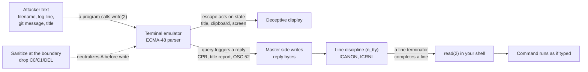

# Terminal Escape Injection

> [!summary] Claim
> A terminal acts on the bytes any program writes to it, and some of those actions write bytes back onto your keyboard input queue, so printing an untrusted string - a log line, a filename, a commit message - can make the terminal type text into your shell that you never pressed.

Part of [Terminals and Job Control](README.md) in [Shell and Unix Engineering](../README.md).

## TL;DR

- Mechanism: escape sequences are an in-band, bidirectional protocol (see [[Escape-Sequences-ECMA-48-and-xterm]]), so a byte stream written to a terminal can set its state and trigger a reply that the line discipline queues as input, indistinguishable from typing.
- Rule: sanitize untrusted data at the boundary before it reaches a terminal - drop every C0 control except TAB and LF, drop DEL and the C1 range - rather than trusting the terminal or a downstream regex to be safe.
- Trap: the defence most tools ship (GNU `ls` shell-escaping, BSD and macOS `ls` replacing bytes with `?`) only runs when standard output is a terminal, so `ls | less` or a redirect to a file passes the raw bytes straight through; BusyBox `ls` is the exception and replaces control bytes with `?` whatever its output is.
- Portability fact: POSIX `cat` is a raw byte copy with no `-v` option (the standard omits it), while `less` renders control bytes visibly by default (ESC as a highlighted `ESC`, other controls in caret notation such as `^A`), so the choice of pager is a security control.
- When not to use hand-rolled stripping: for a real terminal UI use a library that owns the parser and raw mode; for viewing hostile files use a pager or `cat -v`, not `cat`.

## Mental model



A program writes untrusted bytes to the terminal with one `write(2)`, and the emulator parses them with no idea that they came from an attacker rather than the program's own output.
Some sequences change state the user can see (a retitled window, a cleared screen, a spoofed prompt), and some are queries whose answers the emulator writes back to the master side of the pseudo-terminal (see [[Pseudo-Terminals]]).
Those answer bytes enter the line discipline exactly like keystrokes, and in canonical mode a line terminator among them (a `LF`, or a `CR` that `ICRNL` maps to `LF`) completes a line that the shell's next `read(2)` returns and may execute.
The only reliable cut point is the dotted arrow: neutralize the bytes before they are ever written to the terminal, because once they arrive the terminal, not your program, decides what they mean.

## How it works

Terminal escape injection has two halves: getting attacker bytes to a terminal, and the terminal turning them into input or a deception.

### Half one: untrusted bytes reach the terminal

Any data path that ends at a terminal is a carrier.
A filename printed by `ls`, a log line tailed to a console, the `remote:` messages Git prints from a server, the unstructured strings `kubectl` dumps from a Kubernetes object, a `git` branch name, an email header - each becomes a `write(2)` of attacker-chosen bytes to the terminal device.
The program doing the `write` is usually benign and has no notion that its payload is hostile; it is simply echoing a string.

### Half two: the terminal acts, and some actions re-enter input

The emulator runs the ECMA-48 and xterm grammar covered in [[Escape-Sequences-ECMA-48-and-xterm]].
Three classes of action matter for injection:

- Replies to queries.
  `ESC [ 6 n` (DSR) makes the terminal write a cursor-position report onto your input; `ESC [ 21 t` asks it to report the window title, which an attacker set moments earlier with `ESC ] 2 ; TEXT BEL`; `ESC ] 52 ; c ; ? BEL` asks it to report the clipboard; a DECRQSS request can be echoed back with an attacker-controlled argument.
  xterm's `ctlseqs` notes under the cursor-position report that "it is possible for this sequence to be sent by a function key" (shifted F3 can send the same bytes), underlining that the program cannot distinguish a reply from a keystroke.
  xterm answers the title query with `OSC l title ST` (ctlseqs, window manipulation `Ps = 2 1`).
- Deceptions.
  A sequence can clear the screen, move the cursor up, hide text with `ESC [ 8 m`, or retitle the window, so the bytes a user sees need not be the bytes that arrived; this is how a malicious `git clone` message can hide a line or redraw a fake prompt.
- State changes with side effects.
  OSC 52 can write the clipboard; font and window operations have reached code execution.

### Down to the system call

The injected reply needs no special privilege, because the terminal is the injector.
The emulator `write(2)`s its reply to the master side of the pseudo-terminal; the pts driver feeds it to the N_TTY line discipline; in canonical mode input is "processed in units of lines" delimited by `NL`, `EOF`, or `EOL` (POSIX.1-2024 XBD 11.1.6).
By default `ICRNL` is set, so a `CR` in the reply is mapped to `NL` on input (termios(3), POSIX.1-2024 XBD 11.2.2 Input Modes), and that `NL` terminates a line that `read(2)` - and therefore a shell's read loop or its interactive prompt - returns at once.
Whether a reply completes a line by itself depends on its bytes: xterm's title report ends in `ST`, not a line terminator, so the 2003 and 2024 title-report attacks still needed the user to press Enter (H D Moore 2003; NVD CVE-2024-56803), while DECRQSS echoback carried LF characters that completed the line with no keystroke (NVD CVE-2008-2383).
The lab's hostile terminal sends the `CR` itself, which models the second case.
The kernel primitive that does this deliberately is `TIOCSTI`, documented as "faking input": it inserts a byte into a terminal's input queue.
Since Linux 6.2 `TIOCSTI` may require `CAP_SYS_ADMIN` when the `dev.tty.legacy_tiocsti` sysctl is false (TIOCSTI(2const)), closing the explicit-injection hole - but escape replies reach the same input queue through the terminal with no `ioctl` and no privilege, which is why they remain the interesting vector.

### The defences, in the tools

The fix lives where the untrusted bytes are first written, and the mainstream tools have converged on it:

- GNU coreutils since release 8.25 (2016-01-20) quotes file names in shell-escape style when standard output is a terminal (NEWS: "ls now quotes file names unambiguously and appropriate for use in a shell, when outputting to a terminal"); `src/ls.c` sets `qmark_funny_chars` and the shell-escape quoting style only under `stdout_isatty()`.
- BusyBox sanitizes with `printable_string()`, which, in a build without `ENABLE_UNICODE_SUPPORT`, replaces every byte below `0x20` or at or above `0x7f` with `?` (`libbb/printable_string.c`; a Unicode build hands the string to `unicode_conv_to_printable()` instead); its `ls` calls it from `print_name()` with no `isatty` check, so the replacement also applies on a pipe (`coreutils/ls.c`).
- POSIX `cat` has no sanitizing option at all: the RATIONALE records that the historical `-e`, `-t`, and `-v` flags were omitted from the standard (it suggests `sed -n l` for visible output instead), so a conforming `cat` is a raw byte copy, and GNU and BSD `cat -v` are extensions.
- `less` renders control bytes visibly by default: less(1) documents caret notation (`^A` for octal 001), and less 668 on macOS shows ESC as a reverse-video `ESC` (measured on a pseudo-terminal, 2026-11); `-r` shows raw bytes and `-R` passes only ANSI SGR color sequences and OSC 8 hyperlinks (less(1)).
- Git 2.55 (2026-06-29, as of 2026-11) masks control characters arriving over the sideband by default, except ANSI color sequences, with `sideband.allowControlCharacters` to change it (Git 2.55 release notes, `Documentation/config/sideband.adoc`); when CVE-2024-52005 was published (2025-01-15) NVD recorded the patches as still under discussion on the mailing list.
- `kubectl` was taught to escape terminal special characters in its output (kubernetes PR 112553, merged 2022-10-30, closing the CVE-2021-25743 issue).

## Numbers and limits

| Quantity | Value | Source |
| --- | --- | --- |
| ESC | 0x1B (27) | ECMA-48 8.3.48 |
| Title-report payload `ESC ] 2 ; id BEL ESC [ 21 t` | 12 bytes | measured by the lab (`sanitize.sh payload title`), 2026-11 |
| Bytes `drop` removes | C0 (NUL included) except TAB (0x09) and LF (0x0a), plus DEL (0x7f): 31 byte values | this note's lab (test "drop deletes exactly 31 byte values") |
| `TIOCSTI` gating added | Linux 6.2, when `dev.tty.legacy_tiocsti` = false, needs `CAP_SYS_ADMIN` | TIOCSTI(2const) |
| GNU `ls` tty quoting default | coreutils 8.25, 2016-01-20 | coreutils NEWS, `src/ls.c` |
| BusyBox control-byte replacement | bytes < 0x20 or >= 0x7f become `?` (non-Unicode build) | `libbb/printable_string.c` |
| Git sideband masking on by default | Git 2.55, 2026-06-29 | Git 2.55 release notes |
| CVE-2003-0063 (xterm title report) published | 2003-03-03 | NVD |
| CVE-2003-0020 (Apache escape in logs) published | 2003-03-18 | NVD |
| CVE-2008-2383 (xterm DECRQSS echoback) published | 2009-01-02 | NVD |
| CVE-2022-45063 (xterm font ops to zsh) published | 2022-11-10 | NVD |
| CVE-2024-52005 (Git sideband) published | 2025-01-15 | NVD |
| CVE-2024-56803 (Ghostty title report) published | 2024-12-31 | NVD |

## Portability

The sanitizer and the injection primitive are proven by this note's lab; cells marked "lab" ran on macOS (arm64) on 2026-11-13, where all 13 tests pass with `LAB_SHELL=sh` (`/bin/sh`, bash 3.2.57).
No other shell or Linux distribution was run for this version of the lab (as of 2026-11), so every cell not marked "lab" rests on the cited sources.
Cells marked "source" cite the tool's documentation or source; the utility rows do not depend on the shell under test, because the shell never changes which `tr`, `ls`, or `cat` runs.

| Shell or tool | Behavior relevant to injection | Evidence |
| --- | --- | --- |
| Any POSIX shell | `sanitize.sh drop` runs an external `tr -d`, so the shell cannot change which bytes it deletes; the line discipline, not the shell, turns an injected `CR`-terminated reply into a completed line | lab (macOS `sh`, bash 3.2.57, run 2026-11-13), source (POSIX XBD 11.1.6) |
| `tr` (GNU, BSD and macOS, BusyBox) | `tr -d` of an explicit byte set deletes those bytes only; `tr -d '[:cntrl:]'` also deletes TAB and LF, so the set must be named explicitly | lab, POSIX `tr` |
| GNU `ls` (coreutils) | shell-escape quotes control bytes when stdout is a terminal; raw when piped or redirected | lab assertion, source (`src/ls.c`, NEWS 8.25) |
| BSD and macOS `ls` | replaces non-printable bytes with `?` when stdout is a terminal (the historical `-q` default); raw when piped | lab (macOS: `a?]2;x?b` on a pty, raw bytes on a pipe), source (FreeBSD ls.1, `-q`/`-w`) |
| BusyBox `ls` | `printable_string()` replaces bytes < 0x20 or >= 0x7f with `?` on a terminal and on a pipe alike; no `-q` or `-b` option | lab assertion, source (`libbb/printable_string.c`, `coreutils/ls.c` `print_name()`) |
| POSIX `cat` | no `-v`/`-t`/`-e` in the standard; a raw byte copy that passes escapes through | lab (macOS `cat`), source (POSIX `cat` RATIONALE) |
| GNU and BSD `cat -v` | renders control bytes visibly (`^[`, `M-`) as an extension | lab (macOS `cat -v` prints `^[`), source (POSIX `cat` RATIONALE, FreeBSD cat) |
| `less` | visible by default (ESC as a highlighted `ESC`, other controls as `^A`); `-r` raw, `-R` passes only SGR color and OSC 8 hyperlinks | measured (less 668, macOS pty), source (less(1)) |

## Worked example

The lab is [lab](../labs/02-terminal-escape-injection/): `sanitize.sh` builds and neutralizes payloads, `inject_probe.c` plays a hostile terminal on a real pseudo-terminal, and `query-client.sh` is a small program that asks the terminal a question and reads the answer as input.

A hostile string can set the window title to a command and then ask the terminal to report that title back onto your input.
The `drop` filter removes the control bytes that make the sequence active, verbatim from `sanitize.sh`:

```sh
  drop)
    # The delete set is tr's own octal notation: NUL to BS, VT to US, and DEL.
    # It cannot be a string of literal bytes, because a command argument cannot
    # carry NUL, and a set without NUL lets that C0 control through.
    # LC_ALL=C so tr works on bytes, not multibyte characters.
    LC_ALL=C tr -d '\000-\010\013-\037\177'
    ;;
```

The payload carries two ESC bytes and a BEL; after `drop` the same bytes are inert printable text that a terminal renders literally:

```text
$ sanitize.sh payload title | od -An -tx1
 1b 5d 32 3b 69 64 07 1b 5b 32 31 74
$ sanitize.sh payload title | sanitize.sh drop
]2;id[21t
```

The injection itself needs a real terminal, because a pipe has no line discipline and cannot echo or assemble lines.
`inject_probe term` runs `query-client.sh` under the shell being tested inside a pseudo-terminal, waits for the client's `ESC [ 21 t` query, then answers as a hostile terminal with the line `h4ck` followed by `CR`.
The client reads one line in canonical mode and prints it, and the output the lab asserts shows the injected text arriving as a completed line with no keystroke:

```text
$ inject_probe term sh query-client.sh 1
transcript=<ESC>[21tINPUT=[h4ck] rc=0\r\n
child_status=0
```

A single reply can queue several lines; `inject_probe term2` injects `a` then `b`, each followed by `CR`, and the client's two reads return two separate commands:

```text
$ inject_probe term2 sh query-client.sh 2
transcript=<ESC>[21tINPUT=[a] rc=0\r\nINPUT=[b] rc=0\r\n
child_status=0
```

Under bats the suite reports `1..13`, and on macOS with `LAB_SHELL=sh` all 13 pass (run 2026-11-13); the outputs above are that run's.
The sanitizer tests fail if `drop` leaves any ESC, BEL, or CR byte or deletes anything outside its 31 values, the `ls` tests fail if a hostile name is defused on a pipe by GNU, BSD, or uutils `ls` or left live on a terminal, and the injection tests fail if the `CR` reply does not complete a line (the `read` would block to the deadline and the child status would differ).

## Pitfalls

> [!warning] `cat` of an untrusted file
> Trigger: `cat README` or `cat logfile` where the file holds escape sequences.
> Symptom: POSIX `cat` copies the bytes raw to the terminal, so a crafted file can retitle the window, spoof a prompt, or (with a vulnerable emulator) trigger a reply that injects a command; the H D Moore advisory (2003) demonstrated an xterm sequence that downloads and runs a backdoor once the user presses Enter, hiding the command line with an invisible text attribute.
> Fix: view hostile files with a pager (`less` shows ESC as a highlighted `ESC` by default), `cat -v`, or POSIX `sed -n l`, and never pipe untrusted bytes straight to a terminal.

> [!warning] The tool's protection is terminal-only
> Trigger: `ls | less`, `ls > files.txt`, or any capture of a tool whose sanitizing is gated on a tty.
> Symptom: GNU and BSD `ls` only quote or replace control bytes when standard output is a terminal (`stdout_isatty()` in coreutils `src/ls.c`; "the default when output is to a terminal" in FreeBSD ls.1); through a pipe or a file they emit raw bytes, which a later `cat` of that file then delivers to a terminal.
> BusyBox `ls` is the exception: `print_name()` replaces control bytes with `?` whatever stdout is.
> Fix: do not rely on the producer's default; sanitize explicitly in the pipeline, or force quoting (`ls -q` or `ls -b` in GNU and BSD `ls`, `ls --quoting-style=shell-escape` or `QUOTING_STYLE=shell-escape` in GNU `ls`; BusyBox `ls` has neither `-q` nor `-b`).

> [!warning] Escape sequences in logs
> Trigger: an attacker puts escape bytes in a value that is logged verbatim (a User-Agent, a username, a request path) and an operator later views the log on a terminal.
> Symptom: CVE-2003-0020 records that Apache did not filter terminal escape sequences from its error logs, making it easier to carry an emulator attack to whoever reads the log; the log file is the carrier and `cat`/`tail` is the trigger.
> Fix: encode control bytes when writing logs, and read logs with a tool that renders them inert; treat log viewing as handling untrusted input.

> [!warning] Terminal text that returns as a command
> Trigger: a terminal answers a query (title report, DECRQSS) with attacker-controlled bytes.
> Symptom: CVE-2003-0063 (xterm) let a viewed file set the window title and then insert it back on the command line "to execute arbitrary commands"; CVE-2008-2383 reached execution through LF characters around a command name in a DECRQSS string; the same title-report flaw recurred in 2024 in Ghostty 1.0.0 (CVE-2024-56803, fixed in 1.0.1; the user must still press Enter) and iTerm2 before 3.5.2 (CVE-2024-38395, CVE-2024-38396, the latter through its tmux integration), and DECRQSS echoback recurred in iTerm2 (CVE-2022-45872), mintty (CVE-2022-47583), and SwiftTerm (CVE-2022-23465) (Leadbeater, 2023).
> Fix: keep window, font, and clipboard-report operations disabled in the emulator, and in any program that reads a reply, parse it strictly, bound it, and never place it in a command line, an `eval`, or a filename.

> [!warning] Remote output you did not generate
> Trigger: `git clone`/`fetch`/`push` from, or `kubectl get` against, a server an attacker influences.
> Symptom: Git printed the server's `remote:` sideband messages unfiltered (CVE-2024-52005), letting a malicious server "hide and misrepresent information, or mislead the user into executing untrusted scripts"; `kubectl` printed unstructured object strings without neutralizing escapes (CVE-2021-25743).
> Fix: update to the fixed releases (Git 2.55 and later mask sideband control characters except ANSI color by default; `kubectl` escapes terminal special characters since kubernetes PR 112553, merged 2022-10-30), and still avoid piping remote output into a terminal through tools that do not.

> [!warning] Clipboard exfiltration over SSH
> Trigger: an emulator with OSC 52 clipboard reading enabled, reached by printing `ESC ] 52 ; c ; ? BEL`.
> Symptom: the terminal reports its clipboard contents back on your input, so a payload in a file viewed over SSH can read the local clipboard (documented by Leadbeater, 2023); writing the clipboard with OSC 52 is likewise attacker-reachable.
> Fix: disable clipboard read (few emulators implement it; xterm's upstream default enables it, while Debian, Red Hat, and OpenBSD ship it off, per Leadbeater 2023), and sanitize untrusted output so the OSC 52 query never reaches the terminal.

## Security and robustness

- Sanitize at the boundary, not at the sink: the moment untrusted data is about to be written to a terminal is the only place you still control the bytes; after the `write(2)` the terminal decides their meaning.
- Prefer an allowlist: keep printable characters, TAB, and LF, and drop or escape everything else - all other C0 controls, DEL, and the C1 range 0x80 to 0x9F.
- Mind UTF-8 when dropping C1: bytes 0x80 to 0x9F are also UTF-8 continuation bytes, so strip C1 controls after decoding, or escape rather than delete, to avoid corrupting multibyte text (see [[Terminal-Escape-Sequences-and-Unicode]]).
- Replies are untrusted input: a program that reads a terminal reply must switch to non-canonical mode with a timeout, parse the reply strictly, bound it by length, and never feed it to a command interpreter.
- Harden the emulator: disable window-title reporting, font operations, and clipboard read (the xterm `allowWindowOps` family and equivalents); these features are the reply channels the CVEs abused.
- Do not pipe untrusted bytes to a terminal, and do not trust a downstream regex stripper to mirror the terminal's parser - a single pass can leave a valid sequence behind (see [[Escape-Sequences-ECMA-48-and-xterm]]).
- `TIOCSTI` is the explicit form of the same attack; keep `dev.tty.legacy_tiocsti` false on Linux 6.2 and later so a program cannot inject into another process's terminal without `CAP_SYS_ADMIN`.

## The principal's view

The decision is where the trust boundary sits: every program that can write attacker-influenced data to a terminal is part of the terminal's attack surface, whether or not it feels like a security component.
A staff-plus engineer treats "untrusted bytes to a tty" as a tainted-sink problem and pushes sanitization into the producers (loggers, CLIs, VCS clients) and into shared output helpers, rather than hoping every operator remembers to pipe through `cat -v`.
The trade-off is fidelity against safety: dropping control bytes can mangle legitimately colored or tab-aligned output, so the right default is to sanitize untrusted fields (a filename, a remote message, a user string) while leaving the program's own trusted formatting intact, which is exactly what GNU `ls` does by quoting only the name and only on a tty.
Do not build a terminal parser from regular expressions to do this; deleting the C0/C1/DEL bytes is a byte filter, not a parser, and it is robust precisely because it does not try to understand the grammar.
When the job is a real terminal UI rather than printing a string, use a library (ncurses or a language TUI toolkit) that owns the parser, raw mode, and cleanup, and decide explicitly what it does with unknown and truncated sequences.
The cost of getting this wrong ranges from a defaced screen and a spoofed prompt to clipboard theft and, against a vulnerable emulator, command execution from merely viewing a file - a high payoff for an attacker and a cheap, well-understood fix for the defender.

## Interview questions

> [!question] L5: Why can printing an untrusted string to your terminal be dangerous, even if the program only "echoes" it?
>
> > [!success]- Answer
> > Terminals interpret escape sequences in the byte stream, so the string is not just displayed; it can change terminal state and trigger replies.
> > Some replies (a title report, a cursor-position report) are written back onto your input queue, where the shell cannot tell them from typing.
> > So a benign `echo` or `cat` of attacker bytes can retitle the window, spoof the screen, or inject input.
> >
> > Follow-up: Which common command is the most dangerous way to view a hostile file, and what is safer?

> [!question] L5: What bytes should a sanitizer for terminal output remove, and which should it keep?
>
> > [!success]- Answer
> > Keep printable characters, TAB (0x09), and LF (0x0a); drop or escape every other C0 control (including ESC 0x1B, BEL 0x07, and CR 0x0d), DEL (0x7f), and the C1 range 0x80 to 0x9F.
> > `tr -d '[:cntrl:]'` is wrong because it also deletes TAB and LF, so the delete set must be named explicitly.
> > C1 bytes must be handled after UTF-8 decoding, since 0x80 to 0x9F are also continuation bytes.
> >
> > Follow-up: Why is dropping C1 bytes from a raw UTF-8 stream risky?

> [!question] L5: Predict the output: what does `sanitize.sh payload title | sanitize.sh drop` print, given the payload bytes `1b 5d 32 3b 69 64 07 1b 5b 32 31 74`?
>
> > [!success]- Answer
> > It prints `]2;id[21t`.
> > `drop` deletes the two ESC bytes (0x1b) and the BEL (0x07), leaving the printable bytes `] 2 ; i d [ 2 1 t`.
> > Those remaining bytes are inert text a terminal renders literally, so the OSC and CSI are neutralized.
> >
> > Follow-up: Which exact bytes were removed, and why is BEL among them?

> [!question] L6: A tool like `ls` already quotes control characters in filenames, so why is `ls > list.txt; cat list.txt` still unsafe?
>
> > [!success]- Answer
> > GNU and BSD `ls` only sanitize when standard output is a terminal, gated on `stdout_isatty()` in coreutils `src/ls.c` and documented as the `-q` default "when output is to a terminal" in FreeBSD ls.1.
> > Redirected to a file or piped, `ls` writes the raw control bytes, so the protection is absent in `list.txt`.
> > `cat list.txt` then delivers those raw bytes to a terminal, completing the attack the quoting was meant to prevent.
> > Force it instead with `ls -q` or `ls -b`, or in GNU `ls` with `--quoting-style=shell-escape` or `QUOTING_STYLE=shell-escape`.
> > BusyBox `ls` is the exception that proves the point: it replaces control bytes with `?` on a pipe too, so `list.txt` is safe there, which is why a script must not assume either behavior.
> >
> > Follow-up: Why did the tool authors gate quoting on a tty rather than always quoting?

> [!question] L6: Debug this script: it reads one line after asking the terminal to report its title, and sometimes it runs a command the user never typed.
>
> ```sh
> printf '\033[21t'
> read -r cmd
> eval "$cmd"
> ```
>
> > [!success]- Answer
> > The title the terminal reports was set earlier by attacker bytes, and the reply is written onto this program's input, so `read` returns the attacker's text and `eval` runs it.
> > In canonical mode a `CR` in the reply is mapped to `NL` by `ICRNL` and completes the line with no keystroke, as the lab's `inject_probe` shows; a reply without a terminator (xterm's title report ends in `ST`) still waits only for the user's next Enter.
> > The fix is to never `eval` a terminal reply: read it in non-canonical mode with a timeout, parse it strictly (`ESC [ digits ; digits R` for a CPR), bound its length, and discard anything unexpected.
> >
> > Follow-up: How would you make the read itself resistant, independent of what the terminal sends?

> [!question] L6: How does a terminal reply reach your shell's input without any `TIOCSTI` call or special privilege?
>
> > [!success]- Answer
> > The emulator writes the reply to the master side of the pseudo-terminal, and the N_TTY line discipline queues it on the slave's input exactly like keystrokes.
> > In canonical mode (POSIX.1-2024 XBD 11.1.6) a `NL`, or a `CR` mapped to `NL` by `ICRNL`, delimits a line that `read(2)` returns.
> > `TIOCSTI` is the explicit kernel way to fake input and is now gated behind `CAP_SYS_ADMIN` since Linux 6.2, but the terminal-reply path needs no `ioctl` and no privilege.
> >
> > Follow-up: Why does gating `TIOCSTI` not close the escape-injection vector?

> [!question] L7+: Explain how CVE-2003-0063 turned viewing a file into command execution, and why the same bug reappeared in 2024.
>
> > [!success]- Answer
> > In xterm (XFree86 4.2.0 and earlier), an escape sequence in a viewed file set the window title, and a title-report query then inserted that title back onto the command line, which could execute arbitrary commands (NVD); H D Moore's exploit hid the inserted command with an invisible text attribute and waited for the user to press Enter.
> > The root cause is a reply channel that echoes attacker-controlled data into the input stream, which the program cannot distinguish from typing.
> > It reappeared in 2024 because new emulators (Ghostty, CVE-2024-56803; iTerm2, CVE-2024-38395 and CVE-2024-38396) re-enabled or re-implemented title reporting without neutralizing the reply, showing the design hazard outlives any single fix.
> >
> > Follow-up: What emulator configuration removes this class of bug regardless of the application?

> [!question] L7+: You own a CLI that prints remote-controlled strings (a VCS client, a Kubernetes tool). Where do you put the fix and why?
>
> > [!success]- Answer
> > Put sanitization in the producer, at the point just before writing untrusted fields to the terminal, because that is the last place you control the bytes and the only place that protects every consumer.
> > This is what Git did for its sideband messages (CVE-2024-52005, masked by default from Git 2.55) and `kubectl` for object strings (CVE-2021-25743): strip or escape control bytes rather than rely on the user's pager or emulator.
> > Sanitize only the untrusted fields so the program's own colors and layout survive, and keep the filter a byte-level allowlist, not a grammar parser.
> >
> > Follow-up: How do you keep legitimate color output while still neutralizing injected escapes?

> [!question] L7+: Why is a regular-expression ANSI stripper an unsafe way to make untrusted output terminal-safe?
>
> > [!success]- Answer
> > A regex models one reading of a context-dependent grammar, while the terminal models another, so a single pass can delete an inner sequence and leave a valid one behind (a parser differential), as shown in [[Escape-Sequences-ECMA-48-and-xterm]].
> > It also tends to miss 8-bit C1 introducers, OSC strings ended by ST, and DCS payloads.
> > The robust filter is not a parser at all: delete every C0 control except TAB and LF, DEL, and C1, which cannot be defeated by nesting because it does not try to understand structure.
> >
> > Follow-up: What inputs would you use to test such a filter against a real terminal's behavior?

## Related

Prerequisites: [[Terminal-Emulators-and-TERM]]

Next: [[expect-and-Automating-Interactive-Programs]]

See also: [[Terminal-Escape-Sequences-and-Unicode]], [[Escape-Sequences-ECMA-48-and-xterm]], [[Pseudo-Terminals]], [[TTY-Line-Discipline]], [[Canonical-and-Raw-Mode]], [[termios-and-stty]]

## Further reading

- H D Moore, "Terminal Emulator Security Issues" (2003): the original survey of screen-dump and window-title-report attacks, with the exploit that downloads and runs a script from a title report.
- David Leadbeater, "ANSI Terminal Security in 2023 and finding 10 CVEs" (dgl.cx, 2023): a current catalogue of DECRQSS echoback, OSC 52 clipboard, and font-operation bugs across modern emulators.
- NVD records CVE-2003-0063, CVE-2008-2383, CVE-2022-45063, CVE-2024-56803: the primary descriptions of terminal-reply code execution across two decades.
- NVD CVE-2003-0020 (Apache) and CVE-2024-52005 (Git sideband) and CVE-2021-25743 (kubectl): the carrier side - logs and remote output that deliver the bytes.
- POSIX.1-2024 XBD Chapter 11, General Terminal Interface, 11.1.6 and 11.2.2: canonical-mode line delimiting and the `ICRNL` input mapping that make a reply complete a line.
- TIOCSTI(2const), Linux man-pages: the explicit input-faking ioctl and its `CAP_SYS_ADMIN` gating since Linux 6.2.
- coreutils `src/ls.c` and BusyBox `libbb/printable_string.c`: two real sanitizers in code, one gated on a tty (GNU `ls`) and one applied to every output (BusyBox `ls`).
- Git 2.55 release notes and `Documentation/config/sideband.adoc`: the default sideband masking and its `sideband.allowControlCharacters` override.
