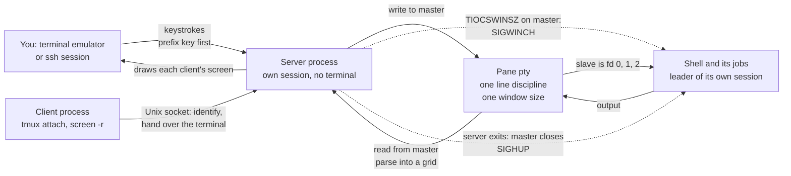

# Terminal Multiplexers: tmux and screen

> [!summary] Claim
> A terminal multiplexer is a server process that holds the master side of each pane's pseudo-terminal, so a program in a pane lives exactly as long as that server does and never learns that the terminal you were watching it through has gone.

Part of [Terminals and Job Control](README.md) in [Shell and Unix Engineering](../README.md).

## TL;DR

- Mechanism: a daemonized server with no controlling terminal owns one pty per pane and runs each shell as the leader of its own session on the slave side; clients reach the server over a Unix-domain socket and only lend it a terminal to draw on.
- Rule: treat the socket as the key to every shell behind it and the server as a single point of failure - protect the first with directory permissions, and put anything that must survive the second (services, migrations, batch jobs) under a supervisor, not in a pane.
- Trap: the pane is frozen at creation - its environment (`SSH_AUTH_SOCK`), its `TERM`, and one window size shared by every attached client - so "it worked before I reattached" bugs are the multiplexer doing exactly what it was built to do.
- Portability: neither tool is in POSIX; macOS 27.2 ships only `screen` 4.00.03 from 2006, the Debian 13 and Alpine 3.22 lab images ship neither, and after a resize a script's own `COLUMNS` is current in bash 5, zsh, ksh93 and mksh but unset in dash, yash, posh, BusyBox ash and bash before 4.3 (as of 2026-11, measured by the lab).
- When not to use it: for unattended work - a pane has no restart policy, no log, no exit-status record, and dies with one `kill -9` or a logout under `KillUserProcesses=yes`; use a service unit, `systemd-run`, a scheduler, or `nohup` with a log file.

## Mental model



A client connects to the server's socket, identifies itself, and hands the server its own terminal.
From then on the server reads your keystrokes from that terminal, takes the ones that follow the prefix key for itself, and writes the rest to the master side of the pane's pty.
The shell in the pane reads them from the slave side, which is its standard input, output, error, and controlling terminal, and it is the leader of a session the client is not part of.
What the shell writes comes back up through the master, is parsed by the server into an in-memory grid of cells, and is redrawn on every attached client's terminal.
Two dotted arrows are the only ways the multiplexer signals the pane: a resize through the master raises `SIGWINCH`, and the death of the server closes the master and raises `SIGHUP`.
There is no arrow from the client to the pane, which is the whole point: detaching, closing the window, or losing the ssh link removes a viewer and nothing else.

## How it works

**Two processes and a socket (tmux 3.8 `client.c`, `server.c`, `proc.c`, `tmux.c`).**
Every `tmux` command is a client: `client_connect` tries the socket, and on `ECONNREFUSED` or `ENOENT`, for a command that is allowed to start the server, it takes an exclusive `flock` on `SOCKET.lock`, unlinks the stale path, and calls `server_start`.
`server_start` forks through `proc_fork_and_daemon`, whose child calls `daemon(1, 0)`, so the server ends up in a new session with no controlling terminal; the lab's server reports the same state (`server_tty=0 server_leader=1`).
`server_create_socket` binds under a temporary `umask` (mode 0660 for the default socket, 0600 otherwise) and calls `listen(fd, 128)`.
The default path is `tmux-UID/default` under `TMUX_TMPDIR` or `/tmp`, and `make_label` refuses to run when that directory is not owned by you or has any permission bit for others ("directory ... has unsafe permissions").
`screen` splits the same way into a foreground attacher and a backend that `ps` shows as `SCREEN`, which meet in `SCREENDIR`, `~/.screen`, or a compiled-in directory such as `/run/screen/S-USER` (screen 5.0.1 `screen.c`; the three locations were seen by hand).

**A pane is a child of the server, never of a client (tmux 3.8 `spawn.c`, `spawn_pane`; `environ.c`, `environ_for_session`).**
`spawn_pane` gets the child's environment from `environ_for_session`, which copies the server's global environment plus the session's, then overwrites `TERM` with the `default-terminal` option and adds `TERM_PROGRAM=tmux`, `TERM_PROGRAM_VERSION`, `COLORTERM=truecolor`, and `TMUX` (socket path, server pid, session id); `spawn_pane` itself then adds `TMUX_PANE`.
It calls `fdforkpty`, which is `forkpty` on Linux and macOS, so the child is the leader of a new session whose controlling terminal is the new slave; when a terminal becomes a session's controlling terminal its foreground process group is set to the leader's group (POSIX.1-2024 XBD 11.1.3).
With no command it runs `execl(shell, "-name", NULL)`: the leading `-` makes every new pane a login shell, so profile files run again in each one.
The lab's `minimux` does the same thing by hand with `setsid`, an `open` of the slave, and `TIOCSCTTY`, and its pane reports `stdin_tty=1 shell_is_leader=1 fg_is_shell_group=1 dev_tty=1`.
[[Pseudo-Terminals]] covers the pair itself; this note is about who holds the master.

**Attaching lends the server your terminal (tmux 3.8 `client.c`, `client_send_identify`; `server-client.c`, `server_client_dispatch_identify`; `tty.c`, `tty_open`).**
The client sends `MSG_IDENTIFY_TERM`, `MSG_IDENTIFY_TTYNAME`, its environment, and `MSG_IDENTIFY_STDIN` with its standard input attached as a passed file descriptor.
The server stores that descriptor (`c->fd = imsg_get_fd(imsg)`), and `tty_open` registers `tty_read_callback` on it, which feeds `tty_keys_next`.
So keystroke decoding, the prefix key (`server_client_key_callback` switches the client to the `prefix` key table), and all drawing happen inside the server; the attached client only waits for messages and signals, turning `SIGWINCH` into `MSG_RESIZE` and `SIGHUP` or `SIGTERM` into `MSG_EXITING` (`client_signal`).
`screen` works the same way: the attacher sends its terminal's name and may pass the descriptor, the backend opens it (`secopen`) in `CreateTempDisplay`, and it later tells the attacher to leave with `SIG_BYE`, which `screen.h` defines as `SIGHUP` (screen 5.0.1 `socket.c`, `screen.h`).
`minimux` is simpler and says so: its clients relay bytes through the socket instead of lending a descriptor.

**Detaching is the absence of an event.**
When the outer terminal goes away, the kernel sends `SIGHUP` to the controlling process of that terminal (POSIX.1-2024 XBD 11.1.10), which is your login shell; a tmux client that receives `SIGHUP` in turn records "lost tty" as its exit reason and tells the server it is leaving (`client_signal`).
The server sees end of file on the borrowed descriptor (`tty_read_callback` calls `server_client_lost`) and frees the client.
Nothing touches the pane's pty: no `ioctl`, no signal, no write.
The lab measures exactly that: after a client disconnects, the pane is the same process and its `HUP` trap has run 0 times.

**Output is parsed, stored, and redrawn (tmux 3.8 `window.c`, `window_pane_read_callback`; `input.c`, `input_parse_pane`; `grid.c`, `grid_collect_history`).**
The server reads pane output from the master and runs it through its own terminal emulator into a grid; lines that scroll off the top go into history up to `history-limit`, and when that is full `grid_collect_history` frees a tenth of the limit at once.
Because the server holds a model of the screen and not a byte stream, a client that attaches later gets a repaint in its own terminal's dialect, and output written while nobody was attached is not lost.
This is also why `TERM` inside must describe the multiplexer and not your emulator: programs in the pane are talking to tmux's emulator, and `tmux.1` requires `default-terminal` to be `screen`, `tmux`, or a derivative.
`minimux` keeps no model; it replays its last 64 KiB of raw bytes to a new client, which is enough to prove that the bytes were kept (`detached_bytes=41` in the lab).

**One pty has one size (tmux 3.8 `window.c`, `window_pane_send_resize`; `resize.c`, `clients_calculate_size`).**
A window size is a property of the terminal device, set with `TIOCSWINSZ` on the master; the kernel then signals the slave's foreground process group with `SIGWINCH` (Linux `drivers/tty/pty.c`, `pty_resize`, as of 2026-11; Linux man-pages 6.19 `TIOCSWINSZ(2const)`).
POSIX.1-2024 standardized both halves in Issue 8: `tcsetwinsize` "shall" deliver `SIGWINCH` to the foreground process group (XSH `tcsetwinsize`), and `SIGWINCH` joined `<signal.h>` through Austin Group Defect 1151.
Two clients of different sizes therefore force a policy, which tmux calls `window-size`: `largest`, `smallest`, `manual`, or `latest` (the client used most recently), and `smallest` takes the minimum of each dimension separately.
The lab implements `smallest` and `latest` and shows both, plus the signal count: one resize, one `SIGWINCH`.

**The server's death is the pane's hangup (tmux 3.8 `window.c`, `window_pane_destroy`; `server.c`, `server_signal`).**
tmux kills a pane by closing its master descriptor and lets the kernel do the rest.
On Linux `pty_close` calls `tty_vhangup` on the slave, and `tty_signal_session_leader` sends `SIGHUP` and `SIGCONT` to the session leader (Linux `drivers/tty/pty.c`, `tty_io.c`, `tty_jobctrl.c`, as of 2026-11); later reads return end of file and writes fail with `EIO` (POSIX.1-2024 XBD 11.1.10).
The same happens to every pane at once when the server process dies for any reason, because all the masters close together.
`server_signal` handles `SIGINT` and `SIGTERM` (both a clean exit), `SIGCHLD`, `SIGUSR1` (recreate the socket), and `SIGUSR2`; it has no case for `SIGHUP`, and a hand test confirmed that tmux 3.8 keeps running after `kill -HUP`.
[[Job-Control-Signals]] and [[Sessions-Process-Groups-and-Controlling-Terminals]] cover what the shell then does with that `SIGHUP`.

## Numbers and limits

Hand measurements were made on 2026-11-11 on macOS 27.2 (arm64) with tmux 3.8, and in the Debian 13 and Alpine 3.22 lab images with their packaged tmux 3.5a and screen 4.09.01 and 5.0.1.

| Quantity | Value | Source |
| --- | --- | --- |
| `sun_path`, the limit on a socket path | 104 bytes on macOS, 108 on Linux | lab test "sun_path is 104 bytes on macOS and 108 on Linux"; Linux man-pages 6.19 `unix(7)` |
| A longer socket path | tmux: `error connecting to ... (File name too long)`; minimux: `bind=ENAMETOOLONG` | hand test with a 171-byte `-S` path on tmux 3.8; tmux 3.8 `client.c`, `client_connect`; the same lab test |
| tmux listen backlog | 128 | tmux 3.8 `server.c`, `server_create_socket` |
| tmux socket modes | directory 0700; default socket 0660; `-S` socket 0600 | hand test (`drwx------`, `srw-rw----` on Debian and Alpine; `srw-------` for `-S` on macOS); tmux 3.8 `server.c` |
| Size of a window nobody is attached to | 80 columns by 24 rows | tmux 3.8 `options-table.c` (`default-size`), confirmed by hand; the lab's minimux starts at the same size (`rows=24 cols=80`) |
| tmux scrollback per pane | 2000 lines (`history-limit`), freed 200 at a time | tmux 3.8 `options-table.c` and `grid.c`, `grid_collect_history`; `show -g` by hand on 3.8 and 3.5a |
| screen scrollback per window | 100 lines (`defscrollback`) | screen 5.0.1 `doc/screen.1` and `screen.h` (`DEFAULTHISTHEIGHT`) |
| Memory for scrollback | 99,980 lines of 79 columns: `history_bytes` 44,001,760 (440 bytes per line); server RSS rose from 4,352 kB to 53,584 kB | hand test on tmux 3.8 with `history-limit 100000` |
| Cost of going through a pane | 5,000,000 lines (54,444,420 bytes) from `seq`: 14.6 s, 18.3 s, 18.4 s through a detached pane; 1.4 s to `/dev/null` | hand test on tmux 3.8, three runs, timed with `wait-for` |
| Escape-key wait (`escape-time`) | 10 ms, reduced to that in tmux 3.5 | tmux 3.8 `options-table.c`; `CHANGES` ("FROM 3.4 TO 3.5": "Reduce default escape-time to 10 milliseconds") |
| Prefix key | tmux `C-b` (0x02); screen `C-a` (0x01) | tmux 3.8 `options-table.c`; screen 5.0.1 `screen.c` (`DefaultEsc`) |
| Variables copied from an attaching client into the session environment | 13 names, among them `DISPLAY`, `SSH_AUTH_SOCK`, `SSH_CONNECTION` | tmux 3.8 `options-table.c` (`update-environment`), listed by `show -g` |
| Paste buffers kept | 50 (`buffer-limit`) | tmux 3.8 `options-table.c` |
| Client and server protocol version | 8; a mismatch prints `protocol version mismatch (client N, server M)` | tmux 3.8 `tmux-protocol.h`; `client.c` |
| Bytes a detached pane wrote that a later client still received | 41 | lab test "a client detaches" (`detached_bytes=41`) |
| `SIGWINCH` deliveries for one resize | 1, and 0 for an attach at the unchanged size | lab test "a resize reaches the pane as one SIGWINCH", every shell of the matrix |
| CVSS 3.1 base scores | CVE-2025-23395: 7.8, CVE-2025-46802: 6.0, CVE-2025-46803: 5.0 (scored by SUSE, the reporting CNA); CVE-2020-27347: 7.8 (scored by NVD) | NVD records, read 2026-11-11 |

The throughput row measures the whole path (a line-buffered `seq`, the pty, and tmux's parser), not the parser alone.

## Portability

Neither `tmux` nor `screen` is specified by POSIX; what POSIX does specify is everything they stand on: sessions and controlling terminals (XBD 11.1.3), hangup (XBD 11.1.10), `posix_openpt`, and, since Issue 8, `tcsetwinsize` and `SIGWINCH`.
The shell rows below are lab results: `mux.sh` ran under each shell with that same shell running `pane.sh` in the pane, on the macOS host and in the Debian 13 and Alpine 3.22 images on 2026-11-11.

| Shell | `stty size` after a resize to 30x90 | A script's `COLUMNS` and `LINES` at 24x80, then after the resize | After `shopt -s checkwinsize` | `HUP` and `WINCH` traps |
| --- | --- | --- | --- | --- |
| POSIX `sh` | `stty size` writes rows, then columns, since Issue 8 (XCU `stty`) | not required to be set: when unset, utilities use the terminal window size (XBD 8.3) | no such option | `SIGWINCH` is in `<signal.h>` since Issue 8 |
| bash 3.2.57 (macOS `/bin/sh` and `/bin/bash`, Alpine) | `30 90` | unset, then unset | accepted, still unset | each ran once |
| bash 4.4.23 (Alpine) | `30 90` | unset, then unset | `90` and `30` | each ran once |
| bash 5.1, 5.2, 5.3 (Alpine), 5.2 (Debian), 5.3 (macOS) | `30 90` | `80` and `24`, then `90` and `30` | already on | each ran once |
| zsh 5.9 (native) | `30 90` | `80` and `24`, then `90` and `30` | no `shopt` | each ran once |
| zsh 5.9 with `--emulate sh` | `30 90` | `80` and `24`, then `90` and `30` | no `shopt` | each ran once |
| dash (macOS 0.5.13, Debian, Alpine) | `30 90` | unset, then unset | no `shopt` | each ran once |
| ksh93u+m 1.0.10 (Debian), ksh93u+ 2012-08-01 (macOS) | `30 90` | `80` and `24`, then `90` and `30` | no `shopt` | each ran once |
| mksh R59 (Alpine 2020/10/31, Debian 2025/04/26) | `30 90` | `80` and `24`, then `90` and `30` | no `shopt` | each ran once |
| yash 2.58.1 (Alpine) | `30 90` | unset, then unset | no `shopt` | each ran once |
| posh 0.14.1 (Debian) | `30 90` | unset, then unset | no `shopt` | each ran once |
| BusyBox ash 1.37.0 (Alpine and Debian) | `30 90` | unset, then unset | no `shopt` | each ran once |

The bash boundary is in its release notes: non-interactive shells "react to the setting of checkwinsize" from bash 4.3, and the option is on by default from bash 5.0 (bash-5.3 `NEWS`).
A hand run of the same lab code in the `bash:4.2`, `bash:4.3`, and `bash:5.0` images agrees: 4.2.53 never sets the variables, 4.3.48 sets them once the option is on, and 5.0.18 sets them by default.
Every other test of the lab (detach, hangup, sizes, broadcast, prefix, environment, socket states) gives the same result under every shell, because those behaviors belong to the kernel and the server, not to the shell.

The multiplexers and the utilities around them, measured by hand on 2026-11-11:

| Fact | macOS 27.2 | Debian 13 image | Alpine 3.22 image |
| --- | --- | --- | --- |
| `tmux` | not in the base system; Homebrew has 3.8 | not installed; the package is 3.5a | not installed; the package is 3.5a |
| `screen` | `/usr/bin/screen` 4.00.03 (2006), not setuid | not installed; the package is 4.09.01, not setuid | not installed; the package is 5.0.1, not setuid |
| screen's rendezvous file | a FIFO (`prw-------`) in `SCREENDIR` | a socket (`srw-------`) in `/run/screen/S-USER` | a socket (`srw-------`) in `~/.screen` |
| `TERM` in a new pane | tmux 3.8: `tmux-256color`; screen: `screen` | tmux 3.5a: `tmux-256color`; screen: `screen` | tmux 3.5a: `tmux-256color`; screen: `screen` |
| terminfo entries `tmux-256color` and `screen` | present | present | present |
| Pane program with a `HUP` trap, after `kill -9` of the server | tmux: the trap ran; bundled screen: it did not, and the program kept running under `login` | tmux and screen: the trap ran | screen: the trap ran |
| `stty size` | BSD `stty`: `rows cols` | GNU coreutils 9.7: `rows cols` | BusyBox 1.37.0: `rows cols` |
| `setsid` utility | absent | util-linux 2.41.5 | BusyBox applet |
| `nohup` utility | present | GNU coreutils 9.7 | BusyBox applet |

tmux picks its default `TERM` at build time: `tmux-256color` if the build host's terminfo has it, otherwise `tmux` or `screen` (tmux 3.8 `configure.ac`); the fallback in `tmux.h` is `screen`.
The macOS `screen` row is why the hangup differs there: it starts each window through `login`, so `login`, not your program's shell, is the session leader that receives the kernel's `SIGHUP`.
The `stty size` row is covered by the lab on all three platforms; the uutils `stty` was not measured, so it has no column.

## Worked example

The [lab](../labs/02-terminal-multiplexers-tmux-and-screen/) builds `minimux.c`, a multiplexer in about 1,000 lines of C, because the matrix images have neither tmux nor screen and because the mechanism is small enough to read.
`mux.sh` drives it under the shell being tested, and that same shell runs `pane.sh` inside the pane.

The function that starts the pane is the heart of it, verbatim from `minimux.c`:

```c
/* The pane: a new session whose controlling terminal is the slave side. */
static void pane_exec(const char *slave_name, const char *sock, int ready, char **argv) {
  struct winsize ws;
  if (setsid() < 0)
    _exit(126);
  int slave = open(slave_name, O_RDWR); /* on Linux this open already makes it the controlling terminal */
  if (slave < 0)
    _exit(126);
  if (ioctl(slave, TIOCSCTTY, 0) != 0) /* BSD and macOS need the explicit request */
    _exit(126);
  /* macOS refuses TIOCSWINSZ on a master whose slave is not open yet, so the first size goes through the slave. */
  memset(&ws, 0, sizeof ws);
  ws.ws_row = (unsigned short)cur_rows;
  ws.ws_col = (unsigned short)cur_cols;
  if (ioctl(slave, TIOCSWINSZ, &ws) != 0 || write(ready, "1", 1) != 1)
    _exit(126);
  if (dup2(slave, 0) < 0 || dup2(slave, 1) < 0 || dup2(slave, 2) < 0)
    _exit(126);
  for (int fd = 3; fd < 256; fd++)
    close(fd);
  signal(SIGPIPE, SIG_DFL);
  setenv("MINIMUX", sock, 1); /* how a program learns it is inside the multiplexer, like TMUX and STY */
  execvp(argv[0], argv);
  _exit(127);
}
```

The server keeps the master and never gives it to a client, and it consumes the prefix key itself, verbatim from `minimux.c`:

```c
/* Keystrokes from one client: the server consumes the prefix key and what follows it. */
static void client_input(struct client *c, const unsigned char *buf, size_t n) {
  unsigned char out[FRAME_MAX];
  size_t len = 0;
  int detach = 0;
  for (size_t i = 0; i < n && !detach; i++) {
    unsigned char b = buf[i];
    if (c->prefix_pending) {
      c->prefix_pending = 0;
      if (b == PREFIX_KEY)
        out[len++] = b; /* prefix twice: one literal prefix byte for the pane */
      else if (b == 'd')
        detach = 1; /* prefix d: detach this client */
      /* any other key after the prefix is unbound and is dropped */
    } else if (b == PREFIX_KEY) {
      c->prefix_pending = 1;
    } else {
      out[len++] = b;
    }
  }
  if (len > 0 && write_all(master, out, len) != 0) {
    /* the pane is gone; the main loop notices on its next pass */
  }
  if (detach) {
    if (send_frame(c->fd, F_DETACHED, NULL, 0) != 0) {
      /* the client left first; it is dropped either way */
    }
    drop_client(c);
  }
}
```

Two of the fifteen modes of `mux.sh`, verbatim; each `NAME:VERB` step drives one scripted client:

```sh
mode_detach() {
  start_server repl "$@" || return 1
  before=$("$mux" info "$sock" pane_pid) || return 1
  # 7 bytes: the pane's "ready" line (with CR NL), written before anyone attached.
  # 41 bytes: those 7 plus the 34-byte line the pane writes after client a has gone.
  "$mux" drive "$sock" a:await=detached_bytes=7 a:attach=24x80 a:expect=ready \
    'a:send=hello\n' a:expect=got:hello 'a:send=burst\n' a:close \
    b:await=detached_bytes=41 b:attach=24x80 b:expect=printed-while-detached \
    'b:send=still here\n' 'b:expect=got:still here' b:close b:await=clients=0 || return 1
  after=$("$mux" info "$sock" pane_pid) || return 1
  if [ "$before" = "$after" ] && kill -0 "${after#pane_pid=}" 2>/dev/null; then
    printf 'pane: same process, still running\n'
  else
    printf 'pane: %s then %s\n' "$before" "$after"
  fi
  "$mux" info "$sock" clients detached_bytes
  "$mux" kill-server "$sock"
}

mode_hangup() {
  start_server signals "$@" || return 1
  pane_pid=$("$mux" info "$sock" pane_pid) || return 1
  pane_pid=${pane_pid#pane_pid=}
  "$mux" drive "$sock" a:attach=24x80 a:expect=armed a:close a:await=clients=0 >/dev/null || return 1
  sleep 2 # the pane's shell runs a pending trap within a second; two leaves a margin
  if kill -0 "$pane_pid" 2>/dev/null; then alive=running; else alive=gone; fi
  hups=$(lines "$dir/hup")
  printf 'after the client detached: pane=%s sighup=%s\n' "$alive" "$hups"
  kill -KILL "$server_pid"
  wait_for_file "$dir/hup"
  hups=$(lines "$dir/hup")
  printf 'after the server was killed: sighup=%s\n' "$hups"
}
```

Run them by hand from the lab directory with a compiled `minimux` and an empty scratch directory:

```sh
work=$(mktemp -d)
cc -O2 -Wall -Wextra -Werror minimux.c -o "$work/minimux"
sh mux.sh detach "$work/minimux" "$work" sh
```

The test "a client detaches: the pane is the same running process, and the server kept what it wrote meanwhile" asserts this output exactly, under every shell:

```text
a: ready
a: got:hello
a: [end: closed by the client]
b: ready
b: got:hello
b: printed-while-detached clients=0
b: got:still here
b: [end: closed by the client]
pane: same process, still running
clients=0 detached_bytes=41
```

Client `b` attached after `a` had gone, yet it received the lines the pane wrote before and during the gap, and the pane itself counted zero attached clients when it printed.

The `hangup` mode shows the two ways a viewer can disappear, and the test "detaching sends the pane no SIGHUP; killing the server closes the master and the kernel sends one" asserts:

```text
after the client detached: pane=running sighup=0
after the server was killed: sighup=1
```

The other tests assert, among others, these lines:

```text
a: stdin_tty=1 shell_is_leader=1 fg_is_shell_group=1 dev_tty=1
server_tty=0 server_leader=1
clients=0 rows=24 cols=80
a: size:40 100
a: size:24 80
a: size:40 30
a: size:40 100
a: hex:610262
a: [end: detached by the server]
b: got:xy
client: SSH_AUTH_SOCK=/new/agent
a: env:/old/agent
server killed with SIGKILL: connect=ECONNREFUSED socket-file=present
second server on a live socket: bind=EADDRINUSE
after kill-server: connect=ENOENT socket-file=absent
created under umask 000: srw-------
mode 000: connect=EACCES
a: [end: pane exited with status 7]
```

The four `size:` lines are one pane seen through the `smallest` policy: alone at 40x100, joined by a 24x80 client, joined instead by a 50x30 client (the minimum of each dimension, 40 rows and 30 columns), and alone again.
`hex:610262` is what the pane received when the client typed `a`, the prefix key twice, and `b`: one literal 0x02.
`got:xy` is one line assembled from two clients: `a` typed `x` and detached with prefix `d`, `b` typed `y` and Enter, and neither the prefix nor the `d` reached the pane.

## Pitfalls

> [!warning] The server is a single point of failure
> Trigger: the server process is killed (`kill -9`, the OOM killer, a crash in its parser) or the host reboots.
> Symptom: every pane of every session is hung up at once; with tmux 3.8 the next command prints `no server running on SOCKET`, and nothing is restored because the state lived only in that process.
> Fix: keep in panes only what you can afford to lose; a program that must survive belongs to a supervisor.
> Measured by the lab (`sighup=1` after `kill -KILL` of the server) and by hand on tmux 3.8 and 3.5a.

> [!warning] Logout kills the server under `KillUserProcesses=yes`
> Trigger: systemd-logind with `KillUserProcesses=yes`, the upstream default since systemd 230; a distribution can build with the old default (`--without-kill-user-processes` in the systemd 230 build, the meson option `-Ddefault-kill-user-processes=false` today, per systemd `meson_options.txt`), so check the effective value on your hosts.
> Symptom: you detach, log out, and the session is gone on your return, because logind terminated every process in the session scope, the multiplexer server included.
> Fix: start the server outside the session scope (`systemd-run --scope --user tmux`), enable lingering with `loginctl enable-linger`, or set `KillExcludeUsers=`.
> Sources: systemd `NEWS` for version 230, `logind.conf(5)` ("will break tools like screen(1) and tmux(1)"), and `systemd-run(1)`, example 5; tmux gained its own scope-per-pane support in 3.4 (tmux 3.8 `CHANGES`, `compat/systemd.c`).

> [!warning] A reattached pane has yesterday's environment
> Trigger: you reconnect over ssh with agent forwarding and reattach.
> Symptom: `git fetch` or `ssh` in an old pane fails to reach the agent, while a new window works; `SSH_AUTH_SOCK` in the old shell names a socket that died with the previous connection.
> Fix: refresh the variable in the old shell from the session environment (`tmux show-environment -s SSH_AUTH_SOCK` prints a command to `eval`), or point `SSH_AUTH_SOCK` at a stable symlink that your login updates.
> Measured by hand on tmux 3.8: after an attach with `/new/agent`, `show-environment` printed `/new/agent`, the existing pane still printed `/old/agent`, and a new window printed `/new/agent`; the lab's `env` test shows the same inheritance in miniature.

> [!warning] One small client resizes everyone
> Trigger: a second client attaches to the same window from a smaller terminal, or an old client was never detached.
> Symptom: under `smallest` every client's view shrinks to the smaller size; under `latest` (the tmux default since 3.1) the size jumps to whoever typed last and the other client sees the window cropped or padded.
> Fix: detach the other clients when you attach (`tmux attach -d`), and find forgotten ones with `tmux list-clients`.
> Measured by the lab (`size:40 100`, then `size:24 80`); the policies are in tmux 3.8 `resize.c` and `CHANGES` ("FROM 2.8 TO 2.9", "FROM 3.0a TO 3.1").

> [!warning] A script's `COLUMNS` is stale or unset after a resize
> Trigger: a script in a pane formats its output from `COLUMNS` or `LINES`, and the pane is resized.
> Symptom: dash, yash, posh, BusyBox ash and bash before 4.3 never set the variables, bash 4.3 and 4.4 set them only after `shopt -s checkwinsize`, and an exported `COLUMNS` overrides the real size in every utility that honors it (POSIX.1-2024 XBD 8.3).
> Fix: ask the terminal when you need the answer (`stty size`, or `tput cols` from [[terminfo-and-tput]]), and never export `COLUMNS` or `LINES` from a startup file.
> Measured by the lab test "after a resize stty size is right in every shell".

> [!warning] The wrong `TERM` on either side
> Trigger: `TERM` inside a pane is copied from the outer terminal (`xterm-256color`), or you ssh from a pane to a host whose terminfo database has no `tmux-256color` entry.
> Symptom: in the first case programs may emit sequences the multiplexer's emulator does not implement; in the second, programs on the remote host cannot find a description of your terminal, because ssh sends your `TERM` in the `pty-req` request (RFC 4254 section 6.2).
> Fix: leave `default-terminal` at `tmux-256color` or `screen-256color` (`tmux.1`: it "must" be `screen`, `tmux`, or a derivative), and install the missing entry on the remote host or override `TERM` for that one connection.
> [[Terminal-Emulators-and-TERM]] explains how the name is chosen and matched.

> [!warning] The socket path is too long, stale, or deleted
> Trigger: a socket under a deep directory (a CI workspace, a per-test temporary directory), a server that died without cleaning up, or a temporary-file cleaner that removed `/tmp/tmux-UID`.
> Symptom: `File name too long` at 104 bytes on macOS and 108 on Linux; `connect` fails with `ECONNREFUSED` on a dead socket file; or a healthy server becomes unreachable (`no server running`) although its panes are alive.
> Fix: keep socket paths short or bind relative to the socket's directory as the lab does; let the next server start replace a dead file; for a deleted socket send the tmux server `SIGUSR1`, which recreates it (`tmux.1`, option `-L`).
> Measured by the lab tests on `sun_path` and on the stale socket, and by hand on tmux 3.8.

> [!warning] Every pane is a login shell
> Trigger: tmux starts panes with no command, which is the default.
> Symptom: profile files run again in every pane, so a profile that appends to `PATH`, starts an agent, or prints a banner does it once per pane.
> Fix: make profiles idempotent, or set `default-command` to start a non-login shell.
> Source: tmux 3.8 `spawn.c`, `spawn_pane` (`argv0` is the shell's name with a leading `-`), and `tmux.1` (`default-command`); a hand test showed `-zsh` and `-sh` as the pane's process name.

> [!warning] Nested multiplexers and the prefix key
> Trigger: you ssh from a pane into a host and attach to a second multiplexer there, or you run tmux inside tmux.
> Symptom: every command goes to the outer one, because the outer server consumes the prefix before the inner one can see it; tmux refuses the local case outright with `sessions should be nested with care, unset $TMUX to force`.
> Fix: press the prefix twice to send one prefix inward (the binding is `send-prefix`), or give the inner multiplexer a different prefix.
> Measured by the lab's `prefix` test: the pane received 0x02 once for a doubled prefix, and nothing for prefix `d`.

## Security and robustness

- The socket is the security boundary: any process that can connect can type into every shell behind it, and read every screen.
  The lab's `broadcast` test shows input from two clients landing in one pane, and its `perms` test shows that setting the socket file to mode 000, which removes write permission, turns `connect` into `EACCES` for any user but root.
  Linux requires write permission on the socket file, but "on some systems (e.g., older BSDs), the socket permissions are ignored" (Linux man-pages 6.19 `unix(7)`), which is why tmux also insists on a private directory.
- Sharing a session means sharing an account.
  tmux 3.3 added `server-access` to admit named users read-only or read-write, and its release note adds that "File system permissions must still be configured manually" (tmux 3.8 `CHANGES`).
  screen's multi-user mode needs a setuid-root binary, and that is where its worst bugs live.
- screen's 2025 security review is the case study.
  CVE-2025-23395: screen 5.0.0 running setuid-root "does not drop privileges while operating on a user supplied path", giving local root through the log file.
  CVE-2025-46802: for a short time during attach the terminal "is set to mode 666", so any local user can open it.
  CVE-2025-46803: the default pty mode changed from 0620 to 0622, "allowing anyone to write to any Screen PTYs in the system".
  The reviewers' advice was not to install screen setuid-root at all (SUSE Security Team report, 2025-05-12), and CVE-2017-5618 (screen before 4.5.1, the same log-file permission flaw) shows the pattern is old.
- The server parses hostile bytes.
  Everything a pane prints, including a file you `cat` or a remote banner, goes through the multiplexer's escape-sequence parser: CVE-2020-27347 was a stack overflow in tmux's `input_csi_dispatch_sgr_colon` "that can be exploited by terminal output" (fixed in 3.1c).
  The layer above can fail too: CVE-2019-9535 let pane output run commands through iTerm2's integration with tmux control mode (iTerm2 up to 3.3.5).
  tmux 3.8 ships with `allow-passthrough off`, so a program in a pane cannot wrap sequences for the outer terminal; its default `set-clipboard external` still lets pane output set the outer terminal's clipboard (`tmux.1`), so set it to `off` where a pasted command matters.
  [[Terminal-Escape-Injection]] covers the attack class.
- Scrollback is a secrets store nobody rotates: tokens and command output stay in server memory for the life of the pane, and anyone who reaches the socket can dump them with `capture-pane`.
- Robustness limits: the server is one process with one event loop, all state is in its memory, and there is no persistence across a reboot.
  A client and server of different protocol versions cannot talk at all, so upgrading the package under a running server leaves you with `protocol version mismatch` until the old server exits (tmux 3.8 `client.c`).

## The principal's view

The decision is not tmux or screen; it is what you allow to depend on a pane.
A multiplexer is an interactive convenience with the failure profile of a single unsupervised process: no restart, no log, no health check, no record of exit status, state that exists only in memory, and an access model that is one file's permission bits.
That is a fine trade for a human's working session and a bad one for anything the business would notice.

- Policy that survives contact: sessions are disposable.
  Anything that must finish (a migration, a backfill, a long build) runs under a supervisor that records its output and status: a systemd unit or `systemd-run`, a job scheduler, a CI job.
  The multiplexer is then only the window you watch it through.
- The honest cost of the alternative: `nohup cmd >log 2>&1 &` survives the terminal but gives you no terminal to come back to, and [[Daemonization]] is more work than typing `tmux`.
  That convenience gap is exactly why production work drifts into panes, so close it by making the supervised path one command.
- Standardize on one tool per fleet.
  tmux is the better default: no setuid binary, a scriptable command language, formats, `wait-for`, and control mode; screen is what you will find on old or minimal hosts (macOS still ships the 2006 release), so know its detach and reattach keys.
- For shared incident sessions, weigh the audit gap: a shared pane has one identity and no record of who typed what.
  Prefer read-only attaches (`tmux attach -r`, or `server-access -r`) for observers, and never widen a root server's socket.
- When to use something else: to automate an interactive program, use [[expect-and-Automating-Interactive-Programs]] or, better, the program's non-interactive mode; `send-keys` plus `sleep` plus `capture-pane` is screen scraping with a race in it.
  To keep one command alive across a disconnect, `nohup` or `systemd-run` is smaller than a multiplexer.
  To make a remote session survive a roaming client, fix the transport; the multiplexer only makes the reattach cheap.

## Interview questions

> [!question] L5: Your ssh connection drops while a build runs in a tmux pane. What happens to the build, and why does it not receive SIGHUP?
>
> > [!success]- Answer
> > The build keeps running.
> > The dropped link hangs up the pty that sshd created, and the kernel sends `SIGHUP` to that terminal's controlling process, which is the login shell's session (POSIX.1-2024 XBD 11.1.10).
> > The tmux client in that session exits; the server only sees end of file on the terminal the client lent it.
> > The build's controlling terminal is a different pty whose master the tmux server holds, and the server is still alive, so no hangup happens there.
> > The lab shows it: after a client disconnects, the pane is the same process and its `HUP` trap ran 0 times.
> >
> > Follow-up: what would have to happen for the build to get `SIGHUP`?

> [!question] L5: Why is `TERM` inside tmux `tmux-256color` or `screen` instead of your emulator's value?
>
> > [!success]- Answer
> > A program in a pane does not talk to your emulator; it talks to the multiplexer, which is itself a terminal emulator.
> > tmux parses the pane's output into a grid and redraws it for each client in that client's own dialect.
> > So `TERM` must describe what tmux implements, and `tmux.1` requires `default-terminal` to be `screen`, `tmux`, or a derivative.
> > tmux sets it in the child's environment in `environ_for_session`, from the `default-terminal` option.
> > Copying the outer `TERM` inside makes programs emit sequences tmux may not implement.
> >
> > Follow-up: you ssh from the pane to an old host and `vi` says the terminal type is unknown; why, and what are two fixes?

> [!question] L5: Predict the output. One pane, the `smallest` size policy. Client A (40 rows by 100 columns) attaches and runs `stty size`. Client C (50 rows by 30 columns) attaches and A runs it again. C detaches and A runs it a third time.
>
> > [!success]- Answer
> > `40 100`, then `40 30`, then `40 100`.
> > A pty has one window size, so the server must pick one for both clients.
> > `smallest` takes the minimum of each dimension separately: 40 rows from A and 30 columns from C.
> > When C leaves, the size is recomputed from the clients that remain.
> > The lab's `smallest` test asserts these values, and tmux computes them the same way in `clients_calculate_size`.
> >
> > Follow-up: what would tmux's default policy, `latest`, print for the second call, and why does it depend on who typed?

> [!question] L6: After you reattach over a new ssh connection, `git pull` in an old pane cannot reach your ssh agent, but a new window can. Explain and fix it.
>
> > [!success]- Answer
> > The old shell inherited `SSH_AUTH_SOCK` when its pane was created, and an environment cannot be changed from outside a process.
> > On attach, tmux copies the variables named in `update-environment` from the client into the session environment (`environ_update`), which only new panes inherit.
> > The old value names a socket that belonged to the previous sshd and no longer exists.
> > Fix it in place with `eval "$(tmux show-environment -s SSH_AUTH_SOCK)"`, or make the variable a stable symlink that every login repoints.
> > A hand test on tmux 3.8 showed all three values: session `/new/agent`, old pane `/old/agent`, new window `/new/agent`.
> >
> > Follow-up: why is the symlink approach safer for long-running programs than re-evaluating the variable?

> [!question] L6: Debug this script. It is flaky in CI and sometimes prints nothing: `tmux new-session -d -s build; tmux send-keys -t build 'make test' Enter; sleep 30; tmux capture-pane -p -t build | grep -q PASS && echo ok`.
>
> > [!success]- Answer
> > It has four independent bugs.
> > The fixed `sleep` is a race: the build may take 31 seconds, or the login shell in the pane may not be ready when `send-keys` types.
> > `capture-pane -p` returns only the visible screen, 24 lines for a detached window, so an early `PASS` has scrolled away (a hand test returned 24 lines starting at 78 of 100; `-S -` adds the history).
> > The exit status of `make` is never examined, only text that happens to be on screen.
> > And the session is left running after the script ends.
> > Better: do not use a multiplexer for this at all; run `make test >build.log 2>&1` and test its status.
> > If a pane is required, run the command as the window's program in a session that stays alive, have it write its status to a file and call `tmux wait-for -S done`, and block on `tmux wait-for done`, which is latched, so a signal sent first is not lost (`cmd-wait-for.c`).
> > A hand test showed the remaining trap: if the signalling window was the server's last, the server has exited and the waiter fails with `no server running`.
> >
> > Follow-up: why does `send-keys` into a login shell have an extra race that running the command as the window's program does not?

> [!question] L6: Someone ran `kill -9` on the tmux server. What exactly is left on the machine, and what do you do next?
>
> > [!success]- Answer
> > The server had no chance to clean up, so its socket file is still there with no listener behind it.
> > All pty masters closed with the process, so the kernel hung up every pane: each session leader got `SIGHUP`, and later reads on those terminals return end of file.
> > Programs that ignore or trap `SIGHUP` and never touch the terminal can survive as orphans; on macOS the bundled screen left the window's program running under `login` in a hand test.
> > The next `tmux` command finds the dead socket (`ECONNREFUSED`), takes the lock, unlinks it, and starts a fresh empty server.
> > So: look for survivors with `ps`, decide whether to kill them, and accept that scrollback and layout are gone.
> >
> > Follow-up: how does the lab distinguish a dead socket file from a missing one, and why does tmux take a lock before unlinking?

> [!question] L6: A status script prints lines wrapped at the wrong width after the pane is resized. `stty size` is right. Why, and does the answer depend on the shell?
>
> > [!success]- Answer
> > The script is using `COLUMNS`, and the kernel does not maintain that variable; only the shell can.
> > The resize itself works everywhere: the server calls `TIOCSWINSZ` on the master and the foreground group gets one `SIGWINCH`.
> > In a script, bash 5, zsh, ksh93 and mksh keep `COLUMNS` and `LINES` current; dash, yash, posh, BusyBox ash and bash before 4.3 never set them; bash 4.3 and 4.4 do after `shopt -s checkwinsize`.
> > An exported value is worse than an unset one, because POSIX lets it override the real size (XBD 8.3).
> > The portable fix is to ask the terminal at the moment of use, with `stty size` or `tput cols`.
> >
> > Follow-up: bash updates the variables "after a foreground job exits"; what does that imply for a long-running builtin-only loop?

> [!question] L7+: Engineers on your team run multi-hour data migrations inside tmux on a bastion host. What do you change, and how do you get people to adopt it?
>
> > [!success]- Answer
> > Name the risk first: the migration's life is tied to one unsupervised process and to logind's policy.
> > A server crash, an OOM kill, a reboot for patching, or `KillUserProcesses=yes` at logout ends the migration with no log and no exit status.
> > Move the work under a supervisor: a transient unit (`systemd-run --user --unit=migrate-123 --collect ...` with lingering enabled), a scheduler, or the deployment pipeline, with output in the journal and an explicit status.
> > Keep tmux as the viewer: `journalctl -fu` in a pane loses nothing if the pane dies.
> > Adoption is a tooling problem: ship a one-line wrapper that is as easy as typing the command in a pane, and make the bastion's message of the day say so.
> > Add a guardrail where it matters, such as migrations refusing to start when `TMUX` or `STY` is set and no supervisor is detected.
> >
> > Follow-up: which of these protections still fail on a host reboot, and what property must the migration itself have?

> [!question] L7+: A team asks for a shared root tmux session on production hosts for incident response. Give the security review.
>
> > [!success]- Answer
> > The socket is a root shell with no authentication beyond file permissions, so the first question is who can reach it and from which accounts.
> > A shared session has one identity: there is no record of who typed a command, and scrollback holds whatever secrets crossed the screen for as long as the server lives.
> > The server parses everything printed, so a hostile log line is attacker input to a root process; CVE-2020-27347 was exactly that class.
> > With screen the multi-user feature needs a setuid-root binary, and the 2025 review found local root (CVE-2025-23395) and terminal hijack (CVE-2025-46802) there; the reviewers advised against setuid-root installs.
> > Controls: per-user sessions that escalate with `sudo` so commands are attributed, observers attached read-only (`server-access -r`), a session lifetime tied to the incident, session recording outside the multiplexer, and no widening of socket permissions.
> >
> > Follow-up: how would you give observers a live view with no ability to type and no access to scrollback?

> [!question] L7+: Why can a multiplexer not give each attached client its own window size for the same pane? Where would you have to change the system to allow it?
>
> > [!success]- Answer
> > The size is not the multiplexer's to split: it is one `winsize` structure on the pane's terminal device, set by `TIOCSWINSZ` and read by the program with `TIOCGWINSZ`.
> > The program lays out its screen for that one size and addresses cells by absolute position, so its output is only correct at that size.
> > The server can redraw per client, crop, or pad, but it cannot make a full-screen program produce two layouts at once.
> > To allow it you would need a program per client (separate ptys, as session groups with separate windows give you) or an application protocol above the terminal that sends structure instead of positioned cells.
> > That is why the realistic choices are policies: smallest, largest, latest, or manual.
> >
> > Follow-up: under `largest`, what does the smaller client see, and which programs handle that badly?

> [!question] L7+: In tmux, which process reads your keystrokes, and what does that imply for latency, for failure, and for privilege?
>
> > [!success]- Answer
> > The server does: the client passes its terminal descriptor over the socket (`MSG_IDENTIFY_STDIN`), and the server registers `tty_read_callback` on it.
> > Latency: there is no relay hop through the client, but every client and every pane shares one event loop, so a pane flooding output competes with your keystrokes; a hand test put 5,000,000 lines through a pane in 14.6 to 18.4 seconds against 1.4 seconds to `/dev/null`.
> > Failure: the client is disposable, the server is not, and the server holds descriptors for terminals it does not own.
> > Privilege: the server reads raw keystrokes, passwords included, from every attached terminal, so attaching to a server run by another user gives that user your keystrokes.
> > It also explains the prefix key: it is consumed in the server's key tables and never reaches the pane.
> >
> > Follow-up: what does the client still have to do after handing over the terminal, and which signals does it translate into messages?

## Related

Prerequisites: [[Readline-and-inputrc]]

Next: [[Terminal-Emulators-and-TERM]]

See also: [[Tmux-Architecture-and-Session-Persistence]]

## Further reading

- [tmux 3.8 source](https://github.com/tmux/tmux/archive/refs/tags/3.8.tar.gz): `server.c`, `client.c`, `spawn.c`, `window.c`, `resize.c`, and `tmux.1` are the specification of everything above; `CHANGES` dates each default.
- [GNU screen 5.0.1 source](https://ftp.gnu.org/gnu/screen/screen-5.0.1.tar.gz): `socket.c` and `attacher.c` show the same split a decade earlier, and `doc/screen.1` is the manual.
- [POSIX.1-2024 XBD chapter 11, General Terminal Interface](https://pubs.opengroup.org/onlinepubs/9799919799/basedefs/V1_chap11.html): controlling terminals (11.1.3) and hangup (11.1.10), the two rules a multiplexer exploits.
- [POSIX.1-2024 XSH tcsetwinsize](https://pubs.opengroup.org/onlinepubs/9799919799/functions/tcsetwinsize.html): the Issue 8 text that finally standardizes window size and `SIGWINCH`.
- [POSIX.1-2024 XBD chapter 8, Environment Variables](https://pubs.opengroup.org/onlinepubs/9799919799/basedefs/V1_chap08.html): section 8.3 defines `COLUMNS` and `LINES` as overrides, which is why exporting them is a bug.
- [Linux `drivers/tty/pty.c`](https://raw.githubusercontent.com/torvalds/linux/master/drivers/tty/pty.c): `pty_resize` and `pty_close`, the kernel side of resize and hangup.
- [Linux man-pages `unix(7)`](https://man7.org/linux/man-pages/man7/unix.7.html): `sun_path`, and the warning that socket file permissions are not a portable access control.
- [SUSE Security Team, "screen: multiple security issues in screen" (2025-05-12)](https://security.opensuse.org/2025/05/12/screen-security-issues.html): the original report behind CVE-2025-23395 and CVE-2025-46802 to CVE-2025-46805.
- [NVD CVE-2025-23395](https://nvd.nist.gov/vuln/detail/CVE-2025-23395): local root through screen 5.0.0's log file when setuid-root.
- [NVD CVE-2020-27347](https://nvd.nist.gov/vuln/detail/CVE-2020-27347): a tmux parser overflow reachable from terminal output.
- [NVD CVE-2019-9535](https://nvd.nist.gov/vuln/detail/CVE-2019-9535): command execution through iTerm2's tmux control-mode integration.
- [systemd `logind.conf(5)`](https://www.freedesktop.org/software/systemd/man/latest/logind.conf.html): `KillUserProcesses=`, the setting that ends detached sessions at logout.
- [systemd `systemd-run(1)`](https://www.freedesktop.org/software/systemd/man/latest/systemd-run.html): example 5 starts screen in a user scope, and the page explains lingering.
- [RFC 4254, The Secure Shell Connection Protocol](https://www.rfc-editor.org/rfc/rfc4254.txt): sections 6.2 and 6.7, how `TERM` and window-size changes cross an ssh connection.
- [bash 5.3 release tarball](https://ftp.gnu.org/gnu/bash/bash-5.3.tar.gz): `NEWS` records when `checkwinsize` began to work in scripts (4.3) and became the default (5.0).
