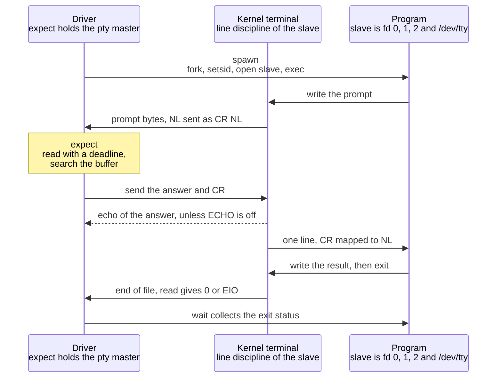

# expect and Automating Interactive Programs

> [!summary] Claim
> An interactive program can be scripted only by a process that holds the master side of a pseudo-terminal and alternates a bounded wait for specific output bytes with a write of input bytes; `expect` is that loop plus a pattern language, and every flaky automation is a wait that was skipped, unbounded, or matched against the wrong bytes.

Part of [Terminals and Job Control](README.md) in [Shell and Unix Engineering](../README.md).

## TL;DR

- Mechanism: `spawn` allocates a pty, forks, makes the slave the child's controlling terminal and descriptors 0 to 2, and executes the program; `expect` reads the master until a pattern matches, the timeout (10 seconds by default) passes, or end of file; `send` writes bytes to the master as if typed.
- Rule: wait for each prompt before answering it, give every wait a `timeout` and an `eof` branch that exit non-zero, end with `expect eof` and `wait`, and exit with the program's status.
- Trap: the driver sees what a terminal sees, not what the program printed - lines end in `\r\n`, everything sent is echoed back (so a pattern can match the script's own input), and input sent before a password prompt is echoed in clear and then thrown away by `tcsetattr(TCSAFLUSH)`.
- Portability: `expect` is a Tcl extension, not a POSIX utility; macOS 27.2 ships version 5.45 while the Debian 13 and Alpine 3.22 matrix images ship none, and the bytes an interactive shell puts around its prompt differ per shell (zsh and BusyBox ash emit escape sequences even with `TERM=dumb`, yash replaces a `PS1` inherited from the environment with its own default, and zsh exits with status 1 on a hangup where the other shells are killed by `SIGHUP`).
- When not to use it: when the interaction can be removed (a flag, a key, an API, an askpass hook) or the program only needs unbuffered output; screen-scraping a human interface is a contract nobody promised to keep.

## Mental model



The driver starts the program on the slave side of a new pseudo-terminal and keeps the master.
The program writes its prompt to what it believes is a terminal; output processing turns each newline into carriage return plus newline, and the bytes become readable on the master.
The driver reads with a deadline and searches everything it has read so far for the pattern, so a prompt that arrives in pieces still matches.
When the pattern is found the driver writes the answer to the master, ending it with a carriage return, the byte the Return key produces.
The line discipline echoes those bytes straight back to the driver unless the program switched `ECHO` off, maps the carriage return to a newline, and hands the program one complete line.
When the program exits and the last slave descriptor closes, the driver's read reports end of file, and the driver reaps the child to learn its exit status.
Each arrow is a place a script can go wrong: no deadline, a pattern that matches the echo arrow instead of the result arrow, an answer sent before the prompt arrow, or a driver that leaves before the end-of-file arrow.

## How it works

**Why a pipe is not enough.**
The lab shows three independent reasons, each with a program that a here-document cannot drive.
First, a program can ignore its standard input and read the secret from the controlling terminal: `getpass` opens `/dev/tty` and falls back to standard input only when that open fails (glibc master `misc/getpass.c`, `getpass`, as of 2026-11), and `readpassphrase` does the same and returns `ENOTTY` when `RPP_REQUIRE_TTY` is set (OpenSSH portable master `openbsd-compat/readpassphrase.c`, `readpassphrase`, as of 2026-11).
Second, stdio decides buffering by asking whether the descriptor is a terminal: the standard says standard input and standard output "shall be fully buffered if and only if the file descriptor associated with the stream is determined not to be associated with an interactive device" (POSIX.1-2024 XSH 2.5), so on a pipe the prompt sits in a buffer while the program waits for the answer and the driver waits for the prompt.
Third, a password prompt discards type-ahead: `TCSAFLUSH` means "all input so far received but not read shall be discarded before the change is made" (POSIX.1-2024 XSH `tcsetattr`), and both `getpass` and `readpassphrase` switch echo off with `TCSAFLUSH` before they write the prompt.
On Linux the flush is `set_termios` calling the line discipline's `flush_buffer` when the ioctl is `TCSETSF` (Linux `drivers/tty/tty_ioctl.c`, `set_termios` and `tty_mode_ioctl`, as of 2026-11).
A pty answers all three: the program gets a real terminal as `/dev/tty`, stdio becomes line buffered, and the driver can wait until the prompt proves the flush has already happened.

**`spawn`.**
`Exp_SpawnObjCmd` calls `exp_getptymaster`, forks, and in the child calls `setsid` (when `DO_SETSID` is defined), closes descriptors 0 to 2, calls `exp_getptyslave`, which opens the slave as descriptor 0 and duplicates it onto 1 and 2, and finally `execvp` (expect trunk `exp_command.c` and `pty_termios.c`, as of 2026-11).
`exp_getptymaster` opens `/dev/ptmx` and uses `ptsname`, `grantpt`, and `unlockpt`, or calls `openpty` where the build has it (expect trunk `pty_termios.c`, as of 2026-11); the allocation itself is the subject of [[Pseudo-Terminals]].
The manual adds that the pty is "initialized the same way as the user's tty" and then made "sane", and that a `stty_init` variable, read in the style of `stty` arguments, configures it further (expect(1) 5.45).

**`expect`.**
`Exp_ExpectObjCmd` computes `end_time = current_time + timeout` and loops: read what is available, try each pattern against the buffer, stop on a match, on end of file, or when the time is gone (expect trunk `expect.c`, as of 2026-11).
Patterns are glob patterns unless marked `-re` (regular expression) or `-ex` (exact string); the default is set by `ec->use = PAT_GLOB`.
The `timeout` variable starts at 10 seconds (`INIT_EXPECT_TIMEOUT`), and the manual states the consequence that makes scripts silently wrong: "If no timeout keyword is used, an implicit null action is executed upon timeout", so the script simply continues with the next command.
End of file is a read of 0 bytes or an `EIO` error, which `expRead` maps to end of file under the comment "On many systems, ptys produce EIO upon EOF"; the per-kernel difference is measured in [[Pseudo-Terminals]].
The match buffer is bounded: `exp_default_match_max` is 2000, `expAdjust` sizes the buffer at three times `match_max` plus one characters (6001 by default), and once it is two thirds full (4000 characters by default) `expIRead` calls `exp_buffer_shuffle`, which discards the oldest third of what it holds, so text that scrolled past can no longer match (expect trunk `expect.c`, as of 2026-11).
The manual states the user-visible guarantee more loosely: more than 2000 bytes of output "can force earlier bytes to be" forgotten, and "the forgotten characters are written to expect_out(buffer)" (expect(1) 5.45).
On a match, the matching output and the unmatched output before it are saved in `expect_out(buffer)` (expect(1) 5.45).

**`send`.**
`send` writes the string to the master and nothing else, so the bytes pass through the slave's input processing like keystrokes.
`ICRNL` translates a received carriage return into a newline (POSIX.1-2024 XBD 11.2.2), which is why scripts send `\r`; `ECHO` echoes input characters back to the terminal, which here is the driver (POSIX.1-2024 XBD 11.2.5); and `ONLCR`, an XSI-marked flag, transmits each newline of output as the pair carriage return, newline (POSIX.1-2024 XBD 11.2.3).
In canonical mode "a read request shall not return until an entire line has been typed" (POSIX.1-2024 XBD 11.1.6), so a program sees nothing until the line terminator arrives; the modes themselves belong to [[Canonical-and-Raw-Mode]] and [[termios-and-stty]].
The manual warns that `send` cannot wait: "if the first send completes before the process starts running, you run the risk of having your data ignored" (expect(1) 5.45).

**`close`, `wait`, and the end of the script.**
When the script exits, "all connections to spawned processes are closed" (expect(1) 5.45), and closing the master hangs the terminal up: `SIGHUP` goes to the controlling process, later reads return 0, and later writes fail with `EIO` (POSIX.1-2024 XBD 11.1.10).
A script that ends right after its last `send` therefore kills the program before it has acted on the input; the lab's `close-early` dialog measures exactly that.
`Exp_WaitObjCmd` returns a list that starts with four elements: the process ID, the spawn ID, 0, and `WEXITSTATUS` of the child; when the child was killed or stopped by a signal it appends `CHILDKILLED` or `CHILDSUSP`, the signal's name, and its description, and when the wait itself failed the third and fourth elements are -1 and an `errno` value, followed by `POSIX`, the error's name, and its message (expect trunk `exp_command.c`, as of 2026-11).
So a program killed by a signal reports 0 in the fourth element: by hand on macOS 27.3 with expect 5.45 on 2026-11-13, a child that sent itself `SIGHUP` gave `wait=PID exp5 0 0 CHILDKILLED SIGHUP hangup`.
Nothing copies that status into the script's own exit status unless the script does.

**The interactive shell as the program.**
An interactive shell writes its prompt to standard error after expanding `PS1`, whose default is `$ ` (POSIX.1-2024 XCU 2.5.3), so a driver on a pty sees the prompt while a capture of standard output alone never would.
What surrounds the prompt is not specified at all, and the lab records each shell's bytes in the Portability table: line editors switch the terminal to non-canonical mode and do their own echo, redraws, and terminal queries.

**What the standard covers.**
POSIX specifies the pieces - pty allocation, `termios`, stdio buffering, the shell's prompt - and no tool that composes them; `expect`, `script`, `unbuffer`, and `stdbuf` are all outside it.
The lab therefore carries its own driver, `mini_expect.c`, which is the loop above in about 450 lines of C, so the mechanism can be run on every system of the matrix.

## Numbers and limits

| Quantity | Value | Source |
|---|---|---|
| `expect` default `timeout` | 10 seconds | expect trunk `expect.c` (`INIT_EXPECT_TIMEOUT`), as of 2026-11; expect(1) 5.45; `puts $timeout` printed 10 on macOS 27.2 with expect 5.45, by hand, 2026-11-11 |
| `expect` default `match_max` | 2000 bytes | expect trunk `expect.c` (`exp_default_match_max`), as of 2026-11; `puts [match_max]` printed 2000, same machine and date |
| Forgetting rule | the buffer holds 3 x `match_max` + 1 characters (6001 by default); the oldest third of its content is dropped once it is two thirds full (4000 by default) | expect trunk `expect.c`, `expAdjust`, `expIRead`, and `exp_buffer_shuffle`, as of 2026-11 |
| `expect` and Tcl versions shipped by macOS 27.2 | expect 5.45, Tcl 8.5.9 | `expect -v` and `info patchlevel`, by hand, 2026-11-11; unchanged on macOS 27.3, by hand, 2026-11-13 |
| pexpect defaults | `timeout=30` seconds, `maxread=2000` bytes, 50 ms `delaybeforesend` | pexpect API documentation, as of 2026-11 |
| Longest line a canonical-mode program accepts | 4096 bytes on Linux, 1024 on macOS | pexpect API documentation (`send`), as of 2026-11; measured in [[TTY-Line-Discipline]] |
| Wait limit in the lab's driver | 10 seconds by default, `-t` to change | lab (`mini_expect.c`) |
| A wait with a 2 second limit returns | after at least 2 seconds, exit status 124, program killed and reaped | lab test "a pattern that never comes" |
| End of file with a 20 second limit is reported | in under 15 seconds (the test's bound; hand runs returned immediately), exit status 125 | lab test "a program that exits before the pattern" |
| Prompt written as `Pass`, 2 seconds, `word: ` | matched at transcript offset 10 after at least 2 reads | lab test "a prompt that arrives in two reads" |
| Lab matrix | 30 shell rows (8 on macOS 27.2, 13 in Alpine 3.22, 9 in Debian 13), 18 tests each, all passing | `run-matrix.sh` on the host and in both images, OrbStack Linux 7.2.12 kernel, 2026-11-11 |
| ksh93 echo count for the same typed line | 2026-11-11, 25 runs each: `exit 7` echoed once in 21 and twice in 4 (ksh93u+m 1.0.10 on Debian); twice in 21 and once in 4 (ksh93u+ 2012 on macOS). Re-run 2026-11-13, 25 runs each: once in 19 and twice in 6 (Debian); twice in 25 (macOS) | by hand with the lab's `shell` dialog, 2026-11-11 and 2026-11-13 |
| CVE-2001-1374 severity | CVSS v2 base score 7.2 | NVD record, published 2001-07-19 |

No throughput or latency figure is claimed: the lab measures behavior, not speed.

## Portability

The shell under test plays both parts in the lab: it runs the driver script, and it is the interactive program.
The first table is the lab's `shell` and `close-early` dialogs, with `TERM=dumb`, an empty `HOME`, an empty `ENV`, and `PS1='LAB> '` in the environment.
Bytes are written as the driver reports them: `\r`, `\n`, and `\x1b` for the escape character.

| Shell | Option that skips startup files | `PS1` from the environment | Bytes around the prompt and the typed line | Status after the terminal hangs up |
|---|---|---|---|---|
| POSIX `sh` | none specified | `PS1` is expanded and written to standard error, default `$ ` (POSIX.1-2024 XCU 2.5.3) | unspecified | unspecified here; hangup semantics are XBD 11.1.10 |
| macOS `/bin/sh` and `/bin/bash` (bash 3.2.57) | `--norc` | used | prompt, the line echoed once, `\r\n`; prints `exit\r\n` when leaving | 129 |
| bash 3.2, 4.4, 5.1, 5.2, 5.3 (Alpine), 5.2 (Debian), 5.3 (macOS) | `--norc` | used | same as above | 129 |
| zsh 5.9 (Alpine, Debian) and 5.9.2 (macOS), native | `-f` | used | before each prompt `%`, 78 spaces, `\r \r\r`; after it `\x1b[?2004h`; after the line `\x1b[?2004l\r\r\n` | 1: zsh exits with the signal's number, it is not killed |
| the same zsh with `--emulate sh` | `-f` | used | same as native zsh | 1, for the same reason |
| dash 0.5.12 and 0.5.13 | none needed | used | prompt, the terminal's own echo, `\r\n` | 129 |
| ksh93u+m 1.0.10 (Debian) | none needed | used | prompt, `\r`, 79 spaces, `\r\r`, prompt again; a typed line is echoed once or twice from run to run | 129 |
| ksh93u+ 2012-08-01 (macOS `/bin/ksh`) | none needed | used | prompt; a typed line is echoed once or twice from run to run | 129 |
| mksh R59 (2020 and 2025) | none needed | used | prompt, the line, `\r\r\n` | 129 |
| yash 2.58.1 | `--norcfile` | overwritten at startup with yash's default: the prompt stays `$ ` and the wait for `LAB> ` times out | plain once the prompt is set by typing the assignment | 129 |
| posh 0.14.1 | none needed | used | prompt, the terminal's own echo, `\r\n` | 129 |
| BusyBox ash 1.37.0 | none needed | used | `\x1b[6n` after a prompt unless input is already pending; Debian's build first prints a two-line banner | 129 |

Every non-POSIX row is asserted by the lab tests "the interactive shell as the program, prompt taken from PS1 in the environment: each family's bytes" and "closing the terminal right after the last send hangs the program up before it finishes its work".
The bash, dash, posh, mksh, and zsh transcripts are asserted byte for byte; for ksh93 the test asserts the stable part and the absence of escape sequences, and for BusyBox ash it accepts each prompt with or without the query, because both vary with timing.
The zsh bytes are its partial-line marker, which the manual describes for the `PROMPT_SP` option as "some cursor-control characters, including a series of spaces" (zsh manual, Options), followed by the sequence that switches bracketed paste on; the BusyBox bytes are a cursor-position request that `ask_terminal` sends only when `poll` finds no input waiting (BusyBox master `libbb/lineedit.c`, as of 2026-11).
The lab test "setting the prompt in band, with an assignment whose echo cannot match, works in every shell" passes in all 30 rows, yash included.

Two rows differ in kind, not only in bytes, and each was traced to its source.
The yash row is documented behavior that departs from the standard: `init_variables` assigns `PS1`, `PS2`, and `PS4` unconditionally, and `main` calls it after `init_environment` has imported the environment (yash 2.58.1 `variable.c` and `yash.c`), and the manual says of `PS1`: "The value is initialized to either `$ ` or `# ` depending on whether the effective user ID of the shell process is zero or not" (yash 2.58.1 manual, Parameters and variables).
POSIX instead has variables "initialized from the environment" and calls `$ ` only "the default value" (POSIX.1-2024 XCU 2.5.3).
POSIX mode does not change it: by hand in the Alpine image on 2026-11-11, `PS1='LAB> ' yash --posix -c 'printf "[%s]\n" "$PS1"'` printed `[$ ]`, and `export -p` listed `PS1`, `PS2`, and `PS4` as exported with yash's values, so a child of yash inherits `$ ` as well.
No entry in yash's `NEWS` file changes this (not found in the changelog as of 2026-11).
The zsh status is the signal's number and not a failure code of its own: zsh installs a handler for `SIGHUP` unless the signal was ignored on entry (zsh 5.9 `Src/init.c`, `init_signals`), and with no trap set the handler calls `zexit(SIGHUP, ZEXIT_SIGNAL)`, which ends in `exit(exit_val)` (zsh 5.9 `Src/signals.c`, `handler`, and `Src/builtin.c`, `zexit`).
`SIGHUP` is signal 1, so zsh exits normally with status 1, while every other shell of the matrix dies of the signal and the driver reports 128 + 1.
POSIX specifies that a hangup sends `SIGHUP` to the controlling process (XBD 11.1.10) and which signal actions commands inherit from the shell (XCU 2.12), not how the shell itself has to end, so neither outcome is required; no changelog entry on the exit status was found as of 2026-11.

Dialogs whose result does not depend on the shell, with the one exception found:

| Lab dialog | Every shell of the matrix | Exception |
|---|---|---|
| `pipe-login`: answers on a pipe, no terminal | status 2, `login: no terminal for the password` | none |
| `login`: wait for each prompt on a pty | status 0, user name echoed, password not | macOS ksh93u+ 2012 echoes the user name twice (the double echo is traced below; see also [[Pseudo-Terminals]]) |
| `blind`: both answers typed ahead, prompt made with `stty -echo` | status 0, and the password is echoed in clear | macOS ksh93u+ 2012: the dialog times out (124) |
| `blind-getpass`: the same against a `TCSAFLUSH` prompt | times out (124), the password was echoed and then discarded | none |
| `wait-getpass`: wait for each prompt against the `TCSAFLUSH` prompt | status 0, password never echoed | none (macOS ksh93u+ 2012 again echoes the user name twice) |

The macOS ksh93u+ 2012 exception was narrowed by hand on 2026-11-11: two reads from the terminal with both lines typed ahead both succeed, but a `stty` call between them loses the second line, and `stty -g` right after the first read shows the `PENDIN` bit (`lflag=200005cb` against `5cb` under `/bin/sh`).
The double echo follows from the XNU line discipline: `ttioctl` for `TIOCSETA` sets `PENDIN` when a change turns `ICANON` on, and `ttypend` then feeds the raw queue through `ttyinput` again, which echoes it (XNU `bsd/kern/tty.c`, as of 2026-11).
The `stty` call is not a flush: macOS `stty` calls `tcsetattr(fd, 0, ...)`, Libc maps `TCSANOW` to `TIOCSETA`, and only `TIOCSETAF` calls `ttyflush(tp, FREAD)` (Apple `adv_cmds` `stty/stty.c`, Libc `gen/FreeBSD/termios.c`, XNU `bsd/kern/tty.c`, as of 2026-11).
Why that call nevertheless loses the second line was not settled from the source.

Utilities and libraries around the dialog:

| Component | GNU and glibc (Debian 13) | macOS 27.2 | BusyBox and musl (Alpine 3.22) | uutils |
|---|---|---|---|---|
| `stty -echo` keeps type-ahead (lab `blind`) | yes, coreutils 9.7 | yes | yes, BusyBox 1.37.0 | `stty` is in the uutils 0.0.30 source and applies changes with `tcsetattr(TCSANOW)`, which does not flush (`src/uu/stty/src/stty.rs`); not run here |
| First line a stdio program writes into a pipe (lab `stdio-pipe`) | held until exit | held until exit | written at once; later lines are held | not applicable: a C library property |
| `stdbuf -oL` makes the lab's stdio program prompt on pipes (by hand, re-run 2026-11-13 on macOS and Debian) | yes, coreutils 9.7 | yes, `/usr/bin/stdbuf` | no `stdbuf` in the image | not measured |
| `script` as a pty wrapper with the answer already on the pipe (by hand, re-run 2026-11-13 on macOS and Debian) | `script -qec CMD /dev/null`: prompt arrives, answer is read | `script -q /dev/null CMD`: prompt arrives, but the program read end of file instead of the answer | no `script` in the image | no `script`: the 0.0.30 `Cargo.toml` lists none |
| `expect` in the base system | not installed in the matrix image | `/usr/bin/expect` 5.45; no `unbuffer` and no `autoexpect` in `/usr/bin` | not installed in the matrix image | not applicable |

The musl row is the lab test "the same program on pipes holds its prompt in the stdio buffer", which branches on the C library the compiler reports.
musl starts `stdout` with a line-buffer character (`.lbf = '\n'` in `src/stdio/stdout.c`), `__fwritex` therefore pushes the first newline-terminated chunk through the stream's write function, and that function, `__stdout_write`, switches to full buffering for a non-terminal only as it writes that first chunk (musl master `src/stdio/fwrite.c` and `src/stdio/__stdout_write.c`, as of 2026-11).

## Worked example

The [lab](../labs/02-expect-and-automating-interactive-programs/) has four files.
`mini_expect.c` is the driver: `-x TEXT` waits for exact bytes, `-s TEXT` sends bytes, `-t` sets the limit, `-p` uses pipes instead of a pty, `-c` closes the terminal right after the last step, and `-v` reports where each match ended.
`targets.c` holds two C programs that defeat a pipe, one that prompts through stdio and one that asks for a password the way `getpass` does.
`dialog.sh` holds the shell programs being automated and the dialogs that drive them, and `expect.bats` runs every dialog with the shell under test as both the driver's shell and the program.

The whole of `expect` is this function, verbatim from `mini_expect.c`:

```c
/*
 * The heart of expect: read until TEXT (or, when TEXT is NULL, end of file) or the deadline.
 * The search runs over everything unconsumed, so a prompt that arrives in two reads still matches.
 * *READS counts the reads that returned data.
 */
static int wait_for(int fd, const char *text, size_t len, int secs, int *reads) {
  long deadline = now_ms() + (long)secs * 1000;
  *reads = 0;
  for (;;) {
    if (text != NULL) {
      long at = find(text, len);
      if (at >= 0) {
        consumed = (size_t)at + len;
        return GOT_MATCH;
      }
    }
    long left = deadline - now_ms();
    if (left <= 0) {
      return GOT_TIMEOUT;
    }
    struct pollfd pf = {.fd = fd, .events = POLLIN};
    int pr = poll(&pf, 1, (int)left);
    if (pr < 0 && errno == EINTR) {
      continue;
    }
    if (pr <= 0) {
      return GOT_TIMEOUT;
    }
    if (total >= CAPACITY) {
      return GOT_OVERFLOW;
    }
    ssize_t n = read(fd, transcript + total, CAPACITY - total);
    if (n < 0 && errno == EINTR) {
      continue;
    }
    if (n <= 0) {
      /* 0 is end of file (pipes, macOS ptys); EIO is how a Linux pty reports that every slave closed */
      return GOT_EOF;
    }
    total += (size_t)n;
    (*reads)++;
  }
}
```

The dialogs are single command lines; these are verbatim from the `drive` function of `dialog.sh`:

```sh
    # prompt, answer, prompt, answer: the canonical expect script
    login) "$mini" -x 'login: ' -s 'alice\r' -x 'Password: ' -s 's3cret\r' -x 'welcome' -- "$@" "$self" inner login ;;
    login-wrong) "$mini" -x 'login: ' -s 'alice\r' -x 'Password: ' -s 'guess\r' -x 'denied' -- "$@" "$self" inner login ;;
    # the here-document approach: both answers on a pipe, no terminal anywhere
    pipe-login) "$mini" -p -s 'alice\ns3cret\n' -- "$@" "$self" inner login ;;
    # both answers typed ahead on the terminal, before any prompt
    blind) "$mini" -s 'alice\rs3cret\r' -- "$@" "$self" inner login ;;
    blind-getpass) "$mini" -t 3 -s 'alice\rs3cret\r' -- "$@" "$self" inner login-getpass "$targets" ;;
    wait-getpass) "$mini" -x 'login: ' -s 'alice\r' -x 'Password: ' -s 's3cret\r' -x 'welcome' -- "$@" "$self" inner login-getpass "$targets" ;;
    # a terminal turns each newline into carriage return, newline
    bare-newline) "$mini" -x 'line1\nline2' -- "$@" "$self" inner lines ;;
    cr-newline) "$mini" -x 'line1\r\nline2' -- "$@" "$self" inner lines ;;
    # a prompt written in two pieces, two seconds apart
    split) "$mini" -v -x 'Password: ' -s 'x\r' -- "$@" "$self" inner slow-prompt ;;
    # the terminal echoes what was sent, so a pattern can match the driver's own input
    echo-match) "$mini" -v -x 'cmd> ' -s 'ok\r' -x 'ok' -- "$@" "$self" inner command ;;
    output-match) "$mini" -v -x 'cmd> ' -s 'ok\r' -x 'ran:ok' -- "$@" "$self" inner command ;;
    # failure paths: the pattern never comes, or the program leaves first
    timeout) "$mini" -t 2 -x 'never' -- "$@" "$self" inner hang "$work/pid" ;;
    eof) "$mini" -t 20 -x 'Password: ' -- "$@" "$self" inner early-exit ;;
    # ending the dialog: close at once (what an expect script does when it ends) or wait for end of file
    close-early) "$mini" -c -x 'go? ' -s 'y\r' -- "$@" "$self" inner finish "$work/marker" ;;
    wait-eof) "$mini" -x 'go? ' -s 'y\r' -- "$@" "$self" inner finish "$work/marker" ;;
    # a C program that prompts through stdio: on a terminal, on pipes, and on pipes without waiting
    stdio-pty) "$mini" -x 'ready\r\n' -s 'go\r' -- "$targets" stdio ;;
    stdio-pipe) "$mini" -p -t 2 -x 'ready' -- "$targets" stdio ;;
    stdio-pipe-blind) "$mini" -p -s 'go\n' -- "$targets" stdio ;;
```

The program behind the `login` dialogs, verbatim from the `inner` function:

```sh
    login)
      # asks for the user on stdout and stdin, and for the password on /dev/tty with echo off
      printf 'login: '
      IFS= read -r user || return 3
      if ! (: </dev/tty) 2>/dev/null; then
        printf 'no terminal for the password\n'
        return 2
      fi
      stty -echo </dev/tty
      printf 'Password: ' >/dev/tty
      IFS= read -r secret </dev/tty
      stty echo </dev/tty
      printf '\n' >/dev/tty
      check "$user" "$secret"
      ;;
    login-getpass)
      # the same, but the password prompt discards type-ahead (targets getpass)
      printf 'login: '
      IFS= read -r user || return 3
      secret=$("$2" getpass) || return 2
      check "$user" "$secret"
      ;;
```

Expected output, captured on macOS 27.2 with `/bin/sh` as the shell under test.
The tests assert these reports exactly, with three exceptions: for `login-wrong` and `wait-eof` they assert the status, the result line, and the end of the transcript; for the `-v` lines they assert the `end=` offset of the last match; and for `split` they also assert that `reads` is at least 2.

```text
$ dialog.sh drive pipe-login
transcript=login: no terminal for the password\n
result=ok status=2
$ dialog.sh drive login
transcript=login: alice\r\nPassword: \r\nwelcome alice\r\n
result=ok status=0
$ dialog.sh drive login-wrong
transcript=login: alice\r\nPassword: \r\ndenied\r\n
result=ok status=1
$ dialog.sh drive blind
transcript=alice\r\ns3cret\r\nlogin: Password: \r\nwelcome alice\r\n
result=ok status=0
$ dialog.sh drive blind-getpass
transcript=alice\r\ns3cret\r\nlogin: Password: 
result=timeout waiting=eof
$ dialog.sh drive wait-getpass
transcript=login: alice\r\nPassword: \r\nwelcome alice\r\n
result=ok status=0
$ dialog.sh drive bare-newline
transcript=line1\r\nline2\r\n
result=eof waiting=line1\nline2
$ dialog.sh drive cr-newline
transcript=line1\r\nline2\r\n
result=ok status=0
$ dialog.sh drive split
matched=Password:  end=10 reads=2
transcript=Password: x\r\ngot=x\r\n
result=ok status=0
$ dialog.sh drive echo-match
matched=cmd>  end=5 reads=1
matched=ok end=7 reads=1
transcript=cmd> ok\r\nran:ok\r\n
result=ok status=0
$ dialog.sh drive output-match
matched=cmd>  end=5 reads=1
matched=ran:ok end=15 reads=2
transcript=cmd> ok\r\nran:ok\r\n
result=ok status=0
$ dialog.sh drive timeout
transcript=started\r\n
result=timeout waiting=never
$ dialog.sh drive eof
transcript=bye\r\n
result=eof waiting=Password: 
$ dialog.sh drive close-early
transcript=go? 
result=closed status=129
$ dialog.sh drive wait-eof
transcript=go? y\r\ndone y\r\n
result=ok status=0
$ dialog.sh drive stdio-pty
transcript=stdio target\r\nready\r\ngo\r\ngot go\r\n
result=ok status=0
$ dialog.sh drive stdio-pipe
transcript=
result=timeout waiting=ready
$ dialog.sh drive stdio-pipe-blind
transcript=stdio target\nready\ngot go\n
result=ok status=0
```

Read the pairs against each other.
`pipe-login` and `login` are the same program: without a terminal it gives up, on a pty it finishes.
`blind` shows the password in the transcript because it arrived while echo was still on; `blind-getpass` shows it and then hangs, because the prompt flushed it; `wait-getpass` shows neither problem.
`echo-match` stops at offset 7, inside the echo of what was just sent, while `output-match` reaches offset 15, the program's answer.
`close-early` leaves no marker file and reports status 129 (128 plus `SIGHUP`), while `wait-eof` lets the program print `done y`.
The three `stdio` runs are one C program: on a pty the prompt arrives and the answer is echoed with `\r\n` line endings; on pipes the wait for `ready` times out with an empty transcript (with musl the transcript holds the banner line `stdio target\n`); and when the answer is sent without waiting, everything arrives at exit, with no echo and no carriage returns.

The same `login` dialog in real `expect`, measured by hand on macOS 27.2 with expect 5.45 on 2026-11-11 (the path to `dialog.sh` is shortened here).
It is not part of the lab, because the matrix images carry no `expect`.

```tcl
set timeout 5
spawn /bin/sh dialog.sh inner login
expect "login: "
send "alice\r"
expect "Password: "
send "[lindex $argv 0]\r"
expect eof
lassign [wait] pid spawnid os_error value
exit $value
```

```text
$ expect login.exp s3cret; echo "rc=$?"
spawn /bin/sh dialog.sh inner login
login: alice
Password: 
welcome alice
rc=0
$ expect login.exp guess; echo "rc=$?"
spawn /bin/sh dialog.sh inner login
login: alice
Password: 
denied
rc=1
```

Run the lab with `bats labs/02-expect-and-automating-interactive-programs/expect.bats`, or under another shell with `LAB_SHELL=dash bats labs/02-expect-and-automating-interactive-programs/expect.bats`.
It needs only a C compiler (`${CC:-cc}`); every wait inside the driver is bounded, and the driver kills the program's process group before it returns.

## Pitfalls

> [!warning] A timeout that falls through
> Trigger: an `expect` command with no `timeout` branch whose pattern never appears, for example after the program changed its prompt from `login:` to `Username:`.
> Symptom: after 10 seconds the script carries on with the next `send` as if the prompt had been seen; by hand on macOS, a script that waited for `Username: ` against the lab's `login: ` program continued after its 2 second timeout and still exited 0, so the failure was invisible.
> Fix: give every wait an explicit failure path, `expect { timeout { exit 124 } eof { exit 125 } "Username: " }`, or install one once with `expect_before`; the lab's driver makes the same choice by exiting 124 and 125.

> [!warning] The program failed and the script exited 0
> Trigger: a script that ends after `expect eof` without calling `wait`.
> Symptom: by hand on macOS, the lab's `login` program printed `denied` and exited 1, and the expect script exited 0.
> Fix: end with `expect eof`, then `exit [lindex [wait] 3]`; the fourth element of the list `wait` returns is the program's exit status (expect trunk `exp_command.c`, `Exp_WaitObjCmd`).
> That element is 0 when the program was killed by a signal, so a robust script also checks for `CHILDKILLED` in the fifth element and exits non-zero then; the sixth element names the signal.

> [!warning] The script ends before the program does
> Trigger: the last command of the script is a `send`.
> Symptom: the exit closes the pty master, the terminal hangs up, and the program dies of `SIGHUP` before it acts on the input; the lab's `close-early` dialog leaves no marker file in any shell (status 129, and 1 for zsh), and the equivalent expect script by hand on macOS left none either.
> Fix: finish with `expect eof` and `wait`, as the lab's `wait-eof` dialog does, or start the program so that it does not depend on the terminal's lifetime.

> [!warning] The pattern matches the echo of what was just sent
> Trigger: `send "ok\r"` followed by `expect "ok"`, or sending a command line that contains the word the script then waits for.
> Symptom: the wait returns at once, on the terminal's echo, before the program has produced anything; the lab's `echo-match` dialog matches at offset 7 of `cmd> ok\r\nran:ok\r\n`.
> Fix: wait for text that only the program can produce (the lab's `output-match`, or `echo $((6*7))` whose echo does not contain `42`), split a sentinel when typing it (`PS1='LAB''> '`), or switch echo off on the slave with `stty_init`.

> [!warning] A bare newline in a pattern, a newline instead of a carriage return in a send
> Trigger: `expect "line1\nline2"`, or porting a here-document to `send` without changing the line endings.
> Symptom: terminal output has `\r\n` line endings, so the pattern never matches; the lab's `bare-newline` dialog ends with `result=eof waiting=line1\nline2` while `cr-newline` matches.
> Fix: write `\r\n` in patterns (or match the lines separately) and end sent lines with `\r`; pexpect's documentation states the same convention for its `readline` and `run`.

> [!warning] Answering before the prompt
> Trigger: sending the password without waiting for its prompt, or waiting for a prompt that the program prints before it switches echo off.
> Symptom: the lab's `blind` dialog prints the password in the transcript, because it arrived while `ECHO` was on, and `blind-getpass` then loses it to `tcsetattr(TCSAFLUSH)` and times out.
> A draft of the lab's `getpass` target wrote the prompt before the `tcsetattr` call, and one matrix run under ksh93u+m then showed `Password: s3cret` in the transcript and timed out: the driver had answered inside that window.
> Fix: wait for the prompt, and prefer programs that switch echo off first, as `getpass` and `readpassphrase` do; for programs that do not, pexpect adds a 50 ms `delaybeforesend` by default and offers `waitnoecho`, because "if you send your password before the application turned off echo, then you get your password echoed".

> [!warning] The prompt that never arrives on a pipe
> Trigger: driving a stdio program through pipes, a FIFO pair, or a coprocess.
> Symptom: the driver waits for a prompt that is still in the program's buffer while the program waits for the answer; the lab's `stdio-pipe` dialog times out with an empty transcript on glibc and macOS, and with only the first line on musl.
> Fix: give the program a pty (`expect`, or the `unbuffer` script from the expect distribution), or change its buffering with `stdbuf -oL` where that exists, or use the program's own unbuffered or batch mode.

> [!warning] Prompt matching against an interactive shell
> Trigger: waiting for `$ ` or for a prompt taken from the environment, on a shell with a line editor.
> Symptom: zsh puts 78 spaces and two escape sequences around the prompt, BusyBox ash adds a cursor-position request, ksh93 redraws the prompt and echoes a line once or twice, macOS `/bin/bash` prints a three-line notice about zsh first unless `BASH_SILENCE_DEPRECATION_WARNING` is set, and yash ignores `PS1` from the environment, so the lab's wait for `LAB> ` times out there.
> Fix: start the shell without startup files, set `TERM=dumb`, set a unique prompt by typing the assignment with a split sentinel, and match the prompt rather than column positions; the lab's `shell-inband` dialog does this and passes in every shell.

> [!warning] Glob and Tcl metacharacters in a prompt
> Trigger: `expect "Continue [y/n]?"`.
> Symptom: Tcl treats the brackets inside double quotes as a command substitution; by hand on macOS the script stopped with `invalid command name "y/n"`, and `expect -c` still exited 0.
> Fix: use braces and an exact match, `expect -ex {Continue [y/n]?}`, which matched in the same hand test; remember that an unmarked pattern is a glob.

> [!warning] Output larger than the match buffer
> Trigger: waiting for a pattern that spans or precedes more than `match_max` bytes of output, such as a long listing followed by a summary line.
> Symptom: `expect` keeps a buffer of three times `match_max` characters and forgets the oldest third of it once it is two thirds full (4000 characters with the default `match_max` of 2000), so earlier text cannot be matched; the forgotten characters go to `expect_out(buffer)`, and a later match overwrites it with only what was still kept.
> Fix: raise `match_max` for that program, or match the end marker only; this entry is read from the manual and `expect.c`, and the lab's driver avoids the question with a fixed 64 KiB transcript.

> [!warning] Libraries loaded from a world-writable directory
> Trigger: expect before 5.32 on a multi-user host.
> Symptom: CVE-2001-1374: expect searched for its libraries in `/var/tmp` before other directories, which let a local user gain root through a Trojan horse library reached by `mkpasswd` (NVD, CVSS v2 7.2).
> Fix: long since fixed upstream; the lasting lesson is that an automation tool that runs with privileges has a search path and a script path that need the same protection as the credentials it types.

## Security and robustness

- The manual's own advice is not to store passwords in scripts: prompt for them at run time instead, since "anything that is stored on a computer is susceptible to being accessed by anyone" (expect(1) 5.45).
  A password on the driver's command line is worse, because arguments are visible to other processes; see [[Secrets-in-argv-env-and-History]].
- Prefer a non-terminal credential path where the program has one: `ssh` runs the program named by `SSH_ASKPASS` when it has no terminal and `DISPLAY` is set, and `SSH_ASKPASS_REQUIRE=force` makes it use that program for every passphrase (OpenSSH ssh(1)); `sudo -S` reads the password from standard input, `sudo -A` runs the `SUDO_ASKPASS` helper, and `sudo -n` fails instead of prompting (sudo(8)).
- The transcript is a secret store: the lab's `blind` dialog shows a password echoed in clear, so logs of expect sessions (`log_user`, `exp_internal`, CI output) need the same handling as the credential.
- A pattern is matched against bytes the other side controls.
  A remote banner or a file name that contains `Password:` makes a careless script type its secret into the wrong place, and anything passed through `interact` reaches the user's real terminal uninterpreted, which is the subject of [[Terminal-Escape-Injection]].
- Bound every wait and clean up on every path: the lab's driver kills the program's process group and reaps it on timeout (the test checks that the recorded process ID is gone), because an abandoned child keeps the pty and the session alive.
- Make the dialog deterministic before making it clever: fixed `TERM`, a fixed window size (the lab sets 24 by 80, since a fresh pair is 0 by 0), no startup files, and a prompt the script itself chose.
- Count pseudo-terminals as a resource: every `spawn` holds one until `close` and `wait`, and the limits are in [[Pseudo-Terminals]].

## The principal's view

The decision is not which expect dialect to use but whether the interaction should exist.
An interactive prompt is an interface designed for a person, with no stability promise: the prompt text, the order of questions, the echo behavior, and the bytes around a shell prompt all change between versions, as the Portability table shows for ten shells on one day.
So the order of preference is fixed.
First remove the interaction: a non-interactive flag, a configuration file, an API, key-based authentication, or an askpass hook.
Second, if the only problem is buffering or terminal detection, fix that alone with the program's own flag or `stdbuf`, not with a dialog.
Third, when a terminal dialog is unavoidable - testing your own interactive tool, a vendor installer, equipment with only a console - write it as code with a test suite, in a language with real error handling: pexpect in Python, or a small C or Go driver like the lab's, rather than hundreds of lines of Tcl.
`expect` itself remains the right tool for a short dialog on a machine that already has it, and for `interact`, where a person takes over after the scripted part.
The trade-off is fidelity against determinism: a pty reproduces exactly what a user sees, including everything a script does not want (echo, redraws, escape sequences, timing), and each of those is a source of flakiness that a pipe or an API does not have.
Budget for it explicitly: every wait has a timeout that turns into a non-zero exit, every dialog has a recorded transcript with secrets removed, and the dialog runs in CI against a fake program on a pty so that a prompt change fails a test, not a deployment.
Shell cannot do this job by itself, since it has no way to allocate a pty; a FIFO pair or a coprocess (see [[Coprocesses]]) covers only programs that read standard input, flush their prompts, and never touch `/dev/tty`.

## Interview questions

> [!question] L5: Why can a here-document not answer a password prompt?
>
> > [!success]- Answer
> > Password readers such as `getpass` and `readpassphrase` open `/dev/tty`, the controlling terminal, and do not read standard input at all when that open succeeds.
> > They also switch echo off with `tcsetattr(TCSAFLUSH)`, which discards input that arrived before the prompt.
> > In the lab, the `pipe-login` dialog feeds both answers on a pipe with no terminal and the program exits 2 with `no terminal for the password`.
> > A pty gives the program a real controlling terminal, and the driver that holds the master can type into it.
> >
> > Follow-up: What does `getpass` do when `/dev/tty` cannot be opened?

> [!question] L5: What do `spawn`, `expect`, and `send` do in terms of system calls?
>
> > [!success]- Answer
> > `spawn` allocates a pty (`/dev/ptmx` with `grantpt`, `unlockpt`, and `ptsname`, or `openpty`), forks, and in the child calls `setsid`, opens the slave as descriptors 0 to 2, and calls `execvp`.
> > `expect` reads the master in a loop with a deadline and matches the accumulated buffer against its patterns; a read of 0 or `EIO` is end of file.
> > `send` is a write to the master, which the slave's line discipline treats as typed input.
> > `wait` is `waitpid` and returns the exit status in the fourth list element, which is 0 with `CHILDKILLED` and the signal's name appended when the program died of a signal.
> >
> > Follow-up: Why does `send` use `\r` and not `\n` for the Return key?

> [!question] L5: Predict the transcript when a driver sends `alice` and `s3cret`, each followed by a carriage return, before a program that prints `login: `, reads a line, runs `stty -echo`, prints `Password: `, reads a line, restores echo, and prints a newline and `welcome alice`.
>
> > [!success]- Answer
> > The transcript is `alice\r\ns3cret\r\nlogin: Password: \r\nwelcome alice\r\n`.
> > Both lines are echoed at the moment they are typed, before the program has printed anything, because the terminal is still in its default mode with `ECHO` on.
> > That includes the password: switching echo off later cannot take back an echo that already happened.
> > The program then finds both lines waiting, so no echo appears after its prompts.
> > This is the lab's `blind` dialog, and the test asserts that exact transcript.
> >
> > Follow-up: What changes if the password prompt uses `tcsetattr(TCSAFLUSH)` instead of `stty -echo`?

> [!question] L6: Debug this script, which sometimes configures nothing and always reports success.
>
> ```tcl
> #!/usr/bin/expect -f
> spawn ./installer
> expect "Password:"
> send "$env(PW)\r"
> expect "Proceed [y/n]?"
> send "y\r"
> ```
>
> > [!success]- Answer
> > Four defects, each reproduced in this note.
> > `"Proceed [y/n]?"` is a Tcl command substitution inside double quotes and fails with `invalid command name "y/n"`; write `expect -ex {Proceed [y/n]?}`.
> > Neither `expect` has a `timeout` or `eof` branch, so a missing prompt falls through after 10 seconds and the script types into whatever is there.
> > The script ends right after the last `send`, which closes the pty and hangs up the installer before it acts; add `expect eof`.
> > The exit status is never taken from `wait`, so the script exits 0 whatever the installer did; end with `exit [lindex [wait] 3]`, and treat a `CHILDKILLED` fifth element as a failure, since the fourth is then 0.
> >
> > Follow-up: Where should the password come from instead of an environment variable?

> [!question] L6: Why does an automation log show the password in clear in about one run in a hundred, and how do you fix it?
>
> > [!success]- Answer
> > The password is echoed when it reaches the terminal while `ECHO` is still on.
> > That happens when the driver sends it without waiting for the prompt, or when the program prints its prompt before switching echo off and the driver answers inside that window.
> > The lab reproduces the first case deterministically (`blind`), and a draft of its target reproduced the second under ksh93u+m in the matrix.
> > Fixes are to wait for the prompt, to wait until echo is off (pexpect's `waitnoecho`, or its default 50 ms delay before each send), and to treat the transcript as secret.
> > The durable fix is to stop typing passwords: keys, an askpass helper, or `sudo -S` from a protected descriptor.
> >
> > Follow-up: Why does `getpass` write its prompt after the `tcsetattr` call and not before?

> [!question] L6: Why does a program print its prompt when run by hand but never when driven through a pipe, and what are three fixes?
>
> > [!success]- Answer
> > stdio makes standard output fully buffered when it is not an interactive device (POSIX.1-2024 XSH 2.5), so the prompt stays in the buffer while the program blocks reading the answer.
> > The lab's `stdio-pipe` dialog times out with an empty transcript on glibc and macOS; musl writes the first line of the stream at once and buffers the rest.
> > Fix one is a pty, through `expect` or `unbuffer`, which makes the stream line buffered.
> > Fix two is `stdbuf -oL` where the system has it, which changed the behavior by hand on Debian and macOS.
> > Fix three is the program's own flag or an explicit `fflush` after each prompt.
> >
> > Follow-up: Why does the answer not need to wait when it is sent blind on the pipe?

> [!question] L6: How do you detect reliably that a command has finished when driving an interactive shell?
>
> > [!success]- Answer
> > Match a prompt that only the shell can print, not a guess such as `$ `.
> > Start the shell without startup files and with `TERM=dumb`, then set a unique prompt by typing the assignment with a split sentinel such as `PS1='LAB''> '`, whose echo does not contain the prompt.
> > Taking `PS1` from the environment is not enough: yash 2.58.1 ignores it in the lab.
> > Match the prompt as a substring, because zsh, ksh93, and BusyBox ash surround it with spaces, carriage returns, and escape sequences.
> > Never wait for text that the command line itself contains, because the echo matches first.
> >
> > Follow-up: How would you also capture the exit status of each command?

> [!question] L7+: What do you do when you inherit several hundred expect scripts that configure devices and fail a few percent of the time?
>
> > [!success]- Answer
> > Measure first: classify failures into timeouts that fell through, prompts that changed, echo races, and early exits, since each has a mechanical fix.
> > Wrap every wait in a shared failure path that exits non-zero on timeout and end of file, and propagate the device's status, so failures stop being silent.
> > Record transcripts with secrets removed, and build a fake device on a pty so dialogs run in CI.
> > Then remove the interaction wherever the device offers a non-interactive interface, and port what remains to a library with real error handling and tests.
> > Retry only steps that are idempotent, and make the rest resumable.
> >
> > Follow-up: Which metric tells you the migration is working?

> [!question] L7+: Design a test harness for an interactive command-line tool that your team ships.
>
> > [!success]- Answer
> > Run the tool on a pty created by the test, in a new session, with a fixed `TERM`, a fixed window size, and an empty home directory.
> > Drive it with wait and send steps where every wait has a deadline, and report timeout, end of file, and exit status as distinct outcomes.
> > Assert on escaped transcripts so carriage returns and escape sequences are visible, and normalize only what is documented as variable.
> > Kill the process group and reap it on every path, and bound the whole suite, because CI has no controlling terminal and a stopped child hangs forever.
> > Run the same suite on each supported platform, since end of file (`EIO` or 0), echo, and libc buffering differ.
> >
> > Follow-up: Which behaviors of your tool would you refuse to test this way?

> [!question] L7+: Review the security of a cron job that uses expect to type a root password into a remote session.
>
> > [!success]- Answer
> > The secret is stored where the script can read it, appears in the transcript if echo is on at the wrong moment, and may be visible in the argument list.
> > The pattern that triggers the send is matched against remote output, so a spoofed `Password:` prompt can collect the secret.
> > The tool itself is part of the trusted base: CVE-2001-1374 was a library search path in expect that gave local users root.
> > Replace the dialog with a key or certificate restricted to one command, or with a privileged helper that needs no password for exactly that command.
> > If the dialog must stay, read the secret from a protected descriptor at run time, disable logging around the send, and fail closed on any unexpected output.
> >
> > Follow-up: How do you prove that no log line ever contained the secret?

## Related

Prerequisites: [[Terminal-Escape-Injection]]

Next: [[Reading-the-POSIX-Standard]]

See also: [[Pseudo-Terminals]]; [[TTY-Line-Discipline]]; [[Canonical-and-Raw-Mode]]; [[termios-and-stty]]; [[Sessions-Process-Groups-and-Controlling-Terminals]]; [[Readline-and-inputrc]]; [[Terminal-Multiplexers-tmux-and-screen]]; [[Here-Documents]]; [[The-read-Builtin]]; [[Coprocesses]]; [[Timeouts-in-Scripts]]; [[Secrets-in-argv-env-and-History]]; [[sudo-and-sudoers]]; [[ssh-agent-and-Forwarding]]

## Further reading

- [Don Libes, "Expect: Curing Those Uncontrollable Fits of Interaction"](https://www.nist.gov/publications/expect-curing-those-uncontrollable-fits-interaction) - the Summer 1990 USENIX paper that introduced the tool and the argument that pipes are not enough for interactive programs.
- [expect(1) manual, trunk](https://core.tcl-lang.org/expect/doc/trunk/expect.man) - the reference for `spawn`, `expect`, `send`, `interact`, `close`, and `wait`, including the default timeout and the advice on passwords.
- [expect `expect.c`](https://core.tcl-lang.org/expect/doc/trunk/expect.c) - the read loop, the timeout, `match_max`, and the buffer shuffle.
- [expect `exp_command.c`](https://core.tcl-lang.org/expect/doc/trunk/exp_command.c) - `Exp_SpawnObjCmd` and the list `Exp_WaitObjCmd` returns.
- [expect `pty_termios.c`](https://core.tcl-lang.org/expect/doc/trunk/pty_termios.c) - how the master and slave are obtained on each platform.
- [`unbuffer` manual](https://core.tcl-lang.org/expect/doc/trunk/example/unbuffer.man) - the pty used only to defeat stdio buffering, and its caveat about pipelines.
- [POSIX.1-2024 XSH 2.5 Standard I/O Streams](https://pubs.opengroup.org/onlinepubs/9799919799/functions/V2_chap02.html) - the rule that makes prompts disappear on pipes.
- [POSIX.1-2024 `tcsetattr`](https://pubs.opengroup.org/onlinepubs/9799919799/functions/tcsetattr.html) - `TCSAFLUSH` and the discarding of unread input.
- [POSIX.1-2024 XBD 11 General Terminal Interface](https://pubs.opengroup.org/onlinepubs/9799919799/basedefs/V1_chap11.html) - canonical input, echo, carriage return mapping, and hangup.
- [POSIX.1-2024 XCU 2.5.3 Shell Variables](https://pubs.opengroup.org/onlinepubs/9799919799/utilities/V3_chap02.html) - `PS1` is written to standard error, and `ENV` is read by interactive shells.
- [glibc `getpass.c`](https://raw.githubusercontent.com/bminor/glibc/master/misc/getpass.c) - `/dev/tty`, echo off with `TCSAFLUSH`, then the prompt.
- [OpenSSH `readpassphrase.c`](https://raw.githubusercontent.com/openssh/openssh-portable/master/openbsd-compat/readpassphrase.c) - the same sequence in the function `ssh` uses, with `RPP_REQUIRE_TTY`.
- [Linux `drivers/tty/tty_ioctl.c`](https://raw.githubusercontent.com/torvalds/linux/master/drivers/tty/tty_ioctl.c) - `set_termios` and the flush behind `TCSETSF`.
- [musl `__stdout_write.c`](https://git.musl-libc.org/cgit/musl/plain/src/stdio/__stdout_write.c) - why the first line reaches a pipe at once under musl.
- [BusyBox `libbb/lineedit.c`](https://raw.githubusercontent.com/mirror/busybox/master/libbb/lineedit.c) - `ask_terminal` and its own comment on the race with pending input.
- [zsh manual, Options](https://zsh.sourceforge.io/Doc/Release/Options.html) - `PROMPT_SP` and `PROMPT_CR`, the source of the bytes before a zsh prompt.
- [pexpect: common problems](https://pexpect.readthedocs.io/en/stable/commonissues.html) and [pexpect API](https://pexpect.readthedocs.io/en/stable/api/pexpect.html) - the echo race, `delaybeforesend`, `waitnoecho`, and line-length limits, from the maintainers of the Python equivalent.
- [OpenSSH ssh(1)](https://man.openbsd.org/ssh.1) - `SSH_ASKPASS` and `SSH_ASKPASS_REQUIRE`, the supported alternative to typing a passphrase.
- [sudo(8)](https://www.sudo.ws/docs/man/sudo.man/) - `-S`, `-A`, `-n`, and `SUDO_ASKPASS`.
- [NVD CVE-2001-1374](https://services.nvd.nist.gov/rest/json/cves/2.0?cveId=CVE-2001-1374) - the library search path flaw in expect before 5.32.
