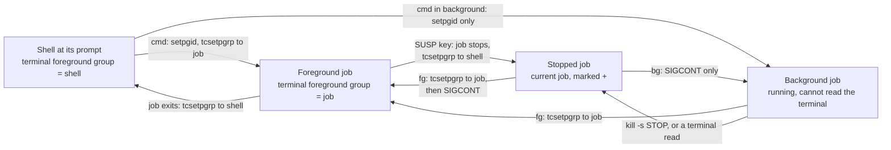

# fg, bg, jobs, and the Foreground Process Group

> [!summary] Claim
> `fg`, `bg` and `jobs` are three views of one piece of kernel state and one shell table: the terminal stores a single foreground process group ID, `fg` rewrites it with `tcsetpgrp` and then sends SIGCONT, `bg` sends SIGCONT without touching it, and `jobs` prints the table that maps job numbers to process groups.

Part of [Terminals and Job Control](README.md) in [Shell and Unix Engineering](../README.md).

## TL;DR

- Mechanism: an interactive shell puts every job in its own process group; `fg` calls `tcsetpgrp(tty, job_pgid)`, sends SIGCONT to that group and waits; when the job exits or stops the shell calls `tcsetpgrp(tty, shell_pgid)`; `bg` sends only the SIGCONT (POSIX.1-2024 XCU 2.11).
- Rule: a job ID (`%%`, `%+`, `%-`, `%n`, `%string`, `%?string`; POSIX.1-2024 XBD 3.182) names a whole process group, `$!` names one process, and the current job `+` is a stopped job whenever one exists.
- Trap: `kill $!` on a pipeline reaches one process, `$(jobs -p)` runs in a subshell that sees no jobs in dash 0.5.12 and `zsh --emulate sh`, bash and zsh hand a resumed job the shell's terminal settings instead of its own, and `fg` in a `set -m` script hands over the terminal only in some shells (all four measured by the lab).
- Portability: POSIX fixes the job ID forms, the order "set the foreground group, then SIGCONT", and the output formats; the shells differ on where `fg` prints, on the words `jobs` uses, on `$?` after a suspend (146 or 148, 0, 404), and posh has no job control at all.
- When not to use it: a script, a CI step or a service has no terminal and no user to type `fg`; there `fg` and `bg` fail with status 1 or 2, so use `wait`, `kill -- -PGID`, and a supervisor.

## Mental model



A command typed at the prompt becomes a process group of its own, and the shell makes that group the terminal's foreground group before it waits, so keystrokes and terminal reads belong to the job; a command typed with `&` gets the group but not the terminal.
When the foreground job exits, or the SUSP key stops it, the shell's `waitpid` returns and the shell makes its own group the foreground group again; a stopped job stays in the job table as the current job.
`bg` continues a stopped job where it is, in the background; `fg` first names the job's group as the terminal's foreground group and only then continues it, which is why the resumed program can read the terminal at once.
Every arrow that ends at "Foreground job" or at the prompt is one `tcsetpgrp` call, and nothing else in the diagram changes who owns the terminal.

## How it works

### One number per terminal

A terminal remembers one process group ID.
POSIX.1-2024 XBD 3.160 defines the foreground process group as the group "whose member processes have certain privileges, denied to processes in background process groups, when accessing their controlling terminal", and adds that a session "has at most one process group of the session as the foreground process group of that controlling terminal".
Which signals follow from that number is the subject of [[Job-Control-Signals]], and how groups and sessions are built is in [[Sessions-Process-Groups-and-Controlling-Terminals]]; this note is about who writes the number and when.

Two functions read and write it.
`tcgetpgrp(fd)` returns it and "is allowed from a process that is a member of a background process group" (POSIX.1-2024 XSH `tcgetpgrp`), which is how the lab's observers watch the terminal without ever owning it.
`tcsetpgrp(fd, pgid)` sets it; the caller's controlling terminal must be `fd`, and `pgid` must be "a process group ID of a process in the same session as the calling process" (POSIX.1-2024 XSH `tcsetpgrp`).
A caller in a background group gets SIGTTOU for the attempt unless it blocks or ignores that signal, which is why every shell blocks or ignores SIGTTOU around the call: bash's `give_terminal_to` blocks SIGTTOU, SIGTTIN, SIGTSTP and SIGCHLD around `tcsetpgrp (shell_tty, pgrp)` (bash `jobs.c`, git master as fetched 2026-11-10), dash's `xtcsetpgrp` calls `sigblockall` first (dash `src/jobs.c`), and yash's `put_foreground` blocks SIGTTOU (yash `job.c`).

Both kernels implement the call as an ioctl, `TIOCSPGRP` (tcgetpgrp(3): "implemented via the TIOCGPGRP and TIOCSPGRP ioctls").
Linux's `tiocspgrp` (`drivers/tty/tty_jobctrl.c`, git master as fetched 2026-11-10) runs `tty_check_change` (the SIGTTOU rule), returns `-ENOTTY` unless the terminal is the caller's controlling terminal and belongs to its session, returns `-ESRCH` when `find_vpid` finds no such process group, returns `-EPERM` when `session_of_pgrp(pgrp) != task_session(current)`, and then swaps `real_tty->ctrl.pgrp` under `ctrl.lock`.
XNU's `ttioctl_locked` handles `TIOCSPGRP` the same way with different numbers: `ENOTTY` when `isctty_sp` fails, `EINVAL` when `pgrp_find` finds nothing, `EPERM` when `pgrp->pg_session != sessp`; then it stores `tp->t_pgrp` and wakes the terminal's readers "to recheck if they are still the foreground process group" (XNU `bsd/kern/tty.c`, `main` as fetched 2026-11-10).
The lab's `fgpg ttyerr` asks both kernels: a group that does not exist gives `ESRCH` on Linux and `EINVAL` on macOS, and a group in another session gives `EPERM` on both.
tcgetpgrp(3) lists only `EBADF`, `EINVAL`, `ENOTTY` and `EPERM`, so the `ESRCH` that Linux returns is not in the manual page.

### What the standard makes the shell do

POSIX.1-2024 added section 2.11, "Job Control", to the shell language (Austin Group Defect 1254, per the change history of `fg` and `bg`), and it is the specification for everything below.
Job control is on when `set -m` is on, and `-m` "shall be enabled by default for interactive shells" (POSIX.1-2024 XCU `set`), so an interactive shell needs no `set -m`; the lab's sessions never run it.

At startup a shell that is the controlling process of its terminal "shall initially set the foreground process group ID associated with the terminal to its own process group ID" (XCU 2.11).
An interactive shell that finds itself in a background group must stop itself with SIGTTIN, or read standard input to the same effect, and repeat the check when continued; dash's `setjobctl` is that loop, `killpg(0, SIGTTIN)` until `tcgetpgrp(fd)` equals `getpgrp()` (dash `src/jobs.c`).

From then on the rules are short.
- Each asynchronous AND-OR list (`cmd &`) becomes a background job whose "associated process ID shall be that of a child process that is made a process group leader", with the other processes of the list in that group.
- A foreground list is a foreground job, and for each pipeline in it "the set of processes comprising the pipeline, and any processes descended from it, shall all be in the same process group".
- "When a foreground job is created, or a background job is brought into the foreground by the fg utility, if the shell has a controlling terminal it shall set the foreground process group ID associated with the terminal" to the job's group.
- "When a foreground job terminates, or becomes a suspended job ..., if the shell has a controlling terminal it shall set the foreground process group ID associated with the terminal to the process group ID of the shell."

The first two rules need `setpgid` and the last two need `tcsetpgrp`, and both are raced by the child that is being created.
bash's `make_child` calls `setpgid (mypid, pipeline_pgrp)` and then `give_terminal_to (pipeline_pgrp, 0)` in the child, and `setpgid (pid, pipeline_pgrp)` again in the parent, "to avoid possible race conditions"; the parent deliberately does not call `tcsetpgrp` ("Don't twiddle terminal pgrps in the parent!"; bash `jobs.c`, `make_child`).
dash's `forkchild` does the same and says why the result is ignored: "This can fail because we are doing it in the parent also" (dash `src/jobs.c`).

A suspended foreground job also leaves a mark in `$?`.
The parameter reports the pipeline that most recently "either terminated or, optionally but only if the shell is interactive and job control is enabled, was stopped by a signal", and for a stopped pipeline "the status value shall be the same as the exit status that would have resulted if the pipeline had been terminated by a signal with the same number as the signal that stopped it" (POSIX.1-2024 XCU 2.5.2).
So a shell may leave `$?` alone or report the signal, and nothing else.
bash, dash, BusyBox ash and zsh report 128 + SIGTSTP and yash reports 384 + SIGTSTP, their usual signal statuses; ksh93 and mksh report 0 although the lab runs `(exit 5)` just before the job, so they neither keep the old value nor report the signal (lab).

### The job table and job IDs

The shell keeps one row per job: a job number, the process group ID, the process IDs, a state, and the command text.
A job ID is how a user names a row (POSIX.1-2024 XBD 3.182).

| Job ID | Meaning |
| --- | --- |
| `%%` or `%+` | the current job |
| `%-` | the previous job |
| `%n` | job number `n` |
| `%string` | the job whose command begins with `string` |
| `%?string` | the job whose command contains `string` |

`fg`, `bg`, `jobs`, `kill` and `wait` accept job IDs, and for `kill` and `wait` the ID "identifies a process group in the case of a job-control background job" (POSIX.1-2024 XCU `kill`, `wait`).
The ID works "only for invocations of kill in the current shell execution environment", because the table lives in the shell's memory; that is also why these utilities are built in.

Which job is current is specified through the `jobs` output: `+` marks "the job that would be used as a default for the fg or bg utilities", `-` marks the job that would become the default if the current one exited, and the text continues: "If there is any suspended job, then the current job shall be a suspended job. If there are at least two suspended jobs, then the previous job also shall be a suspended job." (POSIX.1-2024 XCU `jobs`, STDOUT).
bash keeps two indexes and repairs them after every change; the comment above `reset_current` says that the newest non-running job should be `+` and the next-newest non-running job `-` (bash `jobs.c`).
dash keeps one linked list, `curjob` and its `prev_job` chain, with all stopped jobs in front: `set_curjob` puts a "newly created job or backgrounded job ... after all stopped jobs" and a "newly stopped job" at the head (dash `src/jobs.c`).
The lab starts three jobs and stops the two oldest: in all eight shell families with job control the marks moved from `1_R 2-R 3+R` to `1+S 2_R 3-R` to `1-S 2+S 3_R` (job number, mark, Running or Stopped).

dash's `getjob` shows how little parsing a job ID needs: `%`, `%%` and `%+` take `curjob`, `%-` takes `curjob->prev_job`, a number indexes the table, and anything else walks the list with `prefix` or, after a `?`, with `strstr`, failing with "%s: ambiguous" when two jobs match (dash `src/jobs.c`, `getjob`).
The string forms depend on the command text the shell stored, and that is where they break: mksh R59 lists a job as `\alpha`, so `%alp` finds nothing there, and ksh93 takes the text from the history file (`job_post` stores `hist_tell(...)` in `p_name`, ksh93u+m 1.0.10 `sh/jobs.c`), so the IDs resolve only for commands that went through history.
ksh93u+m 1.0.10 has a second problem: `job_byname` tests `hist_match` against the first job in `job.pwlist` only, because the `for(;pw;pw=pw->p_nxtjob)` loop header that the `dev` branch has is missing from the 1.0.10 file (both fetched 2026-11-10), and the lab confirms that `%alp` and `%?lph` fail there while `%?rav`, which names the current job, works.

### fg

"If job control is enabled ..., the shell is interactive, and the current shell execution environment ... is not a subshell environment, the fg utility shall move a background job in the current execution environment into the foreground"; with no operand it takes the job "that was most recently suspended, placed in the background, or run as a background job" (POSIX.1-2024 XCU `fg`).
For a non-interactive shell the text says only "it may also do so", and the shells use that freedom (see Portability).

XCU 2.11 fixes the order of the two steps: "the fg utility shall send the SIGCONT signal after it has set the foreground process group ID associated with the terminal".
The order matters because the continued program usually reads the terminal first; if SIGCONT won the race, the read would come from a background group and stop the job again with SIGTTIN.
Every implementation read for this note has the two calls in that order (bash, dash, zsh, mksh, yash and BusyBox from git master or trunk, ksh93u+m from tag v1.0.10, all as fetched 2026-11-10).

| Shell | Function | Sequence |
| --- | --- | --- |
| bash | `start_job` (`jobs.c`) | `give_terminal_to (jobs[job]->pgrp, 0)`, `killpg (jobs[job]->pgrp, SIGCONT)`, `wait_for (pid, 0)`, then `set_tty_state ()` |
| dash | `restartjob` (`src/jobs.c`) | `xxtcsetpgrp(pgid)`, `killpg(pgid, SIGCONT)`, `waitforjob(jp)`, which ends with `xxtcsetpgrp(rootpid)` |
| BusyBox ash | `restartjob` (`shell/ash.c`) | `get_tty_state()` (a no-op, see below), `xtcsetpgrp(ttyfd, pgid)`, `killpg(pgid, SIGCONT)`, `waitforjob(jp)` |
| zsh | `bin_fg` (`Src/jobs.c`) | `attachtty(jobtab[job].gleader)`, then, only when the job was stopped (`if (stopped)`), `settyinfo(jobtab[job].ty)` when saved and `killjb(jobtab + job, SIGCONT)`, then `waitjobs()` |
| mksh | `j_resume` (`jobs.c`) | `mksh_tcset(tty_fd, &j->ttystat)` when saved, `tcsetpgrp(tty_fd, ...)`, `mksh_killpg(j->pgrp, SIGCONT)`, `j_waitj(...)` |
| ksh93u+m | `job_switch`, `job_wait`, `job_set` (`sh/jobs.c`) | `tty_set(job.fd,TCSAFLUSH,&pw->p_stty)` when saved, `tcsetpgrp(job.fd,pw->p_fgrp)`, `job_unstop`, which calls `killpg(px->p_pgrp,SIGCONT)` |
| yash | `continue_job` (`job.c`) | `put_foreground(job->j_pgid)`, `kill(-job->j_pgid, SIGCONT)`, `wait_for_job(...)`, `put_foreground(shell_pgid)` |

The lab proves the order from the job's side: the helper's SIGCONT handler calls `tcgetpgrp` and logs `cont role=fg` or `cont role=bg`, and after `fg` every shell in the matrix that has job control (all but posh) produced `cont role=fg`.
The shells differ on a job that is already running: bash 5.3 calls `killpg` unconditionally, bash 3.2 to 5.2 and zsh send nothing, and the lab saw a SIGCONT from dash, BusyBox ash, mksh, yash and bash 5.3, and none from bash 3.2 to 5.2, zsh and ksh93.
In bash's `start_job` the `killpg (jobs[job]->pgrp, SIGCONT)` sits under `if (already_running == 0)` in Apple's 3.2 `jobs.c` and in the 4.4 release tarball and the `bash-5.0`, `bash-5.1` and `bash-5.2` git tags, and it is unconditional in git master (all fetched 2026-11-13).
A program must therefore not assume that a SIGCONT means it was stopped.

`fg` has no exit status of its own: "If the fg utility succeeds, it does not return an exit status. Instead, the shell waits for the job that fg moved into the foreground" (POSIX.1-2024 XCU `fg`, EXIT STATUS).
In the lab the job exits with 7 and `$?` after `fg` is 7 in every shell that has `fg` (all but posh).
It writes the job's command line to standard output as `"%s\n", <command>`; bash, dash, BusyBox ash, mksh and ksh93 do, yash prints `[1] command` unless it is in its POSIX mode (`continue_job`: `if (fg && posixly_correct)`), and zsh writes the line to the terminal, not to standard output (lab).
Finally, `fg` removes the job's process ID from the list of process IDs known in the current shell execution environment (POSIX.1-2024 XCU `fg`), so a later `wait PID` for that job is no longer guaranteed to work.

### bg

`bg` "shall resume suspended jobs from the current shell execution environment by running them as background jobs", and a job that is already running in the background is not an error (POSIX.1-2024 XCU `bg`).
Its whole mechanism is "a SIGCONT signal to the process group of the process(es) whose stopped wait status caused the shell to suspend the job" (XCU 2.11): no `tcsetpgrp`, so the job continues without the right to read the terminal.
The lab's job logs `cont role=bg` for it, and an observer in a command substitution reports `tty_fg=shell` afterwards.

`bg` also redefines `$!`: the parameter expands to the process ID of the most recent asynchronous list "or to ... process ID of the last command specified in the currently executing pipeline in the job-control background job that most recently resumed execution through the use of bg, whichever is the most recent" (POSIX.1-2024 XCU 2.5.2).
bash does it in `fg_bg` (`last_asynchronous_pid = j->pgrp; /* As per Posix.2 5.4.2 */`, `builtins/fg_bg.def`), zsh in `bin_fg` (comment `Set $! to indicate this was backgrounded`), ksh93 in `job_switch` (`sh.bckpid = pw->p_pid`); dash's `fgcmd` and BusyBox's `fg_bgcmd` do not.
The lab starts a job in the foreground, suspends it, runs `bg`, and compares `$!` with the job's process ID: equal in bash, zsh, ksh93, mksh and yash, not in dash and BusyBox ash.
Note that bash assigns the process group ID, which is the first process of a pipeline, where the standard says the last command; the lab's job is a single process, so it cannot show the difference.

The output format is `"[%d] %s\n", <job-number>, <command>`.
dash, BusyBox ash, mksh and yash print that form; bash appends ` &` and, outside POSIX mode, the current-job mark (`[1]+ cmd &`); ksh93 prints a tab after the number and `&` after the command; zsh prints to the terminal (lab).

### jobs

`jobs` "shall display the status of background jobs that were created in the current shell execution environment", one line per job as `"[%d] %c %s %s\n", <job-number>, <current>, <state>, <command>` (POSIX.1-2024 XCU `jobs`).
The standard lists the state strings for the POSIX locale: `Running`, `Done`, `Done(code)`, `Stopped`, `Stopped (SIGTSTP)`, `Stopped (SIGSTOP)`, `Stopped (SIGTTIN)`, `Stopped (SIGTTOU)`, and allows `Suspended` in place of `Stopped`.
For a job terminated by a signal the format is unspecified, but it "shall be visibly distinct from all of the other <state> formats" and name or describe the signal (POSIX.1-2024 XCU `jobs`, STDOUT).
`-l` inserts the process group ID before the state, and `-p` prints "only the process IDs for the process group leaders", one per line.
Reporting has a side effect: "When jobs reports the termination status of a job, the shell shall remove the job from the background jobs list", so `jobs` is not a pure query.

The condition "not a subshell environment" is the sharp edge.
In a subshell the standard says only that `jobs` "may also" work, and a command substitution is a subshell.
dash's `forkchild` frees every job in a forked child unless the child's command is the simple command `jobs` (`if (issimplecmd(n, JOBSCMD->name)) return;`, dash `src/jobs.c`, git master), and BusyBox ash has the same test (`strcmp(n->ncmd.args->narg.text, "jobs") == 0`, `shell/ash.c`, in the 1.37.0 release tarball and in git master, fetched 2026-11-13).
The dash test is absent from the `v0.5.12` tag and present in `v0.5.13` (dash `src/jobs.c` at both tags, fetched 2026-11-13), which is the version split the lab measures.
The irony is that the standard's own APPLICATION USAGE for `jobs` offers `$(jobs -p)` as "a way of referring to the process group of the job in an implementation-independent way" (POSIX.1-2024 XCU `jobs`), while the DESCRIPTION makes it work in a subshell only by permission.
The lab counts the lines of `$(jobs -p)` with two background jobs, once directly and once through a function that runs `jobs -p`: bash, ksh93, zsh, mksh and yash print 2 and 2, BusyBox ash 1.37.0 and dash 0.5.13.5 print 2 and 0, dash 0.5.12 and `zsh --emulate sh` print 0 and 0.

### Terminal settings across a suspend

A full-screen program changes the terminal settings, and a suspend hands the terminal to the shell in that state.
XCU 2.11 gives the shell two duties.
When a foreground job is suspended: "If the shell is interactive, it shall save the terminal settings before changing them to the settings it needs to read further commands."
When `fg` resumes such a job from an interactive shell, "before it sends the SIGCONT signal the fg utility shall restore the terminal settings to the ones that the shell saved when the job was suspended".

The lab's `ttymode` job clears `ECHO`, is suspended with the SUSP key, and logs `ECHO` again inside its SIGCONT handler; an observer reads `ECHO` while the job is stopped.

| Shell | `ECHO` while the job is stopped | `ECHO` the job finds at SIGCONT | What the source does |
| --- | --- | --- | --- |
| ksh93u+ 2012, ksh93u+m 1.0.10 | on | off | `job_reset` saves the job's settings in `pw->p_stty` and restores `my_stty`; `job_set` puts `pw->p_stty` back before `tcsetpgrp` |
| mksh R59 | on | off | `j_waitj` saves `j->ttystat` and sets `JF_SAVEDTTY`; `j_resume` restores it before `tcsetpgrp` |
| bash 3.2 to 5.3 | on | on | `wait_for` calls `set_tty_state ()` for a stopped or signalled job; `start_job` restores only the shell's own state, after the wait |
| zsh 5.9 | on | on | `update_job` saves `jn->ty` only `if (jn->stty_in_env && !jn->ty)`, that is, for a job started with `STTY` in its environment |
| dash, BusyBox ash 1.37.0, yash 2.58.1 | off | off | the shell never changes the settings, so it reads its next command with `ECHO` off |

Only ksh93 and mksh do what the 2024 text asks.
bash and zsh give the resumed job the shell's settings, so a program that needs raw mode must re-apply it in a SIGCONT handler; that is the contract every editor and pager already follows, and the reason is this table.
BusyBox ash carries bash's behavior (`get_tty_state`, `set_tty_state`, `restore_tty_if_stopped_or_signaled`) only as dead code: it sits inside an `#if 0` block whose `#else` branch defines `get_tty_state()` and `restore_tty_if_stopped_or_signaled(jp)` as no-ops, under a comment that states the doubt: "what if I'd fg the stopped python instead? It'll be confused by \"restored\" tty state" (`shell/ash.c`, identical in the 1.37.0 release tarball and in git master, fetched 2026-11-13), so the 1.37.0 in the matrix does not restore anything.

### Where the shell finds the terminal

`tcsetpgrp` needs a file descriptor for the controlling terminal, and the shells get one in different ways.
An interactive bash opens `/dev/tty`, falls back to `dup (fileno (stderr))`, and moves the descriptor out of the way with `move_to_high_fd`.
A non-interactive bash takes a shortcut: "We can only have job control if we are interactive unless we force it", then `shell_tty = fileno (stderr)`, the number 2 itself (bash `jobs.c`, `initialize_job_control`).
So in a script that ran `set -m`, the terminal bash uses is whatever descriptor 2 is at the moment of the call, and `fg 2>/dev/null` asks `/dev/null` to change its foreground group; the failure is silent because the diagnostic in `give_terminal_to` is inside `#if 0`.
The lab runs the same script twice under every bash from 3.2 to 5.3: with a plain `fg` the job becomes the foreground group and exits 7, and with `fg 2>fg.err` it never does and gives up after 3 seconds.
dash's `setjobctl` opens `/dev/tty` and only then falls back to descriptors 2, 1 and 0, so the redirection changes nothing there (lab: dash, BusyBox ash and yash hand over in both runs).
zsh and mksh hand the terminal over only when the shell is interactive, as [[Job-Control-Signals]] shows from their sources; in the lab their script `fg` waits for the job while it stays a background group, and so does ksh93u+m 1.0.10.

### How the lab drives a terminal

Everything above is specified for an interactive shell, so the lab uses one.
`fgpg pty` opens a pseudo-terminal (`posix_openpt`, `grantpt`, `unlockpt`), starts the shell under test with `-i` as the leader of a new session with that terminal, and plays the user at the master end.
It types each command line only after the shell has printed a fresh prompt (`PS1` is set to `@@ `), and types the SUSP character only after the foreground job has reported that it owns the terminal; the pseudo-terminal itself is the subject of [[Pseudo-Terminals]].
Jobs are typed as plain command lines, never started from inside a function, because a shell treats the two differently: ksh93 names a job by its history entry, and a function that is suspended becomes a forked copy of the shell.

## Numbers and limits

| Quantity | Value | Source |
| --- | --- | --- |
| Foreground process groups per controlling terminal | at most 1 | POSIX.1-2024 XBD 3.160 |
| Job ID forms | 6: `%%`, `%+`, `%-`, `%n`, `%string`, `%?string` | POSIX.1-2024 XBD 3.182 |
| State strings `jobs` may print in the POSIX locale | 8, with `Suspended` allowed for `Stopped`, plus an unspecified but visibly distinct format for a job killed by a signal | POSIX.1-2024 XCU `jobs`, STDOUT |
| `$?` after the SUSP key stops a foreground job | 146 on macOS and 148 on Linux (128 + SIGTSTP) in bash, dash, BusyBox ash and zsh; 404 (384 + 20) in yash; 0 in ksh93 and mksh, where the previous command had exited 5 | lab (`suspend`), shell matrix 2026-11-10; SIGTSTP is 18 on macOS and 20 on Linux, read from the C headers by `fgpg tstp` |
| `$?` after `fg` | the job's exit status (7 in the lab), every shell with job control (all but posh) | lab (`fg_running`, `suspend`) |
| Status of `fg` and `bg` with job control off | 1 in bash, zsh, ksh93, mksh and yash; 2 in dash and BusyBox ash; 127 in posh (no such command) | lab (`nojc`) |
| Processes that `kill $!` reaches in a two-process pipeline job | 1 of 2; `kill %%` reaches both | lab (`pipeline`); ksh93u+m 1.0.10 differs, see Portability |
| `tcsetpgrp` errno for a process group that does not exist | `ESRCH` on Linux 7.2.12 (OrbStack VM), `EINVAL` on macOS 27.2 | lab (`fgpg ttyerr`), 2026-11-10 |
| `tcsetpgrp` errno for a process group of another session | `EPERM` on both | lab (`fgpg ttyerr`) |
| Process IDs a shell must remember for `wait` | the {CHILD_MAX} most recent | POSIX.1-2024 XCU 2.9.3.1 |
| `getconf CHILD_MAX` | 6000 on the macOS 27.2 host, 64279 in the Debian 13 and Alpine 3.22 containers | measured by hand on 2026-11-10 and again on 2026-11-13 (macOS 27.3, Debian 13.7, Alpine 3.22.7), not by the lab |
| Delay between "ready" and a keystroke in the lab | 500 ms after a fresh prompt, 1000 ms for raw keys aimed at a running job (the lab's only one is the SUSP character) | lab constants in `fgpg.c`, not measurements |
| Time limits in the lab | 15 s per typed step, `alarm(25)` in every helper (`alarm(20)` in the other-session child of `ttyerr`), `alarm(58)` in the terminal driver, 3 s before the script-mode job gives up | lab constants in `fgpg.c` and `script.sh` |

## Portability

Every cell is asserted by the lab in the shell matrix (macOS 27.2 host, Debian 13 and Alpine 3.22 containers, 2026-11-10) unless it names another source.
The interactive columns come from typed sessions (`shell -i` on a pseudo-terminal); the last column of the second table comes from a script.

| Shell | `fg` prints the command to | `$?` after SUSP | `jobs` state after SIGTSTP, after SIGSTOP | `bg` sets `$!` |
| --- | --- | --- | --- | --- |
| POSIX sh | standard output, `"%s\n"` (XCU `fg`) | unchanged, or the status of a pipeline killed by that signal (XCU 2.5.2) | `Stopped` or `Stopped (SIGTSTP)`, `Stopped (SIGSTOP)` (XCU `jobs`) | yes (XCU 2.5.2) |
| macOS `/bin/bash` 3.2.57 | standard output | 146 | `Stopped`, `Stopped`; as `/bin/sh` (POSIX mode) `Stopped(SIGTSTP)`, `Stopped(SIGSTOP)` | yes |
| bash 3.2.57, 4.4, 5.1, 5.2, 5.3 | standard output | 148 on Linux, 146 on macOS | `Stopped`, `Stopped`; in POSIX mode (5.3 as `sh`) `Stopped(SIGTSTP)`, `Stopped(SIGSTOP)` | yes |
| zsh 5.9 and 5.9.2 native | the terminal, nothing on standard output | 148 on Linux, 146 on macOS | `suspended`, `suspended (signal)` | yes |
| zsh `--emulate sh` | the terminal, nothing on standard output | 148 on Linux, 146 on macOS | `suspended`, `suspended (signal)` | yes |
| dash 0.5.12 (Linux) and 0.5.13.5 (macOS) | standard output | 148 on Linux, 146 on macOS | Linux: `Stopped`, `Stopped (signal)`; macOS: `Suspended: 18`, `Suspended (signal): 17` | no |
| ksh93u+ 2012-08-01 (macOS `/bin/ksh`) | standard output | 0, after a command that exited 5 | `Stopped`, `Stopped (SIGSTOP)` | yes |
| ksh93u+m 1.0.10 (Linux) | standard output | 0, after a command that exited 5 | `Stopped`, `Stopped (SIGSTOP)` | yes |
| mksh R59 2020/10/31 and 2025/04/26 (Linux) | standard output | 0, after a command that exited 5 | `Stopped`, `Stopped (signal)` | yes |
| yash 2.58.1 (Linux) | standard output, as `[1] command` | 404 | `Stopped(SIGTSTP)`, `Stopped(SIGSTOP)` | yes |
| posh 0.14.1 | no `fg`: status 127 | not applicable | no `jobs`: status 127 | no `bg`: status 127 |
| BusyBox ash 1.37.0 (Linux) | standard output | 148 | `Stopped`, `Stopped (signal)` | no |

| Shell | Job's terminal settings on `fg` | `$(jobs -p)` lines for 2 jobs: direct, through a function | `%string` and `%?string` | `jobs -p` | `fg` in a `set -m` script hands over the terminal; with `fg 2>file` |
| --- | --- | --- | --- | --- | --- |
| POSIX sh | restored by `fg` (XCU 2.11) | may work in a subshell (XCU `jobs`) | required (XBD 3.182) | `"%d\n"` per job (XCU `jobs`) | may (XCU `fg`) |
| macOS `/bin/bash` 3.2.57 | shell's settings | 2, 2 | both work | process group IDs | yes; no |
| bash 3.2.57, 4.4, 5.1, 5.2, 5.3 | shell's settings | 2, 2 | both work | process group IDs | yes; no |
| zsh 5.9 and 5.9.2 native | shell's settings | 2, 2 | both work | zsh's long listing, not bare IDs | no; no |
| zsh `--emulate sh` | shell's settings | 0, 0 | both work | zsh's long listing | no; no |
| dash 0.5.12 and 0.5.13.5 | never touched | 0, 0 in 0.5.12; 2, 0 in 0.5.13.5 | both work | process group IDs | yes; yes |
| ksh93u+ 2012-08-01 | restored | 2, 2 | both work for typed commands | process group IDs | `fg` fails with status 1, silently |
| ksh93u+m 1.0.10 | restored | 2, 2 | only for the current job (`job_byname`) | process group IDs | no; no |
| mksh R59 | restored | 2, 2 | `%?string` works; `%alp` fails because the text is `\alpha` | process group IDs | no; no |
| yash 2.58.1 | never touched | 2, 2 | both work | process group IDs; `0` for a job without job control | yes; yes |
| posh 0.14.1 | not applicable | no `jobs` | no `jobs` | no `jobs` | `set -m` is refused |
| BusyBox ash 1.37.0 | never touched | 2, 0 | both work | process group IDs | yes; yes |

Three rows need a sentence.
ksh93u+m 1.0.10 does not keep a typed background pipeline in one process group: `$!` and `jobs -p` name a forked ksh that leads the group of the last process, and the first process leads a group of its own, so neither `kill $!` nor `kill %%` ends the job (lab, three runs with the same result; ksh93u+ 2012 keeps one group, led by the last process).
dash has no version variable, so the lab accepts both measured answers for the direct `$(jobs -p)` case and asserts 0 for the function case; the versions are those of the Debian and Alpine packages (0.5.12) and of Homebrew (0.5.13.5).
posh is asserted by its refusals: `set -m` fails, and `fg`, `bg` and `jobs` are not found.

| Utility | GNU | BSD and macOS | BusyBox | uutils |
| --- | --- | --- | --- | --- |
| Stand-alone `fg`, `bg`, `jobs` | none in Debian 13 (`ls /usr/bin/fg`: no such file) | macOS 27.2 has `/usr/bin/fg`, `/usr/bin/bg` and `/usr/bin/jobs`: one four-line FreeBSD-derived `sh` script, hard-linked 15 times, that runs `builtin` on its own lower-cased name in a new shell; `/usr/bin/fg` prints "fg: no job control" and exits 1 (rechecked on macOS 27.3, 2026-11-13) | no such applets in 1.37.0 (`busybox --list`) | none among the 109 entries of `src/uu` (fetched 2026-11-10) |
| `ps -o tpgid` (the terminal's foreground group) | procps-ng 4.0.4: supported | macOS `ps`: supported | 1.37.0: "bad -o argument 'tpgid'" | no `ps` in `src/uu` |

The utility rows were measured by hand on 2026-11-10 and are not lab assertions.
The macOS script exists because POSIX lists `fg`, `bg` and `jobs` as utilities; the standard itself says such a copy "does not work as expected when it is operating in its own utility execution environment because that environment has no applicable jobs to manipulate" (POSIX.1-2024 XCU `fg`, APPLICATION USAGE).

## Worked example

The lab is here: [lab](../labs/02-fg-bg-jobs-and-the-foreground-process-group/).
`probe.sh` starts the shell under test on a pseudo-terminal, `fgpg` types the session, `session.sh` holds the functions the typed lines call, and `fg_bg_jobs.bats` asserts the logs.
Simplified excerpt of `probe.sh` (the `suspend` session) and `session.sh`:

```sh
# probe.sh: each --type line is typed at a fresh prompt; --key is typed at the running job
session --type 'defs.ready=(exit 5)' --type '="$FGPG" job "$LOGDIR" a fg 7' --key 'a.ready=\032' \
  --type '=after_stop a' --type '=bg >bg.out 2>bg.err' --type '=after_bg' \
  --type '=fg %% >fg.out 2>fg.err' --type '=after_fg a'

# session.sh: who owns the terminal, asked from a command substitution (no job, no terminal)
snap() {
  sn_label=$1
  shift
  sn_line=$("$FGPG" who "$$" "$LOGDIR" "$@")
  log "$sn_label $sn_line"
}

# session.sh: typed after `fg`; the status fg left behind is the job's
after_fg() {
  af_status=$?
  log "fg_status=$af_status"
  snap after_fg "$1"
  cleanup "$1"
}
```

`fgpg job` is the job: it logs the role it starts in, every change of role, and, from its SIGCONT handler, the role it has when the signal arrives; it exits with status 7 once it reaches the foreground after having been in the background.
What the terminal showed under bash 5.3.15 on macOS, captured on 2026-11-10 (`@@ ` is the prompt); a rerun under Homebrew bash 5.3.20 on 2026-11-13 produced the same terminal text and the same three logs below, byte for byte:

```text
@@ . ./s
@@ (exit 5)
@@ "$FGPG" job "$LOGDIR" a fg 7
^Z
[1]+  Stopped                    "$FGPG" job "$LOGDIR" a fg 7
@@ after_stop a
@@ bg >bg.out 2>bg.err
@@ after_bg

[1]+  Stopped                    "$FGPG" job "$LOGDIR" a fg 7
@@ fg %% >fg.out 2>fg.err
@@ after_fg a
@@ exit
exit
```

The job's own log, `a.log`, from the same run:

```text
start role=fg leader=yes
cont role=bg
role bg
cont role=fg
role fg
exit write_failed=0
```

The shell's side, `session.log`:

```text
susp_status=146
stopped tty_fg=shell
while_stopped echo=on
bg_status=0
bang_after_bg=job
after_bg tty_fg=shell
fg_status=7
after_fg tty_fg=shell
```

Read together: the job started as the foreground group; the SUSP key stopped it and the shell took the terminal back (`stopped tty_fg=shell`, and `$?` went from 5 to 146); `bg` continued it in the background (`cont role=bg`) and made it the job `$!` names; `kill -s STOP %%` stopped its group again; `fg %%` made it the foreground group before the SIGCONT arrived (`cont role=fg`), waited, and returned its status 7; and the shell owned the terminal afterwards.
`bg.out` holds `[1]+ "$FGPG" job "$LOGDIR" a fg 7 &` and `fg.out` holds `"$FGPG" job "$LOGDIR" a fg 7`.

The script mode is the second half of the lab.
Simplified excerpt of `script.sh`:

```sh
set -m
# The job gives up after 3 s if nobody hands it the terminal, so fg cannot hang the script.
"$FGPG" job "$LOGDIR" a bg 7 3000 &
wait_file "$LOGDIR/a.ready" 8 || log a_not_ready
if [ "$mode" = fg ]; then
  fg >"$LOGDIR/fg.out"
else
  fg >"$LOGDIR/fg.out" 2>"$LOGDIR/fg.err"
fi
log "fg_status=$?"
```

Under bash the first branch logs `role fg` and `fg_status=7`, and the second logs `timeout role=bg` and `fg_status=99`.

## Pitfalls

> [!warning] `kill $!` leaves half a pipeline running
> Trigger: `producer | consumer &` followed by `kill $!`, in a script or at a prompt.
> Symptom: `$!` is the process ID of the last command, so only `consumer` dies; `producer` keeps running until it writes to the closed pipe, or forever if it never writes (lab: `after_kill_bang_first=alive` in every shell with job control).
> Fix: at a prompt use the job ID, `kill %%` or `kill %1`, which signals the process group; in a script without job control start the pipeline in its own session and signal the group, as [[Job-Control-Signals]] describes.

> [!warning] `$(jobs -p)` can be empty
> Trigger: `kill $(jobs -p)` or `n=$(jobs | wc -l)` in a cleanup function, under `sh`.
> Symptom: the command substitution is a subshell, where `jobs` only "may" work; dash 0.5.12 and `zsh --emulate sh` print nothing, and BusyBox ash and dash 0.5.13.5 print nothing as soon as `jobs` is wrapped in a function (lab: 0 lines against 2 in bash).
> Fix: write the list to a file in the current shell (`jobs -p >"$tmp"`) and read it back, or record `$!` after every `&` and never ask `jobs`.

> [!warning] A resumed program finds the shell's terminal settings
> Trigger: a program that turned off `ECHO` or `ICANON` is suspended with the SUSP key and resumed with `fg` in bash or zsh.
> Symptom: the program runs with echo on and line buffering until it redraws; the lab's job finds `echo=on` at SIGCONT in bash 3.2 to 5.3 and zsh, and `echo=off` only in ksh93 and mksh.
> Fix: in the program, save your settings, restore the original ones before stopping, and re-apply yours in the SIGCONT handler; do not rely on the shell, whatever POSIX.1-2024 XCU 2.11 now says.

> [!warning] After a suspend, dash, BusyBox ash and yash read commands with the job's settings
> Trigger: the same suspend in a shell without a line editor that manages the terminal.
> Symptom: the prompt comes back with `ECHO` off, so typed commands are invisible (lab: `while_stopped echo=off`).
> Fix: type `stty sane` and Enter blind, or `fg` the job and quit it properly; in a program, restore the terminal before stopping.

> [!warning] `fg` in a script only pretends in zsh, mksh and ksh93
> Trigger: a script runs `set -m`, starts a job with `&`, and later calls `fg` expecting the job to read the terminal.
> Symptom: in zsh, mksh and ksh93u+m the shell waits for the job but the job stays a background group, so its first terminal read stops it; in ksh93u+ 2012 `fg` fails with status 1 and no message (lab: `timeout role=bg` or `fg_status=1`).
> Fix: do not use `fg` in scripts; run the command in the foreground in the first place, or start the shell with `-i` when the script is really a canned interactive session.

> [!warning] In a bash script, `fg 2>/dev/null` detaches the job from the terminal
> Trigger: a bash script with `set -m` silences `fg` or `bg` with a redirection of standard error.
> Symptom: `tcsetpgrp` is called on descriptor 2, which is now a file, fails with `ENOTTY`, and nothing reports it; the job runs as a background group (lab: bash 3.2 to 5.3, `fg_status=99` against 7 without the redirection).
> Fix: never redirect descriptor 2 of a job-control builtin in a bash script; redirect standard output only, or wrap the whole script.

> [!warning] String job IDs match the stored text, not what you typed
> Trigger: `fg %vim` or `kill %?build` in mksh or ksh93.
> Symptom: mksh R59 stores the command as `\alpha`, so the prefix form never matches; ksh93u+m 1.0.10 compares only the current job; ksh93 has no text at all for a job that did not come from history (lab: `%alp=none`).
> Fix: use job numbers from `jobs`, or `%%` and `%-`.

> [!warning] A stand-alone `fg` does nothing
> Trigger: `xargs fg`, `env fg`, `sudo fg`, or `(fg)`.
> Symptom: the command runs in another process or a subshell whose job table is empty; macOS ships `/usr/bin/fg`, which prints "fg: no job control" (measured by hand), and POSIX.1-2024 XCU `bg` gives `... | xargs bg` and `(bg)` as the examples that cannot work.
> Fix: job control commands must be typed to the shell that owns the jobs.

## Security and robustness

- The foreground group is a routing decision, not a permission boundary: any process of the session may call `tcsetpgrp` for any group of the session if it ignores or blocks SIGTTOU, so a background job can make itself the foreground group; the kernel checks only the session (`session_of_pgrp(pgrp) != task_session(current)` in Linux `tiocspgrp`).
- A job-control shell must leave SIGTTOU ignored or blocked around `tcsetpgrp`, and must restore the default action in its children, or its jobs inherit immunity to the background write check; the dispositions are covered in [[Job-Control-Signals]].
- `jobs` and string job IDs print and match command text that the user did not necessarily type by hand; a job line can carry terminal escape sequences from a pasted command, which is the subject of [[Terminal-Escape-Injection]].
- Process IDs are reused: the standard keeps a process ID "known" to the shell only until `wait`, `jobs` or `fg` reports it, and only the {CHILD_MAX} most recent, so a saved `$!` used much later can name a stranger; a job ID cannot, because the shell resolves it against its own table.
- Every helper in the lab arms `alarm(25)` and the driver kills the shell's group on a timeout, because a stopped job is alive and silent and would otherwise hold a pseudo-terminal forever.
- The lab's cleanup signals by process ID unless the job's group differs from the shell's own group; a `kill -- -PGID` with the shell's own group in a script without job control kills the script and whatever started it, a mistake this lab made once while it was being written.

## The principal's view

`fg`, `bg` and `jobs` are the user interface of an interactive shell, and they are specified only there: the normative text says "shall" for an interactive shell and "may" for everything else, and the lab shows the shells using every bit of that "may".
The decision for a staff-plus engineer is therefore where the boundary of "interactive" runs in a system.
Inside it, job control is exactly right, costs one `setpgid` and two `tcsetpgrp` calls per command, and the only engineering duty is on the program side: handle SIGTSTP and SIGCONT, restore the terminal before stopping, and re-apply your settings when continued, because bash and zsh, the shells most users have, will not do it for you.
Outside it, in scripts, CI, containers and services, nothing about job control is portable: `set -m` plus `fg` behaves in four different ways across nine shells, `$(jobs -p)` is empty in two of them, and `fg` itself fails without a terminal.
There the trade-off is to give up the convenience of job numbers for explicit process management: record `$!`, use `wait PID` and `kill -- -PGID` on groups you created with `setsid`, and put a supervisor (systemd, s6, a container runtime) in charge of restart and timeout policy.
When the job is to drive or test an interactive program, a shell is the wrong tool entirely; use a pseudo-terminal from C, Rust or Python, as the lab does, or `expect` ([[expect-and-Automating-Interactive-Programs]]).
When you write a shell, as in [[Rebuild-a-Minimal-Shell-With-Job-Control]], implement the two-step `fg` in the standard's order and call `setpgid` in both parent and child; those two details are where every toy shell first hangs.

## Interview questions

> [!question] L5: What do `fg` and `bg` actually do to a stopped job, in terms of system calls?
>
> > [!success]- Answer
> > Both send SIGCONT to the job's process group, for example `kill(-pgid, SIGCONT)`.
> > `fg` first calls `tcsetpgrp(tty, pgid)` so the job's group becomes the terminal's foreground group, then sends the signal, then waits for the job with `waitpid`.
> > When the job exits or stops again, the shell calls `tcsetpgrp(tty, shell_pgid)`.
> > `bg` makes no `tcsetpgrp` call, so the job runs but may not read the terminal.
> >
> > Follow-up: Why must `tcsetpgrp` come before the SIGCONT?

> [!question] L5: What is the difference between `kill %1` and `kill $!`?
>
> > [!success]- Answer
> > `%1` is a job ID: the shell looks up job 1 in its table and signals its process group, so every process of a pipeline gets the signal.
> > `$!` is one process ID, that of the last command of the most recent background list.
> > For `a | b &` the lab shows `kill $!` killing only `b` and leaving `a` alive, and `kill %%` ending both.
> > A job ID also cannot hit a recycled process ID, because the shell resolves it.
> >
> > Follow-up: Which of the two works in a script without `set -m`, and what does it signal there?

> [!question] L5: You have three background jobs and stop the oldest one; which job does a bare `fg` resume, and why?
>
> > [!success]- Answer
> > The stopped one.
> > POSIX.1-2024 says that if any job is suspended, the current job, the one marked `+` that `fg` and `bg` default to, shall be a suspended job.
> > The lab shows the marks moving from `1_R 2-R 3+R` to `1+S 2_R 3-R` in all eight shell families that have job control.
> > The previous job `-` becomes the newest running job.
> >
> > Follow-up: What do the marks look like after you stop job 2 as well?

> [!question] L6: Predict the output of this interactive bash session.
>
> > [!success]- Answer
> > ```sh
> > $ sleep 100 | sleep 200 &
> > [1] 4242
> > $ echo "$!"; jobs -p
> > ```
> > The shell printed the process ID of the last command (`sleep 200`) after the job number, and `echo "$!"` prints that same number, 4242.
> > `jobs -p` prints a different number: the process group ID, which is the process ID of the first command (`sleep 100`), the group leader.
> > The lab asserts exactly this split (`bang=last`, `leader=first`, `jobs_p=pgid`) for bash, dash, BusyBox ash, mksh and yash.
> > In zsh `jobs -p` prints a full listing line instead, and in ksh93u+m 1.0.10 the two processes are not even in one group.
> >
> > Follow-up: Which number would you pass to `kill` with a leading minus sign, and what does the minus mean?

> [!question] L6: Debug this cleanup function, which works under bash and leaks processes under `sh` on Debian.
>
> > [!success]- Answer
> > ```sh
> > cleanup() {
> >   pids=$(jobs -p)
> >   [ -n "$pids" ] && kill $pids
> > }
> > trap cleanup EXIT
> > ```
> > `$(jobs -p)` runs `jobs` in a subshell environment, where POSIX.1-2024 says only that it may work.
> > Debian's `sh` is dash 0.5.12, whose forked child frees the job table, so `pids` is empty and nothing is killed; the lab measures 0 lines there against 2 in bash.
> > Newer dash and BusyBox ash special-case a substitution that is exactly the simple command `jobs`, but not a function that calls it.
> > Record `$!` after each `&` in a variable and kill that list, or write `jobs -p` to a file from the current shell.
> >
> > Follow-up: Even with the right process IDs, what does `kill $pids` miss for a pipeline job?

> [!question] L6: Why does vim redraw correctly after Ctrl-Z and `fg` in bash, although bash never restores vim's terminal settings?
>
> > [!success]- Answer
> > When the job stops, bash's `wait_for` restores the shell's own settings, and `start_job` does not put the job's settings back before the SIGCONT.
> > The lab's job, which cleared `ECHO`, finds `echo=on` in its SIGCONT handler under bash and zsh.
> > A full-screen program therefore handles SIGTSTP and SIGCONT itself: it restores the terminal before it stops and re-applies raw mode and redraws when continued.
> > Only ksh93 and mksh save and restore the job's settings, which is what POSIX.1-2024 XCU 2.11 now requires of an interactive shell.
> >
> > Follow-up: What would a program see if it relied on the shell and ran under dash?

> [!question] L6: A bash script runs `set -m`, starts a job, and calls `fg 2>/dev/null`; why does the job stop as soon as it reads the terminal?
>
> > [!success]- Answer
> > A non-interactive bash does not open `/dev/tty`; `initialize_job_control` sets `shell_tty = fileno (stderr)`.
> > With the redirection, descriptor 2 is `/dev/null` during `fg`, so `tcsetpgrp` fails with `ENOTTY` and bash prints nothing.
> > The job is continued and waited for, but it is still a background group, and its terminal read raises SIGTTIN.
> > The lab shows the pair: `fg_status=7` without the redirection, a job that never reaches the foreground with it, in bash 3.2 to 5.3.
> >
> > Follow-up: Why does the same script work under dash?

> [!question] L7: The standard orders `fg` as "set the foreground group, then SIGCONT"; what fails if a shell does it the other way round, and how would you prove a shell gets it right?
>
> > [!success]- Answer
> > The continued process could run before the terminal changes hands; its first `read` or `tcsetattr` would come from a background group, the kernel would send SIGTTIN or SIGTTOU, and the job would stop again right after `fg`.
> > The bug would be a race, visible only under load.
> > To prove the order, observe it from the job: install a SIGCONT handler that calls `tcgetpgrp` and compares it with `getpgrp`, both async-signal-safe, and log the answer.
> > The lab does this and gets `cont role=fg` after `fg` and `cont role=bg` after `bg` in every shell of the matrix that has job control.
> >
> > Follow-up: Why is a test that sleeps and then checks the terminal owner not a proof?

> [!question] L7: Design the process bookkeeping for a build tool that runs many pipelines in parallel and must kill all of them on Ctrl-C or on a timeout, with and without a terminal.
>
> > [!success]- Answer
> > Do not use shell job control: it exists only with a terminal and differs between shells in every non-interactive detail.
> > Start each pipeline in its own process group (or session), record the group ID yourself, and signal groups with `kill(-pgid, sig)`, first SIGTERM, then SIGKILL after a grace period.
> > If the tool runs on a terminal and children must read it, keep them in the tool's own foreground group, or hand the terminal over explicitly with `tcsetpgrp` and take it back, with SIGTTOU ignored around the calls.
> > Catch SIGINT in the tool, forward it to the groups, and re-raise it after cleanup so the calling shell sees death by signal.
> > Bound every wait, because a stopped child is alive and silent.
> >
> > Follow-up: What breaks if a child calls `setsid` or `setpgid` itself?

> [!question] L7+: You are implementing `fg` for a new shell; what state do you keep per job, and what is the exact sequence for resuming a suspended job, including what POSIX.1-2024 added?
>
> > [!success]- Answer
> > Per job: the job number, the process group ID, the process IDs and wait statuses of its members, the command text, whether it was created under job control, and the terminal settings saved when it was suspended.
> > On suspend: collect the stopped status with `waitpid` and `WUNTRACED`, save the terminal settings into the job, take the terminal back with `tcsetpgrp(tty, shell_pgid)`, restore the shell's settings, mark the job current, and print the `jobs` line.
> > On `fg`: check that job control is on, resolve the job ID, write the command line to standard output, restore the job's saved settings, call `tcsetpgrp(tty, job_pgid)` with SIGTTOU blocked, send SIGCONT to the group, remove the job's process ID from the list `wait` knows, and wait.
> > When the wait returns, take the terminal back and return the job's status as `$?`.
> > The restore of the job's settings before SIGCONT is the POSIX.1-2024 addition that bash and zsh do not implement.
> >
> > Follow-up: The SUSP key arrives while your shell is running a builtin in a pipeline; what can you not stop, and what does XCU 2.11 let you do instead?

> [!question] L7+: A colleague proposes a CI check that types commands into each supported shell to test how your CLI suspends and resumes; what makes such a harness reliable?
>
> > [!success]- Answer
> > Give the shell a real controlling terminal: a pseudo-terminal, `setsid`, and `TIOCSCTTY`, and start the shell with `-i` and with its startup files pointed at nothing.
> > Synchronize on events, not time: type a line only after a fresh prompt, and type the SUSP character only after the program reports that it is the foreground group.
> > Start jobs as typed command lines, because functions and `-c` strings are treated differently (ksh93 names jobs from history; bash 3.2 loses its terminal descriptor when started as `bash -i FILE`).
> > Observe ownership with `tcgetpgrp` from a process that never gets the terminal, read process state from the kernel, and assert per shell family, since `fg` output, `jobs` words and `$?` all differ.
> > Bound every step and kill by process ID during cleanup.
> >
> > Follow-up: Which of these rules did the lab learn from a failure, and what was the symptom?

## Related

Prerequisites: [[Job-Control-Signals]]

Next: [[Readline-and-inputrc]]

See also: [[Rebuild-a-Minimal-Shell-With-Job-Control]], [[Capstone-Unix-Shell-with-Job-Control]], [[Sessions-Process-Groups-and-Controlling-Terminals]], [[Pseudo-Terminals]], [[termios-and-stty]], [[Exit-Status-and-Wait-Status]], [[Subshells-and-the-Execution-Environment]], [[Special-Parameters]], [[Terminal-Escape-Injection]], [[expect-and-Automating-Interactive-Programs]]

## Further reading

- POSIX.1-2024 XCU 2.11 "Job Control" and 2.9.3.1 "Asynchronous AND-OR Lists" (https://pubs.opengroup.org/onlinepubs/9799919799/utilities/V3_chap02.html): the normative text for job creation, the foreground group, suspension, and the terminal settings rule; 2.5.2 defines `$!`.
- POSIX.1-2024 `fg` (https://pubs.opengroup.org/onlinepubs/9799919799/utilities/fg.html), `bg` (https://pubs.opengroup.org/onlinepubs/9799919799/utilities/bg.html) and `jobs` (https://pubs.opengroup.org/onlinepubs/9799919799/utilities/jobs.html): output formats, the "shall" for interactive shells and the "may" for the rest, and the state strings.
- POSIX.1-2024 XBD 3.182 "Job ID" and 3.160 "Foreground Process Group" (https://pubs.opengroup.org/onlinepubs/9799919799/basedefs/V1_chap03.html): the six job ID forms and the definition everything else rests on.
- POSIX.1-2024 `tcsetpgrp` (https://pubs.opengroup.org/onlinepubs/9799919799/functions/tcsetpgrp.html) and `tcgetpgrp` (https://pubs.opengroup.org/onlinepubs/9799919799/functions/tcgetpgrp.html): the only interface that changes or reads the terminal's foreground group.
- POSIX.1-2024 `kill` (https://pubs.opengroup.org/onlinepubs/9799919799/utilities/kill.html) and `wait` (https://pubs.opengroup.org/onlinepubs/9799919799/utilities/wait.html): what a job ID operand means to each.
- bash `jobs.c` (https://cgit.git.savannah.gnu.org/cgit/bash.git/plain/jobs.c) and `builtins/fg_bg.def` (https://git.savannah.gnu.org/cgit/bash.git/plain/builtins/fg_bg.def): `start_job`, `give_terminal_to`, `initialize_job_control`, `set_current_job`, and the `$!` assignment in `fg_bg`.
- Apple's bash 3.2 `jobs.c` (https://raw.githubusercontent.com/apple-oss-distributions/bash/main/bash-3.2/jobs.c): the `start_job` that sends SIGCONT only to a stopped job.
- dash `src/jobs.c` (https://git.kernel.org/pub/scm/utils/dash/dash.git/plain/src/jobs.c): the smallest complete implementation; `getjob`, `set_curjob`, `restartjob`, `setjobctl`, and the `issimplecmd` test in `forkchild`.
- zsh `Src/jobs.c` (https://raw.githubusercontent.com/zsh-users/zsh/master/Src/jobs.c): `bin_fg`, which serves `fg`, `bg`, `jobs`, `wait` and `disown`, and `update_job`.
- mksh `jobs.c` (https://raw.githubusercontent.com/MirBSD/mksh/master/jobs.c): `j_resume` and `j_waitj`, a shell that saves and restores a job's terminal settings.
- ksh93u+m `sh/jobs.c`, tag v1.0.10 (https://raw.githubusercontent.com/ksh93/ksh/v1.0.10/src/cmd/ksh93/sh/jobs.c) and branch `dev` (https://raw.githubusercontent.com/ksh93/ksh/dev/src/cmd/ksh93/sh/jobs.c): `job_set`, `job_reset`, and the two versions of `job_byname`.
- yash `job.c` (https://raw.githubusercontent.com/magicant/yash/trunk/job.c): `continue_job` and `put_foreground`.
- BusyBox `shell/ash.c` (https://raw.githubusercontent.com/mirror/busybox/master/shell/ash.c): `restartjob`, and the comment that doubts restoring terminal state.
- Linux `drivers/tty/tty_jobctrl.c` (https://raw.githubusercontent.com/torvalds/linux/master/drivers/tty/tty_jobctrl.c): `tiocspgrp` and `tiocgpgrp`, the kernel side of the two functions.
- XNU `bsd/kern/tty.c` (https://raw.githubusercontent.com/apple-oss-distributions/xnu/main/bsd/kern/tty.c): the `TIOCSPGRP` case of `ttioctl_locked`.
- tcgetpgrp(3) (https://man7.org/linux/man-pages/man3/tcgetpgrp.3.html): the Linux manual page, including the error list that omits `ESRCH`.
