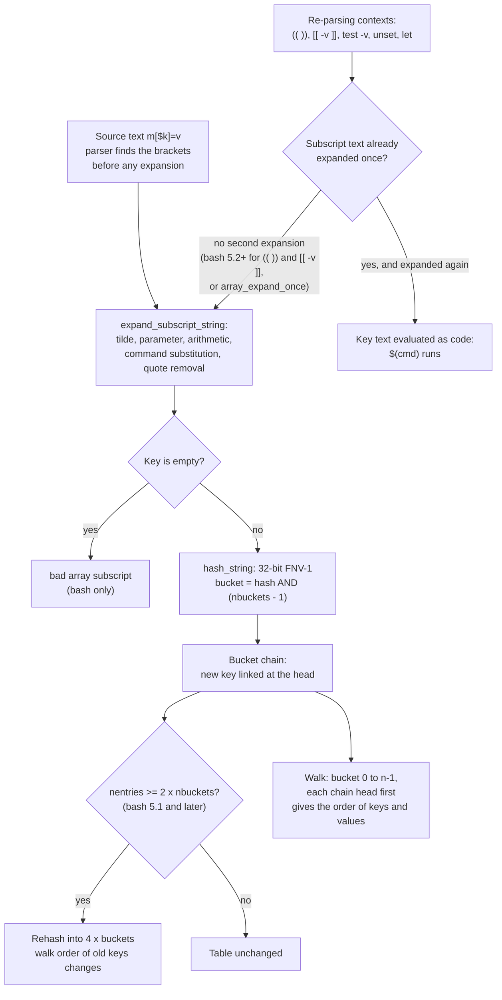

# Associative Arrays

> [!summary] Claim
> A bash associative array is a string-keyed chained hash table inside the shell process, and its one real hazard is not the table but the subscript: every context that re-parses `m[$k]` after `$k` was already expanded can evaluate the key's text as code, and which contexts do so changed in bash 5.2.

Part of [Bash](README.md) in [Shell and Unix Engineering](../README.md).

## TL;DR

- Mechanism: `declare -A m` attaches a 1024-bucket FNV-1 hash table to the variable; `m[$k]=v` expands the subscript once into a key string, hashes it, and links a node at the head of its bucket chain (bash-5.3 `assoc.h`, `hashlib.c`).
- Rule: declare before use, read with `"${m[$k]}"`, test membership with `${m[$k]+set}`, update with `m[$k]=$(( ${m[$k]-0} + 1 ))`, and delete with `unset 'm[$k]'` in bash but `unset "m[$k]"` in zsh and ksh93.
- Trap: `(( m[$k]++ ))`, `[[ -v m[$k] ]]` and `unset "m[$k]"` expand the key a second time, so a key holding `$(cmd)` runs `cmd`; the lab shows the first two do so up to bash 5.1 and the third in every release from 4.4 to 5.3.
- Portability: POSIX sh has no arrays at all; only bash 4.0 and later, zsh and ksh93 have associative arrays, macOS still ships bash 3.2 without them, and mksh, yash, posh, dash and BusyBox ash have none (measured in the shell matrix).
- When not to use it: when the script must run under `/bin/sh` or macOS `/bin/bash`, when the keys are untrusted and you cannot pin the bash release, or when the data outgrows about 10^5 keys; use `awk` arrays, `sort | uniq -c`, or a real language instead.

## Mental model



The parser locates the brackets of `m[...]` in the source before any expansion, so a `]` that arrives inside the value of `$k` cannot end the subscript early.
The bracketed text then goes through one round of expansion and becomes a plain C string, which bash rejects only if it is empty.
That string is hashed with FNV-1, masked to a bucket index, and pushed onto the front of that bucket's chain; from bash 5.1 the table quadruples when it holds twice as many keys as buckets.
Every listing of keys or values walks the buckets in index order and each chain from its head, which is why the order is deterministic for one release and one history of insertions, yet unrelated to insertion order.
The right-hand branch is the hazard: a few contexts receive text in which `$k` has already been replaced by its value and then parse that text again as an array reference, so a key whose characters spell `$(cmd)` is executed.

## How it works

### What POSIX says: nothing, deliberately

POSIX defines a name as "a word consisting solely of underscores, digits, and alphabetics from the portable character set" whose first character is not a digit (POSIX.1-2024 XBD 3.216).
The grammar returns `ASSIGNMENT_WORD` only when the characters before the first unquoted `=` form a valid name; when they do not, as in `m[k]=v`, "it is implementation-defined whether the token WORD or ASSIGNMENT_WORD is returned, or the TOKEN is processed in some other way" (POSIX.1-2024 XCU 2.10.2, rule 7b).
That sentence is the door every array extension walks through.
POSIX also lists `declare`, `typeset`, `local`, `readarray`, `mapfile` and `nameref` among the command names whose results are unspecified (POSIX.1-2024 XCU 2.9.1.4), and the `export` and `readonly` rationale mentions array assignment only as an extension (POSIX.1-2024 XCU 2.15, `export`).
A POSIX shell that implements none of this is conforming: dash, BusyBox ash and yash run `m[k]=v` as a command named `m[k]=v` and report status 127, which the lab asserts.
Values are C strings: POSIX allows parameters to hold "arbitrary byte sequences, except for the null byte" (POSIX.1-2024 XCU 2.5), and bash stores keys and values as NUL-terminated `char *`, so neither can contain a NUL byte.

### Declaration and the variable's type

`declare -A m` (or `typeset -A`, `local -A`) creates the variable with `make_new_assoc_variable`, which calls `assoc_create (ASSOC_HASH_BUCKETS)` with `ASSOC_HASH_BUCKETS` defined as 1024, and sets the `att_assoc` attribute (bash-5.3 `variables.c`, `make_new_assoc_variable`; `assoc.h`).
Inside a function `declare -A` makes a local variable through `make_local_assoc_variable`; `declare -gA` reaches the global scope (bash 4.2 and later per `CHANGES` bash-4.2-alpha item e; measured by hand: bash 4.0 rejects `-g`, and 4.2, 4.4, 5.0 and 5.1 accept it; the lab asserts the locality of the plain form and [[Functions-and-Scope]] covers dynamic scope).
Converting an existing scalar goes through `convert_var_to_assoc`, which uses `assoc_create (0)`, that is `DEFAULT_HASH_BUCKETS` 128, and stores the old value under key `0` (bash-5.3 `arrayfunc.c`, `convert_var_to_assoc`; `hashlib.h`).
Converting an indexed array is refused with "cannot convert indexed to associative array" (bash-5.3 `builtins/declare.def`), and the variable stays indexed with its elements intact, which the lab asserts.
zsh accepts the same `typeset -A` on an indexed array and silently empties it, while ksh93 keeps the elements under the keys `0` and `1` (lab test "converting an indexed array").

Forgetting the declaration is the commonest bug, and the manual states why it is silent: "Bash automatically creates an indexed array if any variable is assigned to using the syntax `name[subscript]=value`", and the subscript "is treated as an arithmetic expression" (bash-5.3 `doc/bash.1`, Arrays).
So `m[foo]=x` without `declare -A` evaluates `foo` as an arithmetic variable, which is 0 when unset, and every unset word collapses onto element 0.
mksh, ksh93 and posh do the same, zsh does it with 1-based indices, and `zsh --emulate sh` with 0-based ones (lab test "without typeset -A"); the indexed side is [[Indexed-Arrays]].

### Subscript expansion on assignment and reference

For an assignment the parser has already isolated the bracketed text; `assign_array_element_internal` then calls `expand_subscript_string` unless the `ASS_NOEXPAND` flag is set, and an empty result goes to `err_badarraysub`, which prints `bad array subscript` (bash-5.3 `arrayfunc.c`, `assign_array_element_internal`; `error.c`, `err_badarraysub`).
The manual lists the expansions applied: "tilde expansion, parameter and variable expansion, arithmetic expansion, command substitution, and quote removal on associative array subscripts", and "Empty strings cannot be used as associative array keys" (bash-5.3 `doc/bash.1`, Arrays).
No arithmetic evaluation happens, so `m[1+1]` is the three-character key `1+1`; zsh documents the same ("no arithmetic expansion is applied") and ksh93 behaves the same (lab test "an associative subscript is a string").
zsh and ksh93 accept the empty key; bash rejects it, and the error is an assignment error with a sharp edge: bash abandons the rest of the input line, so `m[$k]=e; echo same line` prints nothing after the diagnostic, and in POSIX mode the shell exits with status 127 (lab test "bash rejects an empty key").
The robust workaround, used by the worked example, is a constant prefix on every key, which also sidesteps bash 4.4 rejecting `[@]=` in a compound assignment and bash 5.1 treating `unset 'm[@]'` as "remove the whole array" (bash-5.3 `CHANGES`, bash-5.2-alpha items j and l).

A reference `${m[$k]}` is ordinary parameter expansion: the subscript is expanded once and the key is looked up with `assoc_reference`, which is `hash_search` without the create flag (bash-5.3 `assoc.c`, `assoc_reference`).
Under `set -u` a missing key is an unbound-variable error; bash exits with status 127 and zsh and ksh93 with 1 (lab test "under set -u").

### The table: FNV-1 buckets, growth, and walk order

`hash_string` is 32-bit FNV-1 with offset basis 2166136261 and prime 16777619, written as shifts and adds ("was `i *= FNV_PRIME`"), and the bucket is `hash & (nbuckets - 1)`, so the bucket count is always a power of two (bash-5.3 `hashlib.c`, `hash_string`, `HASH_BUCKET`).
Each node stores `next`, `key`, `data`, the cached hash `khash`, and a `times_found` counter (bash-5.3 `hashlib.h`, `BUCKET_CONTENTS`); on an LP64 system that is 32 bytes before the two `malloc`ed strings.
`hash_insert` and `hash_search (..., HASH_CREATE)` link a new node at the head of its chain, and before doing so call `hash_grow` when `HASH_SHOULDGROW` holds, that is when `nentries >= nbuckets * HASH_REHASH_FACTOR` (2); `hash_grow` multiplies the bucket count by `HASH_REHASH_MULTIPLIER` (4) and `hash_rehash` relinks every node using its cached `khash` (bash-5.3 `hashlib.c`).
So a fresh array has 1024 buckets, grows to 4096 when it already holds 2048 keys and one more is inserted, and to 16384 at 8192 keys.
`hash_shrink` and `HASH_SHOULDSHRINK` exist, but nothing in bash-5.3 calls `hash_shrink`, so a table never shrinks after deletions.
Growth arrived in bash 5.1 ("The associative array implementation can now dynamically increase the size of the hash table based on insertion patterns", bash-5.3 `CHANGES`, bash-5.1-alpha item mm); before that the table never grew, and it started at only 128 buckets, because `make_new_assoc_variable` called `assoc_create (0)`, which means `DEFAULT_HASH_BUCKETS` 128 (bash-4.4 and bash-5.0 `variables.c`, `hashlib.h`), so long chains made lookups linear in `n / 128`.
bash 5.1 introduced `ASSOC_HASH_BUCKETS` 1024 for new arrays (bash-5.1 `assoc.h`, `variables.c`).
The hash itself changed in bash 5.0: "Made a slight change to the FNV-1 string hash algorithm used for associative arrays (corrected the initial seed)" (bash-5.3 `CHANGES`, bash-5.0-rc1 item h).

Listing walks the table: `assoc_to_word_list_internal` loops over buckets 0 to `nbuckets - 1` and over each chain from its head, and both `${m[@]}` and `${!m[@]}` use it, so values and keys come out in the same order and can be paired by position (bash-5.3 `assoc.c`).
The order is therefore a function of the hash, the bucket count, and, within one bucket, which key arrived last.
The lab pins it: inserting `alpha bravo charlie delta echo` in either order lists `bravo alpha delta echo charlie` in bash 4.4 and `alpha echo delta bravo charlie` in bash 5.1 to 5.3; after 2100 more keys are added and deleted, bash 5.1 and later list `echo alpha delta bravo charlie` while bash 4.4 is unchanged.
bash 5.0.18, which has the corrected seed but still 128 buckets, lists the same five keys as `echo charlie bravo alpha delta`, a third order (run by hand in the `bash:5.0` image, 2026-11), so the order changed once at 5.0 (seed) and again at 5.1 (1024 buckets).
Substring expansion `${m[@]:1:2}` slices that walk (bash-5.3 `assoc.c`, `assoc_subrange`), and the manual says plainly that "Substring expansion applied to an associative array produces undefined results" (bash-5.3 `doc/bash.1`).

zsh uses its generic hash table: an associative parameter gets its table from `newparamtable(17, ...)` on the first element assignment (`getarg`) or a whole-array assignment (`arrhashsetfn`), the hash is `hashval += (hashval << 5) + c`, and `addhashnode2` calls `expandhashtable`, which quadruples the size, when the count reaches twice the size (zsh `Src/params.c`, `getarg`, `arrhashsetfn`; `Src/hashtable.c`, `hasher`, `addhashnode2`, `expandhashtable`, master branch as of 2026-11).
Its manual promises nothing about order: `[*]` and `[@]` give the values "in no particular order", and ranges are unsupported because "Associative arrays are unordered" (zsh manual, Array Parameters).
ksh93 opens each associative array as a CDT ordered set, `dtopen(&_Nvdisc,Dtoset)` (ksh93u+m `src/cmd/ksh93/sh/array.c`, `nv_associative`), so keys come back in byte order even though its manual says "The order for associative arrays is unspecified" (ksh93u+m `sh.1`); both ksh93u+m 1.0.10 and ksh93u+ 2012 print `alpha bravo charlie delta echo` in the lab.

### The second expansion: where key text becomes code

Some constructs receive a word that has already been through parameter expansion and then parse it again as an array reference.
In `(( m[$k]++ ))` the shell first expands `$k` inside the arithmetic text (it is treated like a double-quoted string), and the evaluator then meets `m[<value of k>]` and expands that subscript again with `expand_subscript_string`.
A key whose text is `$(echo ran >>marker)` therefore runs `echo` on the second pass; the lab counts two runs in bash 4.4 and 5.1, two in zsh, one in ksh93u+ 2012, and none in bash 5.2, bash 5.3 and ksh93u+m.
The bash 5.2 change is a compatibility-level switch in the evaluator: `expr_skipsubscript` suppresses re-expansion when `already_expanded && (shell_compatibility_level > 51 || array_expand_once)` (bash-5.3 `expr.c`), announced as "Bash attempts to expand indexed and associative array subscripts only once when executing shell constructs and word expansions" (bash-5.3 `CHANGES`, bash-5.2-alpha item k).
Setting `BASH_COMPAT=51` brings the double expansion back; the `compat51` list in the manual names the affected places: `((...))`, arithmetic `for`, arithmetic operands in `[[`, substring offsets, `$((...))`, indexed subscripts, and `test -v A[@]` (bash-5.3 `doc/bash.1`, Shell Compatibility Mode).

`[[ -v m[$k] ]]` and `test -v` follow the same pattern: bash 4.4 and 5.1 ran the key once in the lab, bash 5.2 and 5.3 did not, and zsh ran it and then tested the empty key (status 1).
A mailing-list survey across bash 4.0 to 5.2 found `-v hash[$key]` is a syntax error in 4.0 and 4.1, injectable in 4.3 to 5.1, and correct only from 5.2, with the single-quoted `[[ -v 'hash[$key]' ]]` correct in 4.3 to 5.2 except 5.1 with `assoc_expand_once` set (bug-bash, 2024-12-31, "Re: Consolidate recommended options?").

`unset` is a builtin, so its argument is an ordinary word that word expansion has already processed.
`unset_builtin` computes `base_vflags = array_expand_once ? VA_NOEXPAND : 0` and passes the subscript to `unbind_array_element`, which for an associative array computes `akey = (flags & VA_NOEXPAND) ? sub : expand_subscript_string (sub, 0)` (bash-5.3 `builtins/set.def`, `unset_builtin`; `arrayfunc.c`, `unbind_array_element`).
With `unset "m[$k]"` the shell has already substituted the key into the word, and `unbind_array_element` expands it again: the lab shows the key's command running in bash 4.4, 5.1, 5.2 and 5.3 alike, followed by `bad array subscript` because the command printed nothing.
With `unset 'm[$k]'` the word reaching `unset` is the literal text `m[$k]`, so the single expansion inside `unbind_array_element` produces exactly the key, which is why single quotes are the safe form in every bash the lab runs.
bash 5.3 also has a narrower mechanism, `fix_arrayref_words`, which marks arguments of array-reference builtins with `W_ARRAYREF` and is "intended to completely replace array_expand_once in time" (bash-5.3 `execute_cmd.c`); `word_list_split` keeps that mark only when expansion left the word unchanged (bash-5.3 `subst.c`), so it does not rescue `"m[$k]"`.
zsh and ksh93 do the opposite: their `unset` uses the expanded word as the key, so `unset "m[$k]"` is correct and safe there, and `unset 'm[$k]'` looks for a key literally spelled `$k` (status 0 in zsh, 1 in ksh93; lab tests for both quotings).

The escape hatch is the shell option.
`assoc_expand_once` arrived in bash 5.0 ("attempts to expand associative array subscripts only once", bash-5.3 `CHANGES`, bash-5.0-alpha item w), and bash 5.3 renamed it `array_expand_once`, keeping the old name as a synonym: both entries in the `shopt` table point at the same `expand_once_flag` (bash-5.3 `builtins/shopt.def`; `CHANGES`, bash-5.3-alpha item t).
With it set, the lab shows `(( m[$k]++ ))`, `[[ -v m[$k] ]]` and `unset "m[$k]"` all safe and correct in bash 5.1, 5.2 and 5.3; bash 4.4 and 3.2 reject the option name.
It also changes the meaning of the old workarounds: the survey above reports that with the option set the backslash form `(( hash[\$key]++ ))` gives wrong answers in 5.0 and 5.1, and the single-quoted `[[ -v 'hash[$key]' ]]` a wrong answer in 5.1 (5.0 with the option still answers correctly).

The backslash workaround broke on its own in 5.2.
In bash 4.4 and 5.1, `(( m[\$k]++ ))` passes the text `m[$k]` to the evaluator, which expands it once and increments the right key.
From 5.2 the evaluator no longer expands it, so the key is the two characters `$k`: the lab shows `value 1 literal 1`, a new wrong key and no error message, in 5.2 and 5.3, and the same in ksh93u+m.
`let 'm[$k]++'`, with the whole expression single-quoted, increments the right key without running anything in bash 4.4 to 5.3 and in zsh, but increments a key spelled `$k` in ksh93u+m (lab test for `let`).
The forms that never re-parse a key are the ones that keep the array reference inside a parameter expansion: `${m[$k]+set}` for membership and `m[$k]=$(( ${m[$k]-0} + 1 ))` for arithmetic, safe in every shell the lab runs; the survey confirms the arithmetic form, `hash[$key]=$(( ${hash[$key]} + 1 ))`, gives the right answer in bash 4.0 to 5.2 with or without the option, testing a key made of a quote and `]` rather than one holding `$(...)`.

### Compound assignment, key-value lists, and copying

`m=([k1]=v1 [k2]=v2)` assigns pairs, `m+=([k3]=v3)` adds them, and `m[k]+=x` appends to one value; all three work in bash 4.4 to 5.3 and zsh (measured by hand in the matrix).
bash 5.1 added the list form `m=(k1 v1 k2 v2)`: "Compound assignments where the words are not of the form [key]=value are assumed to be key-value assignments", with a missing or empty key an error and a missing value treated as null (bash-5.3 `CHANGES`, bash-5.1-alpha item gg); bash 4.4 reports "must use subscript when assigning associative array" for each word, zsh accepts the form, and ksh93 refuses it (lab test "key-value list assignment").
The words of an associative compound assignment are not field split: `expand_compound_array_assignment` returns the unexpanded word list for an associative array, and `assign_assoc_from_kvlist` expands each key with `expand_subscript_string` and each value with `expand_assignment_string_to_string`, because `split_kvpair_assignments` is 0 (bash-5.3 `arrayfunc.c`).
So `c=("${a[@]@k}")` or `c=("$@")` turns the whole expansion into one key whose value is empty, which the lab shows in bash 5.2 and 5.3 (`k 1`).
The reliable copies are `eval "declare -A b=(${a[@]@K})"`, where `@K` (bash 5.1) prints quoted key-value pairs "in a format that can be reused as input" (bash-5.3 `doc/bash.1`, Parameter transformation), and a plain loop over `"${!a[@]}"`, which works in every release; both copy hostile keys without running them in the lab.
`declare -p m` (and `typeset -p` in zsh and ksh93) prints an assignment that `eval` turns back into the same array, including keys with `$(...)`, `]`, spaces and quotes (lab test "typeset -p").
The transformation operators themselves belong to [[Bash-Parameter-Transformations]].

### Export, subshells, and processes

Associative arrays never leave the process: the bash manual's BUGS section says "Array variables may not (yet) be exported" (bash-5.3 `doc/bash.1`), and the lab shows that `export m` gives a child nothing in bash, zsh and ksh93.
mksh, which has no `-A`, treats `m[k]=v` as element 0 of an indexed array and exports `m=v`, which is the opposite surprise (measured by hand in the matrix).
A subshell, a command substitution and every pipeline stage get a copy of the table through `fork`, and nothing written there reaches the parent, as with any variable ([[Subshells-and-the-Execution-Environment]]).
No system call is involved in a lookup or an insertion; the only kernel interaction is the allocator obtaining more memory as nodes and strings accumulate.

## Numbers and limits

| Quantity | Value | Source |
| --- | --- | --- |
| Initial buckets, `declare -A` | 1024 (`ASSOC_HASH_BUCKETS`); 128 in bash 4.4 and 5.0 | bash-5.3 `assoc.h`, `variables.c` `make_new_assoc_variable`; bash-4.4 and bash-5.0 `variables.c` (`assoc_create (0)`) |
| Initial buckets, scalar converted to associative | 128 (`DEFAULT_HASH_BUCKETS`) | bash-5.3 `hashlib.h`, `arrayfunc.c` `convert_var_to_assoc` |
| Growth rule (bash 5.1 and later) | before an insert when `nentries >= 2 x nbuckets`; buckets x4; 1024 -> 4096 at 2048 keys | bash-5.3 `hashlib.c`; lab test "grow the table past 2048 keys" |
| Shrinking | never: `hash_shrink` has no caller | bash-5.3 source, all `*.c` files |
| Hash function | 32-bit FNV-1, offset 2166136261, prime 16777619; seed corrected in 5.0 | bash-5.3 `hashlib.c`; `CHANGES` bash-5.0-rc1 item h |
| Node size | 32 bytes on LP64 plus key and value strings | bash-5.3 `hashlib.h` `BUCKET_CONTENTS` (struct layout) |
| zsh table | 17 buckets, x4 when count reaches 2 x size, hash `h = 33h + c` | zsh `Src/params.c`, `Src/hashtable.c` (master, as of 2026-11) |
| ksh93 table | CDT ordered set (`Dtoset`): keys come back in byte order | ksh93u+m `array.c` `nv_associative`; lab test "key order" |
| Insert n keys then read each once, bash 4.4.23 | 10^4: 126-127 ms; 4 x 10^4: 616-658 ms; 1.6 x 10^5: 6.8-10.3 s | measured by hand, 3 runs each, Alpine 3.22 container on Apple M3 Pro, Linux 7.2.12 aarch64 (2026-11); not asserted by the lab |
| Same workload, bash 5.1.16 | 93-96 ms; 368-439 ms; 1.61-1.69 s | same measurement |
| Same workload, bash 5.3.20 | 90-115 ms; 373-497 ms; 1.53-1.87 s | same measurement |
| Same workload, zsh 5.9 and ksh93u+m 1.0.10 (one run each) | zsh 43, 163, 651 ms; ksh93 23, 90, 358 ms | measured by hand, Debian 13 container, same host (2026-11) |
| Key or value containing a NUL byte | impossible | POSIX.1-2024 XCU 2.5; bash stores `char *` |
| Empty key | error in bash; allowed in zsh and ksh93 | bash-5.3 `doc/bash.1`; lab test "empty key" |
| Bash releases with associative arrays | 4.0 onward | bash-5.3 `CHANGES`, bash-4.0-alpha item ii |

Growing from 10^4 to 1.6 x 10^5 keys (16 times more) costs 54 to 82 times more time in bash 4.4 and 13 to 21 times more in bash 5.1 and 5.3, which is the fixed 128-bucket table of bash 4.4 turning into chains of about 1250 nodes at the largest size.

## Portability

Every cell is asserted by the lab unless it cites a source.

| Shell | Associative arrays | Declare | List keys | Empty key | Key order | `m=(k v k v)` | `(( m[$k]++ ))` runs key code | `unset "m[$k]"` runs key code | Correct `unset` form |
| --- | --- | --- | --- | --- | --- | --- | --- | --- | --- |
| POSIX sh | none; `m[k]=v` is implementation-defined (XCU 2.10.2 rule 7b), `typeset` unspecified (XCU 2.9.1.4) | - | - | - | - | - | - | - | - |
| bash 3.2 (macOS `/bin/bash`, `/bin/sh`) | none: `declare -A` is an invalid option, status 2 | - | - | - | - | - | - | - | - |
| bash 4.4 | yes | `declare -A` | `"${!m[@]}"` | error | hash order (old seed) | error per word | yes, twice | yes | `unset 'm[$k]'` |
| bash 5.1 | yes | `declare -A` | `"${!m[@]}"` | error | hash order; reorders on growth | yes | yes, twice | yes | `unset 'm[$k]'` |
| bash 5.2 and 5.3 | yes | `declare -A` | `"${!m[@]}"` | error | hash order; reorders on growth | yes | no | yes | `unset 'm[$k]'` |
| zsh 5.9 native | yes | `typeset -A` | `"${(k)m[@]}"` | allowed | hash order | yes | yes, twice | no | `unset "m[$k]"` |
| zsh 5.9 `--emulate sh` | yes, same as native | `typeset -A` | `"${(k)m[@]}"` | allowed | same as native | yes | yes, twice | no | `unset "m[$k]"` |
| ksh93u+m 1.0.10 | yes | `typeset -A` (no `declare`) | `"${!m[@]}"` | allowed | byte order | refused | no | no | `unset "m[$k]"` |
| ksh93u+ 2012 (macOS `/bin/ksh`) | yes | `typeset -A` | `"${!m[@]}"` | allowed | byte order | refused | yes, once | no | `unset "m[$k]"` |
| mksh R59 (2020/10/31 and 2025/04/26) | none: `typeset -A` is an unknown option | - | - | - | - | - | - | - | - |
| yash 2.58.1 | none: `typeset -A` is not a valid option; indexed arrays only, and "Arrays are not supported in the POSIXly-correct mode" (yash manual, Arrays) | - | - | - | - | - | - | - | - |
| posh 0.14.1 | none (indexed `a[i]=v` only) | - | - | - | - | - | - | - | - |
| dash 0.5.12, BusyBox ash 1.37.0 | none: `m[k]=v` is a command, status 127 | - | - | - | - | - | - | - | - |

| Behavior | Shells that differ (lab-asserted) |
| --- | --- |
| `a[foo]=x` without `-A`, `foo=7` | element 7 in bash, mksh, ksh93, posh; 7 elements in zsh (1-based); 8 in `zsh --emulate sh` |
| `[[ -v m[$k] ]]` runs key code | bash 4.4 and 5.1, zsh; not bash 5.2 and 5.3 or ksh93 |
| `(( m[\$k]++ ))` | right key in bash 4.4, 5.1, zsh, ksh93u+ 2012; a new key spelled `$k` in bash 5.2, 5.3 and ksh93u+m |
| `let 'm[$k]++'` | right key in bash 4.4 to 5.3 and zsh; a key spelled `$k` in ksh93u+m |
| `shopt -s assoc_expand_once` | accepted in bash 5.1 to 5.3 (5.0 per `CHANGES`), rejected by 3.2 and 4.4; `array_expand_once` only in 5.3 |
| `typeset -A` on an indexed array | bash refuses and keeps it; zsh empties it; ksh93 keeps elements as keys `0`, `1` |
| `typeset -A` inside `f()` | local in bash and zsh; global in ksh93 (local only in `function f`) |
| `set -u` and a missing key | bash exits 127; zsh and ksh93 exit 1 |
| `@K` and `@k` | `@K` from bash 5.1, `@k` from 5.2 (bash-5.3 `CHANGES`, bash-5.1-alpha item hh, bash-5.2-alpha item t); neither in zsh or ksh93, which report `bad substitution` (measured in the shell matrix) |
| Unquoted `unset m[1]` with a file `m1` present | the glob matches and `m1` is unset instead, in bash, zsh and ksh93 |

The worked example also runs `sort -t TAB -k1,1nr -k2` under `LC_ALL=C`; the lab passes with macOS `sort` 2.3-Apple, BusyBox 1.37.0 `sort` (Alpine) and GNU coreutils 9.7 `sort` (Debian); uutils `sort` was not tested.

## Worked example

The [lab](../labs/04-associative-arrays/) holds `count-keys.sh`, a line counter that must survive every hostile key: an empty line, `*`, `@`, `]`, a space, and a line that spells a command substitution.
This is the lab file verbatim:

```bash
#!/usr/bin/env bash
# count-keys.sh: count how often each distinct input line occurs, using a bash associative array.
# Safe for every line, including an empty one, `*`, `@`, `]`, spaces, and `$(cmd)`; the lab proves it on bash 4.4 to 5.3.
# Usage: count-keys.sh [--drop LINE] <input
#   --drop LINE   remove LINE from the table before printing (exercises the safe `unset` form)
# Output: one "COUNT<TAB>LINE" per distinct line, by count descending, then by line in byte order.
# Exit status: 0 on success; 2 on a usage error or when the shell has no associative arrays.

# Plain POSIX syntax up to here, so any shell that runs this file reaches the check and stops.
case ${BASH_VERSION-} in
  [4-9].* | [1-9][0-9].*) ;;
  *)
    printf 'count-keys: needs bash 4.0 or later (this shell: %s)\n' "${BASH_VERSION:-not bash}" >&2
    exit 2
    ;;
esac

usage() {
  printf 'usage: count-keys.sh [--drop LINE] <input\n' >&2
  exit 2
}

have_drop=0
drop=
case $# in
  0) ;;
  2)
    [ "$1" = --drop ] || usage
    have_drop=1
    drop=$2
    ;;
  *) usage ;;
esac

declare -A count

# Every key gets a "k" prefix: bash rejects an empty key ("bad array subscript"),
# bash 4.4 rejects `[@]=` in a compound assignment, and bash 5.1 `unset 'a[@]'` drops the whole array.
while IFS= read -r line || [ -n "$line" ]; do
  key="k$line"
  # An assignment expands its subscript exactly once in every bash release.
  count[$key]=$((${count[$key]-0} + 1))
done

if [ "$have_drop" -eq 1 ]; then
  key="k$drop"
  # Single quotes: unset itself expands $key once, so the key's text is never evaluated.
  # A double-quoted "count[$key]" is expanded twice and runs any $(...) inside the key.
  unset 'count[$key]'
fi

tab=$'\t'
for key in "${!count[@]}"; do
  printf '%s\t%s\n' "${count[$key]}" "${key#k}"
done | LC_ALL=C sort -t "$tab" -k1,1nr -k2
```

Its test feeds ten lines (`apple`, `$(echo ran >>marker)`, `*`, `@`, `a]b`, an empty line, `x y`, `apple`, `*`, and a final empty line) and asserts this exact output, with a tab between the count and the line, and that no file named `marker` appears:

```text
2	
2	*
2	apple
1	$(echo ran >>marker)
1	@
1	a]b
1	x y
```

The design choices are the note in miniature.
The guard uses only POSIX syntax so that dash, mksh or bash 3.2 stop with status 2 instead of creating an indexed array.
The `k` prefix makes the empty line and `@` ordinary keys in every bash release.
The update keeps the reference inside `${count[$key]-0}`, which no bash release expands twice, and the deletion uses `unset 'count[$key]'`, which expands the key exactly once.
The output is sorted because the walk order differs between bash 4.4 and 5.x and changes when the table grows.
With `--drop '$(echo ran >>marker)'` the same input loses that line and still creates no `marker` file; with `--drop '*'` or `--drop ''` only that key goes (lab tests).

## Pitfalls

> [!warning] Forgetting `declare -A`
> Trigger: `m[$host]=up` in a script with no `declare -A m`, or with the declaration in a function that ran in a subshell.
> Symptom: every host name that is not a set variable evaluates to 0, all hosts overwrite element 0, and `${#m[@]}` is 1; no error is printed (bash manual, Arrays; lab test "without typeset -A").
> Fix: declare at the top of the scope that owns the data, and assert the type where it matters with `[[ $(declare -p m 2>/dev/null) == 'declare -A'* ]]`; `${m@a}` prints `A` only from bash 5.1 for an empty array, and nothing in 4.4 (measured by hand in the matrix; see [[Bash-Parameter-Transformations]]).

> [!warning] Running on macOS `/bin/bash`
> Trigger: a `#!/bin/bash` script with `declare -A` on macOS, where `/bin/bash` is 3.2.57.
> Symptom: `declare: -A: invalid option` with status 2, after which the script continues and the previous pitfall takes over (lab test "typeset -A exists").
> Fix: `#!/usr/bin/env bash` plus a version guard on `BASH_VERSION` that exits before any array code, as the worked example does; see [[Bash-3-2-on-macOS]].

> [!warning] Key text evaluated as code
> Trigger: `(( count[$word]++ ))`, `[[ -v seen[$k] ]]`, or `unset "seen[$k]"` where the key comes from input, a file name, or a network peer.
> Symptom: a key containing `$(...)` runs a command (bash 4.4 and 5.1 in the lab for `((` and `-v`, and 4.3 to 5.1 in the survey for `-v`; every release from 4.4 to 5.3 for `unset "..."`), and keys containing `]` or quotes give wrong answers or `bad array subscript`; this is a [[Command-Injection]] with a data structure as the carrier (bug-bash 2024-12-31 survey; BashPitfalls 61 and 62; lab tests).
> Fix: `${m[$k]+set}` for membership, `m[$k]=$(( ${m[$k]-0} + 1 ))` for counters, `unset 'm[$k]'` in bash, or `shopt -s assoc_expand_once` when the script requires bash 5.1 or later.

> [!warning] The backslash workaround after an upgrade
> Trigger: `(( m[\$k]++ ))`, the long-standing advice for bash 4.x, running on bash 5.2 or later (or 5.0 and 5.1 with `assoc_expand_once`).
> Symptom: no error; a key literally spelled `$k` is created and incremented, and the real key never changes (lab test "the old workaround"; BashPitfalls 62: "Safe before bash 5.2. No longer recommended").
> Fix: replace it with the parameter-expansion form; grep a codebase for `[\$` inside `((` before upgrading bash.

> [!warning] Depending on key order
> Trigger: a test that compares `"${!m[@]}"` with a fixed string, or code that assumes the first key is the first inserted.
> Symptom: the order changed at bash 5.0 with the corrected FNV seed, changed again at 5.1 with the larger initial table, changes again whenever a 5.1+ table grows, and is byte order in ksh93; the lab shows all three.
> Fix: sort explicitly (`printf '%s\n' "${!m[@]}" | LC_ALL=C sort`) or keep a separate indexed array of keys in insertion order.

> [!warning] Copying with `@k`
> Trigger: `declare -A copy; copy=("${orig[@]@k}")` on bash 5.2 or 5.3.
> Symptom: one key made of every key and value joined with spaces, with an empty value, because associative compound assignments do not field split (bash-5.3 `arrayfunc.c`, `assign_assoc_from_kvlist`; lab test "copying").
> Fix: `eval "declare -A copy=(${orig[@]@K})"` on 5.1 and later, or a loop over `"${!orig[@]}"`.

> [!warning] Unquoted `unset m[key]`
> Trigger: `unset m[1]` or `unset m[$k]` without quotes in a directory that contains a matching file such as `m1`.
> Symptom: the brackets are a glob, the word becomes `m1`, and the shell unsets the variable `m1` instead of the element; the manual warns that such an argument "is subject to pathname expansion" (bash-5.3 `doc/bash.1`, Arrays; lab test "an unquoted unset").
> Fix: always quote the argument of `unset`, with single quotes in bash.

> [!warning] An empty key kills the rest of the line
> Trigger: `m[$k]=v; next_command` in bash with `k` empty.
> Symptom: `bad array subscript`, and the rest of that input line is skipped; in POSIX mode the shell exits with status 127 (lab test "bash rejects an empty key").
> Fix: prefix keys, or test `[ -n "$k" ]` before the assignment.

## Security and robustness

Treat a key as data that some contexts will parse, and choose those contexts deliberately.
The safe set, valid from bash 4.4 to 5.3 in the lab and in zsh and ksh93, is: assignment `m[$k]=v`, reference `"${m[$k]}"`, membership `${m[$k]+set}`, counting through a parameter expansion, and listing with `"${!m[@]}"` (`"${(k)m[@]}"` in zsh).
Deletion is the one operation whose safe spelling differs by shell, so a script that runs under both bash and zsh needs a per-shell branch or a rebuild of the array without the key.
`shopt -s assoc_expand_once` is the strongest bash-side control, but it changes the meaning of the old workarounds, so enable it at the top of a script and audit every `((`, `let`, `-v`, `unset`, `read`, `printf -v` and `wait -p` that names an element.
An attacker-controlled key set costs memory and, on bash before 5.1, time that grows faster than linearly: up to 10.3 s for 1.6 x 10^5 short keys in bash 4.4 in the measurement above.
FNV-1 is not keyed, so an attacker who controls many keys can choose them to share a bucket on any bash release; the remedy is a bound on the number of keys from untrusted input, not a different shell.
`declare -p m` output is shell code; `eval` it only when it came from your own process or a file only you can write ([[The-eval-Builtin]]).
Under `set -u` a missing key aborts the shell, so read optional keys with `${m[$k]-}` or `${m[$k]-default}` ([[Null-versus-Unset]]).

## The principal's view

The decision is not whether associative arrays are useful, but whether the program has outgrown the shell.
They earn their place in glue code: a few hundred keys built from trusted sources, such as service names, file extensions or option tables, on a fleet whose bash release you control.
They become a liability when the keys are untrusted, because the safe spelling of three basic operations changed across bash releases that are all still deployed (the lab matrix alone carries 4.4, 5.1, 5.2 and 5.3), and no single quoting of `unset` is right in both bash and zsh.
The second cost is portability: a script with `declare -A` cannot be a `/bin/sh` script, cannot run on stock macOS `/bin/bash`, and cannot pass data to a child process except as text.
At the staff level the rule is: pin the interpreter (`#!/usr/bin/env bash` plus a `BASH_VERSINFO` check), turn on `assoc_expand_once` when the floor is 5.1, restrict keys to a validated character set when they come from outside, and keep counting and joining in `awk` when the data is a stream.
`awk '{ n[$0]++ } END { for (k in n) print n[k], k }'` is POSIX, runs in every image, never evaluates a key, and scales further than bash before 5.1 ([[awk-Language]]); `sort | uniq -c` needs no memory proportional to the number of distinct keys.
Once you need nested maps, typed values, persistence or more than about 10^5 keys, move to Python, Go or a database; the shell's tables have no iteration order, no nesting, and no way to cross a process boundary.

## Interview questions

> [!question] L5: How do you create a bash associative array, add a key, read it, and list its keys?
>
> > [!success]- Answer
> > `declare -A m` creates it; without the declaration bash makes an indexed array instead.
> > `m[$k]=v` adds a key, `"${m[$k]}"` reads it, and `"${!m[@]}"` lists the keys, quoted so that keys with spaces stay whole.
> > `${#m[@]}` is the number of keys, and `unset 'm[$k]'` removes one.
> > The keys come back in hash order, not insertion order.
> >
> > Follow-up: What does `m[foo]=1; m[bar]=2` do when you forgot `declare -A`?

> [!question] L5: Predict the output: `declare -A m; for k in alpha bravo charlie delta echo; do m[$k]=1; done; echo "${!m[@]}"` on bash 4.4 and on bash 5.3.
>
> > [!success]- Answer
> > bash 4.4 prints `bravo alpha delta echo charlie` and bash 5.3 prints `alpha echo delta bravo charlie`; the lab asserts both.
> > The walk visits buckets in index order, and bash 5.0 corrected the FNV-1 seed and bash 5.1 raised the initial bucket count from 128 to 1024, and each change moved keys to different buckets.
> > Inserting the same keys in reverse order prints the same line, because these five keys land in different buckets.
> > Sorting explicitly is the only portable way to get a stable order.
> >
> > Follow-up: Why does the bash 5.3 order change after 2100 unrelated keys are added and removed?

> [!question] L6: Why is `(( count[$word]++ ))` dangerous on bash 5.1, and why is it fine on 5.2?
>
> > [!success]- Answer
> > The arithmetic text is expanded first, so `$word` is replaced by its value, and bash 5.1's evaluator then expands the subscript `count[<value>]` a second time.
> > A word such as `$(touch /tmp/pwned)` therefore runs; the lab shows such a command running twice in bash 4.4 and 5.1.
> > bash 5.2 suppresses the second expansion when the shell compatibility level is above 51, in `expr_skipsubscript`, so the key is used as text.
> > `BASH_COMPAT=51` restores the old behavior (there is no `compat51` shopt; `builtins/shopt.def` stops at `compat44`), so the release alone is not a guarantee.
> >
> > Follow-up: Which form increments the counter safely on every bash from 4.0 to 5.3?

> [!question] L6: Debug this script: it is supposed to forget hosts that failed, but on bash 5.3 a host named `$(touch /tmp/pwned)` creates the file.
>
> ```bash
> declare -A seen
> while IFS= read -r host; do seen[$host]=1; done <hosts
> while IFS= read -r host; do unset "seen[$host]"; done <failed
> ```
>
> > [!success]- Answer
> > `unset` receives the already-expanded word `seen[$(touch /tmp/pwned)]` and expands its subscript again, so the command substitution runs; this happens in every bash release the lab runs, including 5.3.
> > The fix is `unset 'seen[$host]'`: the single-quoted word reaches `unset` as the literal `seen[$host]`, and its one expansion yields the key.
> > Alternatively enable `shopt -s assoc_expand_once` at the top, which makes `unset "seen[$host]"` safe on 5.1 and later.
> > In zsh or ksh93 the double-quoted form is the correct one, so a script shared between shells needs a branch.
> >
> > Follow-up: Why would the single-quoted form remove nothing in zsh?

> [!question] L6: How do you copy an associative array in bash, and why does `copy=("${orig[@]@k}")` fail on 5.2?
>
> > [!success]- Answer
> > The words of an associative compound assignment are not field split: bash expands each key and value as a single string, because `split_kvpair_assignments` is 0 in `assign_assoc_from_kvlist`.
> > So the quoted `@k` expansion becomes one key made of all keys and values joined by spaces, with an empty value.
> > `eval "declare -A copy=(${orig[@]@K})"` works from bash 5.1, because `@K` prints each pair quoted for reuse as input.
> > A loop, `for k in "${!orig[@]}"; do copy[$k]=${orig[$k]}; done`, works on every release and never evaluates a key.
> >
> > Follow-up: Is `declare -p orig` plus `eval` safe for keys that contain `$(...)`?

> [!question] L6: A script works on Linux but prints `declare: -A: invalid option` and then wrong results on a Mac; explain both halves.
>
> > [!success]- Answer
> > macOS ships bash 3.2.57 as `/bin/bash`, and associative arrays arrived in bash 4.0.
> > `declare` fails with status 2 but the script continues, and every later `m[name]=v` creates an indexed array element whose subscript is evaluated arithmetically.
> > Unset names evaluate to 0, so all keys collide on element 0.
> > The fix is `#!/usr/bin/env bash` with a newer bash installed, plus a guard that exits when `BASH_VERSION` is below 4.
> >
> > Follow-up: How would you make the guard itself parse in dash and mksh?

> [!question] L7+: You own a 20,000-line bash codebase that uses associative arrays with keys from user input, deployed on bash 4.4, 5.1 and 5.2. What is your remediation plan?
>
> > [!success]- Answer
> > First inventory every construct that re-parses a subscript: `((`, `$((`, `let`, `[[ -v`, `test -v`, `unset`, `read`, `printf -v`, `wait -p` with an element argument, and any `\$` inside a subscript.
> > Rewrite them to the forms that are safe on all three releases: parameter-expansion arithmetic, `${m[$k]+set}`, and single-quoted `unset`.
> > Add a lab-style regression suite that feeds keys containing `$(...)`, `]`, quotes, `@`, `*` and the empty string, and run it under every deployed bash in CI.
> > Validate keys at the boundary to a character set such as `[A-Za-z0-9._-]` where the domain allows it, and bound the number of keys.
> > Then decide where bash is the wrong tool: data paths that count or join untrusted records move to `awk` or a real language, leaving bash for orchestration.
> >
> > Follow-up: Why is turning on `assoc_expand_once` not a drop-in fix for this fleet?

> [!question] L7+: Explain the bash associative array implementation and its complexity, and compare it with zsh and ksh93.
>
> > [!success]- Answer
> > bash uses a chained hash table with 32-bit FNV-1, a power-of-two bucket count starting at 1024 (128 before 5.1), and new nodes linked at the chain head.
> > From bash 5.1 it quadruples the buckets when the table holds twice as many keys as buckets and never shrinks, so inserts and lookups are amortized O(1); before 5.1 the table stayed at 128 buckets and lookups degrade linearly.
> > The measured cost of 1.6 x 10^5 inserts plus lookups was 6.8 to 10.3 s in bash 4.4 against 1.53 to 1.87 s in bash 5.1 and 5.3.
> > zsh uses its generic hash table starting at 17 buckets with the same x4 growth, and ksh93 uses a CDT ordered set, which is why ksh93 lists keys in byte order.
> > None of them is keyed against collision attacks, and in bash each key costs a 32-byte node plus two separately allocated strings.
> >
> > Follow-up: Why does the walk order of existing keys change when a bash 5.1 table grows?

> [!question] L5: Which shells can run `typeset -A m; m[k]=v` and which cannot?
>
> > [!success]- Answer
> > bash 4.0 and later, zsh (also under `--emulate sh`) and ksh93 can.
> > bash 3.2, mksh, yash, posh, dash and BusyBox ash cannot; mksh reports an unknown option, and dash and BusyBox run `m[k]=v` as a command and report status 127.
> > POSIX does not specify arrays, and leaves `typeset` and `declare` unspecified (XCU 2.9.1.4).
> >
> > Follow-up: What is the POSIX-portable replacement for a string-keyed table in a shell script?

## Related

Prerequisites: [[Indexed-Arrays]]

Next: [[Bash-Parameter-Transformations]]

See also: [[Arithmetic-Expansion]], [[Command-Injection]], [[Shell-Options-shopt]], [[Bash-3-2-on-macOS]], [[Bash-Version-History]], [[Double-Bracket-Conditional]], [[Namerefs-and-Dynamic-Scope]], [[Functions-and-Scope]], [[Null-versus-Unset]], [[Subshells-and-the-Execution-Environment]], [[The-eval-Builtin]], [[awk-Language]], [[printf-v-and-printf-q]], [[mapfile-and-readarray]]

## Further reading

- POSIX.1-2024 XCU chapter 2, Shell Command Language (https://pubs.opengroup.org/onlinepubs/9799919799/utilities/V3_chap02.html): rule 7b of 2.10.2 and the unspecified names in 2.9.1.4 are why arrays are an extension.
- POSIX.1-2024 XBD 3.216 Name (https://pubs.opengroup.org/onlinepubs/9799919799/basedefs/V1_chap03.html): the definition `m[k]` fails.
- bash 5.3 source (https://ftp.gnu.org/gnu/bash/bash-5.3.tar.gz): `hashlib.c`, `assoc.c`, `arrayfunc.c`, `expr.c` and `builtins/set.def` hold every mechanism in this note, and `CHANGES` dates each behavior.
- bash manual, Arrays and Shell Compatibility Mode (`doc/bash.1` in the same tarball): the documented subscript expansions and the exact list of what `compat51` restores.
- bug-bash, "Re: Consolidate recommended options?", 2024-12-31 (https://lists.gnu.org/archive/html/bug-bash/2024-12/msg00193.html): a version-by-version test of `-v` and `((` workarounds across bash 4.0 to 5.2, with the maintainer's reply quoted.
- BashPitfalls 61 and 62 (https://mywiki.wooledge.org/BashPitfalls): the community record of which workarounds hold in which releases.
- zsh manual, Array Parameters and Subscript Parsing (https://zsh.sourceforge.io/Doc/Release/Parameters.html): unordered semantics, the `(e)` flag for literal `*` and `@` keys, and `unset "name[exp]"`.
- ksh93u+m manual (https://raw.githubusercontent.com/ksh93/ksh/dev/src/cmd/ksh93/sh.1) and `array.c` (https://raw.githubusercontent.com/ksh93/ksh/dev/src/cmd/ksh93/sh/array.c): the documented-unspecified order and the ordered-set implementation behind it.
