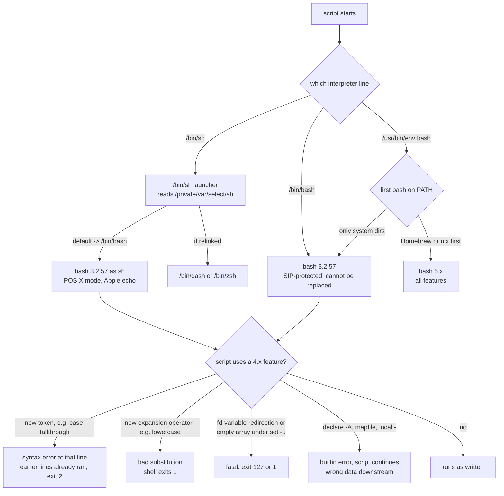

# Bash 3.2 on macOS

> [!summary] Claim
> Every Mac still ships GNU bash 3.2.57 (last patched in October 2014) as both `/bin/bash` and the default `/bin/sh`, so a script written for bash 4 or later fails on macOS in three distinct ways - at parse time, fatally at expansion time, or silently with wrong data - and the only safe designs are a version guard that 3.2 can parse, a declared dependency on a newer bash, or code restricted to the 3.2 subset.

Part of [Bash](README.md) in [Shell and Unix Engineering](../README.md).

## TL;DR

- Mechanism: macOS ships `/bin/bash` 3.2.57 (GPLv2) built from Apple's `bash-144` sources, and `/bin/sh` is a small launcher that re-execs `/bin/bash` (in POSIX mode) by default, chosen by the symlink `/private/var/select/sh`; bash 4.0 and later are GPLv3, and Apple has not shipped any of them.
- Rule: treat `#!/bin/bash` and `#!/bin/sh` on macOS as "bash 3.2", and put a version guard written in 3.2-parseable syntax (`case ${BASH_VERSION-} in '' | [0-3].*) exit 2 ;; esac`) at the top of any script that needs bash 4 or later.
- Trap: `declare -A m` fails with status 2 and the script continues, so `m[foo]=1; m[bar]=2` then silently writes both keys to index 0 of an indexed array (`foo=2 bar=2 count=1` in the lab); `"${a[@]}"` of an empty array under `set -u` and `exec {fd}>file` instead kill the script.
- Portability: of 38 features the lab probes, bash 3.2 has 5 and bash 5.3 has all 38; Apple's `/bin/sh` echo also expands backslashes and prints `-n` literally, unlike GNU bash in POSIX mode on Linux.
- When not to use it: do not write new software against bash 3.2 as a target; write POSIX `sh`, require a newer bash explicitly (Homebrew's `/opt/homebrew/bin/bash` on Apple silicon), or use a real language once you need data structures.

## Mental model



The interpreter is chosen before a single line runs: `#!/bin/sh` goes through Apple's launcher, which execs bash 3.2 as `sh` unless an administrator relinked `/private/var/select/sh`, `#!/bin/bash` is always 3.2, and only `#!/usr/bin/env bash` can reach a newer bash, depending on `PATH` order.
Once bash 3.2 is running, a bash 4 construct fails in one of four ways, and the arrows on the right are ordered from loudest to quietest.
A token 3.2 does not know is a syntax error, but bash parses and runs a script one command at a time, so every line before it has already executed.
An expansion operator 3.2 does not know is an expansion error, which makes a non-interactive shell exit.
Two newer redirection and nounset behaviors are fatal for other reasons.
The quiet case is the dangerous one: a builtin rejects an option, returns 2, and the script carries on with a variable that has a different type from the one the author intended.

## How it works

### Why macOS is frozen at 3.2

The GNU FTP index dates `bash-3.2.tar.gz` to 2006-10-11 and `bash-4.0.tar.gz` to 2009-02-20.
The `COPYING` file in the 3.2 tarball is the GNU GPL "Version 2, June 1991"; the one in the 4.0 tarball is "Version 3, 29 June 2007", and so is the one in 5.3.
Apple's open-source `bash` project (tag `bash-144`, the newest tag on `apple-oss-distributions/bash` as of 2026-11) still contains a `bash-3.2` tree whose `patchlevel.h` says `PATCHLEVEL 57`, and the tag's top-level `version.h` says `3.2.57(1)`.
Apple has never published its reason for staying on 3.2; the GPLv3 boundary is the usual explanation, and this note treats it as an inference, not a documented fact.
What Apple did document is the response: "Starting with macOS 10.15, your Mac uses zsh as the default login shell and interactive shell", and "bash is the default shell in macOS 10.14 and earlier" (Apple Support HT208050).
On the machine used for this note (macOS 27.3, build 26C5035r, Apple M3 Pro, 2026-11), `/bin/bash --version` prints `GNU bash, version 3.2.57(1)-release (arm64-apple-darwin26)`.

### Which binary a script actually gets

`/bin/bash` is a three-architecture universal binary (x86_64, arm64e, arm64e.x1) of 1961872 bytes, and `ls -lO` shows the `restricted` flag, which is System Integrity Protection: even root cannot replace it while SIP is enabled.
`/bin/sh` is a different, 166576-byte binary whose embedded version string is `PROJECT:dash-16`; its strings include `/private/var/select/sh`, `/bin/bash`, `/bin/dash`, `/bin/zsh`, and `Failed to exec %s as variant for /bin/sh`.
Apple's `sh(1)` page (written 2019-02-08) states the mechanism: `sh` "is implemented by re-execing as either bash(1), dash(1), or zsh(1) as determined by the symbolic link located at /private/var/select/sh", falling back to a supported shell if the link is missing or invalid.
On this machine `/private/var/select/sh -> /bin/bash`, so `#!/bin/sh` scripts run bash 3.2.57 with `posix` on.
`#!/usr/bin/env bash` searches `PATH`, so it reaches Homebrew's bash (installed under `/opt/homebrew` on Apple silicon, per docs.brew.sh) only if that directory precedes `/bin`; automation often runs with a shorter `PATH` than an interactive shell: `launchd` resolves a job's relative program path with `_PATH_STDPATH` (`launchd.plist(5)`), which `<paths.h>` defines as `/usr/bin:/bin:/usr/sbin:/sbin`, with no Homebrew directory in it.
`chsh -s` accepts only shells listed in `/etc/shells`, which on this machine lists `/bin/bash`, `/bin/csh`, `/bin/dash`, `/bin/ksh`, `/bin/sh`, `/bin/tcsh`, and `/bin/zsh`, so a Homebrew bash must be added there before it can be a login shell.

### What Apple changed in its 3.2

The `bash-144` tree carries `__APPLE__` blocks; the ones that change script behavior are these.
- Interactive deprecation notice: in `shell.c`, an interactive shell not acting as `sh` prints "The default interactive shell is now zsh." unless `BASH_SILENCE_DEPRECATION_WARNING` is exactly `1`, and only if `/bin/zsh` exists (Apple bash-144 `bash-3.2/shell.c`, `main`); HT208050 documents the same variable.
- POSIX-mode `echo`: Apple's Xcode project compiles a checked-in `builtins/echo.c` instead of the one GNU generates from `echo.def`, and in it `echo_builtin` starts with `do_v9 = xpg_echo || posixly_correct;` and `if (posixly_correct) goto just_echo;` (Apple bash-144 `bash-3.2/builtins/echo.c`, `echo_builtin`); GNU's `echo.def` has `if (posixly_correct && xpg_echo)`.
  So in POSIX mode Apple's echo always interprets backslash escapes and treats `-n` as an operand to print, which is the XSI behavior POSIX.1-2024 requires on XSI-conformant systems, while `shopt xpg_echo` still reports `off` (measured).
- UNIX 03 compatibility switch: `main` calls `COMPAT_MODE("bin/sh", "Unix2003")` and, when it is false, sets a `tiger_mode` that restores Mac OS X 10.4 behavior for setuid scripts and `#!/bin/sh` (Apple bash-144 `bash-3.2/shell.c`, `main`).
- Managed login profile: login shells read `/private/var/db/ManagedConfigurationFiles/com.apple.bash/etc/profile` instead of `/etc/profile` when that file exists, so a managed copy replaces the system profile (Apple bash-144 `pathnames.h`, `MANAGED_SYS_PROFILE`; `bash-3.2/shell.c`, `run_startup_files`).
- Installer privilege: `is_rootless_restricted_environment()` reports a process with the `CS_INSTALLER` code-signing flag, or with `APPLE_PKGKIT_ESCALATING_ROOT` set, and `main` ORs that into `running_setuid` before `shell_initialize` runs, so such a shell, like any setuid bash, imports no functions and no `SHELLOPTS` from the environment and reads no startup files (Apple bash-144 `bash-3.2/shell.c`, `main`; bash-3.2 `bash.1`, INVOCATION).

### Parse-time failures: the 3.2 lexer does not know the token

bash reads a script one complete command at a time and executes each before reading the next, so a syntax error aborts the script at that command with status 2, after everything before it has run (measured: `echo first` printed, then `syntax error near unexpected token '&'` for `;&`).
A function body is one command, so a 4.0 token anywhere inside a function aborts at the function definition, even if the function is never called (measured for `|&`).
bash 4.0 added the tokens `;&`, `;;&`, `|&`, and `&>>` (bash-5.3 `NEWS`, bash-4.0 items cc to ff).
Command substitution parsing changed shape too.
In 3.2, `read_token_word` finds the end of `$(...)` with `parse_matched_pair (cd, '(', ')', &ttoklen, P_COMMAND)`, which counts parentheses instead of parsing (bash-3.2 `parse.y`, `read_token_word`), so the `)` after an unparenthesized `case` pattern closes the substitution early and `x=$(case a in a) echo y;; esac)` is a syntax error.
bash 4.0 "parses command substitutions according to Posix rules: parsing the command contained in `$()` to find the closing delimiter" (bash-5.3 `CHANGES`, bash-4.0-alpha item uuu), bash 5.2 "rewrote the command substitution parsing code to call the parser recursively" (bash-5.3 `NEWS`, bash-5.2 item c), and bash 5.3 calls `parse_comsub (cd, '(', ')', &ttoklen, P_COMMAND)` at the same spot (bash-5.3 `parse.y`, `read_token_word`).
POSIX requires the recursive behavior: the commands string "shall be tokenized (see 2.3 Token Recognition) and parsed (see 2.10 Shell Grammar)" (POSIX.1-2024 XCU 2.6.3).
The workaround that every bash parses is the optional leading parenthesis on the pattern, `$(case a in (a) echo y;; esac)` (lab feature `comsubparen=yes` on 3.2).

### Expansion-time failures: fatal in a script

An unknown parameter-expansion operator such as `${x,,}` (4.0) or `${x@Q}` (4.4) is a "bad substitution", and an expansion error makes a non-interactive shell exit (POSIX.1-2024 XCU 2.8.1); measured on 3.2: `bash -c 'x=Ab; echo "${x,,}"; echo next'` prints `${x,,}: bad substitution` and exits 1 without running `echo next`.
`set -u` is the other fatal case.
POSIX exempts `@` and `*` from `-u`: the shell fails "an unset parameter other than the '@' and '*' special parameters" (POSIX.1-2024 XCU 2.15, `set`).
bash 3.2 applies the exemption only to the special parameters, not to arrays: in `parameter_brace_expand`, the `RBRACE` case reports `err_unboundvar (name)` whenever `var_is_set == 0 && unbound_vars_is_error` (bash-3.2 `subst.c`, `parameter_brace_expand`), and an array with no elements counts as unset, so `"${a[@]}"` of `a=()` prints `a[@]: unbound variable` and exits 1 (lab).
bash 4.4-rc2 changed this: "Using `${a[@]}` or `${a[*]}` with an array without any assigned elements when the nounset option is enabled no longer throws an unbound variable error" (bash-5.3 `CHANGES`); bash 5.3 tests `((name[0] != '@' && name[0] != '*') || name[1]) && all_element_arrayref == 0` at the same point (bash-5.3 `subst.c`, `parameter_brace_expand`).
The portable spelling is `${a[@]+"${a[@]}"}`, which expands to nothing when `a` has no elements and to the quoted elements otherwise (lab: `empty=0 two=2` in every release).

### Fatal redirection: `exec {fd}>` becomes a command named `{fd}`

bash 4.1 added `{varname}` before a redirection (bash-5.3 `NEWS`, bash-4.1 item p): the shell "allocates a file descriptor greater than or equal to 10" and stores its number in the variable (Bash Reference Manual, Redirections; bash-5.3 `redir.c` defines `SHELL_FD_BASE` as 10).
bash 3.2 sees `{fd}` as an ordinary word, so `exec {fd}>/dev/null` asks `exec` to replace the shell with a program called `{fd}`; `exec` fails with `exec: {fd}: not found`, and a non-interactive shell exits 127 when `exec` cannot run its command (lab, under both `/bin/bash` and `/bin/sh`).

### Silent failures: the script keeps going

A builtin that rejects an option is an ordinary failing command, so with no `set -e` the script continues.
`declare -A m` prints `declare: -A: invalid option` and returns 2 (measured), `m` stays unset, and the first `m[foo]=1` creates an indexed array.
An indexed-array subscript is an arithmetic expression, and in arithmetic a bare name that is unset or null evaluates to 0, so `m[foo]` and `m[bar]` are both `m[0]`: the lab prints `foo=2 bar=2 count=1` on 3.2 and `foo=1 bar=2 count=2` on bash 4.0 and later.
The failure propagates as wrong data, not as an error: a deduplicating loop keeps one key, a lookup table answers every query with the last value written, and nothing in the exit status says so.
`mapfile` is a missing builtin, so 3.2 runs it as an external command and returns 127 (`mapfile: command not found`, measured), leaving the array empty; `local -` fails with `` local: `-': not a valid identifier `` and the option changes the function makes leak to the caller (lab feature `localdash=no`).
Two behaviors are bugs that a 4.4 or later author never sees.
`printf -v v ""` leaves `v` unchanged in 3.2 (measured: `v=[old]`); bash 4.4 made it assign the empty string (bash-5.3 `NEWS`, bash-4.4 item m).
`printf -v 'arr[1]' %s val` fails with `` `arr[1]': not a valid identifier `` in 3.2; assigning to an array element arrived in 4.1 (bash-5.3 `NEWS`, bash-4.1 item e).

### Behavior that exists in both but means different things

- `[[ a < B ]]`: bash 3.2 compares with `strcmp`, bash 4.1 and later with the locale's `strcoll` (bash-5.3 `bashref.texi`, Shell Compatibility Mode, `compat40`); measured with `LC_ALL=en_US.UTF-8` on macOS: 3.2 prints `a-ge-B`, Homebrew bash 5.3.20 prints `a-lt-B`, and 5.3.20 with `LC_ALL=C` prints `a-ge-B`.
- `[[ ab =~ "a." ]]`: bash 3.2 itself introduced the rule that a quoted right-hand side matches literally (bash-5.3 `NEWS`, bash-3.2 item f), so this is `nomatch` in 3.2 and every later release; `shopt -s compat31` restores the 3.1 behavior and prints `match` on 3.2 (measured); the manual says `BASH_COMPAT` is required to set a compatibility level from bash 5.1 on and that bash 5.0 was the last release to add a `compat`NN option (bash-5.3 `bashref.texi`, Shell Compatibility Mode), yet Homebrew bash 5.3.20 still accepts `shopt -s compat31` and then prints `match` (measured), as does `BASH_COMPAT=31`.
- `$'\u0041'`: bash 3.2 keeps the backslash (`\u0041`, lab feature `uescape=no`); `\u` and `\U` arrived in 4.2 (bash-5.3 `NEWS`, bash-4.2 item d).
- `read -t 0.5`: 3.2 rejects it as `invalid timeout specification`; fractional timeouts arrived in 4.0 (bash-5.3 `NEWS`, bash-4.0 item y).
- `sh -c 'cmd1; cmd2'`: bash 3.2 forks `cmd2` rather than exec it, measured with `ps -o comm= -p $$` reporting `/bin/bash` for both commands; bash 5.1 and later exec the last command (shell matrix).
- Arithmetic is `intmax_t`: `$((9223372036854775807 + 1))` wraps to `-9223372036854775808` (measured), and `$((08))` is `value too great for base` (measured).

### Shellshock and the function-export encoding

bash exports a function by placing its definition in an environment variable, and before September 2014 any variable whose value began with `() {` was imported as a function and the rest of the value executed.
CVE-2014-6271 is "GNU Bash through 4.3 processes trailing strings after function definitions in the values of environment variables" (NVD, published 2014-09-24, CVSS v3.1 9.8), and CVE-2014-7169 covers the incomplete first fix (NVD: "this vulnerability exists because of an incomplete fix for CVE-2014-6271").
For 3.2 the fixes are `bash32-052` (2014-09-24, CVE-2014-6271), `bash32-053` (2014-09-26, Tavis Ormandy's lookahead bug), `bash32-054` (2014-09-27, Florian Weimer's change of "the encoding bash uses for exported functions"), `bash32-055` and `bash32-056` (parser buffer overflow and uninitialized here-document delimiter), and `bash32-057` (2014-10-05, nested command substitution plus function import), which is why the version is 3.2.57.
`bash32-054` defines `BASHFUNC_PREFIX "BASH_FUNC_"` and `BASHFUNC_SUFFIX "%%"`, so an exported `f` now travels as `BASH_FUNC_f%%=() {  echo hi` and a plain `f=() { ...}` variable is no longer imported (lab and measured).
Apple's first fix was different: "OS X bash Update 1.0" for 10.7.5 to 10.9.5 required the prefix `__BASH_FUNC<` and suffix `>()` (Apple Support HT6495); the current `/bin/bash` uses the upstream `BASH_FUNC_name%%` form (Apple bash-144 `bash-3.2/variables.c` defines both macros; lab).

## Numbers and limits

| Quantity | Value | Source |
|---|---|---|
| bash 3.2 release | 2006-10-11 | GNU FTP index, fetched 2026-11 |
| Last 3.2 patch (`bash32-057`) | 2014-10-05; `bash-3.2.57.tar.gz` dated 2014-11-07 | GNU FTP index |
| Official 3.2 patches | 57 | GNU `bash-3.2-patches/` |
| bash 4.0 release, first GPLv3 bash | 2009-02-20 | GNU FTP index; 4.0 `COPYING` |
| bash 5.3 release | 2025-07-30 | GNU FTP index |
| macOS 27.3 `/bin/bash` | 3.2.57(1), 1961872 bytes, 3 architectures | measured 2026-11 |
| macOS 27.3 `/bin/sh` | launcher, 166576 bytes, `dash-16` project | measured 2026-11 |
| Features in the lab probe present | 5 of 38 in 3.2.57; 38 of 38 in 5.3.20 | lab |
| `shopt` options | 34 in 3.2.57; 59 in 5.3.20 | measured (`shopt \| wc -l`) |
| `enable -a` builtins | 58 in 3.2.57; 61 in 5.3.20 | measured |
| `bash -c :` start-up | 2.3 to 2.9 ms (`/bin/bash` 3.2), 7.3 to 7.5 ms (Homebrew 5.3.20), 1.7 to 2.0 ms (`/bin/dash`) | measured, 3 runs of 500 starts, M3 Pro, macOS 27.3; a 2026-11-14 re-run under load average 200 reproduced the order (dash, then 3.2, then 5.3) but not the absolute times |
| Homebrew bash 5.3.20 dynamic libraries | 7 (`readline`, `history`, `ncursesw`, `intl`, CoreFoundation, `iconv`, `libSystem`) vs 2 for `/bin/bash` | measured (`otool -L`) |
| CVE-2014-6271 severity | CVSS v3.1 9.8, v2 10.0 | NVD |
| Descriptor from `{fd}>` | >= 10 | Bash Reference Manual, Redirections; lab asserts `fd>=10` |
| Arithmetic width | 64-bit signed, wraps at 2^63 | measured |

## Portability

"lab" means `labs/04-bash-3-2-on-macos/bash32.bats` asserts it; "matrix" means the shell matrix measured it; a dash means no verified claim is made here.

| Behavior | POSIX sh | macOS bash 3.2 | bash 5.3 | zsh | zsh `--emulate sh` | dash | ksh93 | mksh | yash | posh | BusyBox ash |
|---|---|---|---|---|---|---|---|---|---|---|---|
| `declare -A` associative arrays | not specified | no; keys collapse to index 0 (lab) | yes since 4.0 (lab) | - | - | - | - | - | - | - | - |
| empty `"${a[@]}"` under `set -u` | `@` and `*` exempt (XCU 2.15) | fatal, exit 1 (lab) | allowed since 4.4 (lab) | - | - | - | - | - | - | - | - |
| `exec {fd}>file` | not specified | exits 127 (lab) | allocates fd >= 10 since 4.1 (lab) | - | - | - | - | - | - | - | - |
| `$(case x in x) ...;; esac)` | must parse (XCU 2.6.3) | syntax error (lab) | parses since 4.0 (lab) | - | - | - | - | - | - | - | - |
| `$'\u0041'` | `\u` unspecified (XCU 2.2.4 lists no `\u`) | literal `\u0041` (lab) | `A` since 4.2 (lab) | - | - | no `$'...'` in 0.5.12 (matrix) | - | - | no `\u` in 2.58.1: `?` plus the rest (matrix) | no `$'...'` (matrix) | no `\u`, keeps backslash (matrix) |
| `echo "a\nb"; echo -n x` in POSIX mode | implementation-defined; XSI expands, prints `-n` | Apple: expands, prints `-n x` (lab) | GNU: `a\nb`, then `x` (lab) | - | - | - | - | - | - | - | - |
| `"${v:-$'a\nb'}"` | - | expands even in POSIX mode (matrix) | expands unless POSIX mode (matrix) | literal (matrix) | - | literal (matrix) | literal (matrix) | expands (matrix) | literal (matrix) | drops backslash (matrix) | literal (matrix) |
| `sh -c 'a; b'` execs `b` | - | forks (matrix; measured) | execs since 5.1 (matrix) | execs (matrix) | - | forks (matrix) | execs (matrix) | forks (matrix) | execs (matrix) | forks (matrix) | execs (matrix) |
| bare `wait` then `wait $pid` | - | 127, job forgotten (matrix; measured) | 127 (matrix) | status kept (matrix) | - | status kept (matrix) | status kept (matrix) | forgets jobs it waited for (matrix) | 127 (matrix) | forgets jobs it waited for (matrix) | status kept (matrix) |
| exported function encoding | not specified | `BASH_FUNC_f%%` since 3.2.54 (lab) | `BASH_FUNC_f%%` (lab) | n/a | n/a | n/a | n/a | n/a | n/a | n/a | n/a |
| this lab's probes | - | run (lab) | run (lab) | `not-bash` (lab) | `not-bash` (lab) | `not-bash` (lab) | `not-bash` (lab) | `not-bash` (lab) | `not-bash` (lab) | `not-bash` (lab) | `not-bash` (lab) |

Which shell `/bin/sh` is: bash 3.2.57 in POSIX mode on macOS by default, dash 0.5.12 on Debian, BusyBox ash 1.37.0 on Alpine (matrix).
The utilities do not change with the shell: the lab calls only `env NAME=VALUE CMD` and `grep PATTERN` with no options, forms that POSIX specifies and that GNU, BSD and macOS, and BusyBox implementations share.

## Worked example

The [lab](../labs/04-bash-3-2-on-macos/) has two scripts and one test file.
`probe.sh` keeps every bash-only construct inside a single-quoted `eval` string, so every shell can parse it; non-bash shells print `not-bash`.
`guarded-assoc.sh` is the pattern this note recommends; verbatim:

```bash
#!/usr/bin/env bash
# guarded-assoc.sh WORD...: count each distinct WORD with an associative array, in first-seen
# order, and refuse to run on anything older than bash 4.0.
# The guard uses only syntax that bash 3.2 and every POSIX shell parse, so an old bash stops
# here with a clear message instead of silently treating every key as arithmetic index 0.
# The body is an eval string only so the lab matrix can run this file under non-bash shells,
# some of which (mksh) parse a whole script before running it.
case ${BASH_VERSION-} in
  '' | [0-3].*)
    printf 'guarded-assoc.sh: needs bash >= 4.0, running %s\n' "${BASH_VERSION:-a non-bash shell}" >&2
    exit 2
    ;;
  *) ;;
esac

eval '
declare -A count
order=()
for w in "$@"; do
  if [ -z "${count[$w]+set}" ]; then
    order+=("$w")
  fi
  count[$w]=$(( ${count[$w]:-0} + 1 ))
done
for w in ${order[@]+"${order[@]}"}; do
  printf "%s=%s\n" "$w" "${count[$w]}"
done
'
```

In a script meant only for bash, drop the `eval` and write the body directly; bash executes the `case` guard before it reads the next command, so a 3.2 shell never parses the body.

Simplified excerpt of `probe.sh`, the `assoc` mode and the feature-probe helper:

```sh
has() {
  if (eval "$2") >/dev/null 2>&1; then
    printf '%s=yes\n' "$1"
  else
    printf '%s=no\n' "$1"
  fi
}
# assoc mode:
eval 'declare -A m 2>/dev/null
m[foo]=1
m[bar]=2
printf "foo=%s bar=%s count=%s\n" "${m[foo]}" "${m[bar]}" "${#m[@]}"'
```

Captured on macOS 27.3 with `/bin/bash` 3.2.57 (stderr included):

```text
$ /bin/bash probe.sh assoc
foo=2 bar=2 count=1
$ /bin/bash probe.sh nounset; echo "[status $?]"
probe.sh: line 96: a[@]: unbound variable
[status 1]
$ /bin/bash probe.sh fd-fatal; echo "[status $?]"
probe.sh: line 108: exec: {fd}: not found
[status 127]
$ /bin/sh probe.sh echo-posix
a
b
-n x

$ /bin/bash probe.sh export-func
encoding=BASH_FUNC_f%%
$ /bin/bash guarded-assoc.sh a b a; echo "[status $?]"
guarded-assoc.sh: needs bash >= 4.0, running 3.2.57(1)-release
[status 2]
$ /bin/bash probe.sh features | paste -sd' ' -
regex=yes pipefail=yes appendop=yes printfv=yes comsubparen=yes assoc=no mapfile=no casemod=no declarel=no fallthrough=no globstar=no pipeamp=no appendall=no zeropad=no readfrac=no bashpid=no comsubcase=no fdvar=no printfvarr=no readN=no uescape=no testv=no negsub=no neglen=no printfT=no lastpipe=no declareg=no nameref=no waitn=no atQ=no nounsetarr=no printfvempty=no inherit=no localdash=no epoch=no srandom=no waitp=no funsub=no
```

The same commands under Homebrew bash 5.3.20 print `foo=1 bar=2 count=2`, `<> reached`, `survived fd>=10`, `a\nb` then `x` (GNU echo in POSIX mode), `encoding=BASH_FUNC_f%%`, `a=2` and `b=1`, and `=yes` for all 38 features.
`bats bash32.bats` passed 10 of 10 tests with `LAB_SHELL` set to `/bin/sh`, `/bin/bash`, Homebrew bash 5.3.20, nix bash 5.3.15, Homebrew `dash`, `/bin/ksh` (ksh93u+ 2012), `zsh`, and `zsh --emulate sh` on this machine; the features test derives the expected list for every release from 3.2 to 5.3 from the `NEWS` table in the test, and the integrator's matrix runs the intermediate releases.

## Pitfalls

> [!warning] `declare -A` on 3.2 corrupts data instead of failing
> Trigger: a bash 4 script with `declare -A map` runs under `/bin/bash` or `/bin/sh` on a Mac.
> Symptom: one `declare: -A: invalid option` line on stderr, then every string key maps to index 0, so the last write wins (`foo=2 bar=2 count=1`) and the script exits 0.
> Fix: guard at the top (`case ${BASH_VERSION-} in '' | [0-3].*) exit 2 ;; esac`), or `set -e` so the failed `declare` stops the script, or use parallel indexed arrays or a sorted text file on 3.2.

> [!warning] Empty arrays under `set -u`
> Trigger: `set -u` (or `set -euo pipefail`) and `"${args[@]}"` where `args` may be empty, a common pattern for optional flags.
> Symptom: `args[@]: unbound variable` and exit 1 on 3.2 to 4.3 only; CI on Linux with bash 5 never sees it.
> Fix: `${args[@]+"${args[@]}"}`, which works on every release (lab).

> [!warning] `#!/usr/bin/env bash` depends on `PATH`
> Trigger: a developer's shell has Homebrew first on `PATH`, but a `launchd` job or another automation context runs the same script with a `PATH` that lacks it.
> Symptom: the script works interactively and fails, or silently miscomputes, under automation.
> Fix: check `BASH_VERSINFO` at run time with a 3.2-parseable guard, or name the interpreter by absolute path (`#!/opt/homebrew/bin/bash`) where the fleet is controlled.

> [!warning] A newer token aborts mid-script
> Trigger: `;&`, `;;&`, `|&`, `&>>`, or an unparenthesized `case` inside `$(...)` somewhere in a script.
> Symptom: the lines before it run (files created, services restarted), then `syntax error near unexpected token` and exit 2; inside a function the error fires at the definition.
> Fix: keep the version guard before any such construct, and keep the guard outside every function and compound command.

> [!warning] `/bin/sh` echo on macOS differs from Linux bash as `sh`
> Trigger: `echo "line1\nline2"` or `echo -n` in a `#!/bin/sh` script tested on Linux bash in POSIX mode.
> Symptom: on macOS the backslash sequences are expanded and `-n` is printed (`-n x`); on Debian `sh` is dash, on Linux bash with `--posix` neither happens.
> Fix: use `printf`, as POSIX.1-2024 `echo` APPLICATION USAGE recommends ("New applications are encouraged to use printf instead of echo").

> [!warning] Shellshock-era assumptions about exported functions
> Trigger: code that builds `f=() { ...}` environment variables to pass functions to a child bash, or scanners that look for that pattern.
> Symptom: since the 2014 patches the child ignores `f=...`; only `BASH_FUNC_f%%` is imported.
> Fix: pass data, not code, across the environment, and `export -f` only when the child is known to be bash (CVE-2014-6271, CVE-2014-7169).

## Security and robustness

No upstream 3.2 patch has been published since `bash32-057` on 2014-10-05 (GNU patch index, checked 2026-11).
Apple ships its own builds, so the effective patch level of `/bin/bash` is whatever Apple compiles; the version string alone does not reveal Apple-specific fixes, and this note does not claim any beyond those visible in `bash-144`.
The Shellshock class is closed in 3.2.57: the lab's `shellshock` mode runs `$BASH` with `x=() { :; }; echo VULNERABLE` in the environment and sees only `body`.
The remaining risk is environment-driven code paths that still exist in every bash: `BASH_ENV` is sourced by a non-interactive `bash` that is not in POSIX mode (measured: `BASH_ENV=./benv.sh /bin/bash -c 'echo body'` runs the file first, while `/bin/sh` does not), `SHELLOPTS` in the environment turns on every option it lists before startup files run (bash-3.2 `bash.1`), and `PS4` is inherited from the environment, even by root until bash 4.4 (bash-5.3 `NEWS`, bash-4.4 item nn).
Robustness rules that follow from this note: fail closed with a version guard, prefer `set -e` only in addition to explicit status checks (a failed `declare -A` is caught by `set -e`, a wrong value is not), and never let a script's correctness depend on which bash `PATH` finds.

## The principal's view

The decision is not "which bash features may we use" but "what is the interpreter contract of this script, and who enforces it".
For developer tooling that must run on stock Macs, the cheapest durable contract is POSIX `sh` plus `printf`, tested under dash and macOS `/bin/sh`; it costs arrays and associative arrays, which is usually a sign the logic belongs elsewhere anyway.
For a team that controls its fleet, requiring bash 5 is reasonable, but it must be enforced twice: by installation (Homebrew, nix, or a vendored binary) and by a run-time guard that fails loudly, because `PATH` drift will eventually hand the script to 3.2.
Writing deliberately to the 3.2 subset is a legitimate third option for small, widely distributed installers, at the price of giving up `mapfile`, associative arrays, `${x,,}`, `printf -v` into elements, and safe empty arrays under `set -u`, and of testing against 3.2 in CI, which Linux runners do not have by default.
Once a script needs maps, structured data, or non-trivial error handling, the right move is a different language with a stable runtime contract (Python, Go, or a compiled helper); the 3.2 trap is a symptom of using the shell past its design point.

## Interview questions

> [!question] L5: Why does a Mac in 2026 still have bash 3.2 as `/bin/bash`?
>
> > [!success]- Answer
> > bash 3.2 is the last release under GPLv2; bash 4.0 (2009) and later are GPLv3, as their `COPYING` files show.
> > Apple has not shipped a GPLv3 bash, moved the default login and interactive shell to zsh in macOS 10.15, and still ships 3.2.57 as `/bin/bash`.
> > Apple never stated the licensing reason officially, so it is an inference from the timing and licenses.
> >
> > Follow-up: What is `/bin/sh` on that Mac, and how would you find out?

> [!question] L5: What does `/bin/sh` run on macOS, and how can it change?
>
> > [!success]- Answer
> > It is a small launcher from Apple's `dash` project that re-execs the shell named by the symlink `/private/var/select/sh`, which points to `/bin/bash` by default.
> > So `#!/bin/sh` scripts run bash 3.2.57 in POSIX mode, with Apple's XSI-style `echo`.
> > An administrator can point the link at `/bin/dash` or `/bin/zsh`, and the `sh(1)` page documents the fallback when the link is invalid.
> >
> > Follow-up: Which behaviors of a `#!/bin/sh` script would change if the link pointed to dash?

> [!question] L5: Predict the output under `/bin/bash` 3.2 and under bash 5: `declare -A m 2>/dev/null; m[foo]=1; m[bar]=2; echo "${m[foo]} ${#m[@]}"`
>
> > [!success]- Answer
> > bash 3.2 prints `2 1`; bash 4.0 and later print `1 2`.
> > On 3.2 `declare -A` fails, `m` becomes an indexed array, and both `foo` and `bar` are arithmetic expressions that evaluate to 0, so the second assignment overwrites the first.
> >
> > Follow-up: Which shell option would have stopped the script at the `declare`, and why is that not a sufficient fix?

> [!question] L6: Debug this script: it passes CI on Ubuntu but a Mac user reports `args[@]: unbound variable`.
>
> ```bash
> #!/usr/bin/env bash
> set -euo pipefail
> args=()
> [ -n "${VERBOSE-}" ] && args+=(--verbose)
> exec mytool "${args[@]}" "$@"
> ```
>
> > [!success]- Answer
> > On the Mac, `env bash` found `/bin/bash` 3.2, where an empty array under `set -u` counts as unset; bash 4.4 exempted `${a[@]}` and `${a[*]}`.
> > Replace the expansion with `${args[@]+"${args[@]}"}`, which is empty for an empty array on every release.
> > There is a second bug: with `VERBOSE` unset, the `[ ... ] && ...` list returns 1, which `set -e` ignores here because the failing command is part of an AND list, but the pattern is fragile; prefer `if`.
> >
> > Follow-up: How would you make CI catch this class of bug without a Mac runner?

> [!question] L6: Why is `x=$(case a in a) echo y;; esac)` a syntax error in bash 3.2 but not in bash 4.0?
>
> > [!success]- Answer
> > bash 3.2 finds the end of `$(` by counting parentheses (`parse_matched_pair` in `read_token_word`), so the `)` after the pattern `a` ends the substitution.
> > bash 4.0 parses the contents to find the closing parenthesis as POSIX XCU 2.6.3 requires, and 5.2 rewrote it to call the parser recursively (`parse_comsub`).
> > The portable fix is the optional leading parenthesis: `case a in (a) ...`.
> >
> > Follow-up: What other construct has the same parenthesis-counting problem in old shells?

> [!question] L6: A script runs fine interactively on a Mac but fails under `launchd`. What do you check first?
>
> > [!success]- Answer
> > The interpreter actually used: with `#!/usr/bin/env bash`, a `PATH` without `/opt/homebrew/bin` (launchd's `_PATH_STDPATH` is `/usr/bin:/bin:/usr/sbin:/sbin`) finds `/bin/bash` 3.2 instead of Homebrew's bash.
> > Log `$BASH` and `$BASH_VERSION` at start, then either set `PATH` in the job, use an absolute shebang, or add a version guard.
> >
> > Follow-up: Which other Mac contexts start processes with a reduced `PATH`?

> [!question] L6: What does `exec {fd}>/tmp/log` do on bash 3.2, and why is it fatal?
>
> > [!success]- Answer
> > bash 3.2 has no `{varname}` redirection (added in 4.1), so `{fd}` is a command word and `exec` tries to replace the shell with a program named `{fd}`.
> > `exec` cannot find it, and a non-interactive shell exits with status 127 when `exec` fails to run its command.
> > The 3.2-compatible form picks a fixed descriptor such as `exec 3>/tmp/log`.
> >
> > Follow-up: Why does a fixed descriptor number become a problem in a library function?

> [!question] L7+: Your company ships a CLI installer as a shell script to developer Macs. Set the interpreter policy.
>
> > [!success]- Answer
> > Write the installer in POSIX `sh` with `printf`, because it must run before any dependency exists, and test it under dash and macOS `/bin/sh` in CI.
> > Everything after bootstrap can require a pinned toolchain (a vendored bash 5, or a compiled helper) whose presence the bootstrap verifies.
> > Reject "write to bash 3.2" as the general policy: it freezes the team on a 2006 feature set, and nobody tests it until a user hits it.
> > The trade-off is developer convenience versus a contract that holds on every Mac without configuration.
> >
> > Follow-up: How do you keep developers from reintroducing bashisms into the bootstrap script?

> [!question] L7+: Explain the Shellshock fix in terms of the environment encoding, and what it changed for legitimate users.
>
> > [!success]- Answer
> > Before the fix, any environment value starting with `() {` was parsed as a function and trailing text executed, so any service that copied untrusted data into the environment (CGI headers, DHCP options, `ForceCommand`) ran attacker code (CVE-2014-6271).
> > The durable fix, `bash32-054` and its siblings, imports only variables named `BASH_FUNC_name%%`, so ordinary values are never parsed as code.
> > Legitimate users who built `f=() {...}` variables by hand had to switch to `export -f`; Apple's first update used a different `__BASH_FUNC<name>()` prefix before converging on upstream.
> >
> > Follow-up: Which bash features still read code or code-like data from the environment?

## Related

Prerequisites: [[Bash-Version-History]]

Next: [[Loadable-Builtins]]

See also: [[Bash-POSIX-Mode]], [[Bash-Startup-Files-and-Modes]], [[Associative-Arrays]], [[Indexed-Arrays]], [[mapfile-and-readarray]], [[Bash-Parameter-Transformations]], [[Namerefs-and-Dynamic-Scope]], [[printf-v-and-printf-q]], [[inherit_errexit-and-errtrace]], [[wait-n-and-wait-p]], [[Double-Bracket-Conditional]], [[Bash-Regex-and-BASH_REMATCH]], [[Shell-Options-shopt]], [[printf-versus-echo]], [[Dollar-Single-Quotes]], [[Command-Substitution]], [[Command-Search-and-PATH]], [[Environment-Variables-and-Inheritance]], [[Null-versus-Unset]]

## Further reading

- GNU bash `NEWS` and `CHANGES` (in `https://ftpmirror.gnu.org/bash/bash-5.3.tar.gz`): the authoritative per-release feature list used for every version in this note.
- GNU bash 3.2 patches (`https://ftpmirror.gnu.org/bash/bash-3.2-patches/`): the 57 patches, including the six Shellshock-era fixes with their bug descriptions.
- Apple `bash` source, tag `bash-144` (`https://github.com/apple-oss-distributions/bash/tree/bash-144`): what Apple changed, including `shell.c` and the compiled `builtins/echo.c`.
- Apple Support HT208050 (`https://support.apple.com/kb/HT208050`): the zsh default since macOS 10.15 and `BASH_SILENCE_DEPRECATION_WARNING`.
- Apple Support HT6495 (`https://support.apple.com/kb/HT6495`): OS X bash Update 1.0 and its original exported-function prefix.
- NVD CVE-2014-6271 (`https://nvd.nist.gov/vuln/detail/CVE-2014-6271`): the Shellshock record and its attack vectors.
- POSIX.1-2024 XCU chapter 2 (`https://pubs.opengroup.org/onlinepubs/9799919799/utilities/V3_chap02.html`): sections 2.6.3, 2.8.1, and 2.15 `set`, which define the behavior bash 3.2 deviates from.
- POSIX.1-2024 `echo` (`https://pubs.opengroup.org/onlinepubs/9799919799/utilities/echo.html`): why Apple's `/bin/sh` echo prints `-n`.
- Bash Reference Manual, Shell Compatibility Mode (in the 5.3 tarball, `doc/bashref.texi`): what `compat31`, `compat40`, and `BASH_COMPAT` restore.
