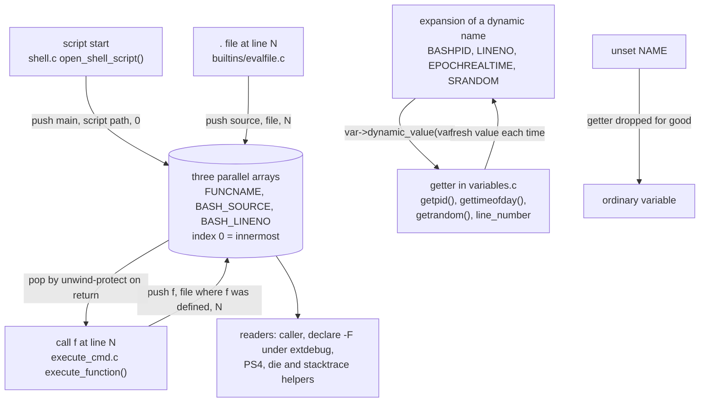

# Bash Introspection Variables

> [!summary] Claim
> Bash's introspection variables are not stored values but views onto interpreter state: the call-stack arrays `FUNCNAME`, `BASH_SOURCE`, and `BASH_LINENO` are pushed and popped by the function and `source` executors, and scalars such as `BASHPID`, `LINENO`, `EPOCHREALTIME`, and `SRANDOM` run a getter function on every expansion, so each one is exactly as reliable as the code path that maintains it, and that differs by bash version and is absent in almost every other shell.

Part of [Bash](README.md) in [Shell and Unix Engineering](../README.md).

## TL;DR

- Mechanism: bash-5.3 variables.c marks these names with a `dynamic_value` getter (`get_bashpid` calls `getpid`, `get_epochrealtime` calls `gettimeofday`, `get_lineno` reads the executor's line counter), and execute_cmd.c `execute_function` pushes the function name, its definition file, and the calling line onto three parallel arrays before the body runs.
- Rule: `FUNCNAME[i]` was defined in `BASH_SOURCE[i]` and was called from `BASH_SOURCE[i+1]` at line `BASH_LINENO[i]`; the frame that is now executing `FUNCNAME[i]` is at line `BASH_LINENO[i-1]`, and every stack trace is an application of that one off-by-one.
- Trap: the main-guard `[[ ${BASH_SOURCE[0]} == "$0" ]]` misfires when the script arrives on standard input (`bash < script` says "sourced"), and `BASH_SOURCE` holds the path as typed, so `cd` breaks `dirname "${BASH_SOURCE[0]}"`; `(return 0 2>/dev/null)` is the guard that survives both (lab).
- Portability: POSIX.1-2024 specifies only `LINENO` (XCU 2.5.3, under the User Portability Utilities option), `PPID`, and `$$`; the bash names are bash only, except `BASHPID` and `EPOCHREALTIME` in mksh, `FUNCNAME` (a scalar) and the `EPOCH` pair in BusyBox ash (the pair only in builds with `ASH_BASH_COMPAT`, and not in Alpine 3.22's), and differently named equivalents in zsh (`funcstack`, `ZSH_SUBSHELL`) and ksh93 (`.sh.fun`, `.sh.subshell`).
- When not to use it: do not build control flow on `BASH_COMMAND`, `BASH_ARGV`, or `SHLVL`, which are debugger aids with version-dependent values; if a program needs reflection, structured stack traces, or monotonic sub-second timing, it has outgrown the shell.

## Mental model



Three writers feed one stack: script start pushes the frame `main`, every function call pushes the callee's name, the file in which the callee was defined, and the line of the call, and `.` or `source` pushes the pseudo-frame `source` with the sourced file and the line of the `.` command.
The arrays are popped by unwind-protect handlers when the frame ends, including on `return`, errors, and `FUNCNEST` aborts, so they always describe the frames that are live right now.
`caller`, `declare -F`, a `PS4` that expands `${FUNCNAME[0]}`, and a hand-written stack trace are all readers of the same arrays and add no information of their own.
The scalar names sit on a different mechanism: expanding one calls a getter that asks the kernel or the executor at that instant, which is why two expansions of `EPOCHREALTIME` differ, why `BASHPID` is right inside a subshell while `$$` is not, and why `unset` is the one operation that changes their nature: it removes the getter permanently, and a later assignment creates an ordinary variable.

## How it works

### What POSIX specifies, and what it leaves to bash

POSIX.1-2024 XCU 2.5.3 Shell Variables defines `LINENO` as "a decimal number representing the current sequential line number (numbered starting with 1) within a script or function before it executes each command", requires it only when "the system supports the User Portability Utilities option", lets the variable "lose its special meaning for the life of the shell" if the user unsets or resets it, and leaves its value unspecified outside a script or function.
The same section defines `PPID` as the parent process ID "during initialization of the shell" and requires a subshell to keep it: "`echo $PPID` and `(echo $PPID)` would produce the same value" (code formatting added).
XCU 2.5.2 Special Parameters defines `$$` as "the decimal process ID of the invoked shell" and keeps it unchanged in a subshell (see [[Special-Parameters]]); the lab asserts both invariances under every shell in the matrix.
Nothing else in this note is in the standard: there is no portable way to read the current function's name, the call stack, the real PID of a subshell, or the subshell depth.
"Within a script or function" is the phrase shells read differently, so `LINENO` inside a function body is the file line in bash and ksh93 and a count from the function's first line in dash and zsh (lab).
Debian builds dash with `--disable-lineno` (Debian dash 0.5.12-12 debian/rules; the option is in dash configure.ac), so Debian's `/bin/sh` expands `LINENO` to an empty string everywhere, measured in the shell matrix; the dash numbers in this note are from upstream builds such as Homebrew's and Alpine's.

### Dynamic variables: a getter per name

bash-5.3 variables.c `initialize_dynamic_variables` creates each special name with the `INIT_DYNAMIC_VAR` macro, which binds the variable and stores two function pointers, `dynamic_value` and `assign_func`.
Every expansion of the name calls `dynamic_value`, which rewrites the variable's value before the expansion reads it; every assignment calls `assign_func` instead of storing the string.
The getters in bash 5.3, read in variables.c:

| Name | Getter | What it reads | Assignment |
| --- | --- | --- | --- |
| `BASHPID` | `get_bashpid` | `getpid()` on every expansion | `null_assign`: ignored |
| `BASH_SUBSHELL` | `get_subshell` | the executor counter `subshell_level` | `assign_subshell`: sets the counter |
| `LINENO` | `get_lineno` | `executing_line_number()` | `assign_lineno`: sets `line_number` |
| `BASH_COMMAND` | `get_bash_command` | `the_printed_command_except_trap` | none |
| `BASH_ARGV0` | `get_bash_argv0` | `dollar_vars[0]`, that is `$0` | `assign_bash_argv0`: replaces `$0` and `shell_name` |
| `EPOCHSECONDS` | `get_epochseconds` | `getnow()` | `null_assign`: ignored |
| `EPOCHREALTIME` | `get_epochrealtime` | `gettimeofday()`, formatted `"%u%c%06u"` with the locale's decimal point | `null_assign`: ignored |
| `BASH_MONOSECONDS` | `get_monoseconds` | `clock_gettime(CLOCK_MONOTONIC)`, `tv_sec` only, else `gettimeofday` | none |
| `SRANDOM` | `get_urandom` | `get_urandom32()`, 32 bits | none: ignored |
| `RANDOM` | `get_random` | a seeded generator, reseeded in a new subshell | `assign_random`: seeds |
| `SECONDS` | `get_seconds` | `gettimeofday()` minus the start time | `assign_seconds`: rebases |
| `FUNCNAME` | `get_funcname` | the array itself (`ARRAY_VARS` builds) | `null_array_assign`: ignored |

The manual repeats one sentence for most of them, "If BASHPID is unset, it loses its special properties, even if it is subsequently reset" (bash-5.3 doc/bashref.texi, Bash Variables), and the lab shows it: `BASHPID=5` is ignored, but after `unset BASHPID` the same assignment sticks.
The stack arrays are protected the other way: `init_dynamic_array_var` gives `BASH_SOURCE`, `BASH_LINENO`, `BASH_ARGV`, and `BASH_ARGC` the attributes `att_noassign|att_nounset`, so `unset BASH_SOURCE` fails with status 1 and "cannot unset" in bash 3.2 and 5.3 (lab), and assignment is a silent no-op.
The lab runs `unset BASH_SOURCE` in a subshell so the surrounding probe can report the failure even when POSIX mode makes it fatal to that subshell.
`FUNCNAME` is created `att_invisible|att_noassign` by `init_funcname_var`, and `execute_function` calls `make_funcname_visible (1)` on entry while `function_misc_cleanup` hides it again at the top level, which is why `${FUNCNAME-unset}` prints `unset` outside a function even though the `main` frame is on the stack (lab).
`BASH_VERSINFO` is a readonly array built by `make_vers_array` at startup (major, minor, patch level, build version, release status, `MACHTYPE`), and `BASH_EXECUTION_STRING` is a plain variable bound once to the `-c` argument (bash-5.3 variables.c `initialize_shell_variables`); the lab checks both.

### The call stack: who pushes what

`execute_function` in bash-5.3 execute_cmd.c does the pushing for functions, in this order: `array_push` of the function name onto `FUNCNAME`, `push_source` of `shell_fn->source_file` onto `BASH_SOURCE`, and `array_push` of `GET_LINE_NUMBER()`, the line of the call, onto `BASH_LINENO`.
`source_file` is recorded when the function is defined: make_cmd.c `make_function_def` copies `BASH_SOURCE[0]` at definition time, so `BASH_SOURCE[i]` is where `FUNCNAME[i]` was written, not where it was called from.
When there is no file, bash 5.3 records `"environment"` for a function imported before the shell is initialized, `"main"` in an interactive shell, and `$0` for a function defined by `bash -c`; bash 4.4 to 5.2 record `"main"` for the `-c` case (bash-5.2 make_cmd.c: `shell_initialized ? "main" : "environment"`), and bash 3.2 records nothing, so the array stays empty and `caller` fails (lab, all three behaviors).
The `"environment"` value arrived in bash 4.4 (bash CHANGES, 4.4-rc1 item h: "Fixed values added to BASH_SOURCE and BASH_LINENO for functions inherited from the environment"); bash 4.0 to 4.3 make_cmd.c has no such default.
shell.c `open_shell_script` pushes the bottom frame: the script's filename onto `BASH_SOURCE`, `executing_line_number()` (0 at that point) onto `BASH_LINENO`, and `"main"` onto `FUNCNAME`, so a script's stack always ends in `main`, while `bash -c` and an interactive shell have no `main` frame.
builtins/evalfile.c `_evalfile` pushes the file, the line of the `.` command, and the name `"source"` (the source comment says "not exactly right"), so a function called from a sourced file's top level sees `FUNCNAME=(k source)`, measured here.
`restore_funcarray_state` pops `BASH_SOURCE` and `BASH_LINENO` unconditionally and pops `FUNCNAME` only if the variable is still the one it pushed onto, which is the guard against a user who unset `FUNCNAME` mid-call.
Since bash 5.3, `shopt -s bash_source_fullpath` makes `push_source` store `sh_realpath(filename)` instead of the name as typed (bash-5.3 NEWS, item pp; variables.c `push_source`); the lab shows `./srcpath.bash` becoming an absolute path and the option missing before 5.3.

The lab's stack probe (`stack.bash` sources `stack-lib.bash`, `main` calls `f` on line 14, `f` calls `g` on line 10, `g` calls `h` on line 7) prints the three arrays and the `caller` output from inside `h`, identically in bash 3.2 and 5.3:

```text
FUNCNAME=h g f main
BASH_SOURCE=stack-lib.bash stack.bash stack.bash stack.bash
BASH_LINENO=7 10 14 0
```

Read it as columns: `h` is defined in `stack-lib.bash` and was called at line 7 of `stack.bash`, the file in the next column; `g` is defined in `stack.bash` and was called at line 10; `main`'s `0` is the placeholder from `open_shell_script`.

### caller and declare -F

`caller` (bash-5.3 builtins/caller.def `caller_builtin`) is a thin formatter over the same arrays.
With no argument it prints `BASH_LINENO[0]` and `BASH_SOURCE[1]`, the line and file of the current call; with `N` it prints `BASH_LINENO[N]`, `FUNCNAME[N+1]`, and `BASH_SOURCE[N+1]`, the line, function, and file of the frame `N` levels above the current function, and it returns 1 when any of the three is missing.
So `caller 0` inside `h` prints `7 g .../stack.bash`: the line in `g` that called `h`, not `h` itself, and the lab's `caller 3` from three frames below `main` fails with status 1.
At a script's top level `caller` prints `0 NULL` and returns 0, because `BASH_LINENO` has the `main` frame's 0 and `BASH_SOURCE[1]` does not exist, although its help text says it fails "if the shell is not executing a shell function" (lab).
Each `caller` call costs nothing more than an array read, but `$(caller N)` forks a subshell, which is why the lab's stack-trace helper reads the arrays directly.
`shopt -s extdebug` makes `declare -F name` print the name, the line number of the definition, and the source file (bash-5.3 doc/bashref.texi, The Shopt Builtin): the lab prints `h 4 stack-lib.bash` after shortening the path.

### BASH_ARGV, BASH_ARGC, and extdebug

`BASH_ARGV` is a stack of every argument of every frame, last argument on top, and `BASH_ARGC` is a stack of per-frame counts (bash-5.3 variables.c `push_args`, which `array_push`es each word and then the count).
The shell maintains them only in debugging mode: `execute_function` calls `push_args` "if (debugging_mode)", and bash 5.0 stopped building them at startup unless `extdebug` was on, but `get_bashargcv` still builds them lazily when the top level references them (bash NEWS, 5.0 items x and ff).
The lab shows the consequence: without `extdebug`, a function sees the script's arguments `c b a|3`, not its own, and only after `shopt -s extdebug` does a call `f x y` push `y x` and a count of 2 (`y x c b a|2 3`), identically in 3.2 and 5.3.
The manual's warning, that turning on `extdebug` after a script starts "may result in inconsistent values", follows from this: frames entered before the switch were never pushed.
`extdebug` also turns on `-E` and `-T` and changes `DEBUG` trap semantics, so it is a debugger switch, not a way to get arguments; the details are in [[ERR-and-DEBUG-Traps]].

### LINENO

bash keeps a single global `line_number`; the parser stores each command's line in its node, and the executor copies it back (`SET_LINE_NUMBER`) before running the command, which is why an assignment to `LINENO` is overwritten by the next command: `bash -c 'LINENO=100; echo $LINENO'` printed 1 in bash 5.3 and 0 in bash 3.2 (measured here).
`executing_line_number()` (bash-5.3 execute_cmd.c) returns the line of the current `[[`, `((`, or arithmetic `for` node when one is executing, else `line_number`; inside a function in a script the number is the absolute file line, a rule bash adopted in 2.05b ("The expansion of `$LINENO` inside a shell function is only relative to the function start if the shell is interactive", bash NEWS, 2.05b item x).
bash 5.0 changed the first line of a function from 0 to 1 "as Posix requires" (bash CHANGES, 5.0-alpha item fff), and in a `-c` string bash 3.2 counts from 0 (its errors say `line 0:`).
The edge cases differ between versions and shells; measured here with one 19-line script (true lines: `eval` string on 6 and 7, command substitution body on 9, `kill -USR1 $$` on 12, a backslash-continued `echo` starting on 13):

| Construct | bash 5.3 | bash 3.2 | dash | zsh 5.9 | ksh93u+ 2012 |
| --- | --- | --- | --- | --- | --- |
| Function body line 3 (`f()` on 2) | 3 | 3 | 2 | 1 | 3 |
| Two-line `eval` string | 6, 7 | 7, 8 | 1, 2 | 1, 2 | 1, 2 |
| Command substitution body | 10 | 11 | 9 | 9 | 9 |
| Inside a `USR1` trap | 1 | 12 | 1 | 12 | 12 |
| Continued line | 13 | 14 | 13 | 13 | 13 |
| `LINENO=100` then two commands | 16, 17 | 16, 17 | 100, 100 | read-only error | 100, 101 |

The dash column is an upstream build (Homebrew dash on the macOS host); Debian's `--disable-lineno` build prints an empty string in every row.
So bash's `LINENO` is exact for plain commands, can be one or two lines late after a multi-line command substitution or continuation, and is relative to the trap string inside a trap in 5.3; dash and ksh93 honor assignment (dash then stops updating), and zsh refuses it.

### BASHPID, BASH_SUBSHELL, and `$$`

`$$` is the PID of the shell that was invoked, frozen at startup in `dollar_dollar_pid` (bash-5.3 variables.c) and inherited by every subshell, as POSIX requires.
`BASHPID` (bash 4.0, NEWS item c: "always returns the process id of the current shell") calls `getpid()` on each expansion, so it differs from `$$` in `( )`, `$( )`, pipeline stages, `&` jobs, and process substitutions, and equals it in `{ }` (lab).
`BASH_SUBSHELL` reads `subshell_level`, which execute_cmd.c increments in `execute_in_subshell`, for an asynchronous simple command, and for a builtin or function run in a forked child, and which subst.c increments for command and process substitution.
The lab prints `0` at the top and in `{ }`, `1` in `( )`, `$( )`, both pipeline sides, `&`, and `<( )`, and `2` in `( ( ) )`; bash 3.2 to 4.3 print `0` for process substitution, because subst.c only gained the increment in 4.4 (bash-4.4 subst.c; NEWS 4.4 item x), and bash before 5.1 in POSIX mode cannot parse `<( )` at all.
The portable fallback for the real PID of a subshell is a child that reports its parent: `pid=$(exec sh -c 'echo "$PPID"')` inside the subshell, which printed the same number as `BASHPID` in bash 5.3 and a value different from `$$` in dash (measured here); zsh has `$sysparams[pid]` after `zmodload zsh/system`, and ksh93u+m has `${.sh.pid}` (ksh93u+m NEWS, 2020-08-06), which is not changed in a virtual subshell that never forked.
See [[Subshells-and-the-Execution-Environment]] for which constructs fork in which shell.

### BASH_COMMAND and BASH_TRAPSIG

`BASH_COMMAND` expands `the_printed_command_except_trap`, the printed form of the command being executed, which the executor writes only when no trap is running, so inside a trap it names the command that was interrupted (bash-5.3 doc/bashref.texi).
The rule was meant to hold from bash 3.2 (CHANGES, 3.2-beta item g: "BASH_COMMAND now retains its previous value while executing commands as the result of a trap"), but the guard in `execute_simple_command` is `signal_in_progress (DEBUG_TRAP) == 0 && running_trap == 0`, and trap.c `run_pending_traps` sets `running_trap` for signal traps only from bash 4.3 (present in bash-4.3 trap.c, absent in bash-4.2), so in bash 3.2 a `USR1` trap sees its own `echo` (lab), and the lab expects the change at 4.3 from that source reading.
The value is the command text before expansion and is reconstructed for compound commands; its use inside `ERR` and `DEBUG` traps, including the case where it names a command inside a function the trap never saw, is in [[ERR-and-DEBUG-Traps]].
`BASH_TRAPSIG` (bash 5.3, NEWS item x) holds the number of the signal whose trap is running: the lab finds it equal to `kill -l USR1` in a `USR1` trap and `0` in the `EXIT` trap, and unset before 5.3.

### Time and random numbers

`EPOCHSECONDS` and `EPOCHREALTIME` (bash 5.0, NEWS items b and c) read the wall clock on each expansion; `EPOCHREALTIME` is `tv_sec`, the locale's decimal point, and six digits of `tv_usec`, so under `LC_ALL=de_DE.UTF-8` it printed `1794542130,175481`, with a comma (measured here), which breaks `$(( ))` and `awk` consumers that expect a point.
`BASH_MONOSECONDS` (bash 5.3, NEWS item w) is `clock_gettime(CLOCK_MONOTONIC)` truncated to whole seconds, so it is a monotonic replacement for `SECONDS`, not for `EPOCHREALTIME`; it printed `125801` on a machine up for about 35 hours (measured here).
`SECONDS` is computed from `gettimeofday` at one-second resolution and goes backwards if the wall clock does.
`SRANDOM` (bash 5.1, NEWS item i) is 32 bits from `getrandom`, `getentropy`, `/dev/urandom`, or `arc4random`, cannot be seeded, and ignores assignment (lab); `RANDOM` is 15 bits from a seedable generator, and `get_random_number` reseeds whenever it runs in a new subshell PID, so a seeded sequence repeats in the parent but not inside `$( )` (lab).

### SHLVL, FUNCNEST, and BASH_ARGV0

`SHLVL` is incremented at startup by `adjust_shell_level (1)` and decremented before `exec` replaces the shell (builtins/exec.def), so `exec bash` keeps the level (lab: `exec=2` from `SHLVL=1`).
Since bash 5.0, execute_cmd.c also decrements it when the shell optimizes away the fork for a single-command `-c` string, so `bash -c 'bash -c "echo $SHLVL"'` prints 2 in 5.x and 3 in 3.2 and 4.4, while a non-final nested bash prints 3 everywhere (lab).
The decrement lives in `execute_disk_command` under `nofork && pipe_in == NO_PIPE && pipe_out == NO_PIPE`, with the comment "decrement the shell level like `exec` would do" (bash-5.0 execute_cmd.c), so it follows whatever sets `CMD_NO_FORK`; bash 5.1 added `optimize_fork` for the last command of a list and the right side of `&&` and `||` (bash-5.1 NEWS item b: "Bash attempts to optimize the number of times it forks when executing commands in subshells and from `bash -c`"), and the shell matrix measured that `sh -c 'cmd1; cmd2'` execs the last command in bash 5.1 and later but forks it in bash 4.4 and older.
From that source reading, `bash -c 'true; bash -c "echo $SHLVL"'` should print 3 in bash 5.0 and 2 in 5.1 and later; this multi-command form is not in the lab and is not measured here.
`adjust_shell_level` resets a level of 1000 or more to 1 with the warning "shell level (1000) too high, resetting to 1" since bash 4.4; bash 3.2 to 4.3 test `> 1000` but format only values below 1000, so `SHLVL=999` leaves the 1000 unformatted and the lab read the bytes `0x04 0x01` from stack garbage in bash 3.2.
`FUNCNEST` (bash 4.2, NEWS item k) is checked at the top of `execute_function`: at the limit it prints "maximum function nesting level exceeded", runs the unwind-protects, and does `jump_to_top_level (DISCARD)`, which abandons the whole top-level command; a script continues with its next top-level command and `$?` 1, and `bash -c` abandons the rest of the string (lab for the script; measured here for `-c`).
Unset, `FUNCNEST` means no limit, and unbounded recursion ends in a stack overflow: `SIGSEGV`, status 139, at about 12000 frames in bash 3.2 and 7000 in bash 5.3 with an 8 MiB stack (measured here).
`BASH_ARGV0` (bash 5.0, NEWS item e) reads and writes `$0`; `assign_bash_argv0` also replaces `shell_name`, so later error messages use the new name, but it does not change the process name that `ps` shows.

### BASH_CMDS and BASH_ALIASES

`BASH_CMDS` and `BASH_ALIASES` (bash 4.0) are associative views of the command hash table and the alias table: `get_hashcmd` rebuilds the array from `hashed_filenames` on each expansion, and `assign_hashcmd` and `assign_aliasvar` insert into the real tables (bash-5.3 variables.c).
An element assignment is therefore a real lookup change: `BASH_CMDS[ls]=/bin/echo; ls hijacked` printed `hijacked` in bash 5.3, while bash 3.2, which predates both names, ran `/bin/ls` (measured here).
In restricted mode `assign_hashcmd` refuses a value with a slash (`/bin/echo: restricted`, measured here; the fix is bash CHANGES 4.4-beta2 item d), and unsetting an element "currently does not cause aliases to be removed" (bash-5.3 doc/bashref.texi).

### The other shells

zsh exposes the stack through the `zsh/parameter` module as `funcstack` (names), `functrace` (caller `name:line`), `funcfiletrace` (absolute call sites), and `funcsourcetrace` (definition sites) (zsh mod_parameter.yo); measured here, a two-deep script printed `funcstack=g f`, `functrace=f:1 zst.zsh:11`, and `funcfiletrace=zst.zsh:9 zst.zsh:11`, and `$0` inside a function is the function's name.
zsh's subshell depth is the readonly `ZSH_SUBSHELL`, its PID is `$sysparams[pid]` from `zsh/system`, `EPOCHSECONDS` and `EPOCHREALTIME` exist only after `zmodload zsh/datetime` (nanosecond digits when `clock_gettime` is available), and `SRANDOM` is in a `zsh/random` module that zsh 5.9.2 does not ship (`zmodload zsh/random` failed here).
ksh93 uses dotted names: `.sh.fun` (current function), `.sh.file` (an absolute path, measured here), `.sh.level` (call depth, writable inside a `DEBUG` trap to switch scope), `.sh.lineno` (the caller's line, set during a `DEBUG` trap), `.sh.subshell`, and `.sh.command` (ksh93 sh.1); ksh93u+m 1.0 adds `.sh.pid`, and only the 1.1 development line adds `SRANDOM` (ksh93u+m NEWS, 2024-01-21).
mksh documents `BASHPID` ("The PID of the shell or subshell") and `EPOCHREALTIME` (`tv_sec`, a dot, six digits of `tv_usec`) (mksh.1), with no `FUNCNAME`, no stack, and no `EPOCHSECONDS`.
BusyBox ash has a scalar `FUNCNAME` in a fixed buffer of `sizeof("FUNCNAME=") + 64` bytes, so names past 64 characters are truncated; `FUNCNAME` and `LINENO` sit in the unconditional `varinit` table, while `EPOCHSECONDS` and `EPOCHREALTIME` exist only when the build enables `ASH_BASH_COMPAT` (`BASH_EPOCH_VARS`), so a custom BusyBox build can have the first pair and not the second (BusyBox ash.c, master and the 1_36_0 tag, read 2026-11).
A distribution patch can lose them too: Alpine 3.22 builds BusyBox 1.37.0 with `CONFIG_ASH_BASH_COMPAT=y` (aports busyboxconfig), yet `EPOCHSECONDS` and `EPOCHREALTIME` expand empty there while Debian's 1.37.0 build has both, measured in the shell matrix; the likely cause is Alpine's patch 0003 (`BB_ASH_VERSION`), which inserts a `varinit` entry and then defines `VAR_OFFSET4` from `VAR_OFFSET2` instead of `VAR_OFFSET3`, so `vepochs` and `vepochr` index the wrong slots.
Its `LINENO` is the line stored in the parse node (`ncmd.linno`, set from the parser's file line), and `funcline` is consulted only for an interactive-shell check, so there is no dash-style `lineno -= funcline - 1` adjustment and a function body reports file lines (ash.c 1_36_0, `evalfun` and `evalcommand`; the shell matrix confirms `func=7` in the Debian and Alpine builds).
dash and posh have `LINENO`, `PPID`, and `$$` only (dash eval.c, posh var.c; Debian's dash build drops `LINENO`), and yash documents `LINENO` as the line "in which the currently executed command appears in the file" (yash params.txt).
mksh and posh share a pdksh lineage: the parser stamps each simple command with `source->line` (mksh syn.c, posh syn.c), the executor copies it to `current_lineno` before running it (mksh exec.c, posh exec.c `/* for $LINENO */`), and the getter returns `current_lineno + user_lineno`, so an assignment to `LINENO` is honored as an offset (`user_lineno = value - current_lineno - 1`, mksh var.c and posh var.c) instead of being overwritten the way bash overwrites it.
That makes both file-line shells inside a function body, even though mksh.1 words `LINENO` as "the line number of the function or shell script that is currently being executed"; the lab asserts the file line for them, and the shell matrix confirms `func=7` in mksh R59 and posh 0.14.1, as it does in yash 2.58.1 (as of 2026-11).

## Numbers and limits

| Quantity | Value | Source |
| --- | --- | --- |
| Frames in the bash stack arrays | no limit of their own; each frame adds one element to each of three arrays | bash-5.3 execute_cmd.c `execute_function` |
| Recursion depth with `FUNCNEST` unset | `SIGSEGV`, status 139, at about 12000 frames (bash 3.2.57) and 7000 (bash 5.3.20), `ulimit -s` 8176 KiB | measured here, macOS on Apple M3 Pro, 2026-11 |
| `FUNCNEST` default | unset in bash (no limit); 500 in zsh 5.9; ksh93 caps at 1024 and Debian dash at 1000 without a variable | bash-5.3 doc/bashref.texi; measured in the shell matrix (see [[Functions-and-Scope]]) |
| `SHLVL` ceiling | 1000 or more resets to 1 with a warning (bash 4.4+); 1000 is left unformatted in bash 3.2 to 4.3 | bash-4.4 and bash-4.3 variables.c `adjust_shell_level`; lab |
| `SRANDOM` range | 0 to 4294967295 (32 bits), unseedable | bash-5.3 doc/bashref.texi; lab |
| `RANDOM` range | 0 to 32767 (15 bits), seedable | bash-5.3 doc/bashref.texi |
| `EPOCHREALTIME` resolution | 6 fractional digits from `gettimeofday`; `tv_sec` printed as C `unsigned`, which wraps after 4294967295 seconds (year 2106) | bash-5.3 variables.c `get_epochrealtime`; lab checks the 6 digits |
| `BASH_MONOSECONDS` resolution | whole seconds (`tv_sec` of `CLOCK_MONOTONIC`) | bash-5.3 variables.c `get_monoseconds`; lab |
| `SECONDS` resolution | one second, wall clock | bash-5.3 doc/bashref.texi |
| BusyBox ash `FUNCNAME` length | 64 characters, longer names truncated | BusyBox ash.c `funcnamevar` |
| Cost of an expansion, 200000-iteration loop | `x=$$` 0.202 s, `x=$BASHPID` 0.213 s, `x=$LINENO` 0.223 s, `x=$EPOCHREALTIME` 0.238 s | measured here once, bash 5.3.20, Apple M3 Pro, 2026-11 |
| `x=$(date +%s)`, 1000 iterations | 2.363 s, about 2.4 ms per call, roughly 10000 times an `EPOCHREALTIME` read | measured here once, same machine |
| Release of each name | `FUNCNAME` scalar 2.04, array 3.0; `BASH_SOURCE`, `BASH_LINENO`, `BASH_ARGV`, `BASH_ARGC`, `BASH_SUBSHELL`, `BASH_COMMAND`, `BASH_EXECUTION_STRING`, `caller` 3.0; `BASHPID`, `BASH_CMDS`, `BASH_ALIASES` 4.0; `FUNCNEST` 4.2; `EPOCHSECONDS`, `EPOCHREALTIME`, `BASH_ARGV0` 5.0; `SRANDOM` 5.1; `BASH_MONOSECONDS`, `BASH_TRAPSIG`, `bash_source_fullpath` 5.3 | bash-5.3 NEWS; bash-3.2 and bash-4.0 variables.c for `BASH_CMDS` |

## Portability

| Feature | POSIX sh | macOS bash 3.2 | bash 5.3 | zsh native | `zsh --emulate sh` | dash | ksh93 | mksh | yash | posh | BusyBox ash |
| --- | --- | --- | --- | --- | --- | --- | --- | --- | --- | --- | --- |
| `$$` and `PPID` unchanged in `( )` and `$( )` | required (XCU 2.5.2, 2.5.3) | yes (lab) | yes (lab) | yes (lab) | yes (lab) | yes (lab) | yes (lab) | yes (lab) | yes (lab) | yes (lab) | yes (lab) |
| `LINENO` in a function body | "within a script or function", unspecified detail | file line (lab) | file line (lab) | count from the definition line, which is 0 (lab) | same as native (lab) | count from the definition line, which is 1, in upstream and Alpine builds; empty in Debian's `--disable-lineno` build (lab, dash eval.c, Debian debian/rules) | file line (lab) | file line (lab, mksh syn.c) | file line (lab, params.txt) | file line (lab, posh syn.c and exec.c) | file line (lab, ash.c) |
| Current function name | none | `FUNCNAME` (lab) | `FUNCNAME` (lab) | `funcstack[1]`, `$0` (measured here) | none; `funcstack` empty, `$0` is the script (lab, measured here) | none (lab) | `.sh.fun` (measured here) | none (lab) | none (lab) | none (lab) | scalar `FUNCNAME` (lab) |
| Call stack with files and lines | none | `FUNCNAME`, `BASH_SOURCE`, `BASH_LINENO`, `caller` (lab) | same (lab) | `functrace`, `funcfiletrace`, `funcsourcetrace` (measured here) | none; all four arrays empty (measured here) | none (dash var.c) | `.sh.level`, `.sh.lineno` in `DEBUG` traps (sh.1) | none (mksh.1) | none (params.txt) | none (posh var.c) | none (ash.c) |
| Real PID of a subshell | none; use `$(exec sh -c 'echo "$PPID"')` | none (lab) | `BASHPID` (lab) | `$sysparams[pid]` (measured here) | `$sysparams[pid]` after `zmodload zsh/system` (shell matrix) | none (lab) | `.sh.pid` in 93u+m only (NEWS) | `BASHPID` (lab) | none (lab) | none (lab) | none (lab) |
| Subshell depth | none | `BASH_SUBSHELL` (lab) | `BASH_SUBSHELL` (lab) | `ZSH_SUBSHELL` (measured here) | `ZSH_SUBSHELL` (measured here) | none (lab) | `.sh.subshell` (measured here) | none (lab) | none (lab) | none (lab) | none (lab) |
| `EPOCHSECONDS`, `EPOCHREALTIME` | none | none (lab) | both (lab) | after `zmodload zsh/datetime` (measured here) | none by default (lab) | none (lab) | none (lab) | `EPOCHREALTIME` only (lab) | none (lab) | none (lab) | both, with `ASH_BASH_COMPAT` (Debian build); none in Alpine 3.22's patched build (lab) |
| `SRANDOM` | none | none (lab) | yes (lab) | `zsh/random`, not in 5.9.2 (measured here) | none (lab) | none (lab) | 1.1 development line only (NEWS) | none (lab) | none (lab) | none (lab) | none (lab) |
| `FUNCNEST` | none | none (lab) | yes, unset by default (lab) | yes, 500 (shell matrix) | yes, 500 (shell matrix) | none; Debian build caps at 1000 (shell matrix) | none; caps at 1024 (shell matrix) | none (shell matrix) | none (shell matrix) | none (shell matrix) | none (shell matrix) |

"Lab" cells are assertions in the lab's test file; the portable probes behind the `$$`, `LINENO`, function-name, PID, depth, `EPOCH`, and `SRANDOM` rows were run under every shell in the matrix (macOS host, Alpine 3.22, Debian 13) in 2026-11, and the cells for mksh, yash, posh, and BusyBox ash, first predicted from the cited source, matched.
None of these variables touch a utility, so GNU, BSD, BusyBox, and uutils utilities do not change any cell; the one utility fallback in common use, `date +%s`, is a fork and an exec per call (2.4 ms here).

## Worked example

The [lab](../labs/04-bash-introspection-variables/) turns the stack rule into a `die` helper that prints a Java-style trace without forking, for bash 3.2 and later.
This is `stacktrace.bash`, verbatim:

```bash
# shellcheck shell=bash
# stacktrace.bash: source this file, then call die MESSAGE [STATUS] to print a stack trace.
# Works in bash 3.2 and later; it reads FUNCNAME, BASH_SOURCE and BASH_LINENO directly
# instead of calling caller in a loop, which would fork once per frame.

# stacktrace [SKIP]: print one "  at FUNCTION (FILE:LINE)" line per frame to stderr,
# innermost first, skipping this function and SKIP more frames.
# Frame i runs FUNCNAME[i], defined in BASH_SOURCE[i], now at line BASH_LINENO[i-1].
stacktrace() {
  local i
  for ((i = ${1:-0} + 1; i < ${#FUNCNAME[@]}; i++)); do
    printf '  at %s (%s:%s)\n' "${FUNCNAME[i]}" "${BASH_SOURCE[i]##*/}" "${BASH_LINENO[i - 1]}" >&2
  done
}

# die MESSAGE [STATUS]: print "SCRIPT: fatal: MESSAGE" and the stack to stderr, then exit.
die() {
  local top=$((${#BASH_SOURCE[@]} - 1))
  printf '%s: fatal: %s\n' "${BASH_SOURCE[top]##*/}" "$1" >&2
  stacktrace 1
  exit "${2:-1}"
}
```

And `demo.bash`, verbatim, which fails two functions deep:

```bash
#!/usr/bin/env bash
# shellcheck source-path=SCRIPTDIR # die, from stacktrace.bash, reports the stack and exits 3
case ${BASH_SOURCE[0]} in
  */*) here=${BASH_SOURCE[0]%/*} ;;
  *) here=. ;;
esac
. "$here/stacktrace.bash"
read_config() {
  [ -r "$1" ] || die "cannot read config: $1" 3
}
load() {
  read_config "$1"
}
load /nonexistent/app.conf
echo "not reached"
```

Running it prints this on stderr and exits with status 3, the output the lab asserts under bash 3.2 and 5.3:

```text
demo.bash: fatal: cannot read config: /nonexistent/app.conf
  at read_config (demo.bash:9)
  at load (demo.bash:12)
  at main (demo.bash:14)
```

Inside `stacktrace`, the stack is `stacktrace die read_config load main`; `SKIP=1` starts at index 2, so the first line is `read_config`, defined in `BASH_SOURCE[2]` and executing line `BASH_LINENO[1]`, the line where it called `die`.
`BASH_SOURCE[top]` is the bottom frame's file, the script, which is a better program name than `$0` when the code is sourced.
The `case` on `BASH_SOURCE[0]` handles a script started without a slash in its path, where `${BASH_SOURCE[0]%/*}` would return the file name itself.
The loop uses `${#FUNCNAME[@]}` and `[top]` instead of `[-1]` because negative subscripts need bash 4.3, and it avoids `$(caller "$i")`, which costs a fork per frame.

## Pitfalls

> [!warning] The off-by-one between FUNCNAME and BASH_LINENO
> Trigger: a trace printed as `${FUNCNAME[i]}:${BASH_LINENO[i]}`.
> Symptom: every function is shown with the line of its call site in the caller, so the innermost frame never shows the failing line.
> Fix: pair `FUNCNAME[i]` and `BASH_SOURCE[i]` with `BASH_LINENO[i-1]`, as `stacktrace.bash` does, and use `LINENO` for the innermost frame when the trace is printed from the failing function itself.

> [!warning] caller N names the caller, not the current function
> Trigger: `read -r line func file < <(caller 0)` inside `h`, expecting `func=h`.
> Symptom: `func` is `g`; at a script's top level `caller` prints `0 NULL` and succeeds, so a status test does not detect "not in a function" (lab).
> Fix: use `${FUNCNAME[0]}` for the current function and treat `caller` output as describing the frame above.

> [!warning] LINENO inside a function is not the same number in every shell
> Trigger: a portable `sh` script that prints `$LINENO` from a function body in an error message, then runs under dash or zsh.
> Symptom: bash, ksh93, mksh, posh, yash, and BusyBox ash report the line in the file; upstream dash counts from 1 at the function's definition line (`func=3` in the lab where the file line is 7) and zsh counts from 0 at the function's definition line (`func=2`).
> Debian's `/bin/sh` is a dash built with `--disable-lineno`, so there `LINENO` is empty at every line, and the same script prints a different line, or none, on Debian, on Alpine's dash, and on macOS (lab; dash eval.c; Debian dash debian/rules).
> Fix: log the function name next to the line, pass `$LINENO` from the call site as an argument when an exact file line matters, guard with `${LINENO:-?}` so an empty value is visible, and never compare `LINENO` values across shells.

> [!warning] The BASH_SOURCE guard misreads a script on standard input
> Trigger: `if [[ ${BASH_SOURCE[0]} == "$0" ]]; then main "$@"; fi`, and the script run as `curl ... | bash` or `bash < script`.
> Symptom: `BASH_SOURCE[0]` is empty and `$0` is `bash`, so the guard concludes "sourced" and `main` never runs; the lab shows it for `bash < guard.bash`.
> Fix: `if ! (return 0 2>/dev/null); then main "$@"; fi`, since `return` is legal only in a function or a sourced file; the lab shows that test right in all three ways of running the file.

> [!warning] BASH_SOURCE is the path as typed
> Trigger: `cd /elsewhere` and then `. "$(dirname "${BASH_SOURCE[0]}")/lib.sh"` in a script run as `./bin/tool`.
> Symptom: the relative path now resolves from the new directory and the file is not found; a symlinked script finds the link's directory, not the target's.
> Fix: resolve once at startup, before any `cd` (`here=$(cd -- "${BASH_SOURCE[0]%/*}" && pwd -P)` when the path has a slash), or use `shopt -s bash_source_fullpath` when bash 5.3 is guaranteed (lab).

> [!warning] Unset or assigned dynamic variables silently stop being special
> Trigger: a script that reuses `SECONDS`, `RANDOM`, `LINENO`, `BASHPID`, or `EPOCHSECONDS` as an ordinary variable name, or runs `unset` on it, for example in a loop that clears "all variables".
> Symptom: after `unset`, a later assignment creates an ordinary variable that never changes again; the lab shows `BASHPID` stuck at 5, and the timing or PID logic that reads it is silently wrong.
> Fix: never `unset` or reuse these names; ShellCheck cannot see the loss, so check `declare -p` output in a review of any code that clears variables in bulk.

> [!warning] EPOCHREALTIME follows the locale
> Trigger: `start=$EPOCHREALTIME` in a script run under a locale with a comma decimal separator, then arithmetic on the value.
> Symptom: the value is `1794542130,175481` (measured here under `de_DE.UTF-8`), and `awk`, `bc`, or string slicing on `.` misparse it.
> Fix: set `LC_NUMERIC=C` (or `LC_ALL=C`) in the script before reading it, or strip the separator: `t=${EPOCHREALTIME/[^0-9]/}` gives microseconds as an integer.

> [!warning] Unbounded recursion crashes bash
> Trigger: a recursive function without a base case, or a wrapper that calls itself because it has the same name as the command it wraps (see [[The-exec-Builtin]]).
> Symptom: bash dies with `SIGSEGV`, status 139, after thousands of frames (about 7000 in bash 5.3 here), with no message from bash and no `EXIT` trap.
> Fix: set `FUNCNEST=100` (or another bound) near the top of any script with recursion; the call past the limit then fails with status 1 and a message naming the function (lab).

> [!warning] BASH_ARGV without extdebug describes the wrong frame
> Trigger: reading `${BASH_ARGV[0]}` inside a function to get its last argument.
> Symptom: without `extdebug` the function sees the script's arguments, not its own (lab: `f: c b a|3` for `f x y`).
> Fix: read `$@` in the function; reserve `BASH_ARGV` for debuggers that enable `extdebug` before the first frame.

> [!warning] SHLVL is not a nesting depth you can rely on
> Trigger: logic such as "if `SHLVL` is 1, we are a login shell" or a prompt that shows nesting.
> Symptom: `exec`, the bash 5.0 single-command and 5.1 last-command fork optimizations, other shells that do not touch it, and environments that clear it make the count drift (lab: 2 or 3 for the same command line depending on version).
> Fix: test what you mean: `shopt -q login_shell`, `[[ $- == *i* ]]`, or an explicit variable the parent exports.

## Security and robustness

- A function's `BASH_SOURCE` entry for a function imported from the environment is `environment` (bash 4.4+, lab), which is a cheap audit signal: a trace that shows `environment` means code came from an exported function, the channel Shellshock (CVE-2014-6271, NVD) abused, rather than from a file under review.
- `BASH_CMDS[name]=path` and `BASH_ALIASES[name]=text` rewrite command lookup without `hash` or `alias` appearing in the script (measured here), so code that accepts a variable name from input and assigns to it through `printf -v`, `declare`, or a nameref can redirect later commands; validate names against a fixed list before indirect assignment (see [[Namerefs-and-Dynamic-Scope]]).
- Restricted bash refuses a `BASH_CMDS` value containing a slash (measured here), but restricted mode is not a sandbox, and `BASH_ALIASES` still adds aliases there.
- Stack traces and `BASH_COMMAND` print source text, and `BASH_ARGV` under `extdebug` holds every argument of every frame: printing them in a log can leak secrets passed as arguments, so redact or print only names and line numbers in production logs.
- `PS4='+${BASH_SOURCE##*/}:${LINENO}:${FUNCNAME[0]:-main}: '` is the standard way to make traces navigable, and its cost and file-descriptor handling are in [[xtrace-PS4-and-BASH_XTRACEFD]]; in bash 3.2 a `-c` trace shows line 0 (measured here).
- Do not use `RANDOM` for anything an attacker might predict: it is a 15-bit seedable generator; `SRANDOM` is drawn from the kernel's generator but is still only 32 bits, so tokens need `head -c 16 /dev/urandom | od -An -tx1` or a real tool.
- Introspection variables are inherited only if exported, and none are exported by default except `SHLVL`; a hostile environment can still preset `FUNCNEST` and `BASH_COMPAT` (bash 4.4 NEWS item hh), so a script that depends on a recursion limit should set `FUNCNEST` itself.

## The principal's view

The decision is how much a production bash codebase should depend on bash-only reflection.
My rule is: use the call-stack arrays for one thing, error reporting, through one small audited helper like `stacktrace.bash`, and use `BASHPID` and `EPOCHREALTIME` where a bash floor of 4.0 or 5.0 is enforced by a version check at startup (`(( BASH_VERSINFO[0] >= 5 )) || die "needs bash 5"`).
The payoff is real: a failing deploy script that prints `at read_config (deploy.sh:212)` turns a 20-minute log hunt into a direct edit, and `EPOCHREALTIME` removes a 2.4 ms fork from every timestamp in a hot loop.
The cost is portability and subtle version behavior: macOS still ships bash 3.2 as `/bin/bash` (see [[Bash-3-2-on-macOS]]), where half of these names do not exist and several of the rest differ, and every value here is a debugger aid whose edge cases moved between releases.
Never let program logic branch on `BASH_COMMAND`, `BASH_ARGV`, `SHLVL`, or `caller` output, and never parse a stack trace to recover state; those are signs that the program needs real exceptions, real data structures, and a real debugger.
At that point the right move is Python or Go for the logic, with the shell left as a thin launcher, rather than a more elaborate trap and introspection framework in bash.

## Interview questions

> [!question] L5: What is the difference between `$$` and `$BASHPID` inside `( )`, and why does POSIX keep `$$` the same?
>
> > [!success]- Answer
> > `$$` is the PID of the invoked shell, recorded once at startup and inherited by every subshell, as XCU 2.5.2 requires.
> > `BASHPID` calls `getpid()` on every expansion, so in a forked subshell it is the child's PID.
> > POSIX keeps `$$` stable so that a subshell can refer to the main script, for example in `kill "$$"` or a lock file name, and because some shells run subshells without forking.
> > In `{ }` both are the same, because no process is created.
> >
> > Follow-up: How do you get a subshell's real PID in a shell that has no `BASHPID`?

> [!question] L5: Predict the output of this script, saved as `t.bash` and run as `bash t.bash`.
>
> `f() { g; }`
> `g() { echo "${FUNCNAME[*]} | ${BASH_LINENO[*]} | $(caller 0)"; }`
> `f`
>
> > [!success]- Answer
> > It prints `g f main | 1 3 0 | 1 f t.bash`.
> > `FUNCNAME` is innermost first and ends in `main` because the code runs from a script.
> > `BASH_LINENO[0]` is 1, the line in `f` that called `g`; `BASH_LINENO[1]` is 3, the line that called `f`; `main` has the placeholder 0.
> > `caller 0` describes the frame above `g`: the line 1, the function `f`, and the file `t.bash`.
> >
> > Follow-up: What changes if the same code runs as `bash -c "$(cat t.bash)"`?

> [!question] L5: Why does `unset SECONDS; SECONDS=0; sleep 2; echo $SECONDS` print 0?
>
> > [!success]- Answer
> > `SECONDS` is a dynamic variable whose expansion calls a getter that computes elapsed time.
> > `unset` removes the getter permanently, as the manual says for each such variable, so the later assignment creates an ordinary variable holding 0.
> > The same applies to `RANDOM`, `LINENO`, `BASHPID`, `EPOCHSECONDS`, and the rest.
> >
> > Follow-up: Which of the special arrays refuse `unset` instead, and how?

> [!question] L6: Debug this script: the guard never runs `main` in the CI job, but works on laptops.
>
> `main() { echo "deploying"; }`
> `[[ ${BASH_SOURCE[0]} == "$0" ]] && main "$@"`
>
> > [!success]- Answer
> > The CI job runs it as `curl -fsSL "$url" | bash` (or `bash < file`), so the script comes from standard input.
> > Then `BASH_SOURCE[0]` is empty and `$0` is `bash`, so the test is false and `main` never runs, with status 1 from the failed `[[`.
> > Replace the test with `if ! (return 0 2>/dev/null); then main "$@"; fi`, which asks whether `return` is legal, the actual definition of being sourced.
> >
> > Follow-up: What does the same guard do when the file is sourced from an interactive shell?

> [!question] L6: Why does `BASH_COMMAND` in an `ERR` or signal trap name the command that was running, and what did bash 3.2 show?
>
> > [!success]- Answer
> > The executor writes `the_printed_command_except_trap` only when no trap is running, and `BASH_COMMAND` reads that buffer.
> > So inside a trap it still holds the interrupted or failing command.
> > For signal traps that works only from bash 4.3, when `run_pending_traps` began setting `running_trap`; bash 3.2 overwrote it with each command of the trap itself, so a `USR1` trap that printed `BASH_COMMAND` printed its own `echo`.
> >
> > Follow-up: Why can `BASH_COMMAND` in an `ERR` trap name a command inside a function that the trap did not run in?

> [!question] L6: A script measures elapsed time with `EPOCHREALTIME` and works in New York but fails in Berlin; why?
>
> > [!success]- Answer
> > `get_epochrealtime` formats the value with `locale_decpoint()`, so under a locale with a comma separator the value is `seconds,micros`.
> > Any consumer that splits on `.` or hands the value to `awk` or `bc` misparses it.
> > Set `LC_NUMERIC=C` before reading, or remove the separator to get integer microseconds.
> >
> > Follow-up: Why is `BASH_MONOSECONDS` not a drop-in fix for elapsed-time measurement?

> [!question] L6: How do `BASH_ARGV` and `BASH_ARGC` behave without `extdebug`, and why?
>
> > [!success]- Answer
> > They are only maintained in debugging mode: `execute_function` calls `push_args` only when `debugging_mode` is set.
> > Without it, since bash 5.0 they are built lazily from the script's arguments when referenced at the top level, so a function sees the script's arguments, reversed, not its own.
> > Turning `extdebug` on mid-script gives frames entered afterwards their own entries and leaves earlier frames missing.
> >
> > Follow-up: What else does `extdebug` change that makes it a poor way to get argument stacks?

> [!question] L7+: You own a 40000-line bash deployment toolkit that must run on macOS `/bin/bash` and on Linux; how do you design its error reporting?
>
> > [!success]- Answer
> > Pick a floor first: with bash 3.2 in scope, only `FUNCNAME`, `BASH_SOURCE`, `BASH_LINENO`, `BASH_SUBSHELL`, and `LINENO` exist, so the trace helper must avoid negative subscripts, `BASHPID`, and `EPOCHREALTIME`.
> > Put one audited helper in one sourced file, read the arrays directly to avoid a fork per frame, and pair `FUNCNAME[i]` with `BASH_LINENO[i-1]`.
> > Wire it into `set -E` plus an `ERR` trap so every failure reports, set `FUNCNEST` so recursion fails cleanly instead of with `SIGSEGV`, and redact arguments.
> > Test the helper in CI under bash 3.2 and the newest bash, since the arrays' edge cases (`-c` functions, environment functions, process substitution depth) differ by version.
> > Finally, track the toolkit's growth: once it needs structured errors, it should move to a language with exceptions, keeping the shell as a launcher.
> >
> > Follow-up: What would make you insist on a bash 5 floor instead, and how do you enforce it at startup?

> [!question] L7+: Why does unbounded recursion in bash end in `SIGSEGV`, and what does `FUNCNEST` change in the control flow?
>
> > [!success]- Answer
> > bash executes shell functions by recursing in C: `execute_function` calls `execute_command_internal`, which calls `execute_function` again, so each shell frame consumes several C stack frames until the 8 MiB stack is exhausted, which here took about 7000 shell frames in bash 5.3.
> > `FUNCNEST` makes `execute_function` check `funcnest` before entering, print an error, run the unwind-protects, and `jump_to_top_level (DISCARD)`.
> > `DISCARD` abandons the whole current top-level command, so a script resumes at its next top-level line with status 1, and `bash -c` abandons the rest of its string.
> >
> > Follow-up: Why does an `EXIT` trap not run after the `SIGSEGV`, and how would you get a core dump to inspect?

## Related

Prerequisites: [[xtrace-PS4-and-BASH_XTRACEFD]], [[Special-Parameters]], [[Functions-and-Scope]]

Next: [[Bash-Version-History]]

See also: [[ERR-and-DEBUG-Traps]], [[inherit_errexit-and-errtrace]], [[Subshells-and-the-Execution-Environment]], [[Bash-3-2-on-macOS]], [[Shell-Options-shopt]], [[Namerefs-and-Dynamic-Scope]], [[pipefail-and-PIPESTATUS]], [[Bash-Regex-and-BASH_REMATCH]], [[The-exec-Builtin]], [[Bash-Startup-Files-and-Modes]]

## Further reading

- [POSIX.1-2024 XCU chapter 2, Shell Command Language](https://pubs.opengroup.org/onlinepubs/9799919799/utilities/V3_chap02.html): sections 2.5.2 and 2.5.3 define `$$`, `PPID`, and `LINENO`, the only introspection the standard guarantees.
- [GNU bash 5.3 source](https://ftpmirror.gnu.org/bash/bash-5.3.tar.gz): `variables.c` (the getters), `execute_cmd.c` (`execute_function`, `executing_line_number`), `builtins/caller.def`, and `doc/bashref.texi` (Bash Variables).
- [GNU bash 3.2 source](https://ftpmirror.gnu.org/bash/bash-3.2.tar.gz): the version macOS ships; its `adjust_shell_level` shows the `SHLVL` formatting bug.
- [bash NEWS and CHANGES, in the 5.3 tarball](https://ftpmirror.gnu.org/bash/bash-5.3.tar.gz): the release history of every name in this note, back to 2.0.
- [zsh mod_parameter documentation](https://raw.githubusercontent.com/zsh-users/zsh/master/Doc/Zsh/mod_parameter.yo): `funcstack`, `functrace`, `funcfiletrace`, and `funcsourcetrace`, zsh's richer stack model.
- [ksh93u+m manual page](https://raw.githubusercontent.com/ksh93/ksh/dev/src/cmd/ksh93/sh.1): the `.sh.*` variables, including the writable `.sh.level` for debuggers.
- [mksh manual page](https://raw.githubusercontent.com/MirBSD/mksh/master/mksh.1): the two bash names mksh adopted, `BASHPID` and `EPOCHREALTIME`.
- [BusyBox ash.c](https://raw.githubusercontent.com/mirror/busybox/master/shell/ash.c): the scalar `FUNCNAME` buffer and the bash-compatible `EPOCH` variables.
- [dash eval.c](https://git.kernel.org/pub/scm/utils/dash/dash.git/plain/src/eval.c): the `lineno -= funcline - 1` line that makes dash's function `LINENO` relative.
- [NVD CVE-2014-6271 Detail](https://nvd.nist.gov/vuln/detail/CVE-2014-6271): official vulnerability record for Shellshock, documenting the function export vector via the environment.
