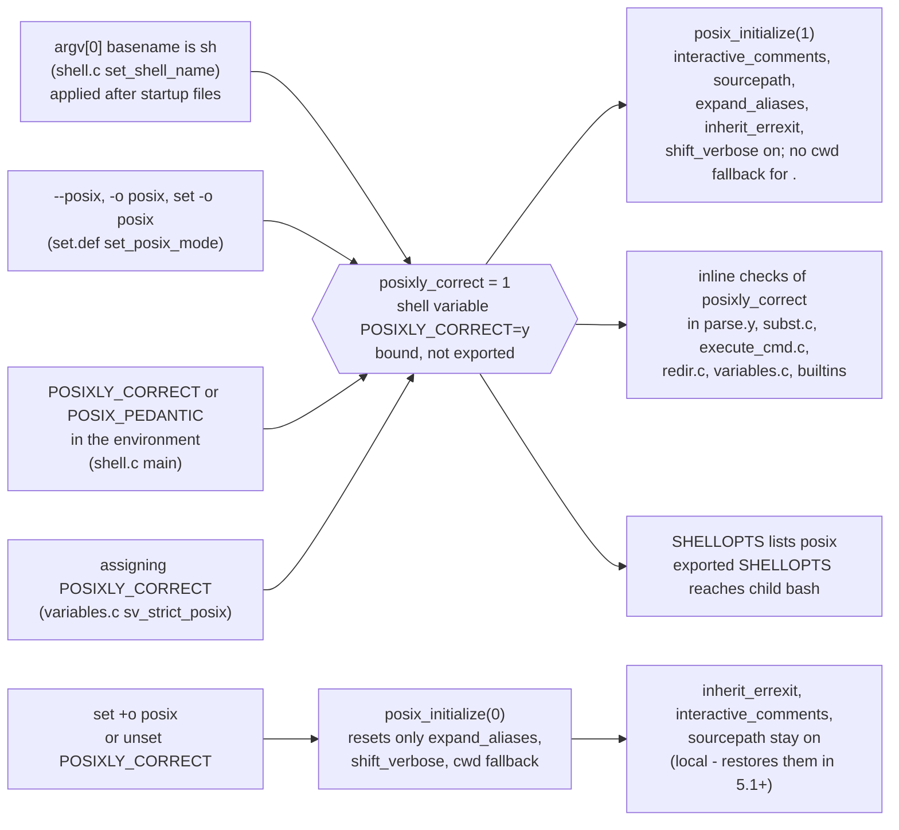

# Bash POSIX Mode

> [!summary] Claim
> Bash POSIX mode is one global flag, `posixly_correct`, that five shell options and about two hundred inline checks consult; it is entered four ways, it is not exported to children, turning it off does not undo all of it, and it changes 75 documented behaviors in bash 5.3 (41 in the bash 3.2 that macOS ships as `/bin/sh`), so "POSIX mode" names a different shell in every bash release.

Part of [Bash](README.md) in [Shell and Unix Engineering](../README.md).

## TL;DR

- **Mechanism**: `--posix`, `set -o posix`, a `POSIXLY_CORRECT` (or `POSIX_PEDANTIC`) environment variable, or an `argv[0]` whose basename is `sh` sets the C global `posixly_correct`; `posix_initialize` then forces `interactive_comments`, `sourcepath`, `expand_aliases`, `inherit_errexit` and `shift_verbose` on, and the rest of the shell tests the flag inline `(bash-5.3 general.c, posix_initialize; builtins/set.def, set_posix_mode; shell.c, main and set_shell_name)`.
- **Rule**: treat bash POSIX mode as a stricter bash, never as a POSIX shell; to prove a script portable, run it under dash, a BusyBox ash, and at least one ksh, because POSIX mode keeps arrays, `[[`, and every other extension working.
- **Trap**: `set -o posix; set +o posix` leaves `inherit_errexit` on in bash 4.4 through 5.3, so a script that toggles the mode for one block silently changes `set -e` for the rest of its life; `local -` inside a function restores everything only from bash 5.1 (lab: `toggle`, `scoped`).
- **Portability fact**: `sh script` on macOS runs bash 3.2 in POSIX mode, which still lets `.` fall back to the current directory, still allows a function named `unset` (and ignores it), and still lets `command export` split its argument; bash 4.4 and later in POSIX mode refuse all three (lab: `dot`, `funcname`, `cmdexport`).
- **When not to use it**: do not export `POSIXLY_CORRECT` to switch bash into POSIX mode: every GNU program that uses glibc `getopt` stops permuting options (GNU `ls d -d` then fails with status 2), and bash itself never exports the variable it sets (lab: `utility`, `pcenv`).

## Mental model



Four independent doors lead to one integer.
The name door (`sh`) is checked in `set_shell_name` and acted on in `main` only after the startup files have run, which is why `sh +o posix` cannot start bash out of POSIX mode: the late `sv_strict_posix` call wins over the option.
The option doors (`--posix`, `-o posix`, `set -o posix`) go through `set_posix_mode`, which binds the shell variable `POSIXLY_CORRECT` to `y` and calls `sv_strict_posix`.
The environment door is read twice, once with `getenv` early in `main` and again when `initialize_shell_variables` imports the variable, and the variable door makes every later assignment or `unset` of `POSIXLY_CORRECT` re-run `sv_strict_posix`.
From the flag, two things happen: `posix_initialize(1)` flips five shell options at once, and roughly two hundred scattered `if (posixly_correct)` tests change parsing, expansion, error handling, and builtin output one by one.
Leaving the mode is asymmetric: `posix_initialize(0)` restores a saved snapshot only when one exists, and only a `POSIXLY_CORRECT=y command` prefix assignment saves one, so `set +o posix` falls back to resetting three settings and leaves the other three on.

## How it works

### The flag and its four entry points

The whole mode is the C global `int posixly_correct`, initialised to 1 only when bash is configured with `--enable-strict-posix-default` (which defines `STRICT_POSIX`) and to 0 otherwise `(bash-5.3 shell.c; doc/bashref.texi, Optional Features)`.
It is set in four ways, each verified in the bash-5.3 source:

1. **Name**: `set_shell_name` sets `act_like_sh` when the basename of `argv[0]` is exactly `sh`; `main` then runs the startup files with sh rules and afterwards executes `bind_variable ("POSIXLY_CORRECT", "y", 0); sv_strict_posix ("POSIXLY_CORRECT");` under the comment "If we are invoked as `sh', turn on Posix mode" `(bash-5.3 shell.c, set_shell_name and main)`.
   Because this runs after option parsing, `sh +o posix -c '[ -o posix ]'` still reports POSIX mode on; `set +o posix` inside the script is the only way out (measured on bash 3.2 to 5.3 in the matrix images).
2. **Options**: the long option `--posix` writes the flag directly through the `long_args` table, `-o posix` and `set -o posix` go through `set_posix_mode`, and `main` calls `sv_strict_posix` once the flag is set `(bash-5.3 shell.c, long_args and main; builtins/set.def, set_posix_mode)`.
3. **Environment**: `main` tests `getenv ("POSIXLY_CORRECT") || getenv ("POSIX_PEDANTIC")` before anything else, and `initialize_shell_variables` re-checks the imported variable and calls `sv_strict_posix` `(bash-5.3 shell.c, main; variables.c, initialize_shell_variables)`.
   Any value, even the empty string, counts, because the test is for presence.
4. **Variable**: `POSIXLY_CORRECT` is in the special-variable table with handler `sv_strict_posix`, which sets `posixly_correct = var && var_isset (var)`, calls `posix_initialize`, and updates `SHELLOPTS` `(bash-5.3 variables.c, special_vars and sv_strict_posix)`.
   So `unset POSIXLY_CORRECT` turns POSIX mode off, in every release from 3.2 to 5.3 (lab: `unsetpc`).

`set_posix_mode` binds `POSIXLY_CORRECT` without the export attribute, and a child process therefore never sees it (lab: `pcenv`).
What does propagate is `SHELLOPTS`: after `set -o posix; export SHELLOPTS`, a child bash starts in POSIX mode, because bash reads an inherited `SHELLOPTS` at startup (measured on bash 3.2 to 5.3 in the matrix images and on the macOS host).
POSIX itself specifies no such switch: XCU 2 describes one language, and `sh` has no `-o posix` option `(POSIX.1-2024 XCU sh)`.

### What `posix_initialize` flips

`posix_initialize (1)` sets `interactive_comments`, `source_uses_path` (`shopt sourcepath`), `expand_aliases`, `inherit_errexit`, and `print_shift_error` (`shopt shift_verbose`) to 1 and `source_searches_cwd` to 0 `(bash-5.3 general.c, posix_initialize)`.
The first five are the `posix_vars` table, the set of shell options that "posix mode" owns `(bash-5.3 general.c, posix_vars)`.
The table grew release by release: bash 3.2's `posix_initialize` sets only `interactive_comments`, `source_uses_path`, and `expand_aliases`; bash 4.4 adds `inherit_errexit` and `source_searches_cwd = 0`; the `shift_verbose` coupling arrived in bash 5.0 `(bash-3.2 general.c and bash-4.4 general.c, posix_initialize; bash-5.3 CHANGES, bash-5.0-beta2 item j)`.
Bash 3.2 has no `inherit_errexit` at all; its `command_substitute` simply keeps `-e` when `posixly_correct` is set `(bash-3.2 subst.c, command_substitute)`, which is why the errexit row behaves the same in 3.2 and 5.3 while the toggle row does not.

`posix_initialize (0)` has three branches `(bash-5.3 general.c, posix_initialize)`:
- If `saved_posix_vars` holds a snapshot, restore it and free it.
- Otherwise, set `source_searches_cwd = 1`, `expand_aliases = interactive_shell`, and `print_shift_error = 0`, and leave everything else alone.

The only writer of `saved_posix_vars` is `save_posix_options`, and its only caller is `assign_in_env`, the code that builds a temporary environment for a prefix assignment, when the name is `POSIXLY_CORRECT` `(bash-5.3 variables.c, assign_in_env)`.
The second name that test checks is spelled `POSIX_PEDANDTIC` in the source, and `POSIX_PEDANTIC` has no special-variable handler, so `POSIX_PEDANTIC` counts only when it is in the environment at startup (measured: `POSIX_PEDANTIC=1 f` leaves a function in default mode on bash 5.3.20).
So `POSIXLY_CORRECT=y fn` runs `fn` in POSIX mode and restores every option afterwards, while `set -o posix; set +o posix` leaves `inherit_errexit`, `interactive_comments`, and `sourcepath` on for good (lab: `toggle`, bash 4.4 to 5.3).
The bash 5.1 change "Bash now saves and restores state around setting and unsetting posix mode" is real but narrow: it covers the prefix-assignment path and `local -`, whose snapshot from `get_current_options` appends the `posix_vars` bitmap since 5.1 `(bash-5.3 CHANGES, bash-5.1-alpha item t; builtins/set.def, get_current_options and set_current_options)`.
In 4.4, `local -` restores the `posix` flag but not the options it implied, so `inherit_errexit` still leaks (lab: `scoped`).

### The inline checks

The rest of POSIX mode is not a table but a scattering of tests: the identifier `posixly_correct` appears 122 times in bash 3.2's C, yacc, builtin, readline, and glob sources and 196 times in bash 5.3's (measured with `grep -o posixly_correct` over `*.c *.y builtins/*.def lib/readline/*.c lib/glob/*.c` in the release tarballs).
The `POSIX` file in each release tarball is the maintainer's list of what those tests change: 41 items in bash 3.2, 54 in 4.4, 59 in 5.1, 61 in 5.2, and 75 in 5.3 (counted in the tarballs).
The lab measures fourteen of them in every shell of the matrix; the groups below map each to its POSIX.1-2024 requirement.

**Assignments and special built-ins.**
A prefix assignment before a special built-in such as `:` "shall affect the current execution environment ... and remain in effect when the command completes" `(POSIX.1-2024 XCU 2.9.1.2)`; default bash discards it, POSIX mode keeps it (bash 5.3 POSIX list item 41; lab: `assign`).
A function may not be named after a special built-in: XCU 2.9.5 makes that the application's obligation, bash 4.3 made the definition an error in POSIX mode and bash 4.4 made it fatal in a non-interactive shell, and bash 3.2 accepts the definition but still runs the built-in `(bash-5.3 CHANGES, bash-4.3-alpha item j and bash-4.4-alpha item g; lab: funcname)`.
`command` in front of a declaration utility keeps assignment-context expansion, as XCU `command` requires since Austin Group defects 351 and 1393, so `command export e=$v` with `v='a b'` exports `a b` in POSIX mode and only `a` in default mode or in bash 3.2 `(POSIX.1-2024 XCU command; bash-5.3 POSIX item 42; lab: cmdexport)`.
Default bash also performs tilde expansion in any argument that looks like an assignment, so `set -- a=~/x` stores a home directory; POSIX restricts that assignment-context expansion to real assignments and declaration-utility operands `(POSIX.1-2024 XCU 2.9.1.1, XCU 2.6.1; bash-5.3 POSIX item 12; lab: tilde)`.

**Fatal errors.**
POSIX's table of consequences makes a variable assignment error, an expansion error, and a special built-in utility error fatal to a non-interactive shell `(POSIX.1-2024 XCU 2.8.1)`.
Default bash recovers from most of them; POSIX mode exits.
In `subst.c`, `posix_variable_assignment_error` jumps to the top level with `FORCE_EOF` when `posixly_correct && interactive_shell == 0` (under `STRICT_POSIX`, even inside `command`) `(bash-5.3 subst.c, posix_variable_assignment_error)`.
How that `FORCE_EOF` turns into an exit status depends on how bash was started: `run_one_command`, the `-c` path, returns 127 for it, so `bash -o posix -c 'readonly r=1; r=2'` exits 127 like a missing command, while the same lines in a script file exit 1 `(bash-5.3 shell.c, run_one_command; lab: readonly; script-file status measured on the macOS host with bash 5.3.20 and 3.2.57)`.
`.` of a file that is not found is fatal (XCU 2.15 `dot`: "If no readable file is found, a non-interactive shell shall abort"), and `execute_for_command` exits with `EX_BADUSAGE` (2) when the loop variable is not a valid name `(bash-5.3 execute_cmd.c, execute_for_command)`.
Bash 5.3 widened the list: "POSIX special builtins now exit the shell in posix mode on more failure cases", which is why `export 1bad=x` survives in 5.2 POSIX mode and exits in 5.3 `(bash-5.3 CHANGES, bash-5.3-alpha item jj; lab: badexport)`.

**Command substitution and `$?`.**
`set -e` applies inside a command-substitution subshell: XCU's own example is `set -e; echo $(false; echo one) two`, where `false` "causes the subshell in which the command substitution is performed to exit without executing echo one" `(POSIX.1-2024 XCU 2.15 set)`.
Default bash clears `-e` in that subshell unless `inherit_errexit` is set `(bash-5.3 subst.c, command_substitute)`; POSIX mode sets it, so `x=$(false; echo survived)` under `set -e` ends the whole script (lab: `errexit`).
`$?` is the status of the most recent pipeline "executed from the current shell execution environment (not a subshell environment)" `(POSIX.1-2024 XCU 2.5.2)`, and a command with no command name completes with the status of its last command substitution `(POSIX.1-2024 XCU 2.9.1.3)`.
So in `false; z=$(exit 3) w=$?`, `w` should see 1, the status of `false`; bash before 5.3, ksh93, and zsh give 3, and only bash 5.3 in POSIX mode gives 1 `(bash-5.3 CHANGES, bash-5.3-alpha item sss; lab: cmdstatus)`.

**Search and parsing.**
`.` with a slash-free name searches `PATH` `(POSIX.1-2024 XCU 2.15 dot)`; default bash falls back to the current directory, POSIX mode does not, from bash 4.4 `(bash-5.3 builtins/source.def, source_builtin; bash-4.4 general.c, posix_initialize; lab: dot)`.
Aliases are part of the grammar regardless of interactivity `(POSIX.1-2024 XCU 2.3.1)`; non-interactive default bash ignores them, POSIX mode sets `expand_aliases` (lab: `alias`).
Redirection words are not pathname-expanded in a non-interactive POSIX-mode shell: `redir.c` sets `W_NOGLOB` on the word before calling `redirection_expand` `(bash-5.3 redir.c, do_redirection_internal)`.

**Output formats.**
`export -p` must print `export name=value` and `trap` must print `trap -- action condition` with the signal name as POSIX spells it `(POSIX.1-2024 XCU 2.15 export and trap)`; default bash prints `declare -x` and `SIGINT`, POSIX mode prints `export` and `INT` (lab: `exportp`, `trap`).
`set` with no arguments lists only variables in POSIX mode, not function bodies, which is why the idiom `(set -o posix; set)` exists (lab: `setfn`).
`ulimit -f` and `-c` count in 512-byte blocks in POSIX mode, as XCU `ulimit` specifies, instead of bash's 1024; bash 3.2 does not (bash 5.3 POSIX item 71; `(POSIX.1-2024 XCU ulimit)`; measured on the macOS host).

**Environment import.**
Exported functions arrive as `BASH_FUNC_name%%` environment entries; in POSIX mode `initialize_shell_variables` refuses to import a function whose name is not a valid identifier ("Don't import function names that are invalid identifiers from the environment in posix mode"), and imports every other one `(bash-5.3 variables.c, initialize_shell_variables)`.
POSIX mode is therefore not an environment-import firewall (lab: `fnimport`).

### What POSIX mode does not do

It does not remove extensions: arrays, `[[`, `local`, process substitution (available in POSIX mode since bash 5.1), brace expansion, and `$'...'` all keep working `(bash-5.3 CHANGES, bash-5.1-alpha item u)`.
It does not make `echo` conform: upstream bash requires `shopt -s xpg_echo` as well (bash 5.3 POSIX, "additional POSIX behavior" item 3).
It does not split `IFS` byte-wise as POSIX interpretation 1560 requires; bash keeps multibyte delimiters (same section, item 1).
It is not `BASH_COMPAT`, which selects older-release behavior and is a separate axis (`doc/bashref.texi`, Shell Compatibility Mode; see [[Bash-Version-History]]).

### macOS `/bin/sh`

macOS `/bin/sh` is a small launcher that "is implemented by re-execing as either bash(1), dash(1), or zsh(1) as determined by the symbolic link located at /private/var/select/sh" `(macOS sh(1), /usr/share/man/man1/sh.1)`; on the host used here that link points to `/bin/bash`, bash 3.2.57, which then starts in POSIX mode because its `argv[0]` is `sh` (lab: `personality` under `/bin/sh`).
Apple's bash 3.2 in POSIX mode also makes `echo` interpret backslash escapes and treat `-n` as an operand: `/bin/sh -c 'echo -n "a\tb"'` prints `-n a<TAB>b`, while `shopt xpg_echo` still reports `off` and upstream bash 3.2.57 in POSIX mode prints `a\tb` (measured on the macOS host, Darwin 27.2.0 and 27.3.0, and in the Alpine image).
The trigger is POSIX mode itself, not the name `sh`: `/bin/bash --posix` and `set -o posix` behave the same (`-e` and `-E` are printed literally and `\c` stops output), `shopt -u xpg_echo` does not undo it, and `set +o posix` does (measured on the macOS host, Darwin 27.3.0).
The shipped binary identifies as `PROJECT:bash-149`, but Apple's published tags end at `bash-144`, whose `bash-3.2/builtins/echo.def` is identical to `main` and gates on `posixly_correct && xpg_echo` with `xpg_echo` defaulting to 0, so the published source does not account for the shipped behavior `(apple-oss-distributions/bash tag bash-144; strings /bin/bash; as of 2026-11)`.

## Numbers and limits

| Quantity | Value | Source |
|---|---|---|
| Items in the bash `POSIX` file (POSIX-mode changes) | 3.2: 41, 4.4: 54, 5.1: 59, 5.2: 61, 5.3: 75 | Counted in the release tarballs from ftp.gnu.org (as of 2026-11) |
| Further POSIX behaviors bash does not implement even in POSIX mode | 3 (byte-wise `IFS`, `fc` editor default, `echo` without `xpg_echo`) | bash-5.3 `POSIX` |
| Shell options owned by POSIX mode (`posix_vars`) | 5 in bash 5.3 (`interactive_comments`, `sourcepath`, `expand_aliases`, `inherit_errexit`, `shift_verbose`) | bash-5.3 general.c, `posix_vars` |
| Options `set +o posix` resets without a snapshot | 3 (`expand_aliases`, `shift_verbose`, cwd fallback of `.`) | bash-5.3 general.c, `posix_initialize`; lab `toggle` |
| Occurrences of `posixly_correct` in the sources | 3.2: 122, 5.3: 196 | `grep -o` over the release tarballs (measured here) |
| Value bash gives `POSIXLY_CORRECT` | `y`, not exported | bash-5.3 builtins/set.def, `set_posix_mode`; lab `unsetpc`, `pcenv` |
| Exit status of a POSIX-mode fatal error under `bash -c` | 127 | bash-5.3 shell.c, `run_one_command`; lab `readonly` (bash 3.2 to 5.3) |
| Same error in a script file | 1 (bash), 2 (dash) | Measured on the macOS host: bash 5.3.20, 3.2.57, dash 0.5.13 |
| Fatal `.`-not-found status, bash 4.4 to 5.3 POSIX mode | 1 | lab `dot` |
| Fatal special-built-in function definition | 2 | lab `funcname` (bash 4.4 to 5.3) |
| `ulimit -f` after `ulimit -f 2048` in default mode, read in POSIX mode | 4096 (bash 5.3.20), 2048 (bash 3.2.57) | Measured on the macOS host |
| `MAILCHECK` default for interactive shells | 600 when POSIX mode is on at variable initialisation (`--posix`), 60 otherwise, including bash started as `sh` | bash-5.3 variables.c, `initialize_shell_variables`; measured with bash 5.3.20 `-i` |
| Releases measured | bash 3.2.57, 4.4.23, 5.1.16, 5.2.37, 5.3.15, 5.3.20 | Lab matrix (2026-11-11) |

## Portability

How each shell enters a POSIX personality (lab: the three `personality` tests).
"Yes" means the test reported the personality on.

| Shell | `posix`-style option | `POSIXLY_CORRECT` in env | Started as `sh` |
|---|---|---|---|
| POSIX sh | none specified `(XCU sh)` | not specified for the shell | not applicable |
| macOS bash 3.2 (`/bin/bash`) | `set -o posix` | yes | yes (`/bin/sh` is this) |
| bash 4.4 to 5.3 | `set -o posix` | yes | yes |
| zsh 5.9 native | none (`emulate sh`) | no | yes (`emulate` reports `sh`) |
| zsh 5.9 `--emulate sh` | none | no | yes |
| dash 0.5.12, 0.5.13 | none | no | no option to switch |
| ksh93u+m 1.0.10 | `set -o posix` | no | yes |
| ksh93u+ 2012 (macOS `/bin/ksh`) | none | no | no |
| mksh R59 (2020, 2025) | `set -o posix` | no | no |
| yash 2.58.1 | `set -o posixlycorrect` (`-o posix` abbreviates it) | no | yes |
| posh 0.14.1 | none | no | no option to switch |
| BusyBox 1.37.0 ash | none | no | no option to switch |

What the POSIX-relevant behaviors look like (lab: one test per column).
"def" is bash in default mode and "posix" is bash in POSIX mode; other shells run natively.

| Shell | `x=1 :` persists | `set -e` inside `$(...)` | `.` falls back to cwd | `$?` mid-command after `$(exit 3)` | `export 1bad=x` | `command export e=$v` |
|---|---|---|---|---|---|---|
| POSIX sh | yes `(XCU 2.9.1.2)` | yes `(XCU 2.15 set)` | no, fatal `(XCU 2.15 dot)` | status before it `(XCU 2.5.2)` | error status `(XCU 2.15 export)`, so fatal `(XCU 2.8.1)` | one field `(XCU command)` |
| bash 3.2 def / posix | no / yes | no / yes | yes / yes | 3 / 3 | continues / continues | split / split |
| bash 4.4 to 5.2 def / posix | no / yes | no / yes | yes / no, fatal | 3 / 3 | continues / continues | split / one field |
| bash 5.3 def / posix | no / yes | no / yes | yes / no, fatal | 3 / 1 | continues / exits | split / one field |
| zsh native | no | yes | no, not fatal | 3 | exits | `command` runs no builtin: empty |
| zsh `--emulate sh` | yes | yes | no, fatal | 3 | exits | split |
| dash | yes | yes | no, fatal | 1 | exits | one field |
| ksh93 (both) | yes | yes | no, fatal | 3 | exits | one field |
| mksh | yes | yes | no, fatal | 1 | exits | one field |
| yash | yes | yes | yes | 1 | continues | one field |
| posh | yes | yes | no, fatal | 1 | exits | split |
| BusyBox ash | yes | no | Alpine build yes, Debian build no (fatal) | 1 | exits | one field |

BusyBox decides the `.` fallback at build time with `ASH_BASH_SOURCE_CURDIR` (`"'source' and '.' builtins search current directory after $PATH"`, default `n`) `(busybox shell/ash.c, find_dot_file)`; the Alpine package enables it and the Debian one does not (lab: `dot`).
Two further lab rows: mksh is the only non-bash shell that tilde-expands `a=~/x` in an ordinary argument, and posh has no `alias` builtin, so it fails the alias row where every other shell, and POSIX-mode bash, expands the alias.

Utilities see `POSIXLY_CORRECT` only when it is exported, and they react to it, not to bash's mode (lab: `utility`):

| `ls d -d` (directory `d`) | Without `POSIXLY_CORRECT` | With `POSIXLY_CORRECT=1` |
|---|---|---|
| GNU coreutils 9.7 (glibc `getopt`) | 0: `-d` is an option (permuted) | 2: `-d` is a file operand |
| BusyBox 1.37.0 | 0 | 0 |
| macOS (BSD) `ls` | 1: `-d` is a file operand | 1 |

glibc documents the switch: "If this is set, then option processing stops as soon as a nonoption argument is encountered" `(getopt(3), ENVIRONMENT)`.
uutils was not measured.

## Worked example

The [lab](../labs/04-bash-posix-mode/) has one probe, `posix-probe.sh`, and 23 tests in `posix-mode.bats`.
Under bash, `posix-probe.sh diff NAME` runs snippet `NAME` twice, in a fresh default-mode bash and a fresh POSIX-mode bash of the same binary, and prints `default=OUT/STATUS posix=OUT/STATUS`; under any other shell it runs the snippet once in a subshell and prints `native=OUT/STATUS`.

Simplified excerpt of `posix-probe.sh` (three of the eighteen snippets, and the bash branch):

```sh
snippet() {
  case $1 in
    assign) printf '%s\n' 'x=1 :' 'echo "${x-unset}"' ;;
    toggle) printf '%s\n' 'set -o posix' 'set +o posix' 'set -e' 'x=$(false; echo survived)' 'echo "[$x]"' ;;
    cmdstatus) printf '%s\n' 'false' 'z=$(exit 3) w=$?' 'echo "$w"' ;;
    *) return 1 ;;
  esac
}

if [ -n "${BASH_VERSION-}" ]; then
  out=$(
    unset POSIXLY_CORRECT
    exec -a bash "$BASH" +o posix -c "$code" 2>/dev/null
  )
  rc=$?
  report default "$out" "$rc"
  out=$("$BASH" -o posix -c "$code" 2>/dev/null)
  rc=$?
  printf ' '
  report posix "$out" "$rc"
fi
```

`exec -a bash` matters: without it, a probe started as macOS `/bin/sh` would start its "default" child as `sh` too, and the name door would switch POSIX mode back on after `+o posix`.

A test, verbatim from `posix-mode.bats`:

```bash
@test "cmdstatus: bash 5.3 POSIX mode stops a command substitution from setting \$? mid-command" {
  run_lab "$PROBE" diff cmdstatus
  case $(lab_shell_family) in
    bash)
      case $(series) in
        3.2 | 4.4 | 5.1-5.2) want='default=3/0 posix=3/0' ;;
        5.3) want='default=3/0 posix=1/0' ;;
        *) false ;;
      esac
      ;;
    yash | busybox | posh | mksh | dash) want='native=1/0' ;;
    zsh | zsh-sh | ksh93) want='native=3/0' ;;
    *) false ;;
  esac
  expect "$want"
}
```

Output of `posix-probe.sh diff NAME` for each snippet, captured on the macOS host (2026-11-11), first under Homebrew bash 5.3.20, then under `/bin/sh` (bash 3.2.57 started as `sh`); the lab asserts exactly these strings for those releases:

```text
== /opt/homebrew/bin/bash (5.3.20(1)-release)
assign    default=unset/0 posix=1/0
exportp   default=declare -x y="1"/0 posix=export y="1"/0
trap      default=trap -- 'echo hi' SIGINT/0 posix=trap -- 'echo hi' INT/0
tilde     default=expanded/0 posix=literal/0
alias     default=/127 posix=aliased/0
errexit   default=[survived]/0 posix=/1
toggle    default=/1 posix=/1
scoped    default=[survived]/0 posix=/1
unsetpc   default=y,unset/0 posix=y,unset/0
pcenv     default=absent/0 posix=absent/0
dot       default=yes/0 posix=/1
cmdstatus default=3/0 posix=1/0
setfn     default=listed/0 posix=hidden/0
funcname  default=fn,end/0 posix=/2
readonly  default=survived/0 posix=/127
badexport default=survived/0 posix=/1
cmdexport default=[a]/0 posix=[a b]/0
== /bin/sh (3.2.57(1)-release)
assign    default=unset/0 posix=1/0
exportp   default=declare -x y="1"/0 posix=export y="1"/0
trap      default=trap -- 'echo hi' SIGINT/0 posix=trap -- 'echo hi' INT/0
tilde     default=expanded/0 posix=literal/0
alias     default=/127 posix=aliased/0
errexit   default=[survived]/0 posix=/1
toggle    default=[survived]/0 posix=[survived]/0
scoped    default=/1 posix=/1
unsetpc   default=y,unset/0 posix=y,unset/0
pcenv     default=absent/0 posix=absent/0
dot       default=yes/0 posix=yes/0
cmdstatus default=3/0 posix=3/0
setfn     default=listed/0 posix=hidden/0
funcname  default=fn,end/0 posix=end/0
readonly  default=survived/0 posix=/127
badexport default=survived/0 posix=survived/0
cmdexport default=[a]/0 posix=[a]/0
```

Read the two blocks side by side: seven rows differ between the bash that macOS runs for `sh` and a current bash, and every one of them is a script that works on one machine and breaks on the other.
The suite passed 23/23 under every shell of the matrix on 2026-11-11: 8 on the macOS host, 13 in the Alpine 3.22 image, and 9 in the Debian 13 image.

## Pitfalls

> [!warning] The one-way toggle
> Trigger: a script runs `set -o posix` around one block (to get POSIX `set` output, or to call a function that needs it) and then `set +o posix`.
> Symptom: in bash 4.4 to 5.3 `inherit_errexit` stays on, so every later `x=$(cmd)` under `set -e` now aborts the script when `cmd` fails, where it used to continue (lab: `toggle`).
> Fix: scope the mode with a subshell, `(set -o posix; set)`, with `local -` inside a function on bash 5.1 and later (lab: `scoped`), or with a `POSIXLY_CORRECT=y fn` prefix assignment, the only form that snapshots and restores the options `(bash-5.3 variables.c, assign_in_env)`.

> [!warning] `.` stops finding the file next to you
> Trigger: `. lib.sh` (no slash) in a script that works under `bash script.sh`, then run as `sh script.sh` on Linux where `sh` is bash, or with `bash --posix`.
> Symptom: bash 4.4 and later print `.: lib.sh: file not found` and exit 1 before running anything else; macOS `/bin/sh` (bash 3.2) still finds the file, so the bug ships from a Mac (lab: `dot`).
> Fix: write `. ./lib.sh`, or source relative to the script with `. "${0%/*}/lib.sh"` after checking that `$0` contains a slash; never rely on the cwd fallback, which POSIX does not have `(POSIX.1-2024 XCU 2.15 dot)`.

> [!warning] Status 127 that is not "command not found"
> Trigger: a fatal expansion or assignment error in a `bash -c` string (`${x?}` in either mode; a readonly assignment or a bad `$((...))` in POSIX mode), such as a CI step, `sh -c` from `system(3)` on a host whose `sh` is bash, or a `docker run ... sh -c`.
> Symptom: the step exits 127, and on-call reads it as a missing binary; the readonly case in a script file exits 1 `(bash-5.3 shell.c, run_one_command; lab: readonly)`, and the `${x?}` and arithmetic cases also exit 127 under `bash -c` (measured in the Alpine image, bash 3.2 to 5.3).
> Fix: read stderr, not the status; put multi-line logic in files; in a wrapper, treat 127 from `sh -c` as "the shell died", not "the program is missing".

> [!warning] Exporting `POSIXLY_CORRECT` changes every GNU tool
> Trigger: `export POSIXLY_CORRECT=1` in a CI image or a profile to make bash strict.
> Symptom: every program that parses options with glibc `getopt` stops permuting, so a trailing option becomes an operand: GNU `ls d -d` exits 2 with `cannot access '-d'` (lab: `utility`, Debian image) `(getopt(3), ENVIRONMENT)`.
> Fix: use `set -o posix` or `bash --posix`, which bind the variable without exporting it (lab: `pcenv`).

> [!warning] `unset POSIXLY_CORRECT` leaves POSIX mode
> Trigger: an environment-scrubbing loop that unsets every variable not on an allowlist, run inside `sh` (bash).
> Symptom: the rest of the script silently runs in default mode: assignments before `:` stop persisting, `.` searches the cwd again (lab: `unsetpc`).
> Fix: keep `POSIXLY_CORRECT` on the allowlist, or check `[ -o posix ]` after scrubbing.

> [!warning] Same file, two languages
> Trigger: one `#!/bin/sh` script deployed to macOS (bash 3.2 POSIX mode), Debian or Ubuntu (dash), Alpine (BusyBox ash), and a RHEL-style host where `sh` is current bash.
> Symptom: rows of the Portability table flip: `export 1bad=x` continues in bash 5.2 and exits in 5.3, `$?` after a command substitution differs, and of the native shells only BusyBox ash ignores `set -e` inside `$(...)`.
> Fix: test under dash, BusyBox ash, mksh or ksh93, and bash 3.2 in POSIX mode (see [[Cross-Shell-CI-Matrices]]); ShellCheck 0.11.0 with `--shell=sh` reports none of these rows (on a file with `. lib.sh`, `export 1bad=x`, `command export e=$v`, and the `$?` line it gave only SC1091, SC2086, and SC2154, plus SC2034 when `z` is otherwise unused, none of them about the rows, measured here).

## Security and robustness

POSIX mode is not a sandbox and not a parser hardening switch.
It still imports every exported function whose name is a valid identifier: with `BASH_FUNC_pp_f%%=() { echo f-imported; }` in the environment, POSIX-mode bash runs `pp_f`, and only the invalid name `pp-g` is refused (lab: `fnimport`, bash 3.2 to 5.3) `(bash-5.3 variables.c, initialize_shell_variables)`.
That import path is the one Shellshock abused: CVE-2014-6271, published 2014-09-24, describes bash "through 4.3" processing "trailing strings after function definitions in the values of environment variables" via OpenSSH `ForceCommand`, Apache `mod_cgi`, and DHCP client scripts `(CVE-2014-6271, CVE record)`.
Because macOS `/bin/sh` re-executes bash (sh(1)), a `system(3)` or `popen(3)` call on macOS reaches the same import code, and the lab's `fnimport` test shows `/bin/sh` importing `pp_f`; POSIX mode does not stand in the way.
The defenses are the patched `BASH_FUNC_name%%` encoding, scrubbing the environment at privilege boundaries (`env -i` with an allowlist), and running a shell that does not import functions at all, which is every other shell in the matrix (lab: `fnimport`).

Fatal-error behavior is a robustness feature with sharp edges.
POSIX mode turns a readonly assignment or a bad `.` into an immediate exit, which is safer than continuing with half-applied state, but the exit happens before any `|| handler` can run and, under `bash -c`, with the misleading status 127.
`set -e` gains force in POSIX mode (command substitutions inherit it), which closes a real hole in `x=$(fetch) || die` style code and opens one in code that relied on the hole; decide per script, and see [[errexit-Semantics-and-Exceptions]] and [[inherit_errexit-and-errtrace]].
Non-interactive POSIX mode turns alias expansion on, so an `alias` defined in a sourced file now rewrites later commands of a script; keep aliases out of non-interactive code (see [[Aliases]]).
A non-interactive bash started as `sh` or with `--posix` does not read `BASH_ENV` `(bash-5.3 shell.c, run_startup_files)`, which removes one injection vector (measured for `--posix` on bash 3.2 to 5.3); the full rules are in [[Bash-Startup-Files-and-Modes]].

## The principal's view

The decision is not "POSIX mode on or off"; it is which language a script is written in, and then how that is enforced.
For a script that must run everywhere `/bin/sh` exists (installers, container entrypoints, init and package hooks), write POSIX sh and prove it in CI under dash, BusyBox ash, a ksh, and bash 3.2 in POSIX mode; bash POSIX mode alone proves nothing, because it accepts every bash extension, and between bash 3.2 and 5.3 it changes on seven of the eighteen behaviors this lab measures.
For a script that may require bash, require it explicitly (`#!/usr/bin/env bash`, a version check against `BASH_VERSINFO`) and run it in default mode with `set -euo pipefail` plus an explicit `shopt -s inherit_errexit` where the bash is 4.4 or newer, so its semantics do not depend on how it was invoked.
Use POSIX mode deliberately in three places: to reproduce what a Linux `sh` that is bash will do, to get POSIX output formats (`export -p`, `trap`, `set`) for machine consumption, and to make assignment and special-built-in errors fatal in a strict script, accepting that the same file then behaves differently on macOS.
The trade-off is reach versus semantics: POSIX sh runs on more systems but has weaker error handling and no arrays, and pinned bash has better tools but must be installed, which on macOS means a second bash next to the system 3.2.
When neither fits, because the script parses data, needs real error types, or exceeds a few hundred lines, move it to Python or Go; no shell mode fixes that.

## Interview questions

> [!question] L5: What turns on bash POSIX mode, and how do you test for it from inside a script?
>
> > [!success]- Answer
> > `bash --posix`, `bash -o posix`, `set -o posix`, a `POSIXLY_CORRECT` or `POSIX_PEDANTIC` variable in the environment, and starting bash under the name `sh`.
> > Inside the script, `[ -o posix ]` or `shopt -oq posix` reports it, and `POSIXLY_CORRECT` is set to `y`.
> > Assigning or unsetting `POSIXLY_CORRECT` at run time switches the mode, because the variable has a special handler.
> >
> > Follow-up: why does `sh +o posix -c '[ -o posix ]'` still succeed when `sh` is bash?

> [!question] L5: Name four things that change when bash enters POSIX mode.
>
> > [!success]- Answer
> > Assignments before special built-ins persist (`x=1 :` leaves `x` set).
> > Non-interactive shells expand aliases.
> > Command substitutions inherit `set -e` (from 4.4 via `inherit_errexit`).
> > `.` no longer falls back to the current directory (from 4.4), and `export -p` and `trap` print POSIX formats.
> >
> > Follow-up: which of these does macOS `/bin/sh` not do, and why?

> [!question] L6: Predict the output under bash 5.3: `bash -o posix -c 'false; z=$(exit 3) w=$?; echo "$w"'`, and then under bash 5.2.
>
> > [!success]- Answer
> > Bash 5.3 prints `1`, bash 5.2 prints `3`.
> > POSIX defines `$?` as the status of the last pipeline run in the current environment, and a command substitution runs in a subshell, so `$?` during the assignments still holds the status of `false`.
> > Bash 5.3 implemented that in POSIX mode (CHANGES item sss); in default mode both print `3`, and so do ksh93 and zsh, while dash, mksh, yash, posh, and BusyBox ash print `1`.
> >
> > Follow-up: what is the exit status of the whole assignment-only command, and which section says so?

> [!question] L6: Debug this script, which works as `bash deploy.sh` but prints only `.: common.sh: file not found` as `sh deploy.sh` on a Linux host whose `sh` is bash 5.2.
>
> ```sh
> #!/bin/sh
> cd "$(dirname "$0")"
> . common.sh
> deploy "$@"
> ```
>
> > [!success]- Answer
> > Started as `sh`, bash enters POSIX mode after reading startup files, and from bash 4.4 POSIX mode clears `source_searches_cwd`, so `.` searches only `PATH`.
> > The file is not on `PATH`, and a not-found `.` is fatal in a non-interactive POSIX shell, so the script exits 1 before `deploy`.
> > Write `. ./common.sh`; it worked under macOS `/bin/sh` because bash 3.2 never cleared the cwd fallback, which is how the bug escaped review.
> >
> > Follow-up: what does dash print for the original line, and with which status?

> [!question] L6: Why does `x=$(curl ...)` under `set -e` start killing a script after it ran `set -o posix`, called a function, and ran `set +o posix`?
>
> > [!success]- Answer
> > `set -o posix` turned on `inherit_errexit` through `posix_initialize`.
> > `set +o posix` calls `posix_initialize(0)`, which restores a snapshot only if one was saved; only a `POSIXLY_CORRECT=y cmd` prefix assignment saves one, so the fallback branch resets three settings and leaves `inherit_errexit` on.
> > Use a subshell, `local -` in a function on bash 5.1 or later, or `POSIXLY_CORRECT=y fn`.
> >
> > Follow-up: why does the same sequence behave as expected on bash 3.2?

> [!question] L6: Why does `bash -o posix -c 'readonly r=1; r=2; echo x'` exit with 127?
>
> > [!success]- Answer
> > In POSIX mode a variable assignment error in a non-interactive shell jumps to the top level with `FORCE_EOF` (`subst.c`, `posix_variable_assignment_error`).
> > For a `-c` string, `run_one_command` maps `FORCE_EOF` to `last_command_exit_value = 127`.
> > Run as a script file the same error exits 1, and dash exits 2; none of them means "command not found".
> >
> > Follow-up: which POSIX table says this error must end a non-interactive shell?

> [!question] L7+: How do you answer a colleague who proposes testing a `#!/bin/sh` installer for macOS, Debian, Alpine, and RHEL-family hosts with `bash --posix` only?
>
> > [!success]- Answer
> > `bash --posix` accepts arrays, `[[`, `local`, `$'...'` and process substitution, so it cannot catch the most common bashisms.
> > Its semantics differ by release: bash 3.2 (macOS `sh`) still searches the cwd for `.` and splits `command export`, bash 5.3 exits on `export 1bad=x` and changes `$?` after command substitution.
> > It also cannot show dash, BusyBox ash, or ksh behavior, such as BusyBox ash ignoring `set -e` inside `$(...)`.
> > Test under dash, BusyBox ash, a ksh, and bash 3.2 POSIX mode in CI, plus ShellCheck with `--shell=sh`, and pin the interpreter to bash if the script needs bash features.
> >
> > Follow-up: what does that matrix cost per pull request, and what is the cheapest subset that still catches the rows in the Portability table?

> [!question] L7+: Is bash POSIX mode a security control, in the light of Shellshock?
>
> > [!success]- Answer
> > No.
> > POSIX mode refuses to import exported functions only when the name is not a valid identifier; a valid name such as `pp_f` is imported and runs (lab: `fnimport`).
> > Shellshock (CVE-2014-6271) was a parsing bug in that import path, reached through OpenSSH `ForceCommand`, CGI, and DHCP hooks, and on macOS through `system(3)` because `/bin/sh` is bash.
> > The controls are environment scrubbing at privilege boundaries, the patched `BASH_FUNC_` encoding, and a shell that imports nothing, such as dash.
> >
> > Follow-up: which other environment variables does bash act on at startup that a privilege boundary should drop?

> [!question] L7+: What do you rely on to make `export -p` output parseable by a tool on hosts with bash, dash, and zsh?
>
> > [!success]- Answer
> > POSIX requires `export name=value` lines quoted for re-input, which bash prints only in POSIX mode (`declare -x` otherwise).
> > Quoting still differs: dash and BusyBox ash single-quote (`export y='1'`), POSIX-mode bash double-quotes, and ksh93, mksh, yash, posh, and zsh print bare words when safe (lab: `exportp`).
> > So feed the output back to a shell (`eval`) rather than parsing it, or emit your own format with `printf '%s=%s\n'`.
> >
> > Follow-up: how would you print the same data safely for values containing newlines?

## Related

Prerequisites: [[Bash-Startup-Files-and-Modes]]

Next: [[Indexed-Arrays]]

See also: [[Special-Built-ins-versus-Utilities]], [[Simple-Commands-and-Assignment-Prefixes]], [[errexit-Semantics-and-Exceptions]], [[inherit_errexit-and-errtrace]], [[Shell-Options-shopt]], [[The-set-Builtin-and-Shell-Options]], [[Aliases]], [[Tilde-Expansion]], [[Command-Substitution]], [[Traps-and-EXIT]], [[Environment-Variables-and-Inheritance]], [[Bash-3-2-on-macOS]], [[Bash-Version-History]], [[Dash-and-Bashisms]], [[Zsh-Emulation-Modes]], [[Strict-POSIX-Shells-posh-and-yash]], [[BusyBox-ash]], [[Cross-Shell-CI-Matrices]], [[POSIX-2024-Changes]]

## Further reading

- POSIX.1-2024 XCU chapter 2, Shell Command Language: the requirements every POSIX-mode change chases, especially 2.5.2, 2.8.1, 2.9.1, and the special built-in pages.
- POSIX.1-2024 XCU `command`: the declaration-utility rule that bash 4.4 POSIX mode adopted.
- bash-5.3 `POSIX` file and `doc/bashref.texi` node "Bash POSIX Mode" (in the release tarball): the maintainer's 75-item list, the authoritative inventory.
- bash-5.3 `general.c` (`posix_initialize`), `builtins/set.def` (`set_posix_mode`), `shell.c` (`main`, `set_shell_name`, `run_one_command`), and `variables.c` (`sv_strict_posix`, `assign_in_env`): the whole mechanism in four files.
- bash-5.3 `CHANGES`: dated history of each POSIX-mode change, from 4.3's function-name rule to 5.3's `$?` and special-built-in fixes.
- BusyBox `shell/ash.c` (`find_dot_file`, `ASH_BASH_SOURCE_CURDIR`): how a build option, not a mode, decides one row of the portability table.
- getopt(3), Linux man-pages: why exporting `POSIXLY_CORRECT` changes GNU utilities.
- CVE-2014-6271 record: the function-import parsing bug that POSIX mode does not prevent.
