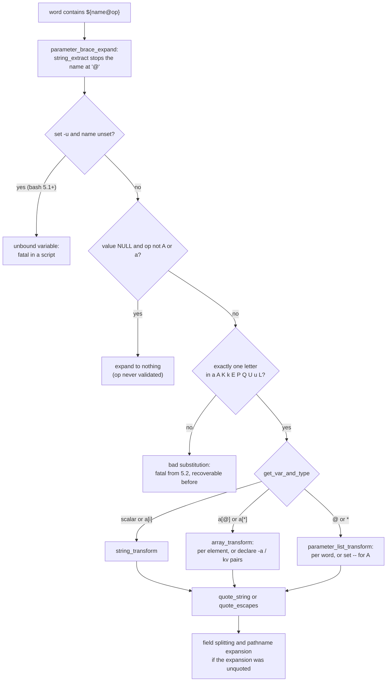

# Bash Parameter Transformations

> [!summary] Claim
> The bash `${name@op}` operators and the `${name^^}` case operators are in-process string rewrites whose output dialect, error handling, and even existence change between bash 3.2, 4.4, 5.1, 5.2, and 5.3, so they are safe only in scripts that pin bash 5.2 or later and whose output is parsed by a shell that speaks bash's `$'...'` dialect.

Part of [Bash](README.md) in [Shell and Unix Engineering](../README.md).

## TL;DR

- Mechanism: `parameter_brace_expand` stops the name at `@`, `parameter_brace_transform` checks for exactly one letter from `a A K k E P Q U u L`, and `string_transform`, `array_transform`, or `parameter_list_transform` rewrite the value in memory, with no fork unless `@P` meets a command substitution.
- Rule: quote the expansion (`"${x@Q}"`), feed `@Q` and `@A` output only to bash, zsh, ksh93, or mksh, and guard every script that uses them with a bash 5.2 floor.
- Trap: macOS `/bin/bash` 3.2 silently drops an operator written after an array subscript, so `"${a[@]@Q}"` prints the bare elements with exit status 0.
- Portability fact: none of these forms is in POSIX.1-2024 XCU 2.6.2; mksh has `${x@Q}` for scalars and zsh has the `(q)` and `(U)` flags, while dash, posh, BusyBox ash, yash, and ksh93 reject the syntax (lab).
- When not to use it: never apply `@P` to data you did not write, and never send `@Q` output to a remote `/bin/sh` that may be dash, posh, BusyBox ash, or yash.

## Mental model



Reading the arrows from the top, the parser hands the brace text to `parameter_brace_expand`, whose terminator set includes `@`, so the name ends there and the rest of the text up to `}` becomes the operator string.
The `set -u` check runs before the operator is looked at, which is why bash 5.1 and later abort on `${unset@Q}` while bash 4.4 expands it to nothing.
An unset variable then short-circuits for every operator except `A` and `a`, before validation, so a typo such as `${u@q}` on an unset name yields an empty string with status 0 instead of an error.
A set variable reaches the validator, which rejects anything that is not one known letter, and from 5.2 that rejection kills a non-interactive shell.
The valid operator is dispatched by variable type, per element for arrays and positional parameters, and the result is re-quoted for the internal word representation before ordinary word splitting and globbing see it.

## How it works

### Grammar and where bash parses it

The bash manual (section "Shell Parameter Expansion" in `doc/bashref.texi` of bash 5.3) defines `${parameter@operator}` with "Each operator is a single letter" and lists `U`, `u`, `L`, `Q`, `E`, `P`, `A`, `K`, `a`, and `k`.
POSIX.1-2024 XCU 2.6.2 defines only `${parameter}`, the `:-`, `-`, `:=`, `=`, `:?`, `?`, `:+`, `+` conditional forms, `${#parameter}`, and the four `#`, `##`, `%`, `%%` removal forms, so every form in this note is a bash extension `(POSIX.1-2024 XCU 2.6.2)`.
In bash 5.3, `parameter_brace_expand` extracts the name with `string_extract (string, &t_index, "#%^,~:-=?+/@}", SX_VARNAME)` when `CASEMOD_TOGGLECASE` is defined (it is, in `config-top.h`), so `@`, `^`, `,`, and `~` all end a name `(bash-5.3 subst.c, parameter_brace_expand)`.
Two special cases keep older syntax alive, both right after the name is extracted `(bash-5.3 subst.c, parameter_brace_expand)`.
The first, commented "Handle ${@[stuff]} now that @ is a word expansion operator", rebuilds the name `@` when the text starts with `@`, so `${@@Q}` is the positional parameters plus the `Q` operator.
The second turns `${!prefix@}` (names starting with a prefix) back into a prefix list instead of the new operator, which a bash 4.4-beta fix repaired (bash-5.3 `CHANGES`, 4.4-beta item d, which fixed `${!vvv@}` being read as the new operator).
The case modification operators `^`, `^^`, `,`, `,,` arrived in bash 4.0 (bash-5.3 `NEWS`, bash-4.0 item hh), and the toggles `~` and `~~` are compiled in by `CASEMOD_TOGGLECASE` in 5.1 and later and by `CASEMOD_CAPCASE` in 4.4 and 5.0, whose `config-top.h` comment ties that macro to the case-capitalizing operators `~` and `~~` and to the capcase attribute `declare -c`.

### The order of checks, and the three ways it surprises

After the operator character, bash 5.3 runs the nounset test for every expansion that can produce an unbound-variable error, and the list explicitly includes `c == '@'` `(bash-5.3 subst.c, parameter_brace_expand)`.
The lab shows bash 4.4 printing `[]` and continuing for `set -u; printf "[%s]\n" "${u@Q}"`, while 5.1, 5.2, and 5.3 stop with `u: unbound variable`.
`parameter_brace_transform` then begins with `if (value == 0 && xc != 'A' && xc != 'a') return ((char *)NULL);`, before it validates the operator, so an unknown letter on an unset variable is never diagnosed (lab: `[${u@Z}]` prints `[]` in 4.4 through 5.3).
Validation is `if (xform[0] == 0 || valid_parameter_transform (xform) == 0)`, and `valid_parameter_transform` returns 0 if `xform[1]` is not NUL, so `${x@QQ}` is rejected `(bash-5.3 subst.c, valid_parameter_transform)`.
Bash 4.4 checked only `xform[0]`, which the probe run for this note showed as `${x@QQ}` printing `'1'` in 4.4, and also in 5.0 (measured by hand in the matrix image and the official `bash:5.0` image, not in the lab), and the 5.1-beta entry "Tightened up the parameter transformation error checking" closed that (bash-5.3 `CHANGES`, 5.1-beta item b).
In bash 5.1 the error path reads `#if 0 /* TAG: bash-5.2 ... */ return (interactive_shell ? &expand_param_error : &expand_param_fatal); #else return &expand_param_error;`, and 5.2 enabled the fatal branch, matching the 5.2-alpha entry "Invalid parameter transformation operators are now invalid word expansions, and so cause fatal errors in non-interactive shells" (bash-5.3 `CHANGES`, 5.2-alpha item w).
The 5.1 validator also read `xform[1]` of an empty operator string, the one-byte heap over-read that Red Hat bug 2126720 titled "heap-buffer-overflow in valid_parameter_transform" and NVD records as CVE-2022-3715; the `xform[0] == 0` test is present in the 5.2 and 5.3 sources and absent in 5.1.
NVD's configuration bounds the flaw at bash 5.1 up to, but excluding, 5.1.8, yet none of the official patches `bash51-001` through `bash51-016` touches `valid_parameter_transform` (`bash51-008` fixes process substitution FIFO cleanup), so the upstream fix is the 5.2 code, not a 5.1 patch level (GNU bash-5.1-patches, read 2026-11).

### Dispatch by variable type

`get_var_and_type` classifies the name as a scalar (`VT_VARIABLE`), one array element (`VT_ARRAYMEMBER`), a whole array subscripted with `@` or `*` (`VT_ARRAYVAR`), or the positional parameters (`VT_POSPARMS`), and it handles `${!ref@op}` indirection and looks names up with `find_variable`, which follows namerefs `(bash-5.3 subst.c, get_var_and_type)`.
That is why `${r@a}` on a nameref `r` to an integer prints `i`, the target's attributes, not `n` (lab).
For scalars and elements, `string_transform` switches on the letter `(bash-5.3 subst.c, string_transform)`:

| Letter | Code path in bash 5.3 | Result |
|---|---|---|
| `Q` | `sh_quote_reusable (s, 0)` | text that `eval` turns back into the value |
| `E` | `ansicstr (s, strlen (s), 0, 0, 0)` | backslash escapes decoded as in `$'...'` |
| `P` | `decode_prompt_string (s, 0)` | the value expanded like `PS1` |
| `A` | `string_var_assignment (v, s)` | `name='value'` or `declare -FLAGS name='value'` |
| `a` | `var_attribute_string (v, 0, flags)` | attribute letters such as `irx` |
| `K`, `k` | `sh_quote_reusable (s, 0)` on a scalar | the same text as `Q` |
| `U`, `u`, `L` | `sh_modcase` with `CASE_UPPER`, `CASE_UPFIRST`, `CASE_LOWER` | case-mapped copy |

For whole arrays, `array_transform` applies the same function to each element through `list_transform`, then joins the words with `string_list_pos_params`, whose comment says it "Calls string_list_dollar_at, string_list_dollar_star, and string_list as appropriate", the same joining `$@` and `$*` get, so `"${a[@]@Q}"` gives one quoted word per element and `"${a[*]@Q}"` gives one word joined by the first character of `IFS` (lab).
`A` and `K` on whole arrays bypass the per-element path: `A` calls `array_var_assignment` to build `declare -a name=([0]="..." ...)` from `array_to_assign` (or `assoc_to_assign`), and `K` calls the same `array_var_assignment` with flag 2, which returns the `array_to_kvpair` (or `assoc_to_kvpair`) string, while `k` returns `array_to_kvpair_list`, a word list `(bash-5.3 subst.c, array_transform)`.
For the positional parameters, `A` is special-cased by `pos_params_assignment`, which builds `set -- ` followed by the `Q` form of each word `(bash-5.3 subst.c, pos_params_assignment)`.

### What `@Q` writes

`sh_quote_reusable` returns `''` for an empty string, calls `ansic_quote` when `ansic_shouldquote` finds a byte or wide character that is not printable, and otherwise calls `sh_single_quote` `(bash-5.3 lib/sh/shquote.c, sh_quote_reusable)`.
`sh_single_quote` wraps the text in `'...'`, turns each `'` into `'\''`, and special-cases a value that is exactly one `'` as `\'`; it allocates `3 + 4 * strlen` bytes, so the worst case is `4n + 2` bytes of output for `n` quotes `(bash-5.3 lib/sh/shquote.c, sh_single_quote)`.
`ansic_quote` writes `$'`, then `\E` for ESC, `\a \v \b \f \n \r \t` for those controls, a backslash before `\` and `'`, three octal digits for any other non-printable byte, and the byte itself otherwise, then a closing `'`; it allocates `4 * l + 4`, so the worst case is `4n + 3` bytes for `n` control bytes `(bash-5.3 lib/sh/strtrans.c, ansic_quote)`.
The lab measures both bounds with real 1000-byte payloads: 1000 quotes become 4002 bytes and 1000 `0x01` bytes become 4003 bytes, and both evaluate back to the original.
Printability is decided by `iswprint` under the current locale, so `e9` in UTF-8 (`\303\251`) stays as `'...'` under `LC_ALL=C.UTF-8` and becomes `$'\303\251'` under `LC_ALL=C` (measured by hand on the macOS host with bash 5.3.20, not in the lab).
POSIX.1-2024 standardizes `$'...'` in XCU 2.2.4 with `\e` for ESC, but not `\E`, and says that "an unescaped backslash immediately followed by any other character" is unspecified, so the `\E` that bash writes is outside the standard dialect `(POSIX.1-2024 XCU 2.2.4)`.

### What `@E`, `@P`, `@A`, `@a`, `@K`, `@k` do in detail

`@E` decodes the escapes of `$'...'` on a value that already exists; the lab shows `a\tb\x41\101\cA\q` becoming bytes `61 09 62 41 41 01 5c 71`, with the unknown `\q` kept as two bytes.
Up to 5.2 the code was `t = ansiexpand (...); ret = dequote_escapes (t);`, and 5.3 calls `ansicstr` directly after the 5.3-alpha fix for removing escapes in the `E` transformation (bash-5.3 `CHANGES`, 5.3-alpha item lllll).
The lab pins two byte-level bugs on either side of that change: bash 4.4 doubles a `0x01` produced by `\x01` (the internal quoting byte `CTLESC` is never removed), and 5.1 and 5.2 delete one of two raw `0x01` bytes already in the value.
`@P` runs `decode_prompt_string`, which ends with `if (promptvars || posixly_correct)` and then calls `expand_prompt_string` with `Q_DOUBLE_QUOTES`, so parameter expansion, arithmetic, and command substitution run on the value `(bash-5.3 parse.y, decode_prompt_string)`.
The lab proves the side effect: `${z@P}` with `z='$(echo ran >FILE)ok'` creates the file, `shopt -u promptvars` stops it in default mode, and in POSIX mode (`sh`) the file is created anyway because `posixly_correct` overrides `promptvars`.
`@A` on a scalar prints `name='value'` with no attributes, `declare -i n='5'` with them, `declare -i u` for a declared but unset variable from 5.1 (`[]` in 4.4), and, new in 5.3 (marked "TAG: bash-5.3 tentative" in the source), `declare l='1'` for a local variable at the current scope where 5.2 printed `l='1'` (lab).
`@a` prints the attribute letters (`irx` for `declare -rix`), and from the 5.0-beta2 change that made `${parameter@a}` display attributes of an unset `parameter` (bash-5.3 `CHANGES`, 5.0-beta2 item g) it prints `i` for `declare -i u` with no value (lab: empty in 4.4, `i` in 5.1 and later; `i` in 5.0 too, measured by hand in the official `bash:5.0` image).
`@K` on an associative array prints `k1 "v 1" ` with a trailing space, on an indexed array `0 "x" 1 "y z"` without one, and both are valid input to `eval "declare -A copy=(...)"` (lab).
`@k`, added in 5.2-alpha as "like @K, but expands the result to separate words after word splitting" (bash-5.3 `CHANGES`, 5.2-alpha item t), makes `set -- "${h[@]@k}"` produce two words for one key, but inside an associative compound assignment `declare -A c=("${h[@]@k}")` the words collapse into the single key `k1 v 1` (lab, bash 5.2 and 5.3).

### Case modification

`${x^}` and `${x,}` change the first character, `${x^^}` and `${x,,}` every character, `${x~}` and `${x~~}` toggle, and an optional pattern restricts which characters change, so `${x^^[lo]}` on `hello World` gives `heLLO WOrLd` (lab).
`@U`, `@u`, and `@L` (5.1-alpha item dd) are `^^`, `^`, and `,,` without the pattern, and both families call `sh_modcase`, which maps through `towupper` and `towlower` from the C library `(bash-5.3 lib/sh/casemod.c, sh_modcase)`, so `${e@U}` on `\303\251` gives `\303\211` under `LC_ALL=C.UTF-8` (lab).
`declare -u`, `declare -l`, and `declare -c` apply the same mapping at assignment time instead of at expansion time; `-c` is compiled in only with `CASEMOD_CAPCASE`.

### System calls

None of the operators makes a system call of its own: they allocate with `xmalloc` and copy bytes inside the shell process.
The exception is `@P`, whose prompt expansion forks for each command substitution in the value, and `\D{format}` in a `@P` value reads the clock and calls `localtime` and `strftime` `(bash-5.3 parse.y, decode_prompt_string)`.
That is the performance argument: on the macOS host (Apple M3 Pro, bash 5.3.20, three runs, median), `y=${x@U}` cost 1.6 microseconds while `y=$(printf %s "$x" | tr a-z A-Z)` cost 4.3 milliseconds, about 2700 times more, because the pipeline forks twice and execs `tr` (measured by hand, not in the lab).

## Numbers and limits

| Quantity | Value | Source |
|---|---|---|
| Operator letters, bash 4.4 and 5.0 | `Q E P A a` (5) | lab; bash-4.4 and 5.0 `subst.c`, `parameter_brace_transform` switch |
| Operator letters, bash 5.1 | adds `K U u L` (9) | lab; bash-5.1 `subst.c`, `valid_parameter_transform` |
| Operator letters, bash 5.2 and 5.3 | adds `k` (10) | lab; bash-5.3 `CHANGES`, 5.2-alpha item t |
| Case operators `^ ^^ , ,,` | bash 4.0 and later | bash-5.3 `NEWS`, bash-4.0 item hh; lab (3.2 rejects) |
| `@Q` of `n` single quotes | `4n + 2` bytes (4002 for 1000) | lab; `sh_single_quote` allocates `3 + 4n` |
| `@Q` of `n` control bytes | `4n + 3` bytes (4003 for 1000) | lab; `ansic_quote` allocates `4n + 4` |
| mksh `@Q` of `n` single quotes | `2n` bytes (2000 for 1000) | lab (R59 2020 and R59 2025) |
| Unknown operator, non-interactive bash 5.2 and 5.3 | shell exits, status 1 from a script | lab (`badop.sh`) |
| Same, top level of `bash -c` | status 127 | measured by hand on bash 5.2.37 and 5.3.20 (2026-11); bash-5.3 `subst.c` `expand_word_list_internal` jumps with `FORCE_EOF`, which `run_one_command` in `shell.c` (the `-c` path, `ONESHOT` is on in `config-top.h`) maps to `last_command_exit_value = 127` |
| Unbound `${u@Q}` under `set -u`, bash 5.1+ | status 1 in a subshell, 127 at `bash -c` top level | lab (subshell); by hand (`-c`) |
| `y=${x@Q}` | 1.6 us per call (0.141 to 0.214 s per 100000) | by hand, host, bash 5.3.20, 2026-11 |
| `printf -v y %q "$x"` | 2.5 us per call (0.238 to 1.114 s per 100000) | by hand, same host |
| `y=${x@U}` and `y=${x^^}` | 1.6 and 1.7 us per call | by hand, same host |
| `y=$(printf %q "$x")` | 0.82 ms per call (0.77 to 1.81 s per 1000) | by hand, same host |
| `y=$(printf %s "$x" \| tr a-z A-Z)` | 4.3 ms per call (3.3 to 9.4 s per 1000) | by hand, same host |
| CVE-2022-3715 | CVSS 3.1 base 7.8 (`AV:L/AC:L/PR:L/UI:N/S:U/C:H/I:H/A:H`); NVD configuration: bash 5.1 up to, excluding, 5.1.8 | NVD API record, fetched 2026-11 |

The timing ranges are wide because the host was running other jobs; the ratio between in-process and forking forms, three orders of magnitude, held in every run.

## Portability

Every cell below comes from the lab unless a citation says otherwise; "no" in the first three columns means the shell exits non-zero or prints a diagnostic for the syntax.

| Shell | `${x@Q}` | other `@` letters | `${x^^}` | reads `$'a\nb'` | reads `\E` as ESC | `${x@Z}` in a script |
|---|---|---|---|---|---|---|
| POSIX sh | not specified (XCU 2.6.2) | not specified | not specified | yes (XCU 2.2.4) | unspecified (XCU 2.2.4 defines `\e`) | expansion error shall exit (XCU 2.8.1) |
| bash 3.2 (macOS `/bin/bash`, `/bin/sh`) | no; after `[@]` silently ignored | no | no | yes | yes | recovers, `$?` 1 |
| bash 4.4 | yes | `E P A a` | yes | yes | yes | recovers, `$?` 1 |
| bash 5.1 | yes | adds `K U u L` | yes | yes | yes | recovers, `$?` 1 |
| bash 5.2, 5.3 | yes | adds `k` | yes | yes | yes | exits, status 1 |
| zsh 5.9 native | no; `${(qq)x}` | no; `${(U)x}` | no | yes | yes | recovers, `$?` 1 |
| `zsh --emulate sh` | no; `${(qq)x}` | no | no | yes | yes | recovers, `$?` 1 |
| dash 0.5.12 (Debian, Alpine) | no | no | no | no, literal `$a\nb` | no | exits |
| dash 0.5.13.5 (Homebrew) | no | no | no | yes | no, keeps `\E` | exits |
| ksh93u+m 1.0.10, ksh93u+ 2012 | no | no | no | yes | yes | recovers, `$?` 1 |
| mksh R59 2020/10/31 (Alpine) | scalars only; leaves `~` bare | no; own `@#` hash, `@^` rejected (measured) | no | yes | yes | exits |
| mksh R59 2025/04/26 (Debian) | scalars only; quotes `~` | no; own `@#` hash and `@^` (measured) | no | yes | yes | exits |
| yash 2.58.1 | no, parse-time error | no | no | yes | no, `?E` | exits |
| posh 0.14.1 | no | no | no | no, literal `$a\nb` | no | exits |
| BusyBox ash 1.37.0 | no | no | no | yes | no, keeps `\E` | exits |

Utilities are not involved: the operators are shell syntax, and the lab uses `od` and `tr` only to display and build bytes, in forms (`od -An -tx1`, `tr " " "\047"`) that GNU coreutils, macOS, and BusyBox all accept in the matrix.
Native zsh documents `(q)`, `(qq)`, `(qqq)`, `(qqqq)`, `(q-)`, `(q+)`, `(U)`, `(L)`, `(C)`, and `(%)` as parameter expansion flags (zsh manual, 14.3.1 Parameter Expansion Flags), and the mksh manual documents `${name@#}` (a BAFH1-0 hash), `${name@Q}`, and `${name@^}` (caret notation) for mksh R59.
The Debian mksh build documents and implements `${name@^}` (`a\001b` becomes `a^Ab`), while Alpine's R59 2020/10/31 build rejects it with `bad substitution`; both builds accept `${name@#}`, but they print different hashes for the same value (`92FC2A8B` and `89D30288` for `abc`), so the hash is not portable across mksh builds (measured by hand in the shell matrix images, 2026-11).

## Worked example

The [lab](../labs/04-bash-parameter-transformations/) ships `requote.sh`, which turns its arguments into one command line that re-creates them when another shell parses it, the job `ssh host "$cmd"` and `su -c "$cmd"` need.
This is the whole file:

```bash
#!/usr/bin/env bash
# requote.sh: print one command line that re-creates its arguments exactly when a shell parses it,
# using the bash 4.4+ ${*@Q} transformation (for ssh, su -c, or a generated script).
# Usage: requote.sh COMMAND [ARG...]
# Example: requote.sh printf '<%s>' 'a b'  ->  'printf' '<%s>' 'a b'
# Exit status 2 when the shell running it has no ${*@Q}; the check is feature detection, not a version test.
# A word with a non-printable byte comes out as $'...', and an ESC byte as \E, so the shell that
# parses the output must understand bash's $'...' escapes (bash, zsh, ksh93, mksh; not dash 0.5.12 or posh).

# The probe runs in a subshell: bash 5.2+ exits on a bad operator, and other shells reject the syntax.
if ! (eval 'set -- probe; : "${*@Q}"') 2>/dev/null; then
  # shellcheck disable=SC2016 # the message names the expansion literally
  printf 'requote.sh: this shell has no ${*@Q} (BASH_VERSION=%s)\n' "${BASH_VERSION:-unset}" >&2
  exit 2
fi
# eval keeps the bash-only syntax away from shells that parse the whole file before running it.
eval 'printf "%s\n" "${*@Q}"'
```

The lab test calls it as `requote.sh printf '<%s>' 'a b' "$(printf 'c\nd')" "it's" '' '$(echo pwned)'` and then runs the printed line as `sh -c` code in the same shell (simplified excerpt of `transformations.bats`):

```bash
run_lab "$LAB_DIR/requote.sh" printf '<%s>' 'a b' "$(printf 'c\nd')" "it's" '' '$(echo pwned)'
[ "$output" = "'printf' '<%s>' 'a b' \$'c\\nd' 'it'\\''s' '' '\$(echo pwned)'" ]
run_lab_c "$output"
[ "$output" = "$(printf '<a b><c\nd><it'"'"'s><><$(echo pwned)>')" ]
```

Under bash 4.4, 5.1, 5.2, and 5.3 the script prints:

```text
'printf' '<%s>' 'a b' $'c\nd' 'it'\''s' '' '$(echo pwned)'
```

Parsing that line runs `printf` with the original six arguments, so it prints the following, with a real newline between `c` and `d` and the command text never executed:

```text
<a b><c
d><it's><><$(echo pwned)>
```

Under bash 3.2, zsh, dash, posh, BusyBox ash, yash, ksh93, and mksh the script exits 2 with `requote.sh: this shell has no ${*@Q} (BASH_VERSION=unset)`, or `BASH_VERSION=3.2.57(1)-release` under bash 3.2.
The lab's `consume.sh` then feeds four fixture lines, each exactly what bash 4.4 or later writes, to every shell: `y='it'\''s'` decodes to `69742773` everywhere, `y=$'a\nb'` decodes to `610a62` except in dash 0.5.12 and posh, which keep the five bytes `$a\nb`, and `y=$'\E[0m'` decodes to `1b5b306d` only in bash, zsh, ksh93, and mksh.

## Pitfalls

> [!warning] macOS bash 3.2 silently ignores the operator after an array subscript
> Trigger: a script with `#!/bin/bash` uses `"${a[@]@Q}"`, `"${a[*]@A}"`, or `"${h[*]@K}"` and runs on macOS, where `/bin/bash` and `/bin/sh` are bash 3.2.57.
> Symptom: bash 3.2 expands `${a[@]@Q}` as `${a[@]}` and `${a[0]junk}` as `${a[0]}`, with exit status 0 and no diagnostic, so the "quoted" command line is unquoted (lab test "bash 3.2 silently ignores an operator after an array subscript"); the scalar form `${x@Q}` at least fails with `bad substitution`.
> Fix: start with `#!/usr/bin/env bash` and refuse old releases (`(( BASH_VERSINFO[0] * 10 + BASH_VERSINFO[1] >= 52 )) || exit 2`), or feature-detect in a subshell as `requote.sh` does; see [[Bash-3-2-on-macOS]].

> [!warning] A typo in the operator is invisible when the variable is unset
> Trigger: `${opts@q}` (lowercase `q`) or any other unknown letter on a name that is unset on some code path.
> Symptom: bash 4.4 through 5.3 return the empty string with status 0, because `parameter_brace_transform` returns before validating when the value is NULL; the same typo on a set variable is a fatal `bad substitution` from 5.2 (lab tests "an unknown operator on an unset variable expands to nothing" and "an unknown operator is fatal from bash 5.2").
> Fix: run every code path in CI under the oldest and newest bash you support; do not count on a linter, since ShellCheck 0.11.0 reports nothing for `"${x@q}"` (checked by hand, 2026-11).

> [!warning] The 5.2 fatal-error change ends scripts that used to limp on
> Trigger: a script relies on bash 4.4 or 5.1 printing `bad substitution` and continuing, for example to probe for a feature without a subshell.
> Symptom: on 5.2 and 5.3 the shell exits with status 1 at that line (127 when the code is the top level of `bash -c`), skipping cleanup that is not in an `EXIT` trap (lab test with `badop.sh`; bash-5.3 `CHANGES`, 5.2-alpha item w).
> Fix: probe inside `( ... )` as `requote.sh` does, and put cleanup in `trap ... EXIT`.

> [!warning] `@Q` output is bash dialect, not POSIX sh
> Trigger: `ssh host "printf '%s\n' ${msg@Q}"` or a generated script for `/bin/sh` with a value that contains a newline, a tab, or an ESC byte.
> Symptom: bash switches to `$'...'`, which dash 0.5.12 (Debian's and Alpine's `sh` in the matrix) and posh read as a literal `$` followed by a single-quoted string, and it writes ESC as `\E`, which POSIX.1-2024 XCU 2.2.4 does not define and which BusyBox ash and dash 0.5.13 keep as `\E` and yash turns into `?E` (lab fixture tests).
> Fix: send only the plain `'...'` form to unknown shells (every shell in the matrix reads `'it'\''s'`), pass data on standard input instead of in the command string, or make the remote command `bash -c` explicitly.

> [!warning] `@P` is `eval` with prompt syntax
> Trigger: rendering a user-supplied template, banner, or log line with `${template@P}`.
> Symptom: any `$(...)`, backtick, or `$((...))` in the value runs with the script's privileges; `shopt -u promptvars` stops it only outside POSIX mode, since `decode_prompt_string` tests `promptvars || posixly_correct` (lab test "@P runs command substitution").
> Fix: use `@P` only on strings the script itself wrote; for untrusted templates use `printf` with the template as data, never as format or code, or a real template engine; see [[Command-Injection]].

> [!warning] `@A` on an array: the quoted `[@]` form splits and the bare name drops elements
> Trigger: `printf '%s\n' "${a[@]@A}" >state` or `state=${a@A}` to save an array.
> Symptom: `"${a[@]@A}"` expands to the three words `declare`, `-a`, and `a=(...)` even inside double quotes, and `${a@A}` serializes element 0 only, as `declare -a a='first'`, so restoring it loses every other index (lab test "@A of a sparse array round-trips").
> Fix: use `"${a[*]@A}"` (one word, sparse indices and `$(...)` text preserved through `eval`, per the lab) or `declare -p a`.

> [!warning] Copying an associative array with `@k` collapses it to one key
> Trigger: `declare -A copy=("${h[@]@k}")` in bash 5.2 or 5.3, by analogy with `set -- "${h[@]@k}"`.
> Symptom: `copy` gets one key, the space-joined `k1 v 1`, with an empty value (lab).
> Fix: `eval "declare -A copy=(${h[*]@K})"`, which the lab shows restoring keys and values, or a loop over `"${!h[@]}"`; see [[Associative-Arrays]].

> [!warning] `@E` byte bugs in 4.4 and in 5.1 to 5.2
> Trigger: decoding binary-ish data, for example `x='\x01'` or a value that already holds raw `0x01` bytes, with `${x@E}`.
> Symptom: bash 4.4 returns two bytes for `\x01`; bash 5.1 and 5.2 return one byte for a value of two raw `0x01` bytes; only 5.3 is right on both (lab test "@E decodes").
> Fix: decode binary data with `printf '%b'` or a real program, and treat bytes `0x01` and `0x7f`, bash's internal `CTLESC` and `CTLNUL` markers, as a test case for any bash string code.

> [!warning] `set -u` semantics of `@Q` changed in 5.1
> Trigger: `set -u` plus `"${maybe_unset@Q}"` written against bash 4.4.
> Symptom: 4.4 expands to nothing; 5.1 and later abort with `unbound variable` (lab).
> Fix: write `"${maybe_unset-}"` first or `${maybe_unset+"${maybe_unset@Q}"}` so the intent is explicit.

> [!warning] Heap over-read on an empty operator (CVE-2022-3715)
> Trigger: crafted script text containing `${x@}` evaluated by a bash with the 5.1 validator.
> Symptom: `valid_parameter_transform` reads `xform[1]` past an empty string, a one-byte heap over-read that Red Hat bug 2126720 reports as a heap-buffer-overflow; NVD scores it 7.8 and lists bash 5.1 before 5.1.8 (as of 2026-11), although no official 5.1 patch changes the validator.
> Fix: run bash 5.2 or later, whose `parameter_brace_transform` tests `xform[0] == 0` before calling the validator (verified in the 5.2 and 5.3 sources).

> [!warning] Unquoted transformations are split and globbed
> Trigger: `cmd ${x@Q}` or `eval echo ${x@Q}` without double quotes.
> Symptom: `x="a b"` gives the two words `'a` and `b'` (lab), and a `*` in a `@U` result can match files, because the result is "subject to word splitting and filename expansion" (bash 5.3 manual).
> Fix: always write `"${x@Q}"`; see [[Field-Splitting-and-IFS]].

> [!warning] mksh R59 2020 leaves a tilde unquoted
> Trigger: mksh's own `${x@Q}` with `x='~'`, then `eval "y=${x@Q}"`.
> Symptom: Alpine's mksh R59 2020/10/31 prints a bare `~`, and the `eval` assigns the home directory, while Debian's R59 2025/04/26 and bash print `'~'` (lab).
> Fix: do not rely on `@Q` round trips across mksh builds; prefix with a guard such as `case $x in "~"*) ...` or quote by hand.

## Security and robustness

Treat `@Q` and `@A` as code generators: their output is meant for `eval`, `ssh`, `su -c`, `sudo sh -c`, or a generated file, so the correctness argument has two halves, the producer (bash 4.4 or later) and the consumer (a shell that reads bash's `$'...'`, including `\E`).
The lab shows the producer half holds for hostile bytes: a value with `'`, newline, `0x01`, `$(id)`, a backtick, `*`, and a tab round-trips through `eval "y=${x@Q}"` in every bash from 4.4 and in mksh.
The consumer half fails silently: dash 0.5.12 and posh produce the wrong bytes with status 0, so a remote `sh -c` can run a different command than the one you quoted; in [[The-eval-Builtin]] terms the quoting is only as strong as the reader's dialect.
`@Q` is a cheap terminal-escape neutralizer for logs, because any non-printable byte forces the `$'...'` form and ESC becomes the two visible characters `\E` (lab fixture), so `printf 'got %s\n' "${input@Q}"` cannot recolor or retitle a terminal; see [[Terminal-Escape-Injection]].
`@P` is the only operator that executes code; ban it on untrusted input in code review, and remember that in POSIX mode `shopt -u promptvars` does not disarm it.
`@E` cannot execute code, but its byte bugs mean it is not a binary-safe decoder before 5.3.
Locale is an input: `@Q` chooses `'...'` or `$'...'` by `iswprint` in the current `LC_CTYPE`, and `@U` and `^^` map case by locale, so pin `LC_ALL` in scripts whose output is compared byte for byte.
Version drift is a robustness risk in itself: the same script has four behaviors across 3.2, 4.4, 5.1, and 5.2+ for invalid operators, `set -u`, and `@a` on unset variables, and only the 5.2 change is loud.

## The principal's view

The decision is whether bash transformations belong in the organization's shell dialect, and the answer depends on controlling the interpreter, not on the features.
Where the fleet can guarantee bash 5.2 or later (containers you build, CI images, Linux hosts with a pinned package), `@Q`, `@A`, `@K`, and `@U` replace forks and fragile `sed` quoting with in-process code that is about 2700 times cheaper than a `tr` pipeline per call and correct for hostile bytes, which is worth adopting with a version guard in every script.
Where scripts must run on macOS stock bash 3.2, as `/bin/sh`, or on a minimal image whose `sh` is dash or BusyBox ash, the cost is silent wrong output, not an error, and the right standard is to forbid them and to quote by hand in the POSIX single-quote form, which every shell in the matrix reads.
The trade-off is explicit: adopting them buys speed and fewer subprocesses, and costs a hard dependency on a bash release that macOS will not ship, plus review discipline for `@P` and for any `@Q` text that crosses a host boundary.
For anything that serializes structured state (arrays to disk, command lines across ssh, templates), a staff engineer should ask whether shell is still the right tool; `python3 -c 'import shlex'` style quoting, JSON with `jq`, or passing data on standard input removes the dialect problem entirely.
Encode the decision in tooling: a CI matrix that runs the oldest and newest supported bash on every code path, because ShellCheck 0.11.0 does not flag an unknown operator letter, and a review rule or custom grep that flags `@P` on any variable not assigned from a literal.

## Interview questions

> [!question] L5: What does `${x@Q}` print for `x="it's a b"`, and why does `eval "y=${x@Q}"` give back the same value?
>
> > [!success]- Answer
> > It prints `'it'\''s a b'`.
> > `sh_single_quote` wraps the value in single quotes and replaces each `'` with `'\''`, which closes the quote, adds an escaped quote, and reopens it.
> > Inside single quotes nothing is special, so the parser rebuilds exactly the original bytes.
> >
> > Follow-up: What changes if the value also contains a newline?

> [!question] L5: Predict the output of `a=(x "y z"); printf '<%s>' "${a[@]@Q}"` under macOS `/bin/bash` and under bash 5.3.
>
> > [!success]- Answer
> > macOS `/bin/bash` 3.2 prints `<x><y z>` with status 0, because it ignores the text after the subscript.
> > Bash 5.3 prints `<'x'><'y z'>`.
> > The scalar form `${x@Q}` fails in 3.2 with `bad substitution`, which makes the array case more dangerous, not less.
> >
> > Follow-up: How would you make the script refuse to run on 3.2?

> [!question] L5: How do `${x^^}`, `${x@U}`, and `declare -u x` differ?
>
> > [!success]- Answer
> > All three map to upper case through `sh_modcase` and the locale.
> > `${x^^pattern}` (bash 4.0) can restrict which characters change; `${x@U}` (bash 5.1) has no pattern.
> > `declare -u` changes the value at assignment time, so every later expansion sees upper case.
> >
> > Follow-up: What does `${x~~}` do, and which compile option enables it?

> [!question] L6: Debug this script: `msg=$(printf 'line1\nline2'); ssh build01 "printf '%s\n' ${msg@Q}"` prints `$line1\nline2` on one host and two lines on another.
>
> > [!success]- Answer
> > `${msg@Q}` contains a newline, so bash writes `$'line1\nline2'`.
> > ssh hands the string to the remote login shell, and on the broken host that shell is dash 0.5.12 or posh, which do not implement `$'...'` and read a literal `$` plus a single-quoted string.
> > Fix it by running `bash -c` remotely, by sending the data on standard input, or by quoting in the plain `'...'` form, which every shell reads.
> >
> > Follow-up: Which other byte makes the output unreadable to BusyBox ash and yash even though they support `$'...'`?

> [!question] L6: Why is `printf '%s\n' "${banner@P}"` with a banner from a config file a vulnerability, and does `shopt -u promptvars` fix it?
>
> > [!success]- Answer
> > `@P` calls `decode_prompt_string`, which runs `expand_prompt_string` on the result, so `$(...)` in the file runs as the script's user.
> > `shopt -u promptvars` stops the expansion in default mode.
> > In POSIX mode the condition is `promptvars || posixly_correct`, so the command still runs.
> >
> > Follow-up: What safe alternative renders `{host}` placeholders?

> [!question] L6: Compare `${a@A}`, `"${a[@]@A}"`, and `"${a[*]@A}"` for `a=([0]=first [3]=x)`.
>
> > [!success]- Answer
> > `${a@A}` serializes element 0 only, as `declare -a a='first'`, losing index 3.
> > `"${a[@]@A}"` gives the right text split into three words, `declare`, `-a`, and `a=([0]="first" [3]="x")`.
> > `"${a[*]@A}"` gives one word that `eval` turns back into the sparse array.
> >
> > Follow-up: When would you prefer `declare -p`?

> [!question] L6: How do you copy an associative array in bash 5.2, and why does `declare -A c=("${h[@]@k}")` fail?
>
> > [!success]- Answer
> > `eval "declare -A c=(${h[*]@K})"` works because `@K` writes quoted key-value pairs that the compound assignment parses as `key value` pairs.
> > `@k` produces separate words only where word splitting of a list happens, such as `set --`; in an associative compound assignment the expansion collapses into one key.
> > A loop over `"${!h[@]}"` is the version-independent option.
> >
> > Follow-up: Which bash release first accepted `( key value ... )` without brackets?

> [!question] L7+: You set the shell standard for 400 repositories that run on macOS laptops, Debian hosts, and Alpine containers; what is your policy on parameter transformations?
>
> > [!success]- Answer
> > Classify scripts by interpreter guarantee first: pinned bash 5.2+ (containers and CI images you build) versus anything that can meet `/bin/sh` or macOS bash 3.2.
> > Allow `@Q`, `@A`, `@K`, `@U` only in the first class, behind `#!/usr/bin/env bash` and a `BASH_VERSINFO` guard, because 3.2 fails silently and 5.2 made unknown operators fatal.
> > Ban `@P` on non-literal data, ban `@Q` text crossing to an unknown remote shell, and enforce both with review rules plus a CI matrix of the oldest and newest bash, since ShellCheck 0.11.0 does not catch a bad operator letter.
> > Move structured serialization out of shell when it grows past a page.
> >
> > Follow-up: How would you measure how many scripts would break if macOS laptops were removed from the matrix?

> [!question] L7+: Explain the root cause of CVE-2022-3715 and what the surrounding code says about validation order.
>
> > [!success]- Answer
> > In bash 5.1, `valid_parameter_transform` started with `if (xform[1])`, which reads one byte past an empty operator string such as the one in `${x@}`.
> > Bash 5.2 added `xform[0] == 0 ||` before the call.
> > The same function still returns early for an unset value before validating, so an invalid operator on an unset variable is accepted silently in 5.3; validation that depends on runtime state is a class of bug, and grammar checks belong in the parser.
> >
> > Follow-up: How would a fuzzer have found the unset-variable gap?

> [!question] L7+: Design a logging helper for untrusted strings: when would you use `${s@Q}`, `printf %q`, or a hex dump?
>
> > [!success]- Answer
> > `${s@Q}` is fastest (about 1.6 microseconds on the test host) and turns every non-printable byte into `$'...'` escapes, so terminal escapes cannot fire.
> > `printf -v out %q` is close in cost and bash-only because of `-v`; both depend on the locale to decide printability.
> > A hex dump through `od` is dialect-free and locale-free but forks and is unreadable for long strings.
> > Choose `@Q` for bash 5.2+ logs read by people, and hex for forensic logs parsed by tools.
> >
> > Follow-up: What does `@Q` print for an empty string versus an unset variable, and why does that matter in logs?

## Related

Prerequisites: [[Associative-Arrays]]

Next: [[Namerefs-and-Dynamic-Scope]]

See also: [[Parameter-Expansion]], [[Dollar-Single-Quotes]], [[The-eval-Builtin]], [[Quote-Removal]], [[printf-v-and-printf-q]], [[Indexed-Arrays]], [[Bash-3-2-on-macOS]], [[Bash-Version-History]], [[Bash-POSIX-Mode]], [[Shell-Options-shopt]], [[Field-Splitting-and-IFS]], [[Command-Injection]], [[Terminal-Escape-Injection]]

## Further reading

- [bash 5.3 source](https://ftp.gnu.org/gnu/bash/bash-5.3.tar.gz): `subst.c` (`parameter_brace_transform`, `string_transform`, `array_transform`), `lib/sh/shquote.c`, `lib/sh/strtrans.c`, and `doc/bashref.texi` are the ground truth for every operator.
- [bash 5.2](https://ftp.gnu.org/gnu/bash/bash-5.2.tar.gz), [5.1](https://ftp.gnu.org/gnu/bash/bash-5.1.tar.gz), [5.0](https://ftp.gnu.org/gnu/bash/bash-5.0.tar.gz), and [4.4](https://ftp.gnu.org/gnu/bash/bash-4.4.tar.gz) sources: diff `valid_parameter_transform` across them to see each letter arrive and the fatal-error change land.
- [POSIX.1-2024 XCU chapter 2](https://pubs.opengroup.org/onlinepubs/9799919799/utilities/V3_chap02.html): 2.2.4 defines the `$'...'` escapes a consumer must support, 2.6.2 the standard expansions, and 2.8.1 which errors end a script.
- [NVD record for CVE-2022-3715](https://services.nvd.nist.gov/rest/json/cves/2.0?cveId=CVE-2022-3715): the score and affected-version configuration for the validator over-read.
- [Red Hat bug 2126720](https://bugzilla.redhat.com/show_bug.cgi?id=2126720): the original report of the heap-buffer-overflow in `valid_parameter_transform`.
- [mksh manual (Debian trixie)](https://manpages.debian.org/trixie/mksh/mksh.1.en.html): `${name@Q}`, `${name@#}`, and `${name@^}`, the only other shell with `@` operators.
- [zsh manual, Expansion](https://zsh.sourceforge.io/Doc/Release/Expansion.html): section 14.3.1 lists the `(q)`, `(U)`, `(L)`, `(C)`, and `(%)` flags that cover the same ground.
