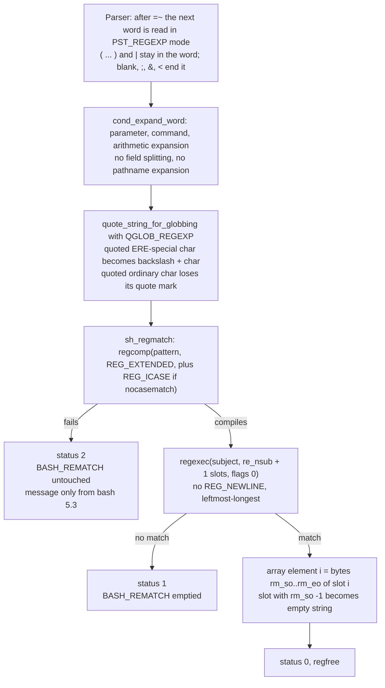

# Bash Regex and BASH_REMATCH

> [!summary] Claim
> `[[ string =~ pattern ]]` is a thin shell over the C library's `regcomp` and `regexec`, so the shell decides only which characters reach the C library and where the captures land, while the C library decides the dialect, the limits, and the cost.

Part of [Bash](README.md) in [Shell and Unix Engineering](../README.md).

## TL;DR

- Mechanism: bash expands the right operand, backslash-escapes every quoted ERE-special character, compiles the result with `regcomp(REG_EXTENDED)` on every evaluation, runs `regexec` once, and copies each subexpression into the global indexed array `BASH_REMATCH`.
- Rule: keep the pattern in a variable and expand it unquoted (`[[ $s =~ $re ]]`); quote only the parts you want literal, and anchor with `^` and `$` because an unanchored ERE matches anywhere.
- Trap: an uncompilable pattern returns 2 (silently before bash 5.3), `[[ ! $s =~ $re ]]` turns that 2 into success, a failed match empties `BASH_REMATCH`, and the next `=~` anywhere, including inside a function you call, overwrites it.
- Portability: `[[` is outside POSIX (`(POSIX.1-2024 XCU 2.4)` lets a shell reserve it with unspecified results); bash, zsh, ksh93, yash, and BusyBox ash implement `=~` with different quoting rules, statuses, and capture variables, mksh rejects it, and dash and posh have no `[[` at all.
- When not to use it: portable `sh` scripts (use `case`, `expr`, or `grep -E`), patterns that come from users (the C library's matcher is the attack surface), and any validation where `\d`, lazy quantifiers, or look-around are assumed, because POSIX ERE has none of them.

## Mental model



The parser decides the word boundaries before any expansion happens, which is why `(a b)` is one pattern but `a b` is a syntax error.
The expansion step turns the word into a string in which every character that was quoted carries an internal quote mark, and the regex quoting step converts that mark into a backslash only where the next character is special to an ERE.
That string goes to `regcomp` unchanged, so everything after this arrow (the dialect, `\w`, the repetition limit, back-references, locale) belongs to the C library, not to bash.
A compile failure short-circuits with status 2 and never touches `BASH_REMATCH`; a compiled pattern always runs `regexec` with one slot per subexpression, and the result either empties the array (no match) or overwrites it (match).

## How it works

### The grammar: one word, read in a special mode

`[[` is a bash reserved word, and POSIX only says that `[[` and `]]` "may be recognized as reserved words, in which case the results are unspecified" `(POSIX.1-2024 XCU 2.4)`.
When `cond_term` in `parse.y` sees the operator `=~`, it sets `PST_REGEXP` before reading the right operand (bash-5.3 parse.y, `cond_term`).
In that state `read_token` skips its metacharacter handling and goes straight to word reading (bash-5.3 parse.y, `read_token`), and `read_token_word` keeps `|` in the word and reads an unquoted `(` through its matching `)` as part of the word, blanks included (bash-5.3 parse.y, `read_token_word`).
Every other metacharacter still ends the word, so `[[ $s =~ a b ]]`, `a;b`, `a&b`, and `a<b` are syntax errors (measured by hand on bash 5.3.15 and 3.2.57), while `[[ $s =~ (a b) ]]` and `[[ $s =~ ^a|x ]]` parse (lab).
zsh reads the operand with its ordinary lexer: native zsh accepts `(a b)` but rejects a bare `|`, and in `sh` emulation, where `SH_GLOB` is set, it rejects the parentheses too (lab).

### Expansion and the quoting rule

`execute_cond_node` recognizes `=~`, and when the compatibility level is above 31 it expands the right operand with `cond_expand_word(..., 2)`; the left operand gets mode 0 (bash-5.3 execute_cmd.c, `execute_cond_node`).
`cond_expand_word` sets `W_NOSPLIT2` and calls `call_expand_word_internal`, so both operands get parameter, command, and arithmetic expansion but no field splitting and no pathname expansion (bash-5.3 subst.c, `cond_expand_word`).
For the regex operand it then calls `quote_string_for_globbing(p, QGLOB_CVTNULL|QGLOB_CTLESC|QGLOB_REGEXP)` instead of removing quotes (bash-5.3 subst.c, `cond_expand_word`).
Inside, a quoted character (internally `CTLESC` followed by the character) becomes `\` plus the character only when `ere_char` says it is special, that is one of `. [ \ ( ) * + ? { | ^ $`; a quoted ordinary character just loses its mark (bash-5.3 pathexp.c, `quote_string_for_globbing` and `ere_char`).
Inside a bracket expression a quoted character is copied without a backslash, because a backslash is literal there in an ERE (bash-5.3 pathexp.c, `quote_string_for_globbing`).
Three consequences follow, all measured in the lab:
- `[[ axb =~ "a.b" ]]` fails, because the pattern that reaches `regcomp` is `a\.b`; `set -x` prints exactly that, `+ [[ axb =~ a\.b ]]` (measured by hand on bash 5.3.15 and 3.2.57).
- `[[ asb =~ ^a\sb$ ]]` succeeds, because an unquoted backslash is shell quoting: it quotes the ordinary `s`, which then loses its mark, so `regcomp` sees `^asb$`.
- `re='^a\sb$'; [[ 'a b' =~ $re ]]` passes `\s` through to the C library, which matches a blank on glibc and musl and a literal `s` on macOS; the lab asserts that bash's answer equals the C library's for every family that calls `regcomp`.

The rule that quotes make the pattern literal is a bash 3.2 change: "Quoting the string argument to the `[[` command's `=~` operator now forces string matching" (bash-5.3 CHANGES, bash-3.2-alpha item f).
Patch bash32-039 added `shopt -s compat31` to restore the 3.1 behavior, and `BASH_COMPAT=31` does the same from bash 4.3, the release that introduced `BASH_COMPAT` (bash-5.3 doc/bashref.texi, Shell Compatibility Mode).
The lab shows both switches working on bash 4.4 through 5.3 and only `compat31` on bash 3.2.

### Compiling and matching

`sh_regmatch` is the whole engine interface (bash-5.3 lib/sh/shmatch.c, `sh_regmatch`):
- `rflags = REG_EXTENDED`, plus `REG_ICASE` when `match_ignore_case` (the `nocasematch` option) is set; there is no `REG_NEWLINE` and no `REG_NOSUB` in array builds.
- `regcomp` runs on every evaluation and `regfree` at the end, so nothing is cached between iterations of a loop.
- A non-zero `regcomp` result returns 2 at once; since bash 5.3 `execute_cond_node` prints `invalid regular expression` with the `regerror` text (bash-5.3 CHANGES, bash-5.3-alpha item g), while earlier releases print nothing (lab, bash 3.2 to 5.2).
- `regexec` gets `re_nsub + 1` slots and flags 0, and any non-zero result, including `REG_ESPACE`, becomes status 1; the source carries the comment `XXX - catch errors and fill in *errbuf here?`.

Because there is no `REG_NEWLINE`, a newline in the subject is an ordinary character `(POSIX.1-2024 XSH regcomp)`: `^` and `$` anchor only at the ends of the whole value, `.` matches a newline, and `$` does not match before a trailing newline.
That is the opposite of `grep -E`, which matches line by line, so `printf '12\nx\n' | grep -Eq '^[0-9]+$'` succeeds while `[[ $'12\nx' =~ ^[0-9]+$ ]]` fails (lab, with GNU, BSD, and BusyBox `grep`).
POSIX matching is leftmost-longest, and each subexpression from left to right takes the longest string consistent with that `(POSIX.1-2024 XBD 9.1)`: `x|xy|xyz` matches all of `xyz`, and `(wee|week)(knights|night)` on `weeknights` captures `wee` and `knights` (lab, on all three C libraries).
A subexpression that repeats reports its last iteration `(POSIX.1-2024 XSH regcomp)`, so `^(a|b)+$` on `aab` captures `b` (lab).

### Filling BASH_REMATCH

From bash 5.3, `sh_regmatch` gets the array with `builtin_find_indexed_array("BASH_REMATCH", 1)`, which honors a `local` declaration, refuses an associative array with `not an indexed array`, and flushes the array (bash-5.3 builtins/common.c, `builtin_find_indexed_array`).
It flushes even when the match failed, so a failed match leaves zero elements; a compile failure returned before this point, so it leaves the previous match in place (lab, every bash release).
Element `i` is a copy of bytes `rm_so` to `rm_eo` of the subject, made with `strncpy` into a buffer of `strlen(subject) + 11` bytes that is allocated on every call (bash-5.3 lib/sh/shmatch.c, `sh_regmatch`).
For a subexpression that took no part in the match, `regexec` reports `rm_so == -1` `(POSIX.1-2024 XSH regcomp)`, the copy length is `-1 - -1 = 0`, and the element becomes an empty string that is set: `${BASH_REMATCH[1]-unset}` prints nothing, not `unset` (lab, with a C probe that shows the `-1`).
So bash cannot tell "matched the empty string" from "did not participate"; if that matters, use a group that cannot match empty, or compare with a second test.

The array's history is a list of scope bugs:

| bash | Behavior | Evidence |
| --- | --- | --- |
| 3.0 | `=~` and `BASH_REMATCH` added; `configure --enable-cond-regexp`, on by default | bash-5.3 CHANGES, bash-3.0-alpha items cc, dd, ee |
| 3.0 to 5.0 | `sh_regmatch` unbinds the variable, makes a new array, and sets `att_readonly`, so `local BASH_REMATCH` and assignment fail after the first match | bash-3.0, 3.1, and 3.2 lib/sh/shmatch.c, `sh_regmatch` (identical `unbind_variable` and `att_readonly` lines); lab (3.2, 4.4) |
| 3.2 to 5.0 | `nocaseglob` also makes `=~` case-insensitive (`glob_ignore_case \|\| match_ignore_case`) | bash-3.2 lib/sh/shmatch.c; lab (3.2, 4.4) |
| 5.1 | "BASH_REMATCH is no longer readonly"; "Setting nocaseglob no longer turns on case-insensitive regexp matching" | bash-5.3 CHANGES, bash-5.1-alpha items p, zz; lab |
| 5.1, 5.2 | `local BASH_REMATCH` is accepted but the match still writes the global (5.2: "local copies are (currently) ignored") | bash-5.3 CHANGES, bash-5.2-rc1 item i; lab (5.1, 5.2) |
| 5.3 | "BASH_REMATCH can now be a local variable"; uncompilable patterns are reported | bash-5.3 CHANGES, bash-5.3-alpha items kkkk, g; lab |

The bash 5.3 manual still says that declaring `BASH_REMATCH` local "will lead to unexpected results" (bash-5.3 doc/bashref.texi), which contradicts the 5.3 CHANGES entry and the lab.
Write code that copies the captures into named variables immediately and never relies on a local copy; that is correct on every release.

### Other shells

- zsh compiles with `REG_EXTENDED`, adds `REG_ICASE` when `CASE_MATCH` is unset, and on a match sets `MATCH`, `MBEGIN`, `MEND`, `match`, `mbegin`, and `mend`, or only `BASH_REMATCH` when the `BASH_REMATCH` option is set; an uncompilable pattern warns `failed to compile regex` and makes the condition false, so the status is 1 (zsh-5.9 Src/Modules/regex.c, `zcond_regex_match`; lab).
  A failed match leaves the previous values in place, and with `KSH_ARRAYS` unset the arrays start at 1, so `setopt BASH_REMATCH KSH_ARRAYS` is what makes zsh index like bash (lab).
- ksh93 defines `string =~ ere` as matching the pattern `~(E)ere` with its own (libast) engine, so `\s` means a blank on every platform, quoting does not make the pattern literal, an uncompilable pattern gives 1, and captures go to `.sh.match`, which a failed match leaves unchanged (ksh93u+m 1.0.10 sh.1; lab on ksh93u+m 1.0.10 and ksh93u+ 2012).
- yash supports `=~` in `[[` and in its `test` builtin, treats quoted characters as literal like bash, returns 1 for an uncompilable pattern without a message, and stores no captures (yash syntax.html; lab, yash 2.58.1).
- BusyBox ash implements `[[` as its `test` applet with `=~` enabled (`BASH_TEST2`), calls `regexec` with zero slots, so there are no captures, and returns 2 for a bad pattern "silently, no error msg" (BusyBox coreutils/test.c, `binop`; shell/ash.c `BASH_TEST2`).
  Its `[[` operands are ordinary words, so an unquoted left operand is field-split and globbed: `v='a b'; [[ $v =~ ^a ]]` fails with 2 (lab).
- mksh has `[[` but no `=~`, and reports `syntax error: unexpected operator/operand '=~'` when it parses the line (lab; the operator is absent from mksh.1); because mksh parses one line at a time, a guard earlier in the file still runs (lab).
- dash and posh have no `[[`, so it is looked up as a command: on Debian that gives status 127, but Alpine links `/usr/bin/[[` to BusyBox, so dash there silently runs BusyBox's `=~` with its field-splitting operands (lab).

## Numbers and limits

| Quantity | Value | Source |
| --- | --- | --- |
| Captures returned | `re_nsub + 1` elements: index 0 is the whole match | bash-5.3 lib/sh/shmatch.c; `(POSIX.1-2024 XSH regcomp)` |
| Statuses | 0 match, 1 no match or `regexec` error, 2 `regcomp` failure | bash-5.3 lib/sh/shmatch.c; lab |
| Largest interval count `{n}`, POSIX minimum | `_POSIX_RE_DUP_MAX` = 255 | `(POSIX.1-2024 XBD limits.h)` |
| `RE_DUP_MAX`, glibc 2.41 (Debian 13) | 32767 (`0x7fff`) | glibc posix/regex.h; lab (`getconf` and the C probe agree) |
| `RE_DUP_MAX`, musl (Alpine 3.22) and macOS | 255 | musl include/limits.h; lab |
| Per-call allocation besides the regex | `strlen(subject) + 11` bytes for the copy buffer and `(re_nsub + 1) * sizeof(regmatch_t)` | bash-5.3 lib/sh/shmatch.c |
| Loop iteration with one `[[ $s =~ $re ]]` on an 85-byte log line with 6 groups | 12 us (macOS arm64, bash 5.3.15), 17 us (Alpine musl, bash 5.2.37), 21 us (Debian glibc, bash 5.2.37) | measured 2026-11-12, 3 runs of 100000 iterations, scratch `perf2.sh` |
| Same line, glob test `[[ $s == *sshd\[*\]:* ]]` | 1.7 us, 2.4 us, 1.3 us | same run |
| Empty loop iteration (baseline) | 1.1 us, 1.5 us, 1.0 us | same run |
| One `grep -Eq "$re" <<<"$s"` (fork and exec) | 2.6 ms, 0.21 ms, 0.30 ms | same run, 1000 iterations |
| One test on a 1 MiB subject | 1.7 ms (macOS), 1.1 ms (Debian), 2.1 ms (Alpine); on macOS and Debian the same as a glob test of it and independent of the group count (1 or 11) | same run plus scratch `perf3.sh`, 100 iterations |
| glibc back-reference blowup, `^(.*)(.*)(.*)(.*)(.*)\5\4\3\2\1b$` on `a` x n | n=24: 33 ms; n=48: 663 ms; n=96: 17.7 s; n=192: killed at 20 s | measured 2026-11-12 in the Debian image, bash 5.2.37, scratch `redos3.sh` |

The regex test costs 7 to 16 glob tests, but about a twelfth of a `grep` fork and exec on Linux and a two-hundredth on macOS, where the fork and exec measured 2.6 ms; the right comparison for a loop body is the process it replaces.
On a large subject the cost is the word expansion that copies the value, not the regex, because the glob test costs the same.

## Portability

Shells (every cell is asserted by the lab unless it cites a source):

| Shell | `=~` in `[[` | Captures | Quoted part of pattern | Uncompilable pattern | Unquoted left operand |
| --- | --- | --- | --- | --- | --- |
| POSIX sh | `[[` may be reserved, results unspecified `(POSIX.1-2024 XCU 2.4)` | none | n/a | n/a | n/a |
| bash 3.2 (macOS `/bin/bash`, `/bin/sh`) | yes | `BASH_REMATCH`, readonly after a match | literal | 2, silent | not split |
| bash 5.3 | yes | `BASH_REMATCH`, may be `local` | literal | 2, message on stderr | not split |
| zsh 5.9 | yes; bare `\|` is a parse error | `MATCH`, `match` from 1; `BASH_REMATCH` with `setopt BASH_REMATCH` | still a regex | 1, message on stderr | not split |
| `zsh --emulate sh` | yes; unquoted `(` and `\|` are parse errors | `MATCH`, `match` from 0 (`KSH_ARRAYS`) | still a regex | 1, message | not split |
| dash 0.5.12 (Debian) | no `[[`: status 127 | none | n/a | n/a | n/a |
| dash on Alpine | runs BusyBox's `/usr/bin/[[` applet | none | still a regex | 2 | split |
| ksh93u+m 1.0.10, ksh93u+ 2012 | yes, libast engine | `.sh.match` | still a regex | 1, silent | not split |
| mksh R59 | parse error at `=~` | none | n/a | n/a | n/a |
| yash 2.58.1 | yes, also in `test` | none | literal | 1, silent | not split |
| posh 0.14.1 | no `[[`: status 127 | none | n/a | n/a | n/a |
| BusyBox 1.37.0 ash | yes (`test` applet) | none | still a regex | 2, silent | field split and globbed |

C libraries (what bash, zsh, yash, and BusyBox inherit; asserted by the lab's C probe, which branches on the C library):

| Feature | glibc 2.41 | musl (Alpine 3.22) | macOS libc |
| --- | --- | --- | --- |
| `\w`, `\s` | yes (GNU operators in `peek_token`) | yes (`tre_macros`) | literal `w`, `s` |
| `\d` | literal `d` | yes | literal `d` |
| `\1` in an ERE | back-reference | literal `1` (back-references only in BREs, `parse_atom`) | literal `1` |
| `a{,2}` | means `a{0,2}` | rejected | literal |
| `[[:<:]]` word start | rejected | rejected | yes `re_format(7)` |
| Empty pattern | matches | matches | rejected |
| `RE_DUP_MAX` | 32767 | 255 | 255 |
| `a+?` (POSIX.1-2024 shortest match) | read as `(a+)?`, matches `aaa` | same as glibc | rejected |
| `.` under `LC_ALL=C.UTF-8` versus `C` on a 2-byte character | one character versus two bytes | same | same |

`(POSIX.1-2024 XBD 9.4.6)` adds the `?` repetition modifier for shortest matching and the `REG_MINIMAL` flag `(POSIX.1-2024 XSH regcomp)`, but none of the three C libraries implements it (as of 2026-11), so a lazy quantifier is unusable in `=~`.
An escaped ordinary character such as `\w` or `\d` is undefined in an ERE `(POSIX.1-2024 XBD 9.4.2)`, which is why each C library is free to give it a different meaning.
BusyBox's regex locale support depends on the build: under `LC_ALL=C.UTF-8`, `^.$` matched a 2-byte character in Alpine's BusyBox but not in Debian's (measured by hand in the matrix images on 2026-11-12).
For utilities, `grep -E` is line-oriented in GNU grep, BSD grep, and BusyBox grep (lab), as POSIX requires.

## Worked example

The [lab](../labs/04-bash-regex-and-bash_rematch/) parses Semantic Versioning strings with the regular expression the specification publishes, translated from PCRE to POSIX ERE.
The translation shows the three edits every PCRE-to-ERE port needs: `\d` becomes `[[:digit:]]`, each non-capturing `(?:...)` becomes a capturing group, and the field indices are recounted by counting open parentheses.
It also shows the two defenses this note recommends: a canary match that catches a pattern the C library will not compile, and copying `BASH_REMATCH` out immediately.

```bash
#!/usr/bin/env bash
# semver.sh: split each VERSION argument into its Semantic Versioning 2.0.0 fields with [[ =~ ]].
# Usage: semver.sh VERSION...
# Prints one line per argument: "VERSION: major=X minor=Y patch=Z pre=P build=B" (absent parts are
# empty), or "VERSION: invalid".
# Exit status: 0 when every argument parsed, 1 when any was invalid, 2 when this shell cannot run it.
# Runs under bash 3.2 or later and under zsh; any other shell gets status 2 and a message.

if [ -n "${ZSH_VERSION-}" ]; then
  # zsh fills BASH_REMATCH (instead of MATCH and match) only with BASH_REMATCH set,
  # and indexes it from 0 only with KSH_ARRAYS set.
  setopt BASH_REMATCH KSH_ARRAYS
elif [ -z "${BASH_VERSION-}" ]; then
  printf 'semver.sh: needs bash or zsh for [[ =~ ]] and BASH_REMATCH\n' >&2
  exit 2
fi

# Bracket classes such as [[:alpha:]] follow LC_CTYPE; pin them to ASCII.
LC_ALL=C

# The semver.org regular expression, translated from PCRE to POSIX ERE:
# \d becomes [[:digit:]], (?:...) becomes a capturing (...), so every group below gets a number.
num='(0|[1-9][[:digit:]]*)'                                          # 1 group
pre_id='(0|[1-9][[:digit:]]*|[[:digit:]]*[[:alpha:]-][[:alnum:]-]*)' # 1 group
build_id='[[:alnum:]-]+'                                             # 0 groups
re="^$num\\.$num\\.$num(-($pre_id(\\.$pre_id)*))?(\\+($build_id(\\.$build_id)*))?\$"
# Count the open parentheses to find each field:
#   1 major  2 minor  3 patch  4 -pre  5 pre  6 first pre id  7 .id  8 last pre id
#   9 +build  10 build  11 last .id
PRE=5
BUILD=10

# Canary: a version that must match. A pattern the C library cannot compile makes [[ =~ ]] return 2
# in bash but 1 in zsh, so test a known-good input instead of trusting the status of real input.
if ! [[ 1.0.0-rc.1+b.2 =~ $re ]]; then
  printf 'semver.sh: this C library rejects the pattern: %s\n' "$re" >&2
  exit 2
fi

rc=0
for v in "$@"; do
  if [[ $v =~ $re ]]; then
    # Copy out at once: the next [[ =~ ]] anywhere, including in a called function, overwrites it.
    printf '%s: major=%s minor=%s patch=%s pre=%s build=%s\n' "$v" \
      "${BASH_REMATCH[1]}" "${BASH_REMATCH[2]}" "${BASH_REMATCH[3]}" \
      "${BASH_REMATCH[PRE]}" "${BASH_REMATCH[BUILD]}"
  else
    printf '%s: invalid\n' "$v"
    rc=1
  fi
done
exit "$rc"
```

Expected output under bash 3.2 to 5.3, zsh, and `zsh --emulate sh`, exit status 1:

```text
1.22.3: major=1 minor=22 patch=3 pre= build=
2.0.0-rc.1+build.5: major=2 minor=0 patch=0 pre=rc.1 build=build.5
01.2.3: invalid
1.2: invalid
```

Under dash, posh, ksh93, mksh, yash, and BusyBox ash it prints `semver.sh: needs bash or zsh for [[ =~ ]] and BASH_REMATCH` and exits 2.
A version with a trailing newline is rejected, because `$` anchors at the end of the value, not before a final newline.
The lab's other 18 tests prove each claim in this note per shell family, and a small C program, `regprobe.c`, calls `regcomp` and `regexec` directly so the tests can separate what the shell does from what the C library does.

## Pitfalls

> [!warning] Quoting the whole pattern
> Trigger: `[[ $s =~ "^[0-9]+$" ]]` or `[[ $s =~ "$re" ]]`, usually copied from `grep -E "$re"`.
> Symptom: bash and yash match the pattern as a literal string, so the test is almost always false; zsh, ksh93, and BusyBox treat it as a regex, so the same line behaves differently by shell.
> Fix: store the pattern in a variable and expand it unquoted; quote only the literal parts, as in `^"$prefix"-[0-9]+$`.

> [!warning] Status 2 read as no match
> Trigger: a pattern the C library rejects (`a{,2}` on musl, an empty pattern or `a+?` on macOS, `a{256}` outside glibc), tested with `if [[ ... ]]` or `[[ ! ... ]]`.
> Symptom: every input is "invalid" with no message before bash 5.3; `[[ ! $s =~ $re ]]` is true for every input because `!` inverts any non-zero status to 0 (bash-5.3 execute_cmd.c, `execute_cond_node`); zsh, ksh93, and yash return 1, which is indistinguishable from no match.
> Fix: run a canary match against a known-good value at startup, as `semver.sh` does, and treat status 2 as an error in bash (`case $? in 0) ;; 1) ;; *) die ;; esac`).

> [!warning] Captures clobbered by a later match
> Trigger: reading `BASH_REMATCH` after calling a function, or after a second `=~`, including a failed one.
> Symptom: a failed match leaves the array empty; a successful one in the function overwrites the caller's captures on every bash before 5.3, even when the function declared `local BASH_REMATCH` (5.1 and 5.2 accept the declaration and ignore it).
> Fix: copy the elements into named variables on the line after the match; never depend on `local BASH_REMATCH`.

> [!warning] Anchors and newlines
> Trigger: validating input such as an ID or a port with `[[ $v =~ ^[0-9]+$ ]]`, then testing the validator with `grep -E` or porting it from PCRE.
> Symptom: none in `[[`, which anchors at the ends of the whole value; but a validator written with `grep -Eq '^[0-9]+$' <<<"$v"` accepts `$'12\nrm -rf x'`, because `grep` matches any line, and a PCRE port that relies on `$` matching before a final newline behaves differently.
> Fix: validate with `[[ =~ ]]` or `case`, always anchor both ends, and never validate multi-line input with a line-oriented tool.

> [!warning] Dialect assumptions
> Trigger: `\d`, `\b`, `\w`, `(?:...)`, `*?`, or back-references in a pattern that must run on more than one platform.
> Symptom: `\d` is a literal `d` on glibc and macOS, so `^\d+$` matches only strings of the letter `d`; `\w` is a literal `w` on macOS; `\1` is a back-reference on glibc and a literal `1` on musl and macOS; `(?:` and `*?` are rejected or silently mean something else.
> Fix: write POSIX bracket classes (`[[:digit:]]`, `[[:alnum:]_]`, `[[:space:]]`), use only capturing groups, and treat the C probe's table above as the portability contract.

> [!warning] Unquoted left operand outside bash
> Trigger: `[[ $line =~ $re ]]` in a script run by BusyBox ash, or by dash on Alpine, where `/usr/bin/[[` is BusyBox.
> Symptom: the left operand is field-split and globbed, so a value with a blank or a newline makes `[[` fail with 2, and a value such as `*` can expand to file names.
> Fix: quote the left operand (`[[ "$line" =~ $re ]]`), which is harmless in bash, or keep `[[` out of scripts that are not run by bash.

> [!warning] Case-insensitivity leaking from shell options
> Trigger: `shopt -s nocasematch` set for a `case` statement and left on, or `shopt -s nocaseglob` in bash 3.2 to 5.0, which also turned on `REG_ICASE` (bash-3.2 lib/sh/shmatch.c, `sh_regmatch`).
> Symptom: `[[ ABC =~ ^abc$ ]]` succeeds; on macOS's bash 3.2, a glob option changes regex results.
> Fix: set the option in the narrowest scope and unset it after, or write the case-insensitivity into the pattern with bracket expressions; see [[Shell-Options-shopt]].

## Security and robustness

- A user-supplied pattern is code for the C library's matcher.
  glibc's matcher is super-linear with back-references: a five-group back-reference pattern took 33 ms on a 24-byte subject, 663 ms on 48 bytes, and 17.7 s on 96 bytes (measured above), so an attacker who controls the pattern, or the subject of such a pattern, controls CPU time.
  Bound such matches with a timeout around the process, or do not accept patterns from users; see [[ReDoS]].
- The matchers have had memory-safety bugs reachable from a pattern: CVE-2010-4051 and CVE-2010-4052 (glibc `regcomp` through 2.12.2 crashed or exhausted the stack on adjacent bounded repetitions such as `{10,}{10,}{10,}{10,}`, demonstrated against ProFTPD), CVE-2016-8859 (integer overflows in TRE and musl leading to an out-of-bounds write), and CVE-2018-20796 and CVE-2019-9192 (uncontrolled recursion in `check_dst_limits_calc_pos_1` in glibc's `posix/regexec.c` through 2.29, the second disputed by the maintainer because it needs a crafted pattern) (NVD entries for each CVE).
  On an affected C library each of them sits behind `[[ $s =~ $re ]]` when `re` comes from an attacker, because bash adds no filtering in front of `regcomp` and `regexec`.
- The left operand is safe from field splitting and globbing in bash, zsh, ksh93, and yash, but not in BusyBox, so quote it in any script that might be run by `ash`.
- Validation must be anchored at both ends, and must reject newlines explicitly if the value will reach a line-oriented consumer later: `[[ $v =~ ^[[:alnum:]_-]+$ ]]` already rejects a newline, because a newline is not in the class.
- A readonly or associative `BASH_REMATCH` does not change the status: in bash 5.3 `[[ abc =~ (b) ]]` still returns 0 after printing `BASH_REMATCH: readonly variable` or `not an indexed array`, and the captures are lost (measured by hand on bash 5.3.15).
- `set -u` treats an index beyond the last capture as unbound, so `${BASH_REMATCH[2]}` after a one-group match aborts the script (measured by hand on bash 5.3.15 and 3.2.57); use `${BASH_REMATCH[2]-}` where a group count can vary.
- Bracket ranges such as `[a-z]` follow the collation of the current locale; prefer named classes, and pin `LC_ALL=C` when a pattern must be ASCII, as the worked example does; see [[Locale-and-LC_ALL]].

## The principal's view

The decision is not "regex or not" but where the matching runs and who owns its dialect.
`[[ =~ ]]` is the right tool for a bash script that validates or splits short strings in a loop, because it costs about 20 us against a fork of hundreds of microseconds to milliseconds, and because `BASH_REMATCH` removes the `sed` and `cut` pipelines that people otherwise build to extract fields.
The price is a dependency on two things the script does not control: the bash release (quoting rules, readonly and local behavior, silent errors) and the C library (escapes, back-references, limits, locale).
A staff-level owner turns that into policy: patterns use only POSIX ERE with bracket classes, live in variables, are anchored, are checked by a canary at startup, and have their captures copied out immediately; a lint rule (ShellCheck SC2076 flags a quoted right operand of `=~`) and a lab like this one run on every platform the script ships to.
When a script needs PCRE features, Unicode properties, look-around, named groups, or matching on attacker-chosen input, the shell is the wrong layer: move the parsing into a language that ships one regex engine on every platform (Python's `re`, or Go's `regexp`, whose documentation guarantees time linear in the size of the input), or into `awk` when it must stay in the POSIX toolset.
For `#!/bin/sh` scripts, the portable equivalents are `case` for glob-shaped checks, `expr STRING : BRE` for one capture, and `grep -E` or `sed -E` for line-oriented work; see [[Extended-Globbing]] for the glob alternative inside bash.

## Interview questions

> [!question] L5: What does `BASH_REMATCH` contain after `[[ 2026-11-12 =~ ^([0-9]{4})-([0-9]{2})-([0-9]{2})$ ]]`, and what after a later failed match?
>
> > [!success]- Answer
> > Element 0 is the whole match, `2026-11-12`, and elements 1 to 3 are `2026`, `11`, and `12`, one per opening parenthesis.
> > A later failed match empties the array, so `${#BASH_REMATCH[@]}` is 0.
> > A later pattern that fails to compile leaves the old contents in place, because bash returns 2 before it touches the array.
> >
> > Follow-up: What does a subexpression that took no part in the match look like, and why can you not tell it from an empty match?

> [!question] L5: Why does `[[ axb =~ "a.b" ]]` fail in bash but succeed in zsh?
>
> > [!success]- Answer
> > Since bash 3.2, quoting part of the pattern makes that part literal: bash turns each quoted ERE-special character into a backslash pair, so `regcomp` sees `a\.b`.
> > zsh removes the quotes and passes `a.b` as a regex, as do ksh93 and BusyBox.
> > `set -x` in bash shows the pattern that reached `regcomp`, and `shopt -s compat31` or `BASH_COMPAT=31` restores the old bash behavior.
> >
> > Follow-up: How do you match a literal prefix stored in a variable followed by digits?

> [!question] L5: Predict the output of this bash snippet: `re='(b)'; bad='('; [[ abc =~ $re ]]; [[ abc =~ $bad ]] 2>/dev/null; echo "$? ${BASH_REMATCH[0]}"; [[ ! abc =~ $bad ]] 2>/dev/null; echo "$?"; [[ abc =~ x ]]; echo "$? ${#BASH_REMATCH[@]}"`
>
> > [!success]- Answer
> > The first line printed is `2 b`: the compile failure returns 2 and leaves the previous match.
> > The second is `0`: `!` inside `[[` inverts any non-zero status, so an invalid pattern looks like a successful negative test.
> > The third is `1 0`: a failed match empties the array.
> >
> > Follow-up: How would you make the script fail loudly on the invalid pattern in every bash release?

> [!question] L6: Debug this script: `re='^\d+\.\d+\.\d+$'; for v in "$@"; do if [[ $v =~ $re ]]; then echo "ok $v"; else echo "invalid $v"; fi; done` reports every version as invalid on a colleague's Mac but works in the team's Alpine container.
>
> > [!success]- Answer
> > `\d` is not POSIX ERE; an escaped ordinary character is undefined `(POSIX.1-2024 XBD 9.4.2)`, so each C library decides.
> > musl expands `\d` to a digit class, but glibc and macOS treat it as a literal `d`, so this pattern matches only strings like `d.d.d` there.
> > The container works because Alpine's C library is musl; the same script on Debian (glibc) rejects every version too.
> > Write `[[:digit:]]` instead, and add a canary match against a known-good value so a dialect mismatch fails at startup instead of rejecting all input.
> >
> > Follow-up: Which other PCRE habits silently change meaning, and how would you catch them in CI?

> [!question] L6: Why is `[[ $s =~ $re ]]` safe without quoting `$s` in bash, and when is it not?
>
> > [!success]- Answer
> > bash expands both operands of `[[` with `W_NOSPLIT2` and without pathname expansion, so the left operand is one word whatever it contains.
> > BusyBox ash implements `[[` as its `test` applet, so its operands are ordinary words: an unquoted value with a blank is split and `[[` fails with 2, and a `*` can glob.
> > On Alpine even dash runs that applet, because `/usr/bin/[[` is a link to BusyBox, so quoting the left operand is the portable habit.
> >
> > Follow-up: What does dash do with `[[ a =~ b ]]` on Debian, and what status does it return?

> [!question] L6: A function you call runs its own `=~`; how do you keep the caller's captures, and does `local BASH_REMATCH` help?
>
> > [!success]- Answer
> > Copy the captures into named variables immediately after the match; that is correct on every release.
> > `local BASH_REMATCH` fails with a readonly error from bash 3.0 to 5.0, is accepted but ignored in 5.1 and 5.2, and works only from bash 5.3.
> > A subshell also isolates the callee, at the cost of a fork, because the array is ordinary shell state.
> >
> > Follow-up: What does the bash 5.3 manual say about local copies, and how would you decide which source to trust?

> [!question] L7+: Your team wants to accept user-supplied regular expressions in a bash tool that filters logs with `[[ $line =~ $user_re ]]`; what do you tell them?
>
> > [!success]- Answer
> > The pattern goes unchanged to the C library, so its dialect and its cost are the C library's: on glibc a back-reference pattern grew from 33 ms at 24 bytes to 17.7 s at 96 bytes in our measurements.
> > The matchers have had pattern-triggered memory bugs (CVE-2010-4051, CVE-2010-4052, CVE-2016-8859, CVE-2018-20796), and status 2 versus 1 is the only error channel.
> > Either restrict the input to a safe subset you construct yourself, or move matching to an engine with a linear-time guarantee (RE2, Go `regexp`) in a process with a CPU limit.
> >
> > Follow-up: How would you prove the replacement matches the old semantics for the patterns users already rely on?

> [!question] L7+: Explain why `(wee|week)(knights|night)` captures `wee` and `knights` in bash, and what a Perl-compatible engine would capture for `x|xy|xyz` on `xyz`.
>
> > [!success]- Answer
> > POSIX requires the leftmost-longest overall match first, and only then the longest match for each subexpression from left to right `(POSIX.1-2024 XBD 9.1)`, which gives this pattern as its example of matching all ten characters.
> > `week` is the longer first alternative, but `week` plus `night` covers only nine characters, so the overall rule forces `wee` plus `knights`.
> > A backtracking engine takes the first alternative that succeeds instead, so `x|xy|xyz` on `xyz` matches `x` in Perl (checked with perl 5) but `xyz` in POSIX, the lab's C probe, and bash.
> > Code ported between the two can therefore extract different fields from the same input without any error.
> >
> > Follow-up: How do DFA-based POSIX matchers implement submatch rules, and why are back-references outside that model?

> [!question] L7+: Design the portability policy for regex use across a fleet of bash scripts that run on macOS laptops, Debian servers, and Alpine containers.
>
> > [!success]- Answer
> > Pin the dialect to the intersection the three C libraries agree on: POSIX ERE with bracket classes, no escapes of ordinary characters, no back-references, no lazy quantifiers, intervals at most 255.
> > Enforce it with a lint step and a matrix test that runs each script's patterns through a `regcomp` probe on all three platforms, as this note's lab does.
> > Require the canary-plus-copy-out idiom, quote the left operand for BusyBox, and set `nocasematch` only in narrow scopes; anything beyond that moves to a language with one regex engine.
> >
> > Follow-up: Which of these rules would you relax for scripts that run only under bash 5.3 on glibc, and what would that cost later?

## Related

Prerequisites: [[Double-Bracket-Conditional]]

Next: [[Extended-Globbing]]

See also: [[Shell-Options-shopt]], [[Indexed-Arrays]], [[Namerefs-and-Dynamic-Scope]], [[Bash-Version-History]], [[Bash-3-2-on-macOS]], [[xtrace-PS4-and-BASH_XTRACEFD]], [[BRE-ERE-and-PCRE]], [[POSIX-Leftmost-Longest-Matching]], [[ReDoS]], [[Locale-and-LC_ALL]], [[grep-in-Depth]], [[BusyBox-ash]], [[Zsh-Emulation-Modes]], [[ksh93-Features]], [[Dash-and-Bashisms]], [[Quote-Removal]], [[The-test-Builtin]]

## Further reading

- POSIX.1-2024 XBD 9, Regular Expressions (https://pubs.opengroup.org/onlinepubs/9799919799/basedefs/V1_chap09.html): the ERE grammar, leftmost-longest matching, undefined escapes, and the new shortest-match modifier.
- POSIX.1-2024 XSH `regcomp` (https://pubs.opengroup.org/onlinepubs/9799919799/functions/regcomp.html): the `pmatch` rules behind every `BASH_REMATCH` element, including `-1` for groups that did not participate and the `REG_NEWLINE` semantics bash does not use.
- GNU bash 5.3 source (https://ftp.gnu.org/gnu/bash/bash-5.3.tar.gz): `lib/sh/shmatch.c`, `pathexp.c` (`quote_string_for_globbing`), `subst.c` (`cond_expand_word`), and `CHANGES`, which is the only complete history of the operator.
- zsh 5.9 `Src/Modules/regex.c` (https://raw.githubusercontent.com/zsh-users/zsh/zsh-5.9/Src/Modules/regex.c): a second, short implementation of the same idea, with the `MATCH` and `BASH_REMATCH` variants side by side.
- BusyBox `coreutils/test.c` (https://raw.githubusercontent.com/mirror/busybox/master/coreutils/test.c): how little a `[[` needs to implement `=~`, and what it leaves out.
- glibc `posix/regcomp.c` and `posix/regex.h` (https://raw.githubusercontent.com/bminor/glibc/master/posix/regcomp.c): where `\w`, back-references in EREs, and the 32767 repetition limit come from.
- musl `src/regex/regcomp.c` (https://git.musl-libc.org/cgit/musl/plain/src/regex/regcomp.c): the TRE-derived parser with its escape macros and BRE-only back-references.
- Semantic Versioning 2.0.0 (https://semver.org/spec/v2.0.0.html): the published PCRE pattern the worked example translates.
- Go `regexp` package documentation (https://pkg.go.dev/regexp): the linear-time guarantee that makes an RE2-style engine the right home for untrusted patterns.
- NVD CVE-2018-20796 (https://nvd.nist.gov/vuln/detail/CVE-2018-20796): an example of a pattern-triggered fault in the matcher every `=~` reaches.
