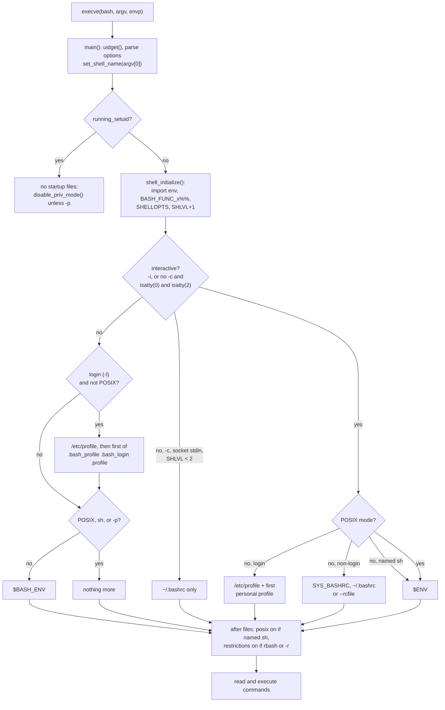

# Bash Startup Files and Modes

> [!summary] Claim
> Before bash runs a single command it classifies itself along four independent axes (interactive, login, POSIX, and privileged or restricted) from `argv[0]`, its options, its descriptors, and its environment, and that classification alone decides which of `/etc/profile`, `~/.bash_profile`, `~/.bash_login`, `~/.profile`, `~/.bashrc`, `$BASH_ENV`, or `$ENV` it executes, and what it imports from the environment.

Part of [Bash](README.md) in [Shell and Unix Engineering](../README.md).

## TL;DR

- Mechanism: `main()` in `shell.c` decides interactivity (`-i`, or no `-c`, no operands, and `isatty()` on descriptors 0 and 2), login (`argv[0]` starting with `-`, or `-l`/`--login`), POSIX mode (name `sh`, `--posix`, or `POSIXLY_CORRECT`), and privilege, then `run_startup_files()` sources a fixed subset of files with `set -e` and job control off (bash-5.3 shell.c, `run_startup_files`).
- Rule: interactive login reads `/etc/profile` then the first of `~/.bash_profile`, `~/.bash_login`, `~/.profile`; interactive non-login reads `~/.bashrc`; non-interactive reads only the file `BASH_ENV` names; POSIX mode reads only `ENV`, and only when interactive.
- Trap: `bash -c` reads `~/.bashrc` when its standard input is a socket and `SHLVL` was unset or 0, and Debian- and nix-built bash also read it whenever `SSH_CLIENT` is set; an empty `~/.bash_profile` silently hides `~/.profile`.
- Portability fact: POSIX defines only `ENV` for interactive shells and no login shell at all; dash, ksh93, mksh, and BusyBox ash read `/etc/profile` and `~/.profile` for `-l`, zsh reads its own `~/.zshenv` even for `zsh -c`, and posh 0.14.1 ignores `ENV` (measured in the shell matrix, as of 2026-11).
- When not to use it: never put anything a script depends on in a startup file; scripts must be hermetic, so set state inside the script and run automation with `env -i` or `bash --norc --noprofile` when you need a clean start.

## Mental model



The kernel hands bash only `argv`, `envp`, and inherited descriptors, so every mode decision is computed from those three inputs before any file is read.
`main()` first compares real and effective IDs (`uidget()`); a set-user-ID or set-group-ID bash skips every startup file, and without `-p` it also drops its privileges.
`shell_initialize()` then imports the environment, which is where exported functions (`BASH_FUNC_name%%`), `SHELLOPTS`, `BASHOPTS`, and `SHLVL` take effect, before any startup file runs.
`run_startup_files()` handles the remote-shell case first (a non-interactive `-c` shell whose descriptor 0 is a socket, or with `SSH_CLIENT` set in some builds, reads only `~/.bashrc`), then the login profile chain, then `BASH_ENV` for non-interactive shells, then `~/.bashrc` or `ENV` for interactive ones.
Only after the files have run does bash switch a shell named `sh` into POSIX mode and turn on restricted mode, which is why a startup file can do what the shell later refuses.

## How it works

### Inputs: argv[0], options, descriptors, environment

`set_shell_name()` takes the basename of `argv[0]`; a leading `-` sets `login_shell = 1`, a basename of `sh` sets `act_like_sh`, and a basename of `su` sets `su_shell` (bash-5.3 shell.c, `set_shell_name`).
`-l` or `--login` sets `make_login_shell`, which `main()` turns into a negative `login_shell`, so the code can tell an explicit `-l` (negative) from a `-` in `argv[0]` (positive) (bash-5.3 shell.c, `main`).
The long options that steer startup are `--login`, `--noprofile`, `--norc`, `--rcfile FILE`, `--init-file FILE` (the same variable as `--rcfile`), `--posix`, and `--restricted`, all in the `long_args` table (bash-5.3 shell.c, `long_args`).
Interactivity is `forced_interactive` (`-i`), or all of: no `-c` string, no remaining operands or `-s`, `isatty(fileno(stdin))`, and `isatty(fileno(stderr))` (bash-5.3 shell.c, `main`), which is the POSIX rule (POSIX.1-2024 XCU sh, DESCRIPTION of `-i`).
Standard output is not consulted: `bash < /dev/tty 2>/dev/tty > log` is interactive.
POSIX mode starts at startup if `POSIXLY_CORRECT` or `POSIX_PEDANTIC` is in the environment or `--posix` is given; a shell named `sh` enters it only after its startup files (bash-5.3 shell.c, `main`).

### What happens before any file is read

`shell_initialize()` calls `initialize_shell_variables(env, privileged_mode||restricted||should_be_restricted||running_setuid)`, so the second argument switches off function import in privileged, restricted, and set-user-ID shells (bash-5.3 shell.c, `shell_initialize`).
An environment string is imported as a function only if its name starts with `BASH_FUNC_`, ends with `%%`, and its value starts with `() {`; the name in between is the function name, and in POSIX mode an invalid identifier is refused (bash-5.3 variables.c, `initialize_shell_variables`).
That encoding is the post-Shellshock format: CVE-2014-6271 was bash "through 4.3" executing "trailing strings after function definitions in the values of environment variables", with OpenSSH `ForceCommand`, Apache `mod_cgi`, and DHCP clients as vectors, and CVE-2014-7169 covered the incomplete first fix (CVE-2014-6271 and CVE-2014-7169 records).
`initialize_shell_options()` then parses an imported `SHELLOPTS` and turns on every option it names, unless the shell is privileged, restricted, or set-user-ID (bash-5.3 builtins/set.def, `initialize_shell_options`).
`adjust_shell_level(1)` increments `SHLVL`, treating an empty or non-numeric value as 0 and resetting 1000 or more to 1 with a warning (bash-5.3 variables.c, `adjust_shell_level`).
A non-interactive shell unbinds `PS1` and `PS2`, so a script never sees an inherited prompt (bash-5.3 shell.c, `main`), which the lab confirms.
Since bash 5.0 the positional parameters are bound before the startup files, "so startup files can use $@" (bash-5.3 CHANGES, bash-5.0-alpha item r); the lab shows bash 3.2 and 4.4 still run `BASH_ENV` with `$#` = 0 and `$0` = the shell's path.

### run_startup_files(), branch by branch

The function runs only when `running_setuid == 0`, with `exit_immediately_on_error` saved and set to 0, and restored afterwards (bash-5.3 shell.c, `main`); the lab's `errexit` mode shows a `false` inside `BASH_ENV` does not stop the shell, while the same `false` in the command does.
For an interactive shell it also calls `set_job_control(0)` around the files, so a `fg` or `&` in `~/.bashrc` runs without job control.

1. Remote-shell case: if the shell is non-interactive, has a `-c` string, is not a login shell, is not named `sh`, `--norc` was not given, and `shell_level < 2`, then bash reads `SYS_BASHRC` (when compiled in) and `~/.bashrc` (or `--rcfile`) and returns, when either `isnetconn(fileno(stdin))` is true or, in builds that define `SSH_SOURCE_BASHRC`, `SSH_CLIENT` or `SSH2_CLIENT` is set (bash-5.3 shell.c, `run_startup_files`).
   It returns before the `BASH_ENV` step, so such a shell reads `~/.bashrc` instead of `BASH_ENV`, which the lab's `socket` and `socket-nested` modes prove.
2. Login chain: if `login_shell < 0` (an explicit `-l`; with `NON_INTERACTIVE_LOGIN_SHELLS` defined, any login shell) and not POSIX mode, bash reads `SYS_PROFILE` (`/etc/profile`), then for bash the first of `~/.bash_profile`, `~/.bash_login`, `~/.profile` that `maybe_execute_file()` reports as found, or `~/.profile` alone for `sh` (bash-5.3 shell.c, `execute_profile_file`).
3. Non-interactive exit: unless the shell is an `su` login shell, a non-interactive bash now sources `BASH_ENV` if it is not in POSIX mode, not named `sh`, and not privileged, and returns.
4. Interactive, not POSIX mode: a login shell that has not yet sourced the chain does so and sets `no_rc`; otherwise bash reads `SYS_BASHRC` and `~/.bashrc` (or the `--rcfile` file); a shell named `sh` reads `ENV` instead.
5. Interactive, POSIX mode: only `ENV`, and only if not privileged.

The `su` exception exists because `su - user -c cmd` historically starts the shell as `-su` with `-c`, and the comment says "we want to read the startup files" in that case (bash-5.3 shell.c, `run_startup_files`).

### How one file is read: maybe_execute_file() and evalfile_internal()

`maybe_execute_file(name, 1)` tilde-expands the name and calls `evalfile_internal()` with `FEVAL_ENOENTOK|FEVAL_RETRY|FEVAL_NONINT` (bash-5.3 builtins/evalfile.c, `maybe_execute_file`).
`evalfile_internal()` calls `open(O_RDONLY)` (retrying on `EINTR`), `fstat()`, refuses a directory, then reads a regular file with a single `read()` of `st_size` bytes into one buffer and hands it to `parse_and_execute()`; a non-regular file such as a FIFO is read with `zmapfd()` (bash-5.3 builtins/evalfile.c, `evalfile_internal`).
It returns 0 for a missing file (no message), 1 for an empty or successfully executed file, and -1 for any other failure after printing the error, and the profile chain stops at the first non-zero result.
So an empty `~/.bash_profile` returns 1 and stops the chain, and a `~/.bash_profile` with mode 000 returns -1, prints `.bash_profile: Permission denied`, and also stops it; both hide `~/.profile`, as the lab's `empty` and `unreadable` modes show.
NUL bytes in a startup file are deleted in place; the "more than 256 NULs means binary" refusal applies only with `FEVAL_BUILTIN`, which is the `.` and `source` path, not startup (bash-5.3 builtins/evalfile.c, `evalfile_internal`).

### BASH_ENV and ENV are expanded, not just read

`execute_env_file()` passes the variable's value through `expand_string_unsplit_to_string(env_file, Q_DOUBLE_QUOTES)`, which performs parameter expansion, command substitution, and arithmetic expansion, then sources the result if it is non-empty, without a `PATH` search (bash-5.3 shell.c, `execute_env_file`).
The lab's `expand` mode sets `BASH_ENV='$(printf ... >>trace)'` and the command substitution runs in every bash from 3.2 to 5.3.
POSIX requires only parameter expansion of `ENV` and leaves a relative result unspecified (POSIX.1-2024 XCU 2.5.3, `ENV`).

### Logout

`~/.bash_logout` (then `SYS_BASH_LOGOUT` when compiled in) runs from `bash_logout()`, which the `exit` and `logout` builtins call, as does the `TMOUT` auto-logout handler, and only for a login shell outside a subshell (bash-5.3 builtins/exit.def, `bash_logout`; eval.c, `alrm_catcher`).
An interactive end-of-file goes through `handle_eof_input_unit()`, which calls `exit_builtin()`, so `Ctrl-D` runs it too (bash-5.3 parse.y, `handle_eof_input_unit`).
A non-interactive login shell that simply reaches the end of its `-c` string calls `exit_shell()`, which does not; the lab's `login` mode has no `bash_logout` in its trace and its `logout` mode, which ends with `exit 0`, does.
zsh documents `.zlogout` for "either an explicit exit ... or an implicit exit" (zsh manual, Files), but `zexit()` sources it only when `interact` is set (zsh Src/builtin.c, `zexit`), so `zsh -l -c 'exit 0'` skips it, as the lab shows.

### Restricted and privileged modes

`restricted` is cleared before the startup files and set again afterwards, and `maybe_make_restricted()` then makes `PATH`, `SHELL`, `ENV`, `BASH_ENV`, and `HISTFILE` read-only (bash-5.3 shell.c, `main` and `maybe_make_restricted`); the lab's `restricted` mode runs `cd /` successfully from `BASH_ENV` and is refused the same `cd /` in the command.
The manual lists the restrictions and adds that "Modern systems provide more secure ways to implement a restricted environment, such as jails, zones, or containers" (bash-5.3 doc/bashref.texi, The Restricted Shell).
`-p` (privileged) skips `BASH_ENV` and `ENV`, function import, and `SHELLOPTS`/`BASHOPTS` import; it does not skip `~/.bashrc` or the login profile chain, because no `privileged_mode` test guards those branches; without `-p`, a set-user-ID bash calls `disable_priv_mode()` (bash-5.3 shell.c, `disable_priv_mode`).
CVE-2019-18276 was `disable_priv_mode()` in bash through 5.0 patch 11 setting the effective UID but not the saved UID, so `enable -f` could load a builtin that called `setuid()` back to the saved ID (CVE-2019-18276 record); bash 5.3 uses `setresuid(uid, uid, uid)` when available (bash-5.3 shell.c, `disable_priv_mode`).

### Vendor builds change the answer

| Compile-time choice (config-top.h) | Effect | Builds measured (as of 2026-11) |
|---|---|---|
| `SSH_SOURCE_BASHRC` | `SSH_CLIENT` alone makes `bash -c` read `~/.bashrc` | on: Debian 13 bash 5.2.37, nix bash 5.3.15, Apple bash 3.2.57; off: Alpine 3.22 bash 5.2.37, upstream 5.3 |
| `NON_INTERACTIVE_LOGIN_SHELLS` | `argv[0]` `-bash` without `-i` reads the profile chain | on: Debian 13, nix; off: Alpine, Apple, upstream (lab `minus-name` mode) |
| `SYS_BASHRC` | a system file before `~/.bashrc` | binary contains `/etc/bash.bashrc` (Debian), `/etc/bash/bashrc` (Alpine), `/etc/bashrc` (nix) |

Apple's `/bin/bash` 3.2 also patches `run_startup_files()`: it reads `/private/var/db/ManagedConfigurationFiles/com.apple.bash/etc/profile` instead of `/etc/profile` when that file exists, and its interactive branch declares a local `int posixly_correct = 0` ("Solaris 10 sources /etc/profile and $HOME/profile in /usr/xpg4/bin/sh"), so `bash --posix -i` on macOS reads `~/.bashrc`, not `ENV` (Apple bash-3.2 shell.c, `run_startup_files`; pathnames.h).
The lab asserts the Apple branch by `MACHTYPE` and version.

### Why sshd matters

For `ssh host cmd`, OpenSSH runs the user's shell as `argv = { shell0, "-c", command }`, so it is neither a login nor an interactive shell; only a session with no command (normally an interactive one) gets `argv[0]` = `-` plus the shell name (OpenSSH session.c, `do_child`, "If we have no command, execute the shell").
`session.c` defines `USE_PIPES 1` before `do_exec_no_pty()`, so the command's standard input is a pipe, not a socket, and `isnetconn()` is false; the `.bashrc` read under modern sshd therefore comes from `SSH_CLIENT`, which sshd always sets, in builds with `SSH_SOURCE_BASHRC` (OpenSSH session.c, `do_setup_env`).
The bash 3.2 source records why the variable test became a compile option: "Bash now leaves SSH_CLIENT and SSH2_CLIENT alone", relying on the `shell_level` check instead and making the variable test conditional on `SSH_SOURCE_BASHRC` (bash-3.2 variables.c, comment dated 24 October 2001, as carried in Apple's bash-3.2 tree).
`isnetconn()` returns true when `getpeername(0)` succeeds or fails with an errno other than `ENOTSOCK`, `ENOTCONN`, `EINVAL`, or `EBADF`, so any connected socket counts, including an `AF_UNIX` pair (bash-5.3 lib/sh/netconn.c, `isnetconn`); the lab's `launch -s` helper uses exactly that.

## Numbers and limits

| Quantity | Value | Source |
|---|---|---|
| `shell_level` threshold for the remote-shell `.bashrc` read | `< 2`, after the increment | bash-5.3 shell.c, `run_startup_files` |
| `SHLVL` reset point | 1000 or more resets to 1 with a warning | bash-5.3 variables.c, `adjust_shell_level` |
| Descriptors marked close-on-exec by an interactive login shell | 3 through 19 (`for (i = 3; i < 20; i++)`) | bash-5.3 shell.c, `main`; bash 3.2 closes them under `CLOSE_FDS_AT_LOGIN` |
| Exported-function name encoding | prefix `BASH_FUNC_` (10 bytes), suffix `%%` (2 bytes), value starts `() {` | bash-5.3 variables.c |
| `read()` calls to load a regular startup file | 1, of `st_size` bytes | bash-5.3 builtins/evalfile.c |
| Startup files with positional parameters bound | bash 5.0 and later | bash-5.3 CHANGES; lab `args` mode on 3.2, 4.4, 5.1, 5.2, 5.3 |
| Profile files a login bash executes | at most 2: `/etc/profile` plus the first personal file found | bash-5.3 shell.c, `execute_profile_file` |
| Lab coverage | 22 tests, all passing under 30 shell configurations (13 Alpine, 9 Debian, 8 macOS host), some of them one binary under two names | shell matrix run, as of 2026-11 |
| Shellshock disclosure | 2014-09-24, bash through 4.3 | CVE-2014-6271 record |

## Portability

Every cell below is asserted by the lab (`startup.bats`) on the shells named, unless it cites a source; "profile" means `/etc/profile` then `~/.profile`.

| Shell | `-c` non-interactive | `-i` | `-l -c` | `argv[0]` = `-name` | `SHLVL` from empty env | `-p` | `-r` |
|---|---|---|---|---|---|---|---|
| POSIX sh | nothing | `ENV` (parameter expansion only) | no `-l` defined | no login concept | not specified | not specified | not specified |
| bash 5.x | `BASH_ENV` | `~/.bashrc` | `~/.bash_profile` chain, then `BASH_ENV` | build option | 1 | privileged | restricted after startup |
| bash 3.2 and 4.4 | `BASH_ENV`, no `$@` yet | `~/.bashrc` | as 5.x | build option | 1 | privileged | restricted |
| macOS bash 3.2 (`/bin/bash`) | `BASH_ENV` | `~/.bashrc`, even with `--posix` | as 5.x | login, but only `~/.bash_logout` (option off) | 1 | privileged | restricted |
| bash as `sh` | nothing | `ENV`, before posix mode | profile | build option | 1 | privileged | restricted |
| zsh 5.9 | `~/.zshenv` | `.zshenv .zshrc` | `.zshenv .zprofile .zlogin` | login | 1 | skips `~/.zshenv` | restricted |
| zsh `--emulate sh` | nothing | `ENV` | profile | login | 1 | accepted | restricted |
| dash 0.5.12, 0.5.13.5 | nothing | `ENV` | profile | login | unset | Debian 0.5.12 accepts; Alpine 0.5.12 and Homebrew 0.5.13.5 reject (2), measured in the shell matrix | rejected (2) |
| ksh93 (u+ 2012, u+m 1.0.10) | nothing | `ENV` | profile | login | 1 | accepted | restricted |
| mksh R59 | nothing | `ENV` | profile | login | unset | accepted | restricted |
| yash 2.58.1 | nothing | `~/.yashrc` (`ENV` only as `sh`) | `~/.yash_profile`; none as `sh` | login | unset | rejected (2) | rejected (2) |
| posh 0.14.1 | nothing | nothing | profile | login | unset | rejected (1) | rejected (1) |
| BusyBox ash 1.37.0 | nothing | `ENV` | profile | login | 1 | rejected (2) | rejected (2) |

The sources explain the odd cells.
posh compiles its `ENV` block only under `#ifdef SILLY_FEATURES` (posh main.c, `main`).
yash runs a profile only when `is_login_shell && !posixly_correct`, and in POSIX mode reads `$ENV` instead of `~/.yashrc` (yash.c, `main` and `execute_rcfile`).
dash and BusyBox ash skip the POSIX "ignore `ENV` when real and effective IDs differ" rule on Linux, because the `getuid() == geteuid()` test sits inside `#ifndef linux` (dash src/main.c, `main`; BusyBox shell/ash.c, `ash_main`), although POSIX says `ENV` "shall be ignored if the user's real and effective user IDs or real and effective group IDs are different" (POSIX.1-2024 XCU 2.5.3).
BusyBox's `SHLVL` comes from `BASH_SHLVL_VAR`, an `ENABLE_ASH_BASH_COMPAT` feature (BusyBox shell/ash.c).
When POSIX mode comes from `POSIXLY_CORRECT` in the environment, bash discards an inherited `SHELLOPTS`, so `noglob` from the environment is lost (the lab asserts `noglob=off`): bash 3.2.57 prints `SHELLOPTS: readonly variable`, under `--posix` as well, while bash 5.3.15 and 5.3.20 drop it silently and keep it under `--posix` alone (measured on the macOS host, as of 2026-11).
In 5.3 the cause is order: `initialize_shell_variables()` imports `SHELLOPTS`, then finds the imported `POSIXLY_CORRECT` and calls `sv_strict_posix()`, whose `set_shellopts()` rebuilds `SHELLOPTS` from the options currently set before `initialize_shell_options()` parses it (bash-5.3 variables.c, `initialize_shell_variables` and `sv_strict_posix`).
In 3.2 the cause is order too, but the other way round: `main()` sets `posixly_correct` when `getenv ("POSIXLY_CORRECT")` is set (or `--posix` is given) and, before `initialize_shell_variables()` runs, calls `sv_strict_posix()`, whose `set_shellopts()` creates `SHELLOPTS` with the read-only attribute, so the environment import's `bind_variable` hits `err_readonly` and prints the message while the inherited value is discarded (Apple bash-3.2 shell.c `main`, builtins/set.def `set_shellopts`, variables.c `bind_variable_internal`; measured on macOS bash 3.2.57 with `env -i POSIXLY_CORRECT=1 SHELLOPTS=noglob` and with `--posix`, as of 2026-11).
No utility is involved beyond `env -i`, used identically on GNU coreutils, macOS, and BusyBox in the lab.

## Worked example

The [lab](../labs/04-bash-startup-files-and-modes/) builds a sandbox `HOME` in which every startup file of every shell appends its own tag to a trace file, starts the shell under `env -i`, and prints which files ran.
`startup-probe.sh MODE SHELL` covers 21 modes; `launch.c` supplies a socket standard input and a chosen `argv[0]`; `startup.bats` asserts one exact arm per shell family.

Simplified excerpt of `startup-probe.sh` (the tag writer and the start line are verbatim; the mode handling is omitted):

```sh
# tag_file PATH TAG: write a startup file that appends TAG to the trace.
tag_file() {
  printf '%s\n' "printf '%s\\n' $2 >>'$trace'" >"$1"
}

for name in profile bash_profile bash_login bashrc bash_logout zshenv zprofile zshrc zlogin zlogout \
  kshrc mkshrc yashrc yash_profile; do
  tag_file "$home/.$name" "$name"
done
tag_file "$sandbox/env.sh" ENV
tag_file "$sandbox/bash_env.sh" BASH_ENV

set -- env -i "PATH=$PATH" "HOME=$home" "ENV=$sandbox/env.sh" "BASH_ENV=$bash_env" \
  SHELLOPTS=noglob 'PS1=probe$ ' 'BASH_FUNC_probe_fn%%=() { fn=imported; }' "$@"
(cd "$home" && exec "$@") >"$sandbox/out" 2>"$sandbox/err" </dev/null
```

Two tests from `startup.bats`, verbatim:

```bash
@test "an empty ~/.bash_profile hides ~/.profile from a login bash" {
  probe empty
  [ "$status" -eq 0 ]
  case $(startup_family) in
    bash) [ "${lines[0]}" = "trace: BASH_ENV" ] ;;
    bash-sh | zsh | zsh-sh | dash | mksh | posh | ksh93 | busybox | yash)
      is_login_trace
      ;;
    *) false ;;
  esac
}
```

```bash
@test "bash -c reads ~/.bashrc instead of BASH_ENV when stdin is a socket, unless SHLVL says nested" {
  probe socket
  [ "$status" -eq 0 ]
  local top=${lines[0]}
  probe socket-nested
  [ "$status" -eq 0 ]
  case $(startup_family) in
    bash)
      [ "$top" = "trace: bashrc" ]
      [ "${lines[0]}" = "trace: BASH_ENV" ]
      ;;
    zsh)
      [ "$top" = "trace: zshenv" ]
      [ "${lines[0]}" = "trace: zshenv" ]
      ;;
    bash-sh | zsh-sh | dash | mksh | posh | ksh93 | busybox | yash)
      [ "$top" = "trace: -" ]
      [ "${lines[0]}" = "trace: -" ]
      ;;
    *) false ;;
  esac
}
```

Output captured from bash 5.3.15 on the macOS host; the tests assert the `trace:` and `status:` lines, and the `body:` facts that their titles name:

```text
$ ./startup-probe.sh login bash
trace: bash_profile BASH_ENV
body: ran fn=imported noglob=on shlvl=1 ps1=unset posix=no interactive=no cd=ok
status: 0
$ ./startup-probe.sh empty bash
trace: BASH_ENV
body: ran fn=imported noglob=on shlvl=1 ps1=unset posix=no interactive=no cd=ok
status: 0
$ ./startup-probe.sh socket bash
trace: bashrc
body: ran fn=imported noglob=on shlvl=1 ps1=unset posix=no interactive=no cd=ok
status: 0
$ ./startup-probe.sh socket-nested bash
trace: BASH_ENV
body: ran fn=imported noglob=on shlvl=2 ps1=unset posix=no interactive=no cd=ok
status: 0
```

Read the four runs together.
A non-interactive login bash reads `~/.bash_profile` and then `BASH_ENV` as well, because the login chain and the non-interactive step are separate branches.
An empty `~/.bash_profile` removes `~/.profile` from that chain without a message.
A socket on descriptor 0 swaps `BASH_ENV` for `~/.bashrc`, and an inherited `SHLVL=1` swaps it back.
`fn=imported noglob=on ps1=unset` in every run shows what bash took from, and removed from, the environment before the command ran.

## Pitfalls

> [!warning] An empty or unreadable ~/.bash_profile hides ~/.profile
> Trigger: a tool or a user creates `~/.bash_profile` (even with `touch`) on a system whose settings live in `~/.profile`.
> Symptom: login shells lose `PATH` and locale settings with no error for the empty file, and only a `Permission denied` line for an unreadable one.
> Fix: keep one personal login file; make `~/.bash_profile` contain `. ~/.profile` and `case $- in *i*) . ~/.bashrc;; esac` if both must exist (lab `empty` and `unreadable` modes).

> [!warning] Output from ~/.bashrc breaks non-interactive ssh
> Trigger: `~/.bashrc` prints, or runs `stty`, on a bash built with `SSH_SOURCE_BASHRC` (Debian, nix, and Apple builds measured), and the user runs `ssh host cmd`, `scp`, `rsync`, or `git` over ssh.
> Symptom: the remote command's output starts with stray text, binary protocols fail to start, `stty` reports it has no terminal.
> Fix: start `~/.bashrc` with `case $- in *i*) ;; *) return;; esac`; this returns before any output in a non-interactive shell.

> [!warning] Exported SHELLOPTS turns options on in every child bash
> Trigger: `export SHELLOPTS` in a profile, or `set -a` while `SHELLOPTS` exists, after `set -o xtrace` or `set -o errexit`.
> Symptom: every bash the session starts, including vendor scripts, traces or exits on the first failure.
> Fix: never export `SHELLOPTS` or `BASHOPTS`; set options inside each script (lab `noninteractive` mode shows `noglob=on` imported).

> [!warning] BASH_ENV is code, and it is expanded
> Trigger: a service or CI runner passes an attacker-influenced environment to `bash -c` or a bash script.
> Symptom: `BASH_ENV=/tmp/x` runs that file, and `BASH_ENV='$(cmd)'` runs `cmd` even when no such file exists.
> Fix: scrub the environment (`env -i`, or an allow-list) before starting bash across a trust boundary, or use `bash -p`; the lab's `expand` mode proves the command substitution runs in bash 3.2 through 5.3.

> [!warning] Startup files are not where set -e or job control apply
> Trigger: `bash -e` with a failing command in `BASH_ENV` or `~/.bashrc`, or `&` and `fg` in `~/.bashrc`.
> Symptom: the failure is ignored, and job-control commands in the file behave as in a script.
> Fix: check status explicitly in startup files; the lab's `errexit` mode shows `false` passing in `BASH_ENV` and stopping the command.

> [!warning] Shellshock: functions imported from any environment string
> Trigger: bash through 4.3 started with an environment variable whose value began `() {` and continued after the closing brace, as through OpenSSH `ForceCommand`, Apache `mod_cgi`, or DHCP clients (CVE-2014-6271).
> Symptom: the trailing text ran as a command during `initialize_shell_variables()`, before any startup file or script line.
> Fix: patched bash imports only `BASH_FUNC_name%%` variables and parses one function definition; still, never let untrusted data name exported functions, and treat `bash -p` or `env -i` as the boundary.

> [!warning] Restricted bash runs your startup files unrestricted
> Trigger: relying on `rbash` or `bash -r` while the user controls `~/.bash_profile` or `BASH_ENV`.
> Symptom: the user's file does `cd`, sets `PATH`, or redirects output before restrictions start (lab `restricted` mode).
> Fix: make the startup files root-owned and unwritable, set `PATH` in them, or use a container or jail as the manual recommends.

## Security and robustness

Treat the process environment as executable input to bash: `BASH_ENV`, `ENV` (for `sh` and POSIX mode), `BASH_FUNC_*%%`, `SHELLOPTS`, and `BASHOPTS` all change what runs, and the first two are expanded with command substitution before use.
The same class of bug is why bash 4.4 stopped importing `PS4` into shells running as root, "closing a security hole involving PS4 expansion performing command substitution" (bash-5.3 CHANGES, bash-4.4-rc1 item g).
The boundaries bash itself offers are `-p`, which skips `BASH_ENV`, `ENV`, function import, and options import (but not `~/.bashrc` or the profile chain of an interactive or login shell), and the automatic privilege drop of a set-user-ID start; the boundary to prefer is a scrubbed environment from the caller, because `-p` does nothing about `PATH` or the dynamic loader's `LD_*` variables.
sshd forwards `SSH_CLIENT` and, with `AcceptEnv`, any client variables it allows, so on `SSH_SOURCE_BASHRC` builds a forced command or a restricted key still runs `~/.bashrc` first; put the policy in `ForceCommand` and keep the account's startup files root-owned.
`rbash` is a speed bump: restrictions start after the startup files, and scripts it runs are unrestricted ("rbash turns off any restrictions in the shell spawned to execute the script", bash-5.3 doc/bashref.texi).
For robustness, keep startup files idempotent (they run once per shell, and nested shells re-run `~/.bashrc`), fast (every `ssh host cmd` may pay for them), and silent when non-interactive.
In tests and CI, start bash with `env -i PATH=... HOME=$(mktemp -d)` as the lab does, so a developer's dotfiles cannot change a result.

## The principal's view

The decision is where configuration lives: in the user's interactive environment, or in the program.
Startup files are for humans at prompts; anything a script, a job, or a service needs belongs in the script, a wrapper, or the unit file, because bash's choice of file depends on `argv[0]`, descriptor types, `SHLVL`, the distribution's compile options, and the vendor's patches, all of which change silently between laptops, containers, and CI runners.
Standardise one pattern per fleet: `~/.profile` for environment variables that any POSIX shell can read, a two-line `~/.bash_profile` that sources it and then `~/.bashrc` when interactive, and a `~/.bashrc` that returns immediately when `$-` lacks `i`.
The trade-off is duplication against predictability: a lean `~/.profile` means zsh and fish users need their own glue, but nothing a non-interactive process depends on is hidden in a file it may not read.
When the requirement is a controlled environment for untrusted users, do not reach for `rbash`; use containers, `ForceCommand` with a small program, or a language with an explicit sandbox.
When startup cost matters (thousands of `ssh host cmd` calls in a fleet tool), measure the `.bashrc` path on the target build, because on Debian and nix it runs for every call and on Alpine it does not.

## Interview questions

> [!question] L5: Which files does bash read for `ssh host`, `ssh host cmd`, and a new terminal tab on Linux?
>
> > [!success]- Answer
> > `ssh host` starts the shell with `argv[0]` = `-bash`, an interactive login shell, so bash reads `/etc/profile` and the first of `~/.bash_profile`, `~/.bash_login`, `~/.profile`.
> > `ssh host cmd` runs `bash -c cmd`, non-interactive and non-login, so bash reads `BASH_ENV` if set, unless the build defines `SSH_SOURCE_BASHRC` (Debian does), in which case `SSH_CLIENT` makes it read `~/.bashrc` instead.
> > A terminal tab is usually an interactive non-login shell, which reads `~/.bashrc`; a terminal configured to start a login shell reads the profile chain instead and needs `~/.bash_profile` to source `~/.bashrc`.
> >
> > Follow-up: Why does `ssh host cmd` not see the socket test in `isnetconn()`?

> [!question] L5: How can a startup file tell whether the shell is interactive, and why is checking `PS1` weaker than checking `$-`?
>
> > [!success]- Answer
> > `case $- in *i*)` tests the shell's own flag, which is set exactly when bash decided it is interactive.
> > Bash unsets `PS1` in a non-interactive shell, so `PS1` usually works too, but a file sourced later can set it, and other shells keep an inherited `PS1` (the lab shows dash, mksh, and zsh do).
> >
> > Follow-up: What does `$-` contain for `bash -i -c 'echo $-'`?

> [!question] L6: Predict the output: `printf 'echo env-file\n' >/tmp/e; env -i BASH_ENV=/tmp/e bash -c 'echo body'; env -i BASH_ENV=/tmp/e sh -c 'echo body'` where `sh` is bash.
>
> > [!success]- Answer
> > The first prints `env-file` then `body`, because a non-interactive bash sources `BASH_ENV`.
> > The second prints only `body`, because a bash named `sh` reads no startup file when not interactive.
> > The lab's `noninteractive` and `sh-noninteractive` modes assert both.
> >
> > Follow-up: What changes if you add `-i` to the second command and set `ENV=/tmp/e`?

> [!question] L5: Debug this script, which works at a prompt but fails from cron with `ll: command not found`: line 1 `#!/bin/bash`, line 2 `ll /var/log`.
>
> > [!success]- Answer
> > `ll` is an alias or function defined in `~/.bashrc`, which only an interactive bash reads.
> > A script runs in a non-interactive shell that reads at most the file `BASH_ENV` names, and cron sets no `BASH_ENV`.
> > Even if the script sourced `~/.bashrc`, alias expansion is off in a non-interactive bash unless `shopt -s expand_aliases` is set, and a well-written `~/.bashrc` returns early when `$-` lacks `i`.
> > Fix the script by writing `ls -l /var/log`, or by defining what it needs inside the script.
> >
> > Follow-up: Which of the lab's modes reproduces what cron does, and what does its trace show?

> [!question] L6: A team's `~/.profile` sets `PATH`, yet login shells lost it after a tool created a 0-byte `~/.bash_profile`; why?
>
> > [!success]- Answer
> > A login bash reads only the first of `~/.bash_profile`, `~/.bash_login`, `~/.profile` that exists, and `maybe_execute_file()` returns 1 for an empty file, which stops the search.
> > So `~/.profile` is never read and there is no error message.
> > Fix it by removing the empty file or by making it `. ~/.profile`.
> >
> > Follow-up: What would the user see if the file had mode 000 instead?

> [!question] L6: Why do startup files run with `set -e` off, and what does that mean for a `bash -e script` whose `BASH_ENV` file fails?
>
> > [!success]- Answer
> > `main()` saves `exit_immediately_on_error`, sets it to 0 around `run_startup_files()`, and restores it afterwards, so a failing command in a startup file cannot kill the shell before it starts.
> > The script then runs with `-e` restored, so the same failing command in the script exits it.
> > The lab's `errexit` mode shows `BASH_ENV-after-false` in the trace and status 1 from the script's own `false`.
> >
> > Follow-up: Is job control on while `~/.bashrc` runs in an interactive shell?

> [!question] L6: `bash --posix -i` reads `ENV` on Linux but `~/.bashrc` on macOS `/bin/bash`. Why?
>
> > [!success]- Answer
> > Upstream `run_startup_files()` sends an interactive POSIX-mode shell to the `ENV` branch.
> > Apple's bash 3.2 declares a local `int posixly_correct = 0` in the interactive branch, so its POSIX-mode shell takes the non-POSIX path and reads `~/.bashrc`, or `ENV` only when named `sh`.
> > The lab asserts each branch using `MACHTYPE`.
> >
> > Follow-up: What other file does Apple's build read instead of `/etc/profile` when it exists?

> [!question] L7+: A fleet tool runs 50,000 `ssh host cmd` calls per hour and its p99 latency differs by distribution; how can startup files explain it, and what do you change?
>
> > [!success]- Answer
> > On builds with `SSH_SOURCE_BASHRC` (Debian, nix, Apple measured), every call sources `SYS_BASHRC` and `~/.bashrc`, including completion setup, while Alpine and upstream builds read nothing for the same call.
> > Measure with the account's real files, then make `~/.bashrc` return immediately when not interactive, or set the account's shell or `ForceCommand` to a program that does not read rc files.
> > Do not rely on `SSH_CLIENT` being unset, because sshd always sets it.
> >
> > Follow-up: Would setting `SHLVL=1` in the remote environment change the result, and could you set it from the client?

> [!question] L7+: Design the startup-file layout for an organisation whose engineers use bash, zsh, and dash, and whose automation must never depend on dotfiles.
>
> > [!success]- Answer
> > Put environment variables in `~/.profile` using only POSIX syntax, since dash, ksh, mksh, BusyBox, and bash as `sh` read it for login shells.
> > Make `~/.bash_profile` source `~/.profile` and then `~/.bashrc` when `$-` contains `i`, and give zsh a `~/.zprofile` that emulates sh to source `~/.profile`.
> > Keep interactive-only settings in `~/.bashrc` and `~/.zshrc`, each guarded by an interactivity test, and keep `~/.zshenv` empty, since zsh reads it for every script.
> > Run automation with `env -i` and explicit variables, and enforce it in CI by running jobs with a scratch `HOME`.
> >
> > Follow-up: Which of these files does a container entrypoint `bash -c` read, and how do you prove it?

> [!question] L7+: Explain how CVE-2014-6271 and CVE-2019-18276 relate to bash's startup sequence, and what each says about trust boundaries.
>
> > [!success]- Answer
> > Shellshock lived in `initialize_shell_variables()`, which ran before any startup file, so any program that put untrusted data in the environment and then started bash executed attacker text at startup.
> > CVE-2019-18276 lived in `disable_priv_mode()`, the step that drops privileges for a set-user-ID start; leaving the saved UID let `enable -f` regain them.
> > Both show that startup processing is part of the attack surface, and that the caller, not bash, must scrub the environment and avoid set-user-ID shells.
> >
> > Follow-up: Which startup imports does `bash -p` still perform?

## Related

Prerequisites: [[Environment-Variables-and-Inheritance]], [[Program-Startup-argv-envp-and-ARG_MAX]], [[The-set-Builtin-and-Shell-Options]], [[Sessions-Process-Groups-and-Controlling-Terminals]]

Next: [[Bash-POSIX-Mode]]

See also: [[Shell-Options-shopt]], [[Bash-3-2-on-macOS]], [[Bash-Version-History]], [[Bash-Introspection-Variables]], [[errexit-Semantics-and-Exceptions]], [[Traps-and-EXIT]], [[Command-Injection]], [[Readline-and-inputrc]]

## Further reading

- POSIX.1-2024 XCU `sh` utility (https://pubs.opengroup.org/onlinepubs/9799919799/utilities/sh.html): the interactive rule and the `ENV` contract every shell starts from.
- POSIX.1-2024 XCU 2.5.3 Shell Variables (https://pubs.opengroup.org/onlinepubs/9799919799/utilities/V3_chap02.html): `ENV` tokenised and executed before interactive commands, and ignored when IDs differ.
- GNU bash 5.3 source, `shell.c` `run_startup_files()` and `builtins/evalfile.c` (https://ftp.gnu.org/gnu/bash/bash-5.3.tar.gz): the authoritative decision tree and the file reader.
- Bash Reference Manual, "Bash Startup Files" and "The Restricted Shell" (`doc/bashref.texi` in the same tarball): the documented contract, including the remote shell and unequal-ID cases.
- Apple bash-3.2 `shell.c` (https://raw.githubusercontent.com/apple-oss-distributions/bash/main/bash-3.2/shell.c): the macOS patches that change POSIX-mode and `/etc/profile` behaviour.
- OpenSSH `session.c` `do_child()` (https://raw.githubusercontent.com/openssh/openssh-portable/master/session.c): how sshd builds `argv[0]` and the command's descriptors.
- zsh manual, Files (https://zsh.sourceforge.io/Doc/Release/Files.html): the zsh startup order that the portability table contrasts.
- CVE-2014-6271 and CVE-2019-18276 records (https://cveawg.mitre.org/api/cve/CVE-2014-6271, https://cveawg.mitre.org/api/cve/CVE-2019-18276): the two startup-time bash vulnerabilities and their vectors.
