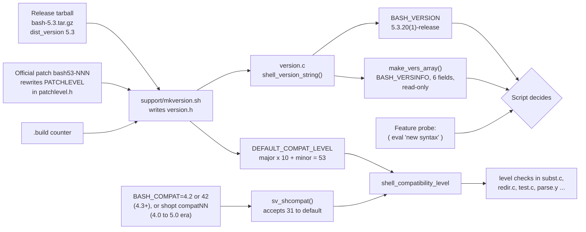

# Bash Version History

> [!summary] Claim
> Bash is not one language but a sequence of releases, from 2.0 (1996) to 5.3 (2025), each of which adds syntax older releases cannot parse and a few of which silently change what existing code means, so a robust script states its floor, detects features by trying them, and treats `BASH_COMPAT` as a migration aid rather than a time machine.

Part of [Bash](README.md) in [Shell and Unix Engineering](../README.md).

## TL;DR

- Mechanism: `support/mkversion.sh` bakes the release, the official patch level from `patchlevel.h`, a build counter, and a release status into `version.h`, which `version.c` turns into `BASH_VERSION` (`5.3.20(1)-release`) and `variables.c` turns into the six-field read-only `BASH_VERSINFO`; the same step sets `DEFAULT_COMPAT_LEVEL` (53 for 5.3), against which about 53 `shell_compatibility_level` checks in the source decide old versus new behavior.
- Rule: write to a stated floor (for example 4.4 or 5.0), fail fast when `BASH_VERSINFO` is below it, and detect any individual feature by running it in a subshell under `eval`, because new syntax is a parse error, not a runtime error, in every older release.
- Trap: three changes alter the meaning of code that still parses: a quoted right side of `=~` became literal in 3.2, `&` in a `${s/pat/rep}` replacement started inserting the match in 5.2 (`patsub_replacement` is on by default), and here-documents and here-strings became pipes instead of temporary files in 5.1.
- Portability: macOS still ships bash 3.2.57 as `/bin/bash` and `/bin/sh` (measured here, as of 2026-11), the last GPLv2 release, so 28 of the 33 features the lab probes are missing there; Debian 13 ships 5.2.37 and Alpine 3.22 ships 5.2.37 (as of 2026-11); no other shell sets `BASH_VERSION`, and POSIX defines no variable that names the shell at all.
- When not to use it: do not use `BASH_COMPAT` to run a 2010 script on 5.3 unchanged (it covers only the behaviors the COMPAT file lists, levels below 31 do not exist, and since 4.4 it is inherited from the environment), and do not gate on version where a feature probe works.

## Mental model



A release tarball fixes the major and minor numbers, each official patch rewrites the one `PATCHLEVEL` line in `patchlevel.h`, and the build counter in `.build` counts local compilations; `mkversion.sh` combines them into `version.h`.
From there two variables are born at startup: the string `BASH_VERSION`, formatted by `shell_version_string()` as `%s.%d(%d)-%s`, and the read-only array `BASH_VERSINFO`, filled field by field by `make_vers_array()`.
The same generation step emits `DEFAULT_COMPAT_LEVEL`, the release's own level; `BASH_COMPAT` (or, before 5.1, a `compatNN` shopt option) can lower `shell_compatibility_level` toward 31 but never raise it past the default, and code paths throughout the shell compare that integer to decide whether to behave as an older release.
A script can decide what to do from the version variables or, more robustly, from a probe that tries the feature, which is the only method that also works when a vendor has backported or removed something.

## How it works

### Lineage and maintenance

The name puns on Stephen Bourne, author of the Seventh Edition `/bin/sh`, "with the notion of rebirth through reimplementation"; Brian Fox of the Free Software Foundation wrote the original, and Chet Ramey, a volunteer at Case Western Reserve University, is the developer and maintainer (Ramey, AOSA vol. 1 ch. 3).
The manual page carries the copyright line `Copyright (C) 1989-2025 by the Free Software Foundation` (bash-5.3 `doc/bash.1`), and the oldest tarball still on the GNU mirror is `bash-1.14.7.tar.gz`, dated 1996-08-29 in the directory listing.
Readline, the line-editing library, is developed together with bash, with bash as its primary client but no bash-specific code inside it (AOSA ch. 3); bash 5.3 bundles readline 8.3 (`RL_READLINE_VERSION 0x0803` in `lib/readline/readline.h`).
The license changed at the 4.0 boundary: `shell.c` in 3.2.57 says "either version 2, or (at your option) any later version" with a GPLv2 `COPYING`, while 4.0's `shell.c` says "either version 3 of the License" with the GPLv3 `COPYING` dated 29 June 2007.
macOS still ships 3.2.57, the last release before that boundary, and the consequences are the subject of [[Bash-3-2-on-macOS]].

### Release anatomy: alpha, beta, rc, release, patches

Each feature release passes through public `-alpha`, `-beta`, and `-rc` tarballs (for 5.3: `bash-5.3-alpha`, `-beta`, `-rc1`, `-rc2`, then `bash-5.3.tar.gz`, all in the mirror listing), and `CHANGES` records each step as a section headed "This document details the changes between this version, bash-5.3-rc2, and the previous version".
After release, fixes ship as numbered official patches in `bash-X.Y-patches/` named `bashXY-NNN` (`bash53-001`, ...), each a context diff with a header of `Bash-Release`, `Patch-ID`, `Bug-Reported-by`, `Bug-Reference-URL`, and `Bug-Description`, applied with `patch -p0` from the source root.
Every patch includes a hunk that rewrites `patchlevel.h`; the file's own comment warns that no other line may match `^#define[ \t]*PATCHLEVEL` because `mkversion.sh` greps for it.
Occasionally the maintainer rolls patches into a new tarball (`bash-3.2.57.tar.gz`, `bash-4.3.30.tar.gz`, `bash-5.2.37.tar.gz`), which is why distribution versions such as `5.2.37` name a patch level, not a feature release.
NEWS and CHANGES differ in purpose: `NEWS` is "a terse description of the new features", one lettered list per release back to 2.0, while `CHANGES` is the full bug-fix log, and `COMPAT` lists the deliberate incompatibilities, 69 numbered items in 5.3 plus the compatibility-level table.

### How the version variables are built

`support/mkversion.sh` reads the distribution version (`5.3`), splits it into `dist_major` and `dist_minor`, reads `.build` and increments it into `build_ver`, takes `rel_status` from `-s` (default `release`), and writes `version.h` with `DISTVERSION`, `BUILDVERSION`, `RELSTATUS`, `DEFAULT_COMPAT_LEVEL ${dist_major}${dist_minor}`, and an SCCS string (bash-5.3 `support/mkversion.sh`).
`version.c` exposes these as `dist_version`, `patch_level`, `build_version`, and `release_status`; `shell_version_string()` formats them with `"%s.%d(%d)-%s"`, and `show_shell_version()` prints `GNU bash, version %s (%s)` with `MACHTYPE` for `--version` (bash-5.3 `version.c`).
`make_vers_array()` in `variables.c` unbinds any inherited `BASH_VERSINFO`, creates a fresh array, inserts index 0 major, 1 minor, 2 patch level, 3 build version, 4 release status, 5 `MACHTYPE`, and sets `att_readonly`, so the array cannot be forged from the environment or reassigned later; the lab measures six fields, agreement with `BASH_VERSION`, and a failed assignment under both 3.2 and 5.3.
The `(1)` in `3.2.57(1)-release` is therefore a local build counter, not a version component, and a vendor that rebuilt twice would print `(2)`.
`BASH_VERSINFO[4]` is the only reliable way to tell a release from a prerelease; a script that compares `BASH_VERSION` as a string cannot distinguish `5.3.0(1)-rc2` from `5.3.0(1)-release` without parsing it.

### Compatibility levels

Bash 4.0 introduced shell compatibility levels as mutually exclusive `shopt` options (`compat31`, `compat32`, `compat40`, ...) "intended to be a temporary solution" while users migrate (bash-5.3 `COMPAT`, Shell Compatibility Level).
Bash 4.3 added the `BASH_COMPAT` variable, which accepts either a decimal version like `4.2` or an integer like `42`; 4.4 made it inheritable from the initial environment and began deprecating the options; 5.0 is "the final version for which there will be an individual shopt option", and 5.1 and later require `BASH_COMPAT` (bash-5.3 `COMPAT`; NEWS 4.3 ee, 4.4 hh).
In 5.3 the `shopt` table still has exactly seven of them, `compat31` through `compat44` (bash-5.3 `builtins/shopt.def`), and `set_compatibility_level()` copies the result into `BASH_COMPAT` so the two never disagree.
`sv_shcompat()` in `variables.c` parses the value with two exact patterns, digit-dot-digit or digit-digit, so `5.10`, `4.2.0`, and ` 42` are all errors (measured under 5.3.20, as is `30`); it rejects anything below `MIN_COMPAT_LEVEL` (31) or above the running release's default with "compatibility value out of range" and falls back to the default level; an unset or empty `BASH_COMPAT` also means the default.
A level is a threshold, not a snapshot: setting `compat32` also enables the ASCII `[[ < ]]` comparison that changed in 4.1, because each level controls "behavior that changed in that version of bash", and every newer behavior gated at a higher number is switched off too.
A `grep` of the 5.3 tarball finds 53 comparisons of `shell_compatibility_level` against a literal level from 31 to 52 (measured here, 2026-11-12); that is the full extent of what `BASH_COMPAT` can undo, and anything not behind one of those checks, such as new syntax or new default-on options, is unaffected.
For example `redir.c` `here_document_to_fd()` checks `shell_compatibility_level <= 50` before choosing a pipe, while `patsub_replacement` is a plain `shopt` default, so `BASH_COMPAT=51` does not turn it off (the lab shows `BASH_COMPAT=50` restoring temporary files and `shopt -u patsub_replacement` restoring a literal `&`).

The levels and what each restores (bash-5.3 `COMPAT`):

| Level | Restores |
|---|---|
| 31 | quoted right side of `=~` is a regex again; ASCII `[[ < ]]` |
| 32, 40 | ASCII `strcmp(3)` ordering for `[[ < ]]` instead of locale `strcoll(3)` |
| 41 | POSIX mode: `time` followed by options stays a reserved word; single quotes special inside double-quoted `${...}` |
| 42 | replacement string of a double-quoted pattern substitution not quote-removed |
| 43 | word expansion errors non-fatal even in POSIX mode; `break` in a function affects the caller's loop |
| 44 | `BASH_ARGV`/`BASH_ARGC` set without `extdebug`; subshells inherit loops; assignments before `export`/`readonly` leak to the caller |
| 50 | 5.0 `RANDOM` sequence for a given seed; temporary files for here-documents |
| 51 | `unset a[@]` unsets the array; arithmetic and subscripts may expand twice; command substitutions parse as if `extglob` were on |
| 52 | historical `test` parsing with five or more arguments; old `bind -p` arguments; job notices while sourcing |

### The timeline

Release dates below are the tarball timestamps in the GNU mirror's directory listing (fetched 2026-11-12), and features are from bash-5.3 `NEWS`, which keeps one section per release back to 2.0.

| Release | Tarball date | Landmark additions (NEWS) | Last official patch (date) |
|---|---|---|---|
| 2.0 | 1996-12-31 | indexed arrays, `$'...'`, `PIPESTATUS`, `BASH_VERSINFO`, `shopt`, `((...))`; `sh` invocation enters POSIX mode | none in mirror |
| 2.02 | 1998-04-18 | `[[ ]]`, `extglob`, `printf` builtin, `$(< file)` | none in mirror |
| 2.04 | 2000-03-21 | `for ((;;))`, programmable completion (`progcomp`) | none in mirror |
| 2.05b | 2002-07-17 | here-strings `<<<`; `printf %q` switches to `$'...'` quoting | none in mirror |
| 3.0 | 2004-08-03 | `=~` and `BASH_REMATCH`, `set -o pipefail`, `{x..y}`, `${!a[@]}`, `failglob`, `RETURN` trap, `errtrace`/`functrace` | 022 (2014-10-05) |
| 3.1 | 2005-12-08 | `+=`, `printf -v`, `nocasematch` | 023 (2014-10-05) |
| 3.2 | 2006-10-11 | quoted `=~` right side matches literally; backquote parsing follows POSIX | 057 (2014-10-05) |
| 4.0 | 2009-02-20 | associative arrays, `mapfile`, `coproc`, `globstar`, `;&` and `;;&`, `\|&`, `&>>`, `${x^^}`, `BASHPID`, `command_not_found_handle`, compat levels; GPLv3 | 044 (2014-10-05) |
| 4.1 | 2009-12-31 | `{var}<file` descriptor allocation, `BASH_XTRACEFD`, locale-aware `[[ < ]]`, `read -N` | 017 (2014-10-05) |
| 4.2 | 2011-02-13 | `declare -g`, `-v`, `\u` escapes, `lastpipe`, `printf %(fmt)T`, negative subscripts, `FUNCNEST` | 053 (2014-10-05) |
| 4.3 | 2014-02-26 | namerefs (`declare -n`), `wait -n`, `BASH_COMPAT`, negative-subscript assignment | 048 (2016-10-04) |
| 4.4 | 2016-09-15 | `${x@Q}` and the transformation family, `inherit_errexit`, `mapfile -d`, `local -`, `PS0`, `EXECIGNORE` | 023 (2018-06-01) |
| 5.0 | 2019-01-07 | `EPOCHSECONDS`, `EPOCHREALTIME`, `BASH_ARGV0`, `wait -f`, `assoc_expand_once`, `localvar_inherit` | 018 (2020-07-10) |
| 5.1 | 2020-12-06 | `SRANDOM`, `wait -p`, `${x@U}` and friends, array `PROMPT_COMMAND`, pipes for small here-documents, process substitution in POSIX mode, fewer forks for `bash -c` | 016 (2022-01-04) |
| 5.2 | 2022-09-26 | `patsub_replacement` and `globskipdots` on by default, `varredir_close`, `${x@k}`, recursive-parser command substitution | 037 (2024-09-23) |
| 5.3 | 2025-07-30 | `${ cmd; }` and `${\| cmd; }`, `GLOBSORT`, `BASH_MONOSECONDS`, `BASH_TRAPSIG`, `array_expand_once`, `source -p`, `compgen -V`, `MULTIPLE_COPROCS` on | 020 (2026-09-14), maintained |

Two dates stand out.
Every release from 3.0 to 4.2 received its final patch on 2014-10-05, the Shellshock sweep, after which those branches stopped; 3.2's 057 is the patch macOS's 3.2.57 carries.
And `$'...'` illustrates how primary sources can disagree: NEWS lists it under 2.0 ("The `$'...'` quoting syntax expands ANSI-C escapes"), while `COMPAT` item 9 says "Bash-2.01 uses a new quoting syntax"; it was standardized only in POSIX.1-2024 (XCU 2.2.4), as was `pipefail` (XCU 2.9.2), both of which bash had since 2.0 and 3.0.

### Changes that alter the meaning of working code

Most releases only add syntax, which fails loudly on older shells; these changed what already-valid code does, and are the ones that bite during upgrades (bash-5.3 `COMPAT` items and NEWS).

- 3.2: a quoted part of the right side of `=~` matches as a string (COMPAT 33); `re='a.c'; [[ abc =~ "$re" ]]` is false from 3.2 on, true again only under `BASH_COMPAT=31`.
- 3.2: `test` and `[[` use `access(2)` instead of mode bits, honoring read-only and `noexec` mounts (COMPAT 32).
- 4.0: `set -e` exits when any pipeline fails, not only a simple command (COMPAT 41); 4.1 conforms to the then-current POSIX `set -e` (COMPAT 45).
- 4.1: `[[ a < B ]]` uses the locale's `strcoll(3)` (COMPAT 43).
- 4.1: `set -u` no longer aborts on `$@` with no positional parameters (COMPAT 44); 4.4 no longer aborts on `${a[@]}` of an empty array (COMPAT 53), so `set -u` scripts written for 4.4 die on 4.3 and older.
- 4.3: the replacement string of a pattern substitution undergoes quote removal (COMPAT 52).
- 4.4: `break` and `continue` in a function no longer affect the caller's loop (COMPAT 56); `PS4` is not imported when running as root (COMPAT 55).
- 5.0: `BASH_ARGV`/`BASH_ARGC` exist only under `extdebug` (COMPAT 59).
- 5.1: here-documents and here-strings no longer than the build-time pipe capacity become pipes (NEWS 5.1 c); POSIX-mode assignments before a function call no longer persist (COMPAT 62); `RANDOM` sequences for a given seed change (compat50).
- 5.2: `&` in the replacement of `${s/pat/rep}` inserts the matched text unless quoted or the option is off (NEWS 5.2 x); `globskipdots` stops `.*` from matching `.` and `..` (NEWS 5.2 aa); `unset 'a[@]'` on an associative array removes the key `@` (COMPAT 66).
- 5.3: `test` with more than four arguments parses parenthesized subexpressions with the POSIX algorithm (COMPAT 67); `wait -n` in POSIX mode removes jobs from the table (NEWS 5.3 nn).

### Mechanisms behind two recent changes

Here-documents in 5.1+: `redir.c` `here_document_to_fd()` expands the document first, returns `/dev/null` for an empty one, jumps to the temporary-file path when `shell_compatibility_level <= 50`, and otherwise, if the document is no longer than `HEREDOC_PIPESIZE`, creates a `pipe(2)`, checks `fcntl(F_GETPIPE_SZ)` where the kernel has it, writes the whole document, closes the write end, and returns the read end; larger documents still go to a `sh-thd` temporary file.
`HEREDOC_PIPESIZE` defaults to `PIPESIZE`, which `builtins/psize.sh` measures at build time (writing 512 if the measurement produces nothing; `redir.c` falls back to `PIPE_BUF` or 4096 only when `PIPESIZE` is not defined at all), an optional `HEREDOC_PIPEMAX` caps it, and FreeBSD is pinned to 4096 because, per the source comment, "FreeBSD 13 can reliably handle atomic writes at this capacity without hanging".
The point is to write the whole document before any reader runs: a document bigger than the pipe would block the writing shell, which is also the reader's parent, so it would deadlock.

Nofork command substitution in 5.3: `${ cmd; }` runs `cmd` in the current shell via `subst.c` `function_substitute()`, which captures output not through a pipe but through `anonopen("sh-nfc", ...)` in `lib/sh/anonfile.c`: `memfd_create("anonopen", MFD_NOEXEC_SEAL)` where the system has it (`HAVE_MEMFD_CREATE`, for example Linux), else an unlinked `shm_open` object, else an unlinked random temporary file; stdout is redirected there, the command runs as an unnamed function scope (locals allowed, `return` ends it, positional parameters shared), and the file is read back with trailing newlines removed (bash-5.3 `doc/bash.1`, Command Substitution).
`${| cmd; }` skips the capture file entirely: it makes `REPLY` a fresh local, runs `cmd` with the caller's stdout, and expands to `REPLY`'s final value without trimming newlines.
Side effects persist: `n=0; x=${ n=1; echo hi; }` leaves `n` set to 1, where `$(...)` would not (the lab asserts both).

### Detecting the version and the feature

There is no standard way to ask which shell is running: none of the variables POSIX defines in XCU 2.5.3 names the implementation or its version.
Each shell announces itself with its own variable instead (`BASH_VERSION`, `ZSH_VERSION`, `KSH_VERSION` for ksh93 and mksh, `YASH_VERSION`, `POSH_VERSION`, `BB_ASH_VERSION`), dash sets none, and the lab asserts that each family sets its own and that only bash sets `BASH_VERSION`.
A version check costs nothing and documents the floor:

```bash
if [ -z "${BASH_VERSION-}" ] || [ $(( BASH_VERSINFO[0] * 100 + BASH_VERSINFO[1] )) -lt 404 ]; then
  echo "${0##*/}: needs bash >= 4.4, running ${BASH_VERSION:-a non-bash shell}" >&2
  exit 1
fi
```

That test must itself work in old shells: `BASH_VERSINFO[0]` inside `$(( ))` is valid in every bash since 2.0 (arrays and `BASH_VERSINFO` both arrived in 2.0), and the `-z` guard runs first, so a non-bash `sh` exits through the message without ever expanding the array reference.
A feature probe is stronger, because distributions patch and configure builds: `--enable-cond-regexp`, `--enable-translatable-strings`, `--enable-function-import`, and `MULTIPLE_COPROCS` are build-time switches (NEWS 3.0 dd, 5.2 z, 4.4 l, 5.3 ff), so a version number does not prove a feature is compiled in.
The probe must also contain the failure: on 3.2 (measured here) `declare -A m` fails with `declare: -A: invalid option`, `mapfile` with `command not found`, `${x^^}` with `bad substitution`, and `[[ -v x ]]` with `conditional binary operator expected` followed by a syntax error; the first two are ordinary command failures, but the last two can end a non-interactive shell, so each probe runs as `(eval 'CODE')` in a subshell.

## Numbers and limits

| Quantity | Value | Source |
|---|---|---|
| Fields in `BASH_VERSINFO` | 6, read-only (major, minor, patch, build, status, `MACHTYPE`) | bash-5.3 `variables.c` `make_vers_array()`; lab, 3.2.57 and 5.3.20 |
| `BASH_VERSION` format | `%s.%d(%d)-%s`, e.g. `5.3.20(1)-release` | bash-5.3 `version.c` `shell_version_string()`; lab |
| Default compatibility level | major x 10 + minor (53 for 5.3) | bash-5.3 `support/mkversion.sh` |
| Lowest accepted `BASH_COMPAT` | 31 (`MIN_COMPAT_LEVEL`) | bash-5.3 `variables.c` `sv_shcompat()` |
| `compatNN` shopt options left | 7 (`compat31` to `compat44`) | bash-5.3 `builtins/shopt.def` |
| Literal compat-level checks (31 to 52) | 53 | `grep` of the bash-5.3 tarball, measured here 2026-11-12 |
| Items in `COMPAT` | 69 numbered incompatibilities | bash-5.3 `COMPAT` |
| Feature releases 2.0 to 5.3 | 20: eight 2.x (2.0 to 2.05b), three 3.x, five 4.x, four 5.x | GNU mirror listing, 2026-11-12 |
| Official patches, final count | 3.0: 22; 3.1: 23; 3.2: 57; 4.0: 44; 4.1: 17; 4.2: 53; 4.3: 48; 4.4: 23; 5.0: 18; 5.1: 16; 5.2: 37; 5.3: 20 so far (as of 2026-11) | `bash-X.Y-patches/` listings, 2026-11-12 |
| Age of macOS `/bin/bash` | 3.2 released 2006-10-11; last patch 2014-10-05 | mirror listing; lab measured 3.2.57 on macOS 27.3 |
| Lab features present in 3.2.57 | 5 of 33 | lab, macOS `/bin/bash` |
| Lab features present in 5.3.20 | 33 of 33 | lab, Homebrew bash |
| `{var}` descriptor floor | 10 or above | bash-5.3 `doc/bash.1`, `SHELL_FD_BASE` in `redir.c`; lab got 10 |
| `SRANDOM` width | 32 bits, from `getrandom`/`getentropy`, else `/dev/urandom` or `arc4random` | NEWS 5.1 i |
| `EPOCHREALTIME` resolution | microseconds | NEWS 5.0 c |
| `TIMEFORMAT` precision | up to 6 digits from 5.3 (3 before) | NEWS 5.3 v |
| Here-document pipe threshold | build-time pipe capacity (`PIPESIZE`), 4096 on FreeBSD | bash-5.3 `redir.c` |
| `$(echo hi)` cost | about 670 us per substitution (2000 in 1.344 s) | fastest of 10 runs, 2026-11-14: bash 5.3.20, Apple M3 Pro, macOS 27.3, host load average above 30 |
| `${ echo hi; }` cost | about 200 us (2000 in 0.394 s) | same 10 runs |
| `${\| REPLY=hi; }` cost | about 6 us (2000 in 0.012 s) | same 10 runs |
| Shellshock CVSS | CVE-2014-6271: 9.8 (v3.1), 10.0 (v2) | NVD |

The timing rows are the fastest of ten runs of a 2000-iteration loop on one busy machine, not a benchmark: the slowest `$(...)` run took 3.8 s, nearly three times the fastest, so only the ordering and the order of magnitude (fork plus pipe, then an anonymous file, then no capture at all) are the durable part.

## Portability

The question here is not whether another shell implements a bash feature but how a script tells which shell and which bash release it is running, and what each answer implies; utilities are not involved.
Cells marked "lab" are asserted by the lab's tests, which the integrator's matrix runs in every listed shell it has; the matrix has bash 3.2.57 (macOS), 5.2.37 (Debian and Alpine), and 5.3.20 (Homebrew) but no 4.x, so the 4.3 and 4.4 to 5.0 rows rest on NEWS and the lab's version-keyed expectations, not on a run; the same holds for the lab's split of negative-subscript reads at 4.2 (NEWS 4.2 p) and assignment at 4.3 (NEWS 4.3 x).

| Shell | Identity variable | Bash features from the lab probe | `BASH_COMPAT` |
|---|---|---|---|
| POSIX sh | none defined (XCU 2.5.3) | not specified | not specified |
| macOS bash 3.2.57 (`/bin/bash`, `/bin/sh`) | `BASH_VERSION=3.2.57(1)-release`, 6-field `BASH_VERSINFO` (lab) | 5 of 33: 3.0 and 3.1 features only (lab) | ignored, an ordinary variable (lab) |
| bash 4.3 | `BASH_VERSION` | through 4.3 (NEWS; lab expectation by version, not run) | honored when assigned (NEWS 4.3 ee); ignored from the environment (NEWS 4.4 hh) |
| bash 4.4 to 5.0 | `BASH_VERSION` | through the release (NEWS; lab expectation by version, not run) | honored, inherited from the environment (NEWS 4.4 hh), `compatNN` options still present (bash-5.3 `builtins/shopt.def` still has `compat31` to `compat44`) |
| current bash 5.3 | `BASH_VERSION` | 33 of 33 (lab) | 31 to 53 accepted, others rejected (lab, `variables.c`) |
| zsh native and `zsh --emulate sh` | `ZSH_VERSION` set, `BASH_VERSION` unset (lab) | probe reports `not-bash` (lab) | none |
| dash | none of the six set (lab) | `not-bash` (lab) | none |
| ksh93 (u+ 2012 and u+m 1.0.10) | `KSH_VERSION` set, `BASH_VERSION` unset (lab) | `not-bash` (lab) | none |
| mksh | `KSH_VERSION` set (lab), containing `MIRBSD` (`@(#)MIRBSD KSH R59 2025/04/26 +Debian`, measured in the shell matrix), `BASH_VERSION` unset (lab) | `not-bash` (lab) | none |
| yash | `YASH_VERSION` set, `BASH_VERSION` unset (lab) | `not-bash` (lab) | none |
| posh | `POSH_VERSION` set, `BASH_VERSION` unset (lab) | `not-bash` (lab) | none |
| BusyBox ash | `BB_ASH_VERSION` set, `BASH_VERSION` unset (lab) | `not-bash` (lab) | none |

Distribution bash releases (as of 2026-11): Debian 13 (trixie) `5.2.37-2`, Debian 12 `5.2.15-2`, Debian 11 `5.1-2+deb11u1`, Debian forky and sid `5.3-4` (sources.debian.org); Alpine 3.22 `5.2.37-r0` (pkgs.alpinelinux.org); macOS 3.2.57 (measured).
In the shell matrix's Debian 13 and Alpine 3.22 images bash reports `5.2.37(1)-release` and the lab probe finds 30 of 33 features, every one except the three 5.3 additions.
A Debian version string such as `5.1-2+deb11u1` encodes the Debian revision, not the upstream patch level; read `BASH_VERSINFO[2]` on the machine.

## Worked example

The [lab](../labs/04-bash-version-history/) has three probes and one bats file.
`bash-features.sh` tries 33 version-gated features and prints `NAME yes|no`; the tests hold the release that introduced each (from NEWS) and require "yes" exactly when the bash under test is that release or newer.
Simplified excerpt of `bash-features.sh` (the full file has one `probe` line per feature):

```sh
#!/bin/sh
if [ -z "${BASH_VERSION-}" ]; then
  echo not-bash
  exit 0
fi

# probe NAME CODE: print "NAME yes" if CODE succeeds in a subshell, else "NAME no".
probe() {
  if (eval "$2") >/dev/null 2>&1; then
    printf '%s yes\n' "$1"
  else
    printf '%s no\n' "$1"
  fi
}

# 4.0
probe assoc-array 'declare -A m && m[k]=v && m[j]=w && [ "${#m[@]}" -eq 2 ] && [ "${m[k]}" = v ]'
# 4.2
probe negative-index-read 'a=(p q r); [ "${a[-1]}" = r ]'
# 5.2
probe patsub-replacement 's=abc; r=${s/b/[&]}; [ "$r" = "a[b]c" ]'
# 5.3
probe nofork-comsub 'n=0; x=${ n=1; echo hi; }; [ "$x" = hi ] && [ "$n" = 1 ]'
```

Simplified excerpt of the check in `bash-version-history.bats`:

```bash
# bash_num: print the release of the bash under test as MAJOR * 100 + MINOR (5.3 -> 503).
bash_num() {
  local v major rest minor
  v=$(lab_shell_version)
  major=${v%%.*}
  rest=${v#*.}
  minor=${rest%%.*}
  printf '%d\n' "$((major * 100 + minor))"
}

@test "bash 4.0 features: associative arrays, case modification, mapfile, coproc, globstar, |&" {
  feature_test 400 assoc-array case-modify mapfile coproc-keyword globstar pipe-stderr
}
```

Captured on macOS 27.3 (2026-11-12) with `/bin/bash` 3.2.57 and Homebrew bash 5.3.20; the probe's lines are joined three per row with `paste` to save space, and `compat-probe.sh MODE` outputs are shown one per line (`|` separates two output lines):

```text
### /bin/bash
3.2.57(1)-release
pipefail yes regex-match yes brace-sequence yes
append-assign yes printf-v yes assoc-array no
case-modify no mapfile no coproc-keyword no
globstar no pipe-stderr no fd-variable no
declare-g no test-v no negative-index-read no
lastpipe no printf-time no nameref no
negative-index-write no transform-Q no mapfile-d no
local-dash no inherit-errexit no epochseconds no
bash-argv0 no srandom no transform-U no
patsub-replacement no transform-k no globskipdots no
nofork-comsub no valsub-comsub no array-expand-once no
versinfo         -> fields=6 match=yes readonly=yes
regex            -> literal
regex 31         -> literal
regex-env 31     -> literal
herestring       -> file
herestring 50    -> file
compat-error 99  -> accepted
patsub           -> a[&]c
patsub off       -> no-option
nofork           -> comsub n=0 x=hi|nofork unsupported
### /opt/homebrew/bin/bash
5.3.20(1)-release
pipefail yes regex-match yes brace-sequence yes
append-assign yes printf-v yes assoc-array yes
case-modify yes mapfile yes coproc-keyword yes
globstar yes pipe-stderr yes fd-variable yes
declare-g yes test-v yes negative-index-read yes
lastpipe yes printf-time yes nameref yes
negative-index-write yes transform-Q yes mapfile-d yes
local-dash yes inherit-errexit yes epochseconds yes
bash-argv0 yes srandom yes transform-U yes
patsub-replacement yes transform-k yes globskipdots yes
nofork-comsub yes valsub-comsub yes array-expand-once yes
versinfo         -> fields=6 match=yes readonly=yes
regex            -> literal
regex 31         -> regex
regex-env 31     -> regex
herestring       -> pipe
herestring 50    -> file
compat-error 99  -> rejected
patsub           -> a[b]c
patsub off       -> a[&]c
nofork           -> comsub n=0 x=hi|nofork n=1 x=hi
```

Read the two blocks against the timeline: 3.2 has exactly the 3.0 and 3.1 features, treats `BASH_COMPAT` as an ordinary variable (so `99` is "accepted" and `31` changes nothing), and keeps a literal `&`; 5.3 has everything, restores the pre-3.2 regex rule under `BASH_COMPAT=31` whether assigned or inherited, refuses level 99, and shows that a here-string is a pipe unless the level is 50 or lower.
All 21 tests passed under bash 5.3.20 here; the matrix runs the same file under bash 3.2.57, 5.2.37, and 5.3.20 and the other shells, where the non-bash families must print `not-bash`.

## Pitfalls

> [!warning] Comparing major and minor separately
> Trigger: `if (( BASH_VERSINFO[0] >= 4 && BASH_VERSINFO[1] >= 2 ))` to require 4.2.
> Symptom: bash 5.0 and 5.1 fail the check (minor 0 and 1 are below 2), so the script refuses to run on newer shells.
> Fix: compare one number, `(( BASH_VERSINFO[0] * 100 + BASH_VERSINFO[1] >= 402 ))`, as the lab's `bash_num` does; never compare `BASH_VERSION` as a string either, since `"10.0" < "5.3"` lexically.

> [!warning] `#!/bin/bash` on macOS is 2006
> Trigger: a script developed on Linux bash 5.x using `declare -A`, `mapfile`, `${x,,}`, `[[ -v ]]`, or `${a[-1]}` is run on a Mac as `#!/bin/bash`.
> Symptom: `declare: -A: invalid option`, `mapfile: command not found`, or `bad substitution` at the first use; the lab measures 28 of 33 probed features missing in 3.2.57.
> Fix: state the floor and check it at the top, use `#!/usr/bin/env bash` with a documented Homebrew or Nix bash, or keep the script inside bash 3.2's feature set; see [[Bash-3-2-on-macOS]].

> [!warning] `&` changed meaning in 5.2
> Trigger: `${path//\//&}` or a replacement built from data containing `&`, written when `&` was literal.
> Symptom: on 5.2 and later the `&` expands to the matched text (the lab prints `a[b]c` instead of `a[&]c`), silently corrupting output; `BASH_COMPAT=51` does not undo it, because `patsub_replacement` is an ordinary default-on option (bash-5.3 `subst.c`, `doc/bash.1`; measured here, `BASH_COMPAT=51` under 5.3.20 still prints `a[b]c`).
> Fix: quote the `&` (`\&`) or the replacement variable (`"${s//x/"$rep"}"`), or `shopt -u patsub_replacement` at the top of scripts that must behave identically across releases.

> [!warning] Quoted regex in `=~`
> Trigger: `[[ $s =~ "$re" ]]`, copied from a pre-3.2 tutorial.
> Symptom: the pattern matches only the literal text of `re` on every bash from 3.2 on (lab: `literal`), so validation silently passes or fails.
> Fix: keep the regex in a variable and expand it unquoted, `[[ $s =~ $re ]]`; see [[Bash-Regex-and-BASH_REMATCH]].

> [!warning] An inherited `BASH_COMPAT`
> Trigger: a CI system, container image, or user profile exports `BASH_COMPAT` (for example `BASH_COMPAT=42` set once to keep a legacy script alive).
> Symptom: since 4.4 every bash started with that environment behaves as the older release for the 53 gated behaviors (the lab shows `regex-env 31` turning a literal match into a regex match), with no warning; a value newer than the running release prints "compatibility value out of range" at every start.
> Fix: never export `BASH_COMPAT`; set it, if at all, inside the one script that needs it, and `unset BASH_COMPAT` at the top of scripts that must have current semantics.

> [!warning] Here-documents became pipes in 5.1
> Trigger: a program that `lseek(2)`s, `mmap(2)`s, or `fstat(2)`s its stdin for a size is fed a small here-document or here-string.
> Symptom: on 5.1 and later stdin is a pipe (lab: `pipe`), so `lseek` fails with `ESPIPE` and the size is 0; on 5.0 and earlier, or for a document larger than the pipe capacity, it is a regular unlinked file and works, so the bug appears only for short inputs.
> Fix: redirect from a real file when the consumer needs one, or run that script with `BASH_COMPAT=50` (lab: `file`), which `here_document_to_fd()` checks before choosing a pipe.

> [!warning] `set -u` and empty arrays before 4.4
> Trigger: `set -u` and `"${args[@]}"` with an empty array.
> Symptom: 4.3 and older abort (3.2.57 prints `a[@]: unbound variable` for an empty `a`, measured here); 4.4 and later do not (COMPAT 53), so the script works on a developer's Linux laptop and dies on a Mac or an older server.
> Fix: `${args[@]+"${args[@]}"}` works on every release, or require 4.4.

> [!warning] Testing on one release
> Trigger: CI uses the distribution's bash (5.2 on Debian 13) while production includes macOS laptops (3.2) or old appliances (4.x).
> Symptom: features and changed semantics above escape review; ShellCheck cannot know which release you target unless told.
> Fix: run the test suite under each bash you support (official tarballs build in minutes; see [[Building-Bash-from-Source]]) and keep the floor check in the script so an unsupported release fails at line 1, not line 300.

## Security and robustness

Shellshock is the defining incident of bash's version history.
Bash exported functions as ordinary environment variables whose value began with `() {`, and the importer passed the whole value to the parser and executor, so trailing commands after the function body ran at startup in any bash that received the environment (CVE-2014-6271, NVD: "GNU Bash through 4.3 processes trailing strings after function definitions", CVSS 9.8; vectors include OpenSSH `ForceCommand`, Apache `mod_cgi`, and DHCP clients).
The response was a cascade of official patches, each with a primary-source description:

| Patch (4.3 / 3.2) | Reported by | `Bug-Description` (abridged) | CVE closed (NVD wording) |
|---|---|---|---|
| bash43-025 / bash32-052 | Stephane Chazelas | "bash will execute user code while processing the environment for exported function definitions"; adds `SEVAL_FUNCDEF` and `SEVAL_ONECMD` | CVE-2014-6271 |
| bash43-026 | Tavis Ormandy | parser "can incorrectly save a lookahead character and return it on a subsequent call" | CVE-2014-7169 ("through 4.3 bash43-025") |
| bash43-027 | Florian Weimer | "changes the encoding bash uses for exported functions": names become `BASH_FUNC_name%%` | hardening; CVE-2014-6277 and 6278 are "through 4.3 bash43-026" |
| bash43-028 | Florian Weimer | "two local buffer overflows in parse.y" with many here-documents or nested loops | CVE-2014-7186 (`redir_stack`), CVE-2014-7187 (`word_lineno`), both "through bash43-026" |
| bash43-029 | Michal Zalewski | here-document "delimited by end-of-file" leaves the delimiter uninitialized | parser robustness |
| bash43-030 / bash32-057 | Michal Zalewski | "nested command substitutions and function importing" can run code after the definition | parser robustness |

The `BASH_FUNC_name%%` encoding is the lasting design fix: a variable is treated as a function only if its name has the prefix and suffix (`BASHFUNC_PREFIX`, `BASHFUNC_SUFFIX` in the bash43-027 `variables.c` hunk), so attacker-chosen values in ordinary variables such as `HTTP_USER_AGENT` can no longer be function definitions; 4.4 added `--enable-function-import` so builders can compile import out (NEWS 4.4 l).
A machine has the whole 2014 series only if `BASH_VERSINFO[2]` is at least 30 for 4.3 or at least 57 for 3.2, or the release is 4.4 or later; for 3.0 to 4.2 it means the final patch of 2014-10-05 (022, 023, 044, 017, 053 respectively).
On 3.2 the series is bash32-052 to bash32-057, whose first and last descriptions match bash43-025 and bash43-030 word for word.
The details of the parser bugs and detection are in [[Shellshock]] and [[Variable-Contexts-and-Exported-Functions]].

Other version-specific security facts:
- CVE-2019-18276: in bash "through 5.0 patch 11", `disable_priv_mode()` reset the effective UID but not the saved UID, so code running in a setuid-started bash could regain privilege with `enable -f` and a loadable builtin that calls `setuid()` (NVD, CVSS 7.8); bash-5.3 `shell.c` now calls `setresuid(uid, uid, uid)` when the effective or saved UID differs from the real one; the first fixed release is 5.1, whose `disable_priv_mode()` already calls `setresuid()` where the system has it, while none of the remaining 5.0 patches (bash50-012 to bash50-018) touches it (bash-5.1 `shell.c`; `bash-5.0-patches/` `Bug-Description` headers); see [[Dropping-Privileges]].
- CVE-2022-3715: a heap buffer overflow in `valid_parameter_transform`, the code behind `${x@op}` (NVD, CVSS 7.8; affected releases not stated in the NVD text).
- 4.4 stopped importing `PS4` when running as root, "closing a security hole involving PS4 expansion performing command substitution" (NEWS 4.4 nn), so an older root shell with `set -x` can run commands from an attacker-controlled environment.
- `BASH_COMPAT` and `FUNCNEST` are read from the environment since 4.4 (NEWS 4.4 hh), `ARGV0` sets `$0` from the environment since 5.1 (NEWS 5.1 l), and `BASH_ENV` names a file a non-interactive bash sources at startup; treat all of them as inputs that cross privilege boundaries, see [[BASH_ENV-and-ENV]].

Robustness rules that follow:
- Make the release floor executable: a three-line check at the top beats a comment in a README.
- Pin the interpreter path in production (`/usr/bin/bash` from a known package, or a vendored build) rather than whatever `env bash` finds first in `PATH`.
- Inventory releases across the fleet with `bash -c 'echo "$BASH_VERSION"'`, not the package manager, because rolled-up tarballs and vendor rebuilds diverge from package version strings.

## The principal's view

The decision is the organization's bash floor, and it is a portability decision disguised as a style choice.
A 4.4 floor buys associative arrays, `mapfile -d ''`, namerefs, `${x@Q}`, `inherit_errexit`, and empty-array `set -u` safety, and costs every stock macOS machine plus anything older than Debian 9; a 5.x floor adds `EPOCHREALTIME`, `wait -p`, and `SRANDOM` for little additional reach loss on Linux but none on macOS, where you must install bash anyway.
A 3.2 floor is the price of "runs on every Mac with nothing installed", and is often cheaper paid by writing POSIX `sh` instead, which also covers dash and BusyBox; see [[Dash-and-Bashisms]] and [[Shell-Landscape-What-Runs-Where]].
Upgrades are mostly safe because most releases only add syntax, but the handful of semantic changes (quoted `=~`, `set -e` and `set -u` refinements, here-document pipes, `patsub_replacement`) mean a fleet-wide bump needs the test suite run under both releases, not just a changelog read.
`BASH_COMPAT` is a short-term bridge for a known script during that migration, never a policy: it covers only gated behaviors, is inherited by children, and its `compatNN` options are already being removed.
When a tool needs things bash added late and still lacks (structured data, real error handling, portable concurrency), the trade is not 4.4 versus 5.3 but bash versus a language with one runtime version per lockfile; move it to Python or Go once it outgrows a few hundred lines or needs to run identically on every developer machine.

## Interview questions

> [!question] L5: What is in `BASH_VERSINFO`, and why prefer it to parsing `BASH_VERSION`?
>
> > [!success]- Answer
> > It is a six-element read-only array: major, minor, patch level, build number, release status, and `MACHTYPE`, filled by `make_vers_array()` at startup.
> > `BASH_VERSION` is the same data formatted as `%s.%d(%d)-%s`, so parsing it means splitting on dots and parentheses and still handling `-rc2`.
> > The array is read-only and rebuilt at startup, so it cannot be forged from the environment.
> >
> > Follow-up: What does the `(1)` in `3.2.57(1)-release` mean? (A local build counter from `.build`, not a version component.)

> [!question] L5: Why does a `#!/bin/bash` script that uses `declare -A` work on Linux but fail on a Mac, and what are your options?
>
> > [!success]- Answer
> > macOS ships bash 3.2.57, the last GPLv2 release, and associative arrays arrived in 4.0.
> > Options: require a newer bash via `#!/usr/bin/env bash` plus an install step and a floor check, rewrite without associative arrays, or rewrite in POSIX `sh`.
> > Whatever you choose, add a version check at the top so the failure names the cause.
> >
> > Follow-up: Why does `#!/usr/bin/env bash` not fix it by itself? (It finds whichever bash is first in `PATH`, which on a stock Mac is still `/bin/bash`.)

> [!question] L6: Predict the output of `s=abc; r=${s/b/[&]}; echo "$r"` under bash 3.2, 5.1, and 5.3, and with `BASH_COMPAT=51` under 5.3.
>
> > [!success]- Answer
> > 3.2 and 5.1 print `a[&]c`, because `&` had no special meaning before 5.2.
> > 5.3 prints `a[b]c`, because `patsub_replacement`, on by default since 5.2, replaces an unquoted `&` with the matched text.
> > `BASH_COMPAT=51` still prints `a[b]c`: the option is a plain default, not one of the compatibility-gated behaviors, so only `shopt -u patsub_replacement` or quoting the `&` restores the old output.
> >
> > Follow-up: How do you write the replacement so it is identical on every release? (Escape it as `\&` or put it in a quoted variable, `"${s/b/"$rep"}"`.)

> [!question] L6: Debug this script: it is supposed to require bash 4.2 but refuses to run on bash 5.1.
>
> ```bash
> if (( BASH_VERSINFO[0] < 4 || BASH_VERSINFO[1] < 2 )); then
>   echo "need bash 4.2+" >&2; exit 1
> fi
> ```
>
> > [!success]- Answer
> > It tests the minor number independently of the major, so 5.1 fails `BASH_VERSINFO[1] < 2`.
> > Combine them into one ordered number: `(( BASH_VERSINFO[0] * 100 + BASH_VERSINFO[1] < 402 ))`.
> > Also guard with `[ -n "${BASH_VERSION-}" ]` first, so a non-bash `sh` gets a clear message instead of an arithmetic error.
> >
> > Follow-up: Why is a feature probe still better than the fixed check? (Builds can omit features such as `=~` or function import at configure time, and vendors backport fixes.)

> [!question] L6: What does `BASH_COMPAT` do, what values does it accept, and what can it not do?
>
> > [!success]- Answer
> > It lowers `shell_compatibility_level`, which about 53 checks in the source compare against to restore older behavior, for example the pre-3.2 regex quoting rule at 31 or temporary-file here-documents at 50.
> > `sv_shcompat()` accepts `D.D` or `DD` between 31 and the running release's own level; anything else prints "compatibility value out of range" and uses the default.
> > It cannot remove new syntax, cannot undo default-on options such as `patsub_replacement`, and cannot emulate anything older than 3.1.
> >
> > Follow-up: Why is exporting it dangerous? (Since 4.4 every child bash inherits it, silently changing semantics in unrelated scripts.)

> [!question] L6: Why did bash 5.1 start using pipes for here-documents, and what can break?
>
> > [!success]- Answer
> > A pipe avoids creating, writing, and unlinking a temporary file for every small here-document, so `here_document_to_fd()` uses one when the document fits within the build-time pipe capacity and writes it fully before the command runs.
> > Consumers that seek, `mmap`, or size their stdin now see a pipe, and `lseek` returns `ESPIPE`, but only for short documents, which makes the bug input-dependent.
> > `BASH_COMPAT=50` or redirecting from a real file restores seekable input.
> >
> > Follow-up: Why must the document fit in the pipe? (The shell writes it before the reader runs; a larger write would block the writer, which is the reader's parent, so it would deadlock.)

> [!question] L7+: Walk through Shellshock: the root cause, why the first patch was insufficient, and what the durable fix was.
>
> > [!success]- Answer
> > Bash imported any environment variable whose value started with `() {` as a function by handing the value to the parser and executor, so commands after the body ran at startup (CVE-2014-6271), reachable through CGI headers, `ForceCommand`, and DHCP options.
> > bash43-025 restricted that evaluation to a single function definition, but the parser itself had state bugs, a saved lookahead character (CVE-2014-7169, fixed by 026) and buffer overflows (7186 and 7187, fixed by 028), still reachable through any variable.
> > The durable fix was bash43-027's encoding change: only variables named `BASH_FUNC_name%%` are candidates, so attacker-controlled ordinary variables never reach the function parser; 4.4 also made import a configure option.
> > The organizational lesson is that every release from 3.0 to 4.2 got a final patch on 2014-10-05 and then stopped, so the inventory question was "which patch level", which package versions did not answer.
> >
> > Follow-up: How would you verify a fleet is patched without trusting package metadata? (Run `bash -c 'echo "${BASH_VERSINFO[0]}.${BASH_VERSINFO[1]}.${BASH_VERSINFO[2]}"'` and compare against 3.2.57, 4.3.30, and so on, or run the classic `env x='() { :;}; echo vulnerable' bash -c :` probe in a sandbox.)

> [!question] L7+: As owner of the shell standards for a company with Linux servers on Debian 11 to 13 and macOS laptops, what bash floor do you set and how do you enforce it?
>
> > [!success]- Answer
> > The servers span 5.1 to 5.2 and the laptops ship 3.2.57, so the real choice is between POSIX `sh` for scripts that must run on unmodified laptops and a 4.4 or 5.0 floor with bash installed by the device-management tooling.
> > I would set 5.0 for internal tooling (all servers satisfy it and macOS needs an install regardless), and POSIX `sh` for bootstrap scripts that run before any install.
> > Enforcement: a shared preamble that checks `BASH_VERSINFO` and fails with a clear message, ShellCheck in CI, and the test suite run under the floor release and the newest release in CI images.
> > The trade-off named explicitly: the floor locks out `${ cmd; }` and `GLOBSORT` until 5.3 is everywhere, which is acceptable because none of them is load-bearing.
> >
> > Follow-up: When do you stop writing bash for a tool at all? (When it needs structured data, real error handling, or identical behavior on every machine; a language with a lockfile gives one runtime version.)

> [!question] L7+: Why do you think bash keeps adding syntax such as `${ cmd; }` rather than fixing `$(...)`, and what does that cost the ecosystem?
>
> > [!success]- Answer
> > POSIX fixes `$(...)` as a subshell (XCU 2.6.3), so its fork cannot be removed without breaking the variable-isolation guarantee existing scripts rely on; a new spelling is the only compatible way to offer no-fork capture.
> > The measured gain is large (about 670 us versus 200 us per capture here, and 6 us for `${| ...; }`), which matters in loops.
> > The cost is that every new spelling is a hard parse error on all older releases and in every other shell, which raises the floor of any script that uses it and fragments "bash" further.
> >
> > Follow-up: How would you adopt it safely in a library that must support 4.4? (Gate on a probe and keep a `$(...)` fallback, or keep the hot loop free of command substitution altogether.)

## Related

Prerequisites: [[Bash-Introspection-Variables]]

Next: [[Bash-3-2-on-macOS]]

See also: [[Bash-POSIX-Mode]], [[Shell-Options-shopt]], [[Bash-Regex-and-BASH_REMATCH]], [[Bash-Parameter-Transformations]], [[Associative-Arrays]], [[Namerefs-and-Dynamic-Scope]], [[wait-n-and-wait-p]], [[Command-Substitution]], [[Here-Documents]], [[Shellshock]], [[Variable-Contexts-and-Exported-Functions]], [[Dropping-Privileges]], [[BASH_ENV-and-ENV]], [[Building-Bash-from-Source]], [[POSIX-2024-Changes]], [[Dash-and-Bashisms]], [[Shell-Landscape-What-Runs-Where]], [[Bourne-Shell]], [[KornShell-and-POSIX-Standardization]]

## Further reading

- GNU bash `NEWS` (in every release tarball, https://ftpmirror.gnu.org/bash/): the per-release feature list back to 2.0, the primary source for "since when".
- GNU bash `COMPAT` (same tarball): every deliberate incompatibility and the exact behavior each compatibility level restores.
- GNU bash `CHANGES` (same tarball): the full fix log per alpha, beta, rc, and release.
- Official patch directories, for example https://ftpmirror.gnu.org/bash/bash-5.3-patches/: patch headers state the reporter and the bug, and the listing shows when each branch stopped.
- Chet Ramey, "The Bourne-Again Shell", The Architecture of Open Source Applications vol. 1, https://aosabook.org/en/v1/bash.html: the maintainer's own account of bash's structure and lineage.
- NVD, CVE-2014-6271 and CVE-2014-7169, https://nvd.nist.gov/vuln/detail/CVE-2014-6271: the Shellshock records, including the note that the first fix was incomplete.
- NVD, CVE-2019-18276, https://nvd.nist.gov/vuln/detail/CVE-2019-18276: the saved-UID privilege bug and its `enable -f` exploitation path.
- POSIX.1-2024 XCU chapter 2, https://pubs.opengroup.org/onlinepubs/9799919799/utilities/V3_chap02.html: what bash extends, including the 2024 adoption of `pipefail` (2.9.2) and `$'...'` (2.2.4).
