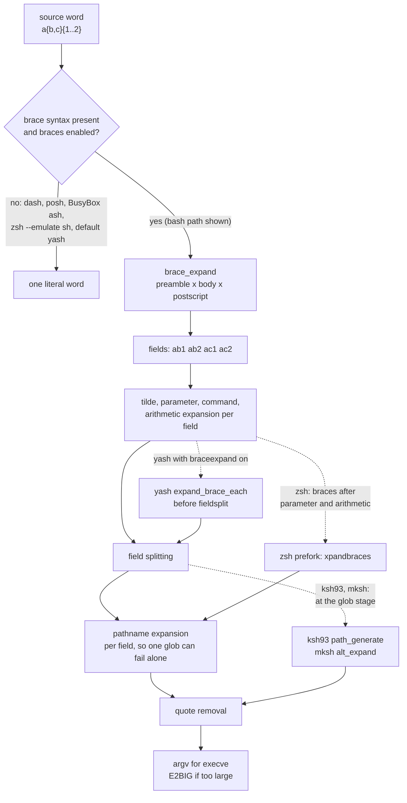

# Brace Expansion

> [!summary] Claim
> Brace expansion is a purely textual, filesystem-blind generator that turns one source word into the cross product of its comma lists and sequence expressions before any other expansion runs, which POSIX.1-2024 now permits but never requires, so `a{b,c}` is two words in bash, zsh, ksh93 and mksh and one literal word in dash, posh, BusyBox `ash`, `zsh --emulate sh` and default yash.

Part of [Bash](README.md) in [Shell and Unix Engineering](../README.md).

## TL;DR

- Mechanism: bash splits each unquoted word into a preamble, a brace body and a postscript, expands the body as a comma list or an `x..y[..incr]` sequence, and concatenates the cross product left to right before tilde, parameter, command, arithmetic and pathname expansion (`(bash-5.3 braces.c, brace_expand)`; `(bash-5.3 subst.c, expand_word_list_internal)`).
- Rule: a word expands only if it contains, before any expansion, an unquoted `{` not preceded by `$`, an unquoted `,` or `..`, and an unquoted `}` (POSIX.1-2024 XCU 2.6); anything else, such as `{a}` or `{}`, stays literal in every shell (lab `malformed` mode).
- Trap: in bash the braces are expanded before variables, so `{1..$n}` is the literal word `{1..3}`, and `$x{1,2}` means `$x1 $x2` (lab `order` mode); zsh, ksh93, mksh and yash expand parameters first.
- Portability fact: POSIX makes brace expansion an optional implementation-defined extension (POSIX.1-2024 XCU 2.6, added by Austin Group Defect 1193), and of the shells in the matrix only bash, zsh, ksh93 and mksh enable it by default; dash, posh and BusyBox `ash` have no brace expansion at all, yash needs `set -o braceexpand`, and mksh supports comma lists only (proved by lab as of 2026-11).
- When not to use it: never in a `#!/bin/sh` script, never on data (it cannot see braces that arrive in a variable in bash), and never for large ranges passed to an external command, where one million generated words already exceed every `execve` limit in the matrix; use a loop, `seq`, or `xargs` instead.

## Mental model



Read the solid arrows as bash: the parser hands `expand_word_list_internal` a word list, assignment words are set aside first, then every word that still contains `{` goes through `brace_expand`, and only the resulting fields meet tilde, parameter, command and arithmetic expansion, field splitting, pathname expansion and quote removal, in that order.
The dotted arrows show where the other implementations put the same step: zsh runs it after parameter, command and arithmetic expansion, yash after those four and before field splitting, and ksh93 and mksh during pathname generation, which is why only those two expand braces that came out of a variable.
Every path ends at the argument vector of `execve(2)`, the first point at which a large expansion meets a hard limit.

## How it works

### What POSIX says, and what it refused

POSIX.1-2024 lists the standard word expansions as tilde, parameter, command substitution and arithmetic expansion, then field splitting, pathname expansion and quote removal, and then makes one exception (POSIX.1-2024 XCU 2.6).
A word that, "before any expansions are applied", contains an unquoted `{` not immediately preceded by an unquoted `$`, one or more unquoted `,` characters or two adjacent `.` characters surrounded by other characters, and an unquoted `}`, "may be subject to an additional implementation-defined form of expansion", which "if supported, shall be applied before all the other word expansions" (POSIX.1-2024 XCU 2.6).
The permission applies only "in a context where field splitting will be performed", so assignment values and `case` patterns are outside it.
XCU 2.2 accordingly adds `{`, `,` and `}` to the characters that "might need to be quoted under certain circumstances" (POSIX.1-2024 XCU 2.2).
The rationale states the design decision: a variant "whereby brace expansion is performed following field splitting was considered by the standard developers and rejected because it causes surprising behavior if the results of parameter expansion and command substitution happen to produce a valid brace expansion", and it adds that quoting the braces or commas prevents the expansion but "quoting the periods need not prevent it" (POSIX.1-2024 XRAT C.2.6).
The text came from Austin Group Defect 1193, filed by Geoff Clare on 2018-04-23 because the standard then forbade `echo {1,2}` from printing two words; it was accepted as marked on 2022-07-18, marked applied to the Issue 8 draft on 2022-08-05, and closed on 2024-06-11 (Austin Group Defect 1193, issue history).
The original proposal allowed either form, before all expansions or after field splitting; the accepted text keeps only the first, which is exactly the line between bash and zsh on one side and ksh93 and mksh on the other.

### Where it came from

Brace expansion is a C shell feature: the csh manual defines "the metanotation `a{b,c,d}e`" as "a shorthand for `abe ace ade`", says that "left-to-right order is preserved", that "it is not an error when this construct expands to files which do not exist", and that "the words `{`, `}` and `{}` are passed undisturbed" (FreeBSD csh(1)).
The csh entry already notes the interaction with globbing: `../{memo,*box}` "might expand to `../memo ../box ../mbox`", because each alternative is globbed separately.
Historical `sh` did not have it: the bash manual calls brace expansion "a slight incompatibility with historical versions of `sh`", where a word such as `file{1,2}` "appears identically in the output", and recommends `+B` "for strict `sh` compatibility" (bash-5.3 doc/bashref.texi, Brace Expansion).

### bash: the call path

1. The parser marks words: an assignment word inside a compound assignment gets `W_NOGLOB|W_NOBRACE` (`(bash-5.3 parse.y, read_token_word)` sets the flags when `PST_COMPASSIGN` is active).
2. `expand_word_list_internal` first calls `separate_out_assignments` when `WEXP_VARASSIGN` is set, so a plain assignment such as `x={a,b}` never reaches brace expansion, then runs `brace_expand_word_list` if `eflags & WEXP_BRACEEXP` and the global `brace_expansion` flag are both set, and only then `shell_expand_word_list` and globbing (`(bash-5.3 subst.c, expand_word_list_internal)`).
3. `brace_expansion` is the `-B` flag, initialised to 1 (`(bash-5.3 flags.c)` lists `{ 'B', &brace_expansion }`), so `set +B`, `set +o braceexpand` and `bash +B` turn it off.
4. `brace_expand_word_list` skips words flagged `W_NOBRACE` and words flagged both `W_COMPASSIGN` and `W_ASSIGNARG`, and calls `brace_expand` only when `mbschr` finds a `{` character, quoted or not, so the common case costs one scan per word (`(bash-5.3 subst.c, brace_expand_word_list)`).
5. `brace_expand` uses `brace_gobbler` to find the first `{` that begins a valid expression, copies everything before it as the preamble, finds the matching `}`, and checks whether the body holds an unquoted comma; if not, and the body was classified as a sequence, it calls `expand_seqterm` (`(bash-5.3 braces.c, brace_expand)`).
6. A comma body goes to `expand_amble`, which splits at top-level commas and calls `brace_expand` on each piece, which handles nesting; the pieces are joined to the preamble with `array_concat`, and the postscript is expanded recursively and concatenated the same way, producing the cross product (`(bash-5.3 braces.c, expand_amble)`, `(bash-5.3 braces.c, array_concat)`).

`brace_gobbler` is the lexer for this mini-language.
It tracks single, double and backtick quoting and backslash escapes, so a quoted `,` or `}` is not a separator; it treats `${` "like `\{`" and raises the nesting level, so the braces of a parameter expansion are never a brace expression and `${x}{1,2}` still expands the list after it; it skips `$(...)`, `<(...)` and `>(...)` whole with `extract_command_subst`, so process substitutions "pass unchanged through brace expansion" since bash 4.0; and it ignores an open brace surrounded by whitespace (`(bash-5.3 braces.c, brace_gobbler)`; bash-5.3 COMPAT item 36).
Inside the body, a top-level `,` marks `BRACE_COMMA` and a top-level `..` marks `BRACE_SEQ` only while no comma has been seen, "the check against BRACE_NONE gives the comma higher precedence", which is why `{1..2,3}` is the list `1..2` and `3` (`(bash-5.3 braces.c, brace_gobbler)`).
bash 5.3 adds `valid_seqterm`, which rejects a candidate sequence early and skips its `{`, so other brace expressions inside the bad sequence still expand; `valid_seqterm` does not exist in the bash 3.2.57 or 4.0 `braces.c`, and the lab shows the consequence: `{{1,2}..3}` is `1..3 2..3` in bash 3.2 to 5.2 and `{1..3} {2..3}` in 5.3.

### bash: the sequence generator

`expand_seqterm` parses `x..y[..incr]`: both endpoints must be integers (optionally signed) or both single letters, and the increment must be an integer; anything else returns `NULL` and the word stays literal (`(bash-5.3 braces.c, expand_seqterm)`).
Integers are `intmax_t` from `strtoimax`, with `ERANGE` treated as invalid; letters are single bytes compared as `unsigned char`, "using the C locale", so `{a..C}` walks down through the six punctuation characters between `Z` and `a` (bash-5.3 doc/bashref.texi, Brace Expansion).
Zero padding applies when either endpoint starts with `0` and is longer than one character, or starts with `-0` and is longer than two; the width is the longest such endpoint, and the sign counts toward it, which is why `{-01..1}` gives `-01 000 001` (`(bash-5.3 braces.c, expand_seqterm)`; lab `pad` mode).
`mkseq` then normalises the step: an increment of 0 becomes 1, and the sign of the increment is forced to agree with the direction from start to end, so `{1..10..-3}` and `{1..10..3}` are the same sequence; bash ignores the sign you wrote (`(bash-5.3 braces.c, mkseq)`; lab `step` mode).
It computes the element count with `ckd_sub` and `ckd_add` overflow checks, allocates the whole vector with `strvec_mcreate`, reports "brace expansion: failed to allocate memory for N elements" when that fails and returns `NULL`, and checks `ISINTERRUPT` and `QUIT` on every element so a long expansion can be interrupted (`(bash-5.3 braces.c, mkseq)`).
bash 3.2's `mkseq` takes `int start, end, incr, type`, so 64-bit endpoints are truncated to 32 bits and `{9223372036854775806..9223372036854775807}` prints `-2 -1` (`(bash-3.2.57 braces.c, mkseq)`; lab `width` mode).
A failed sequence is not an error: since bash 4.3 "the brace expansion code now treats a failed sequence expansion as a simple string and will continue to expand brace terms in the remainder of the word" (bash-5.3 NEWS, bash-4.3 item gg), which is why bash 3.2 leaves `{1..x}{a,b}` whole while bash 4.4 and later produce `{1..x}a {1..x}b`.

### bash: the places it does and does not apply

- Assignments: `x={a,b}` is set aside before brace expansion and keeps its braces in every shell (lab `assign` mode).
- Declaration builtins: `export y={a,b}` is an ordinary argument word in bash, so it becomes `export y=a y=b` and `y` ends as `b`; every other shell in the matrix keeps `{a,b}` (lab `assign` mode).
- Compound assignment under `declare`: bash 3.2 brace expands the whole word `arr=({1..3})` into three assignments and keeps only `3`; bash 4.1 fixed "brace expansion to take place too soon in some compound array assignments" (bash-5.3 CHANGES, bash-4.1-alpha item bb; lab `array-declare` mode).
- Redirections: `redirection_expand` runs `expand_words_no_vars`, whose `WEXP_NOVARS` includes `WEXP_BRACEEXP`; if the result is more than one word it returns `NULL` and the caller reports "ambiguous redirect" (`(bash-5.3 redir.c, redirection_expand)`; `(bash-5.3 subst.c)` defines `WEXP_NOVARS`), even in POSIX mode, where the POSIX permission does not reach because redirection words are not field split.
- `case` patterns are not brace expanded in any shell in the matrix, so the pattern `{a,b}` matches only the five-character string `{a,b}` (lab `case-pattern` mode).
- The command word is: `{echo,brace-ran}` runs `echo brace-ran` in bash, ksh93 and mksh, a trick that builds a command line with no blank in it (lab `command-position` mode).

### There is no system call

Brace expansion never touches the kernel: it does not read directories, does not stat names, and allocates only through `malloc` (`xmalloc`, `strvec_mcreate`), which is why `/nonexistent-brace-lab/{x,y}` happily produces two paths (lab `list` mode).
Its cost surfaces in two places: memory, at roughly 70 to 200 bytes of resident memory per generated word in the measurements below, and `execve(2)`, which fails with `E2BIG` when "the total number of bytes in the environment (envp) and argument list (argv) is too large" (Linux execve(2), ERRORS).
On Linux 2.6.23 and later that total "is limited to 1/4 of the allowed stack size" and also to "3/4 of the value of the kernel constant `_STK_LIM` (8 MiB)", that is 6 MiB, with each string capped at 32 pages by `MAX_ARG_STRLEN` (Linux execve(2), Limits on size of arguments and environment).

### zsh

zsh performs brace expansion as the fifth of five left-to-right steps, after process substitution, parameter expansion, command substitution and arithmetic expansion (zsh expn.yo, Expansion); in the source it is the `hasbraces` and `xpandbraces` loop in `prefork`, skipped when `IGNORE_BRACES` is set (`(zsh Src/subst.c, prefork)`; `(zsh Src/glob.c, xpandbraces)`).
Because it runs after parameter expansion, `{1..$n}` and `$x{1,2}` work, but braces that arrive inside a value are not tokens, so `x='{a,b}'; print $x` stays literal (lab `order` and `from-expansion` modes).
zsh documents what bash leaves implicit: padding includes the `-` in the width, a negative step outputs the numbers "in reverse order", which differs from swapping the endpoints when the step does not divide the range, and character ranges may be multibyte (zsh expn.yo, Brace Expansion).
`BRACE_CCL` turns a comma-less brace word into "a lexically ordered list of all the characters", so `{cba}` becomes `a b c` (zsh options.yo, BRACE_CCL; lab `zsh-ccl` mode).
`IGNORE_BRACES` (`-I`) is marked `<S>`, on in sh emulation, which is why `zsh --emulate sh` has no brace expansion until `set -o braceexpand` (zsh options.yo, IGNORE_BRACES; lab `toggle` mode); without it or `IGNORE_CLOSE_BRACES`, "a sole close brace character `}` is syntactically significant at any point on a command line", so in native zsh `a,b}` is a parse error (zsh options.yo, IGNORE_CLOSE_BRACES).
Brace expansion "is not part of filename generation", so `*/{foo,bar}` becomes two patterns and a `no match` error if either fails; with zsh's default `NOMATCH` that aborts the command (zsh expn.yo, Brace Expansion; lab `glob` mode).

### ksh93, mksh and yash

ksh93u+m checks for brace patterns in "each word, as well as any fields resulting from field splitting" when `braceexpand` (`-B`) is set, which is the variant POSIX rejected; it also accepts a `%fmt` printf format after a range (ksh93u+m sh.1, Brace Expansion; lab `from-expansion` and `ksh-format` modes).
The code lives in `path_generate` in `sh/expand.c`, compiled under `SHOPT_BRACEPAT`, which also refuses brace expansion inside `~(E)`-style regular expression patterns that use braces as bounds (`(ksh93u+m sh/expand.c, must_disallow_bracepat)`).
Turning on `posix` "turns on `letoctal` and turns off `-B`/`braceexpand`", and if brace expansion is turned back on it "disallows brace expansion on the results of unquoted expansions" (ksh93u+m sh.1, posix option); the lab confirms that ksh93u+m treats a leading zero as octal, so `{010..012}` is `8 9 10` and `{08..10}` is literal, while ksh93u+ 2012 prints `8 9 10` for both.
mksh documents only `prefix{str1,...,strN}suffix` and says it "is carried out after parameter substitution and before file name generation" (mksh.1, Brace expansion (alternation)); in `eval.c` the `DOBRACE` flag is set only when `DOGLOB` is (`if (Flag(FBRACEEXPAND) && (f & DOGLOB)) f |= DOBRACE;`), so `set -f` also disables brace expansion, and `alt_expand` does the work (`(mksh eval.c, alt_expand)`; lab `noglob` mode); its `posix` and `sh` options turn `braceexpand` off (mksh.1).
yash expands braces "only when the brace-expand option is enabled", after tilde, parameter, command and arithmetic expansion and before field splitting (yash manual, Brace expansion); `expand_multiple` calls `expand_brace_each` between `expand_four` and `fieldsplit`, and `try_expand_brace_sequence` accepts only integers parsed by `wcstol`, pads with `%0*ld`, rejects a step of 0, and emits only the first term when the step points away from the end (`(yash expand.c, expand_multiple)`, `(yash expand.c, try_expand_brace_sequence)`).
BusyBox `ash`, the Alpine `/bin/sh`, has no brace expansion; BusyBox `hush` has an optional `HUSH_BRACE_EXPANSION` whose own comment admits that `v='{q,w}'; echo $v` "erroneously expands braces in `$v`" (`(BusyBox shell/hush.c)`).

## Numbers and limits

| Quantity | Value | Source |
|---|---|---|
| Words from `{a,b,c}{a,b,c}{a,b,c}{a,b,c}` | 81 (product of list lengths) | lab `count` mode, 2026-11 |
| Words from `{1..100000}` | 100000 in bash, zsh, ksh93; 1 in mksh and the shells without ranges | lab `count` mode, 2026-11 |
| Bytes of `argv` strings for `{1..1000000}` | 6888896 (5888896 digits plus 1000000 NULs) | computed here with `awk`, 2026-11-12 |
| Linux `execve` cap on `argv` plus `envp` | 1/4 of `RLIMIT_STACK`, at most 3/4 of 8 MiB = 6291456 bytes | Linux execve(2), as of 2026-11 |
| `getconf ARG_MAX` | 1048576 macOS host; 2097152 Debian 13; 131072 Alpine 3.22 (musl), although a 100000-word, 588895-byte argument list executes there (8 MiB stack) | measured here, 2026-11-12 |
| Status when 1000000 generated words are passed to `/usr/bin/env` | 126 in bash and ksh93, 127 in zsh | lab `e2big` mode, 2026-11 |
| Time and peak RSS for `set -- {1..1000000}` | bash 5.3.15: 0.32 to 0.47 s, 205 MiB; bash 3.2.57: 0.45 to 0.49 s, 109 MiB; zsh 5.9.2: 0.13 to 0.14 s, 72 MiB; ksh93u+ 2012: 0.23 to 0.36 s, 90 MiB | measured here on the macOS host (Apple Silicon), `/usr/bin/time -l`, three runs each, 2026-11-13 |
| Characters in zsh `{1..x}` | 72 (0x31 to 0x78), so `{1..x}{a,b}` is 144 words | lab `failed-sequence` mode, 2026-11 |
| bash 3.2 sequence integer width | 32-bit `int`; `{9223372036854775806..9223372036854775807}` gives `-2 -1`, as it also does in ksh93u+ 2012 and ksh93u+m 1.0.10 | bash-3.2.57 braces.c `mkseq`; lab `width` mode |
| bash 3.2 range across 2^31, `{2147483646..2147483648}` | never finishes: still running when a 12 s alarm killed it on the macOS host (re-measured 2026-11-13), dies with `SIGSEGV` on Alpine (recorded run, 2026-11-12) | measured here |
| `{1..999999999999999}` | bash 5.3: "failed to allocate memory for 999999999999999 elements", word left literal; bash 4.4: same message with a negative count (-1530494977); bash 5.1 and 5.2: literal, no message; bash 3.2: still running when a 12 s alarm killed it on the macOS host (bash 5.3 message re-measured on the host, 2026-11-13) | the other versions from a recorded run in the Alpine image, 2026-11-12 |
| Per-string `execve` limit | 32 pages (`MAX_ARG_STRLEN`) | Linux execve(2) |

## Portability

Shell behavior, every cell proved by the lab under the matrix (macOS host, Alpine 3.22, Debian 13) as of 2026-11 unless it names a source.

| Shell | On by default | Comma list | Integer range | Letter range | Step `..n` | Leading zeros | Braces from `$x` expand | Turn off |
|---|---|---|---|---|---|---|---|---|
| POSIX sh | optional extension (XCU 2.6) | implementation-defined | implementation-defined | implementation-defined | implementation-defined | implementation-defined | not allowed (XCU 2.6; XRAT C.2.6) | n/a |
| bash 3.2.57 (macOS `/bin/bash`, `/bin/sh`) | yes, also in POSIX mode | yes | yes | yes | no, literal | dropped: `{08..10}` is `8 9 10` | no | `set +o braceexpand` |
| bash 4.4, 5.1, 5.2, 5.3 | yes, also in POSIX mode | yes | yes | yes | yes, sign ignored | padded: `08 09 10` | no | `set +o braceexpand` |
| zsh 5.9 native | yes | yes | yes | yes | yes, negative reverses | padded | no | `set +o braceexpand` |
| `zsh --emulate sh` | no (`IGNORE_BRACES`) | after `set -o braceexpand` | after `set -o braceexpand` | after `set -o braceexpand` | not tested | not tested | no | default |
| dash 0.5.12, 0.5.13 | no option | no | no | no | no | no | no | n/a |
| ksh93u+m 1.0.10 | yes | yes | yes | yes | yes; wrong direction gives first term only | octal: `{010..012}` is `8 9 10`, `{08..10}` literal | yes | `set -o posix` or `set +o braceexpand` |
| ksh93u+ 2012 (macOS `/bin/ksh`) | yes | yes | yes | yes | as ksh93u+m | `{08..10}` is `8 9 10`, `{010..012}` is `8 9 10` | yes | `set +o braceexpand`; no `posix` option |
| mksh R59 | yes | yes | no | no | no | no | yes | `set -o posix`, `set +o braceexpand`, or `set -f` |
| yash 2.58.1 | no | after `set -o braceexpand` | after `set -o braceexpand` | no | first term only if direction disagrees (yash expand.c; measured here with `-o braceexpand`) | padded (yash expand.c; measured here) | no (measured here with `-o braceexpand`) | default |
| posh 0.14.1 | no option | no | no | no | no | no | no | n/a |
| BusyBox 1.37.0 `ash` | no option | no | no | no | no | no | no | n/a |

Sequence utility, the external alternative, measured by the lab where marked; the shell does not change which `seq` runs.

| `seq` implementation | `seq 3 1` | `seq -w 8 10` | `seq 1 0.5 2` | `-f FORMAT` |
|---|---|---|---|---|
| GNU coreutils 9.7 (Debian) | prints nothing, status 0 (lab) | `08 09 10` (measured here) | `1.0 1.5 2.0` (measured here) | yes (measured here) |
| BSD seq (macOS host) | `3 2 1` (lab) | `08 09 10` (measured here) | `1 1.5 2` (measured here) | yes (measured here) |
| BusyBox 1.37.0 (Alpine) | prints nothing, status 0 (lab) | `08 09 10` (measured here) | `1.0 1.5 2.0` (measured here) | no: "unrecognized option: f" (measured here) |
| uutils coreutils | not in the matrix; not measured | not measured | not measured | not measured |

## Worked example

The [lab](../labs/04-brace-expansion/) is one probe script, `brace-probe.sh`, with one mode per behavior, and a bats suite that asserts each shell family's exact output; it runs under every shell in the matrix.
This excerpt is the `order` mode and the helper it calls, copied verbatim from `brace-probe.sh` (lines 9 to 16 and 57 to 72):

```sh
# args ARG...: print the argument count, then each argument between angle brackets.
args() {
  printf '%d args:' "$#"
  if [ "$#" -gt 0 ]; then
    printf ' <%s>' "$@"
  fi
  printf '\n'
}
```

```sh
  order)
    # Does brace expansion run before or after parameter and tilde expansion?
    n=3
    # shellcheck disable=SC2051,SC2248 # a variable as a range endpoint is the behavior under test
    args {1..$n}
    x=a
    x1=one
    x2=two
    # shellcheck disable=SC2086,SC2248,SC2154 # unquoted on purpose; bash reads this as $x1 $x2
    args $x{1,2}
    # shellcheck disable=SC2086,SC2248 # unquoted on purpose
    args ${x}{1,2}
    # shellcheck disable=SC2088 # a tilde generated by a brace list is the behavior under test
    args {~,x}
    : "$x1" "$x2"
    ;;
```

Run it with `bash brace-probe.sh order`; the lab asserts these outputs (with `HOME=/home/lab`, as in the matrix containers):

```text
bash (3.2 to 5.3):
1 args: <{1..3}>
2 args: <one> <two>
2 args: <a1> <a2>
2 args: </home/lab> <x>

zsh 5.9:
3 args: <1> <2> <3>
2 args: <a1> <a2>
2 args: <a1> <a2>
2 args: </home/lab> <x>

ksh93 (2012 and u+m):
3 args: <1> <2> <3>
2 args: <a1> <a2>
2 args: <a1> <a2>
2 args: <~> <x>

mksh R59:
1 args: <{1..3}>
2 args: <a1> <a2>
2 args: <a1> <a2>
2 args: <~> <x>

dash, posh, BusyBox ash, yash, zsh --emulate sh:
1 args: <{1..3}>
1 args: <a{1,2}>
1 args: <a{1,2}>
1 args: <{~,x}>
```

Read the four lines as a proof of expansion order.
bash expands braces first, so `{1..$n}` is not a valid sequence (its end is the text `$n`) and stays literal, `$x{1,2}` becomes the two words `$x1` and `$x2`, which then expand to `one` and `two`, and the `~` that the brace list generated is still at the start of a word when tilde expansion runs.
zsh and ksh93 expand parameters first, so `$n` is already `3` and `$x{1,2}` is `a{1,2}`; ksh93 and mksh expand braces after tilde expansion, so the generated `~` is never expanded.
The other modes carry the rest of this note's claims: `list`, `range`, `step`, `pad` and `width` for the generators, `quoting`, `malformed` and `failed-sequence` for the parser, `assign`, `dollar-at`, `case-pattern`, `redirect`, `glob` and `command-position` for context, `toggle`, `noglob` and `posix-mode` for the switches, and `count` and `e2big` for the limits.

## Pitfalls

> [!warning] `{1..$n}` is not a loop bound in bash
> Trigger: `for i in {1..$n}` or `{$start..$end}` in a bash script.
> Symptom: the loop runs once with `i` set to the literal `{1..3}`, because the sequence is parsed before `$n` is expanded (lab `order` mode); the same script works in zsh and ksh93, which hides the bug when it is tested there.
> Fix: `for ((i = 1; i <= n; i++))` in bash, `i=1; while [ "$i" -le "$n" ]; do ...; i=$((i + 1)); done` in POSIX sh, or `seq` when an external command is acceptable; `eval "for i in {1..$n}"` works but turns `n` into code, so only with a value you have already validated as an integer.

> [!warning] Brace syntax in a `#!/bin/sh` script
> Trigger: `cp config.yml{,.bak}` or `mkdir -p src/{lib,bin}` in a script run by dash (Debian and Ubuntu `/bin/sh`), BusyBox `ash` (Alpine) or posh.
> Symptom: the word reaches the command unexpanded; GNU `cp` reports `cp: missing destination file operand after 'config.yml{,.bak}'` with status 1, and `mkdir -p src/{lib,bin}` silently creates one directory named `{lib,bin}` (measured here in the Debian image; lab `list` mode for the unexpanded word).
> Fix: write the names out, or make the interpreter `#!/usr/bin/env bash` and keep the bash-only syntax honest; ShellCheck reports brace expansion in `sh` scripts as SC3009, which the lab disables with a reason because it is the behavior under test.

> [!warning] bash brace expands an `export`, `local`, `declare` or `readonly` argument
> Trigger: `export PATH_SUFFIX={a,b}` or `local x={a,b}` meaning a literal value.
> Symptom: bash runs `export PATH_SUFFIX=a PATH_SUFFIX=b`, so the variable is `b` and the first value is lost without a diagnostic (lab `assign` mode); with `readonly r={a,b}` the second assignment fails with `r: readonly variable`.
> Fix: quote the value (`export x='{a,b}'`); a plain assignment `x={a,b}` is safe in every shell because assignments are separated out before brace expansion.

> [!warning] A brace list in a redirection
> Trigger: `cmd > out.{log,err}` or `exec 3> "$dir"/{a,b}` written as if it fanned output out.
> Symptom: bash refuses with `ambiguous redirect` and status 1 without running the command; zsh, whose `MULTIOS` option is on in native mode, opens both files; dash, ksh93, mksh, posh, BusyBox `ash` and yash create one file literally named `{a,b}` (lab `redirect` mode).
> Fix: `cmd | tee out.log >out.err`, or two explicit redirections.

> [!warning] Each alternative is globbed separately
> Trigger: `rm -- *.{tmp,bak}` in a directory with no `.bak` files.
> Symptom: bash passes the literal `*.bak` to `rm` (which then fails on a file that does not exist, or deletes a file literally named `*.bak`), and zsh aborts the whole command with `no matches found` before `rm` runs (lab `glob` mode; zsh expn.yo, Brace Expansion).
> Fix: in bash, `shopt -s nullglob` or a pattern that cannot miss, such as `*.@(tmp|bak)` with `extglob` (see [[Extended-Globbing]]); in zsh, `*.(tmp|bak)`.

> [!warning] Zero padding and octal depend on the release
> Trigger: `for d in {01..31}` to build dates, expected to give `01` to `31`.
> Symptom: bash 3.2, the macOS `/bin/bash`, drops the zeros (`{08..10}` is `8 9 10`), and ksh93u+m reads a leading zero as octal, so `{08..10}` is not a sequence at all and `{010..012}` is `8 9 10` (lab `pad` mode); the padded strings later fed to `$(( ))` hit the same octal rule in bash (see [[Bash-3-2-on-macOS]]).
> Fix: generate the number unpadded and format it with `printf '%02d'`.

> [!warning] Huge or malformed ranges
> Trigger: a range whose endpoints come from input, for example `eval "echo {1..$n}"` with `n=999999999999999`.
> Symptom: bash 5.3 prints `brace expansion: failed to allocate memory for 999999999999999 elements` and leaves the word literal, bash 5.1 and 5.2 leave it literal silently, bash 4.4 reports a negative element count, bash 3.2 runs until killed, and a range across 2^31 in bash 3.2 never finishes or dies with `SIGSEGV` (measured here, see Numbers and limits); zsh 5.9 and ksh93u+m start building the list and were still running when a 10 s timeout killed them (status 137, measured here in both images).
> Fix: validate both endpoints and the product of the list lengths before expanding, and never let input choose a range size.

> [!warning] Library reimplementations are attack surface
> Trigger: a tool that applies "bash-style" brace expansion to untrusted strings, such as glob matchers in build tools.
> Symptom: CVE-2017-18077: `brace-expansion` before 1.1.7 "is vulnerable to Regular Expression Denial of Service (ReDoS) attacks, as demonstrated by an expand argument containing many comma characters" (CVSS 3.0 7.5); CVE-2024-4068: `braces` before 3.0.3 "fails to limit the number of characters it can handle, which could lead to Memory Exhaustion" on "imbalanced braces" (CVSS 3.1 7.5, a secondary score, not NVD's own); CVE-2025-5889: `brace-expansion` up to 1.1.11, 2.0.1, 3.0.0 and 4.0.0 has "inefficient regular expression complexity" in `expand` (CVSS 3.1 3.1, assigned by the CNA VulDB; NVD status Deferred, as of 2026-11) (NVD).
> Fix: bound input length, nesting depth and output count before expansion; brace expansion output grows as the product of list lengths, so a 40-byte input can ask for millions of words.

## Security and robustness

Brace expansion is safe in one way that matters: in bash, zsh and yash it never re-scans the results of parameter expansion or command substitution, so a value such as `x='{a,b}'` cannot inject extra words (lab `from-expansion` mode for bash and zsh; measured here for yash 2.58.1 with `-o braceexpand`), which is precisely the property POSIX chose to guarantee (POSIX.1-2024 XRAT C.2.6).
ksh93 and mksh break that property: an unquoted `$x` holding braces is expanded, so data can multiply into arguments, another reason the unquoted expansion is the bug and `"$x"` is the fix (lab `from-expansion` mode; see [[Field-Splitting-and-IFS]]).
`eval` is the usual way braces from data get expanded on purpose (`eval "set -- {1..$n}"`), and it turns the whole value into code; validate the value against a strict pattern (for example `case $n in ''|*[!0-9]*) exit 1 ;; esac`) before any `eval` (see [[The-eval-Builtin]]).
The command-position trick `{echo,hi}` builds a command with arguments from a word that contains no blank, which makes it a way to get a command with arguments past a filter that forbids spaces; it works in bash, ksh93 and mksh and fails with status 127 elsewhere (lab `command-position` mode), so a blank-stripping filter in front of bash is not a sandbox.
Resource exhaustion is the robustness failure: output size is the product of the list lengths and the range sizes, the whole list is built in memory before the command runs, and a million words already cost 72 MiB to 205 MiB of resident memory in the measured shells and exceed every `execve` limit in the matrix (see Numbers and limits).
`set -x` traces the expanded words, not the brace expression, so a log shows what ran but not how it was produced; this matters when reviewing a trace of a destructive command (see [[xtrace-PS4-and-BASH_XTRACEFD]]).

## The principal's view

The decision is whether brace expansion is allowed in the codebase at all, and the answer follows from the interpreter contract, not from taste.
In a script whose shebang is `bash` and whose CI runs bash, brace lists are clearer than the alternatives for small, literal sets: `mkdir -p "$root"/{bin,lib,etc}` and `cp file{,.orig}` are idioms every reviewer reads.
The trade-off is that the same text is silently a different program under `/bin/sh` on Debian, Ubuntu and Alpine, and the failure is not an error but one wrong argument, which is the worst kind of portability bug.
So the policy I would set: brace lists are allowed only in files that declare bash, ShellCheck runs with the declared shell so SC3009 catches them in `sh` files, sequence expressions with variable endpoints are banned in favor of arithmetic `for` loops, and nothing that can exceed a few thousand words is ever brace generated.
For anything data driven (lists of hosts, date ranges, file sets that depend on input), generate the list with a real program, stream it, and batch it with `xargs` or a loop (see [[xargs-and-Argument-Batching]] and [[Program-Startup-argv-envp-and-ARG_MAX]]); when the list must be validated, typed or combined, that is the point at which the script should become Python or Go rather than a longer brace expression.

## Interview questions

> [!question] L5: Predict the output of `echo {1..3}{a,b}` in bash, in dash, and in mksh.
>
> > [!success]- Answer
> > bash prints `1a 1b 2a 2b 3a 3b`: the range and the list form a cross product, the left term varying slowest.
> > dash prints `{1..3}{a,b}` unchanged, because it has no brace expansion.
> > mksh prints `{1..3}a {1..3}b`: it supports comma lists but not sequence expressions, so the range stays literal while the list expands.
> >
> > Follow-up: What does zsh print for `echo {1..x}{a,b}`, and why is it not literal?

> [!question] L5: Why does `for i in {1..$n}; do ...; done` run once in bash, and what do you write instead?
>
> > [!success]- Answer
> > bash performs brace expansion before parameter expansion, so when the sequence is parsed its end is the text `$n`, which is not an integer, and the word stays literal.
> > After that, parameter expansion turns it into `{1..3}` and the loop runs once with that string.
> > Write `for ((i = 1; i <= n; i++))` in bash, or a `while` loop with `$((i + 1))` in POSIX sh.
> >
> > Follow-up: Why is `eval "for i in {1..$n}; do ...; done"` a security problem, and what check makes it safe?

> [!question] L6: Predict the output of `set -- 1 2; printf '<%s>' "$@"{a,b}; echo` in bash and in zsh.
>
> > [!success]- Answer
> > bash prints `<1><2a><1><2b>`: brace expansion happens first and copies the text `"$@"` into both generated words, `"$@"a` and `"$@"b`, and each then expands to two fields.
> > zsh prints `<1><2a><2b>`: it expands `"$@"` first, and the brace list attaches only to the last field.
> > ksh93 and mksh agree with zsh, and dash prints `<1><2{a,b}>`.
> >
> > Follow-up: Which of the two behaviors does POSIX.1-2024 XCU 2.6 describe?

> [!question] L6: Debug this script, which works on a developer's Mac and fails in the Debian-based CI image with `cp: missing destination file operand after 'config.yml{,.bak}'`.
>
> ```sh
> #!/bin/sh
> set -eu
> cp config.yml{,.bak}
> printf 'backup written\n'
> ```
>
> > [!success]- Answer
> > On macOS `/bin/sh` is bash 3.2 in POSIX mode, which still performs brace expansion, so `cp` received `config.yml config.yml.bak`.
> > On Debian `/bin/sh` is dash, which has no brace expansion, so `cp` received the single operand `config.yml{,.bak}` and failed with status 1, and `set -e` stopped the script.
> > Fix it by writing `cp config.yml config.yml.bak`, or by changing the shebang to bash if the script is meant to be bash.
> > The lesson is that testing a `#!/bin/sh` script on macOS tests bash, not a POSIX shell; run it under dash in CI.
> >
> > Follow-up: Which ShellCheck code would have caught the brace expansion, and why must ShellCheck know the target shell?

> [!question] L6: What happens to `echo hi > out.{log,err}` in bash, zsh and dash?
>
> > [!success]- Answer
> > bash expands the redirection target to two words, `redirection_expand` returns `NULL`, and bash reports `ambiguous redirect` with status 1 without running `echo`.
> > zsh expands it and, because `MULTIOS` is on in native zsh (zsh options.yo marks it `<Z>`), opens both `out.log` and `out.err` and writes `hi` to each (checked by hand on zsh 5.9 on 2026-11-13; the lab asserts that both files exist).
> > dash does not brace expand, so it creates one file named `out.{log,err}`.
> >
> > Follow-up: Why does bash still do this in POSIX mode, where XCU 2.6 permits brace expansion only in field-splitting contexts?

> [!question] L6: Why does `x='{a,b}'; printf '<%s>' $x` print `<{a,b}>` in bash but `<a><b>` in ksh93 and mksh, and which behavior does POSIX allow?
>
> > [!success]- Answer
> > bash brace expands only braces that are in the source text, before parameter expansion, so braces in a value are ordinary characters.
> > ksh93 checks for brace patterns again in the fields produced by field splitting, and mksh performs brace expansion in its globbing stage after parameter substitution, so the value is expanded.
> > POSIX.1-2024 allows only the first behavior: the expansion "shall be applied before all the other word expansions", and the rationale rejects the after-splitting variant because data could then turn into extra words.
> > ksh93u+m's `posix` option turns brace expansion off and, if it is turned back on, stops expanding the results of unquoted expansions.
> >
> > Follow-up: What else in mksh turns brace expansion off, and why does it follow from the code?

> [!question] L7+: Walk through how bash expands `a{b,{c,d}}e` internally, and state the cost model.
>
> > [!success]- Answer
> > `expand_word_list_internal` passes the word to `brace_expand_word_list`, which calls `brace_expand` because `mbschr` finds a `{`.
> > `brace_gobbler` finds the first `{` that starts a valid expression, so the preamble is `a`, and a second call finds the matching `}` at nesting level 0, classifying the body `b,{c,d}` as `BRACE_COMMA`.
> > `expand_amble` splits the body at top-level commas into `b` and `{c,d}` and calls `brace_expand` on each, which returns `b` and `c d`.
> > `array_concat` prefixes `a` to each, giving `ab ac ad`, and the postscript `e` is expanded recursively and appended, giving `abe ace ade`.
> > The output size is the product of the alternatives at each level, all strings are built in memory before any other expansion, and there is no system call until the command is executed.
> >
> > Follow-up: Where does `${x}{1,2}` change this path, and why does `brace_gobbler` treat `${` like an escaped brace?

> [!question] L7+: A batch job that runs `process {1..1000000}` fails; where exactly does it fail, with which numbers, and how do you redesign it?
>
> > [!success]- Answer
> > The expansion itself succeeds: bash builds one million words in about 0.3 to 0.5 s and about 200 MiB of resident memory on the measured macOS host.
> > The failure is `execve(2)` returning `E2BIG`: the strings alone are 6888896 bytes, above the Linux cap of 1/4 of the stack limit and at most 6 MiB, and far above macOS's `ARG_MAX` of 1 MiB, so bash reports `Argument list too long` with status 126 (zsh uses 127).
> > A builtin such as `printf` would accept the list, because no `execve` happens, which is why `printf '%s\n' {1..1000000} | xargs process` works but wastes memory.
> > The better design streams: `seq 1000000 | xargs process`, or a loop, so memory stays constant and `xargs` batches within the limit.
> >
> > Follow-up: Why does `getconf ARG_MAX` print 131072 on Alpine although a 588895-byte argument list executes there?

> [!question] L7+: Your team's CLI applies bash-style brace expansion to user patterns; what do you require before it ships?
>
> > [!success]- Answer
> > A bound on input length, nesting depth, range size, and the total number of generated strings, checked before allocation, because output grows as the product of the list lengths.
> > A parser that is linear in the input, not a backtracking regular expression: CVE-2017-18077 and CVE-2025-5889 are ReDoS bugs in the `brace-expansion` package, and CVE-2024-4068 is memory exhaustion on imbalanced braces in `braces`.
> > A lazy or streaming interface so callers can stop early, and a documented grammar that says what happens to malformed input, because shells disagree on exactly that.
> > Fuzz tests that compare against a reference shell for valid inputs and against the bounds for invalid ones.
> >
> > Follow-up: bash 5.3 checks `ISINTERRUPT` inside `mkseq`; what is the equivalent for a library?

## Related

Prerequisites: [[Shell-Options-shopt]]

Next: [[Process-Substitution]]

See also: [[Expansion-Order]], [[Tilde-Expansion]], [[Parameter-Expansion]], [[Field-Splitting-and-IFS]], [[Pathname-Expansion]], [[Extended-Globbing]], [[Quoting-Backslash-Single-and-Double]], [[Redirection-Order-and-Semantics]], [[The-eval-Builtin]], [[The-set-Builtin-and-Shell-Options]], [[Bash-POSIX-Mode]], [[Bash-3-2-on-macOS]], [[Bash-Version-History]], [[Indexed-Arrays]], [[xtrace-PS4-and-BASH_XTRACEFD]], [[Zsh-versus-POSIX]], [[ksh93-Features]], [[mksh]], [[Strict-POSIX-Shells-posh-and-yash]], [[Program-Startup-argv-envp-and-ARG_MAX]], [[xargs-and-Argument-Batching]], [[POSIX-2024-Changes]]

## Further reading

- [POSIX.1-2024 XCU 2.6 Word Expansions](https://pubs.opengroup.org/onlinepubs/9799919799/utilities/V3_chap02.html#tag_19_06) - the normative permission for brace expansion, its exact trigger characters, and the rule that it runs before every other expansion.
- [POSIX.1-2024 XRAT C.2.6 Word Expansions](https://pubs.opengroup.org/onlinepubs/9799919799/xrat/V4_xcu_chap01.html) - why the after-field-splitting variant used by ksh93 and mksh was rejected.
- [Austin Group Defect 1193](https://www.austingroupbugs.net/view.php?id=1193) - the 2018 to 2024 history of adding brace expansion and `{name}>file` redirections to the standard, including the rejected alternative wording.
- [GNU bash 5.3 `braces.c`](https://git.savannah.gnu.org/cgit/bash.git/plain/braces.c?h=bash-5.3) - `brace_expand`, `brace_gobbler`, `expand_seqterm`, `valid_seqterm` and `mkseq`, the whole implementation in under a thousand lines.
- [GNU bash 5.3 release tarball](https://mirrors.kernel.org/gnu/bash/bash-5.3.tar.gz) - `subst.c` (`expand_word_list_internal`, `brace_expand_word_list`), `redir.c`, `parse.y`, and `NEWS` and `CHANGES` for the version history of every behavior in the Portability table.
- [zsh manual, Brace Expansion (`expn.yo`)](https://raw.githubusercontent.com/zsh-users/zsh/master/Doc/Zsh/expn.yo) - the most precise prose specification of padding, negative steps, character ranges and the interaction with globbing.
- [ksh93u+m `sh.1`](https://raw.githubusercontent.com/ksh93/ksh/dev/src/cmd/ksh93/sh.1) - brace expansion on split fields, `%fmt` ranges, and what the `posix` option changes.
- [mksh(1)](https://raw.githubusercontent.com/MirBSD/mksh/master/mksh.1) - the comma-only alternation and its place after parameter substitution.
- [yash manual, Brace expansion](https://magicant.github.io/yash/doc/expand.html) - an opt-in implementation that places brace expansion between the four expansions and field splitting.
- [Linux execve(2)](https://man7.org/linux/man-pages/man2/execve.2.html) - the `E2BIG` limits that large brace expansions run into.
- [FreeBSD csh(1)](https://man.freebsd.org/cgi/man.cgi?query=csh&sektion=1) - the original definition of the `a{b,c,d}e` metanotation and its interaction with globbing.
