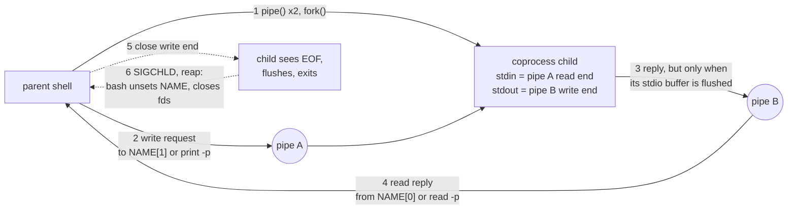

# Coprocesses

> [!summary] Claim
> A coprocess is an asynchronous command whose standard input and standard output are both pipes held by the shell, which turns a long-lived filter into a request-response server, and it works only when four things are managed by hand: the descriptors, end of file, the child's stdio buffering, and the moment the shell forgets the child.

Part of [Bash](README.md) in [Shell and Unix Engineering](../README.md).

## TL;DR

- Mechanism: the shell makes two pipes, forks, wires the child's stdin to one and its stdout to the other, and keeps the opposite ends; bash 4.0+ exposes them as `NAME[1]` (write) and `NAME[0]` (read) with the pid in `NAME_PID`, while ksh (`cmd |&`) and zsh (`coproc cmd`) hide them behind `print -p`, `read -p`, `>&p` and `<&p`.
- Rule: write a request, then read exactly the reply; close the write end (`exec {fd}>&-` in bash, `exec 3>&p; exec 3>&-` in ksh, `coproc exit` in zsh) when the child needs end of file, and copy `NAME[0]` with `exec {r}<&"${NAME[0]}"` first, because bash unsets `NAME` and closes the descriptors as soon as it reaps the child.
- Trap: a filter that uses stdio (`sed`, `awk`, `tr`, `grep`, a C program) fully buffers its output when stdout is a pipe, so its answer never arrives and the read blocks forever; the lab shows the answer appearing only at end of file.
- Portability: POSIX has no coprocess (POSIX.1-2024 rationale C.2.3 calls `|&` invalid in a POSIX script with "a specific KornShell meaning"); dash, BusyBox ash, yash, posh and macOS `/bin/bash` 3.2 have none, and bash 4.0+ reads `|&` as `2>&1 |`, so the ksh syntax silently changes meaning there.
- When not to use it: for one-shot work use `$(...)` or a pipeline; for anything that must survive partial reads, timeouts, binary data, or several children, use two FIFOs with explicit timeouts, `expect` with a pseudo-terminal, or a language with `poll(2)` and a subprocess API.

## Mental model



The parent makes two pipes and forks (arrow 1); the child's descriptors 0 and 1 become the far ends, and the parent keeps the near ends, which is all a coprocess is.
Each request goes down pipe A (arrow 2), and the child answers on pipe B (arrow 3) only when its output library actually calls `write(2)`, which for a stdio program writing to a pipe means when its buffer fills, when it calls `fflush`, or when it exits.
The parent reads the answer (arrow 4); if the answer is still sitting in the child's buffer, this read blocks forever, which is the classic coprocess deadlock.
End of file reaches the child only when every copy of pipe A's write end is closed (arrow 5).
When the child exits, the parent reaps it, and bash then discards the descriptors and the `NAME` array, so anything still unread in pipe B is lost unless the parent kept its own copy (arrow 6).

## How it works

### What POSIX says, and what it leaves out

POSIX.1-2024 defines no coprocess.
XCU 2.4 lists the reserved words, and `coproc` is not among them, not even among the words that "may be recognized as reserved words" (the opening and closing double brackets, `function`, `namespace`, `select`, `time`), so in a POSIX shell `coproc` is an ordinary command name.
The rationale for token recognition (XRAT C.2.3) says that implementations may use invalid operator combinations "(such as "|&") as valid control operators", and that "the unquoted combination "|&" is not valid in a POSIX script, but has a specific KornShell meaning".
What POSIX does give you is every piece needed to build one: `mkfifo`, redirection (XCU 2.7), descriptor duplication (XCU 2.7.5 and 2.7.6), and asynchronous lists (XCU 2.9.3.1).
XCU 2.9.3.1 says that with job control disabled an asynchronous list's standard input "shall initially be assigned to an open file description that behaves as if /dev/null had been opened for reading only", and that this "shall be overridden by any explicit redirection", which is why the portable version below redirects the helper's stdin explicitly.
The FIFO rules come from XSH `open()`: with `O_NONBLOCK` clear, "an open() for reading-only shall block the calling thread until a thread opens the file for writing" and the reverse, so every FIFO open in a shell needs a peer.
XSH `write()` defines the failure when the reader has gone: `EPIPE` for "a pipe or FIFO that is not open for reading by any process", and "A SIGPIPE signal shall also be sent to the thread".
The buffering rule is in XSH `stdin`: "stdin and stdout shall be fully buffered if and only if the file descriptor associated with the stream is determined not to be associated with an interactive device", which is the root of the deadlock.

### bash: the coproc reserved word (4.0 and later)

The bash 4.0 NEWS entry introduced it: "There is a new `coproc' reserved word that specifies a coprocess: an asynchronous command run with two pipes connected to the creating shell."
The same release made `|&` "a synonym for `2>&1 |'", so the Korn shell spelling means something else in bash.
The manual (bash 5.3 `doc/bash.1`, Coprocesses) gives the syntax `coproc [NAME] command [redirections]` and recommends `coproc NAME { command [redirections]; }`.
The grammar in `parse.y` has five productions under `coproc:`: `COPROC shell_command`, the same with a redirection list, `COPROC WORD shell_command` (with and without redirections), and `COPROC simple_command`, which is always named `COPROC`.
So `coproc mycat cat` does not create a coprocess named `mycat`; it runs a command called `mycat` with the argument `cat` (ad hoc, bash 5.3.20 on macOS: "mycat: command not found").
Since bash 5.0 the NAME "undergoes word expansion, so unique coprocs can be created in loops" (NEWS, bash 5.0), and `execute_coproc` rejects a result that is not a valid identifier (bash 5.3 through `valid_identifier` and `err_invalidid`; bash 5.2 through `legal_identifier` and `internal_error` with the same message), which prints "not a valid identifier" and returns 1 (ad hoc: `coproc 1x { cat; }` gives "`1x': not a valid identifier", status 1).

`execute_coproc` in bash-5.3 `execute_cmd.c` does the work:

1. It calls `sh_openpipe` twice, for `rpipe` ("0 = parent read, 1 = child write") and `wpipe` ("0 = child read, 1 = parent write").
2. `sh_openpipe` (bash-5.3 `general.c`) calls `pipe` and then `move_to_high_fd (pv[0], 1, 64)` and `move_to_high_fd (pv[1], 1, 64)`, which scans down from 63 for the first unused descriptor and `dup2`s the pipe end there; that is why the first coprocess gets 63 and 60 (62 and 61 are the child's ends, closed in the parent after the fork) and a second one gets 62 and 58, exactly what the lab prints.
3. It blocks `SIGCHLD` and calls `make_child` with `FORK_ASYNC`, so the coprocess is an ordinary background job: `$!` equals `NAME_PID` and `jobs` lists it as `coproc C { cat; } &` (ad hoc, bash 5.3.20).
4. The child closes the parent's ends and calls `execute_in_subshell (command, 1, wpipe[0], rpipe[1], fds_to_close)`, which wires the pipes to descriptors 0 and 1 with `do_piping` before the command's own redirections run, matching the manual's "This pipe is established before any redirections specified by the command".
5. The parent closes the child's ends, records the pid and descriptors with `coproc_alloc`, marks both descriptors close-on-exec (`SET_CLOSE_ON_EXEC (cp->c_rfd)` and `SET_CLOSE_ON_EXEC (cp->c_wfd)`), and creates the variables with `coproc_setvars`: the array `NAME` with `NAME[0]` the read end and `NAME[1]` the write end, and `NAME_PID`.
6. It returns success at once ("Since the coprocess is created as an asynchronous command, the coproc command always returns success"); `wait "$NAME_PID"` returns the command's status, 7 in the lab.

Where the descriptors are visible follows from three code paths, and the lab checks each.
External commands never see them, because they are close-on-exec: `fdcheck 63 60` run from the script prints `63:closed 60:closed`.
Subshells do not see them either, because `execute_in_subshell` calls `coproc_closeall` right after `do_piping`, and so do the forking paths of `execute_simple_command` and `execute_null_command` (`coproc_closeall ()` appears three times in bash-5.3 `execute_cmd.c`); the manual says "Other than those created to execute command and process substitutions, the file descriptors are not available in subshells", and the lab shows `( : >&"${C[1]}" )` failing while `$( : >&"${C[1]}" )` succeeds.
An explicit redirection such as `cmd >&"${C[1]}"` duplicates the descriptor onto 1 in the child, and `dup2` clears close-on-exec on the copy, so that is how you hand a coprocess to an external program.

Closing a descriptor through a redirection updates the variables: both the `r_close_this` case and the dup-and-close case in bash-5.3 `redir.c` call `coproc_fdchk`, and `coproc_checkfd` sets the matching field to -1 and calls `coproc_setvars`, so after `exec {fd}>&-` the array reads `63 -1` (lab: `write_fd_after_close=-1`).
The source comments the dup-and-close call "XXX - loses coproc fds", and the check runs even for a non-`exec` command whose redirection is undone afterwards, so a temporary close forgets the descriptor for good (from the source; not asserted by the lab).

Reaping is where scripts lose data.
`coproc_pidchk`, called from `waitchld` in `jobs.c` (the `SIGCHLD` path), only records the status through `coproc_setstatus`, whose comment reads "Don't dispose the coproc or unset the COPROC_XXX variables because this is executed in a signal handler context"; later `coproc_reap`, called from `cleanup_dead_jobs` and from `wait_for_any_job` (the `wait -n` path), calls `coproc_dispose`, which runs `coproc_unsetvars` (unset `NAME_PID` and `NAME`) and `coproc_close` (close both descriptors).
The lab's coprocess prints one line and exits; after the script has waited one second for `/bin/sleep`, `C_PID` is unset, `read <&"${C[0]}"` fails with "Bad file descriptor", and the line is gone, while a copy made beforehand with `exec {saved}<&"${C[0]}"` still reads `hi`.
That the variables are unset at all dates from bash 4.3, whose CHANGES entry is "Fixed the coproc cleanup to unset the appropriate shell variables when a coproc terminates"; the same release fixed "a race condition with short-lived coproc creation and reaping that caused the child process to be reaped before the various coproc shell variables were initialized".

The number of coprocesses changed in bash 5.3.
Through bash 5.2 `config-top.h` sets `MULTIPLE_COPROCS 0` (verified in the 4.4 and 5.2 sources; 4.0 does not define it, which the code treats as 0), and bash keeps a single global `sh_coproc`; starting a second coprocess while the first still has open descriptors prints "execute_coproc: coproc [PID:NAME] still exists", then reinitializes `sh_coproc` with `coproc_init` without unsetting the old variables or closing the old descriptors, so bash stops tracking the first coprocess, and because `coproc_closeall` in the new child now sees an empty `sh_coproc`, the new coprocess's subshell inherits the first one's descriptors too.
Measured in the shell matrix's Debian image, bash 5.2.37: a second coprocess that lists its own descriptors with a builtin loop holds 60 and 63, the first one's write and read ends, so the first never sees end of file while the second runs unless the second execs a program (close-on-exec then drops them); under bash 5.3.15 on macOS the same probe holds neither.
Bash 5.3 NEWS: "MULTIPLE_COPROCS is now enabled by default", backed by a list (`cpl_add`, `cpl_reap`, `cpl_closeall`), and the 5.3-alpha CHANGES fixes "a bug that could cause the shell to hang if a script used multiple coprocesses without manually closing file descriptors associated with existing coprocesses".
`COPROC_MAX` is defined as 16, but its only user, `cpl_prune`, is inside `#if 0`, so 5.3 has no enforced cap from that constant.
Two unnamed coprocesses in 5.3 both write to `COPROC`, so the first one's descriptors stay open and tracked but its variable is overwritten (ad hoc: `first=63 60 second=62 58`).

Scope is the last bash subtlety.
`coproc_setvars` binds `NAME` with `find_variable` and `bind_array_variable`, so if a function has declared `local C` the array lands in the function's scope and disappears on return while the coprocess keeps running (ad hoc, bash 5.3.20: `f(){ local C; coproc C { cat; }; }; f; declare -p C` reports "C: not found").
Use a global name or pass the descriptors out explicitly; see [[Namerefs-and-Dynamic-Scope]].

POSIX mode does not remove the keyword: `bash --posix -c 'coproc C { cat; }; ...'` works (ad hoc, bash 5.3.20).

### ksh93: the original co-process

The ksh93u+m 1.0.10 manual (`sh.1`) defines `|&` as a list terminator with the same precedence as `;` and `&`, and "The symbol |& causes asynchronous execution of the preceding pipeline with a two-way pipe established to the parent shell".
The parent writes with `print -p` and reads with `read -p`, or applies `>&p` and `<&p`, documented as "The output to the co-process is moved to standard output" and "The input from the co-process is moved to standard input"; moved, not copied, which is why `exec 3>&p 4<&p` hands the co-process to descriptors 3 and 4 and frees the shell to start another (lab: `new=two old=three`).
For `read -p` the manual adds: "An end-of-file causes read to disconnect the co-process so that another can be created."

`coproc_init` in ksh93u+m 1.0.10 `sh/xec.c` creates the channel.
It refuses a second co-process with `errormsg(SH_DICT,ERROR_exit(1),e_copexists)`, and `data/msg.c` defines `e_copexists` as "coprocess is running; cannot create a new coprocess"; ksh93u+ 2012 (macOS `/bin/ksh`) prints "process already exists" instead, and in both the error ends a non-interactive shell with status 1 (lab, measured on ksh93u+ 2012).
For the first co-process it moves the write end of the output pipe (the end the co-process writes to) to descriptor 10 or above with `sh_fcntl(sh.cpipe[1],F_DUPFD,10)`, and it sets `FD_CLOEXEC` on both ends of that pipe with `fcntl(...,F_SETFD,FD_CLOEXEC)`.
Both pipes come from `sh_pipe`, which in ksh93u+m `sh/io.c` uses `socketpair(AF_UNIX,SOCK_STREAM,0,v)` followed by `shutdown` when the build defines `_pipe_socketpair` and not `_stream_peek` (a `pipe` macro at the top of `io.c`), and a real `pipe` under `set -o posix` (`if(sh_isoption(SH_POSIX)) return sh_rpipe(pv);`); the shell matrix has measured pipeline stages as sockets in ksh93u+m 1.0.10 on Linux, so co-process facts that depend on pipes (`PIPE_BUF` atomicity, `EPIPE` versus `ECONNRESET`) may not carry over there.

### mksh

The mksh manual (master, `mksh.1` dated February 2 2026) describes the pdksh model: `print -p` and `read -p`, `>&p` and `<&p`, and "Once a co-process has been started, another can't be started until the co-process exits, or until the co-process's input has been redirected using an exec n>&p redirection".
It states the end-of-file rule explicitly: "The only way to close the co-process's input (so the co-process reads an end-of-file) is to redirect the input to a numbered file descriptor and then close that file descriptor: exec 3>&p; exec 3>&-".
Two differences from ksh93 matter.
Co-processes can share one output pipe, so "end-of-file will not be detected until all co-processes sharing the co-process's output have exited", and "this behaviour is slightly different from the original Korn shell".
And "print -p will ignore SIGPIPE signals during writes if the signal is not being trapped or ignored", so a write to a dead co-process fails instead of killing the script, unlike bash.
The second-start check in mksh `exec.c` reports "coprocess already exists".

### zsh

The zsh 5.9 manual (`grammar.yo`): "If a pipeline is preceded by `coproc', it is executed as a coprocess; a two-way pipe is established between it and the parent shell", reached with `>&p`, `<&p`, `print -p` and `read -p`; "A pipeline cannot be preceded by both `coproc' and `!'"; `coproc` is a reserved word.
In zsh `|&` is "shorthand for `2>&1 |'", as in bash.
In `execpline` (zsh 5.9 `Src/exec.c`), a sublist flagged `WC_SUBLIST_COPROC` first closes any existing `coprocin` and `coprocout`, then creates two pipes with `mpipe`, which calls `movefd`, and `movefd` (`Src/utils.c`) moves a descriptor "to a place >= 10".
So a new `coproc` silently replaces the old one; the old child gets end of file on its input and the shell can no longer read its output, unless you copied the descriptors first (lab: `exec 3>&p 4<&p` keeps the first one reachable).
The redirection `>&p` is a copy, not a move: `execcmd_exec` does `fil = movefd(dup(fd))` with `fd` set to `coprocout` or `coprocin`, so closing that copy does not give the child end of file (ad hoc: after `exec 3>&p; exec 3>&-`, `wc -l` never answered within a 2 second `read -t`).
The idiom is `coproc exit`: starting a trivial coprocess closes the shell's descriptors to the real one, which then sees end of file and answers on a descriptor saved with `exec 4<&p` (lab: `count=3`).
On the path where it execs a simple command, `execcmd_exec` closes `coprocin` and `coprocout` (after `closem(FDT_INTERNAL, 0)`), so exec'd programs do not inherit them; `>&p` on that command is how you pass one in (lab: `/bin/sh -c "echo external" >&p` is read back with `read -p`).
All of this also works under `zsh --emulate sh` (lab).

### The shells without one

- dash: no coprocess code in `src/parser.c`; `cat |&` is `Syntax error: "&" unexpected` (ad hoc, dash on macOS).
- BusyBox ash: no `coproc` anywhere in `shell/ash.c` (master mirror as fetched), and the lab finds no working dialect.
- yash 2.58.1: no coprocess, but "Pipeline redirection" `>>|` "opens a new pipeline": `3>>|4` makes descriptor 3 the write end and 4 the read end of one new pipe, "yash's extension that is not defined in POSIX", from which a coprocess can be assembled by hand.
- posh: the lexer turns `|&` into the `COPROC` token only inside `#ifdef KSH` (`lex.c`), and neither `configure.ac` nor `Makefile.am` in the fetched source defines `KSH`, although `posh.1` still documents `|&`; the lab asserts only that no dialect works.
- bash 3.2 (macOS `/bin/bash` and `/bin/sh`): `coproc` is not a keyword, so `coproc C { cat; }` is "syntax error near unexpected token `}'" (status 2) and `coproc cat` is "coproc: command not found" (127).

### Buffering: why the answer never comes

The coprocess is usually a filter written against stdio.
At start-up its stdout is a pipe, which is not an interactive device, so XSH `stdin` requires it to be fully buffered; `printf` copies the answer into a buffer and returns, and nothing reaches the pipe until the buffer fills, `fflush` runs, or `exit` flushes it.
The lab's `reply` helper is that program in 30 lines: in `full` mode the parent's read gets the watchdog's `timeout` line after 2 seconds, and the real answer arrives only after the parent closes the write end and the helper's `fclose(stdout)` runs (`after_eof=ack q`); in `line` mode, one `setvbuf(stdout, NULL, _IOLBF, 0)` makes every answer immediate.
The same experiment in the ad hoc probes deadlocked `tr a-z A-Z` as a coprocess in both zsh and ksh93u+ 2012 until a 10 second alarm killed the shell, while `cat` answered at once in every run.
The fixes, in order of preference:

- Use the filter's own switch: GNU sed `-u` ("Buffer both input and output as minimally as practical"), FreeBSD and macOS sed `-l` ("Make output line buffered") or `-u`, GNU and BSD grep `--line-buffered`, mawk `-W interactive` ("changes stdout to unbuffered"), and `fflush()` in awk, which POSIX.1-2024 specifies ("If no argument ... write all such data for all such open files and piped streams, and standard output").
- Wrap it: GNU `stdbuf -oL` works only for a program that "uses the ISO C FILE streams for input/output, and does not adjust the buffering of its standard streams", and "stdbuf is installed only on platforms that use the Executable and Linkable Format (ELF)"; the macOS 27.3 host used here ships a FreeBSD-style `/usr/bin/stdbuf` built on `libstdbuf(3)` (ad hoc, 2026-11-12; its `stdbuf(1)` HISTORY says it "first appeared in FreeBSD 8.4").
  Apple's `shell_cmds` source has a `stdbuf` directory in the macOS 15.0 release (`shell_cmds-319.0.1`) but not in macOS 14.6 (`shell_cmds-309.120.3`), so `/usr/bin/stdbuf` first shipped with macOS 15 (as of 2026-11; from the `apple-oss-distributions` release manifests `macos-150` and `macos-146`).
BusyBox 1.37.0 has no switch at all (Alpine image, measured in the shell matrix): its `sed` has neither `-u` nor `-l`, its `grep` rejects `--line-buffered` with "unrecognized option" and status 2, and there is no `stdbuf` applet, but its `awk` accepts `fflush()`.
- Give it a terminal: a program that checks `isatty` line-buffers under a pseudo-terminal; that is what `expect` does (see [[expect-and-Automating-Interactive-Programs]] and [[Pseudo-Terminals]]).

### The second deadlock: full pipes

Even with line buffering, a protocol where the parent writes a large request before reading, and the child writes output while it still reads input, deadlocks once both pipes are full: the parent blocks in `write` on pipe A, the child blocks in `write` on pipe B, and neither reads.
The bound is the pipe capacity: on Linux "Since Linux 2.6.11, the pipe capacity is 16 pages (i.e., 65,536 bytes in a system with a page size of 4096 bytes)" (`pipe(7)`), and on macOS pipes start at 16 KiB and grow to 64 KiB (measured in the shell matrix).
Keep requests and replies small and strictly alternating, or move to a program that multiplexes with `poll(2)`; see [[Pipes-and-FIFOs]].

## Numbers and limits

| Quantity | Value | Source |
|---|---|---|
| Descriptors of the first bash coprocess | `NAME[0]=63` (read), `NAME[1]=60` (write) | lab (`fds`), run here under bash 5.3.20 and in the shell matrix's Debian image under bash 5.2.37 |
| Descriptors of a second bash coprocess | 62 and 58 | lab (`fds`) |
| Highest descriptor bash tries | 63, from `move_to_high_fd (pv[0], 1, 64)` | bash-5.3 `general.c`, `sh_openpipe`; the same call in 4.0, 4.4 and 5.2 |
| Coprocesses bash tracks | one (`MULTIPLE_COPROCS 0`) in 4.0 to 5.2; a list in 5.3 | bash 4.4 and 5.2 `config-top.h`; bash 5.3 NEWS |
| `COPROC_MAX` | 16, used only by `cpl_prune` inside `#if 0` | bash-5.3 `execute_cmd.c` |
| First bash with `coproc`, and with the pipe-ampersand operator as stderr-plus-stdout pipe | 4.0 | bash NEWS, bash-4.0 section |
| NAME undergoes word expansion | bash 5.0 and later | bash NEWS, bash-5.0 section |
| ksh93 output pipe, co-process side | moved to descriptor 10 or above | ksh93u+m 1.0.10 `xec.c`, `coproc_init` |
| zsh coprocess descriptors | 10 or above (`movefd`) | zsh 5.9 `utils.c`, `exec.c` `mpipe` |
| Delay of a fully buffered answer | unbounded: no answer before end of file; the lab's watchdog fired at 2 s and the run took 2.02 s real | lab (`fifo-pair.sh full q` under dash, macOS, 2026-11-12) |
| Pipe capacity before a writer blocks | 65,536 bytes on Linux since 2.6.11; macOS 16 KiB growing to 64 KiB | `pipe(7)`; shell matrix |
| Status of bash after writing to a dead coprocess | 141 (128 + `SIGPIPE`) | lab (`sigpipe`) |
| Status of that write with `SIGPIPE` ignored | 1, with "write error: Broken pipe" | lab (`sigpipe-ignored`) |
| Status of the `coproc` command itself | 0, whatever the command does | lab (`status`); bash.1 |

## Portability

"Lab" means the cell is asserted by `coprocesses.bats`; the bash 3.2, bash 5.3, zsh, `zsh --emulate sh`, ksh93u+ 2012 and dash cells were run on macOS, and the lab's probes were run by hand in the shell matrix images on 2026-11-12 for bash 5.2.37, ksh93u+m 1.0.10, mksh R59 2025/04/26, posh and dash (Debian) and for yash 2.58.1 and BusyBox ash 1.37.0 (Alpine).
Bash 4.4 to 5.1 were not run; their cells rest on the 4.4 and 5.2 sources, which have the same `sh_openpipe`, `MULTIPLE_COPROCS 0` and "still exists" warning.
"Ksh operator" means a pipeline terminated by the two-character pipe-ampersand operator.

| Shell | Syntax | Talk to it | Second while one runs | Send end of file | Evidence |
|---|---|---|---|---|---|
| POSIX sh (spec) | none; the ksh operator is invalid | build it from two FIFOs | n/a | close the FIFO | XCU 2.4, XRAT C.2.3 |
| macOS bash 3.2 (`/bin/bash`, `/bin/sh`) | none: syntax error, status 2 | n/a | n/a | n/a | lab |
| bash 4.4 to 5.2 | `coproc NAME { ...; }` | `>&"${NAME[1]}"`, `<&"${NAME[0]}"` | allowed with "still exists" warning; old one untracked, its descriptors inherited by the new one's subshell | `exec {fd}>&-` | lab, measured on 5.2.37; bash 4.4 and 5.2 source |
| bash 5.3 | same | same | allowed silently; both tracked | `exec {fd}>&-` | lab; bash 5.3 NEWS |
| zsh 5.9 native | `coproc cmd` | `print -p`, `read -p`, `>&p`, `<&p` | replaces the old one | `coproc exit` | lab |
| `zsh --emulate sh` | same as native | same | same | same | lab |
| ksh93u+m 1.0.10 | ksh operator | `print -p`, `read -p`, `>&p`, `<&p` | fatal error "coprocess is running; cannot create a new coprocess" | `exec 3>&p; exec 3>&-` | lab; `msg.c` |
| ksh93u+ 2012 (macOS `/bin/ksh`) | ksh operator | same | fatal error "process already exists" | `exec 3>&p; exec 3>&-` | lab |
| mksh R59 | ksh operator | same | error "coprocess already exists" | `exec 3>&p; exec 3>&-` | lab; `mksh.1` |
| dash 0.5.12 | none | build it from two FIFOs | n/a | close the FIFO | lab |
| yash 2.58.1 | none; its pipeline redirection makes a raw pipe | build it from FIFOs or pipeline redirections | n/a | close the descriptor | lab; yash `redir.txt` |
| posh 0.14.1 | none (ksh operator only under `#ifdef KSH`) | build it from two FIFOs | n/a | close the FIFO | lab; posh `lex.c` |
| BusyBox ash 1.37.0 | none | build it from two FIFOs | n/a | close the FIFO | lab |

The two-FIFO coprocess, including the buffering stall and its line-buffered fix, is asserted in every shell.

Utilities matter more than the shell for the buffering trap, and the line-buffering switch is implementation-specific:

| Utility | Line-buffered or unbuffered output | Source |
|---|---|---|
| GNU sed | `-u` / `--unbuffered` | GNU sed manual |
| FreeBSD sed, macOS sed | `-l` (line buffered), `-u` (unbuffered) | FreeBSD `sed(1)`; macOS `sed(1)` on the lab host |
| GNU grep | `--line-buffered` | GNU grep manual |
| FreeBSD grep, macOS grep | `--line-buffered` | FreeBSD `grep(1)`; macOS `grep(1)` on the lab host |
| mawk | `-W interactive` | mawk manual |
| any POSIX.1-2024 awk | `fflush()` after each `print` | POSIX.1-2024 `awk` |
| GNU coreutils | `stdbuf -oL cmd`, ELF platforms only | coreutils manual |
| BusyBox 1.37.0 | none for `sed` or `grep` (`--line-buffered` is rejected), no `stdbuf`; `fflush()` in its `awk` | Alpine image, measured in the shell matrix |
| uutils coreutils | `stdbuf -oL cmd`, with the same `-i`, `-o`, `-e` options and `L`, `0` or size modes; preloads a library (`LD_PRELOAD`, `DYLD_LIBRARY_PATH` on Apple) | uutils `stdbuf` source and help text (0.12.0, as of 2026-11) |

## Worked example

The lab is [lab](../labs/04-coprocesses/); it has 16 tests, five probe scripts, and two C helpers (`reply.c`, `fdcheck.c`) compiled with `"${CC:-cc}"`.
The portable form, `fifo-pair.sh`, runs in every shell in the matrix; this is the whole file.

```sh
#!/bin/sh
# fifo-pair.sh REPLY MODE WORD...: a coprocess built from two FIFOs, in any POSIX shell.
#   REPLY  path of the compiled reply helper (answers each line with "ack LINE")
#   MODE   full (the C library default buffering) or line (line buffered)
# For each WORD it sends one line and prints "WORD -> FIRST", where FIRST is the first line that
# comes back: the answer, or "timeout" from a watchdog that writes to the same FIFO when no answer
# has arrived after 2 seconds. Then it closes the write end, prints every line that arrives before
# end of file as "after_eof=...", and prints the helper's exit status.
# Every FIFO open has a guaranteed peer, so nothing here can block forever.

filter=${1:?usage: fifo-pair.sh REPLY full|line WORD...}
mode=${2:?usage: fifo-pair.sh REPLY full|line WORD...}
shift 2

dir=$(mktemp -d) || exit 1
trap 'rm -rf "$dir"' EXIT
mkfifo "$dir/req" "$dir/rep" || exit 1

# The helper opens req for reading, then rep for writing; the two exec lines below are the
# peers of those opens, in the same order.
"$filter" "$mode" <"$dir/req" >"$dir/rep" &
helper=$!
exec 8>"$dir/req"
exec 9<"$dir/rep"

n=0
for word; do
  n=$((n + 1))
  printf '%s\n' "$word" >&8
  # The watchdog answers "timeout" only if the parent has not marked this request answered.
  (
    /bin/sleep 2
    [ -e "$dir/answered.$n" ] || echo timeout
  ) >"$dir/rep" &
  IFS= read -r first <&9 || first="(eof)"
  : >"$dir/answered.$n"
  printf '%s -> %s\n' "$word" "$first"
done

exec 8>&- # end of file for the helper: it exits, and fclose flushes what it still holds
late=
while IFS= read -r line <&9; do
  late="${late:+$late,}$line"
done
exec 9<&-
wait "$helper"
st=$?
wait # the watchdogs; a bare wait is enough because the helper status is already saved
echo "after_eof=$late"
echo "status=$st"
```

Output under dash on macOS, captured from the lab (`fifo-pair.sh reply line a b c`, then `fifo-pair.sh reply full q`):

```text
a -> ack a
b -> ack b
c -> ack c
after_eof=
status=0
q -> timeout
after_eof=ack q
status=0
```

The bash form of the same ideas, as a simplified excerpt of `coproc-bash.sh` (modes `eof` and `lost`):

```bash
coproc W { wc -l; }
exec {r}<&"${W[0]}"            # own copy: survives the reap
printf 'a\nb\nc\n' >&"${W[1]}"
w=${W[1]}
exec {w}>&-                    # the only way wc sees end of file; W[1] becomes -1
read -r n <&"$r"               # count=3

coproc C { echo hi; }
exec {saved}<&"${C[0]}"
/bin/sleep 1                   # C exits and is reaped: C and C_PID are unset
read -r x <&"${C[0]-}"         # Bad file descriptor
read -r y <&"$saved"           # hi
```

Probe output under bash 5.3.20, captured from the lab:

```text
count=3 write_fd_after_close=-1
vars=unset direct=failed saved=hi
C=63 60 D=62 58 C_PID_live=yes
external: 63:closed 60:closed
subshell=closed comsub=open redirected: 1:open
coproc_status=0 wait_status=7
```

TAP from `bats` under bash 5.3.20, captured from the lab (16 tests, all passing; the same 16 passed under bash 3.2, `/bin/sh`, zsh, `zsh --emulate sh`, ksh93u+ 2012 and dash), abbreviated:

```text
ok 1 each shell accepts only its own coprocess syntax, and POSIX-only shells accept none
ok 2 bash puts NAME[0] and NAME[1] on the highest free descriptors below 64, and only 5.3 allows two coprocs silently
ok 4 bash: once the coprocess is reaped NAME is unset and its unread output is lost unless the descriptor was copied
ok 6 bash: writing to a coprocess that has exited kills the script with SIGPIPE (status 141)
ok 13 zsh: a new coproc replaces the old one, which survives only through descriptors copied first
ok 16 a fully buffered filter holds its answer until end of file, so a request-response loop stalls
```

## Pitfalls

> [!warning] The answer is stuck in the child's stdio buffer
> Trigger: `coproc S { sed 's/x/y/'; }` or `tr a-z A-Z |&`, then a write and a `read` of the reply.
> Symptom: the `read` blocks forever; the lab's fully buffered helper produces nothing until end of file, and in the ad hoc probes `tr` hung zsh and ksh93 until an alarm killed them.
> Fix: make the filter line-buffered (`sed -u` on GNU, `sed -l` on BSD and macOS, `grep --line-buffered` on GNU and BSD but not BusyBox, `awk '{ print; fflush() }'`, `stdbuf -oL` on ELF systems with GNU coreutils), or bound every read with `read -t` and treat a timeout as an error.

> [!warning] The coprocess exits and bash takes its output with it
> Trigger: `coproc C { produce; }`, then a slow command, then `read <&"${C[0]}"`.
> Symptom: `C` and `C_PID` are unset and the read fails with "Bad file descriptor", because `coproc_reap` closed the descriptors; the lab shows `direct=failed` while a saved copy reads `hi`.
> Fix: copy the descriptors at once, `exec {in}<&"${C[0]}" {out}>&"${C[1]}"`, use the copies, and close them yourself; save `C_PID` in a variable before it can be unset.

> [!warning] No end of file, so the coprocess never finishes
> Trigger: `coproc W { sort; }` or `wc -l |&`, then waiting for a result without closing the write end, or closing only a copy of it.
> Symptom: the read blocks; in zsh closing a `>&p` copy does nothing because the shell keeps its own descriptor (ad hoc), and in mksh the output end stays open until every co-process sharing it exits (`mksh.1`).
> Fix: bash `exec {fd}>&-` on the real descriptor (the lab shows `NAME[1]` becoming -1), ksh `exec 3>&p; exec 3>&-`, zsh `coproc exit`; keep every other copy closed.

> [!warning] The Korn shell operator means something else in bash and zsh
> Trigger: porting `bc |&` from ksh to bash or zsh.
> Symptom: bash 4.0+ and zsh read `|&` as `2>&1 |` (bash NEWS 4.0, zsh `grammar.yo`), and a newline after a pipe operator continues the pipeline (XCU 2.10.2, `pipe_sequence '|' linebreak command`), so `bc |&` followed by `print -p 1+1` becomes one pipeline into `print`; the lab's ksh probes never answer under bash or zsh.
> Fix: rewrite to `coproc` in bash and zsh, or to two FIFOs, and run the lab's `dialects.sh` check in CI on every target shell.

> [!warning] Writing to a dead coprocess kills the script
> Trigger: the coprocess exits early (bad input, crash), and the script writes another request to a saved descriptor.
> Symptom: bash dies of `SIGPIPE` with status 141 and no message (lab), because XSH `write()` sends `SIGPIPE` with `EPIPE`; mksh's `print -p` ignores `SIGPIPE` and fails instead (`mksh.1`).
> Fix: check `kill -0 "$pid"` before writing, or `trap '' PIPE` and test the write status (the lab gets 1 and "write error: Broken pipe"); always read the coprocess's stderr or log it.

> [!warning] A second coprocess in bash before 5.3
> Trigger: two `coproc` commands in one script on bash 4.0 to 5.2.
> Symptom: "execute_coproc: coproc [PID:NAME] still exists" on stderr (lab), and bash stops tracking the first coprocess, so its variables are never unset and its descriptors never closed (bash 5.2 `execute_coproc`), and the second coprocess's subshell inherits the first one's write end, so the first can wait forever for end of file (measured on bash 5.2.37 in the shell matrix); bash 5.3 CHANGES also fixed a hang with multiple coprocesses.
> Fix: one coprocess per script on bash 5.2 and older, or close the first one's descriptors before starting the next; feature-test with `BASH_VERSINFO`.

> [!warning] `coproc NAME simple command`
> Trigger: `coproc calc bc -l`, intending a coprocess named `calc`.
> Symptom: bash runs the command `calc` with arguments `bc -l` under the name `COPROC`, because a NAME is allowed only before a compound command (bash.1; ad hoc: "mycat: command not found").
> Fix: always use the recommended form `coproc calc { bc -l; }`.

> [!warning] `local NAME` hides the coprocess
> Trigger: a function that declares `local C` and then starts `coproc C { ...; }`.
> Symptom: after the function returns, `C` is gone but the child still runs with its descriptors open in the shell (ad hoc, bash 5.3.20), a leak that later deadlocks on end of file.
> Fix: use a global NAME, or copy the descriptors into variables the caller owns.

## Security and robustness

- A coprocess is a trusted peer only if its input is: replies from `coproc N { nc host port; }` or `openssl s_client` are attacker-controlled text, so never `eval` them, never use them unquoted, and validate their shape before use (see [[Command-Injection]]).
- Every read from a coprocess is a potential infinite block, so a script that runs unattended must bound reads with `read -t` (bash, ksh93, mksh, zsh) or a watchdog like the lab's, and must kill the child on exit with a `trap '...' EXIT` that does `kill "$pid"` and closes the descriptors (see [[Traps-and-EXIT]]).
- The descriptors are close-on-exec in bash and ksh93 (`SET_CLOSE_ON_EXEC`, `FD_CLOEXEC`) and closed by zsh's `execcmd_exec` before it execs a program, which prevents accidental leaks into exec'd programs; an explicit `>&"${C[1]}"` or `>&p` deliberately hands the channel to a child, which can then write requests too, so grant it only to code you trust.
- A coprocess inherits the script's environment and privileges, including secrets in exported variables; start it with `env -i` or explicit assignments when it runs third-party code (see [[Environment-Variables-and-Inheritance]]).
- Since bash 5.0 the NAME is word-expanded; bash rejects a result that is not an identifier, but a NAME built from untrusted input can still overwrite an existing array, so build names only from controlled values.
- Collect the exit status: after closing the write end, `wait "$pid"` with the pid saved at start tells a clean exit from a crash, which the descriptors alone never reveal (see [[Exit-Status-and-Wait-Status]]).
- In ksh93u+m the channel may be a Unix socket rather than a pipe, so a writer whose reader has gone can see `ECONNRESET` instead of `EPIPE` (measured for pipelines in the shell matrix); handle any write failure, not one errno.

## The principal's view

A coprocess buys one thing: a long-lived helper you can query many times without paying a `fork` and `exec` per request, with the helper's state (a `bc` session, a database connection, an authenticated `ssh` master) kept warm between queries.
Everything else about it is cost: three incompatible dialects and none in POSIX, a deadlock waiting in every stdio filter, a reaping rule in bash that silently destroys unread output, and no multiplexing, so a single slow reply blocks the whole script.
The staff-level decision is usually to not write one: use `$(...)` or a pipeline when the per-request cost is tolerable, use two FIFOs with explicit timeouts when portability to dash and BusyBox matters (the lab shows the pattern working in every shell), use `expect` when the peer insists on a terminal, and move to Python (`subprocess` with `bufsize=1` and a `selectors` loop), Go, or Rust as soon as the protocol needs partial reads, binary data, concurrency, or real error handling.
When a coprocess is right, standardize one wrapper per codebase that copies the descriptors at once, bounds every read, checks the child before every write, closes the write end explicitly, waits for the exit status, and kills the child in an `EXIT` trap, and pin the minimum bash version (4.0 for `coproc`, 5.3 for more than one) in the script's preamble.
Code review should treat any `coproc` or `|&` without line-buffering evidence for the child and without a timeout on the read as a latent outage.

## Interview questions

> [!question] L5: What does `coproc C { cat; }` create, and what are `${C[0]}`, `${C[1]}` and `$C_PID`?
>
> > [!success]- Answer
> > It forks an asynchronous subshell running `cat`, with its stdin and stdout connected to two pipes.
> > `${C[0]}` is the shell's read end of the child's stdout and `${C[1]}` is the shell's write end of the child's stdin.
> > `$C_PID` is the child's process id, the same value as `$!`.
> > In a fresh script they are 63 and 60 (the lab asserts this for every bash 4.0 or later it runs under, measured on 5.2.37 and 5.3.20), because `sh_openpipe` moves pipe ends to the highest free descriptor below 64.
> >
> > Follow-up: Why does an external command started with `cmd` not see descriptor 63?
> > Bash sets close-on-exec on both descriptors; only an explicit redirection such as `cmd <&"${C[0]}"` passes one in.

> [!question] L5: Predict the output: `coproc W { wc -l; }; printf 'a\nb\n' >&"${W[1]}"; read -t 2 -r n <&"${W[0]}"; echo "rc=$? n=$n"`.
>
> > [!success]- Answer
> > It prints `rc=142 n=`: `read -t` timed out (bash reports a status greater than 128; bash 5.3.20 printed 142 in an ad hoc run) and `n` is empty.
> > `wc -l` prints its count only at end of file, and the shell still holds the write end, so no end of file arrives.
> > Closing the write end first (`w=${W[1]}; exec {w}>&-`) makes it print 2.
> >
> > Follow-up: What is `${W[1]}` after the close?
> > -1, because the close goes through `coproc_fdchk`, which updates the array.

> [!question] L5: Why does `bc |&` work in ksh and do something different in bash?
>
> > [!success]- Answer
> > In ksh `|&` ends a pipeline and makes it a co-process.
> > In bash 4.0 and later, as in zsh, `|&` means `2>&1 |`, so the next line becomes the right-hand side of a pipeline.
> > POSIX calls `|&` invalid in a POSIX script, with a KornShell meaning (XRAT C.2.3).
> >
> > Follow-up: How do you write it portably?
> > Two FIFOs and a background job, as in the lab's `fifo-pair.sh`.

> [!question] L6: Debug this script: it hangs forever on the `read`.
> `coproc S { sed 's/^/> /'; }; echo hello >&"${S[1]}"; read -r line <&"${S[0]}"; echo "$line"`
>
> > [!success]- Answer
> > `sed` uses stdio, and its stdout is a pipe, so it is fully buffered (XSH `stdin`): `> hello` sits in `sed`'s buffer.
> > The script waits for the reply, `sed` waits for more input, and neither moves.
> > Use `sed -u` (GNU) or `sed -l` (BSD and macOS), or `stdbuf -oL sed ...` on ELF systems, and bound the read with `read -t 5`.
> > The lab reproduces this with a 30-line C filter: no answer until end of file in `full` mode, an immediate answer in `line` mode.
> >
> > Follow-up: Why does the same script work with `cat`?
> > `cat` answered every request immediately in every lab run, so it does not hold output in a stdio buffer.

> [!question] L6: Why does a script that starts `coproc C { produce_one_line; }`, runs a 1-second command, and then reads `<&"${C[0]}"` get "Bad file descriptor", and what is the fix?
>
> > [!success]- Answer
> > The coprocess exited, bash reaped it during the foreground command, and `coproc_reap` called `coproc_dispose`, which unset `C` and `C_PID` and closed both descriptors.
> > The line was in the pipe, and closing the read end discarded it.
> > Copy the descriptor right after starting it, `exec {in}<&"${C[0]}"`, and read from the copy; the lab shows `direct=failed saved=hi`.
> >
> > Follow-up: Since which bash version are the variables unset at all?
> > 4.3, per its CHANGES entry about coproc cleanup.

> [!question] L6: How do you send end of file to a ksh co-process, and to a zsh coprocess?
>
> > [!success]- Answer
> > ksh93 and mksh: `exec 3>&p; exec 3>&-`, because `>&p` moves the shell's write end to descriptor 3 and closing 3 closes the last copy.
> > zsh: `coproc exit`, because zsh's `>&p` duplicates the descriptor and keeps its own, and starting a new coprocess closes the shell's copies of the old one.
> > Save the output first with `exec 4<&p` in zsh, or the answer is unreachable.
> >
> > Follow-up: What does mksh add?
> > Co-processes can share an output pipe, so end of file on the output arrives only after every sharing co-process exits.

> [!question] L6: What happens when a bash script writes to a coprocess that has died?
>
> > [!success]- Answer
> > The write fails with `EPIPE` and the kernel sends `SIGPIPE`, which kills bash with status 141 and no message (lab).
> > With `trap '' PIPE` the write fails with status 1 and "write error: Broken pipe", and the script can handle it.
> > mksh's `print -p` ignores `SIGPIPE` by itself.
> >
> > Follow-up: How do you detect the death before writing?
> > `kill -0 "$saved_pid"`, with the pid saved at start because `NAME_PID` is unset after the reap.

> [!question] L7+: Design a robust shell client for a long-lived line protocol helper that must run under bash 5.2 on Debian and dash on Alpine.
>
> > [!success]- Answer
> > Use two FIFOs from `mktemp -d`, because dash and BusyBox have no coprocess and bash 5.2 tracks only one.
> > Start the helper with explicit `<req >rep` redirections, open the parent's ends in the same order so every open has a peer, and force line buffering in the helper.
> > Bound every reply with a watchdog writer or `read -t` where available, check the helper is alive before each write, and close the write end, `wait` for the status, and remove the directory in an `EXIT` trap.
> > The lab's `fifo-pair.sh` is that design, asserted in every shell.
> >
> > Follow-up: When would you abandon the shell?
> > When you need partial reads, binary data, more than one helper at once, or per-request timeouts with cancellation; use a language with `poll(2)`.

> [!question] L7+: With both directions line-buffered, why does a client still deadlock when it sends a 1 MB request to its coprocess, in numbers?
>
> > [!success]- Answer
> > The helper writes output while it reads input; once pipe B holds its capacity (65,536 bytes on Linux since 2.6.11 per `pipe(7)`, 16 KiB growing to 64 KiB on macOS per the shell matrix), the helper blocks in `write`.
> > It then stops reading, pipe A fills, and the client blocks in `write` too, before it ever reads.
> > Line buffering does not help, because the problem is the pipe capacity and not the stdio buffer.
> > Chunk the request and drain replies between chunks, write from a separate background process, or multiplex with `poll(2)` in a real language.
> >
> > Follow-up: Can `F_SETPIPE_SZ` fix it?
> > On Linux it raises the bound for one pipe, which moves the deadlock to a larger request but does not remove it.

> [!question] L7+: Why did bash keep `MULTIPLE_COPROCS` off until 5.3, and what does a reviewer check in a script that uses two coprocesses?
>
> > [!success]- Answer
> > Until 5.2 bash had one global `sh_coproc`; the list code existed but was compiled out, and a second coprocess left the first untracked, with a "still exists" warning.
> > Bash 5.3 turned the list on by default and fixed a hang with multiple coprocesses whose descriptors were not closed by hand.
> > A reviewer checks the minimum bash version, that each coprocess has its own NAME, that descriptors are copied at start and closed explicitly, and that the script never relies on the second `coproc` closing the first.
> >
> > Follow-up: What does zsh do instead?
> > It allows one coprocess and closes the shell's descriptors to the old one whenever a new `coproc` starts.

## Related

Prerequisites: [[Process-Substitution]]

Next: [[mapfile-and-readarray]]

See also: [[Pipes-and-FIFOs]], [[SIGPIPE-and-EPIPE]], [[Close-on-Exec-and-Descriptor-Inheritance]], [[Descriptor-Duplication-and-Closing]], [[The-exec-Builtin]], [[The-read-Builtin]], [[Subshells-and-the-Execution-Environment]], [[Processes-fork-exec-and-wait]], [[Exit-Status-and-Wait-Status]], [[wait-n-and-wait-p]], [[Namerefs-and-Dynamic-Scope]], [[Traps-and-EXIT]], [[Zombies-and-Orphans]], [[Pseudo-Terminals]], [[expect-and-Automating-Interactive-Programs]], [[Token-Recognition]], [[Bash-Version-History]], [[Bash-3-2-on-macOS]], [[Command-Injection]], [[Environment-Variables-and-Inheritance]]

## Further reading

- POSIX.1-2024 XCU chapter 2, https://pubs.opengroup.org/onlinepubs/9799919799/utilities/V3_chap02.html: sections 2.4, 2.7, 2.9.3.1 and 2.10.2 define everything a portable coprocess is built from, and the absence of one.
- POSIX.1-2024 XCU rationale, https://pubs.opengroup.org/onlinepubs/9799919799/xrat/V4_xcu_chap01.html: C.2.3 is where the standard discusses `|&` (XCU chapter 2 itself never mentions it).
- POSIX.1-2024 XSH `stdin`, `open()` and `write()`: the full-buffering rule, the FIFO open rule, and `EPIPE` with `SIGPIPE`.
- bash 5.3 `execute_cmd.c` and `general.c`, in https://ftpmirror.gnu.org/bash/bash-5.3.tar.gz: `execute_coproc`, `coproc_setvars`, `coproc_dispose` and `sh_openpipe` are the whole bash mechanism.
- bash 5.3 `doc/bash.1`, `NEWS` and `CHANGES` in the same tarball: the documented contract and the version history (4.0, 4.3, 5.0, 5.3).
- ksh93u+m 1.0.10 `sh.1`, `sh/xec.c` and `sh/io.c`, https://github.com/ksh93/ksh: `coproc_init` and the socketpair-backed `sh_pipe`.
- mksh manual, https://raw.githubusercontent.com/MirBSD/mksh/master/mksh.1: the Co-processes section is the clearest statement of the end-of-file and shared-output rules.
- zsh 5.9 `Doc/Zsh/grammar.yo` and `Src/exec.c`, https://github.com/zsh-users/zsh: `execpline` shows why a new coprocess replaces the old one.
- Linux `pipe(7)`, https://man7.org/linux/man-pages/man7/pipe.7.html: pipe capacity and its history.
- GNU coreutils `stdbuf`, https://www.gnu.org/software/coreutils/manual/html_node/stdbuf-invocation.html: what a buffering wrapper can and cannot change.
