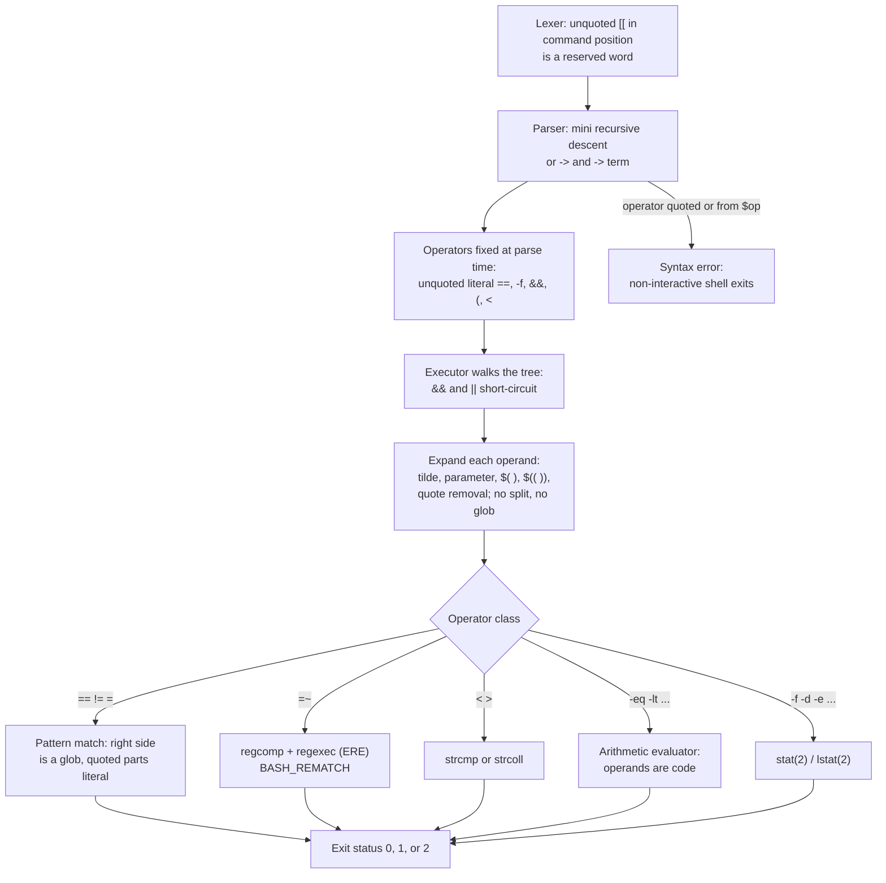

# Double Bracket Conditional

> [!summary] Claim
> `[[ ... ]]` is not a better `[` but a second language: a reserved word whose operators are fixed by the parser, whose operands are expanded without splitting or globbing, and whose `==`, `=~` and `-eq` turn data into patterns, regular expressions and arithmetic code, which is exactly why POSIX refused to standardize it.

Part of [Bash](README.md) in [Shell and Unix Engineering](../README.md).

## TL;DR

- Mechanism: `[[` is a reserved word, so the parser builds an expression tree from unquoted literal operators, and at run time each operand gets tilde, parameter, command and arithmetic expansion plus quote removal, but no field splitting and no pathname expansion.
- Rule: quote the right side of `==`, `!=` and `=~` unless you mean a pattern or a regular expression, and never feed an unvalidated string to `-eq`, `-lt` or `-v`.
- Trap: in bash, mksh and zsh the operands of `-eq` are arithmetic expressions, so `x='b[1$(cmd)]'; [[ $x -eq 0 ]]` runs `cmd` whether or not `$x` is quoted.
- Portability fact: POSIX.1-2024 lists `[[` only as a word that "may be recognized as a reserved word" with unspecified results (XCU 2.4), and rejected standardizing it in Issue 8 because implementations were error-prone and too varied.
- When not to use it: in any `#!/bin/sh` script (dash and posh have no `[[`, and BusyBox ash fakes it with a builtin that still splits), and for numeric checks on untrusted input.

## Mental model



The lexer recognizes `[[` only when it is unquoted and in a position where reserved words are recognized, exactly like `if` or `case`.
From there the shell's own parser, not a utility's argument parser, consumes words up to `]]` and decides which ones are operators, so an operator that is quoted or that arrives through an expansion never becomes one and the whole command is a syntax error.
At run time the executor walks the tree left to right, skipping the right side of `&&` and `||` without expanding it.
Each operand is expanded as one word with no splitting and no globbing, and the operator class then decides what that string means: a glob pattern, a regular expression, a collation key, an arithmetic expression, or a pathname for `stat`.
Only the file operators touch the kernel; everything else runs in the shell's own process, with no `fork` and no `execve`.

## How it works

### The specification: a reserved word with unspecified meaning

POSIX.1-2024 XCU 2.4 (Reserved Words) says that `[[`, `]]`, `function`, `namespace`, `select` and `time` "may be recognized as reserved words, in which case the results are unspecified except as described below for time" (POSIX.1-2024 XCU 2.4); the exception concerns `time` alone.
That sentence licenses the syntax and specifies nothing: a conforming shell may treat `[[` as a keyword, as a command name, or as anything else.
The rationale in the `test` page records the history: the KornShell conditional command was removed from an early draft because "the real problem is misuse of the test command", and "a later proposal to add `[[]]` in Issue 8 was also rejected because existing implementations of it were found to be error-prone in a similar way to historical versions of test, and there was also too much variation in behavior between shells that support it" (POSIX.1-2024 XCU test, RATIONALE).
Some primaries that first appeared in the `[[` proposal (`<`, `>`, `-nt`, `-ot`, `-ef`) were later added to `test` itself by Austin Group Defect 375, and Defect 1330 removed `test`'s obsolescent `-a`, `-o`, `(` and `)` (POSIX.1-2024 XCU test, RATIONALE and CHANGE HISTORY); see [[The-test-Builtin]].
The closest standardized relative is `case`: its word undergoes tilde expansion, parameter expansion, command substitution, arithmetic expansion and quote removal, and each pattern undergoes tilde expansion, parameter expansion, command substitution and arithmetic expansion but not quote removal, because quoting a part of a pattern is what makes that part literal; neither list includes field splitting or pathname expansion, and the two are compared by the rules of XCU 2.14 Pattern Matching Notation (POSIX.1-2024 XCU 2.9.4.3).
`[[ $x == pat ]]` is that same matching, wrapped in an expression language.

### Parse time: operators are syntax

In bash the lexer maps `[[` to the token `COND_START` (bash-5.3 parse.y, `word_token_alist`), and the grammar rule `cond_command: COND_START COND_CMD COND_END` hands control to a hand-written recursive descent parser (bash-5.3 parse.y, `parse_cond_command`), whose own comment calls it "kind of bogus - we slip a mini recursive-descent parser in here".
`cond_or` calls `cond_and`, which calls `cond_term`, so `&&` binds tighter than `||` and both associate to the right (bash-5.3 parse.y, `cond_or`, `cond_and`).
`cond_term` accepts four shapes: `(` expression `)`, `!` term, a unary operator recognized by `test_unop` followed by one word, or a word followed by a binary operator recognized by `test_binop` (or `=~`, `<`, `>`) and one more word (bash-5.3 parse.y, `cond_term`).
A lone word followed by `]]`, `&&`, `||` or `)` becomes an implicit `-n` test, which is why `[[ a==b ]]` is true: it is one non-empty word, not a comparison.
`test_binop` compares the raw token text, quotes included, so `[[ a "==" a ]]` and `op="=="; [[ a $op a ]]` both fail with "conditional binary operator expected" before anything runs.
The same rule makes `[[ -n a -a -n b ]]` a syntax error: after the unary term `-n a`, the next token must be `&&`, `||`, `)` or `]]`.
Because `<` and `>` arrive from the lexer as redirection tokens, `cond_term` turns them back into words (`make_word_from_token`), so inside `[[` they compare strings and never open a file.
When the operator is `==`, `=` or `!=`, `cond_term` sets `PST_EXTPAT` and forces `extended_glob = 1` while it reads the right operand, so `@(a|b)` parses there even when `shopt extglob` is off (bash-5.3 parse.y, `cond_term`); bash NEWS lists this under bash-4.1 ("Force extglob on temporarily when parsing the pattern argument to the == and != operators").
A parse error inside `[[` is a shell syntax error, not a command failure: a non-interactive bash, ksh93, mksh or yash stops at that line, while the same mistake in `[` only makes `[` return 2 and the script continues (lab).

Other shells use the same design with different details.
zsh parses `[[` in `par_cond`, `par_cond_1` and `par_cond_2` (zsh Src/parse.c), and anything it does not recognize as a known operator becomes a `COND_MOD` call to a loadable condition, so `[[ -n a -a -n b ]]` parses and then fails at run time with "unknown condition: -n" (zsh Src/cond.c, `evalcond`), abandoning the rest of the command list (lab).
ksh93 parses in `test_expr`, `test_or`, `test_and` and `test_primary` (ksh93u+m sh/parse.c), and `test_primary` clears `TEST_STRCMP` when the right operand is unquoted, which is the switch between literal and pattern comparison.
ksh93 is also the only keyword implementation that accepts a quoted operator such as `"=="` (lab).
mksh accepts an operator only if it is an unquoted word (`uqword = c == LWORD && *ident`) and converts the `<` and `>` redirection tokens back into string operators (mksh syn.c, `dbtestp_isa`).
yash added the command in 2.48 (2018-12-22) (yash NEWS) and parses it in `parse_double_bracket`, `parse_double_bracket_ors`, `_ands`, `_nots` and `_primary` (yash parser.c).
dash has no such keyword at all: its parser has no `[[` token (dash src/parser.c), so `[[` is an ordinary command name that is not found, status 127, unless an executable called `[[` is on `PATH`.
BusyBox ash is the odd one: it registers `[[` as a regular builtin bound to `testcmd` (BusyBox shell/ash.c, builtin table), and while `simplecmd` is inside `[[ ... ]]` it passes `&&` and `||` to the builtin as literal words instead of ending the command (BusyBox shell/ash.c, `simplecmd`, `double_brackets_flag`); BusyBox's own source says "TODO: handle `[[ expr ]]` bashism bash-compatibly" (BusyBox coreutils/test.c).
Every word therefore goes through normal expansion first, so BusyBox's `[[` splits, globs and drops empty words exactly like `[`, and `(` and `<` are still the subshell and redirection operators (lab).

### Run time: expand, then dispatch on the operator

`execute_cond_command` runs the `DEBUG` trap, then sets `this_command_name` to `[[`, and calls `execute_cond_node` (bash-5.3 execute_cmd.c, `execute_cond_command`).
`execute_cond_node` recurses over the tree; for `COND_AND` and `COND_OR` it evaluates the right child only when the left result requires it, so an expansion on the skipped side, including `${v:=x}` or `$(cmd)`, never happens (bash-5.3 execute_cmd.c, `execute_cond_node`; lab).
Operands are expanded by `cond_expand_word`, which sets `W_NOSPLIT2` and `expand_no_split_dollar_star` so that `$*` and `"$@"` join into one word and nothing is split, then removes quotes (bash-5.3 subst.c, `cond_expand_word`).
For the right side of a pattern or regex operator it instead calls `quote_string_for_globbing`, which keeps a record of which characters were quoted, so `[[ abc == a"*" ]]` treats that `*` as a literal while `[[ abc == a* ]]` does not.
The same function receives `special == 3` for arithmetic operators, which selects `Q_ARITH` quoting, the hook that lets the arithmetic evaluator see the operand as an expression.
Because no word list is ever built, an empty `$v` stays an empty operand: `[[ -n $v ]]` is false, where `[ -n $v ]` collapses to `[ -n ]`, a one-argument test of the non-empty string `-n`, and is true (lab).
`[[` never forks: it runs in the current shell, so an assignment made by an operand, such as `$((v = v + 1))`, persists after the command (lab).

`cond_test` then calls `binary_test` or `unary_test` with the flags `TEST_PATMATCH|TEST_ARITHEXP|TEST_LOCALE`, which is the whole difference between `[[` and the `test` builtin inside bash (bash-5.3 execute_cmd.c, `execute_cond_node`; bash-5.3 test.c, `cond_test`).
`binary_test` routes `==`, `=` and `!=` to `patcomp`, which calls `strmatch(pat, string, FNMATCH_EXTFLAG|FNMATCH_IGNCASE)`, so `nocasematch` applies and extended patterns are always on (bash-5.3 test.c, `patcomp`).
`<` and `>` use `strcoll` when the compatibility level is above 40 or the shell is in POSIX mode, else `strcmp` (bash-5.3 test.c, `binary_test`); NEWS lists the locale-aware comparison under bash-4.1.
`-eq`, `-ne`, `-lt`, `-le`, `-gt` and `-ge` go to `arithcomp`, which with `TEST_ARITHEXP` calls `evalexp` on each operand, the same evaluator as `$(( ))` (bash-5.3 test.c, `arithcomp`).
If `evalexp` fails, `arithcomp` returns false rather than an error, so `[[ 08 -eq 8 ]]` prints "value too great for base" and returns 1, not 2, and `[[ ! 08 -eq 8 ]]` returns 0 (lab).
`=~` goes to `sh_regmatch`, which compiles the right operand with `regcomp(..., REG_EXTENDED)` from the C library and fills `BASH_REMATCH` (bash-5.3 lib/sh/shmatch.c, `sh_regmatch`); an invalid regex returns 2, and bash-5.3 newly prints an error for it (bash NEWS, bash-5.3 item g); details belong to [[Bash-Regex-and-BASH_REMATCH]].
`-v name` is resolved without expanding the name, but a name of the form `a[subscript]` is passed as an array reference whose subscript is evaluated (bash-5.3 execute_cmd.c, `valid_array_reference` with `TEST_ARRAYEXP`); see [[Indexed-Arrays]] and [[Associative-Arrays]].
`-R name` is true for a name reference, and `-v` on a nameref tests the target (lab); it arrived with namerefs in bash-4.3 (bash CHANGES, bash-4.3-alpha item w), the subject of [[Namerefs-and-Dynamic-Scope]].
File operators call `sh_stat`, a wrapper around `stat(2)` that fails an empty pathname with `ENOENT` and emulates `/dev/fd/N` with `fstat` where the system lacks it (bash-5.3 test.c, `unary_test`; bash-5.3 lib/sh/eaccess.c, `sh_stat`).
`!` flips the final status with `result == EXECUTION_SUCCESS ? EXECUTION_FAILURE : EXECUTION_SUCCESS`, so in bash `!` turns an error status 2 into 0 (bash-5.3 execute_cmd.c, `execute_cond_node`); yash keeps the error (`DBE_NOT` maps anything other than true or false to `Exit_TESTERROR`) (yash builtins/test.c, `eval_dbexp`).

### Arithmetic operands in the other shells

ksh93 computes `-eq` operands with `sh_arith` as `Sfdouble_t` floating point, except for the `test` builtin in POSIX mode, which accepts only decimal numbers (ksh93u+m bltins/test.c, `test_binop`).
mksh evaluates `-eq` operands with `evaluate()` for both `[[` and `[` (mksh funcs.c, `test_eval`, `TO_INTEQ`), and its arithmetic is "exactly 32-bit wide ... with silent wraparound" (mksh.1).
zsh calls `matheval` on both operands (zsh Src/cond.c, `evalcond`); yash accepts only integers (`compare_integers`) and BusyBox only integers, so an expression operand is status 2 in both (yash builtins/test.c; lab).
`[[ 010 -eq 8 ]]` is true in bash and `zsh --emulate sh` (octal) and false in native zsh, ksh93, mksh, yash and BusyBox (decimal) (lab), consistent with the leading-zero split that [[Arithmetic-Expansion]] measures.

### Version history (bash)

| Release | Change | Source |
| --- | --- | --- |
| 2.02 | new ksh-like `[[` compound command, `--enable-cond-command` | bash NEWS, bash-2.02 item e and k |
| 2.05b | `DEBUG` trap runs before `[[` | bash NEWS, bash-2.05b item w |
| 3.0 | `=~` operator, `BASH_REMATCH` | bash NEWS, bash-3.0 items cc to ee |
| 3.1 | `nocasematch` applies to `[[` | bash NEWS, bash-3.1 item p |
| 3.2 | quoting the right side of `=~` forces string matching | bash NEWS, bash-3.2 item f |
| 4.0 | `compat31` restores the 3.1 `=~` quoting | bash NEWS, bash-4.0 item l |
| 4.1 | `set -e` and `ERR` apply to `[[`; `<` `>` use the locale; extglob forced on the `==` right side | bash NEWS, bash-4.1 items j, q, s |
| 4.2 | `-v varname` | bash NEWS, bash-4.2 item f |
| 4.3 | `-R` with namerefs; `-v` understands array references | bash CHANGES, bash-4.3-alpha w; bash NEWS, bash-4.3 item ll |
| 5.3 | error message when an `=~` regex fails to compile | bash NEWS, bash-5.3 item g |

[[Bash-Version-History]] holds the cross-feature timeline, and [[Bash-3-2-on-macOS]] the consequences of the 3.2 column below.

## Numbers and limits

| Quantity | Value | Source |
| --- | --- | --- |
| Exit statuses | 0 true, 1 false, 2 evaluation error (bad regex, bad `test` operand); a parse error is a shell syntax error | bash-5.3 test.c `cond_test`; lab |
| bash arithmetic error inside `[[` | status 1, not 2 (`arithcomp` returns false) | bash-5.3 test.c `arithcomp`; lab |
| bash integer width for `-eq` | 64-bit `intmax_t`; `9223372036854775808` wraps negative | bash-5.3 test.c `arithcomp`; lab |
| mksh integer width | exactly 32 bits, silent wraparound | mksh.1 (as of 2026-11) |
| ksh93 `-eq` operand type | `Sfdouble_t`; ksh93u+ 2012 on macOS arm64 treats `2^63-1` and `2^63-2` as equal | ksh93u+m bltins/test.c `test_binop`; lab |
| POSIX `test` argument dispatch | defined for 0 to 4 arguments; more than 4 unspecified | POSIX.1-2024 XCU test |
| Forks per `[[` | 0 (runs in the current shell; operand side effects persist) | lab |
| System calls per string, pattern or arithmetic test | none from the comparison itself | bash-5.3 test.c `binary_test`, `patcomp`, `arithcomp` (no I/O on these paths) |
| System calls per file test | one `stat(2)` or `lstat(2)` | bash-5.3 test.c `unary_test`; lib/sh/eaccess.c `sh_stat` |
| CPU per iteration, empty `for ((...))` loop | 1150 ns | measured by hand, see below |
| `[[ $x == abc ]]` / `[ "$x" = abc ]` | 1124 / 1778 ns per iteration (loop included) | measured by hand |
| `[[ $x == a* ]]` / `case $x in a*)` | 1186 / 1058 ns | measured by hand |
| `[[ $i -lt 5 ]]` / `[ "$i" -lt 5 ]` / `((i < 5))` | 1244 / 1782 / 1038 ns | measured by hand |
| `[[ -f /etc/passwd ]]` / `[ -f /etc/passwd ]` | 4450 / 5164 ns | measured by hand |

The timings were measured by hand on 2026-11-12 on the macOS arm64 host with bash 5.3.15: 500,000 iterations per form, user plus system CPU time from `TIMEFORMAT='%U %S'`, minimum of five runs, load average 7 to 10, so treat differences under about 100 ns as noise.
They are not part of the lab.
The reading is relative: a `[[` string or arithmetic test costs about the same as the loop step itself, `[` adds roughly 600 ns per call in bash, plausibly because it is a builtin that first builds an argument list and then re-parses it with `test`'s argument-count rules, and a file test is dominated by the `stat(2)` call either way.
None of these forms forks; the cost that matters in real scripts is the `$(...)` or external command that people put inside them.

## Portability

Shell behavior; every cell is asserted by the lab in the shell matrix unless it names a source.
Columns: bash 3.2 is macOS `/bin/bash` and Alpine's `/opt/shells/bash-3.2`; bash 5.x is 4.4 to 5.3 unless a cell says otherwise; ksh93 covers ksh93u+m 1.0.10 and macOS ksh93u+ 2012 unless split; mksh is R59.

| Behavior | POSIX sh | bash 3.2 | bash 5.x | zsh | zsh --emulate sh | dash | ksh93 | mksh | yash 2.58.1 | posh 0.14.1 | BusyBox 1.37.0 ash |
| --- | --- | --- | --- | --- | --- | --- | --- | --- | --- | --- | --- | --- |
| What `[[` is | may be reserved, results unspecified (XCU 2.4) | keyword | keyword | keyword | keyword | not found (127), or a `[[` file on `PATH` | keyword | keyword | keyword | not found (127) | builtin |
| `$v="a b"` unquoted is one operand | unspecified | yes | yes | yes | yes | n/a | yes | yes | yes | n/a | no, split (2) |
| Empty unquoted `$v` stays an operand | unspecified | yes | yes | yes | yes | n/a | yes | yes | yes | n/a | no, vanishes |
| Pathname expansion of operands | unspecified | none | none | none | none | n/a | none | none | none | n/a | yes |
| `==` right side is a pattern, quoted parts literal | unspecified | yes | yes | yes | yes | n/a | yes | yes | yes | n/a | pattern, quotes ignored |
| Unquoted `$pat` on the right acts as a pattern | unspecified | yes | yes | no, needs `$~pat` | yes | n/a | yes | yes | yes | n/a | yes, quoted too |
| `<` `>` compare strings, open no file | unspecified | yes | yes | yes | yes | redirection | yes | yes | yes | redirection | redirection |
| `<` in `en_US.UTF-8` | unspecified | byte order | locale (4.1+) | byte order (`strcmp`, cond.c) | byte order | n/a | locale (ksh93u+ 2012 on macOS; u+m not measured) | byte order (`strcmp`, funcs.c) | locale (`wcscoll`, test.c) | n/a | redirection |
| `( ... )` grouping | unspecified | yes | yes | yes | yes | parse error | yes | yes | yes | parse error | parse error |
| `&&` `\|\|` skip expansion of the unused side | unspecified | yes | yes | yes | yes | n/a | yes | yes | yes | n/a | no, all expanded |
| `-eq` operands are expressions (`1+1`, names) | unspecified | yes | yes | yes | yes | n/a | yes | yes | no (2) | n/a | no (2) |
| `010 -eq 8` | unspecified | true (octal) | true (octal) | false | true (octal) | n/a | false | false | false | n/a | false |
| `x='b[1$(cmd)]'; [[ $x -eq 0 ]]` runs `cmd` | unspecified | yes | yes | yes | yes | n/a | 2012: yes; u+m: no, aborts | yes | no (2) | n/a | no (2) |
| `-v name` | unspecified | parse error | yes (4.2+) | yes | yes | n/a | yes | yes | parse error | n/a | status 2 |
| `-R name` (nameref) | unspecified | parse error | yes (4.3+) | run-time abort | run-time abort | n/a | yes | parse error | parse error | n/a | status 2 |
| `=~` | unspecified | yes | yes | yes | yes | n/a | yes | parse error | yes | n/a | yes |
| Invalid regex status, then with `!` | unspecified | 2, then 0 | 2, then 0 | 1, then 0 | 1, then 0 | n/a | 1, then 0 | n/a | 1, then 0 | n/a | 2, then 2 |
| Quoted `"=="` as operator | unspecified | syntax error | syntax error | syntax error | syntax error | n/a | accepted | syntax error | syntax error | n/a | accepted (plain argument) |
| `-a` `-o` as binary operators | unspecified | syntax error | syntax error | run-time abort | run-time abort | n/a | syntax error | syntax error | syntax error | n/a | status 2 |
| `@(a\|b)` on the right with no option set | unspecified | parse error | yes (4.1+) | no, literal `@` | parse error | parse error | yes | yes | parse error | parse error | parse error |
| `set -e` exits on a false `[[` | unspecified | no | yes (4.1+) | yes | yes | n/a | yes | yes | yes | n/a | yes |

External utilities named `[[`, checked in the matrix images and on the host (as of 2026-11):

| Platform | `[[` executable | What it does |
| --- | --- | --- |
| Alpine 3.22 (BusyBox 1.37.0) (as of 2026-11) | `/usr/bin/[[ -> /bin/busybox` | the `test` applet in `[[` mode: `=~` allowed, `-a` and `-o` refused, words already split by the calling shell (BusyBox coreutils/test.c, `check_operator`; lab) |
| Debian 13 (GNU coreutils 9.7) (as of 2026-11) | none; coreutils ships only `[` and `test` | n/a |
| macOS host (as of 2026-11) | none; `/bin/[` exists | n/a |

The consequence for dash on Alpine is a trap of its own: `[[ $v == "a b" ]]` there is not a syntax error but a call to the BusyBox applet with split words, so a script that "works" on Alpine fails with 127 on Debian.

## Worked example

The [lab](../labs/04-double-bracket-conditional/) runs 42 tests through every shell in the matrix.
Its probe classifies what `[[` is in the running shell by behavior rather than by name, then runs the same five checks through `[` and through `[[` and prints both statuses.

```sh
#!/bin/sh
# dbracket_probe.sh: show what [[ is in the running shell, and where it differs from [.
# Usage: dbracket_probe.sh classify|contrast
#   classify  print kind=keyword, kind=builtin, kind=external, or kind=absent
#   contrast  run the same five checks through [ and through [[ and print both exit statuses
#
# Every [[ lives in a single-quoted eval string: dash and posh have no such keyword, mksh parses
# a whole file before running any of it, and shfmt would otherwise reformat the conditional.

set -u

# dbl CODE: evaluate CODE (a [[ command) in this shell and print its exit status.
dbl() {
  eval "$1" 2>/dev/null
  printf '%s' "$?"
}

# sgl ARG...: run [ with these arguments and print its exit status.
sgl() {
  # shellcheck disable=SC2244 # the arguments are a whole test expression, not one string
  [ "$@" ] 2>/dev/null
  printf '%s' "$?"
}

# row NAME SINGLE DOUBLE: print one line of the contrast table.
row() {
  printf '%-8s single=%s double=%s\n' "$1" "$2" "$3"
}

classify() {
  where=$(command -v '[[' 2>/dev/null) || where=
  case $where in
    '') kind=absent ;;
    */*) kind=external ;;
    *)
      # A keyword parses < as a string operator; a builtin leaves it to the shell, which tries
      # to open the right operand for reading and fails.
      order=$(dbl '[[ / < /nonexistent/dbracket-probe ]]')
      if [ "$order" = 0 ]; then
        kind=keyword
      else
        kind=builtin
      fi
      ;;
  esac
  printf 'kind=%s\n' "$kind"
}

contrast() {
  v='a b'
  # shellcheck disable=SC2086,SC2248 # unquoted on purpose: [ sees two words, [[ sees one
  s=$(sgl $v = 'a b')
  # shellcheck disable=SC2016 # the code is for eval, not for expansion here
  d=$(dbl '[[ $v == "a b" ]]')
  row split "$s" "$d"

  v=
  # shellcheck disable=SC2086,SC2248 # unquoted on purpose: the empty value vanishes from [
  s=$(sgl -n $v)
  # shellcheck disable=SC2016 # the code is for eval, not for expansion here
  d=$(dbl '[[ -n $v ]]')
  row empty "$s" "$d"

  s=$(sgl abc = 'a*')
  d=$(dbl '[[ abc == a* ]]')
  row pattern "$s" "$d"

  s=$(sgl 010 -eq 8)
  d=$(dbl '[[ 010 -eq 8 ]]')
  row octal "$s" "$d"

  s=$(sgl 1+1 -eq 2)
  d=$(dbl '[[ 1+1 -eq 2 ]]')
  row expr "$s" "$d"
}

case ${1-} in
  classify) classify ;;
  contrast) contrast ;;
  *)
    printf 'usage: %s classify|contrast\n' "$0" >&2
    exit 2
    ;;
esac
```

Under bash (3.2 through 5.3) the lab asserts this output:

```text
$ bash dbracket_probe.sh classify
kind=keyword
$ bash dbracket_probe.sh contrast
split    single=2 double=0
empty    single=0 double=1
pattern  single=1 double=0
octal    single=1 double=0
expr     single=2 double=0
```

Read it row by row.
`split`: `[` received four words (`a`, `b`, `=`, `a b`) and failed with 2; `[[` saw one operand and matched.
`empty`: `[ -n ]` is a one-argument test of the string `-n`, so it is true; `[[ -n $v ]]` correctly reports the empty value.
`pattern`: `[` compares strings, `[[` matches `a*`.
`octal` and `expr`: `[` wants decimal integers, `[[` evaluates `010` as octal 8 and `1+1` as 2; this is the feature that becomes the injection in the Security section.
The lab asserts the other families too: ksh93 and mksh print `octal single=1 double=1` and `expr single=0 double=0` (decimal in `[[`, and their `[` also evaluates expressions); native zsh prints `split single=0` because it never splits; BusyBox ash prints `kind=builtin` and `split single=2 double=2`, `empty single=0 double=0`; dash prints `kind=absent` and `double=127` on every row where no `[[` file exists.

## Pitfalls

> [!warning] Unquoted right side turns data into a pattern
> Trigger: `[[ $input == $expected ]]` or `[[ $token == $secret ]]` where the right side comes from a variable.
> Symptom: `guess='*'` equals any secret; a value containing `\` does not equal itself (`x='a\b'; [[ $x == $x ]]` is false in bash, ksh93, mksh and yash, true in zsh) (lab).
> Fix: quote the right side, `[[ $a == "$b" ]]`, whenever you mean equality; write a pattern unquoted only when it is a literal in the source.

> [!warning] Arithmetic operators evaluate their operands as code
> Trigger: `[[ $n -gt 0 ]]` (quoted or not) where `n` comes from a file, an environment variable, a CGI parameter or an HTTP header.
> Symptom: `n='b[1$(cmd)]'` runs `cmd` in bash, mksh, zsh and ksh93u+ 2012; `n='y=7'` assigns `y`; `n=nosuch` silently compares 0 (lab).
> The mechanism was laid out on bug-bash in May and June 2014 in the thread "Arithmetic + array allows for code injection" (Dan Douglas, Greg Wooledge, Pierre Gaston).
> Fix: validate the shape first, for example `[[ $n =~ ^(0|[1-9][0-9]*)$ ]] || die`, and only then compare.

> [!warning] Quoting the operand does not help with `-eq`
> Trigger: believing `[[ "$n" -eq 0 ]]` is safer than `[[ $n -eq 0 ]]`.
> Symptom: both run the substitution, because the danger is the arithmetic evaluation of the expanded value, not splitting (lab, test "arithmetic injection").
> Fix: as above; or use `[ "$n" -eq 0 ]`, which in bash, zsh, yash, dash and BusyBox rejects a non-integer with status 2, but not in mksh, ksh93u+ 2012 or posh, which also evaluate it (lab).

> [!warning] Leading zeros are octal in bash
> Trigger: comparing zero-padded values such as months, minutes or IDs: `[[ $month -eq 8 ]]` with `month=08`.
> Symptom: bash prints "value too great for base" and the test is false (status 1), and `[[ ! 08 -eq 8 ]]` is true; `010` equals 8 (lab).
> Fix: strip the zeros or compare as strings; in arithmetic context `10#$month` forces decimal for a value already validated as digits.

> [!warning] An error inside a negated test becomes success
> Trigger: `if [[ ! $s =~ $re ]]` with a broken `$re`, or `[[ ! $n -lt 5 ]]` with a malformed `$n`.
> Symptom: an invalid regex is status 2 in bash and 1 in zsh, ksh93 and yash, and `!` turns each into 0; an operand error such as `1.5 -lt 2` is status 1 in bash, also flipped to 0, while mksh, yash and BusyBox return 2 and keep 2 under `!` (lab; bash-5.3 execute_cmd.c `execute_cond_node`; yash builtins/test.c `eval_dbexp`).
> Fix: test the positive form and branch on the status explicitly, or validate the regex and the number before negating.

> [!warning] An operator that arrives in a variable is a syntax error
> Trigger: `op='=='; [[ $a $op $b ]]`, or a quoted `"-f"` as the operator.
> Symptom: "conditional binary operator expected"; the parse error ends a non-interactive script at that line, in bash, mksh, yash and zsh (ksh93 accepts a quoted operator) (lab).
> Fix: dispatch with `case $op in ==) [[ $a == "$b" ]] ;; ... esac`, or use `test "$a" "$op" "$b"`, which takes operators as data.

> [!warning] `-a` and `-o` are not operators inside `[[`
> Trigger: porting `[ -n "$a" -a -n "$b" ]` by swapping the brackets.
> Symptom: a syntax error in bash, ksh93, mksh and yash, a run-time "unknown condition" in zsh that abandons the command list, status 2 in BusyBox (lab).
> Fix: `[[ -n $a && -n $b ]]`, or in POSIX sh `[ -n "$a" ] && [ -n "$b" ]`, since POSIX.1-2024 removed `-a` and `-o` from `test` (Defect 1330); ShellCheck flags the `[[` form as SC2108.

> [!warning] `set -e` did not see `[[` before bash 4.1
> Trigger: relying on `set -e` to stop at `[[ -f $config ]]` on macOS `/bin/bash` 3.2.
> Symptom: bash 3.2 continues after a false `[[`; 4.1 and later exit (lab; bash NEWS, bash-4.1 item j).
> Fix: write `[[ -f $config ]] || die "missing $config"`; see [[inherit_errexit-and-errtrace]] and [[ERR-and-DEBUG-Traps]].

> [!warning] `<` sorts by locale in one shell and by bytes in the next
> Trigger: `[[ $a < $b ]]` used for ordering keys, versions or file names.
> Symptom: in `en_US.UTF-8`, bash 4.1+ and ksh93u+ say `a < B`; bash 3.2, zsh and mksh say `B < a` (lab on the macOS host; zsh cond.c and mksh funcs.c use `strcmp`).
> Fix: set `LC_ALL=C` for the comparison when you need byte order; for versions use `sort -V` or a real parser.

> [!warning] BusyBox's `[[` is a builtin that splits
> Trigger: a bash script run with Alpine's `/bin/sh` or `busybox ash` "because `[[` works there".
> Symptom: `[[ $v == "a b" ]]` returns 2 for `v="a b"`, `[[ -n $empty ]]` is true, `[[ a < b ]]` creates or reads a file, and `(` is a syntax error (lab).
> Fix: use a `#!/bin/bash` shebang when you use bash syntax, or write POSIX `[` and `case`.

## Security and robustness

The threat model for `[[` is input that becomes code.
Three operators interpret their operand rather than compare it: `==`/`!=` (glob), `=~` (regular expression) and `-eq` family (arithmetic), plus `-v`, which interprets a name.
The arithmetic path is the dangerous one, because bash's evaluator expands array subscripts, and a subscript can contain `$(...)`: the lab writes a marker file through `[[ $x -eq 0 ]]` with `x='b[1$(echo run >pwned1)]'` in bash 3.2 to 5.3, mksh, zsh, `zsh --emulate sh` and ksh93u+ 2012, and through `[[ -v $x ]]` in bash 4.3+ and mksh.
ksh93u+m rejects the subscript as an arithmetic syntax error, and yash and BusyBox reject the operand as a non-integer (lab).
This is distinct from the variable-name recursion that [[Arithmetic-Expansion]] measures (`$((x))` where `x` names an array element): here the expanded text itself is pasted into the expression, so zsh, which that note shows does not run a substitution reached through a variable name, still runs this one (lab).
Rules that hold for every input:
- Validate integers with a regex or `case` before any arithmetic operator: `[[ $n =~ ^(0|[1-9][0-9]*)$ ]]` accepts exactly the non-negative decimal integers without leading zeros, which also removes the octal surprise.
- Validate names with `[[ $name =~ ^[A-Za-z_][A-Za-z0-9_]*$ ]]` before `-v`, `-R`, `declare -n` or `printf -v`, or test with `${name+set}` on a fixed name; see [[Null-versus-Unset]].
- Quote every right side of `==` and `!=` that is data; keep patterns as literals in the source.
- Put a regex in a variable (`re='^[a-z]+$'; [[ $s =~ $re ]]`) to avoid quoting rules, and never build it from input; see [[Bash-Regex-and-BASH_REMATCH]].
- Treat `!` around an error-prone test as a bug; branch on the positive form.
- Remember that operands still undergo command substitution, so `[[ -f $(find ...) ]]` runs a program with the parent's privileges; see [[Command-Injection]].

The robustness benefit is real but narrow: no splitting and no globbing removes the argument-count collapse that breaks `[ $x = y ]`, and a misspelled operator is caught at parse time instead of silently returning 2.
The cost is that a parse error inside `[[` kills a non-interactive script on that line, so a typo in a rarely taken branch is a crash in production; `bash -n` and ShellCheck catch it before deployment.

## The principal's view

The decision is not "`[` or `[[`"; it is which language the file is written in.
In a file whose shebang is `bash`, `[[` should be the default conditional for strings, patterns and files, because it removes a whole class of quoting bugs, costs no fork, and is slightly faster than the `[` builtin.
In a file run by `/bin/sh`, `[[` is wrong even when it seems to work: dash and posh do not have it, BusyBox fakes it badly, and POSIX deliberately declined to define it.
The trade-off is a reviewability tax: `==` with an unquoted right side, `=~` with inline quotes, and `-eq` on an expression all look like comparisons and are not, so a reviewer has to know three sub-languages to read one line.
The staff-plus rule is to keep the conditional boring: compare strings with a quoted right side, do arithmetic in `(( ))` on validated integers, match with `case` when a pattern is the point, and use `=~` only with a regex held in a variable.
For trust boundaries, do the validation in one function at the edge (`is_uint`, `is_identifier`) and forbid arithmetic operators on raw input in code review ([[Reviewing-Shell-at-Staff-Level]]) and in lint-driven CI ([[ShellCheck-Warning-Families]]).
When conditions grow into version comparison, structured data or many-way decisions, the shell has stopped being the right tool: move the logic to a language with types and real comparisons, and keep the shell as the glue that calls it.

## Interview questions

> [!question] L5: What does `[[` do differently from `[` with an unquoted variable?
>
> > [!success]- Answer
> > `[` is a builtin, so the shell expands its arguments first, field-splits and globs unquoted expansions, and drops empty ones.
> > `[[` is a reserved word; its operands are expanded as single words with no splitting and no pathname expansion.
> > So `v="a b"; [[ $v == "a b" ]]` is true and `[ $v = "a b" ]` is a "too many arguments" error with status 2.
> > An empty `$v` stays an operand: `[[ -n $v ]]` is false, while `[ -n $v ]` becomes `[ -n ]`, which is true.
> >
> > Follow-up: Which shell provides `[[` but still splits, and why?

> [!question] L5: Predict the output of `x=abc; [[ $x == a* ]]; echo $?; [[ $x == "a*" ]]; echo $?; [[ a* == $x ]]; echo $?` in bash.
>
> > [!success]- Answer
> > It prints `0`, `1`, `1`.
> > The right side of `==` is a pattern, so `a*` matches `abc`.
> > Quoting makes the pattern characters literal, so `"a*"` only matches the string `a*`.
> > The left side is never a pattern, so `a* == abc` compares the literal `a*` against the pattern `abc`.
> >
> > Follow-up: What does `[[ abc == a"*" ]]` print, and which bash function tracks which characters were quoted?

> [!question] L5: Why is `[[ a==b ]]` true?
>
> > [!success]- Answer
> > Operators must be separate words; `a==b` is one word.
> > A lone word is an implicit `-n` test (bash-5.3 parse.y `cond_term` builds `-n` for it), and `a==b` is non-empty.
> > ShellCheck 0.11.0 (as of 2026-11) reports `[[ $x==b ]]` as SC2077 ("You need spaces around the comparison operator"); the fix is spaces: `[[ $x == b ]]`.
> >
> > Follow-up: What happens with `op="=="; [[ a $op b ]]`, and when does the error surface?

> [!question] L6: Debug this script: `read -r n; if [[ $n -ge 10 ]]; then echo "too big"; exit 1; fi; process "$n"` is meant to accept only 0 to 9, yet it passes `08`, `1.5` and `abc` to `process`; why?
>
> > [!success]- Answer
> > In bash, `-ge` evaluates both operands as arithmetic expressions instead of checking that they are integers.
> > `08` is an invalid octal constant and `1.5` is not an integer, so the evaluator fails, `arithcomp` returns false, and the test is status 1: not too big.
> > `abc` is a variable name; unset, it evaluates to 0, which is not too big either.
> > A value such as `b[1$(cmd)]` runs `cmd` during the check, so the guard is also an injection point.
> > Fix: validate the shape first, `[[ $n =~ ^[0-9]$ ]] || die "not a digit"`, and only then compare.
> >
> > Follow-up: Which shells reject `1.5` with status 2 here, and does that make the script correct in them?

> [!question] L6: Why does POSIX not standardize `[[`, and what does XCU 2.4 actually say?
>
> > [!success]- Answer
> > XCU 2.4 lists `[[` and `]]` among words that may be recognized as reserved words, with unspecified results.
> > The `test` rationale says the KornShell conditional was dropped early because the real problem was misuse of `test`, and that an Issue 8 proposal was rejected because implementations were error-prone and varied too much.
> > The variation is measurable: quoted operators, `=~`, `-v`, octal constants, collation and the meaning of `!` on errors all differ across bash, zsh, ksh93, mksh and yash.
> >
> > Follow-up: Which `[[` primaries did make it into `test`, and through which Austin Group defect?

> [!question] L6: Is `[[ "$n" -eq 0 ]]` safe against code injection when `n` is attacker-controlled?
>
> > [!success]- Answer
> > No.
> > Quoting prevents splitting, but the operand is still evaluated by the arithmetic evaluator, and an array subscript inside it undergoes command substitution.
> > `n='b[1$(cmd)]'` runs `cmd` in bash, mksh, zsh and ksh93u+ 2012, quoted or not; ksh93u+m and yash reject it.
> > The fix is validation before comparison.
> >
> > Follow-up: Does `[ "$n" -eq 0 ]` help, and in which shells does it not?

> [!question] L6: Why does `[[ ab == @(ab|cd) ]]` work in bash 5 without `shopt -s extglob`, but `x=@(ab|cd); [[ ab == $x ]]` might not?
>
> > [!success]- Answer
> > Since bash-4.1 `cond_term` forces `extended_glob` on while it parses the right side of `==` and `!=`, so the literal pattern parses, and `patcomp` always matches with `FNMATCH_EXTFLAG`.
> > The assignment `x=@(ab|cd)` is parsed as ordinary shell input, where `(` is a syntax error unless extglob is already on.
> > So the pattern works in `[[` but cannot be stored in a variable without the option (or quotes around the assignment value).
> >
> > Follow-up: What does native zsh do with `@(ab|cd)`, and which option changes it (see [[Extended-Globbing]])?

> [!question] L7+: Design a policy for numeric comparisons in a 50,000-line bash codebase that processes untrusted input.
>
> > [!success]- Answer
> > Ban arithmetic operators and `(( ))` on values that have not passed a named validator such as `is_uint` or `is_int`.
> > Make the validator a single regex check (`^(0|[1-9][0-9]*)$` or with an optional sign) so octal and expression forms are rejected, not reinterpreted.
> > Enforce it in review and with a custom lint that flags `-eq`, `-lt` and `((` on variables tainted by `read`, environment, or command output.
> > Keep the bash version floor explicit (4.1+ for `set -e` on `[[`, 4.2+ for `-v`) and test the macOS 3.2 path in CI if you support it.
> > Accept the cost: one extra regex per input, measured in microseconds, against the risk of a remote command execution.
> >
> > Follow-up: How would you detect existing violations at scale without false positives from loop counters?

> [!question] L7+: Explain, down to the source, why `n=1.5; [[ ! $n -lt 2 ]]` is true in bash but an error in yash.
>
> > [!success]- Answer
> > In bash, `arithcomp` calls `evalexp`, which fails on `1.5`, and `arithcomp` then returns false, so the inner test is status 1, not 2.
> > `execute_cond_node` applies `!` as "success becomes failure, anything else becomes success", so the 1 becomes 0 and the negated test is true.
> > yash accepts only integers (`compare_integers`), reports the operand error as status 2, and its `eval_dbexp` maps `DBE_NOT` of anything other than true or false to `Exit_TESTERROR`, so the result stays 2.
> > bash's `!` would also turn a genuine 2, such as an invalid `=~` regex, into 0.
> > The design lesson: a two-valued negation over a three-valued result loses the error, so robust code never negates a test that can fail for reasons other than the comparison.
> >
> > Follow-up: How does `set -e` treat a `[[` that returns 2, and does the `ERR` trap fire?

> [!question] L7+: A team ships `#!/bin/sh` scripts that use `[[` and pass CI on Alpine but fail on Debian; explain both results.
>
> > [!success]- Answer
> > On Alpine `/bin/sh` is BusyBox ash, which has a `[[` builtin, and `/usr/bin/[[` is a BusyBox applet, so most simple uses appear to work.
> > On Debian `/bin/sh` is dash, which has no `[[` keyword and finds no `[[` executable, so every use is "not found", status 127, and under `set -e` the script exits.
> > Even on Alpine the semantics are those of `[`: words split, empty words vanish, `<` is a redirection, so the passing tests prove less than they seem.
> > The fix is a `bash` shebang or POSIX `[` and `case`, plus running CI under dash, which rejects bashisms loudly.
> >
> > Follow-up: What does ShellCheck report for `[[ $x == b ]]` in a `#!/bin/sh` file?

## Related

Prerequisites: [[Namerefs-and-Dynamic-Scope]], [[The-test-Builtin]], [[Field-Splitting-and-IFS]], [[Pathname-Expansion]]

Next: [[Bash-Regex-and-BASH_REMATCH]]

See also: [[Extended-Globbing]], [[Reviewing-Shell-at-Staff-Level]], [[Cross-Shell-CI-Matrices]], [[Shell-Options-shopt]], [[Arithmetic-Expansion]], [[Compound-Commands]], [[Shell-Grammar]], [[errexit-Semantics-and-Exceptions]], [[inherit_errexit-and-errtrace]], [[ERR-and-DEBUG-Traps]], [[Bash-Version-History]], [[Bash-3-2-on-macOS]], [[Bash-POSIX-Mode]], [[Indexed-Arrays]], [[Associative-Arrays]], [[Dash-and-Bashisms]], [[BusyBox-ash]], [[Zsh-versus-POSIX]], [[ksh93-Features]], [[mksh]], [[Command-Injection]], [[Null-versus-Unset]]

## Further reading

- POSIX.1-2024 XCU 2.4 Reserved Words (https://pubs.opengroup.org/onlinepubs/9799919799/utilities/V3_chap02.html): the one sentence that makes `[[` legal and unspecified.
- POSIX.1-2024 `test`, RATIONALE and CHANGE HISTORY (https://pubs.opengroup.org/onlinepubs/9799919799/utilities/test.html): why `[[` was rejected twice, and Defects 375 and 1330.
- POSIX.1-2024 XCU 2.9.4.3 and 2.14 (same chapter 2 page): `case` and pattern matching, the standardized core that `==` reuses.
- bash-5.3 source, `parse.y` (`cond_term`), `execute_cmd.c` (`execute_cond_node`), `subst.c` (`cond_expand_word`), `test.c` (`binary_test`, `arithcomp`) (https://ftp.gnu.org/gnu/bash/bash-5.3.tar.gz): the whole mechanism in about 600 lines.
- bash NEWS and CHANGES in the same tarball: the dated history of every `[[` feature.
- zsh `Src/parse.c` (`par_cond_2`) and `Doc/Zsh/cond.yo` (https://github.com/zsh-users/zsh): how zsh extends conditions with module operators.
- ksh93u+m `sh/parse.c` (`test_primary`) and `bltins/test.c` (`test_binop`) (https://github.com/ksh93/ksh): the original design and its floating-point arithmetic.
- mksh `syn.c` (`dbtestp_isa`) and `mksh.1` (https://github.com/MirBSD/mksh): unquoted-operator rule and 32-bit arithmetic.
- yash `parser.c` (`parse_double_bracket`) and `builtins/test.c` (`eval_dbexp`) (https://github.com/magicant/yash): a 2018 reimplementation that keeps errors through `!`.
- BusyBox `shell/ash.c` (`simplecmd`) and `coreutils/test.c` (https://github.com/mirror/busybox): what a builtin imitation of a keyword cannot do.
- bug-bash, "Arithmetic + array allows for code injection", May and June 2014 (https://lists.gnu.org/archive/html/bug-bash/2014-05/msg00112.html): the primary discussion of the subscript injection mechanism.
