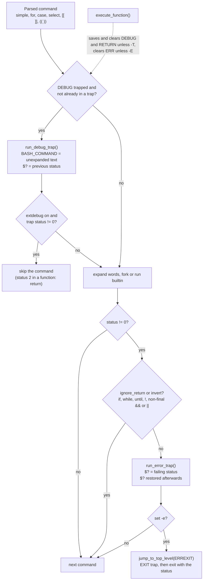

# ERR and DEBUG Traps

> [!summary] Claim
> `ERR` and `DEBUG` are not signals but executor hooks: bash, zsh, ksh93, mksh, and BusyBox ash call an `eval`-style action from inside the command loop, after a command fails (`ERR`, with the same exemptions as `set -e`) or before a command runs (`DEBUG`), and almost every surprising behavior follows from where each shell places that call and which scopes it resets the hook in.

Part of [Bash](README.md) in [Shell and Unix Engineering](../README.md).

## TL;DR

- Mechanism: bash keeps `ERR`, `DEBUG`, and `RETURN` as pseudo-signals numbered `NSIG`, `NSIG + 1`, `NSIG + 2` in its trap table (bash-5.3 trap.h), and `execute_command_internal` calls `run_error_trap` after a failure while `execute_simple_command` and the compound-command executors call `run_debug_trap` before running.
- Rule: install a production `ERR` handler as `set -o errexit -o errtrace` plus `trap 'on_err "$?" "$BASH_COMMAND"' ERR`, have the handler print to stderr and `exit`, because the first trap run is the innermost failure and exiting stops the second run in every caller frame.
- Trap: without `errtrace` the trap fires once at the call site of a failing function, yet `BASH_COMMAND` still names the last command inside the function, so the report blames a command at the wrong line.
- Portability: POSIX.1-2024 XCU 2.15 `trap` defines only `EXIT`, `0`, and signal names, and its rationale calls the KornShell `ERR` trap "allowable as an extension, but was not mandated"; dash, yash, and posh reject both conditions, and mksh and BusyBox ash have `ERR` but no `DEBUG` (lab).
- When not to use it: do not build control flow, retries, or a tracer that must be fast on `DEBUG`; one bash `DEBUG` firing cost about 2.5 microseconds here, a 3.7x slowdown on a tight loop, and anything that needs exceptions or tracing belongs in a language with them.

## Mental model



Every command first passes the `DEBUG` gate: if a `DEBUG` trap is set and no trap is already running, bash runs it with `BASH_COMMAND` holding the reconstructed, unexpanded command text and `$?` still holding the previous command's status, and under `extdebug` a non-zero trap status skips the command.
The command then expands and runs; a zero status goes straight on, while a non-zero status is checked against the flags the parser and the enclosing constructs set (`CMD_IGNORE_RETURN` for `if`, `while`, `until`, and non-final `&&` and `||` operands, `CMD_INVERT_RETURN` for `!`), which are the same flags `set -e` reads.
Only a failure that survives that filter runs the `ERR` trap, with `$?` equal to the failure and restored after the action, and only then does `set -e` exit through the `EXIT` trap.
The dotted edge is the scoping rule that causes most surprises: on entry to every function, `execute_function` stashes the `DEBUG`, `ERR`, and `RETURN` actions and clears them for the body unless `functrace` (`-T`) or `errtrace` (`-E`) says otherwise.

## How it works

### Specification status

POSIX.1-2024 XCU 2.15 `trap` says "The condition can be EXIT, 0 (equivalent to EXIT), or a signal specified using a symbolic name, without the SIG prefix".
Neither `ERR` nor `DEBUG` appears anywhere in XCU chapter 2 except the `trap` rationale, which opens with "The KornShell uses an ERR trap that is triggered whenever set -e would cause an exit."
It continues: "This is allowable as an extension, but was not mandated, as other shells have not used it."
For an invalid condition, "the trap utility shall write a warning message to standard error" (XCU 2.15 `trap`), which is what dash does: `trap: ERR: bad trap`, status 1, and the script continues (measured here with Homebrew dash 0.5.13).
What the standard does specify, and what every `ERR` implementation borrows, is the exemption list for `-e` in XCU 2.15 `set`: the `-e` setting "shall be ignored when executing the compound list following the while, until, if, or elif reserved word, a pipeline beginning with the ! reserved word, or any command of an AND-OR list other than the last", and "the failure of any individual command in a multi-command pipeline ... shall not cause the shell to exit".
The `EXIT` half of the trap story, `trap -p`, signal deferral, and subshell resets belong to [[Traps-and-EXIT]]; this note covers only the two executor hooks.

### Where bash stores the hooks

bash-5.3 trap.h defines `DEBUG_TRAP` as `NSIG`, `ERROR_TRAP` as `NSIG+1`, `RETURN_TRAP` as `NSIG+2`, and `EXIT_TRAP` as 0, and sizes its tables `BASH_NSIG` (`NSIG+3`).
They share `trap_list[]` and the `sigmodes[]` flag words with real signals, but trap.c `SPECIAL_TRAP()` marks them so that no `sigaction(2)` handler is ever installed: no kernel signal is involved, and no system call happens until the action itself runs a command.
`trap` decodes the names case-insensitively with an optional `SIG` prefix (bash-5.3 doc/bashref.texi, `trap`), so `trap ... err` works in bash and fails in shells that follow POSIX's uppercase rule.
bash 5.3 added `BASH_TRAPSIG`, "set to the numeric signal number of the trap being executed while it's running" (bash-5.3 NEWS); trap.c `_run_trap_internal` calls `set_bash_trapsig(sig)` with the internal number, so a `DEBUG` trap sees `NSIG` and an `ERR` trap sees `NSIG + 1`: 32 and 33 on macOS, measured in the lab, where `NSIG` is 32.

### The DEBUG call sites

bash-5.3 execute_cmd.c calls `run_debug_trap()` in `execute_simple_command`, `execute_for_command` (once per iteration, before binding the variable), the arithmetic `for` evaluator, `execute_select_command`, `execute_case_command`, `execute_arith_command`, `execute_cond_command`, and `execute_function` (once before the body, only when the function inherits the trap).
Each call site first copies the printed command into `the_printed_command_except_trap`, which is what `BASH_COMMAND` expands to, and it does so only when `signal_in_progress (DEBUG_TRAP) == 0 && running_trap == 0`, so commands executed by a trap never overwrite it.
In `execute_simple_command` the copy and the trap happen after `print_simple_command` and before word expansion, so `BASH_COMMAND` is the source text: the lab's `echo "hello $v"` shows up as `echo "hello $v"`, not `echo hello world`.
Compound commands are reconstructed, not copied: `[[ a ]]` appears as `[[ -n a ]]` and a `case` head as `case x in ` (measured here in bash 3.2 and 5.3).
`run_debug_trap` runs the action through `_run_trap_internal(DEBUG_TRAP, "debug trap")`, which saves the parser state, `PIPESTATUS`, and the temporary environment, sets `SIG_INPROGRESS` so the trap cannot recurse, and calls `parse_and_execute` on a copy of the action string: the action is re-parsed on every firing, which is where the cost comes from.
Because the trap fires once per simple command, a three-stage pipeline costs three firings in bash, one per stage, run in the parent before each fork (lab: four firings including the `trap - DEBUG` that ends the probe).
zsh fires once per sublist instead (`execlist` in zsh Src/exec.c checks `sigtrapped[SIGDEBUG] && isset(DEBUGBEFORECMD) && !intrap` once per loop iteration), and ksh93 fires once per pipeline, so the same probe gives 2 in both (lab).

### extdebug turns DEBUG into a debugger protocol

With `shopt -s extdebug`, every call site checks `if (debugging_mode && retval != EXECUTION_SUCCESS)` and skips the command, and `run_debug_trap` adds that a status of 2 while `return_catch_flag` is set (inside a function or a sourced file) longjmps to the function's return point (bash-5.3 trap.c `run_debug_trap`).
Without `extdebug` the trap's status is ignored (measured here: `trap false DEBUG` does not stop anything).
`shopt_set_debug_mode` in bash-5.3 builtins/shopt.def is `error_trace_mode = function_trace_mode = debugging_mode`, so turning `extdebug` on also turns on `-E` and `-T`, and turning it off clears both even if the script had set `-E` itself.
That handler first appears in bash 4.4 (absent from bash-4.0 through 4.3 builtins/shopt.def); bash 3.2 keeps `-E` after `shopt -u extdebug` (lab), and so does bash 4.3.0 built from source (measured here).
Setting `extdebug` at invocation (`bash -O extdebug` or `--debugger`) makes shell.c `start_debugger` source the compiled-in `DEBUGGER_START_FILE`; with Homebrew bash 5.3 that printed `.../share/bashdb/bashdb-main.inc: No such file or directory` and `cannot start debugger; debugging mode disabled` (measured here).
ksh93 uses status codes instead of an option: a `DEBUG` trap that exits 2 skips the command and one that exits 255 inside a function or dot script returns from it (ksh93 sh.1, `trap`), and zsh skips the next command when the trap sets `ERR_EXIT` (zsh builtins.yo, `trap`); the lab exercises all three protocols.

### The ERR call sites and the exemption flags

bash-5.3 execute_cmd.c runs the `ERR` trap in five places: `execute_command_internal` after a simple command, after a user `( ... )` subshell, after a failed redirection on a compound command, and after `(( ))`, `[[ ]]`, or a function definition, and `execute_connection` after a `|` pipeline.
Every site has the same guard: `was_error_trap && ignore_return == 0 && invert == 0 && exec_result != EXECUTION_SUCCESS`, where `ignore_return` is `CMD_IGNORE_RETURN`, the flag that the `if`, `while`, `until`, `&&`, and `||` executors set on the commands whose status they test, and `invert` is `CMD_INVERT_RETURN` from `!`.
That is why the bash manual can say the `ERR` conditions "are the same conditions obeyed by the errexit (-e) option" (bash-5.3 doc/bashref.texi, `trap`): both read the same two flags.
The simple-command site also requires `pipe_in == NO_PIPE && pipe_out == NO_PIPE`, so a failing non-final pipeline stage never fires; the pipeline site fires on the pipeline's status, which under `pipefail` is the rightmost failure (see [[pipefail-and-PIPESTATUS]]).
The simple-command site skips commands flagged `CMD_COMMAND_BUILTIN`, so `command false` fires once, when `command` itself returns; that deferral first appears in bash-5.0 execute_cmd.c (absent in 4.4), and bash 3.2 fires twice (lab), as do bash 4.0.0 and 4.3.0 built from source (measured here).
`execute_builtin` disables the trap entirely for `eval`, `command`, and `source` run in a tested context: it saves the action, calls `restore_default_signal (ERROR_TRAP)`, and restores it with an unwind-protect.
The trap runs with `$?` set to the failure (`last_command_exit_value = exec_result`) and `line_number` swapped for `line_number_for_err_trap`, the line of the failing command recorded by the `SET_LINE_NUMBER` macro; when the trap returns, `execute_command_internal` ends with `last_command_exit_value = exec_result`, so the next command sees the failure, not the trap's status (lab: `err:3`, then `after:3`; measured here: an action ending in `(exit 9)` still leaves `$?` at 3).
`run_error_trap` refuses to run while `SIG_INPROGRESS` is set, so a failure inside the `ERR` action does not recurse.
After the trap, `exit_immediately_on_error` sends the shell through `jump_to_top_level (ERREXIT)`, so under `set -e` the order is `ERR` trap, then `EXIT` trap, then exit with the failing status, whatever the `ERR` action returned (lab: status 3 after an action that ended with `true`, measured here).

### Scoping: functions, subshells, and sourced files

`execute_function` in bash-5.3 execute_cmd.c reads the three actions and then, for `DEBUG` "if `(trace_p (var) == 0) && function_trace_mode == 0`", for `ERR` if `error_trace_mode == 0`, and for `RETURN` under the `DEBUG` rule or whenever a `DEBUG` trap is running, calls `restore_default_signal` for the body and registers `uw_maybe_set_*_trap` to put the action back on return.
The restore goes through trap.c `trap_if_untrapped`, which sets the saved action only if the slot is untrapped at that moment, so a trap the function set for itself survives the return; bash-4.4-beta CHANGES item k records the fix that made `ERR` and `RETURN` behave this way, and the lab shows a `DEBUG` trap set in a function firing for the caller's next command.
`-T` (`functrace`) and `declare -t name` let functions inherit `DEBUG` and `RETURN`; `-E` (`errtrace`) lets them inherit `ERR`; the details, and `inherit_errexit`, are in [[inherit_errexit-and-errtrace]].
For forked children, trap.c `reset_or_restore_signal_handlers` clears `DEBUG` and `RETURN` unless `function_trace_mode` and clears `ERR` unless `error_trace_mode`, which covers `$( )`, `( )`, and pipeline stages.
`source` saves and clears `DEBUG` unless `functrace` (bash-5.3 builtins/source.def `source_builtin`), and evalfile.c runs the `RETURN` trap when the file finishes.
The consequence for a failing function without `-E`: the body runs with no `ERR` trap, the call returns 1, and the caller's simple-command site fires once, but `BASH_COMMAND` was last written by the `false` inside the body, so the trap reports `cmd=false` with `LINENO` at the call (lab).
With `-E` the same failure fires twice, once inside the function with `FUNCNAME[0]` set and once at the call with an empty `FUNCNAME` (lab: `E:g`, then `E:top`).
`RETURN` "is executed each time a shell function or a script executed with the . or source builtins finishes executing" (bash-5.3 doc/bashref.texi), but because untraced functions clear it, a global `RETURN` trap fires for `.` and never for a plain function; the idiom is to set it inside the function, and it then persists (lab: `R:f`, then `R:top` for a later `. /dev/null`).

### zsh, ksh93, mksh, and BusyBox ash

zsh spells the condition `ZERR`, with `ERR` as an alias "on systems that have no SIGERR signal (this is the usual case)", and keeps both `ZERR` and `DEBUG` "within subshells, while other traps are reset" (zsh builtins.yo, `trap`), so a failure inside `$( )` fires the trap in the child (lab).
zsh `execlist` runs `ZERR` after a failed sublist unless `noerrexit` has `NOERREXIT_EXIT`, and uses a static `donetrap` flag so "a trap is only called once for each sublist that fails": a failing function fires once, from inside (lab).
zsh's `DEBUG` runs before each sublist when `DEBUG_BEFORE_CMD` is set, the default, and after it otherwise, which "mimics the behaviour of ksh 93; with the option unset the behaviour is that of ksh 88" (zsh options.yo); the text of the next sublist is in `ZSH_DEBUG_CMD`, reconstructed and unset after the trap.
ksh93 runs `ERR` "whenever a command has a non-zero exit status" and `DEBUG` "before each command" with the command in `.sh.command` "in the same format as the output generated by the xtrace option" (ksh93 sh.1, `trap`), which means expanded: ksh93u+ 2012 showed `echo 'hello world'` where bash shows `echo "hello $v"` (measured here).
ksh93 resets caught traps inside `function name` functions but shares them with `name()` functions (ksh93 sh.1, Functions), so a POSIX-style function whose last command fails fires `ERR` twice, inside and at the call (lab); ksh93u+m added `--functrace` to inherit `DEBUG` into `function` scopes and subshells (ksh93u+m NEWS, 2022-06-04, also in the 1.0 branch).
ksh93u+m fixed two bugs that the macOS ksh93u+ 2012 still has: `ERR` not firing for a pipeline that fails only under `pipefail` (NEWS 2020-09-30; the lab shows 2012 printing only `end`), and `DEBUG` traps "incorrectly inherited by subshells and ksh functions" (NEWS 2021-01-23, a bug dated there to ksh 93t 2008-06-24; measured here: a `DEBUG` counter around a two-command `function f` reaches 4 in ksh93u+ 2012, so the trap runs inside the body).
It also fixed a regression of its own: the exit-2 skip broke on 2021-01-20 and was repaired on 2021-02-20 (NEWS 2021-02-20), so the 2012 release, which the lab shows skipping correctly, never had that bug.
mksh implements `ERR` but documents that "The original Korn shell's DEBUG trap and handling of ERR and EXIT in functions are not yet implemented" (mksh.1); mksh exec.c `execute` calls `trapsig(ksh_SIGERR)` after any failing node not marked `XERROK`, and histrap.c `trapsig` only marks the trap pending (`p->set = 1`), so the action runs at the start of the next `execute()` and repeated failures coalesce.
BusyBox ash gained "bash-like ERR trap and set -E" on 2021-09-06 (commit e0bf3df020, first in the 1_35_0 tag): ash.c `evaltree` runs `trap[NTRAP_ERR]` only for simple command, subshell, background, and pipeline nodes, guarded by `checkexit = ~flags & EV_TESTED` and `in_trap_ERR`, `evalfun` clears it for function bodies unless `Eflag`, and `forkchild` calls `clear_traps`, which clears `ERR` in every child, so BusyBox `-E` reaches functions but never `$( )`.
posh removed its "fake SIGERR" in 0.2.17 (posh debian/changelog), and yash's sig.c and trap documentation know only `EXIT` and real signals.

## Numbers and limits

| Quantity | Value | Source |
| --- | --- | --- |
| Cost of one bash `DEBUG` firing, action `n=$((n + 1))` | about 2.5 microseconds; `while [ $i -lt 200000 ]; do i=$((i + 1)); done` took 0.35 to 0.37 s without the trap and 1.30 to 1.34 s with it (400003 firings), 3.7x | measured here, bash 5.3.20, Apple M3 Pro, three runs, 2026-11-13 |
| Cost of an `ERR` trap that never fires | one `signal_is_trapped` flag test per command; single runs showed no consistent difference (bash 5.3: 0.235 s vs 0.305 s; bash 3.2: 0.654 s vs 0.404 s) | bash-5.3 execute_cmd.c; measured here, one run each |
| `DEBUG` firings for `true \| true \| true` | bash 3, zsh 1, ksh93 1 | lab |
| `DEBUG` firings for calling a two-command function | bash 1 (call only), bash with `-T` 4 (call, entry, two commands), zsh and ksh93 3 | lab (each count plus 1 for the closing `trap - DEBUG`) |
| `ERR` firings for a function whose last command fails | 1 in bash, zsh, BusyBox ash; 2 in ksh93 `name()` functions and in bash or BusyBox with `-E` | lab |
| `BASH_TRAPSIG` in `DEBUG`, `ERR`, `RETURN` traps | `NSIG`, `NSIG + 1`, `NSIG + 2`: 32, 33, 34 on macOS | bash-5.3 trap.h; macOS values measured here |
| bash `extdebug` skip status | any non-zero skips; 2 in a function or sourced file forces `return` | bash-5.3 doc/bashref.texi, `extdebug` |
| ksh93 `DEBUG` status codes | 2 skips the command; 255 returns from the function or dot script | ksh93 sh.1, `trap` (as of 2026-11) |
| bash release history | `DEBUG` 2.0 (after each command), `ERR` 2.05a, `DEBUG` before commands and `declare -t` 2.05b, `RETURN`, `-E`, `-T`, `extdebug`, `BASH_COMMAND` 3.0, ERR for `( )` subshells by 4.0, `[[ ]]` and `(( ))` 4.1, `extdebug` toggles `-E` and `-T` 4.4, `command` deferral 5.0, `BASH_TRAPSIG` 5.3 | bash-5.3 NEWS; 4.0, 4.4, 5.0 source checked for the three code-level entries |

## Portability

| Shell | `ERR` | `DEBUG` | Inheritance into functions and `$( )` | Skip protocol | Evidence |
| --- | --- | --- | --- | --- | --- |
| POSIX sh | not specified; "allowable as an extension" | not specified | n/a | n/a | XCU 2.15 `trap` and its rationale |
| bash 3.2 (macOS `/bin/bash`, `/bin/sh`) | yes; not for `[[ ]]`, `(( ))`, or `( )`; `command false` fires twice | yes | `ERR` needs `-E`; `DEBUG` needs `-T` | `extdebug`, non-zero status; `shopt -u extdebug` keeps `-E` | lab |
| bash 5.3 | yes, including `[[ ]]`, `(( ))`, `( )` | yes | `ERR` needs `-E`; `DEBUG` and `RETURN` need `-T` | `extdebug`; `shopt -u extdebug` clears `-E` | lab |
| zsh 5.9, native | yes (`ZERR`, alias `ERR`), once per failed sublist | yes, once per sublist, before by default | traps are global: functions and `$( )` both see them | `setopt errexit` inside the trap | lab |
| `zsh --emulate sh` | same as native | same as native | same as native | same | lab |
| dash 0.5.12 | no (`trap: ERR: bad trap`) | no | n/a | n/a | lab; dash trap.c |
| ksh93u+ 2012 (macOS `/bin/ksh`) | yes; not under `pipefail`, not for `(( 0 ))` | yes, once per pipeline, `.sh.command` expanded | `ERR` shared with `name()` functions, reset in `function` and `$( )`; `DEBUG` leaks into `function` bodies (bug) | trap exits 2 | lab; `function` `DEBUG` leak measured here, NEWS 2021-01-23 |
| ksh93u+m 1.0.10 | yes, also under `pipefail` | yes | both traps shared with `name()` functions, reset in `function` and `$( )`; `--functrace` inherits `DEBUG` | trap exits 2; 255 returns | NEWS 2020-09-30, 2021-01-23, 2021-02-20, 2022-06-04; lab asserts |
| mksh R59 | yes, run at the next command | no ("not yet implemented") | no `errtrace` | n/a | mksh.1, exec.c, histrap.c; lab asserts |
| yash 2.58 | no | no | n/a | n/a | yash doc/_trap.txt, sig.c; lab asserts |
| posh 0.14 | no (fake `SIGERR` removed in 0.2.17) | no | n/a | n/a | posh debian/changelog; lab asserts |
| BusyBox 1.37 ash | yes, since 1.35.0, simple commands, subshells, pipelines | no | `set -E` reaches functions only; children clear it | n/a | ash.c `evaltree`, `evalfun`, `clear_traps`; lab asserts |

## Worked example

The [lab](../labs/04-err-and-debug-traps/) has 26 tests: `probe.sh` runs under every shell in the matrix and asserts each family's real answer, `bash-probe.sh` holds the bash-only version boundaries, and `err-trace.sh` is the production pattern below.

`stacktrace.bash`, verbatim:

```bash
# shellcheck shell=bash
# stacktrace.bash: an ERR handler that prints the failing command and a call stack, then exits.
# Source it after set -o errexit -o errtrace; it installs itself on ERR.

on_err() {
  local status=$1 cmd=$2 i
  # The first trap run is the innermost failure; exiting here stops the
  # errtrace double fire in every caller frame.
  trap - ERR
  printf 'error: status %s from [%s]\n' "$status" "$cmd" >&2
  for ((i = 1; i < ${#FUNCNAME[@]}; i++)); do
    printf '  at %s (%s:%s)\n' "${FUNCNAME[i]}" "${BASH_SOURCE[i]##*/}" "${BASH_LINENO[i - 1]}" >&2
  done
  exit "$status"
}

trap 'on_err "$?" "$BASH_COMMAND"' ERR
```

`err-trace.sh`, verbatim:

```sh
#!/bin/sh
# shellcheck disable=SC3040 # errtrace is reached only after the script has checked that it runs under bash
# err-trace.sh: fail three calls deep under errexit plus errtrace and print a stack trace.
# Prints "err-trace.sh: needs bash" and exits 2 under any other shell.
# Usage: err-trace.sh [STATUS]   (default 3; the script exits with STATUS)
if [ -z "${BASH_VERSION-}" ]; then
  echo "err-trace.sh: needs bash" >&2
  exit 2
fi
set -o errexit -o errtrace -o nounset
case $0 in
  */*) here=${0%/*} ;;
  *) here=. ;;
esac
. "$here/stacktrace.bash"

fetch() {
  /bin/sh -c "exit $1"
  echo "fetch: not reached"
}

process() {
  fetch "$1"
}

run() {
  process "$1"
}

run "${1:-3}"
echo "top: not reached"
```

Output under bash 5.3 (exit status 3), as the lab asserts:

```text
error: status 3 from [/bin/sh -c "exit $1"]
  at fetch (err-trace.sh:18)
  at process (err-trace.sh:23)
  at run (err-trace.sh:27)
  at main (err-trace.sh:30)
```

Under macOS bash 3.2 the first frame reads `err-trace.sh:17`, the line of `fetch() {`, not the failing line (measured in the lab).
bash 4.0.0 built from the GNU tarball reads `err-trace.sh:1`, and bash 4.1.0, 4.2.0, and 4.3.0 built the same way all read the correct `err-trace.sh:18` (measured here), so the fix predates the bash-4.4-alpha `$LINENO` item; the matching entry is bash-4.1-alpha CHANGES item p, "Fixed a bug that caused traps to set $LINENO to the wrong value when they execute" (bash-5.3 CHANGES).
Under every other shell the script prints `err-trace.sh: needs bash` and exits 2.
Three details make it correct: `$BASH_COMMAND` is accurate here only because `errtrace` fires the trap inside `fetch`, before the stale value problem can arise; `${BASH_LINENO[i - 1]}` is the line inside `FUNCNAME[i]`, because `BASH_LINENO[j]` is where `FUNCNAME[j]` was called from (bash-5.3 doc/bashref.texi, `BASH_LINENO`); and `exit` inside the handler stops the trap from running again in `process`, `run`, and at top level, which `-E` would otherwise do.

## Pitfalls

> [!warning] Stale `BASH_COMMAND` after a failing function call
> Trigger: an `ERR` trap without `errtrace` that logs `$BASH_COMMAND` when a function's last command fails.
> Symptom: the trap fires at the call site but prints the inner command (lab: `cmd=false` for a call to `g`), so the report points at the wrong command.
> Fix: use `set -o errtrace` so the trap fires where the failure happened, and exit from the handler.

> [!warning] Double firing under `errtrace`
> Trigger: `set -E` with an `ERR` trap that logs and returns.
> Symptom: one failure produces one report per active frame (lab: `E:g`, then `E:top`).
> Fix: exit in the handler, or record `$BASH_SUBSHELL`, `${#FUNCNAME[@]}`, and `$LINENO` and drop a repeat.

> [!warning] Trap output captured by `$( )`
> Trigger: an `ERR` trap that writes to stdout, with `-E` in bash or by default in zsh, and a failure inside a command substitution.
> Symptom: the diagnostic becomes part of the value (lab: `[TRAPPED` and `data]` on two lines).
> Fix: write every trap diagnostic to stderr (`>&2`) or to a descriptor opened for the purpose.

> [!warning] Failures that `ERR` never sees
> Trigger: a function called as `if f`, `f || :`, `f && x`, or `! f`, or a value assigned with `local v=$(cmd)`, `declare`, or `export`.
> Symptom: no trap at all, even with `-E`, because `CMD_IGNORE_RETURN` propagates into the whole body, and `local` returns its own status 0 (measured here in bash 3.2 and 5.3: `x,then,x,end` with no `E`).
> Fix: split declaration from assignment (`local v; v=$(cmd)`), and do not rely on `ERR` for any code that runs in a tested context; see [[errexit-Semantics-and-Exceptions]].

> [!warning] `shopt -u extdebug` turns off `set -E`
> Trigger: a script enables `extdebug` for a debugging aid and disables it again.
> Symptom: in bash 4.4 and later, `errtrace` and `functrace` are off afterwards and the `ERR` handler goes quiet inside functions (lab).
> Fix: re-assert `set -o errtrace -o functrace` after any `shopt -u extdebug`.

> [!warning] A hook set in a function outlives it
> Trigger: a helper function that installs a `DEBUG`, `ERR`, or `RETURN` trap for itself.
> Symptom: the trap keeps firing in the caller (lab: the `DEBUG` trap set by `setter` fires before `echo after-setter`, and the `RETURN` trap set by `f` fires for a later `.`).
> Fix: remove it explicitly before returning, or save `trap -p DEBUG` on entry and `eval` it on exit.

> [!warning] `DEBUG` is a per-command interpreter call
> Trigger: a `DEBUG` trap used for logging, timing, or coverage in a hot loop.
> Symptom: about 2.5 microseconds per firing here, a 3.7x slowdown on a `while` counting loop, and three firings for a three-stage pipeline.
> Fix: use `set -x` with `BASH_XTRACEFD` for traces ([[xtrace-PS4-and-BASH_XTRACEFD]]), `PS0` or `PROMPT_COMMAND` for interactive hooks, and keep `DEBUG` for debuggers.

> [!warning] macOS `/bin/bash` and `/bin/ksh` are old
> Trigger: a script developed against bash 5 or ksh93u+m and run with the system shells on macOS.
> Symptom: bash 3.2 never fires `ERR` for `[[ ]]`, `(( ))`, or `( )`, fires twice for `command false`, and reports the function's first line; ksh93u+ 2012 skips `ERR` under `pipefail` (all lab).
> Fix: pin `#!/usr/bin/env bash` to a known bash, check `BASH_VERSINFO` at startup, and see [[Bash-3-2-on-macOS]].

> [!warning] Shared shell hooks collide
> Trigger: two tools (a prompt framework, a terminal integration, your own trace) each install a `DEBUG` trap.
> Symptom: the last `trap ... DEBUG` wins and silently disables the others; bash-preexec, used by iTerm2, Ghostty, WezTerm, and Atuin according to its README, keeps subshell support off by default "due to buggy situations related to to `functrace` and Bash's `DEBUG trap`".
> Fix: chain by reading `trap -p DEBUG` before replacing it, or use one dispatcher that owns the trap.

## Security and robustness

- The action is parsed and executed like `eval` on every firing (XCU 2.15 `trap`: "in a manner equivalent to: eval action"), so build it with single quotes; `trap "echo failed in $file" ERR` expands `$file` once at registration and executes any command substitution an attacker placed in the name, see [[Command-Injection]] and [[The-eval-Builtin]].
- Never `eval "$BASH_COMMAND"` to replay a command: the text is unexpanded source, so replaying it expands every substitution a second time.
- What a `DEBUG` logger leaks depends on the shell: bash's `BASH_COMMAND` holds `$TOKEN`, not its value, while ksh93's `.sh.command` is expanded xtrace text (measured here) and writes the secret itself.
- Hooks can arrive from outside the script: bash enables every option listed in an inherited `SHELLOPTS` "before reading any startup files" (bash-5.3 doc/bashref.texi), so `SHELLOPTS=errtrace` turns on `-E` in a child script (measured here), and `BASH_ENV` names a file that a non-interactive bash sources first, where a trap can be installed; sanitize the environment of privileged scripts with `env -i`.
- `bash -O extdebug` sources a compiled-in debugger start file before the script (shell.c `start_debugger`); do not ship scripts or wrappers that enable `extdebug` at invocation.
- An `ERR` handler is a diagnostic, not a guarantee: every exempt context in the pitfalls above runs without it, and `set -e` has the same holes; correctness still needs explicit `if ! cmd; then ...` checks around operations that matter.
- Keep the handler itself failure-proof: `run_error_trap` will not recurse, so a failure inside the handler is silent; print to stderr first and do cleanup in an `EXIT` trap ([[Traps-and-EXIT]]).

## The principal's view

The decision is how much of a script's error model to put in a hook that the language standard does not define.
For bash glue code, a short `ERR` handler with `errexit`, `errtrace`, and a stack trace is cheap, catches the failures that matter in pipelines of commands, and makes CI logs actionable; standardize one handler in a sourced library instead of letting every script grow its own.
The trade-off is portability and predictability: the handler binds the script to bash (zsh's `ZERR` and ksh93's `ERR` disagree on inheritance and double firing, and dash, yash, and posh have nothing), and the exemption rules mean a whole function body can run unobserved because a caller tested it.
`DEBUG` is tooling infrastructure: it is the right hook for debuggers such as bashdb and for shell integrations, and the wrong one for production logging, retries, or performance-sensitive tracing.
When a script needs retries with backoff, typed errors, structured logs, or more than one level of cleanup, the hook is a sign that the program has outgrown the shell; Python, Go, or Rust give exceptions or explicit error values that cannot be switched off by an `if` three frames up.

## Interview questions

> [!question] L5: What is the difference between `trap ... ERR` and `set -e`?
>
> > [!success]- Answer
> > Both react to the same failures, because bash checks the same `CMD_IGNORE_RETURN` and `CMD_INVERT_RETURN` flags for each.
> > `ERR` runs an action and continues unless the action exits, while `set -e` exits.
> > With both set, the `ERR` action runs first, then the `EXIT` trap, then the shell exits with the failing status.
> >
> > Follow-up: Which constructs suppress both, and why does a function called from `if` lose them for its whole body?

> [!question] L5: Predict the output of `bash -c 'trap "echo E" ERR; false && echo a; true && false; ! false; echo done'`.
>
> > [!success]- Answer
> > `E` then `done`.
> > `false && echo a` is exempt because `false` is not the last command of the AND-OR list, and the list's status is not checked separately.
> > `true && false` fails in its last command, so `ERR` fires once.
> > `! false` is inverted, so it never fires.
> >
> > Follow-up: What changes if you add `false | true` with and without `set -o pipefail`?

> [!question] L5: What does `$?` hold inside an `ERR` trap and after it?
>
> > [!success]- Answer
> > Inside the trap, `$?` is the failing command's status, because bash sets `last_command_exit_value` before calling `run_error_trap`.
> > After the trap, `$?` is restored to that same status, not the trap's own status, as POSIX requires for every trap action.
> > So `trap 'echo err' ERR; sh -c "exit 3"; echo $?` prints `err` then `3`.
> >
> > Follow-up: How would you make the trap's own outcome change the script's exit status?

> [!question] L6: Why does `BASH_COMMAND` sometimes name the wrong command in an `ERR` trap?
>
> > [!success]- Answer
> > `BASH_COMMAND` is a copy taken at the last command that ran outside a trap, not the command that triggered the trap.
> > Without `errtrace`, the function body runs with no `ERR` trap, so the trap fires at the call, but the last copy was taken inside the body.
> > The trap therefore reports the inner command with the caller's line number.
> > `set -o errtrace` makes it fire inside the body, where the copy is accurate.
> >
> > Follow-up: What new problem does `errtrace` introduce, and how does the handler avoid it?

> [!question] L6: Debug this script: the author expects a stack trace when `curl` fails, but nothing is printed and the script continues.
>
> ```bash
> set -o errexit -o errtrace
> trap 'echo "failed: $BASH_COMMAND" >&2; exit 1' ERR
> fetch() { local body=$(curl -fsS "$1"); echo "$body"; }
> if ! fetch "$url" >/dev/null; then echo "fetch failed"; fi
> ```
>
> > [!success]- Answer
> > Two independent masks hide the failure.
> > `local body=$(curl ...)` returns the status of `local`, which is 0, so the failure is discarded before any check.
> > `fetch` is also called in an `if` condition, which sets `CMD_IGNORE_RETURN` for the whole body, so neither `ERR` nor `errexit` would fire inside it anyway.
> > Fix: `local body; body=$(curl -fsS "$1") || return`, and keep the explicit `if` check, which is the real error handling here.
> >
> > Follow-up: Why does `errtrace` not help in a tested context?

> [!question] L6: How many times does a `DEBUG` trap fire for `a | b | c` in bash, zsh, and ksh93?
>
> > [!success]- Answer
> > bash fires once per simple command, so three times, each in the parent just before that stage is forked.
> > zsh fires once per sublist and ksh93 once per pipeline, so once each.
> > The lab measures 4, 2, and 2 including the closing `trap - DEBUG`.
> >
> > Follow-up: What does `BASH_COMMAND` hold during each of the three bash firings?

> [!question] L6: How do you skip a command from a `DEBUG` trap in bash, ksh93, and zsh?
>
> > [!success]- Answer
> > bash needs `shopt -s extdebug`, after which any non-zero trap status skips the command and 2 inside a function or sourced file forces a return.
> > ksh93 skips when the trap exits 2 and returns from a function when it exits 255, with no option needed.
> > zsh skips when the trap sets `ERR_EXIT`, which it restores afterwards.
> >
> > Follow-up: Which side effect of `extdebug` can break an unrelated `ERR` handler?

> [!question] L7+: What do you tell a team that wants to add per-command timing and audit logging to every production bash script through a shared `DEBUG` trap in a sourced library?
>
> > [!success]- Answer
> > The trap is re-parsed and run before every simple command, about 2.5 microseconds per firing measured on a fast laptop, so loops slow down several times.
> > It is not inherited by functions, `$( )`, or sourced files without `-T`, so the audit is incomplete by default, and with `-T` it multiplies firings.
> > It is a single global slot that other tools also claim, and `BASH_COMMAND` is unexpanded, which is safe for secrets but useless for exact replay.
> > Use `xtrace` to a dedicated descriptor for traces, process-level auditing for compliance, and a real language for anything that needs structured telemetry.
> >
> > Follow-up: If they insist, how would you make the hook safe to chain and cheap to disable?

> [!question] L7+: Why did POSIX decline to standardize `ERR`, and what would a portable equivalent look like?
>
> > [!success]- Answer
> > The rationale of XCU 2.15 `trap` says only the KornShell had it, so it is "allowable as an extension, but was not mandated".
> > The shells that did adopt it disagree on firing points (bash per command, zsh per sublist with one firing per failure, mksh deferred to the next command, BusyBox only at simple commands, subshells, and pipelines) and on inheritance.
> > A portable script uses explicit checks (`cmd || die "..."`) and an `EXIT` trap for cleanup, which every POSIX shell has.
> >
> > Follow-up: How would you detect `ERR` support at run time without aborting a shell that rejects it?

## Related

Prerequisites: [[inherit_errexit-and-errtrace]]

Next: [[wait-n-and-wait-p]]

See also: [[Traps-and-EXIT]], [[errexit-Semantics-and-Exceptions]], [[pipefail-and-PIPESTATUS]], [[xtrace-PS4-and-BASH_XTRACEFD]], [[Bash-Introspection-Variables]], [[Shell-Options-shopt]], [[Bash-Version-History]], [[Bash-3-2-on-macOS]], [[Functions-and-Scope]], [[Subshells-and-the-Execution-Environment]], [[Command-Substitution]], [[The-eval-Builtin]], [[Command-Injection]]

## Further reading

- [POSIX.1-2024 XCU chapter 2](https://pubs.opengroup.org/onlinepubs/9799919799/utilities/V3_chap02.html): the `trap` condition list, the `set -e` exemptions that `ERR` copies, and the rationale that declined to standardize `ERR`.
- [GNU bash 5.3 source](https://ftpmirror.gnu.org/bash/bash-5.3.tar.gz): trap.c `_run_trap_internal`, `run_debug_trap`, `run_error_trap`, and execute_cmd.c `execute_function` are the ground truth for every rule in this note; NEWS and CHANGES date each change.
- [zsh Src/exec.c](https://raw.githubusercontent.com/zsh-users/zsh/master/Src/exec.c): `execlist` shows the per-sublist `DEBUG` call and the `donetrap` flag that stops double `ZERR` firing.
- [ksh93u+m sh.1](https://raw.githubusercontent.com/ksh93/ksh/dev/src/cmd/ksh93/sh.1) and [NEWS](https://raw.githubusercontent.com/ksh93/ksh/dev/NEWS): the original `ERR` and `DEBUG` design, the exit-code skip protocol, and the bugs fixed since 2012.
- [BusyBox ash.c](https://raw.githubusercontent.com/mirror/busybox/master/shell/ash.c): a compact second implementation of a bash-like `ERR`, useful for seeing which node types really need the hook.
- [mksh.1](https://raw.githubusercontent.com/MirBSD/mksh/master/mksh.1): the pdksh lineage's deferred `ERR` and its explicit statement that `DEBUG` is not implemented.
- [bash-preexec README](https://raw.githubusercontent.com/rcaloras/bash-preexec/master/README.md): the most widely deployed `DEBUG`-trap consumer and its documented limits.
