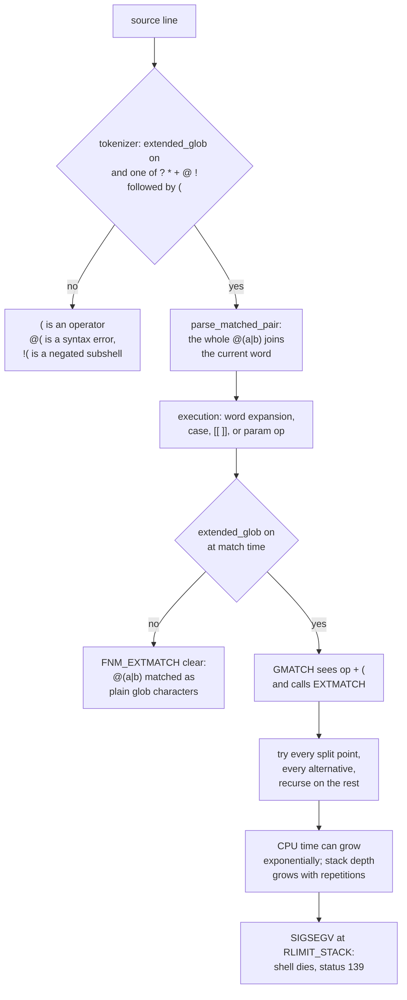

# Extended Globbing

> [!summary] Claim
> Extended globbing adds the ksh operators `?( )`, `*( )`, `+( )`, `@( )`, and `!( )` to shell patterns, and in bash it is a parser switch as much as a matcher switch, so it must be on both when a line is read and when it runs, and its recursive backtracking matcher can take exponential time or crash the shell on long input.

Part of [Bash](README.md) in [Shell and Unix Engineering](../README.md).

## TL;DR

- Mechanism: with `extglob` on, bash's tokenizer swallows `@(a|b)` into one word instead of reading `(` as an operator (bash-5.3 parse.y, read_token_word), and the matcher passes `FNM_EXTMATCH` to a recursive backtracking engine (bash-5.3 lib/glob/sm_loop.c, EXTMATCH).
- Rule: turn the switch on in its own line at the top of the file, before any function or command substitution that uses the operators, and leave it on; bash reads it at parse time and again at match time, while ksh93 and mksh have the operators always and zsh needs `setopt kshglob`.
- Trap: `!(true)`, which dash, posh, yash, BusyBox ash, and bash by default read as a negated subshell, becomes a pattern that runs the first file in the directory as a command in ksh93, in mksh, and in bash with `extglob` on (lab); POSIX.1-2024 leaves `!(` unspecified for exactly this reason (XCU 2.9.2).
- Portability: none of this is POSIX; dash, posh, BusyBox ash, and yash reject `@(` in a `case` pattern, and `${v##+( )}` silently trims nothing there (lab, shell matrix).
- When not to use it: on untrusted or unbounded input, because a 12-byte pattern backtracks exponentially and a single `*([0-9])` overflows an 8 MiB stack at about 25 000 characters in bash 5.3 (measured; the lab reproduces the crash); use a negated bracket test or a real parser instead.

## Mental model



A line enters the tokenizer, which checks the working copy `extended_glob` when it meets one of the five operator characters followed by `(`.
If the flag is off, the `(` is a shell operator, so `@(a|b)` is a syntax error and `!(true)` is read as `!` followed by a subshell (the no branch).
If it is on, `parse_matched_pair` collects the balanced parentheses, including every `|`, into the current word, so the shell grammar never sees them (the yes branch).
At run time the same word reaches the pattern matcher from pathname expansion, `case`, `[[ == ]]`, or a parameter operator such as `${v##p}`, and the matcher checks the flag a second time to decide whether to pass `FNM_EXTMATCH`.
With the flag off the operators are ordinary characters; with it on, `GMATCH` hands the rest of the pattern to `EXTMATCH`, which tries every split of the subject string against every alternative and recurses on the remainder.
That recursion is the cost model: nested repetition makes the work exponential in the input length, and each repetition consumes stack frames, so a long subject runs into the stack limit and the kernel kills the shell with `SIGSEGV`.

## How it works

### The grammar problem extended patterns solve

POSIX defines exactly three special pattern characters, `?`, `*`, and `[` (POSIX.1-2024 XCU 2.14.1), and builds multi-character patterns only by concatenation and `*` (XCU 2.14.2).
There is no alternation, no repetition of a sub-pattern, and no negation of a whole pattern, so "one or more digits" or "anything except `*.o`" cannot be written as one pattern.
The KornShell filled the gap with five prefix operators that each take a `|`-separated pattern list in parentheses:

| Operator | Matches | Regular-expression analogue |
|---|---|---|
| `?(p1\|p2)` | zero or one occurrence of any listed pattern | `(p1\|p2)?` |
| `*(p1\|p2)` | zero or more occurrences | `(p1\|p2)*` |
| `+(p1\|p2)` | one or more occurrences | `(p1\|p2)+` |
| `@(p1\|p2)` | exactly one of the listed patterns | `(p1\|p2)` |
| `!(p1\|p2)` | any string that matches none of the listed patterns, over the span it is given | no ERE equivalent (complement) |

The bash manual lists the same five with the same meanings (bash-5.3 doc/bash.1, Pattern Matching).
The syntax is chosen so that, in most places, it would otherwise be a syntax error: in POSIX token recognition `(` is an operator, so `echo @(a|b).c` cannot be a valid POSIX command.
The POSIX rationale states the consequence and the limit of that trick: such extensions "are valid extensions in these contexts because they would otherwise cause syntax errors", but they are "not allowed by this standard to be recognized in contexts where those syntax errors would not occur anyway", and its example is `pattern='a*(b)'; ls -- $pattern`, which "this standard requires to list files with names beginning 'a' and ending "(b)"" (POSIX.1-2024 XRAT C.2.14.1).
The rationale recommends enabling such an extension "only when a non-standard shell option is set, or when the shell is executed using a command name other than sh", which is the design bash adopted with `shopt -s extglob` (POSIX.1-2024 XRAT C.2.14.1).
One spelling breaks the "otherwise a syntax error" argument: `!(list)` at the start of a command reads naturally as `!` followed by a subshell, so POSIX.1-2024 makes the application responsible: it "shall ensure that the ( operator at the beginning of command1 is separated from the ! by one or more `<blank>` characters", and "The behavior of the reserved word ! immediately followed by the ( operator is unspecified" (POSIX.1-2024 XCU 2.9.2).
Shells that keep the subshell reading and shells that read a pattern are therefore both conforming, and only `! (list)` is portable (see Pitfalls).

### History in bash

| bash release | Change (bash-5.3 CHANGES unless noted) |
|---|---|
| 2.02-alpha1 | "ksh-88 egrep-style extended pattern matching" of the form `[@+*?!](patlist)` is implemented, controlled by the new `shopt` option `extglob` |
| 2.02-alpha1 | a configure option compiles the feature in or out, "enabled by default" (the code is built in; the `shopt` option itself defaults off) |
| 4.1-alpha | force `extglob` on temporarily while parsing the pattern operand of `==` and `!=` in `[[ ]]`, "for compatibility" |
| 4.1-alpha | "a new configure option that forces the extglob option to be enabled by default" (`--enable-extended-glob-default`, configure.ac) |
| 4.4-alpha, 5.0-alpha | several fixes so extended patterns no longer match names with a leading `.` that the pattern did not spell |
| 5.2-alpha | "Rewrote the command substitution parsing code to call the parser recursively", so `$( )` bodies are now parsed when the enclosing command is |
| 5.2-alpha | new `globskipdots`, on by default: pathname expansion never returns `.` or `..` unless matched explicitly |
| 5.2-alpha | fixed extended glob functions that could match `.` or `..` when not explicitly specified, even with `dotglob` set |
| 5.2-rc3 | "a compatibility mode feature that causes the parser to parse command substitutions as if extglob were enabled" (`BASH_COMPAT=51` or lower) |

The default for the option is `EXTGLOB_DEFAULT`, which configure sets to 0 unless `--enable-extended-glob-default` is given (bash-5.3 configure.ac; builtins/shopt.def, `extglob_flag = EXTGLOB_DEFAULT`).
A non-interactive `bash -c` reports `extglob off` in the lab on bash 3.2.57 and 5.3.15, and a fresh `bash -c 'echo @(a|b).c'` is a syntax error in every bash from 3.2 to 5.3 in the shell matrix.
Interactive shells often show it on only because a startup file (for example a completion package) ran `shopt -s extglob`; scripts must never rely on that (see [[Bash-Startup-Files-and-Modes]]).
The release-by-release view of these changes belongs to [[Bash-Version-History]].

### Two flags and the parser

bash keeps the user-visible value in `extglob_flag` and a working copy in `extended_glob`; `shopt -s extglob` sets the first and `shopt_set_extglob` copies it into the second (bash-5.3 builtins/shopt.def, shopt_set_extglob).
The working copy exists so the parser can force it on temporarily and later restore it: `reset_parser` executes `extended_glob = extglob_flag` when it unwinds from an extended pattern or a command substitution (bash-5.3 parse.y, reset_parser).
The tokenizer is where the flag first matters.
In `read_token_word`, when `extended_glob` is set and the current character satisfies `PATTERN_CHAR` and the next one is `(`, bash calls `parse_matched_pair` to collect everything to the matching `)` and appends it to the token, so `|`, `(`, and `)` inside lose their operator meaning (bash-5.3 parse.y, read_token_word; syntax.h, PATTERN_CHAR).
When the flag is off, the same input reaches the grammar as a word followed by the `(` operator and fails with `syntax error near unexpected token '('`.
Three code paths override the flag during parsing:
- `cond_term` sets `PST_EXTPAT` after reading `=`, `==`, or `!=` inside `[[ ]]` and reads the right-hand word with `extended_glob = 1` (bash-5.3 parse.y, cond_term), which is why `[[ a == @(a|b) ]]` parses with `extglob` off in bash 4.1 and later but is a syntax error in bash 3.2.57 (lab).
- `parse_comsub` forces `extended_glob = 1` while parsing a command substitution when `shell_compatibility_level <= 51` (bash-5.3 parse.y, parse_comsub), which restores the pre-5.2 tolerance under `BASH_COMPAT=51` (lab).
- `xparse_dolparen` saves and restores `extended_glob` around the recursive parse of `$( )` (bash-5.3 parse.y, xparse_dolparen).

Because bash parses one complete command at a time, a `shopt -s extglob` that shares a line, a `{ }` group, an `if` body, or a function body with the pattern runs too late; [[Shell-Options-shopt]] covers that unit-of-parsing rule in general.

### The flag is read again when matching

The matcher does not inherit a decision from the parser; every call site derives its flags from the current `extended_glob`.
`FNMATCH_EXTFLAG` is defined as `(extended_glob ? FNM_EXTMATCH : 0)` (bash-5.3 pathexp.h), and `glob_vector` adds `FNM_EXTMATCH` to its match flags only `if (extended_glob)` (bash-5.3 lib/glob/glob.c, glob_vector).
So a function parsed while `extglob` was on, and called after `shopt -u extglob`, still contains the word `@(a|b)` but matches it as plain characters: `f a` prints `yes` and then `no` in the lab on bash 3.2.57 and 5.3.15.
`[[ == ]]` is the exception again: `execute_cond_node` sets `extended_glob = 1` around `cond_test` and restores `extglob_flag` afterwards (bash-5.3 execute_cmd.c, execute_cond_node), so `p='@(a|b)'; [[ a == $p ]]` matches with `extglob` off in every bash the lab ran, while `case a in $p)` does not.
The same flag also governs `GLOBIGNORE`, `EXECIGNORE`, and `HISTIGNORE` patterns (bash-5.3 doc/bash.1, Shell Variables), and in an ad hoc run here `GLOBIGNORE='@(a|b).c'` with `extglob` on removed `a.c` and `b.c` so that `*.c` stayed literal.

### The matching engine

`strmatch` calls `xstrmatch`, which resets the counter `glob_recursion_depth` and calls `internal_strmatch`, the single-byte instance of the template function `FCT`, which calls `GMATCH` (bash-5.3 lib/glob/strmatch.c, strmatch; lib/glob/smatch.c, xstrmatch; lib/glob/sm_loop.c, FCT).
`GMATCH` walks the pattern; whenever `FNM_EXTMATCH` is set and the current character is one of `+ * ? @ !` followed by `(`, it returns `EXTMATCH (c, n, se, p, pe, lflags)` on the whole rest of the pattern and string (bash-5.3 lib/glob/sm_loop.c, GMATCH).
`EXTMATCH` first calls `PATSCAN` to find the end of the parenthesized list, honoring nested parentheses and bracket expressions; if the list is unbalanced it falls back to `STRCOMPARE`, a literal string comparison (bash-5.3 lib/glob/sm_loop.c, PATSCAN, STRCOMPARE).
The five operators then become loops over split points:
- `*` and `+`: for every alternative and every end position `srest` from the current position to the end of the string, match the alternative against `s..srest`; on success either match the rest of the pattern from `srest` or, if the alternative consumed something, call `GMATCH (srest, se, p - 1, pe, ...)`, which re-enters the same extended pattern for the next repetition.
- `?` and `@`: for every alternative and every end position, the alternative must match `s..srest` and the rest of the pattern must match `srest..se`; `?` first tries matching the rest with zero occurrences.
- `!`: for every end position, check that no alternative matches `s..srest`, then require the rest of the pattern to match `srest..se`.

Three properties follow directly from that code.
First, each further repetition of `*( )` or `+( )` is one more nested `GMATCH` and `EXTMATCH` frame, so stack depth grows linearly with the number of repetitions in the subject.
`glob_recursion_depth++` is executed on every `EXTMATCH` call, but in the 5.3 tree the counter is only reset in `xstrmatch` and never compared with any limit, so nothing stops the recursion before the stack does (bash-5.3 lib/glob/sm_loop.c, EXTMATCH; lib/glob/smatch.c, xstrmatch).
Second, nested repetition multiplies the split points: `*(*(*(a|b)))` against a string with no match explores every way of carving the string into repetitions at three levels, and the measured time roughly doubles per added byte (Numbers and limits).
Third, `!( )` is a complement over whatever span the surrounding pattern leaves it, which is why `!(foo)*` matches `foo` (the `!( )` takes the empty span and `*` takes `foo`) and why mksh's manual says `!(?)*` "matches all strings (think about it)" (mksh.1, File name patterns).
The loop checks `interrupt_state` and `terminating_signal` on every pattern character, so a user can interrupt a runaway match with `SIGINT`; a script with no one watching just burns CPU (bash-5.3 lib/glob/sm_loop.c, GMATCH).
No system call is involved in matching itself: it is pure user-space recursion, and the only kernel event is the fault past the stack limit, which Linux reports as "Upon reaching this limit, a SIGSEGV signal is generated" (getrlimit(2), RLIMIT_STACK).

### Pathname expansion and leading dots

For pathname expansion bash reads each directory a pattern component needs and filters the names through the matcher, as [[Pathname-Expansion]] describes; with extended patterns two details change.
`glob_filename` finds the last directory separator with `glob_dirscan` when `extended_glob` is set, a scan that skips over `x(...)` groups so that a `/` inside one is not taken as a directory separator (bash-5.3 lib/glob/glob.c, glob_filename; lib/glob/gmisc.c, glob_dirscan).
`skipname` hands any extended pattern to `extglob_skipname`, which decides per sub-pattern whether a name with a leading `.` may match, so `@(.hidden|a.c)` can list `.hidden` while `!(*.c)` still hides dot files (bash-5.3 lib/glob/glob.c, extglob_skipname).
Inside `EXTMATCH`, `FNM_PERIOD` and `FNM_DOTDOT` are cleared once the match has moved past the first character, and the `!` case refuses a name that starts with `.` when `FNM_PERIOD` is set (bash-5.3 lib/glob/sm_loop.c, EXTMATCH).
The observable result changed across releases: in a scratch directory holding `.env`, `.git`, and `.hidden`, `echo .!(git)` printed `. .. .env .hidden` in bash 3.2.57 and ksh93u+ 2012 but `.env .hidden` in bash 5.3.15, and `echo @(.hidden|a.c)` printed only `a.c` in bash 3.2.57 but `.hidden a.c` in bash 5.3.15 (ad hoc runs here, 2026-11-12).

### Other contexts that use the matcher

The same engine serves `case` patterns, `[[ == ]]` and `[[ != ]]`, and the parameter operators `${v#p}`, `${v##p}`, `${v%p}`, `${v%%p}`, `${v/p/r}`, and `${v//p/r}` (bash-5.3 subst.c, remove_upattern and match_upattern, both passing `FNMATCH_EXTFLAG`; execute_cmd.c, execute_case_command, which passes `FNMATCH_EXTFLAG|FNMATCH_IGNCASE`).
That makes extended patterns the standard bash idiom for whitespace trimming and squeezing without a subprocess: `${v##+([[:space:]])}` trims leading blanks and `${v//+( )/ }` collapses runs of spaces (lab).
The regex alternative `[[ $v =~ ... ]]` and `BASH_REMATCH` is covered in [[Bash-Regex-and-BASH_REMATCH]]; parameter operators in general are in [[Bash-Parameter-Transformations]].

### Other shells

- ksh93 has the operators always, plus more: a pattern list may use `&` for "all must match", `{n}(list)` and `{m,n}(list)` count repetitions, a `-` before the `(` asks for the shortest match, `~(options:list)` sets matching options such as case folding, and `\d` and `\D` work inside a list (ksh93u+m sh.1, Pathname Expansion); `{2}(ab)`, `@(a*&*c)`, and `~(i:abc)` matched in ksh93u+ 2012 on the host and in ksh93u+m 1.0.10 in the shell matrix, and were syntax errors in bash, dash, posh, mksh, yash, BusyBox ash, and `zsh --emulate sh`, while native zsh (without `KSH_GLOB`) parsed `{2}(ab)` without matching it and rejected `@(a*&*c)` with `parse error near '&'` (shell matrix).
- mksh has the five operators always (mksh.1, File name patterns).
- zsh has them only with `KSH_GLOB`, "In pattern matching, the interpretation of parentheses is affected by a preceding '@', '*', '+', '?' or '!'" (zsh Options, KSH_GLOB); native zsh instead offers `(a|b)` grouping and, under `EXTENDED_GLOB`, `^`, `~`, `#`, and `##` (zsh Expansion, Filename Generation).
  `BARE_GLOB_QUAL`, on in native zsh, treats "a trailing set of parentheses as a qualifier list, if it contains no '|', '(' or (if special) '~' characters" (zsh Options, BARE_GLOB_QUAL), so `*.!(c)` in a pathname is read as the qualifier `c`, which needs a number, and fails with `number expected` even with `KSH_GLOB` set (lab).
  In sh emulation `SH_GLOB` "Disables the special meaning of '(', '|', ')' ... for globbing the result of parameter and command substitutions, and in some other places where the shell accepts patterns" (zsh Options, SH_GLOB), and the lab shows the effect: with `setopt kshglob`, `zsh --emulate sh` applies the operators in `case` and pathname expansion but not in `${v##+( )}`.
- dash matches patterns with `fnmatch(pattern, string, 0)` when built to use the C library, or with its own `pmatch` loop, and passes no extended flag either way (dash expand.c, pmatch); BusyBox ash defines `pmatch(a, b)` as `!fnmatch((a), (b), 0)` (BusyBox ash.c, pmatch); yash documents only `?`, `*`, and bracket expressions (yash manual, Pattern matching notation); posh rejected `{2}(ab)` in a `case` pattern, reported `bad substitution` for `${v//+( )/ }`, and left `${v##+([[:space:]])}` untrimmed in the shell matrix, and posh 0.14.1 answers `case ab in @(ab|cd)) ...` with `syntax error: `(' unexpected` (shell matrix, Debian image, 2026-11-13).
- glibc's `fnmatch` accepts `FNM_EXTMATCH`, documented as "Besides the normal patterns, also recognize the extended patterns introduced in ksh" (glibc manual, Wildcard Matching), but POSIX `fnmatch` defines only `FNM_PATHNAME`, `FNM_NOESCAPE`, `FNM_PERIOD`, `FNM_CASEFOLD`, and `FNM_IGNORECASE` (POSIX.1-2024 fnmatch), and `find -name '@(a|b).c'` matched only a file literally named `@(a|b).c` with macOS `find` here (lab) and in both matrix images (shell matrix).

## Numbers and limits

| Quantity | Value | Source |
|---|---|---|
| Extended operators in bash, mksh, zsh `KSH_GLOB` | 5: `? * + @ !` | bash-5.3 doc/bash.1; mksh.1; zsh Expansion |
| Extra ksh93 forms | `&` in a list, `{n}( )`, `{m,n}( )`, `-(` shortest match, `~(opts:list)` | ksh93u+m sh.1 |
| `FNM_EXTMATCH` bit in bash's matcher | `1 << 5` | bash-5.3 lib/glob/strmatch.h |
| Default of `extglob` in bash | off (`EXTGLOB_DEFAULT` 0 unless `--enable-extended-glob-default`) | bash-5.3 configure.ac; lab on 3.2.57 and 5.3.15 |
| First bash with the feature | 2.02-alpha1 | bash-5.3 CHANGES |
| Recursion limit in bash's matcher | none: `glob_recursion_depth` is counted, never checked | bash-5.3 lib/glob/sm_loop.c, smatch.c |
| `*(*(*(a\|b)))` vs 13, 17, 19, 21 a's plus `!`, bash 5.3.15 | 0.04, 0.34, 1.43, 6.28 s | measured here 2026-11-12, Apple arm64 host |
| same, bash 3.2.57 | 0.04, 0.41, 1.77, 7.39 s | measured here 2026-11-12 |
| same pattern, ksh93u+ 2012, inputs of 12, 14, 15, 16, 18 bytes | 0.07, 0.40, 1.09, 3.39, 31.26 s; 20 bytes did not finish in 60 s | measured here 2026-11-12 |
| same pattern, zsh 5.9.2 `KSH_GLOB`, 22 and 24 bytes | 0.03 s each | measured here 2026-11-12 |
| input length at which one failed match first takes 2 clock seconds | bash 5.3.15: 19; bash 3.2.57: 20; ksh93u+: 15; zsh: not reached by 40 | lab `backtrack 40` on the host |
| same 12-byte pattern in minimatch (JavaScript) | 18-byte non-matching input "stalls for over 7 seconds" | NVD CVE-2026-27904 |
| `*([0-9])` digits before `SIGSEGV`, 8176 KiB stack, bash 5.3.15 | survives 20 000, crashes at 25 000 | measured here 2026-11-12 |
| same, bash 3.2.57 | survives 10 000, crashes at 20 000 | measured here 2026-11-12 |
| `+([0-9])`, bash 5.3.15 | survives 20 000, crashes at 40 000 | measured here 2026-11-12 |
| `*([0-9])`, ksh93u+ 2012 and zsh 5.9.2 | ksh93u+ crashes at 20 000; zsh survives 20 000 and crashes at 100 000 | measured here 2026-11-12 |
| plain `*[0-9]` against 1 000 000 digits | matches, no crash, bash 3.2.57 and 5.3.15 | measured here 2026-11-12 |
| `*([0-9])` against 300 000 digits with `ulimit -s 8192` | status 139 (128 + `SIGSEGV`) in bash, ksh93u+, zsh, zsh-sh | lab `deep` |

The timings are wall-clock seconds for one `case` match on an Apple-silicon laptop under no other load; treat them as ratios, not absolutes.
The crash thresholds scale with the stack limit, because the frame count per repetition is fixed by the code; the host's soft `RLIMIT_STACK` was 8176 KiB (`ulimit -s`).

## Portability

Cells marked lab are asserted by `extended-globbing.bats`; on the host this job ran bash 3.2.57, bash 5.3.15, dash, ksh93u+ 2012, zsh 5.9.2, and `zsh --emulate sh`, and the integrator's matrix runs the rest.
Cells marked matrix were measured in the shell matrix images on 2026-11-11.

| Behavior | POSIX sh | bash 3.2 (macOS) | bash 5.3 | zsh native | zsh `--emulate sh` | dash | ksh93 | mksh | yash | posh | BusyBox ash |
|---|---|---|---|---|---|---|---|---|---|---|---|
| How the operators are enabled | not specified | `shopt -s extglob` | `shopt -s extglob` | `setopt kshglob` | `setopt kshglob` | absent | always on | always on | absent | absent | absent |
| Truth table of the five operators | - | ksh semantics (lab) | ksh semantics (lab) | ksh semantics (lab) | ksh semantics (lab) | `@(` is a syntax error (lab) | ksh semantics (lab) | ksh semantics (lab) | syntax error (lab) | syntax error (lab) | syntax error (lab) |
| `!(true)` as a command, defaults | unspecified; write `! (` (XCU 2.9.2) | status 1 (lab) | status 1 (lab) | glob-qualifier error (lab) | status 1 (lab) | status 1 (lab) | runs the first file, 127 (lab) | runs the first file, 127 (lab) | status 1 (lab) | status 1 (lab) | status 1 (lab) |
| `!(true)` after `shopt -s extglob` | - | runs the first file, 127 (lab) | runs the first file, 127 (lab) | as above | as above | as above | as above | as above | as above | as above | as above |
| `${v##+([[:space:]])}` | `+(` is literal (XRAT C.2.14.1) | trims (lab) | trims (lab) | trims with `kshglob` (lab) | literal, no error (lab) | literal, no error (lab) | trims (lab) | trims (lab) | literal (lab) | literal (lab) | literal (lab) |
| `${v//+( )/ }` | not specified | squeezes (lab) | squeezes (lab) | squeezes with `kshglob` (lab) | no change (lab) | `Bad substitution`, status 2 (lab) | squeezes (lab) | squeezes (lab) | no change (lab) | `bad substitution`, status 1 (lab) | no change (lab) |
| `[[ a == @(a\|b) ]]` with the switch off | - | syntax error (lab) | true (lab) | false: `@` is literal | parse error | syntax error | true | not measured | not measured | not measured | not measured |
| `a*(b)` from a variable in pathname expansion | names ending `(b)` (XRAT C.2.14.1) | extended: `abb` | extended: `abb` | literal unless `$~p` | literal (`SH_GLOB`) | literal: `ax(b)` | literal: `ax(b)` (host and matrix) | literal: `ax(b)` (matrix) | not measured | not measured | not measured |
| same pattern from a variable in `case` | literal (XRAT C.2.14.1) | extended | extended | literal | literal | literal | extended | not measured | not measured | not measured | not measured |
| `.!(git)` lists `.` and `..` | - | yes | no (`globskipdots`) | - | - | - | yes (93u+ 2012) | not measured | - | - | - |
| Nested `*( )` backtracking | - | exponential (lab) | exponential (lab) | fast: 40 bytes in under 2 s (lab) | same as zsh (lab) | - | exponential in 93u+ 2012 and 93u+m 1.0.10 (lab) | exponential: a failed match of 20 bytes took 2 clock seconds in R59, 21 in the Alpine mksh (lab) | - | - | - |
| 300 000-repetition `*( )` under 8 MiB stack | - | `SIGSEGV` (lab) | `SIGSEGV` (lab) | `SIGSEGV` (lab) | `SIGSEGV` (lab) | - | `SIGSEGV` in 93u+ 2012 and 93u+m 1.0.10 (lab) | `SIGSEGV`, status 139 (lab) | - | - | - |

Utilities do not follow the shell: `find -name` passes its pattern to `fnmatch` without `FNM_EXTMATCH`, so `@(a|b)` is literal in macOS `find` (lab) and in the `find` of both matrix images (shell matrix), and `FNM_EXTMATCH` itself is a glibc extension (glibc manual, Wildcard Matching).
Unmarked cells in the `[[ ]]` and variable rows come from ad hoc runs on the host (bash 3.2.57, bash 5.3.15, ksh93u+ 2012, zsh 5.9.2, dash), and the matrix cells in those rows from the 2026-11-11 run for mksh and ksh93u+m 1.0.10.
The mksh, ksh93u+m, and posh cells above were measured on 2026-11-13 by running the lab's probe in the Debian image (mksh R59 2025/04/26, ksh93u+m 1.0.10 2024-08-01, posh 0.14.1) and the Alpine image (mksh, yash, BusyBox ash): ksh93u+m failed a 16-byte match after 3 s and died with status 139 on 300 000 digits, and yash, BusyBox ash, and posh print `mode=none` and exit 3 for both probes (as of 2026-11).

## Worked example

The [lab](../labs/04-extended-globbing/) holds three probes and `extended-globbing.bats`.
`extmatch.sh` turns the operators on with the shell's own switch and prints a truth table; this is the file verbatim:

```sh
#!/bin/sh
# extmatch.sh: turn on ksh-style extended patterns with this shell's own switch, then
# print whether each STRING matches its PATTERN in a case statement.
# Usage: extmatch.sh PATTERN:STRING...
# Prints "mode=shopt" (bash), "mode=setopt" (zsh), "mode=native" (ksh93, mksh), or "mode=none",
# then one "PATTERN:STRING R" line per argument with R = 1 (match) or 0; exits 3 for mode=none.
# Example: extmatch.sh '+(ab):abab' '!(ab|cd):ab'  ->  mode=shopt / +(ab):abab 1 / !(ab|cd):ab 0

enable_ext() {
  if command -v shopt >/dev/null 2>&1; then
    # shellcheck disable=SC3044 # bash-only builtin, reached only when command -v finds it
    shopt -s extglob && ext_mode=shopt
  elif command -v setopt >/dev/null 2>&1; then
    setopt kshglob && ext_mode=setopt
  else
    ext_mode=native
  fi
  # The parser must see @( ) after the switch is on, so the probe text goes through eval.
  if ! (eval 'case ab in @(ab|cd)) exit 0 ;; *) exit 1 ;; esac') 2>/dev/null; then
    ext_mode=none
  fi
}

enable_ext
printf 'mode=%s\n' "$ext_mode"
[ "$ext_mode" != none ] || exit 3

for pair in "$@"; do
  pat=${pair%%:*}
  # shellcheck disable=SC2034 # str is read by the eval text below
  str=${pair#*:}
  r=none
  # The pattern is pasted into the case text so it is parsed as a literal pattern, not
  # expanded from a variable (shells disagree about patterns that come from expansions).
  eval "case \$str in $pat) r=1 ;; *) r=0 ;; esac"
  printf '%s %s\n' "$pair" "$r"
done
```

Run under bash with the pairs the test uses, it prints this (the test asserts the same table after `mode=setopt` in zsh and `mode=native` in ksh93 and mksh, and `mode=none` with status 3 in dash, posh, BusyBox ash, and yash):

```text
$ bash extmatch.sh '?(ab):' '?(ab):ab' '?(ab):abab' '*(ab):' '*(ab):ababab' '+(ab):' '+(ab):abab' \
    '@(ab|cd):cd' '@(ab|cd):abcd' '!(ab|cd):ab' '!(ab|cd):abc' '!(ab|cd):' '!(foo)*:foo' \
    '*.!(c):a.c' '*.!(c):a.cc' '+([0-9]).+([0-9]):10.25' '!(?)*:a' '!(*):x' '@(|a)b:b'
mode=shopt
?(ab): 1
?(ab):ab 1
?(ab):abab 0
*(ab): 1
*(ab):ababab 1
+(ab): 0
+(ab):abab 1
@(ab|cd):cd 1
@(ab|cd):abcd 0
!(ab|cd):ab 0
!(ab|cd):abc 1
!(ab|cd): 1
!(foo)*:foo 1
*.!(c):a.c 0
*.!(c):a.cc 1
+([0-9]).+([0-9]):10.25 1
!(?)*:a 1
!(*):x 0
@(|a)b:b 1
```

Read the surprising rows against the engine: `!(ab|cd):` is 1 because the empty string is not `ab` or `cd`; `!(foo)*:foo` is 1 because `!( )` takes the empty prefix and `*` takes `foo`; `*.!(c):a.cc` is 1 because `!(c)` only has to differ from `c` over the span after the last dot it is given; `!(*):x` is 0 because every string matches `*`.
The other probes cover the failure modes: `extglob-files.sh DIR` expands four patterns as pathnames, and `extglob-probe.sh` has the modes `negation`, `negation-extglob`, `params`, `squeeze`, `backtrack N`, and `deep N`.
In a directory that holds only `a.c` and `b.c`, `extglob-probe.sh negation-extglob DIR` under bash prints a diagnostic ending in `a.c: command not found` and then `status=127`, and `backtrack 40` stops at a length of 19 or 20 bytes in bash on the host, where zsh runs to 40 in under a second.

## Pitfalls

> [!warning] Switch on the same line or in the same function
> Trigger: `shopt -s extglob; case $f in @(a|b)) ...` on one line, inside an `if` block, or inside the function that uses the pattern.
> Symptom: `syntax error near unexpected token '('` and a script that stops at that command, because bash parsed the whole command before `shopt` ran (lab).
> Fix: put `shopt -s extglob` alone on line 2, right after the shebang, before any function definition; or start bash with `-O extglob` (see [[Shell-Options-shopt]]).

> [!warning] Parsed on, matched off
> Trigger: a library turns `extglob` off after defining functions that use `@( )`, or code toggles it around one command.
> Symptom: no error at all; the function's `case` silently stops matching, because the matcher reads the current flag (lab: `yes` then `no`).
> Fix: enable it once and never turn it off in a script; in a library, record `shopt -p extglob` and restore exactly that state, and never assume the caller's value.

> [!warning] Command substitutions are parsed early from bash 5.2
> Trigger: `f() { echo $(ls @(a|b).c); }` defined while `extglob` is off, even though the script enables it before calling `f`.
> Symptom: older bash defers the parse and works (bash 3.2.57 measured; the lab asserts the same for 4.x to 5.1, consistent with bash-5.3 CHANGES, which dates the recursive command-substitution parser to 5.2-alpha); bash 5.2 and later report `syntax error near unexpected token '(' while looking for matching ')'`, and bash 5.3.15 then exits with status 127 even when the definition was inside `eval` (lab, ad hoc run).
> Fix: enable `extglob` before the definition; `BASH_COMPAT=51` (or lower) restores the old parse as a stopgap (bash-5.3 parse.y, parse_comsub; lab).

> [!warning] `!(true)` runs a file
> Trigger: negation of a subshell written without a space, `!(cmd)`, which POSIX.1-2024 already makes unspecified (XCU 2.9.2), in a script that enables `extglob`, or in any script run by ksh93 or mksh.
> Symptom: the word becomes a pattern that matches every name in the current directory except `cmd`, and the first match is executed as a command; with `a.c` and `b.c` present, bash prints `a.c: command not found` and returns 127 (lab), and with an executable first match it runs that file.
> Fix: always write `! (cmd)` or `! cmd` with a space; a formatter will not save you, because `shfmt` (bash dialect by default) prints `!(true)` back unchanged (checked here with shfmt on the host).

> [!warning] Negation covers only its own span
> Trigger: `!(foo)*` to mean "not starting with foo", or `*.!(c)` to mean "not a C file".
> Symptom: `!(foo)*` matches `foo` itself, and `*.!(c)` matches `a.cc` (lab) and `a.c.h` (ad hoc run) while skipping `readme`, which has no dot (lab).
> Fix: put the whole intent inside one negation, `!(foo*)` or `!(*.c)`, so the complement is taken over the full name.

> [!warning] Exponential backtracking
> Trigger: nested or overlapping repetition such as `*(*(a|b))`, `+(a|aa)`, or `*(a|b)*(a|b)` applied to a long string that almost matches.
> Symptom: one `case` or `[[ ]]` takes seconds to minutes; `*(*(*(a|b)))` against 21 a's plus `!` took 6.28 s in bash 5.3.15 and 16 bytes took 3.39 s in ksh93u+ (measured), the same shape that NVD records for minimatch as CVE-2026-27904 and for picomatch as CVE-2026-33671 and CVE-2026-112366 (the latter for single-branch repeats such as `+(*)`).
> Fix: never nest repetition operators; anchor alternatives so they cannot overlap; bound the input length first; or classify with a bracket-complement test such as `[[ $s == *[![:digit:]]* ]]`, which took 0.05 s on 1 000 000 digits here.

> [!warning] Stack exhaustion on long input
> Trigger: validating a large value, for example `[[ $body == +([0-9]) ]]` on a 100 000-character field.
> Symptom: the shell itself dies with `SIGSEGV`, status 139, printing nothing of its own; at the default 8 MiB stack bash 5.3.15 crashed at 25 000 repetitions of `*([0-9])` and 40 000 of `+([0-9])`, and bash 3.2.57 at 20 000 of `*([0-9])` (measured), and the lab reproduces it at 300 000 in bash, ksh93u+, and zsh.
> Fix: test the complement with a plain bracket expression, `[[ -n $s && $s != *[![:digit:]]* ]]`, which uses no extended operator; it accepted 1 000 000 digits in 0.05 s in bash 5.3.15 and 0.12 s in bash 3.2.57 here.

> [!warning] Trailing parentheses in native zsh
> Trigger: `setopt kshglob` in native zsh followed by a pathname pattern that ends in `X(...)` with no `|` inside, such as `*.!(c)` or `a*(b)`.
> Symptom: `number expected` or `unknown file attribute`, because `BARE_GLOB_QUAL` reads the parentheses as glob qualifiers (lab, zsh Options).
> Fix: `setopt kshglob no_bare_glob_qual`, or use native zsh syntax (`^`, `~`, `(a|b)`) with `EXTENDED_GLOB`.

> [!warning] Patterns from variables differ by shell
> Trigger: `p='+([0-9])'; case $x in $p)` or `ls -- $p`, expecting the same result everywhere.
> Symptom: bash with `extglob` applies the operators in every context, ksh93 applies them in `case` and parameter operators but not in pathname expansion, mksh does not apply them in pathname expansion, native zsh needs `$~p`, and zsh in sh mode and dash treat them literally, as POSIX requires for pathname expansion (XRAT C.2.14.1; ad hoc runs and matrix).
> Fix: write extended patterns literally in the code, or build the `case` text and `eval` it only from trusted constants, as the lab does.

> [!warning] `GLOBIGNORE` and `dotglob` interact with negation
> Trigger: `rm -- !(keep.txt)` in a shell with `dotglob` set, or with `GLOBIGNORE` set (which turns on `dotglob`, bash-5.3 doc/bash.1, Pathname Expansion).
> Symptom: `!( )` then also matches `.git`, `.env`, and other dot files; in an ad hoc run `!(*.c|*.h)` with `dotglob` returned `.env .git .hidden` along with the ordinary names.
> Fix: print the expansion with `printf '%s\n' !(keep.txt)` before handing it to `rm`, keep `dotglob` off in scripts, and add `nullglob` or `failglob` so no match is not passed as a literal pattern.

## Security and robustness

An extended pattern is a small program run by a backtracking interpreter with no time limit, no recursion limit, and no memory bound other than the stack, so any pattern or subject that an attacker controls is a denial-of-service input.
The JavaScript glob libraries learned this in 2026 (as of 2026-11, per NVD): NVD describes minimatch's nested `*()` extglobs as "triggered by the default `minimatch()` API with no special options" with "the minimum viable pattern is only 12 bytes" (CVE-2026-27904), and NVD's description of the picomatch issue recommends "disabling extglob support for untrusted patterns" and "running matching in an isolated worker or separate process with time and resource limits" (CVE-2026-33671).
The same 12-byte pattern is exponential in bash and ksh93 here, so a shell CGI script, a CI step that matches branch names, or a hook that tests user-supplied globs inherits the risk.
The crash mode is worse than the slow mode for robustness: a `SIGSEGV` kills the whole shell, skipping `EXIT` traps and cleanup (an `EXIT` trap did not run when bash 5.3.15 crashed this way here), so a long field in an input file can leave lock files, temporary directories, and half-written outputs behind.
Pattern text must never come from data: `eval "case \$x in $pat)"` with an untrusted `$pat` is command injection, not pattern injection (see [[Command-Injection]]), and the lab's use of `eval` is safe only because its patterns are test constants.
zsh's own extended syntax has a security record too: NVD records that in shescape before 2.1.14 and 3.0.1, for users whose shell is zsh, "The Zsh options EXTENDED_GLOB and MAGIC_EQUAL_SUBST exacerbate the problem" and "an attacker can leverage home directory expansion and extended glob syntax to obtain lists of files and directories on the system" (CVE-2026-73412), which shows that escaping code must know every pattern character the target shell's options enable.
For robust scripts: enable `extglob` once at the top, combine it with `nullglob` or `failglob` where a no-match would otherwise pass a literal pattern to a command, quote every variable that should be literal, bound input length before matching, and use bracket-expression complements for validation.

## The principal's view

The decision is not whether extended globbing is expressive (it is) but where a regular-language matcher with backtracking semantics and parser side effects belongs in a codebase.
Inside bash scripts that own their inputs, it is the right tool for three jobs: file selection such as `!(*.o|*.a)`, cheap string normalization such as trimming and squeezing without forking `sed`, and `case` dispatch on a handful of token shapes.
The trade-off is that it ties the script to bash (or ksh93 and mksh), makes correctness depend on parse order and on a global flag that libraries can change, and hides cost cliffs that no code review sees because they depend on the data.
A staff-plus engineer sets a house rule: `#!/usr/bin/env bash`, then `shopt -s extglob` on its own line before any function, never toggled; extended patterns only in literal source text, never from variables or user input; and no extended pattern on input whose length the script does not bound.
For portable `sh`, the replacement is several `case` arms or a POSIX bracket complement; for selection over file trees, `find` with `-name`, `-path`, and `-prune`; and for validating untrusted text or anything that needs grouping with guarantees, a language whose regex engine has a documented complexity bound, or a real parser.
When the matching problem itself is the product (a glob API, a policy engine, a router), do not reach for any backtracking glob dialect at all; compile patterns to a linear-time automaton and cap pattern and input sizes, which is the lesson of the 2026 glob-library CVEs.

## Interview questions

> [!question] L5: What do `?(p)`, `*(p)`, `+(p)`, `@(p)`, and `!(p)` match, and how do you turn them on in bash, zsh, and ksh93?
>
> > [!success]- Answer
> > They match zero or one, zero or more, one or more, exactly one, and anything but the listed patterns, where `p` is a `|`-separated list.
> > bash needs `shopt -s extglob` (or `bash -O extglob`), zsh needs `setopt kshglob`, and ksh93 and mksh have them always.
> > dash, posh, BusyBox ash, and yash have no such operators, and `@(` is a syntax error there.
> >
> > Follow-up: Why does `[[ x == @(a|x) ]]` work in bash 5 even with `extglob` off?

> [!question] L5: Predict the output of `bash -c 'shopt -s extglob; echo @(a|b).c'` in a directory with `a.c` and `b.c`, and then of the same two commands on separate lines.
>
> > [!success]- Answer
> > The one-line form prints `syntax error near unexpected token '('` and exits with status 2, because bash tokenizes the whole line while `extglob` is still off.
> > On separate lines it prints `a.c b.c`, because the second line is read after `shopt` has run.
> > The rule is that the switch must be on when the line is parsed, not just when it runs.
> >
> > Follow-up: What happens if the pattern is inside a function defined before the `shopt` line but called after it?

> [!question] L6: A function defined with `extglob` on contains `case $1 in @(start|stop))`, and a library sourced later runs `shopt -u extglob`. What breaks, and how?
>
> > [!success]- Answer
> > Nothing breaks at parse time, because the word `@(start|stop)` was already tokenized.
> > At match time bash passes `FNM_EXTMATCH` only when `extended_glob` is set (pathexp.h `FNMATCH_EXTFLAG`), so the pattern is compared as plain characters and `start` no longer matches.
> > The `case` silently falls through to the default arm; there is no error to catch.
> > Fix it by saving `shopt -p extglob` before the library and restoring it, or by never letting libraries change the flag.
> >
> > Follow-up: Which bash pattern context is immune to this, and which line of execute_cmd.c makes it so?

> [!question] L6: Debug this script: it worked on bash 5.1 and fails on bash 5.2 with `syntax error near unexpected token '(' while looking for matching ')'`.
>
> ```bash
> #!/usr/bin/env bash
> list() { printf '%s\n' $(cd "$1" && echo !(*.tmp)); }
> shopt -s extglob
> list /var/data
> ```
>
> > [!success]- Answer
> > bash 5.2 rewrote command substitution parsing to call the parser recursively, so the body of `$( )` is parsed when `list` is defined, while `extglob` is still off.
> > bash 5.1 and earlier only scanned for the closing parenthesis and parsed the body at run time, after `shopt` had run.
> > Move `shopt -s extglob` above the function; `BASH_COMPAT=51` before the definition is a stopgap that makes the parser treat command substitutions as if `extglob` were on.
> > Also, `$( )` unquoted splits names with spaces; use `printf '%s\n' "$1"/!(*.tmp)` with `nullglob` instead.
> >
> > Follow-up: In bash 5.3, why does wrapping the definition in `eval` not let the script continue?

> [!question] L6: Why is `!(true)` dangerous in a script that enables `extglob`, and why is it not dangerous in dash?
>
> > [!success]- Answer
> > dash and bash by default read `!(true)` as the `!` reserved word followed by a subshell, so it runs `true` and returns 1; POSIX.1-2024 makes `!` immediately followed by `(` unspecified and requires `! (` (XCU 2.9.2).
> > With `extglob` on, bash's tokenizer reads `!(` as the start of a pattern, so the word expands to every file name except `true`, and the first name becomes the command to execute.
> > ksh93 and mksh read it that way always; dash, posh, yash, BusyBox ash, and zsh in sh mode keep the subshell reading.
> > Writing `! (true)` with a space is unambiguous in every shell.
> >
> > Follow-up: Why does native zsh fail on `!(true)` with a glob-qualifier error instead?

> [!question] L7+: A deploy hook validates a version string from a pull request with `[[ $v == +([0-9]).+([0-9]).+([0-9]) ]]`. What can an attacker do, and what do you change?
>
> > [!success]- Answer
> > The matcher is recursive backtracking with no depth limit, so a long digit run makes the shell recurse once per repetition until it overflows the stack and dies with `SIGSEGV`; at 8 MiB bash 5.3.15 survived 20 000 repetitions of `+([0-9])` and crashed at 40 000 (25 000 for `*([0-9])`), measured on the host.
> > The crash skips `EXIT` traps, so cleanup and status reporting are lost, and an overlapping pattern could burn CPU for minutes instead.
> > Bound the length first (`(( ${#v} <= 32 ))`), then validate with a check that has no repetition operator, such as `[[ $v =~ ^[0-9]{1,5}\.[0-9]{1,5}\.[0-9]{1,5}$ ]]` or a bracket complement per field, so the cost is fixed by the bound.
> > Treat any pattern applied to untrusted text as an algorithmic-complexity attack surface, as the 2026 minimatch and picomatch CVEs did.
> >
> > Follow-up: How would you measure the crash threshold of your production bash without risking the host?

> [!question] L7+: POSIX says `pattern='a*(b)'; ls -- $pattern` must list names ending in `(b)`. Which shells comply, and why did the standard bother to say it?
>
> > [!success]- Answer
> > The rationale allows ksh-style extensions only where the text would otherwise be a syntax error, and a pattern produced by expansion is never a syntax error, so recognizing the operators there changes the meaning of conforming scripts.
> > dash, zsh in sh mode, mksh, ksh93u+ 2012, and ksh93u+m list `ax(b)` (measured on the host and in the shell matrix), while bash with `extglob` on lists `abb`, because bash applies the flag at match time to every pattern regardless of origin.
> > ksh93 is inconsistent in the other direction: it applies the operators to a pattern from a variable in `case` but not in pathname expansion.
> > The standard's advice is to enable such extensions only through a non-standard option or a non-`sh` invocation name, which is what bash's `shopt` does.
> >
> > Follow-up: How would you write a portability test that proves which behavior a given shell has?

> [!question] L7+: Explain why `*(*(*(a|b)))` is exponential in bash and ksh93 but fast in zsh, and what that tells you about choosing a matcher.
>
> > [!success]- Answer
> > bash's `EXTMATCH` tries every end position for every alternative and, after each successful repetition, re-enters the whole construct on the remainder, so nested stars explore every way of splitting the string across three levels before reporting no match.
> > Measured here, each extra byte roughly doubles bash's time (6.28 s at 22 bytes) and roughly triples ksh93u+'s (3.39 s at 16 bytes), while zsh with `KSH_GLOB` stays at 0.03 s, so zsh's pattern code avoids that blow-up for this input.
> > The lesson is that glob dialects specify what matches, not how fast, so complexity is an implementation property you must measure or bound.
> > For untrusted patterns pick an engine with a proven linear bound, or reject nested quantifiers before matching.
> >
> > Follow-up: Which simpler pattern with the same language as `*(*(*(a|b)))` avoids the blow-up in bash?

## Related

Prerequisites: [[Bash-Regex-and-BASH_REMATCH]], [[Pathname-Expansion]]

Next: [[Shell-Options-shopt]]

See also: [[Double-Bracket-Conditional]], [[Bash-Parameter-Transformations]], [[Bash-Version-History]], [[Bash-3-2-on-macOS]], [[Bash-POSIX-Mode]], [[Brace-Expansion]], [[Command-Injection]], [[Token-Recognition]]

## Further reading

- POSIX.1-2024 XCU 2.14 Pattern Matching Notation (https://pubs.opengroup.org/onlinepubs/9799919799/utilities/V3_chap02.html): the three special characters every extension builds on, and the filename-expansion rules for leading dots.
- POSIX.1-2024 XRAT C.2.14.1 (https://pubs.opengroup.org/onlinepubs/9799919799/xrat/V4_xcu_chap01.html): why extensions are tolerated only where they would be syntax errors, with the `a*(b)` example.
- POSIX.1-2024 fnmatch (https://pubs.opengroup.org/onlinepubs/9799919799/functions/fnmatch.html): the standard flags, which do not include an extended-match flag.
- bash 5.3 source, lib/glob/sm_loop.c and parse.y (https://mirrors.kernel.org/gnu/bash/bash-5.3.tar.gz): `EXTMATCH`, `PATSCAN`, `read_token_word`, and `cond_term`, the code behind every behavior above.
- bash 5.3 CHANGES (same tarball): the dated history from 2.02-alpha1 to the 5.2 command-substitution parser.
- glibc manual, Wildcard Matching (https://sourceware.org/glibc/manual/latest/html_node/Wildcard-Matching.html): `FNM_EXTMATCH` for C programs that want the same operators.
- ksh93u+m sh.1 (https://raw.githubusercontent.com/ksh93/ksh/dev/src/cmd/ksh93/sh.1): the original dialect with counted repetition, `&`, shortest match, and `~(options)`.
- mksh(1) (https://raw.githubusercontent.com/MirBSD/mksh/master/mksh.1): the pdksh line's version, with the `!(?)*` puzzle.
- zsh manual, Filename Generation and Options (https://zsh.sourceforge.io/Doc/Release/Expansion.html, https://zsh.sourceforge.io/Doc/Release/Options.html): `KSH_GLOB`, `SH_GLOB`, `BARE_GLOB_QUAL`, and zsh's native operators.
- NVD CVE-2026-27904 (https://services.nvd.nist.gov/rest/json/cves/2.0?cveId=CVE-2026-27904): the 12-byte `*(*(*(a|b)))` denial of service in minimatch, the same shape measured here in bash.
