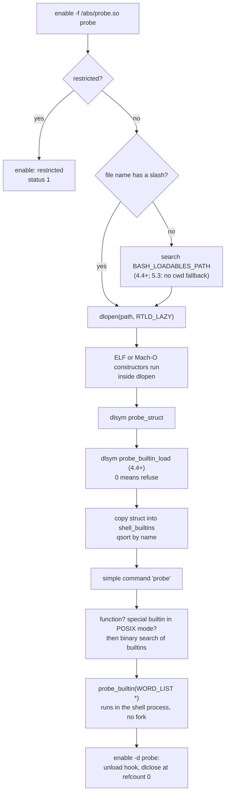

# Loadable Builtins

> [!summary] Claim
> `enable -f FILE NAME` makes bash `dlopen(3)` a shared object, copy the object's `NAME_struct` into its sorted builtin table, and from then on run `NAME` as a C function inside the shell process, which removes the roughly 2 ms fork and exec of an external command but binds you to bash's internal ABI, gives the object the shell's privileges and address space, and behaves differently in every bash release from 3.2 to 5.3.

Part of [Bash](README.md) in [Shell and Unix Engineering](../README.md).

## TL;DR

- Mechanism: `enable -f` calls `dlopen` (constructors run here), `dlsym`s `NAME_struct` and the optional `NAME_builtin_load` hook, then appends the struct to `shell_builtins` and re-sorts it with `qsort`; lookup is a binary search, and execution is a plain function call with no `fork`.
- Rule: build the object against the headers of the exact bash that will load it (`bash.pc`, `loadables.h`), load it with an absolute path, and repeat the `enable -f` in every script, because only subshells inherit it.
- Trap: the object runs with the shell's privileges and in its address space, so a fault kills the shell (status 134 for `abort`), and a constructor executes even when `enable` then fails with "cannot find NAME_struct".
- Portability: POSIX has no loadable builtins and does not even list `enable` among the command names whose results it leaves unspecified; ksh93 has `builtin -f` with a different ABI, zsh has `zmodload` modules, and dash, mksh, yash, posh and BusyBox ash have no runtime loading at all.
- When not to use it: when parameter expansion, one batched external call, or a rewrite in a real language removes the fork cost without coupling a deployment to one bash build.

## Mental model



The arrows are the life of one loadable builtin.
`enable -f` first refuses in a restricted shell, then resolves the file name: a name containing a slash goes straight to `dlopen`, and a bare name goes through `BASH_LOADABLES_PATH`, whose fallback rules changed in 4.4, 5.2 and 5.3.
The dynamic loader maps the object and runs its constructors before bash has looked at a single symbol, so loading is already code execution.
bash then needs exactly one data symbol, `probe_struct`, and optionally calls `probe_builtin_load`, whose zero return vetoes the load.
The struct is appended to the builtin table, which is re-sorted so that command lookup can keep using binary search.
From then on a simple command named `probe` that is not a function (and, in POSIX mode, not a special builtin) calls the struct's function pointer in the shell process, and `enable -d` reverses the process through the unload hook and `dlclose`.

## How it works

### The data structures

A bash builtin is one `struct builtin` (bash-5.3 `builtins.h`): `name`, `function` (an `int (*)(WORD_LIST *)`), `flags`, `long_doc`, `short_doc`, and `handle`, which the header still calls "for future use" but which `enable -f` uses to remember the `dlopen` handle.
The layout is identical in bash 3.2, 4.4, 5.1, 5.2 and 5.3 (each release's `builtins.h`), and so are `WORD_DESC` (`char *word; int flags;`) and `WORD_LIST` (`next`, `word`) in `command.h`; that stability is why the lab's `probe.c` can declare them itself and load into every bash from 3.2 to 5.3 without bash headers.
On LP64 the struct is 48 bytes (a `sizeof` probe on this host).
The flags that matter to a loadable are `BUILTIN_ENABLED` (0x01, which the struct must set or the builtin is installed disabled), `BUILTIN_DELETED` (0x02), `STATIC_BUILTIN` (0x04, which `enable -f` clears so that `enable -d` will accept the name), and `SPECIAL_BUILTIN` (0x08, which `enable -s -f` sets) (bash-5.3 `builtins.h`).
The table is the global array `shell_builtins`, which starts out pointing at the compiled-in `static_shell_builtins` and has `num_shell_builtins` entries (bash-5.3 `builtins.h`).

### Loading: `dyn_load_builtin`

`enable_builtin` parses `adnpsf:` with `internal_getopt`, refuses `-f` and `-d` in a restricted shell with `sh_restricted`, and hands `-f` to `dyn_load_builtin` (bash-5.3 `builtins/enable.def`, `enable_builtin`).
`dyn_load_builtin` resolves the file name (bash-5.3 `builtins/enable.def`, `dyn_load_builtin`):

- a name that contains a slash (`absolute_program`, which despite its name means "has a slash") goes to `dlopen` unchanged, so `./probe.so` is relative to the current directory (hardened macOS `/bin/bash` refuses every relative path, `./` included, so use an absolute path there);
- otherwise, if `BASH_LOADABLES_PATH` is set, `find_in_path(filename, path, FS_NODIRS|FS_EXEC_PREFERRED)` searches it and there is no fallback to the current directory;
- otherwise the name is made absolute against `.` with `make_absolute` and opened from the current directory.

Because bash 5.2 and later set a default `BASH_LOADABLES_PATH` that ends in `.`, the second branch is the one a default shell takes, and `find_in_path` turns the `.` entry into `./NAME` (`sh_makepath` inserts the slash), so a bare name is still found in the current directory unless the variable is unset or overridden (bash-5.3 `lib/sh/makepath.c`, `sh_makepath`; measured on 5.3.20, and asserted by the lab test on the default `BASH_LOADABLES_PATH`).

The flags are `RTLD_LAZY`, except `RTLD_NOW|RTLD_GLOBAL` on AIX.
For each builtin name it builds `NAME_struct`, rejects names containing a slash, and calls `dlsym`; a missing struct is the error "cannot find NAME_struct in shared object FILE".
It then looks up `NAME_builtin_load`; if present it is called with the name, and a return of 0 produces "load function for NAME returns failure (0): not loaded".
If the name already exists, the new struct is copied over the old entry with `FASTCOPY`; otherwise the new structs are appended to a freshly allocated table of `num_shell_builtins + new + 1` entries, the old table is freed unless it is the static one, and `initialize_shell_builtins` re-sorts the whole table with `qsort` (bash-5.3 `builtins/common.c`, `initialize_shell_builtins`).
Lookup is `builtin_address_internal`, a binary search that compares the first character before calling `strcmp`, which is why the table must stay sorted (bash-5.3 `builtins/common.c`, `builtin_address_internal`).
If no struct at all was found, the handle is closed with `dlclose` and `enable` fails.

### Unloading: `dyn_unload_builtin`

`enable -d NAME` refuses a builtin that still has `STATIC_BUILTIN` set ("NAME: not dynamically loaded"), counts how many table entries share the same `handle`, calls `NAME_builtin_unload` if the object exports it, calls `dlclose` only when that count is 1, and then `delete_builtin` copies the table without the entry (bash-5.3 `builtins/enable.def`, `dyn_unload_builtin`, `delete_builtin`).
This reference count is the "simple reference-counting scheme" that the bash `examples/loadables/README` describes for objects that implement several builtins, such as `truefalse`, which supplies both `true` and `false`.

### Execution: an ordinary function call

`execute_simple_command` looks for a special builtin first only in POSIX mode, then for a function, then calls `find_shell_builtin`, and only then searches `PATH` (bash-5.3 `execute_cmd.c`, `execute_simple_command`).
A loaded builtin is just another table entry, so it shadows any `PATH` command of the same name, including when `PATH` is empty, and a function of the same name shadows it; the lab proves both.
The builtin receives the arguments as a `WORD_LIST` after expansion, with the command name removed, and returns `EXECUTION_SUCCESS` (0), `EXECUTION_FAILURE` (1), or one of the internal codes above `EX_SHERRBASE` (256) in bash-5.3 `shell.h`: `EX_USAGE` (258) becomes status 2, and `EX_DISKFALLBACK` (262) makes bash forget the builtin and `goto execute_from_filesystem`, running the `PATH` command instead (bash-5.3 `execute_cmd.c`, `execute_simple_command` and `execute_subshell_builtin_or_function`).
The bundled `rm` returns `EX_DISKFALLBACK` for `-i`, and `chmod` for any option other than `--help`, so the external tool handles what the loadable does not (bash-5.3 `examples/loadables/rm.c`, `chmod.c`).
`EX_DISKFALLBACK` exists in bash 5.0's and 5.1's `shell.h` but not in 4.4's, where `builtin_status` maps every unknown code above 256 to 0 (bash-4.4 `execute_cmd.c`, `builtin_status`); the lab shows bash 3.2 printing status 0 and never running the external command.
A builtin that runs long must poll for signals with the `QUIT` macro, which runs `termsig_handler` or `throw_to_top_level` when a signal arrived (bash-5.3 `quit.h`), as the bundled `sleep` and `cat` do after each `fsleep` or `read` (bash-5.3 `examples/loadables/sleep.c`, `cat.c`); otherwise `SIGINT` and traps wait until the function returns.
The bundled `hello.c` calls `fflush(stdout)` after every `printf`, because the builtin shares the shell's stdio buffers.

### Version history

From `CHANGES` and the per-release sources:

| Release | Change |
|---|---|
| bash-2.0 | Loadable builtin examples ship (logname, basename, dirname, tty, pathchk, tee, head, rmdir). |
| bash-3.2 | "Loadable builtins now work on MacOS X 10.[34]"; `dlopen` gets the bare file name, so the loader's own search rules apply. |
| bash-4.4 | `BASH_LOADABLES_PATH`; `NAME_builtin_load` and `NAME_builtin_unload` hooks; `make install` installs the examples and the headers. |
| bash-5.0 | `EX_DISKFALLBACK` (262) present in `shell.h`; new loadables `rm`, `stat`, `fdflags`. |
| bash-5.2 | A default `BASH_LOADABLES_PATH` from `config-top.h`; `enable NAME` without `-f` tries to load `NAME` from it. |
| bash-5.3 | No current-directory fallback when `BASH_LOADABLES_PATH` misses; builtin names may not contain slashes; restricted shells also refuse the `enable NAME` shorthand; `fltexpr`, `kv`, `strptime` loadables. |

The 5.2 shorthand loophole in restricted mode was not fixed by any of the 37 official 5.2 patches: none of `bash52-001` to `bash52-037` touches `enable.def`.

### Other shells

ksh93's `builtin -f LIB NAME` calls `dllplugin(SH_ID, LIB, NULL, SH_PLUGIN_VERSION, ...)`, runs the library's `lib_init` once, and binds `NAME` to the symbol `b_NAME`, whose signature is `int b_NAME(int argc, char *argv[], Shbltin_t *context)` (ksh93u+m 1.0.10 `bltins/typeset.c`, `b_builtin`, `sh_addlib`; `shcmd.h`).
`dllcheck` rejects a library whose `plugin_version()` is missing or older than `SH_PLUGIN_VERSION`, which is at least 20111111 (ksh93u+m 1.0.10 `libdll/dllcheck.c`, `dllversion`, `dllcheck`; `libast/include/shcmd.h`), so the lab exports one.
`b_builtin` also refuses in restricted mode (`SH_RESTRICTED`) and, when it runs inside a virtual subshell that is not a shared-state `${ ...; }` substitution, forks that subshell first (`sh_subfork`, guarded by `sh.subshell && !sh.subshare`), so a builtin loaded inside `( )` does not leak out (ksh93u+m 1.0.10 `bltins/typeset.c`).
POSIX gives ksh93's model a home: in XCU 2.9.1.4 a non-intrinsic built-in is used only when it "is associated with the directory that was most recently tested during the successful PATH search" (POSIX.1-2024 XCU 2.9.1.4), and ksh93 can bind a builtin to a path name such as `/opt/ast/bin/cat`; bash's loaded builtins ignore `PATH` entirely.
zsh loads whole modules: `zmodload zsh/files` adds `chgrp`, `chmod`, `chown`, `ln`, `mkdir`, `mv`, `rm`, `rmdir` and `sync` builtins plus a `zf_`-prefixed duplicate builtin of each (zsh `Src/Modules/files.c` declares both sets with `BUILTIN`), and `try_load_module` tries `DIR/NAME.DL_EXT` for each `DIR` in `$module_path` with `dlopen(buf, RTLD_LAZY | RTLD_GLOBAL)` (zsh `Src/module.c`, `try_load_module`).
zsh's own `enable -f` means "the function table", so `enable -f FILE NAME` reports "no such hash table element" (zsh `Src/builtin.c` declares `enable` with options `afmprs`; measured on zsh 5.9).
BusyBox ash has no runtime loading, but with `CONFIG_FEATURE_SH_NOFORK` it calls a NOFORK applet's `main` directly in the shell process (`run_nofork_applet` in `evalcommand`), which gives the same speed and the same blast radius at build time (BusyBox `shell/ash.c`).
The builtin tables of dash (`builtins.def.in`), mksh (`funcs.c`) and posh (`builtins.c`) contain no `enable` entry and no `dlopen` call; a search of the whole yash source tree finds no `dlopen` call and no `enable` builtin (as of 2026-11).

## Numbers and limits

| Quantity | Value | Source |
|---|---|---|
| Per call, external `/usr/bin/basename` | 1.8 to 2.1 ms | Measured 2026-11-12: 2000 calls, 3 runs, bash 5.3.20, macOS 27.3, Apple M3 Pro |
| Per call, loaded `basename` builtin | 12.5 to 16 us | Same run |
| Per call, `"${p##*/}"` | 2.5 to 3.5 us | Same run |
| Per call, re-running `enable -f` on a loaded object | 50 to 85 us | Same run, 200 calls |
| `sizeof(struct builtin)` on LP64 | 48 bytes | `sizeof` probe on this host |
| Builtins in bash 5.3.20 / 3.2.57 (`enable -a`) | 61 / 58 | Measured 2026-11-12 |
| POSIX special builtins listed by `enable -s` | 16 in both | Measured 2026-11-12 |
| `EX_SHERRBASE`, `EX_USAGE`, `EX_DISKFALLBACK` | 256, 258 (reported as 2), 262 | bash-5.3 `shell.h` |
| Status of a shell killed by a builtin's `abort()` | 134 (128 + `SIGABRT` 6) | Lab |
| Upstream default `BASH_LOADABLES_PATH` (5.2+) | `/usr/local/lib/bash:/usr/lib/bash:/opt/local/lib/bash:/usr/pkg/lib/bash:/opt/pkg/lib/bash:.` | bash-5.3 `config-top.h` |
| Homebrew bash 5.3.20 default | `/opt/homebrew/lib/bash` prepended to the upstream list | Measured 2026-11-12 |
| Loadables shipped by Homebrew bash 5.3.20 | 40 objects in `/opt/homebrew/lib/bash` | Measured 2026-11-12 |
| Debian trixie `bash-builtins` | 5.2.37-2, 36 objects in `/usr/lib/bash`, plus `loadables.h`, `Makefile.inc` and `Makefile.sample` there | packages.debian.org arm64 file list (as of 2026-11) |
| ksh93 minimum plugin version | `SH_PLUGIN_VERSION`, at least 20111111 | ksh93u+m 1.0.10 `shcmd.h` |

The ratio, not the absolute numbers, is the point: on this host a loaded builtin is about 130 times cheaper than a fork and exec, and parameter expansion is another 4 to 5 times cheaper still.
macOS process creation is slower than Linux's, so the ratio on Linux will be smaller; that figure was not measured here.

## Portability

| Shell | Runtime loading | Evidence |
|---|---|---|
| POSIX sh | None; `builtin` and `disable` are names with unspecified results, `enable` is not in that table | POSIX.1-2024 XCU 2.9.1.4 table |
| macOS `/bin/bash` 3.2.57 | `enable -f` with an absolute path; no hooks, no `BASH_LOADABLES_PATH`, every relative path, even `./x.so`, refused by the hardened runtime | Lab; measured dyld error |
| bash 4.4 to 5.1 | `BASH_LOADABLES_PATH` (unset by default), load and unload hooks | Per-release `enable.def` (bash-4.4, 5.0, 5.1 checked); the lab asserts it, but these releases were not run in the matrix for this note |
| bash 5.2 | Default `BASH_LOADABLES_PATH` ending in `.`, `enable NAME` shorthand, which restricted mode does not block | bash-5.2 `enable.def` and `config-top.h`; the lab asserts it (default path, `enable NAME` and restricted-mode tests), measured on 5.3.20 but not run on 5.2 |
| bash 5.3 | No current-directory fallback when the path misses; shorthand blocked in restricted mode | Lab; bash-5.3 `enable.def` |
| zsh (native and `--emulate sh`) | `zmodload` modules; `enable -f` means functions | Lab |
| ksh93 | `builtin -f LIB NAME`, symbol `b_NAME`, needs `plugin_version()` | Lab (ksh93u+ 2012 on macOS measured; ksh93u+m 1.0.10 from source) |
| dash, mksh, yash, posh, BusyBox ash | None: no `enable -f`, no `builtin -f`, no `zmodload` | Lab (dash measured on the host); mksh, yash, posh and BusyBox ash from their builtin tables in source, not yet run in the matrix |
| BusyBox ash, build time | NOFORK applets run in-process when `CONFIG_FEATURE_SH_NOFORK` is set | BusyBox `shell/ash.c` |
| Loader: glibc | A name without a slash is searched in `DT_RPATH`, `LD_LIBRARY_PATH`, `DT_RUNPATH`, the `ld.so.cache`, then `/lib` and `/usr/lib`, never the current directory | dlopen(3) |
| Loader: musl | A name without a slash is searched in `LD_LIBRARY_PATH`, the run paths of the calling objects, then `/etc/ld-musl-ARCH.path` or `/lib:/usr/local/lib:/usr/lib`; no cache, and never the current directory | musl `ldso/dynlink.c`, `load_library` |
| Loader: macOS dyld | Hardened `/bin/bash` rejects `probe.so` and `./probe.so` alike: "relative path not allowed in hardened program" | Measured on macOS 27.3 |

## Worked example

The [lab](../labs/04-loadable-builtins/) builds one object, `probe.so`, that is both a bash and a ksh93 builtin, and asserts 18 behaviors across every shell family.
Simplified excerpt of `probe.c` (the lab file adds the `cd`, `fallback` and `crash` modes, a vetoing `probefail`, an unload hook, a constructor, and the ksh93 entry points):

```c
typedef struct word_desc { char *word; int flags; } WORD_DESC;
typedef struct word_list { struct word_list *next; WORD_DESC *word; } WORD_LIST;
struct builtin {
  char *name; int (*function)(WORD_LIST *); int flags;
  char *const *long_doc; const char *short_doc; char *handle;
};

static int probe_builtin(WORD_LIST *list) {
  if (list && strcmp(list->word->word, "pid") == 0)
    printf("%ld\n", (long)getpid());
  fflush(stdout);
  return 0;
}

struct builtin probe_struct = {
  "probe", probe_builtin, 0x01 /* BUILTIN_ENABLED */, probe_doc, "probe mode [arg ...]", NULL,
};
```

Build it with the lab's `build-probe.sh`, which runs `"${CC:-cc}" -Wall -Wextra -Werror -O2 -shared -fPIC -o probe.so probe.c`.
The lines below combine the lab's first test with its load-hook and `enable -d` tests, plus one `args` line, as a single script that takes the object and a scratch directory as arguments:

```sh
enable -f "$1" probe
type -t probe
probe args a "b c" ""
probe pid >"$2/pid"; read -r p <"$2/pid"
[ "$p" = "$$" ] && echo "same pid as the shell"
s=$(probe pid); [ "$s" != "$$" ] && echo "command substitution forked"
enable -f "$1" probefail 2>/dev/null; echo "probefail status $?"
enable -d probe; echo "delete status $?"
```

Captured on the macOS host with Homebrew bash 5.3.20 (re-run 2026-11-14 with identical output):

```text
builtin
3 args: <a> <b c> <>
same pid as the shell
command substitution forked
probefail status 1
unload hook: probe
delete status 0
```

and with macOS `/bin/bash` 3.2.57, which has neither hook:

```text
builtin
3 args: <a> <b c> <>
same pid as the shell
command substitution forked
probefail status 0
delete status 0
```

The same object loads into ksh93 with `builtin -f "$1" probe`, where `probe args a "b c"` prints `2 args: <a> <b c>`, and in bash `probe crash` ends the shell with status 134 while `( probe crash )` only ends the subshell.

## Pitfalls

> [!warning] Measuring "in-process" through a command substitution
> Trigger: `[ "$(probe pid)" = "$$" ]` as the proof that a builtin does not fork.
> Symptom: the comparison fails, because bash forks a subshell for every `$(...)` and the builtin runs in that child; `$$` still names the parent.
> Fix: redirect the builtin's output to a file and `read` it in the current shell, as the lab does.

> [!warning] An ABI mismatch between the object and the shell
> Trigger: loading Homebrew's 5.3 `basename` into macOS `/bin/bash` 3.2.
> Symptom: `enable: cannot open shared object /opt/homebrew/lib/bash/basename: dlopen(..., 0x0001): symbol not found in flat namespace '_loptend'` (measured); against a newer shell that does resolve the symbols, a changed internal structure would instead corrupt memory silently.
> Fix: compile against the headers of the bash that will load the object (`pkg-config --cflags bash` with the installed `bash.pc`, or the installed `Makefile.inc`), and pin both in the same image.

> [!warning] A bare file name that resolves differently in each release
> Trigger: `enable -f probe.so probe`.
> Symptom: bash 3.2 passes `probe.so` to `dlopen`, where glibc and musl never search the current directory and hardened macOS `/bin/bash` refuses every relative path, `./probe.so` included; 4.4 and later first search `BASH_LOADABLES_PATH`, and 4.4 to 5.2 fall back to that same bare `dlopen` on a miss; 5.2 and 5.3 with the default path still find a file in the current directory, because its trailing `.` entry becomes `./probe.so`; 5.3 searches only that path when it is set and only the current directory when it is unset; 5.3 even prints "(null)" as the reason, because it never called `dlopen` and `dlerror()` returned NULL (measured on 5.3.20).
> Fix: always pass an absolute path, or set `BASH_LOADABLES_PATH` to one trusted directory and require bash 4.4 or later.

> [!warning] Hooks and status codes that old bash ignores
> Trigger: a load hook that vetoes, or a builtin returning `EX_DISKFALLBACK`, under bash 3.2 or 4.x.
> Symptom: bash before 4.4 never calls `NAME_builtin_load`, so the refused builtin is installed anyway; bash before 5.0 turns status 262 into 0 without running the external command; the lab shows both on 3.2.
> Fix: check `BASH_VERSINFO` before relying on either, and never use 262 as an error code.

> [!warning] A fault in the builtin is a fault in the shell
> Trigger: a NULL dereference, a double free, or `abort()` inside the builtin.
> Symptom: the whole script dies (status 134 for `abort`), with no `ERR` trap, no `EXIT` trap, and no error message from bash; heap corruption may instead surface later in unrelated bash code.
> Fix: test loadables under ASan in a scratch shell, and when a call might crash, run it as `( probe ... )` so only the subshell dies.

> [!warning] The builtin disappears in child scripts
> Trigger: `enable -f` in an interactive shell or a wrapper, then running a script.
> Symptom: the script says "command not found" or silently runs the slower `PATH` command, because a new bash process starts with only the static table; subshells and `$( )` do inherit it because they are forks.
> Fix: put the `enable -f` (with a fallback when it fails) at the top of each script that uses the builtin.

> [!warning] A long-running builtin that never polls for signals
> Trigger: a loop in C without the `QUIT` macro.
> Symptom: `SIGINT` and trapped signals are recorded but not acted on until the builtin returns.
> Fix: call `QUIT` between units of work, as the bundled `sleep.c` and `cat.c` do.

> [!warning] Replacing a static builtin
> Trigger: `enable -f ./x.so echo` with an `echo_struct` in `x.so`.
> Symptom: `FASTCOPY` overwrites the existing entry in place, so after `enable -d echo` the entry is deleted and the original `echo` builtin is gone until a new shell starts; loading a second object over an already loaded name overwrites `handle` without a `dlclose`, so the first object stays mapped (bash-5.3 `enable.def`, `dyn_load_builtin`; read from source, not tested in the lab).
> Fix: give loadables names that no static builtin uses.

> [!warning] zsh's `enable -f` is a different command
> Trigger: porting `enable -f lib name` to zsh.
> Symptom: zsh reports `no such hash table element: lib` and `no such hash table element: name`, because `-f` selects the function table.
> Fix: use `zmodload` for zsh modules; zsh cannot load a bash loadable.

## Security and robustness

`enable -f` is arbitrary code execution in the shell's process by design, and the code runs before bash checks anything: the lab's constructor prints from inside `dlopen` while `enable -f probe.so nosuch` then fails with status 1, which matches dlopen(3): "Constructor functions are executed before dlopen() returns".
CVE-2019-18276 turned that into privilege escalation: bash through 5.0 patch 11 dropped privileges in `disable_priv_mode` without dropping the saved UID, so "an attacker with command execution in the shell can use `enable -f` for runtime loading of a new builtin, which can be a shared object that calls setuid() and therefore regains privileges" (CVE-2019-18276 record).
Restricted mode blocks `enable -f` and `enable -d` in every release checked (3.2, 4.4, 5.0, 5.1, 5.2, 5.3 `enable.def`), but bash 5.2's `enable NAME` shorthand skipped the check; `BASH_LOADABLES_PATH` is not one of the variables `maybe_make_restricted` makes read-only (bash-5.3 `shell.c` freezes `PATH`, `SHELL`, `ENV`, `BASH_ENV`, `HISTFILE`), so in bash 5.2 an `rbash` user can point it at a writable directory and load a builtin; bash-5.3-beta fixed it (`CHANGES`, item j: restricted shells may not run `enable -f` "even when it's shorthand from" `enable NAME`), and the lab asserts 5.2 loading and 5.3 refusing; the 5.3 refusal was measured on the host, and the 5.2 load follows from bash-5.2 `enable.def`, whose shorthand path has no `restricted` test.
In bash 5.2 and later the default `BASH_LOADABLES_PATH` ends in `.`, so `enable NAME` for a name that is not a builtin will load a file called `NAME` from the current directory; `set_if_not` keeps an imported environment value, so whoever controls the environment controls the search path, exactly as with `PATH` (bash-5.3 `variables.c`, `initialize_shell_variables`).
Set `BASH_LOADABLES_PATH` explicitly to a root-owned directory in any script that loads builtins, and never run `enable NAME` with an untrusted name.
On macOS, hardened `/bin/bash` 3.2 refused relative paths but still loaded a linker-signed object from an absolute path in a user-writable directory (measured), so code signing is not a barrier there.
A loadable shares every file descriptor, signal disposition, `umask`, current directory and resource limit with the shell; the lab's `probe cd` changes the kernel's working directory while `$PWD` keeps the old value, which breaks every later relative path assumption silently.

## The principal's view

The decision is not "loadable or external" but "who owns the fork cost".
A loadable is justified only when three things hold together: a measured hot loop dominated by process creation (thousands of calls, each 2 ms on macOS), a loop that cannot be restructured into one batched call (`awk`, `xargs`, `find -exec ... +`), and a deployment where you pin the bash binary and the object together, such as one container image.
The cost side is real: there is no stable ABI or programming guide ("There is no real `builtin writers' programming guide'", bash `examples/loadables/README`), resolution and hook semantics change in minor releases, the object is unsandboxed code in the shell, and portability ends at bash.
Pure bash usually wins first: `"${p##*/}"` was 4 to 5 times cheaper than the loaded `basename` here, with no build step.
If the hot path needs C, it usually needs a C or Rust program that reads the whole data set once, not a C function called once per line from bash.
Use the shipped loadables (`sleep` for fractional seconds, `stat`, `fdflags`, `realpath`, `mktemp`) as an interactive convenience or in a pinned image, and treat a custom loadable as you would a kernel module: reviewed, tested under sanitizers, and owned.

## Interview questions

> [!question] L5: What does `enable -f ./lib.so name` look up inside `lib.so`, and what happens if it is missing?
>
> > [!success]- Answer
> > bash calls `dlsym` for the data symbol `name_struct`, a `struct builtin`.
> > If it is missing, `enable` prints "cannot find name_struct in shared object" and fails with status 1.
> > In bash 4.4 and later it also looks up the optional functions `name_builtin_load` and `name_builtin_unload`.
> >
> > Follow-up: Has any code in `lib.so` already run when that error is printed?

> [!question] L5: Why is a loadable builtin faster than the same command in `/usr/bin`, and by how much?
>
> > [!success]- Answer
> > The builtin is a function call in the shell process, while the external command costs a `fork`, an `execve`, dynamic linking and process teardown.
> > On an Apple M3 Pro with bash 5.3.20 the external `basename` took 1.8 to 2.1 ms per call and the loaded one 12.5 to 16 us.
> > Parameter expansion was faster still, at 2.5 to 3.5 us.
> >
> > Follow-up: Why does the speedup not apply inside `$(basename "$f")`?

> [!question] L5: Predict the output under bash 5.3, where `probe.so` defines `probe` and `$PWD` starts as `/w`.
>
> > [!success]- Answer
> > The script is `enable -f /lib/probe.so probe; probe() { echo function; }; probe args 1; builtin probe args 2; unset -f probe; PATH=; probe args 3`.
> > The output is `function`, then `1 args: <2>`, then `1 args: <3>`.
> > A function shadows the builtin, `builtin` skips functions, and an empty `PATH` does not hide a builtin because bash consults its builtin table before any `PATH` search.
> >
> > Follow-up: What would `enable -n probe` change for the third call?

> [!question] L6: A loadable's load hook returns 0, yet `type -t name` says `builtin`. Explain.
>
> > [!success]- Answer
> > The shell is older than bash 4.4, which introduced the `NAME_builtin_load` hook, so the hook was never called.
> > macOS `/bin/bash` 3.2 is the usual case.
> > Check `BASH_VERSINFO` and do the initialization check in the builtin itself on old shells.
> >
> > Follow-up: What does bash 3.2 do with a builtin that returns 262?

> [!question] L6: Debug this script: it works interactively and in bash 5.3, but on a CI image with bash 5.1 it fails with "cannot open shared object".
>
> > [!success]- Answer
> > The script is `cd "$repo/lib" && enable -f mybuiltin.so mybuiltin`.
> > Before 5.3, a bare name that `BASH_LOADABLES_PATH` does not find (and 5.1 has no default path) goes straight to `dlopen`, and glibc's `dlopen` never searches the current directory for a name without a slash.
> > Bash 5.3 (like 5.2) sets a default `BASH_LOADABLES_PATH` that ends in `.`, and `find_in_path` turns that entry into `./mybuiltin.so`, a name with a slash, which is why it worked there; with the variable unset, 5.3 makes the name absolute against the current directory instead.
> > Fix it with `enable -f "$repo/lib/mybuiltin.so" mybuiltin`.
> >
> > Follow-up: Would `./mybuiltin.so` work on all versions, and why does it still fail under macOS `/bin/bash`?

> [!question] L6: Why does `enable -d` keep the shared object mapped after you delete one of its builtins?
>
> > [!success]- Answer
> > `dyn_unload_builtin` counts the table entries whose `handle` equals the deleted builtin's handle.
> > It calls `dlclose` only when that count is 1, so an object that provides `true` and `false` stays loaded until both are deleted.
> > The unload hook runs for each deleted name regardless.
> >
> > Follow-up: What breaks if the object were closed while another entry still pointed into it?

> [!question] L6: How do ksh93 and zsh load builtins, and can either load a bash loadable?
>
> > [!success]- Answer
> > ksh93 uses `builtin -f LIB NAME`, which requires `plugin_version()` and binds `NAME` to `b_NAME(int argc, char *argv[], Shbltin_t *context)`.
> > zsh loads modules with `zmodload`, searching `$module_path` for `NAME.so`.
> > Neither understands `NAME_struct`, but one object can export both bash's struct and ksh93's `b_NAME`, as the lab does.
> >
> > Follow-up: Which POSIX rule does ksh93's path-bound builtin model satisfy that bash's does not?

> [!question] L7+: A restricted-shell product lets customers run `rbash`. What does loadable builtin support change in your threat model, release by release?
>
> > [!success]- Answer
> > `enable -f` and `enable -d` are refused in restricted mode in every release checked.
> > In bash 5.2 the `enable NAME` shorthand skipped that check, and `BASH_LOADABLES_PATH` is not read-only in `rbash`, so a user who can place a file anywhere can load native code.
> > bash 5.3 closes the shorthand, but you should still build without loadable support or freeze `BASH_LOADABLES_PATH`, and treat `rbash` as defense in depth rather than a sandbox.
> >
> > Follow-up: What does CVE-2019-18276 add when the shell starts with real and effective UIDs that differ?

> [!question] L7+: A team proposes a custom loadable to speed up a 2-hour bash ETL job. How do you decide?
>
> > [!success]- Answer
> > First profile whether process creation is the bottleneck, then try to batch the per-record calls into one `awk` or one compiled program.
> > A loadable is the right call only if the loop cannot be restructured and the bash binary and the object ship pinned together.
> > The costs are an unstable internal ABI, crashes that kill the job, unsandboxed native code in the shell, and a skills dependency on bash internals.
> > Most often the better answer is to move the hot loop out of bash entirely.
> >
> > Follow-up: What would you require in review and testing before approving the loadable?

## Related

Prerequisites: [[Bash-3-2-on-macOS]]

Next: [[Bash-Version-History]]

See also: [[Special-Built-ins-versus-Utilities]], [[Bash-POSIX-Mode]], [[Command-Execution-in-execute_cmd-c]], [[The-Fork-Decision-and-Exec-Optimization]], [[Command-Hashing]], [[Building-Bash-from-Source]], [[Shell-Options-shopt]]

## Further reading

- bash-5.3 `builtins/enable.def`: the whole loader, `dyn_load_builtin` and `dyn_unload_builtin`, in 600 lines.
- bash-5.3 `examples/loadables/` (`README`, `hello.c`, `template.c`, `mypid.c`, `sleep.c`): the only maintainer documentation of the builtin API, including hooks, dynamic variables, and `QUIT`.
- bash-5.3 `CHANGES`: the release-by-release record of `BASH_LOADABLES_PATH`, the hooks, the shorthand, and the restricted-mode fix.
- POSIX.1-2024 XCU 2.9.1.4 and XCU 1.6 and 1.7: how a conforming shell may provide built-ins, and why `PATH`-bound built-ins exist.
- dlopen(3) from the Linux man-pages project: search order for names without a slash, `RTLD_LAZY`, constructors and reference counts.
- ksh93u+m `src/cmd/ksh93/bltins/typeset.c` (`b_builtin`) and `src/lib/libdll/dllcheck.c`: the other production loader and its version gate.
- zsh `Src/module.c`: module loading through `$module_path` and `dlopen`.
- CVE-2019-18276: the saved-UID bug that made `enable -f` a privilege escalation.
